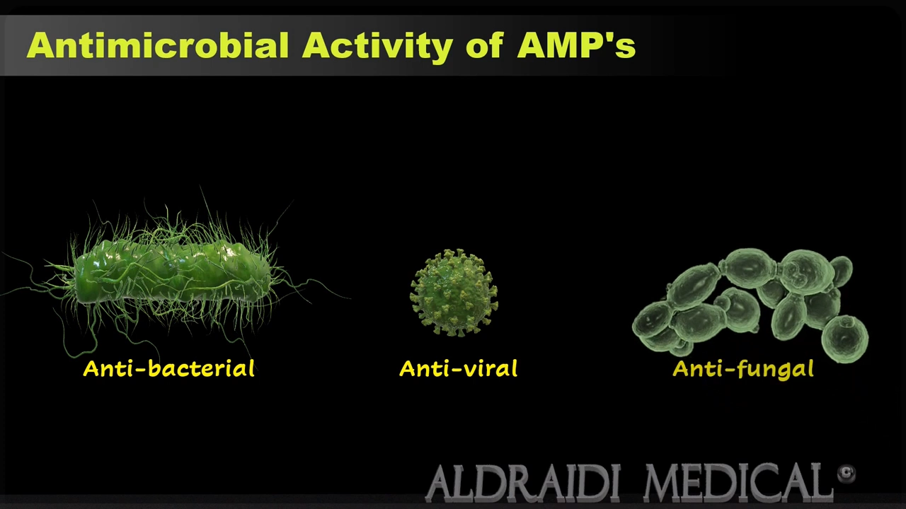
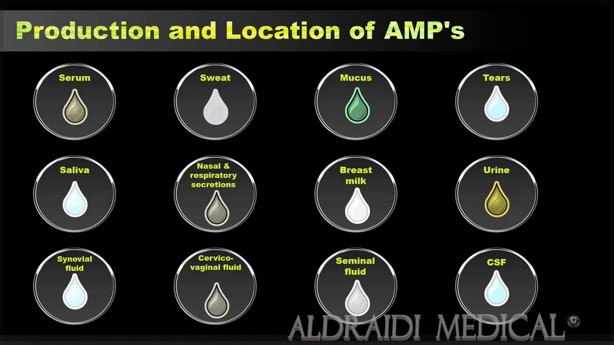
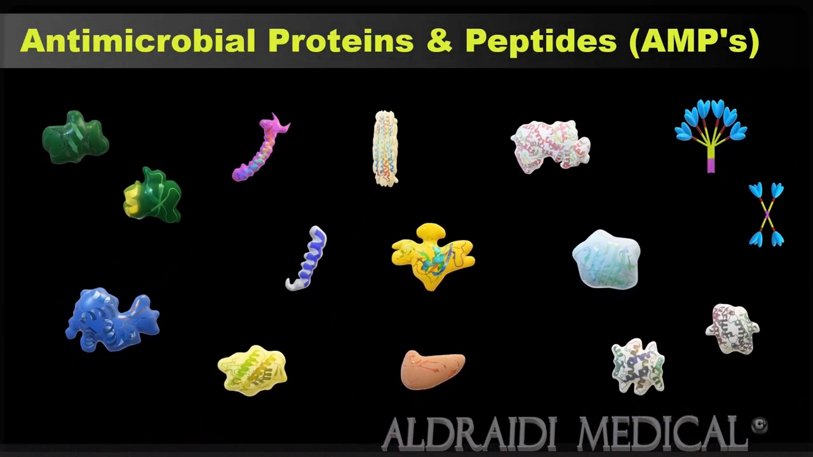
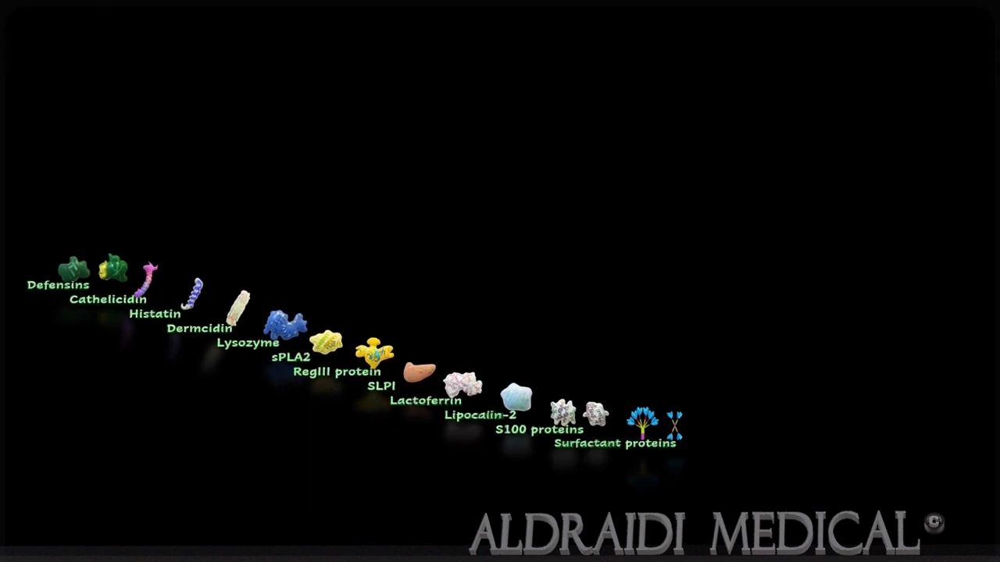
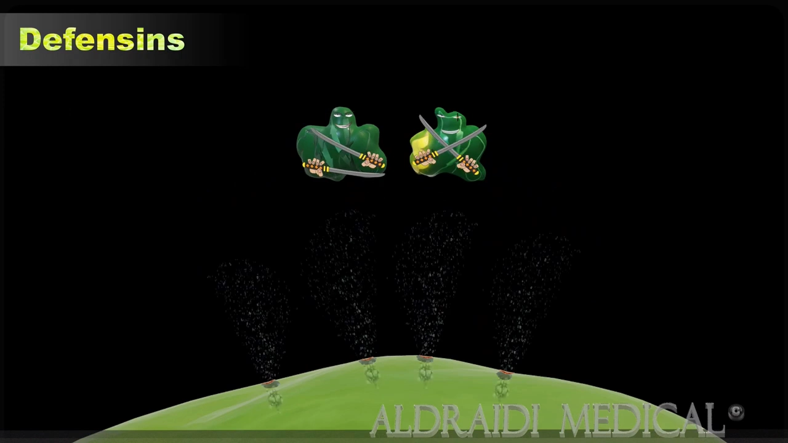
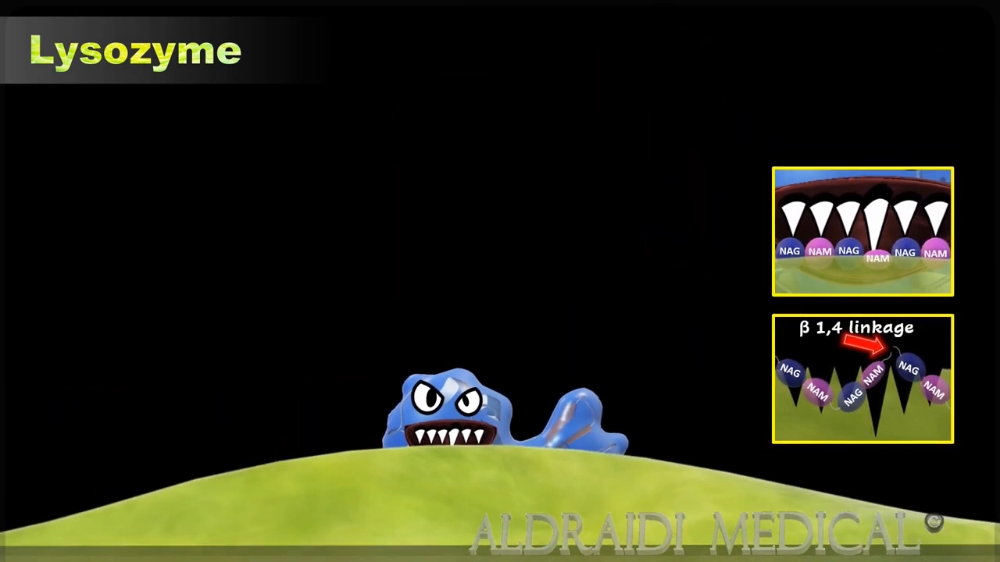
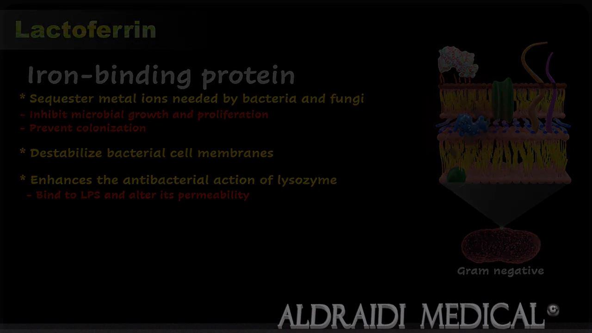
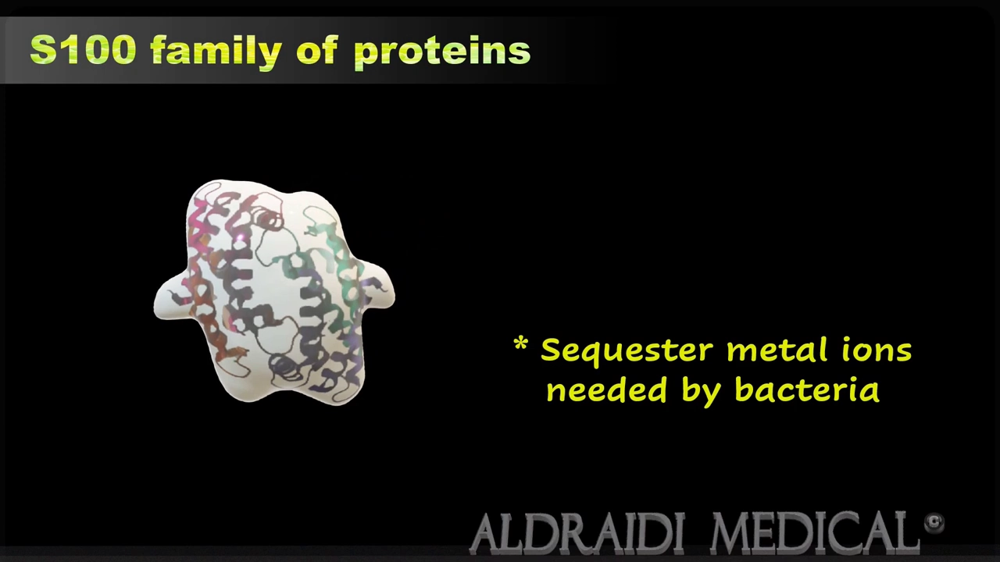
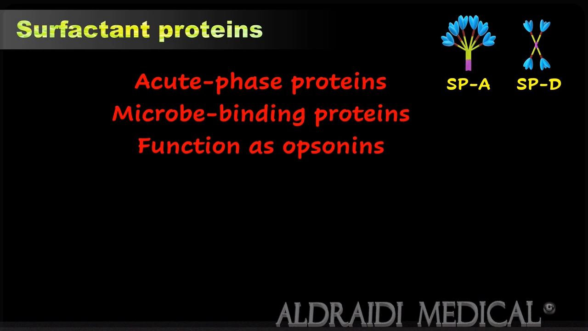
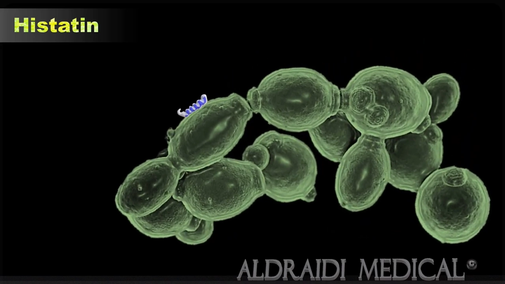

# 抗微生物蛋白与肽：穿孔之外的五类非膜机制

> 视频来源：[Antimicrobial Proteins and Peptides](https://www.youtube.com/watch?v=rUrKjBGPxPs)（YouTube · Aldraidi Medical，免疫学系列课）｜时长约 24 分钟
> 导读：这是一节把 12 种抗微生物蛋白与肽（AMP）逐个过一遍的免疫学课。本文的重点不在"抗菌肽怎么打孔"，而在讲者反复强调的另一半：溶菌酶切细胞壁、分泌型磷脂酶 A2 水解膜磷脂、乳铁蛋白与 calprotectin 夺走金属离子、SLPI 抑制蛋白酶、SP-A/SP-D 结合脂多糖，以及 histatin 钻进真菌细胞去打线粒体。字幕为自动识别，术语错拼已按上下文订正；讲者没有展开的方法学问题（怎样才算证明了靶点）以"补充"单独标出。

## 本讲要解决的核心问题（SCQA）

**背景**：提到"抗微生物肽"，多数人脑子里只有一幅图——阳离子肽贴到带负电的细菌膜上，插进去，打个孔，内容物漏出来，细菌死掉。这套"膜穿孔"叙事在教科书里出现频率极高，也确实解释了防御素和 LL-37 这类肽。

**冲突**：但同一份 AMP 清单里，有一半成员压根不靠破膜。溶菌酶是一种**酶**，它切断的是肽聚糖里的一个糖苷键；乳铁蛋白和 calprotectin 不破坏任何结构，只是把细菌需要的铁、锌、锰"藏起来"；histatin 甚至要**进入**真菌细胞，去打线粒体的 ATP 生产。如果只用"打孔"来理解 AMP，这些机制全部会被漏掉，而且会把"膜通透性上升"误当成所有 AMP 的共同终点。

**疑问**：那么，除了在膜上打孔，AMP 还能用哪些方式杀死或抑制微生物？这些方式各自作用在什么分子上？我们又凭什么说某条肽走的是这条路，而不是那条路？

**回答（中心思想）**：**这份清单里的 12 种 AMP 可以按"作用对象"分成五类非膜机制——切细胞壁的化学键、水解膜磷脂、螯合必需金属、结合并中和细菌表面成分（不杀死只限制）、进入胞内打细胞器。** 判断一条肽属于哪一类，关键不是看它"有没有让膜变漏"，而是看它**指名道姓地作用于哪个分子、哪个键、哪个离子**；而"这条肽的表达被感染诱导上调"只是调控信息，不能当作靶点证据。

## 一、AMP 是"局部产生的内源性抗生素"：一组化学屏障

讲者先把 AMP 放进免疫系统的框架里：上皮细胞构成的紧密屏障、覆盖黏膜的黏液、某些组织的酸性环境、巡逻的吞噬细胞，这些是众所周知的防御；除此之外还有一类**免疫系统相关的保护性蛋白**，它们具有抗微生物活性，能阻止共生菌和病原体进入宿主组织 [【跳转到 01:35】](https://www.youtube.com/watch?v=rUrKjBGPxPs&t=95)。这类保护蛋白被分成四组：补体蛋白、干扰素、抗体，以及抗微生物蛋白与肽（AMP）——前三组各有专讲，这一讲只讲第四组。

### 1.1 定义与四条共性

讲者给出的定位很直白：AMP 主要作为**化学屏障**，属于第一道防线，在先天免疫里"病原体一接触解剖屏障就立刻开工" [【跳转到 02:15】](https://www.youtube.com/watch?v=rUrKjBGPxPs&t=135)。它们对多种病原体提供被动保护，通过两种方式抑制微生物：**让微生物缺少必需营养**，或者**直接杀死**（主要靠破坏细胞膜）。它们像"局部产生的内源性抗生素"。

这里有一个容易被忽略的划分：这 12 种分子可以分成**肽**和**蛋白**两组，区别在于肽一般少于 100 个氨基酸 [【跳转到 05:13】](https://www.youtube.com/watch?v=rUrKjBGPxPs&t=313)。换句话说，"AMP"这个缩写里既有短肽（防御素、LL-37、histatin），也有真正的酶和运载蛋白（溶菌酶、乳铁蛋白、SP-A）——**它们的作用机制注定不会统一**，这一点是后面所有讨论的前提。

讲者还给出一个相当强的断言：微生物似乎不会对 AMP 产生耐药性，与使用抗生素药物的情况不同；尽管微生物长期暴露在 AMP 中，至今没有细菌被证明对 AMP 耐药，即便是多重耐药菌也不例外 [【跳转到 02:33】](https://www.youtube.com/watch?v=rUrKjBGPxPs&t=153)。这句话在视频里是作为"AMP 值得开发"的理由提出的；读的时候要留意它是**一个领域性判断**，而不是本节任何一条机制的实验证据（第八节会回到这个区别）。

### 1.2 组成型与诱导型：表达受调控，不等于靶点

AMP 的产生有两种模式 [【跳转到 02:57】](https://www.youtube.com/watch?v=rUrKjBGPxPs&t=177)：

- **组成型**：身体常规、持续地产生，不需要激活；
- **诱导型**：主要在病原体入侵时被诱导产生。

它们主要由屏障组织（皮肤、黏膜上皮）产生并分泌到表面，因此在感染时能立即起效。后面讲防御素时，讲者把这条规则说得更具体：β 防御素的表达受**模式识别受体**（pattern recognition receptor，识别微生物保守分子的宿主受体）信号诱导或增强，但 α 与 β 防御素也都可以被上皮细胞组成型分泌 [【跳转到 07:26】](https://www.youtube.com/watch?v=rUrKjBGPxPs&t=446)。

这段内容是**调控层面**的信息：感染 → 模式识别受体 → 表达上调。它说明"这条肽在感染时变多了"，但完全没有说明"这条肽杀死细菌时打的是哪个分子"。初学者最常见的误读，就是把"感染后表达上调"当成"它就是靠这个机制杀菌"——两者之间隔着好几步（见第八节）。

### 1.3 这 12 种分子

讲者明确说人体内有成千上万种 AMP，这一讲只讲 12 种主要的 [【跳转到 04:33】](https://www.youtube.com/watch?v=rUrKjBGPxPs&t=273)。

| 类别 | 成员 | 本讲给出的主要作用对象 |
| --- | --- | --- |
| 防御素 | α 防御素、β 防御素 | 微生物细胞膜（成孔） |
| cathelicidin | LL-37（人类唯一） | 微生物细胞膜 |
| 富含组氨酸的肽 | histatin | 真菌细胞膜表面成分 → 胞内线粒体 |
| 汗腺肽 | dermcidin | 膜通道、离子梯度 |
| 酶 | 溶菌酶、分泌型磷脂酶 A2 | 肽聚糖的糖苷键、膜磷脂 |
| 凝集素 | REG3 蛋白 | 细胞壁碳水化合物、肽聚糖 |
| 蛋白酶抑制剂 | SLPI | 丝氨酸蛋白酶；病毒进入与复制 |
| 金属结合蛋白 | 乳铁蛋白、lipocalin-2、S100（psoriasin、calprotectin） | 铁、锌、锰、镁等金属离子 |
| 集素蛋白 | SP-A、SP-D | 细菌表面成分（LPS 等）、调理吞噬 |

这张表就是本文的路线图：只有前两行是"打孔"，其余七行全部是**非膜机制**。下面先花一节把"打孔"这条基线讲清楚，再逐类展开。

## 二、先看膜：静电找位置，疏水动手（比较基线）

防御素是约 30–40 个氨基酸、富含半胱氨酸的阳离子肽，分 α 与 β 两个亚家族。α 防御素由肠道潘氏细胞（Paneth cell，小肠隐窝底部能分泌抗菌物质的细胞）产生，常被称为 cryptdin；也由中性粒细胞和巨噬细胞产生，存放在颗粒里，参与杀死被吞噬的微生物。β 防御素由多种上皮产生，包括表皮已分化的角质形成细胞和肺的 II 型肺泡上皮细胞；在这些位置它被包装进**板层小体**（lamellar body，富含脂质的分泌细胞器），释放后参与形成表皮不透水的脂质层和肺表面活性物质层。β 防御素缺少 α 防御素那段很长的前体肽 [【跳转到 06:42】](https://www.youtube.com/watch?v=rUrKjBGPxPs&t=402)。

**术语补充（讲者未展开的背景）**：所谓"阳离子肽"，指的是在生理 pH 下净电荷为正。把每个可电离侧链的电荷加起来就得到净电荷：

$$
z_{\text{net}} = \sum_{i} q_i
$$

其中 $q_i$ 是第 $i$ 个残基侧链在给定 pH 下的平均电荷（精氨酸、赖氨酸约 $+1$，天冬氨酸、谷氨酸约 $-1$，组氨酸部分质子化）。$z_{\text{net}} > 0$ 是"能靠静电找到带负电的细菌膜"的前提；而 histatin 这类富含组氨酸的肽，其带电状态会随 pH 变化，这也是它行为与防御素不同的原因之一。

两类防御素都能抗细菌、真菌、原虫寄生虫和包膜病毒，并在**数分钟内**破坏病原体细胞膜。原因讲者说得很清楚：它们的两亲性结构由"一段带正电的区域"和"一段疏水区域"分开构成；肽先与微生物膜表面带电荷的部分发生静电作用，再把疏水区插进脂双层（脂双层通常含带负电的磷脂），结果形成孔道，膜变渗漏，微生物失去活力 [【跳转到 08:25】](https://www.youtube.com/watch?v=rUrKjBGPxPs&t=505)。

LL-37 走的是同一条路：人类唯一的 cathelicidin，α 螺旋型阳离子肽，广谱抗细菌，由多种上皮细胞和白细胞组成型产生并分泌，也储存在中性粒细胞颗粒和板层小体中，随时杀死被吞噬的细菌、真菌、病毒和原虫 [【跳转到 08:43】](https://www.youtube.com/watch?v=rUrKjBGPxPs&t=523)。dermcidin 也类似——皮肤主要的 AMP，由外泌汗腺和上皮细胞组成型分泌，靠在膜上形成通道破坏离子梯度 [【跳转到 11:00】](https://www.youtube.com/watch?v=rUrKjBGPxPs&t=660)。

把这条基线记住，后面五类非膜机制才好比较：**膜穿孔的共同点是"破坏结构的完整性"；非膜机制的共同点是"破坏某个具体分子的功能"，膜可以完好无损。**

## 三、非膜机制之一：切断细胞壁的化学键

### 3.1 溶菌酶：一种糖苷酶，切的是 β-1,4 糖苷键

溶菌酶由多种上皮细胞分泌，几乎存在于所有体液中（唾液、泪液、母乳、黏液、汗液、宫颈分泌物），也由吞噬细胞产生并存在于中性粒细胞颗粒中，参与降解被吞噬的微生物 [【跳转到 11:40】](https://www.youtube.com/watch?v=rUrKjBGPxPs&t=700)。

它的身份不是"膜活性肽"，而是**糖苷酶**（glycosidase，能水解糖与糖之间糖苷键的酶）。它切断革兰阳性菌和革兰阴性菌细胞壁中的特定化学键，破坏的正是 β-内酰胺类抗生素最终作用的那个结构 [【跳转到 12:19】](https://www.youtube.com/watch?v=rUrKjBGPxPs&t=739)。所以它的抗微生物活性主要来自"消化细胞壁"：细胞壁失去结构完整性，肽聚糖层上出现缺口。

讲者还解释了它对革兰阳性菌更有效的原因：革兰阳性菌的肽聚糖层暴露在外，而革兰阴性菌外面还有一层脂多糖（LPS）把肽聚糖盖住 [【跳转到 12:44】](https://www.youtube.com/watch?v=rUrKjBGPxPs&t=764)。这条"外膜挡住底物"的说明很关键——它把"为什么对某种菌效果差"归结为**底物不可及**，而不是"机制不同"，这正是酶类 AMP 的典型逻辑。

### 3.2 REG3：先结合碳水化合物，再成孔

REG3 蛋白是 C 型凝集素（C-type lectin，需要钙离子才能结合糖的蛋白），由潘氏细胞和肠道其他上皮细胞分泌 [【跳转到 14:22】](https://www.youtube.com/watch?v=rUrKjBGPxPs&t=862)。它有双重作用：

1. **阻断黏附**：结合细菌细胞壁上的碳水化合物，阻止细菌接触肠道上皮细胞；
2. **直接杀菌**：结合肽聚糖，在细菌膜上打出孔道。

与溶菌酶类似，REG3 优先杀死肽聚糖暴露在表面的革兰阳性菌；革兰阴性菌的 LPS 会**抑制** REG3 的成孔能力，从而进一步强化它对革兰阳性菌的选择性 [【跳转到 15:12】](https://www.youtube.com/watch?v=rUrKjBGPxPs&t=912)。注意这里的因果顺序：**先有"结合细胞壁糖链"这一步，才有后面的成孔**——靶点在前，膜损伤在后。

## 四、非膜机制之二：水解膜磷脂——破坏的是"膜的化学组成"

分泌型磷脂酶 A2（sPLA2）是另一个"酶类 AMP"，讲者把它和溶菌酶并列，称它们都攻击细菌细胞壁/膜特有的化学结构 [【跳转到 13:06】](https://www.youtube.com/watch?v=rUrKjBGPxPs&t=786)。这种碱性很强的酶由泪腺、唾液腺和鲍曼腺分泌，也由潘氏细胞分泌。

它的直接抗细菌功能是：进入细菌细胞壁，接近、修饰并水解**细胞膜中的磷脂**，从而杀死细菌。它还有一条间接途径：分解磷脂后产生脂肪酸和花生四烯酸，后者进一步代谢可生成炎症性和促血栓的分子，属于急性期反应的一部分，促进炎症，从而以改变白细胞功能的方式促进细菌清除 [【跳转到 13:51】](https://www.youtube.com/watch?v=rUrKjBGPxPs&t=831)。

这一条特别值得和"打孔"区分：sPLA2 作用的确实也是膜，但它干的是**化学反应**（水解酯键），产物是溶血磷脂和游离脂肪酸；膜穿孔肽干的是**物理组装**（插进去、聚起来、形成通道）。两者都会让膜失去功能，但"靶点"完全不同：一个是磷脂分子本身，一个是膜的连续性与离子梯度。

## 五、非膜机制之三：金属饥饿

这是本讲最容易被忽略、也最能体现"非膜"思路的一类：**不破坏任何结构，只是把微生物生长必需的金属离子抢走。**

### 5.1 乳铁蛋白：夺铁、破坏膜、还给溶菌酶"开门"

乳铁蛋白是铁结合蛋白，主要由黏膜上皮细胞产生，存在于大多数体液中，尤其是母乳；它也是中性粒细胞颗粒的重要成分，可由这些细胞局部分泌 [【跳转到 18:04】](https://www.youtube.com/watch?v=rUrKjBGPxPs&t=1084)。讲者给它列了三条作用 [【跳转到 18:52】](https://www.youtube.com/watch?v=rUrKjBGPxPs&t=1132)：

1. **螯合金属离子**：结合细菌和真菌需要的金属离子，抑制其生长与增殖，阻止定植；
2. **破坏细菌细胞膜**：这是它"直接杀菌"的一面；
3. **增强溶菌酶**：结合革兰阴性菌的脂多糖层、改变其通透性，让溶菌酶能接触到被 LPS 盖住的肽聚糖层。

第 3 条是本节最漂亮的一处"机制接力"：乳铁蛋白自己不是酶，但它通过改变外膜通透性，把"底物不可及"变成了"底物可及"，于是溶菌酶才切得动肽聚糖。这类**协同**关系说明：AMP 之间不是各自独立地打孔，而是在同一个靶点链上前后配合。

### 5.2 lipocalin-2：抢的是铁载体

lipocalin-2（也叫中性粒细胞明胶酶相关脂质运载蛋白，NGAL）由中性粒细胞和黏膜上皮细胞大量产生，抗微生物活性与乳铁蛋白相似，主要靠螯合微生物生长所需的金属离子 [【跳转到 19:16】](https://www.youtube.com/watch?v=rUrKjBGPxPs&t=1156)。

它的特别之处在于"抢的对象"：它结合的是**铁载体**（siderophore，细菌用来抓铁的小分子，例如肠杆菌素 enterobactin），而这些铁载体是许多细菌和真菌生存与致病所需的营养。把铁载体扣住，等于让细菌"有铁也运不进来"，讲者的说法是把它们"饿死" [【跳转到 19:41】](https://www.youtube.com/watch?v=rUrKjBGPxPs&t=1181)。

### 5.3 S100 家族：psoriasin 与 calprotectin 的分工

S100 家族是钙结合蛋白，其中两个成员有抗微生物活性 [【跳转到 19:47】](https://www.youtube.com/watch?v=rUrKjBGPxPs&t=1187)：

- **psoriasin（S100A7）**：由角质形成细胞产生，可经汗液出现在皮肤表面；对多种致病菌有强效，尤其对大肠杆菌。讲者给了一个很有说服力的"表型对应"：人的皮肤尽管会因卫生条件差而接触粪便中的大肠杆菌，却不会被大肠杆菌定植 [【跳转到 20:22】](https://www.youtube.com/watch?v=rUrKjBGPxPs&t=1222)。
- **calprotectin（S100A8 + S100A9）**：由中性粒细胞和 T 细胞大量产生，巨噬细胞和上皮细胞产生较少；能夺走微生物需要的**锌和锰**，也能夺走**镁和铁**，在其产生部位发挥抗微生物作用 [【跳转到 21:13】](https://www.youtube.com/watch?v=rUrKjBGPxPs&t=1273)。

讲者用一句话点出了这类机制的特异性：与杀死大肠杆菌的 psoriasin 不同，calprotectin 能杀葡萄球菌却不杀大肠杆菌——这说明 AMP 对某些病原体具有选择性 [【跳转到 21:35】](https://www.youtube.com/watch?v=rUrKjBGPxPs&t=1295)。对金属饥饿机制来说，这种选择性很好理解：不同细菌对某种金属的依赖程度不同，谁更缺锌锰，谁就更容易被饿住。

## 六、非膜机制之四：不杀死，只"限制"

### 6.1 SLPI：抗蛋白酶，顺带抗病毒

SLPI（分泌型白细胞蛋白酶抑制剂）是碱性很强的抗微生物蛋白，存在于皮肤以及黏膜和腺体分泌物中，尤其是唾液和母乳 [【跳转到 15:40】](https://www.youtube.com/watch?v=rUrKjBGPxPs&t=940)。它的本职是**丝氨酸蛋白酶抑制剂**：既保护上皮表面不被内源性蛋白水解酶攻击，又有抗微生物活性。

讲者强调，SLPI 的抗病毒活性在**生理条件**下观察得更清楚，而不是在人工体系中；原因很可能是它干扰了由蛋白酶介导的事件，例如病毒进入宿主细胞和病毒遗传物质的复制 [【跳转到 16:23】](https://www.youtube.com/watch?v=rUrKjBGPxPs&t=983)。他给了两个例子：母乳喂养婴儿的唾液 SLPI 水平较高，与经母乳传播 HIV 的风险降低相关；高水平的 SLPI 也能对抗人乳头瘤病毒，主要靠阻断 HPV 被上皮细胞摄取和感染 [【跳转到 17:13】](https://www.youtube.com/watch?v=rUrKjBGPxPs&t=1033)。

这条机制的"非膜"性质最彻底：它抑制的是一个**宿主酶的活性**，从而间接阻断病原体利用这条通路，既没有膜损伤，也没有直接作用于病原体结构。

### 6.2 SP-A 与 SP-D：结合 LPS，当调理素

SP-A 和 SP-D 属于 collectin 家族，由肝脏和多种上皮产生，是急性期蛋白，存在于肺泡液和其他一些黏膜上皮的分泌物中 [【跳转到 21:48】](https://www.youtube.com/watch?v=rUrKjBGPxPs&t=1308)。除了在呼吸道的润滑作用，它们还是**微生物结合蛋白**：通过阻断和修饰细菌表面成分来防止感染；在血液中则作为**调理素**（opsonin，包被在病原体表面、让吞噬细胞更容易抓住它的分子）包被病原体，使其更容易被巨噬细胞吞噬 [【跳转到 23:03】](https://www.youtube.com/watch?v=rUrKjBGPxPs&t=1383)。

它们的功能终点不是"杀死"，而是"标记 + 交给吞噬细胞"。讲者指出，SP-A/SP-D 的这一功能有助于清除机会性呼吸道病原体，例如耶氏肺孢子菌（*Pneumocystis jirovecii*）——艾滋病患者肺炎的主要病因之一 [【跳转到 23:08】](https://www.youtube.com/watch?v=rUrKjBGPxPs&t=1388)。

## 七、非膜机制之五：进入胞内，打细胞器

前面所有机制都发生在细菌表面或胞外，而 histatin 是这份清单里唯一明确"进入细胞内部"的成员。

histatin 是短的、富含组氨酸的阳离子肽，由口腔中的腮腺、舌下腺和下颌下腺组成型产生，存在于唾液中；具有广谱抗细菌和抗真菌活性，是强效抗真菌肽，对新型隐球菌和白色念珠菌等致病真菌有效 [【跳转到 09:59】](https://www.youtube.com/watch?v=rUrKjBGPxPs&t=599)。它的作用路径是：**结合真菌细胞膜的表面成分 → 进入细胞质 → 干扰线粒体的 ATP 产生**，并对细胞造成其他多种伤害 [【跳转到 10:42】](https://www.youtube.com/watch?v=rUrKjBGPxPs&t=642)。

这条机制在概念上与其他所有条目都不同：

- **靶点在胞内**：线粒体是产生 ATP 的细胞器，干扰它就等于切断能量供应；
- **必须先"进去"**：肽要穿过细胞壁和质膜，才能接触到靶点；
- **膜可以保持完整**：杀菌并不需要把膜打漏。

这也解释了为什么"膜通透性"不能作为 AMP 的通用判据：如果只用膜渗漏实验去筛 histatin，很可能得出"它没有活性"的错误结论。

## 八、怎么判断一条 AMP 走哪条路：三种陈述与一条证据阶梯

**（补充：以下是讲者未展开的方法学讨论，用于把本讲的机制清单变成可检验的判断。）**

把这一讲的 12 条机制按"说了什么"重新排一遍，会发现它们其实处在三个不同的陈述层级上：

| 层级 | 陈述形式 | 本讲例子 | 它能支持什么 |
| --- | --- | --- | --- |
| 调控陈述 | 什么时候、在哪里产生 | β 防御素受模式识别受体诱导；histatin 由唾液腺组成型分泌 | 只说明表达与分布 |
| 机制陈述 | 作用于哪类结构 | 防御素成孔；dermcidin 破坏离子梯度；乳铁蛋白夺铁 | 说明"可能的作用方式" |
| 靶点陈述 | 作用于哪个具体分子/键 | 溶菌酶切肽聚糖的糖苷键；sPLA2 水解膜磷脂；REG3 结合肽聚糖糖链；lipocalin-2 结合肠杆菌素 | 可被生化实验直接检验 |

**最容易犯的错误，是把第一层当成第三层。** "感染后这条肽表达上调"是一个调控观察：它说明宿主在响应微生物，但不说明这条肽杀死微生物时作用于哪个分子。要把它升级成靶点证据，至少需要下面几类实验中的一种（这是领域内的常规做法，不是本视频内容）：

1. **靶标占据**：证明肽在杀菌浓度下确实结合到所声称的分子上（如肽-肽聚糖结合、肽-金属离子竞争）；
2. **体外重构**：把纯化的靶点（肽聚糖、脂质体、纯化酶）与纯化的肽放在一起，看是否重现活性；
3. **抗性突变**：筛选抗性菌株，看突变落在哪个基因上——如果突变集中在金属转运体，就支持"金属饥饿"；如果落在膜脂合成，就支持"膜靶点"；
4. **转录组/蛋白组**：看处理后哪些通路被扰动，但它只能提示方向，单靠表达谱不能确定直接靶点。

用这把尺子回看本讲：溶菌酶、sPLA2、REG3、lipocalin-2 的陈述最"硬"，因为它们指名了底物（糖苷键、磷脂、肽聚糖糖链、铁载体）；防御素与 LL-37 的成孔模型有结构基础（两亲性 + 膜插入），属于机制陈述；而"AMP 不易产生耐药"是一个领域性判断，需要放到具体的耐药机制研究里去核对，不能由任何单条机制推出。

## 小结

- **AMP 不是一类机制，而是一组机制**：这份清单里 12 种分子，只有防御素、LL-37、dermcidin 走"膜穿孔/通道"，其余七类走非膜路线。
- **酶类 AMP 的靶点是化学键**：溶菌酶切肽聚糖的糖苷键，sPLA2 水解膜磷脂；它们的效力取决于底物是否可及（革兰阴性菌的 LPS 外膜就是一道屏障）。
- **金属饥饿是最彻底的"非膜"**：乳铁蛋白夺铁、lipocalin-2 夺铁载体、calprotectin 夺锌锰镁铁，细菌不是被打死，而是被"饿住"。
- **有些 AMP 不杀死，只限制**：SLPI 抑制宿主丝氨酸蛋白酶并阻断病毒进入/复制；SP-A/SP-D 结合细菌表面成分并作为调理素把病原体交给吞噬细胞。
- **histatin 是唯一明确进胞内的例子**：结合真菌表面 → 进入细胞质 → 干扰线粒体 ATP 产生，膜可以完好。
- **表达 ≠ 靶点**：组成型/诱导型产生、模式识别受体上调，都是调控信息；靶点陈述必须指名分子，并靠靶标占据、体外重构、抗性突变等证据支撑。

## 关键术语速查

| 术语 | 一句话解释 |
| --- | --- |
| AMP（antimicrobial proteins and peptides） | 抗微生物蛋白与肽的统称，主要作为黏膜与体液中的化学屏障，属先天免疫 |
| 组成型 / 诱导型产生 | 前者持续产生不需激活，后者在病原体入侵时被诱导 |
| 模式识别受体（PRR） | 宿主识别微生物保守分子的受体，其信号可上调防御素等 AMP 的表达 |
| 防御素（defensin） | 富含半胱氨酸的阳离子肽，靠两亲性插入膜并成孔；分 α、β 两亚家族 |
| cathelicidin / LL-37 | 人类唯一的 cathelicidin，α 螺旋阳离子肽，广谱抗微生物，储存在中性粒细胞颗粒与板层小体 |
| histatin | 富含组氨酸的唾液肽，抗真菌；结合真菌表面后进入胞内，干扰线粒体 ATP 产生 |
| 溶菌酶（lysozyme） | 糖苷酶，水解肽聚糖中的 β-1,4 糖苷键，对革兰阳性菌更有效 |
| 分泌型磷脂酶 A2（sPLA2） | 水解膜磷脂的酶，产物为脂肪酸与花生四烯酸，兼具杀菌与促炎作用 |
| REG3 蛋白 | C 型凝集素，结合细胞壁碳水化合物并成孔，偏好革兰阳性菌 |
| 乳铁蛋白（lactoferrin） | 铁结合蛋白，螯合金属抑制生长，并可通过结合 LPS 增强溶菌酶 |
| lipocalin-2 / NGAL | 结合肠杆菌素等铁载体，切断细菌的取铁途径 |
| psoriasin / calprotectin | S100 家族成员，分别针对大肠杆菌与葡萄球菌，机制为螯合锌、锰、镁、铁 |
| SLPI | 分泌型白细胞蛋白酶抑制剂，抑制丝氨酸蛋白酶，并阻断 HIV、HPV 等的进入与复制 |
| SP-A / SP-D | collectin 家族急性期蛋白，结合微生物表面成分并作为调理素促进吞噬 |
| 调理素（opsonin） | 包被病原体表面、使吞噬细胞更易识别的分子 |
| 板层小体（lamellar body） | 富含脂质的分泌细胞器，β 防御素与 LL-37 可在此储存并释放 |