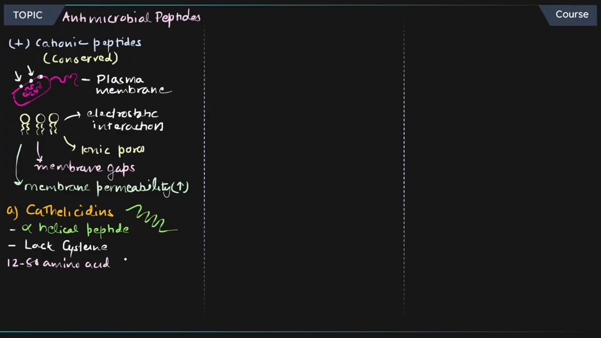
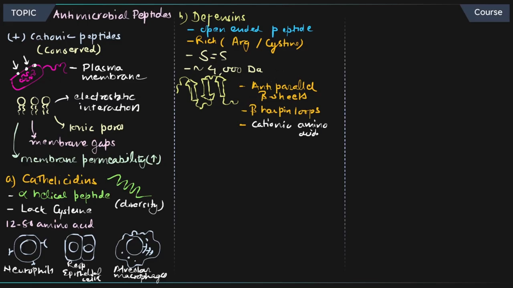
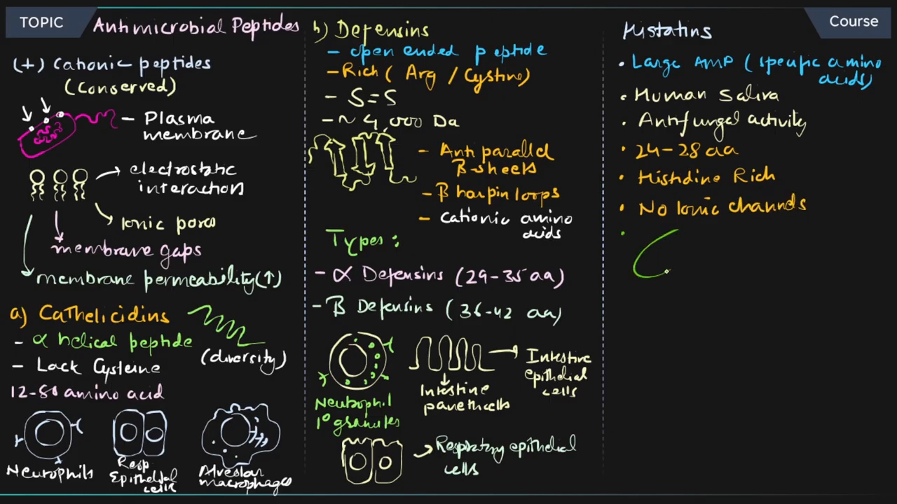
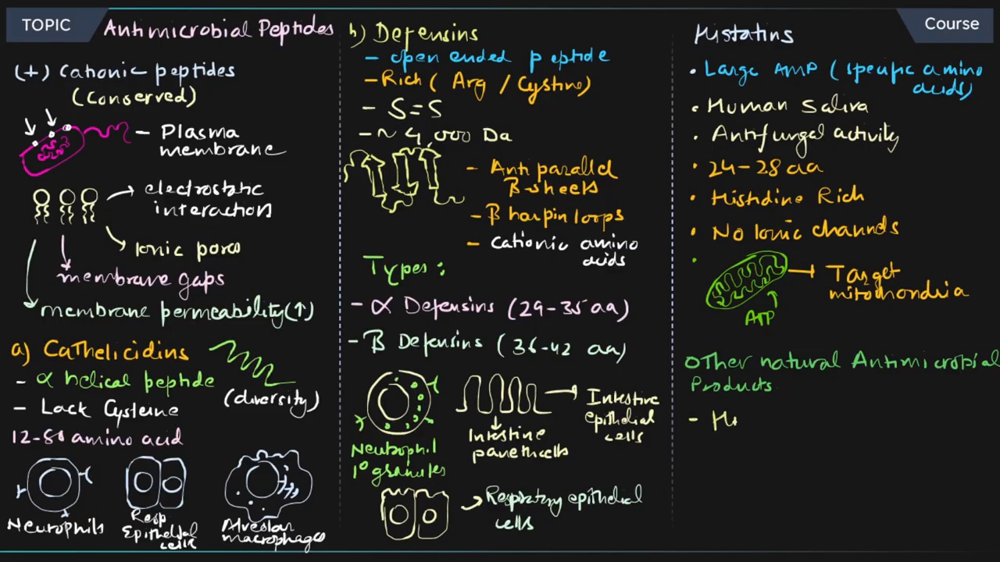
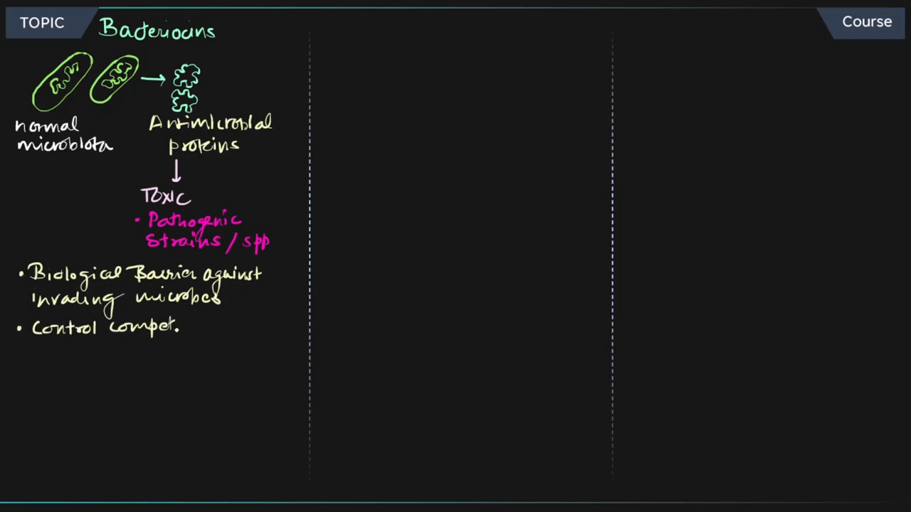
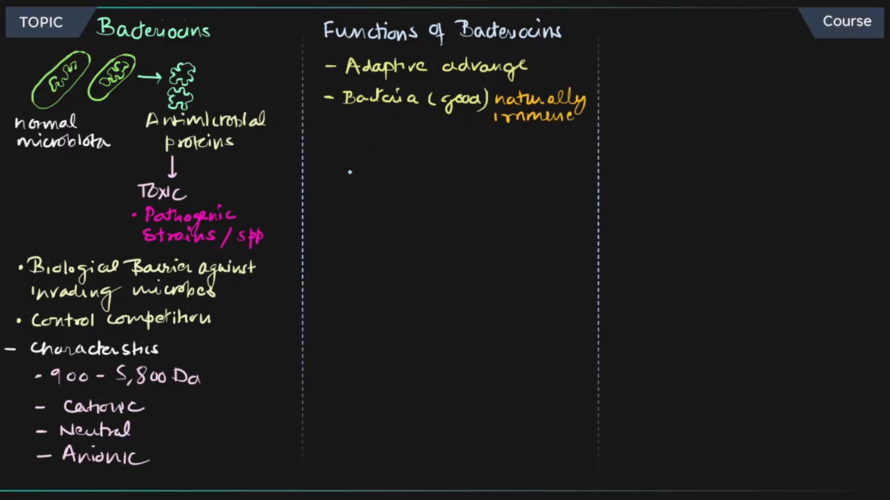
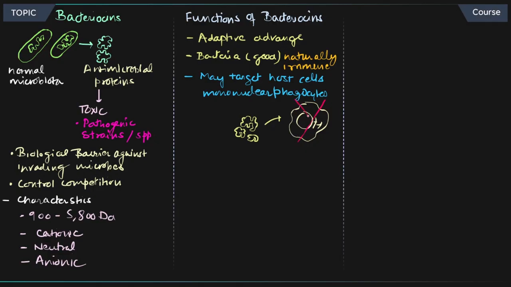
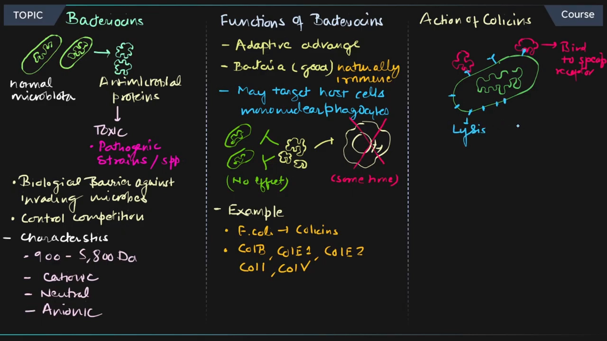
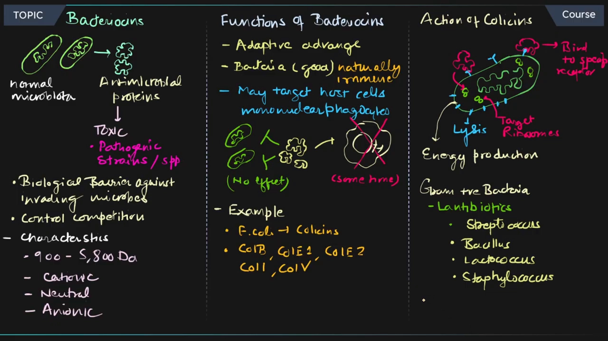

# 抗菌肽与细菌素：从膜孔道到核糖体与线粒体的靶点清单

> 视频来源：[Antimicrobial Peptides and Bacteriocins: Mechanism and Types](https://www.youtube.com/watch?v=ZsN4eM7RK7U)（YouTube · Dr. Lokender Kumar，Research Goals 免疫学课程）｜时长约 12 分钟
> 导读：这是一节面向考试的白板课，讲者边画边讲，把"抗菌肽—防御素—histatin—细菌素—大肠菌素"串成一条靶点链。它的价值不在深度，而在于把**靶点层级**摆得很清楚：有的肽打膜，有的肽进胞内打线粒体，有的蛋白结合受体后去打核糖体和能量系统。字幕为自动识别，术语错拼已按上下文订正；讲者未展开的证据问题以"补充"单独标出。

## 本讲要解决的核心问题（SCQA）

**背景**：抗菌肽的教科书形象是"阳离子 + 两亲性 → 贴到带负电的细菌膜上 → 形成离子孔道 → 内容物外漏 → 裂解"。这条路径在本讲开头也被完整讲了一遍，是理解一切后续机制的地基。

**冲突**：但同一位讲者在同一节课里，给出的靶点清单远不止膜。histatin 明确"不能形成离子通道"，却要去打线粒体；大肠杆菌产生的大肠菌素（colicin）要先结合细菌表面的**特定受体**，然后分别去裂解膜、打**核糖体**、破坏**能量产生**。如果只记"抗菌肽=打孔"，这份清单里一半的靶点会被抹掉。

**疑问**：抗菌肽和细菌素到底能打哪些靶点？这些靶点分几个层级？一条肽要打到胞内靶点，必须先完成哪一步？

**回答（中心思想）**：**这份靶点清单可以按"从外到内"分成三层——膜（成孔/裂解）、表面受体与细胞壁、胞内靶点（核糖体、能量系统、线粒体）。** 打膜不需要"进入"，打胞内靶点则必须先结合表面成分或被受体识别，再跨膜转运；histatin 是"不打孔、打线粒体"的短肽代表，colicin 是"受体识别 + 多靶点"的蛋白代表。把这三层分开记，比背一串肽名有用得多。

## 一、地基：阳离子肽的"膜默认路径"

讲者开篇给的两个前提是：这些肽是**阳离子肽**（带正电），而且序列**高度保守** [【跳转到 00:25】](https://www.youtube.com/watch?v=ZsN4eM7RK7U&t=25)。它们的靶点是细菌的质膜，作用方式分四步 [【跳转到 00:50】](https://www.youtube.com/watch?v=ZsN4eM7RK7U&t=50)：

1. **静电相互作用**：肽与质膜中的磷脂分子（带脂肪酸链的那些）发生静电作用；
2. **形成离子孔道**：有了孔道，分子就能流出来；
3. **造成膜缺口**：肽还能在膜上"撕开"缺口；
4. **提高膜通透性**：细菌内容物外流，最终细胞裂解。

这四步是后面所有比较的参照系。注意它的逻辑：**正电负责"找对地方"，插入负责"动手"**；整个过程不需要肽进入细胞质，靶点始终在膜上。

## 二、cathelicidin 与防御素：结构不同，终点相同

### 2.1 cathelicidin：α 螺旋、没有半胱氨酸

第一个例子是 cathelicidin。讲者强调三点 [【跳转到 01:00】](https://www.youtube.com/watch?v=ZsN4eM7RK7U&t=60)：

- 它是 **α 螺旋**结构（蛋白质二级结构的一种，肽链盘成螺旋）；
- 它**不含半胱氨酸**——这一点是它和防御素的关键差别；
- 总长 12 到 80 个氨基酸，取决于不同类型的 cathelicidin。

产生它的细胞包括中性粒细胞、呼吸道上皮细胞和肺泡巨噬细胞 [【跳转到 02:05】](https://www.youtube.com/watch?v=ZsN4eM7RK7U&t=125)。也就是说，同一条肽可以由"专职免疫细胞"和"屏障上皮"两头供货。

### 2.2 防御素：靠二硫键锁死结构

第二个例子是防御素（defensin）。讲者从名字讲起：defensin 就是"防御"的意思。它的结构特征很具体 [【跳转到 02:55】](https://www.youtube.com/watch?v=ZsN4eM7RK7U&t=175)：

- **开放式**（open-ended）肽，这是重要特征；
- 富含**精氨酸**和**半胱氨酸**（cathelicidin 没有半胱氨酸）；
- 半胱氨酸之间形成**二硫键**，因此结构非常稳定；
- 分子量约 4000 Da；
- 含**反平行 β 折叠**和 **β 发夹环**结构，比 cathelicidin 复杂一些；
- 同样带阳离子氨基酸。

按类型分，α 防御素是 29–35 个氨基酸，β 防御素是 36–42 个，后者更大 [【跳转到 03:45】](https://www.youtube.com/watch?v=ZsN4eM7RK7U&t=225)。来源方面：中性粒细胞内的颗粒（图中绿色的原发颗粒）、肠道的潘氏细胞、肠道上皮细胞、呼吸道上皮细胞都能产生 [【跳转到 04:10】](https://www.youtube.com/watch?v=ZsN4eM7RK7U&t=250)。

**这里值得初学者停一下**：cathelicidin 和防御素的一级结构、二级结构、是否含二硫键全都不同，但讲者给它们的终点是同一个——膜。这说明"结构决定机制"这句话要说得更精确：**结构决定的是"能不能插入膜、插得多稳"，而不是"靶点在不在膜上"。** 决定靶点层级的，是后面 histatin 与 colicin 那类"额外步骤"。

## 三、histatin：不打孔，进胞内打线粒体

histatin 是本节最重要的转折点。讲者的描述是 [【跳转到 05:00】](https://www.youtube.com/watch?v=ZsN4eM7RK7U&t=300)：

- 它是比较大的抗菌肽，由特定氨基酸组成；
- 存在于**人的唾液**中；
- 有**抗真菌**活性；
- 长约 24–28 个氨基酸，**富含组氨酸**。

接着是一句关键的否定：**"它不是离子型的，不能形成离子通道"**——这是它区别于前面几类肽的地方 [【跳转到 05:25】](https://www.youtube.com/watch?v=ZsN4eM7RK7U&t=325)。

然后讲者画出它的真正靶点：一个特定的细胞器，**线粒体**，产生 ATP 的细胞器。histatin 靶向线粒体，而线粒体对许多结构功能都是必需的，抗真菌活性就来自这里 [【跳转到 05:50】](https://www.youtube.com/watch?v=ZsN4eM7RK7U&t=350)。

把这条机制拆成逻辑链，会看得更清楚：

| 环节 | histatin 的情况 | 与膜穿孔肽的差别 |
| --- | --- | --- |
| 第一步：到达 | 存在于唾液，接触真菌表面 | 相同（都要先到表面） |
| 第二步：进入 | 需要穿过细胞壁与质膜进入胞内 | 膜穿孔肽**不进入**，只在膜上组装 |
| 第三步：靶点 | 线粒体，干扰 ATP 产生 | 靶点是膜本身 |
| 第四步：后果 | 能量供应被切断 | 离子梯度崩溃、内容物外漏 |

**为什么这一步很重要？** 因为它把"抗菌肽"这个概念从"膜活性分子"扩展成"可以是胞内靶向分子"。一旦承认靶点可以在胞内，那么判断一条肽的机制时，就不能只看"膜有没有变漏"——膜通透性可能根本没变，细菌却因为能量代谢被切断而死。

讲者随后补了一句"其他天然抗微生物产物"：组蛋白、乳铁蛋白，以及趋化因子，它们都能杀死微生物 [【跳转到 05:50】](https://www.youtube.com/watch?v=ZsN4eM7RK7U&t=350)。这句话的作用是提醒：AMP 家族里还有一批成员连"肽"都不算（乳铁蛋白是金属结合蛋白），机制谱系更宽。

## 四、细菌素：另一套靶点清单

讲完人体自身的肽，讲者转向**细菌素**（bacteriocin）。定义部分他反复强调了一个容易记错的点 [【跳转到 06:53】](https://www.youtube.com/watch?v=ZsN4eM7RK7U&t=413)：

- 细菌素由**有益细菌**产生，也就是正常微生物群、好细菌；
- 它们**不是肽，而是抗微生物蛋白**（讲者原话："these are not peptides, these are antimicrobial proteins"）；
- 对致病菌株**毒性很高**；
- 可以针对不同菌株、不同种，但**不会影响正常微生物群**。

功能上，细菌素是一道**生物屏障**：抵御入侵的微生物，不让致病菌株进入；同时**控制竞争**——如果有细菌想压过正常菌群，就会被针对 [【跳转到 07:18】](https://www.youtube.com/watch?v=ZsN4eM7RK7U&t=438)。它们的特征是大小 900–5800 Da，多数阳离子性，也有中性甚至阴离子性的 [【跳转到 07:18】](https://www.youtube.com/watch?v=ZsN4eM7RK7U&t=438)。

### 4.1 "有益菌天然免疫"这件事为什么重要

讲者列出的细菌素功能里，有两条值得单独拎出来 [【跳转到 08:08】](https://www.youtube.com/watch?v=ZsN4eM7RK7U&t=488)：

1. **提供适应性优势**：产生细菌素的细菌在对抗感染时获得优势；
2. **有益菌天然免疫**：好细菌对这些蛋白天然免疫，所以不受影响。

此外还有一个"例外"：细菌素**也可能靶向宿主细胞**，特别是单核吞噬细胞，某些情况下确实能杀死这些细胞；但它们不会杀死有益菌，因为那些细菌对它们免疫 [【跳转到 08:33】](https://www.youtube.com/watch?v=ZsN4eM7RK7U&t=513)。

"有益菌免疫、致病菌被杀"这个组合，其实是**选择性**问题，而不是"毒性强弱"问题。它提示我们：细菌素的作用谱取决于靶点在不同菌上的**可获得性与是否被保护**，而不是简单地"谁膜更负"。这一点和上一节 histatin 的"进得去才打得着"是同一类逻辑。

## 五、colicin：受体识别之后，三条不同的路

讲者用大肠杆菌举例：大肠杆菌产生**大肠菌素**（colicin），由不同基因编码，例如 colB、colE1、colE2、colI、colK 等，很多基因产生不同类型的细菌素 [【跳转到 08:58】](https://www.youtube.com/watch?v=ZsN4eM7RK7U&t=538)。

接下来是本讲信息密度最高的一段：大肠菌素怎么起作用。讲者先画出细菌，把 **DNA 画在中心**，然后逐条列出靶点 [【跳转到 09:23】](https://www.youtube.com/watch?v=ZsN4eM7RK7U&t=563)：

1. **结合特定受体**：细菌表面有不同受体，大肠菌素先结合这些受体，从而影响细菌功能；

2. **裂解膜**：靶向膜，内容物外流，发生裂解；
3. **靶向核糖体**：核糖体是蛋白合成的机器，被靶向之后蛋白合成受影响；
4. **破坏能量产生**：靶向中间体（mesosome），从而破坏细菌的能量产生。

这张图把"靶点层级"讲得非常清楚：

- **受体结合是入口**，不是杀伤步骤。没有这一步，后面的核糖体和能量靶点都接触不到；
- **膜裂解**与**核糖体/能量**是并列的两条杀伤路线，前者在膜上，后者在胞内或膜内结构上；
- 同一种菌（大肠杆菌）可以生产多种大肠菌素，分别走不同路线——**"细菌素"不是一个机制，而是一个家族**。

讲者最后补了革兰阳性菌那边的情况：羊毛硫抗生素（lantibiotic）可由链球菌、芽孢杆菌、乳球菌产生，表皮葡萄球菌也是产生这类保护分子的重要菌种 [【跳转到 10:13】](https://www.youtube.com/watch?v=ZsN4eM7RK7U&t=613)。这再次说明"谁产生"和"打哪里"是两件独立的事。

## 六、把"靶点"和"证据"分开

**（补充：以下是讲者未展开的方法学讨论，用来把这份靶点清单变成可检验的判断。）**

这节课给的是**靶点清单**，不是**靶点证明**。两者的差别可以用三个问题来检验：

1. **这条肽真的到了那个位置吗？**
   histatin 说靶点是线粒体，那就必须证明它确实进入了真菌细胞质。膜结合实验证明不了这一点——它只证明"贴在膜上"。同理，大肠菌素说靶向核糖体，就必须证明它跨过了膜、到达胞内。
2. **结合等于抑制吗？**
   "结合特定受体"是入口证据；"核糖体被靶向、蛋白合成受影响"才是功能证据。前者可以用结合实验做，后者需要看蛋白合成是否真的下降。
3. **扰动等于直接靶点吗？**
   处理后看到能量池下降、膜通透性上升、转录谱变化，这些都是**表型**。表型可能来自直接靶点，也可能来自下游连锁反应。要把表型升级成靶点，通常需要靶标占据、体外重构（纯化靶点 + 纯化肽）、抗性突变定位等手段。

用这把尺子回看本讲，可以把内容分成三档：

| 档次 | 本讲的例子 | 还缺什么 |
| --- | --- | --- |
| 有明确分子靶点 | 核糖体（蛋白合成机器）、线粒体（ATP 产生）、膜磷脂 | 直接的结合/重构证据 |
| 有明确入口 | 大肠菌素结合细菌表面特定受体 | 受体身份与转运路径 |
| 只有表型描述 | "破坏能量产生"、"内容物外漏" | 区分直接作用与下游效应 |

还要提醒一点：讲者把细菌的 ATP 池定位在**中间体（mesosome）**这一膜性结构上，并按此解释"破坏膜就破坏 ATP 池"。这是视频里的原话表述，读的时候应当把它当作**该讲者的机制模型**，而不是已经定论的结构事实。

## 七、小结

- **先分层，再记名字**：这份清单的靶点分三层——膜（成孔/裂解）、表面受体与细胞壁、胞内靶点（核糖体、能量系统、线粒体）。
- **膜是默认路径，不是唯一路径**：阳离子肽靠静电找到膜、靠插入成孔，cathelicidin 与防御素结构差别很大，终点却都在膜上。
- **histatin 是"进胞内"的代表**：不能形成离子通道，靠进入细胞质后干扰线粒体 ATP 产生来发挥抗真菌作用。
- **细菌素是另一套体系**：由有益菌产生、多为蛋白、900–5800 Da，作为生物屏障并控制竞争；有益菌天然免疫，但它们也可能靶向宿主单核吞噬细胞。
- **colicin 展示"入口 + 多靶点"**：先结合特定受体，再分别裂解膜、打核糖体、破坏能量产生。
- **靶点清单 ≠ 靶点证明**：进入、结合、功能抑制、表型扰动是四级不同的证据，别把最后一级当成第一级。

## 关键术语速查

| 术语 | 一句话解释 |
| --- | --- |
| 抗菌肽（AMP） | 带正电、序列保守的小肽，多靶向微生物膜；本讲以质膜为默认靶点 |
| cathelicidin | α 螺旋阳离子肽，不含半胱氨酸，长 12–80 个氨基酸，由中性粒细胞、呼吸道上皮、肺泡巨噬细胞产生 |
| 防御素（defensin） | 开放式、富含精氨酸与半胱氨酸的阳离子肽，靠二硫键稳定，含反平行 β 折叠与 β 发夹环，约 4000 Da |
| α / β 防御素 | 按长度分的两个亚家族：α 为 29–35 aa，β 为 36–42 aa |
| 潘氏细胞（Paneth cell） | 小肠隐窝底部的分泌细胞，产生防御素等抗微生物物质 |
| histatin | 唾液中的富含组氨酸肽（24–28 aa），抗真菌；不形成离子通道，靶向线粒体 |
| 细菌素（bacteriocin） | 正常微生物群产生的抗微生物蛋白（900–5800 Da），对致病菌有毒而不伤有益菌 |
| 大肠菌素（colicin） | 大肠杆菌产生的细菌素家族，由 colB、colE1、colE2、colI、colK 等基因编码 |
| 中间体（mesosome） | 讲者用来指称细菌膜上承载 ATP 池的膜性结构；本节按视频原话记录 |
| 羊毛硫抗生素（lantibiotic） | 革兰阳性菌（链球菌、芽孢杆菌、乳球菌等）产生的一类细菌素 |
| 离子孔道 | 肽在膜上组装出的通道，使离子与小分子外流、膜电位崩溃 |
| 靶点层级 | 本节的记忆框架：膜 → 表面受体/细胞壁 → 胞内靶点 |