# 从树脂到HPLC：一条十肽的手工固相合成与纯度判读

> 视频来源：[Solid Phase Peptide Synthesis Hands On Procedures from swelling resin to HPLC & MS analysis](https://www.youtube.com/watch?v=jVXUfC2pLh4)（YouTube · acr92651，实验室操作实录）｜时长约 14 分钟
> 导读：这是一支没有幻灯片的手工操作视频，全程在实验台上完成：从称 100 毫克树脂开始，到冻干出红色粉末结束。它的价值在于把"纯度"这个抽象指标拆成了几个当场能看见的信号——紫外吸收、染料颜色、茚三酮显色、HPLC 峰面积、质谱分子量。本文按操作顺序整理，并在末尾说明"80% 主峰"到底该怎么读。字幕为自动生成且断句很碎，术语已按画面上的黄色标注订正。

## 本讲要解决的核心问题（SCQA）

**背景**：固相肽合成的原理不复杂——脱保护、偶联、洗涤，循环往复，最后裂解。试剂怎么选，前面已经讲过。

**冲突**：但真实实验室里的问题是：**你怎么知道这一步反应完了？** 链挂在树脂上，看不见、摸不着，也不能拿去做核磁。少接一个氨基酸、或者有一段链的氨基没脱开，产物就是一堆分子量相差一百多的"近似分子"，最后的收率与纯度都会莫名其妙地掉。

**疑问**：手工做一条十肽，每一步靠什么信号判断成败？最后的"HPLC 主峰 80%"到底说明了什么、又没说明什么？

**回答（中心思想）**：**手工 SPPS 靠三类即时反馈把"看不见的反应"变成"看得见的信号"——Fmoc 紫外吸收给出游离胺的定量、染料与显色反应给出"接上了没有"的定性、HPLC 与质谱给出终产物的定量与身份。** 而"主峰 80%"只回答了"这一批里有多少是目标分子"，它不回答那 20% 是什么，也不回答下一批会不会一样。

## 一、开工：称树脂、溶胀过夜

操作从装柱开始。讲者用的是一根 Poly-Prep 层析柱，掰掉出口的封头、装上盖子，就得到一个可以抽滤的小反应器 [【跳转到 00:00】](https://www.youtube.com/watch?v=jVXUfC2pLh4&t=0)。

合成用的是 **Rink 酰胺树脂**，称了 100 毫克。讲者形容它"非常细，像细沙一样，很轻" [【跳转到 00:31】](https://www.youtube.com/watch?v=jVXUfC2pLh4&t=31)。

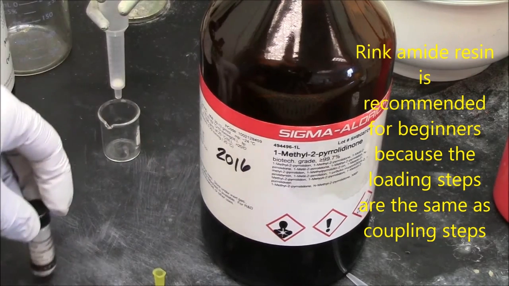

溶胀这一步在视频里只占了十几秒，但它对应着上一节讲过的那个物理事实：**树脂必须先胀开，试剂才进得去**。讲者的做法是 100 毫克树脂加 1 毫升 NMP，在冰箱里溶胀过夜；溶胀后的树脂是浆状的，"在有机溶剂里几乎像硅胶一样" [【跳转到 00:46】](https://www.youtube.com/watch?v=jVXUfC2pLh4&t=46)。

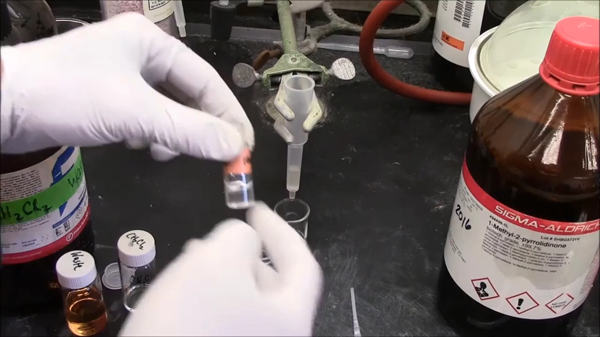

这里有个容易被忽略的动作：**涮洗小瓶**。树脂很轻、很细，倒不干净，剩下的那部分会直接变成"这一批少了几毫克树脂"，也就是少了几十微摩尔的反应位点。手工操作的批次差异，往往就是从这种地方开始的。

## 二、第一次脱保护：20% 哌啶，两次 15 分钟

Rink 酰胺树脂出厂时，第一个"氨基酸位"上带的是一个 Fmoc 基团，必须先脱掉才能接东西。讲者配的是 **20% 哌啶的 NMP 溶液**（20% 哌啶 + 80% NMP），加 1 毫升到树脂上 [【跳转到 02:02】](https://www.youtube.com/watch?v=jVXUfC2pLh4&t=122)。

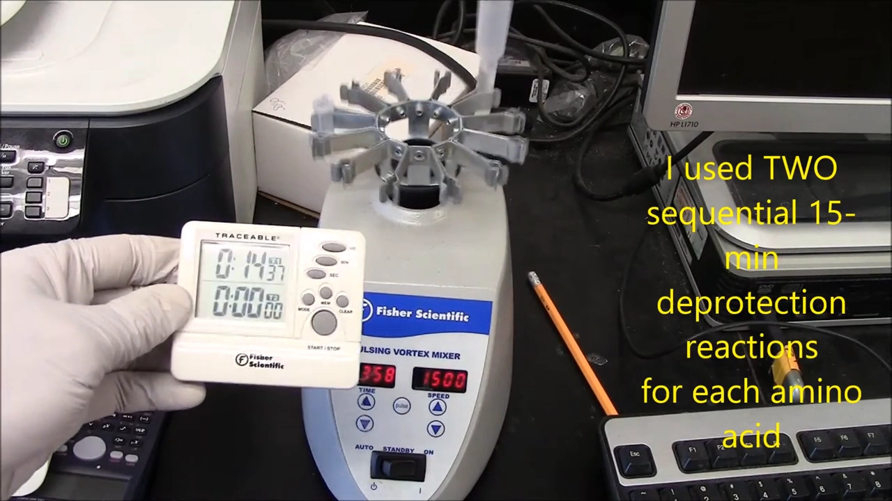

有两个操作细节值得记下来：

1. **每个氨基酸做两次连续的 15 分钟脱保护**（画面上写的是 "TWO sequential 15-min deprotection reactions for each amino acid"）。为什么要两次？因为第一次脱保护产生的 Fmoc 加合物与哌啶会达到平衡，换一次新鲜试剂可以把平衡推到底——**"脱不干净"是缺残基杂质的头号来源**。
2. **开盖顺序有讲究**：脱保护过程中可能憋出压力，必须先开上面的盖子放气，再开下面 [【跳转到 02:49】](https://www.youtube.com/watch?v=jVXUfC2pLh4&t=169)。这是纯安全操作，但漏掉就会喷。

## 三、用紫外把"载量"量出来

这是整支视频里最"专业"的一步，也是初学者最容易跳过的一步。

脱保护液不要倒掉。讲者取 10 微升洗脱液，稀释到 990 微升乙醇里，也就是 **100 倍稀释**，然后用 **2 毫米光程**的比色皿测紫外光谱 [【跳转到 03:14】](https://www.youtube.com/watch?v=jVXUfC2pLh4&t=194)。

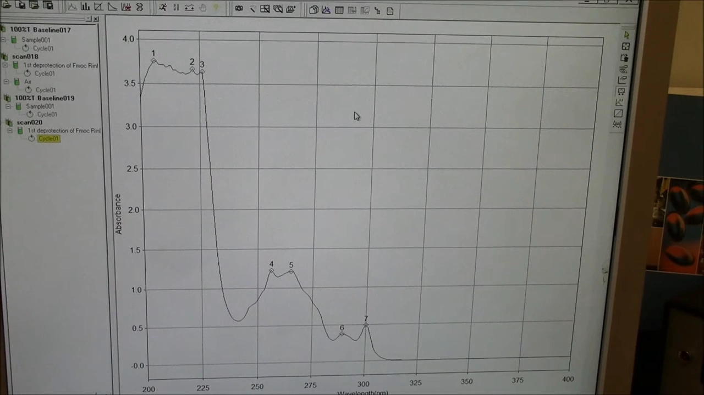

原理很直接：**Fmoc 基团在 300 纳米附近有特征吸收，脱下来多少 Fmoc，就说明露出了多少游离胺。** 讲者读出 300 纳米处的吸光度正好是 0.495，用它定量 Fmoc 浓度 [【跳转到 03:40】](https://www.youtube.com/watch?v=jVXUfC2pLh4&t=220)。

换算依据就是朗伯—比尔定律：

$$
A = \varepsilon \, c \, l \quad\Longrightarrow\quad c = \frac{A}{\varepsilon \, l}
$$

其中 $A$ 是吸光度，$\varepsilon$ 是 Fmoc 在该波长下的摩尔吸光系数，$l$ 是光程（这里是 2 毫米，不是常规的 1 厘米），$c$ 是浓度。**光程写错是这类计算最常见的错误来源**：用 2 毫米的比色皿却按 1 厘米算，结果会差 5 倍。

这一步的意义不只是"知道载量"。讲者后面说：**偶联反应的规模由柱子上游离胺的微摩尔数决定** [【跳转到 05:03】](https://www.youtube.com/watch?v=jVXUfC2pLh4&t=303)。也就是说，如果你不知道柱子上到底有多少个反应位点，你就不知道该加多少氨基酸、多少缩合试剂——加少了反应不完全，加多了浪费并且增加副反应。**"按树脂的标称载量算"和"按实测游离胺算"是两个精度级别的事**，后者才是每一批的真实起点。

## 四、偶联：0.2 M 浓度、HATU、DIPEA，预活化 5 分钟

偶联前先洗：用 NMP 洗三次（每次 1 毫升），再用二氯甲烷洗。讲者的理由很朴素——**每一步之后洗树脂珠非常重要，这能去掉不需要的反应物**；洗的时候要把柱壁和树脂珠本身都洗到 [【跳转到 03:55】](https://www.youtube.com/watch?v=jVXUfC2pLh4&t=235)。

这次偶联的氨基酸是**挂了 Dabcyl 染料的赖氨酸**。为什么要挂染料？讲者说得很清楚：这个颜色可以帮他"看到"氨基酸结合到树脂上的过程 [【跳转到 05:48】](https://www.youtube.com/watch?v=jVXUfC2pLh4&t=348)。

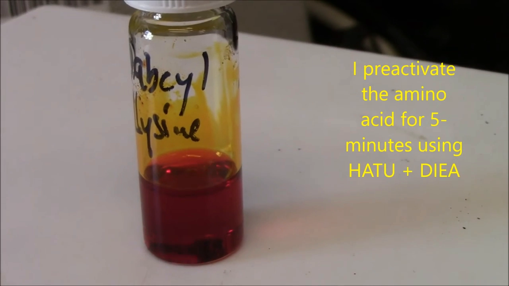

偶联混合物的实际配比在画面里给了出来（以甘氨酸那一轮为例）[【跳转到 07:40】](https://www.youtube.com/watch?v=jVXUfC2pLh4&t=460)：

- 600 微升 0.20 M 的 Fmoc-甘氨酸（NMP 溶液）
- 570 微升 0.20 M 的 HATU
- 114 微升 2.0 M 的 DIEA

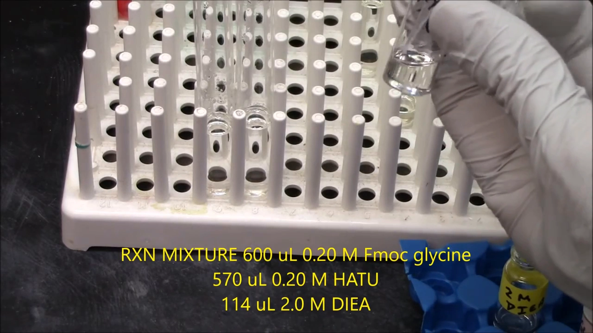

把这三个数字放在一起看，能读出两条信息：**氨基酸与 HATU 基本等当量**（0.20 M × 600 µL 对 0.20 M × 570 µL），而 **DIEA 是过量很多的碱**（2.0 M × 114 µL）。碱的作用是把氨基酸的羧酸去质子化、让 HATU 能活化它；过量加碱是为了保证这个平衡偏向活化态。

预活化 5 分钟之后，把活化的氨基酸加到柱子上，涡旋 2200 rpm。讲者提醒：**树脂会沉下去，每隔几分钟要手动重新悬浮一次** [【跳转到 06:39】](https://www.youtube.com/watch?v=jVXUfC2pLh4&t=399)。20 分钟后排掉多余液体，用 NMP 和二氯甲烷洗。

洗完之后柱子还是红的——讲者特意解释了这个现象：**共价结合的氨基酸留住了，游离的都被洗掉了** [【跳转到 07:08】](https://www.youtube.com/watch?v=jVXUfC2pLh4&t=428)。这就是"用眼睛判断反应"的第一个例子。

## 五、Kaiser 检测：把"接上了没有"变成颜色

颜色只能证明"有染料留在柱子上"，不能证明"所有氨基都反应完了"。要回答后者，讲者用 **Kaiser 检测**（茚三酮检测）[【跳转到 08:59】](https://www.youtube.com/watch?v=jVXUfC2pLh4&t=539)。

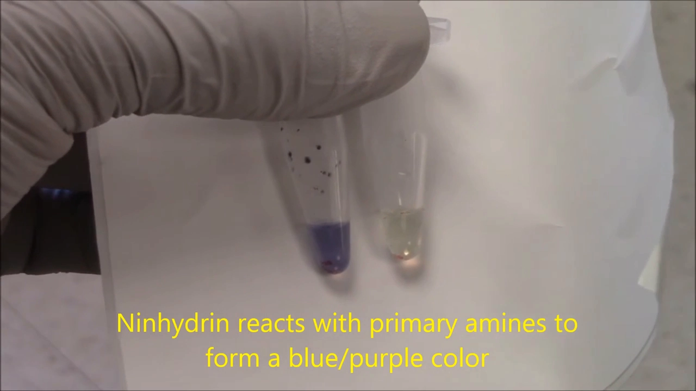

操作很微量：用药匙蘸几颗树脂珠放进 Eppendorf 管，加 25 微升三种试剂，80 摄氏度加热 3 分钟 [【跳转到 09:31】](https://www.youtube.com/watch?v=jVXUfC2pLh4&t=571)。

判据只有一条：**茚三酮与一级胺反应生成蓝紫色**。所以左边（脱保护后、有游离胺）呈蓝紫色，右边（偶联完成、氨基都被 Fmoc 封住）无色 [【跳转到 09:59】](https://www.youtube.com/watch?v=jVXUfC2pLh4&t=599)。

这一步在整条流程里的地位，相当于工业生产里的"工序检验"：**它检验的不是最终产物，而是当前这一步有没有做到位**。如果 Kaiser 检测还是蓝色，说明还有游离胺，这一轮偶联没做完——正确做法是重新偶联（或者封端 capping），而不是继续往下走。因为一旦往下走，那部分没接上的链就会变成"缺一个残基"的失败序列，最后混在产物里。

## 六、三天，十个循环

讲者说：Kaiser 检测确认成功之后，就回到"脱保护—光谱分析—活化下一个氨基酸—Kaiser 检测"这个循环；**三天之后，十个氨基酸全部接完** [【跳转到 10:38】](https://www.youtube.com/watch?v=jVXUfC2pLh4&t=638)。

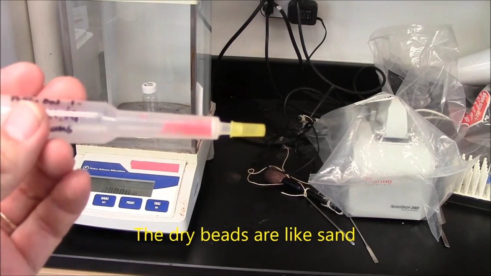

这里有一个可以自查的账：起始 100 毫克树脂，抽干后带肽的树脂重 **130.4 毫克**，所以讲者估计"至少有 30 毫克肽接在这些树脂珠上" [【跳转到 11:10】](https://www.youtube.com/watch?v=jVXUfC2pLh4&t=670)。

**这个质量差是合成是否成功的第一个粗指标。** 如果增重远低于预期，说明载量没算对、或者某几步偶联效率很低。它不能替代 HPLC，但能在花时间做裂解之前给你一个预警。

## 七、裂解：95% TFA / 5% 水，两小时

裂解取的是 2.4 毫克带肽的树脂，加 100 微升 **95% TFA / 5% 水** [【跳转到 11:28】](https://www.youtube.com/watch?v=jVXUfC2pLh4&t=688)。

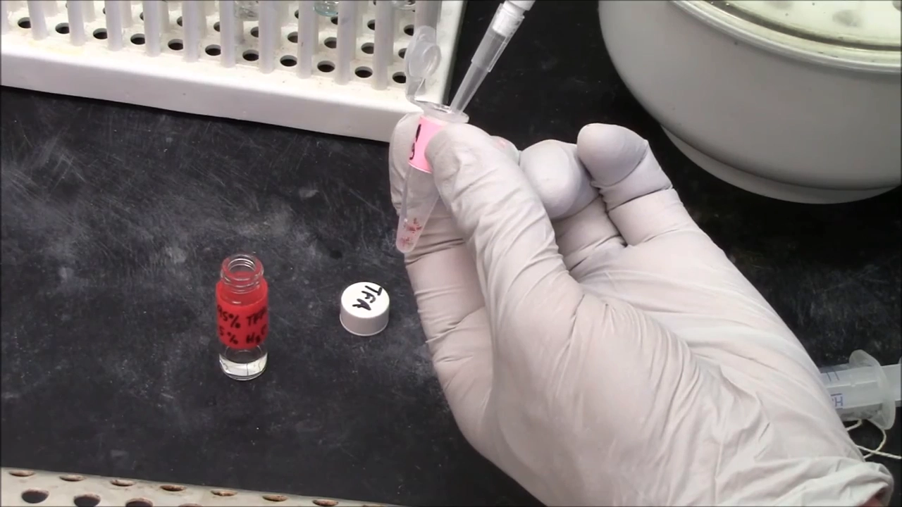

讲者的预期是"大概几个小时"，因为这一步不只把肽从树脂上切下来，**还要脱掉丝氨酸和赖氨酸上的保护基** [【跳转到 12:08】](https://www.youtube.com/watch?v=jVXUfC2pLh4&t=728)。

这个例子里有一个便利条件：肽本身带颜色，所以能直接看出它有没有被释放出来。TFA 密度大，树脂珠会浮在上面，但溶液明显变红，说明肽正在被切下来；15 分钟时已经开始，30 分钟时"溶液越来越红" [【跳转到 12:36】](https://www.youtube.com/watch?v=jVXUfC2pLh4&t=756)。

对比一下上一节的裂解鸡尾酒表：这里的配方只有 TFA + 水，没有加 TIS 和 DODT。原因大概是这条序列里没有需要特别保护的残基（没有 Met、Cys、Trp 这类容易被阳离子攻击或氧化的侧链）。**"标准配方"和"这条序列的配方"是两件事**——加清除剂是为了对付特定残基，不是仪式。

## 八、纯度判读：主峰 80% 意味着什么

裂解液直接进 HPLC。讲者的读法是：**一个主峰，占总面积的 80%；另外还有两个约 5% 的小峰，不知道是什么** [【跳转到 12:55】](https://www.youtube.com/watch?v=jVXUfC2pLh4&t=775)。

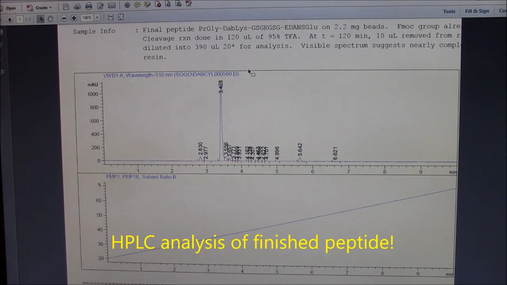

这张图信息量很大，值得逐项拆开：

- **检测波长是 510 纳米**，也就是可见区，针对的是 Dabcyl 染料。这意味着**只有带染料的分子才会被强烈检测到**——没接上染料赖氨酸的失败序列在这个波长下几乎不可见。所以"80%"实际上是"带染料的那部分里，80% 是目标分子"。
- **主峰后面跟着一串小峰**（图上标了 3.556、3.664、3.969、4.468 等）。讲者说不知道它们是什么。这正是上一节讲过的情形：**分子量相近的缺失序列、氧化产物、消旋体，在色谱上就是一群挨在一起的小峰**。
- **梯度从 20% 有机相爬到 80%**（下方那条斜线）。肽的纯化几乎都靠这种反相梯度，疏水一点的杂质往后跑。

所以"主峰 80%"的正确读法是：**这一批产物中，目标分子占可检出峰面积的 80%，其余 20% 是若干未鉴定的杂质。** 它没有告诉你：这些杂质是什么、有没有毒性、下一批会不会变成 70%、以及在不加染料的真实药物分子上这个数字会是多少。

## 九、身份确认：ESI-MS 的 1398

纯度只回答"有多少"，不回答"是不是它"。讲者用电喷雾质谱（ESI-MS）确认身份：**肽的分子量为 1398**，图上看到的是加氢的双电荷峰 [【跳转到 13:11】](https://www.youtube.com/watch?v=jVXUfC2pLh4&t=791)。

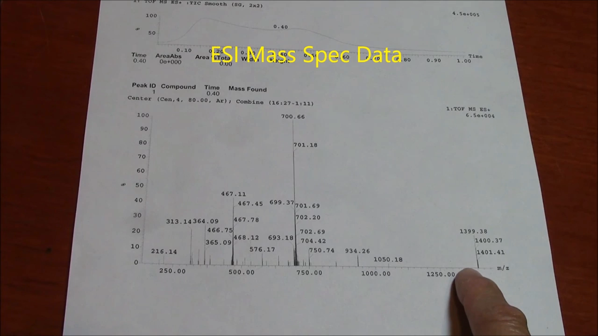

读质谱有一个初学者常犯的错：**把最强峰当成分子量**。这里的 700.66 不是分子量，而是双电荷离子。多电荷离子的质荷比与分子量的关系是：

$$
\frac{m}{z} = \frac{M + z \cdot m_{\mathrm{H}}}{z}
$$

其中 $M$ 是中性分子量，$z$ 是电荷数，$m_{\mathrm{H}}$ 是质子质量（约 1.008）。把 $z = 2$ 代进去、乘 2 再减掉两个质子，才回到 1398 附近。图上右侧的 1399.38 才是 $z = 1$ 的 [M+H]⁺。两个数字互相印证，才能确认"这条肽的分子量是 1398"。

**HPLC 给纯度，MS 给身份，两者缺一不可。** 只有 HPLC，你可能在纯化一个分子量不对的杂质；只有 MS，你不知道样品里有多少别的东西。

## 十、冻干：为什么产物是"蓬松的粉末"

最后一步是冻干。讲者把样品冻干过夜，第二天得到的是"相当蓬松"的红色粉末 [【跳转到 13:29】](https://www.youtube.com/watch?v=jVXUfC2pLh4&t=809)。

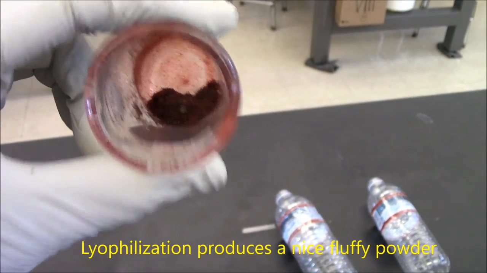

为什么强调"蓬松"？因为它反映了两件事：**一是样品里没有大量盐或溶剂残留**（否则会结成硬块或油状），**二是复溶会更容易**（多孔结构的比表面积大）。对一条要拿去称量、配母液的肽来说，这直接影响你称得准不准。

顺便补充一句本系列另一支视频（GenScript 环肽讲座）问答里的经验：如果结构里同时有游离巯基和二硫键，**二硫键重排甚至会在冻干过程中发生**，那边的建议是降低冻干温度。也就是说，冻干不只是一个"去掉水"的物理步骤，它也可能改变分子本身。

### 盐形式与批次：视频没讲、但下单时必须问的两件事

这支视频全程没有讨论"盐形式"，但从流程本身能看出一件事：**肽是从 95% TFA 里被切下来、又在 TFA 体系里冻干的，所以产物带着 TFA 反离子。** 如果下游实验需要的是醋酸盐或其他盐型，那是另一步"换反离子"的操作，视频里没有涉及。**"这条肽"和"这条肽的某种盐"在称量、溶解度、甚至色谱行为上都可能不一样**，所以订单上写序列还不够，盐型也得写清楚。

批次差异同理。视频只给了一批数据：主峰 80%、两个 5% 小峰。而同一序列换一批树脂、换一次偶联时间、裂解多放一小时，这个比例就会变。讲者自己在流程里坚持做载量实测、Kaiser 检测和增重核算，本质上就是在**给批次差异装几个可以提前报警的哨子**——而不是等 HPLC 出来才发现这一批不行。

## 十一、把这条流程翻译成"可制造性"清单

把整支视频的操作顺序，改写成"拿到一条序列、要判断它能不能做出来"时该检查的项：

| 环节 | 视频里的做法 | 可以用来预判什么 |
| --- | --- | --- |
| 溶胀 | 100 mg 树脂 + 1 mL NMP，过夜 | 树脂不胀开，后面所有偶联效率都会低 |
| 脱保护 | 20% 哌啶，两次 15 分钟 | 只做一次，容易留下"缺残基"序列 |
| 载量实测 | 300 nm 吸光度定量 Fmoc | 不知道真实游离胺数，就无法按化学计量加试剂 |
| 偶联 | 0.2 M 氨基酸 + HATU + DIEA，预活化 5 分钟 | 疏水/位阻残基需要更长的时间或更强的试剂 |
| 过程检验 | Kaiser 检测（茚三酮显色） | 蓝色=没接完，继续往下走就产生缺失序列 |
| 增重核算 | 100 mg 树脂变成 130.4 mg | 增重不足说明某几步效率低 |
| 裂解 | 95% TFA/5% 水，约 2 小时 | 有 Met/Trp/Cys 时必须加清除剂 |
| 纯度 | HPLC 主峰 80%，两个 5% 小峰 | 20% 未鉴定杂质是常态，不是异常 |
| 身份 | ESI-MS 分子量 1398 | 纯度合格但分子量不对，说明纯化的是杂质 |
| 成型 | 冻干成蓬松粉末 | 含游离巯基的肽可能在冻干中重排 |

## 小结

- 手工 SPPS 的关键不是"按步骤做"，而是每一步都有反馈：紫外定量、染料颜色、茚三酮显色、增重、HPLC、MS。
- 每个氨基酸做两次 15 分钟脱保护，是为了把脱保护平衡推到底；这是减少"缺残基"杂质最直接的手段。
- 用 300 纳米吸光度实测游离胺，才知道该按什么规模加试剂；标称载量只是起点。
- Kaiser 检测是工序检验，不是终点检验：它不合格时应该重偶联，而不是继续往下做。
- HPLC 主峰 80% 只说明"这一批里 80% 是目标分子"，不说明那 20% 是什么，也不保证下一批一样。
- 质谱负责身份、HPLC 负责纯度，两者缺一不可；读质谱时别把双电荷峰当分子量。
- 冻干不只是去水，含游离巯基的肽可能在冻干过程中发生二硫键重排。

## 关键术语速查

| 术语 | 一句话解释 |
| --- | --- |
| Rink 酰胺树脂 | 裂解后给出 C 端酰胺的树脂，常用于肽酰胺类产物 |
| NMP | N-甲基吡咯烷酮，SPPS 中最常用的极性非质子溶剂 |
| Fmoc 定量 | 用脱保护液中 Fmoc 基团在 300 nm 的吸光度反推游离胺量 |
| Kaiser 检测 | 茚三酮显色检测，有游离一级胺时呈蓝紫色 |
| Dabcyl | 常用作淬灭基团/染料的芳香基团，接在赖氨酸侧链上便于肉眼追踪 |
| 预活化 | 偶联前先把氨基酸与缩合试剂混合几分钟，生成活泼酯 |
| 清除剂 | 裂解时捕获活泼碳正离子的小分子，如 TIS、水、DODT |
| 反相梯度 | HPLC 中随时间提高有机相比例，让疏水性不同的肽依次洗脱 |
| ESI-MS | 电喷雾电离质谱，常给出多电荷峰，需换算才能得到分子量 |
| 冻干（lyophilization） | 冷冻后减压升华除水，得到蓬松粉末 |