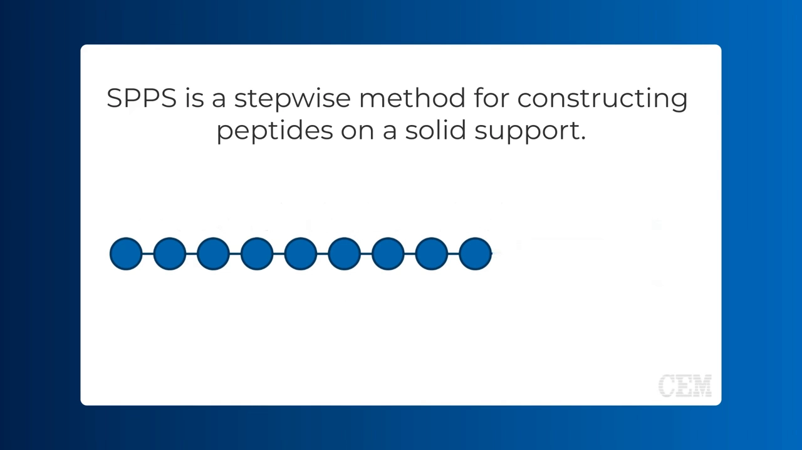
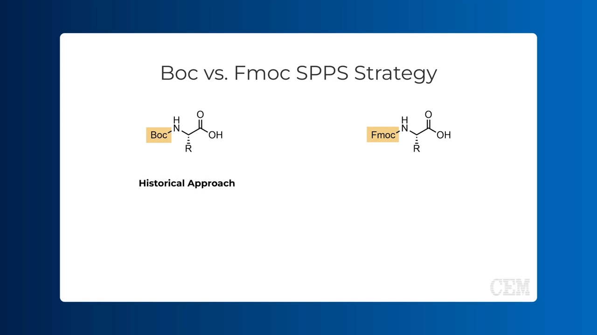
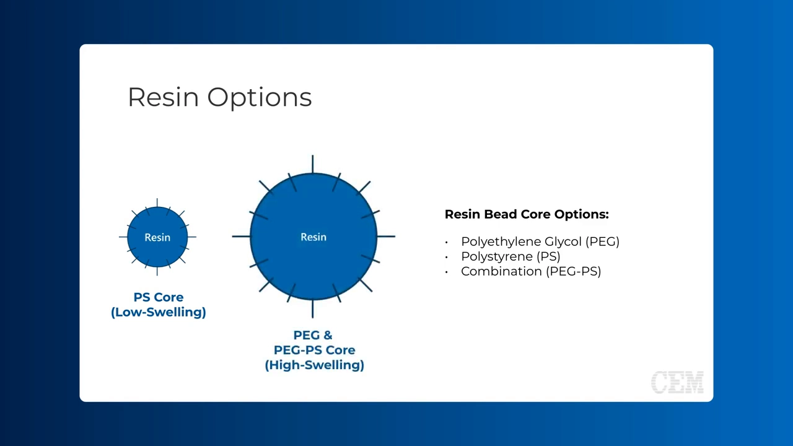
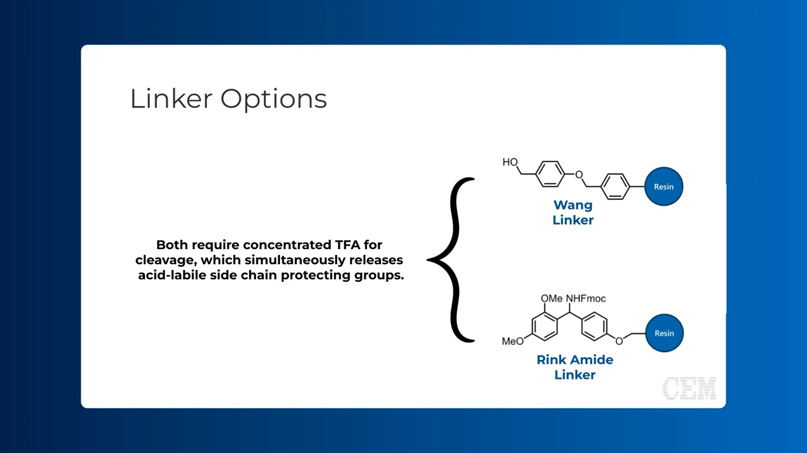
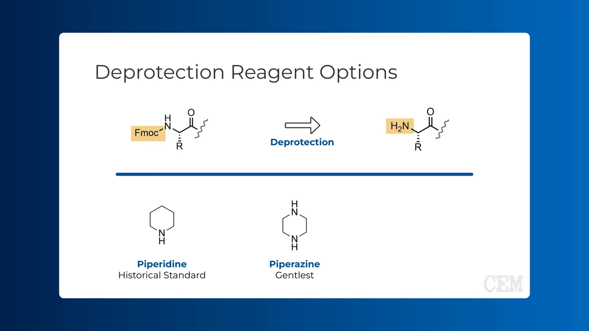
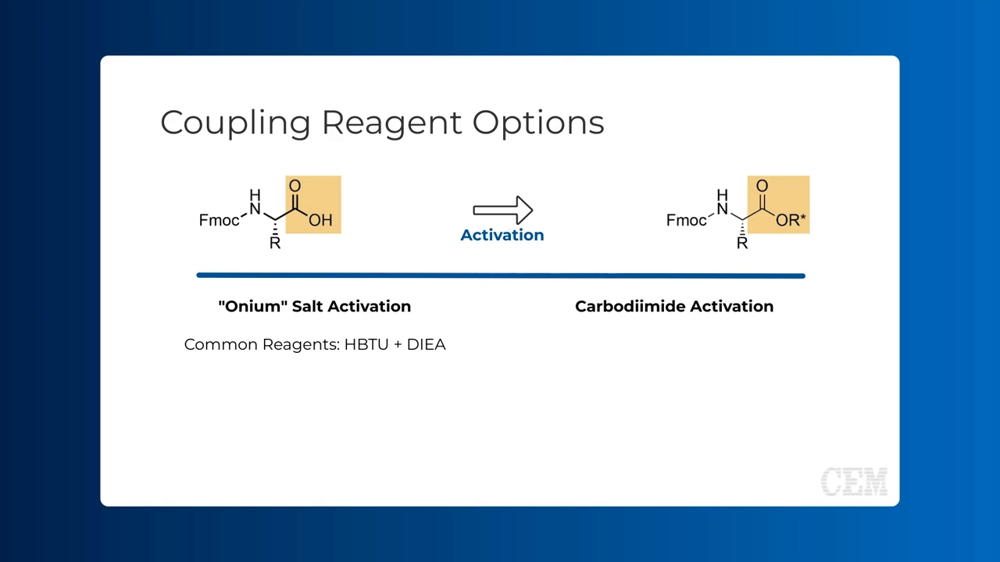
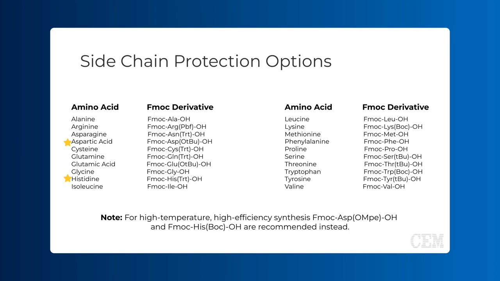
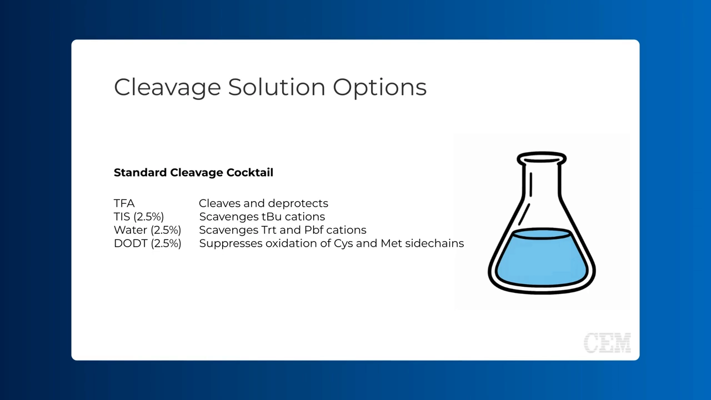

# 固相肽合成的六种试剂：从树脂到裂解鸡尾酒的一条循环

> 视频来源：[SPPS Reagents Explained: A Complete Guide](https://www.youtube.com/watch?v=X8Q0TGnZGIA)（YouTube · CEM Corporation，仪器厂商技术讲解）｜时长约 10 分钟
> 导读：这是一支厂商做的 SPPS 试剂总览，十分钟把固相肽合成的六类试剂挨个过了一遍。它的价值不在机理细节，而在于把"一条肽能不能做出来"拆成了六个可以逐个检查的化学决定。本文按视频顺序整理这六个决定，并在末尾给出与计算设计的对照清单。字幕为自动生成，术语已按上下文订正。

## 本讲要解决的核心问题（SCQA）

**背景**：肽类药物越来越多，而它们绝大多数不是从生物体里提取的，是在树脂珠上一颗氨基酸一颗氨基酸接出来的。这套方法叫固相肽合成（solid-phase peptide synthesis，SPPS）。

**冲突**：一条肽上有几十个官能团，每一个都可能在不该反应的时候反应。接错一个残基、漏脱一次保护基、裂解时把一个敏感残基氧化掉，最后的产物就是一堆分子量相近、色谱上分不开的杂质。合成失败通常不是"某一步不反应"，而是若干步的副反应叠在一起。

**疑问**：那么在 SPPS 这条循环里，究竟有哪些化学决定？每一个决定各自管什么、会在哪里出问题？

**回答（中心思想）**：**SPPS 的成败由六个互相独立的试剂选择决定——树脂（溶胀与载量）、连接臂（C 端官能团与裂解条件）、脱保护试剂（碱）、偶联试剂（活化方式）、侧链保护基（正交性）、裂解鸡尾酒（酸与清除剂）。** 它们不是六个可以随便挑的选项，而是六个约束：前一个决定会限制后一个决定的可行范围。理解这一点，才能把"设计出来的序列"翻译成"做得出来的序列"。

## 一、一个循环，六个决定

讲者开篇给出的流程只有一句话：把第一个氨基酸通过连接臂锚定到树脂上，然后反复"脱保护—偶联"，一次接一个氨基酸，直到序列完成；最后把肽从树脂上切下来，脱掉侧链保护基，粗肽再纯化 [【跳转到 00:00】](https://www.youtube.com/watch?v=X8Q0TGnZGIA&t=0)。

这里要替初学者把"固相"两个字解释清楚。**固相指的是把正在生长的肽链拴在不溶的树脂珠上**。好处是：每接完一个氨基酸，只要把液体抽走、用溶剂洗几遍，多余的试剂和副产物就跟着走了，不需要结晶或萃取来纯化中间体。这就是为什么一条十肽可以在三天里靠手工操作做出来——每一步的"纯化"只是洗一洗。

代价是：**链一直挂在珠子上，你没法在中途看清楚它长什么样**。所以每一步的反应是否完全，要靠别的办法判断（后面的实操视频里会看到 Kaiser 检测）。而每一个试剂选择，都是在"这一步反应得干不干净"上做赌注 [【跳转到 00:36】](https://www.youtube.com/watch?v=X8Q0TGnZGIA&t=36)。

## 二、Boc 还是 Fmoc：整个策略的分岔

在进入具体试剂之前，讲者先讲了一件更上位的事：**用哪套保护基策略，决定了后面所有试剂的选择范围**。

历史上用的是 Boc 策略，保护基对酸敏感。Boc 化学很稳健，但深度脱保护需要强酸——TFA，甚至氟化氢（HF），这些试剂操作起来既苛刻又危险。相比之下，Fmoc 策略用的是碱敏感的保护基，最常用哌啶脱除；它更温和，与酸敏感的侧链保护基正交，而且与自动化高度兼容。所以今天几乎所有现代肽合成都走 Fmoc 路线 [【跳转到 01:14】](https://www.youtube.com/watch?v=X8Q0TGnZGIA&t=74)。

**"正交"是这段里最该记住的词。** 正交的意思是：两套保护基对不同的条件敏感，所以你可以只动其中一套而不碰另一套。Fmoc 对碱敏感、侧链保护基对酸敏感，于是"用哌啶脱主链保护基"和"用 TFA 脱侧链保护基"可以分开做。如果两套保护基都对酸敏感，你就没法在链还挂在树脂上时只脱一个、不脱另一个。

讲者随后声明：本视频后面讨论的所有试剂，都默认是 Fmoc 兼容的 [【跳转到 02:04】](https://www.youtube.com/watch?v=X8Q0TGnZGIA&t=124)。这句话本身就是一条重要的边界——**换策略等于换一整套试剂表**，不能混搭。

## 三、树脂：溶胀与载量决定链能长多长

树脂珠是固相载体，骨架通常是聚乙二醇（PEG）、聚苯乙烯（PS），或两者的组合 PEG-PS。不同骨架的**溶胀（swelling）**性质不同：低溶胀的 PS 树脂适合简单的肽序列，溶胀更高的 PEG 与 PEG-PS 树脂更适合较长的序列 [【跳转到 02:18】](https://www.youtube.com/watch?v=X8Q0TGnZGIA&t=138)。

为什么溶胀这么重要？因为反应发生在树脂内部的孔道里，不是在珠子表面。树脂不溶胀，孔道就窄，试剂进不去、链也伸展不开；链与链挤在一起，还会互相阻挡——这就是讲者说的"生长中的肽链之间的空间位阻"。

树脂的第二个性质是**取代度（substitution）**，也就是肽锚定点的密度，通常用 mmol/g 表示，代表每克树脂上能合成多少条肽链，即载量（loading capacity）[【跳转到 02:31】](https://www.youtube.com/watch?v=X8Q0TGnZGIA&t=151)。

这两件事要一起看，讲者给的经验规则很干脆：**对于更长和/或更庞大的序列，总是推荐高溶胀、低载量的树脂** [【跳转到 02:56】](https://www.youtube.com/watch?v=X8Q0TGnZGIA&t=176)。低载量意味着珠子上链与链之间隔得远，位阻小；高溶胀意味着孔道大，试剂进得去。反过来说，短肽用低载量树脂是浪费产能——这就是为什么"载量"不是越高越好。

还有一条容易被忽略的工程细节：树脂珠有多种目数（mesh），最常见 100 到 200 目，**一定要核对你所用反应器对目数的兼容性** [【跳转到 03:21】](https://www.youtube.com/watch?v=X8Q0TGnZGIA&t=201)。太细的树脂会堵砂芯，太粗的树脂在抽滤时容易漏。

## 四、连接臂：C 端官能团在第一步就定了

连接臂（linker）是把第一个氨基酸连到树脂骨架上的化学间隔物，它决定了合成结束时肽以什么方式被释放下来 [【跳转到 03:55】](https://www.youtube.com/watch?v=X8Q0TGnZGIA&t=235)。

更关键的是：**连接臂决定了最终肽的 C 端官能团**。讲者举了两个最常用的例子：Wang 连接臂裂解后给出游离羧酸；Rink 酰胺连接臂给出 C 端酰胺。两者因稳定性好、裂解行为可预测而被广泛使用 [【跳转到 04:00】](https://www.youtube.com/watch?v=X8Q0TGnZGIA&t=240)。

这一点对"计算设计 → 实际合成"的对照特别重要。**C 端是酸还是酰胺，不是合成完之后再改的事，而是在买树脂那一刻就定了。** 很多设计文件里只写序列，不写 C 端修饰；但对一条要进动物实验的肽来说，C 端酰胺往往能避开羧酸端被外肽酶识别的位点，也影响分子的整体电荷。这类信息如果没写进订单，做出来的分子和设计分子就不是同一个分子。

Wang 和 Rink 酰胺连接臂都需要浓 TFA 裂解，而这个处理除了把肽从树脂上释放出来，**同时也会脱掉侧链上的酸敏感保护基** [【跳转到 04:35】](https://www.youtube.com/watch?v=X8Q0TGnZGIA&t=275)。讲者还提到一些专用连接臂，比如 Sieber、2-氯三苯甲基（2-chlorotrityl）或 HMBA，它们允许在温和条件下选择性裂解，或便于按片段组装；这些选项很强大，但通常更贵、通用性更差 [【跳转到 04:40】](https://www.youtube.com/watch?v=X8Q0TGnZGIA&t=280)。

## 五、脱保护：同一个动作，三种碱

每个循环里，Fmoc 基团必须被脱除以暴露出氨基，才能接下一个氨基酸。讲者给了三个选项 [【跳转到 05:05】](https://www.youtube.com/watch?v=X8Q0TGnZGIA&t=305)：

| 试剂 | 特点 | 讲者点出的取舍 |
| --- | --- | --- |
| 哌啶（piperidine） | 快速、有效，手动与自动合成的历史标准 | 默认选择，浓度与方法成熟 |
| 哌嗪（piperazine） | 更温和，作用更慢 | 在某些情况下可降低副反应风险 |
| DBU | 强而高效的碱，快速、干净 | 用于超高效合成方法 |

对初学者来说，这里最值得注意的不是"哪个更好"，而是**脱保护不足和脱保护过度都会出问题**。脱不干净，下一轮就有一批链的氨基还封着，最后的产物是"缺一个残基"的失败序列，分子量差 100 多，色谱上却常常只差一点；脱得太狠或时间太长，可能带来其他副反应。所以讲者反复强调：如果你在自动合成仪上做，**要按仪器厂商推荐的浓度与方法走**，不要照搬别人的配方 [【跳转到 05:30】](https://www.youtube.com/watch?v=X8Q0TGnZGIA&t=330)。

## 六、偶联：先活化羧基，再让胺进攻

要形成肽键，进入的氨基酸的羧基必须先被活化 [【跳转到 06:10】](https://www.youtube.com/watch?v=X8Q0TGnZGIA&t=370)。讲者把偶联分成两大策略：

- **鎓盐（onium salt）促进的活化**：用脲鎓、铵鎓或膦鎓盐，配一种碱，通常是 DIPEA；
- **碳二亚胺（carbodiimide）促进的活化**：用碳二亚胺，配一种共活化剂，通常是 Oxyma。

两者的定位很清楚：**鎓盐活化是室温合成的首选；碳二亚胺活化由于稳定性高、消旋风险极低，是高温高效合成的金标准** [【跳转到 06:40】](https://www.youtube.com/watch?v=X8Q0TGnZGIA&t=400)。

"消旋"（racemization）这个词值得单独解释一下。氨基酸的 α 碳是手性中心，活化羧基之后，这个手性中心有可能通过一个平面的中间体被"抹平"，于是 L 型变成 D 型。**产物分子量完全一样、连接方式完全一样，只是某个碳的立体构型翻了**——这种杂质用质谱查不出来，用普通 HPLC 也常常分不开。这就是为什么"消旋风险"会被单独拎出来当作选试剂的判据。

## 七、侧链保护：20 个残基里有 12 个要保护

Fmoc 保护的是主链上的氨基，而任何有潜在反应性的侧链也必须带上保护基。讲者给的数字很具体：**20 种标准氨基酸中，有 12 种含有必须被保护的功能团** [【跳转到 07:31】](https://www.youtube.com/watch?v=X8Q0TGnZGIA&t=451)。

这张表是本节最实用的一张。它告诉你：**你写序列时用的是三字母代码，下单时买的却是带保护基的具体衍生物**，两者不是一一对应——同一个残基在不同合成条件下可能选不同的保护基。

讲者特别点出了两个例外：对于高温高效合成，天冬氨酸（Asp）和组氨酸（His）建议改用替代衍生物，即 Fmoc-Asp(OMpe)-OH 与 Fmoc-His(Boc)-OH。虽然比表里列的 Fmoc 衍生物更贵，这两种衍生物对天冬酰胺形成（aspartamide formation）和消旋这类常见副反应有出色的抵抗力 [【跳转到 07:56】](https://www.youtube.com/watch?v=X8Q0TGnZGIA&t=476)。

"天冬酰胺形成"值得解释：Asp 的侧链羧基如果进攻自己主链上的酰胺氮，会形成一个五元环状酰亚胺，开环之后主链就在那里断成了酰胺。**这不是"少接了一个氨基酸"，而是主链骨架被重排了。** 这类副反应在高温、长时间偶联时更明显，所以厂商会给高温流程单独推荐衍生物。

## 八、裂解：浓 TFA 加清除剂，是一套配方而不是一个试剂

最后一步是把肽从树脂上释放下来，同时脱掉侧链保护基。讲者说，在大多数情况下、以及在使用 Wang 和 Rink 连接臂时总是如此，裂解用浓三氟乙酸（TFA），并与清除剂（scavenger）配成鸡尾酒 [【跳转到 08:21】](https://www.youtube.com/watch?v=X8Q0TGnZGIA&t=501)。

这张表把"为什么要加清除剂"讲得很清楚。保护基被酸切下来时，不是安静地消失，而是变成一个活泼的碳正离子；如果附近没有东西接住它，它就会去攻击肽上的 Tyr、Trp、Met 等富电子侧链，把产物变成一堆烷基化杂质。所以：

- **TIS（2.5%）** 捕获 tBu 类阳离子；
- **水（2.5%）** 捕获 Trt 与 Pbf 类阳离子；
- **DODT（2.5%）** 抑制 Cys 与 Met 侧链的氧化。

讲者也提醒：这个办法非常有效，但**如果处理时间过长，强酸条件仍可能损伤特别敏感的序列**。确实存在更温和的体系，比如稀 TFA，或乙酸与 TFE、DCM 的混合液；但这些策略只用于专用连接臂，目的是只把肽从树脂上切下来而不脱除侧链保护基 [【跳转到 08:46】](https://www.youtube.com/watch?v=X8Q0TGnZGIA&t=526)。

## 九、把六件事连起来：一张可合成性清单

讲者在结尾把六类试剂又念了一遍：树脂、连接臂、脱保护试剂、偶联试剂、侧链保护基、裂解液 [【跳转到 09:11】](https://www.youtube.com/watch?v=X8Q0TGnZGIA&t=551)。如果把这六条改写成"拿到一条设计序列时该问的问题"，就是下面这张清单：

| 决定 | 要问的问题 | 答错的后果 |
| --- | --- | --- |
| 树脂 | 序列多长、多疏水？该用高溶胀低载量还是低溶胀高载量？ | 长链聚集、偶联不完全，产物是一组"缺残基"的序列 |
| 连接臂 | C 端要羧酸还是酰胺？裂解条件能承受吗？ | 做出来的分子 C 端与设计不符 |
| 脱保护 | 用哪种碱、多长时间？仪器厂商推荐什么？ | 脱不干净导致缺残基；过度处理带来副反应 |
| 偶联 | 室温鎓盐还是高温碳二亚胺？消旋风险如何？ | 消旋杂质，质谱查不出、色谱分不开 |
| 侧链保护 | 有 Asp/His/Cys/Met/Trp 吗？要不要换衍生物？ | 天冬酰胺形成、氧化、烷基化 |
| 裂解 | 清除剂配比对不对？敏感残基要不要换温和体系？ | 产物被阳离子烷基化或氧化 |

这张清单的意义在于：**它把"能不能合成"从一句经验判断，变成了六个可以逐条核对的化学问题。** 计算设计给出的是一条序列字符串；这六个问题决定这条字符串能不能变成一个瓶子里真实存在的物质。

## 小结

- SPPS 的核心是"链挂在固相上、一次接一个氨基酸"，每一步的纯化只是洗涤，所以每一步的反应完全性都必须靠别的办法确认。
- 策略层面先分岔：Boc 用强酸脱保护，Fmoc 用碱脱保护；Fmoc 与酸敏感侧链保护基正交，这是现代自动化的基础。
- 树脂的溶胀与载量共同决定链能长多长：长序列、大位阻序列用高溶胀、低载量树脂。
- 连接臂在第一步就锁定了 C 端官能团（羧酸或酰胺）和裂解条件，这不是合成后能改的事。
- 脱保护、偶联、侧链保护三件事共同决定"每一步接得干不干净"，其中消旋和天冬酰胺形成是两类质谱查不出的隐形杂质。
- 裂解不是"加酸"这么简单，TFA 必须配清除剂；清除剂配错，产物会被保护基碎片烷基化。

## 关键术语速查

| 术语 | 一句话解释 |
| --- | --- |
| SPPS | 固相肽合成：把肽链拴在树脂珠上逐步延长的方法 |
| 树脂载量（substitution） | 每克树脂上可接肽链的毫摩尔数，决定单批产能与链间位阻 |
| 溶胀（swelling） | 树脂在溶剂中胀开的程度，决定孔道大小与试剂可及性 |
| 连接臂（linker） | 连接树脂与第一个氨基酸的化学片段，决定 C 端官能团与裂解条件 |
| Fmoc | 碱敏感的主链氨基保护基，用哌啶脱除 |
| Boc | 酸敏感的主链氨基保护基，需强酸脱除 |
| 正交保护 | 两套保护基对不同条件敏感，因此可以分别脱除 |
| 清除剂（scavenger） | 裂解时捕获活泼碳正离子、防止其攻击肽侧链的小分子 |
| 消旋（racemization） | 手性 α 碳的构型被抹平，产生分子量相同的立体异构杂质 |
| 天冬酰胺形成（aspartamide） | Asp 侧链攻击自身主链形成酰亚胺、开环后主链重排的副反应 |