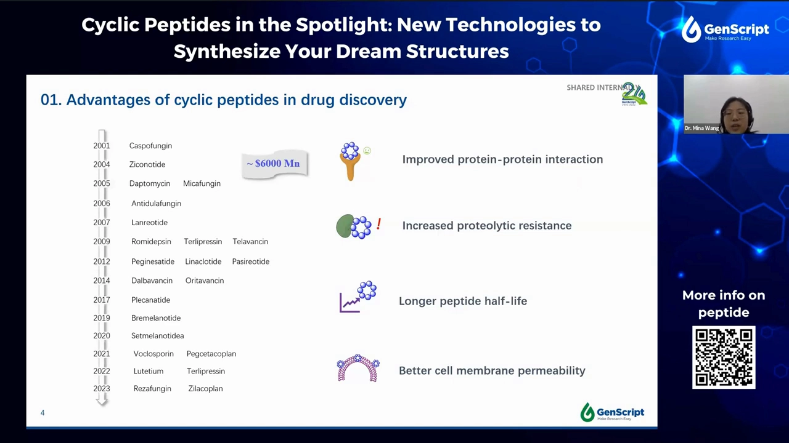
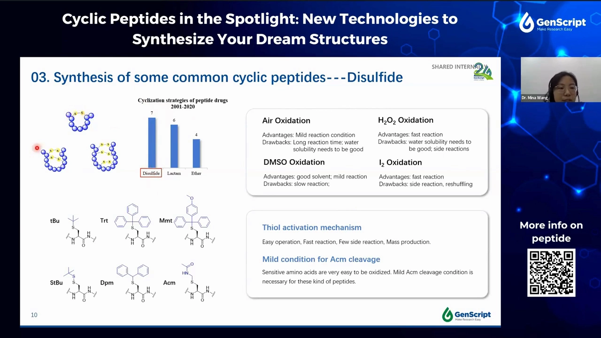
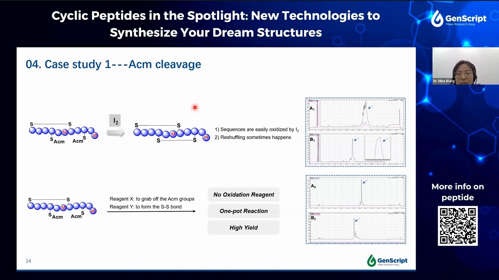
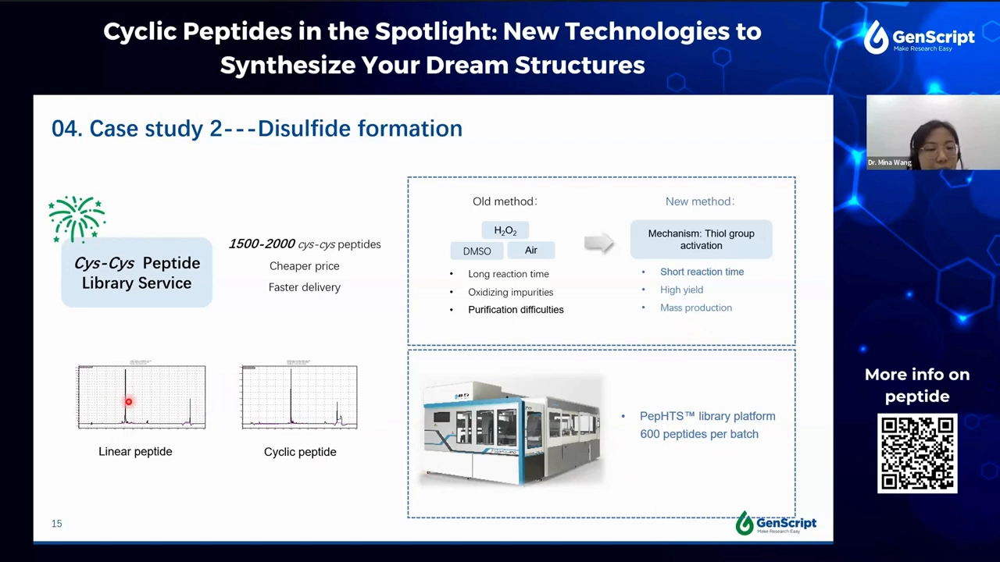
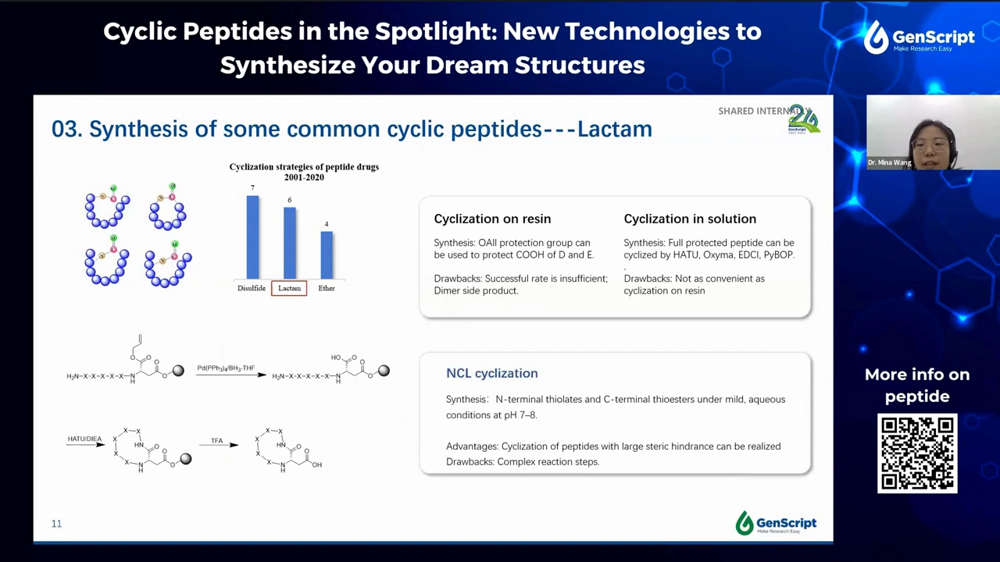
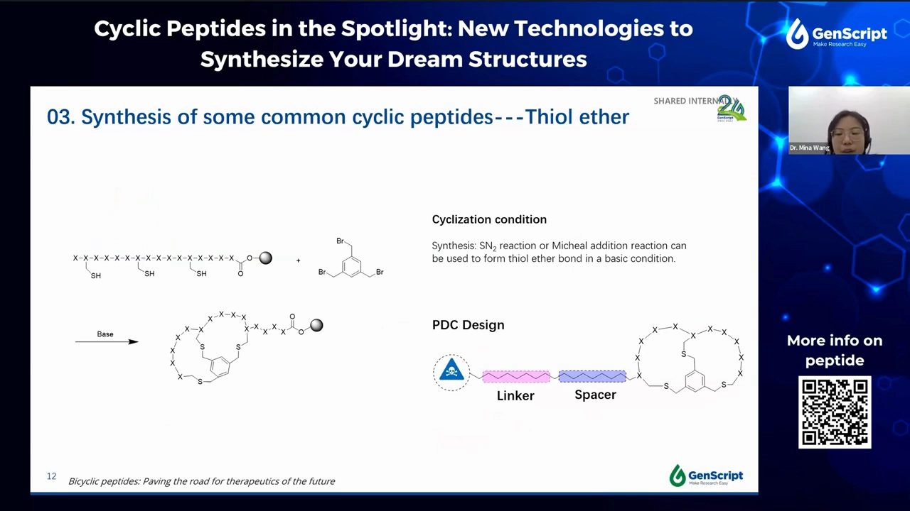
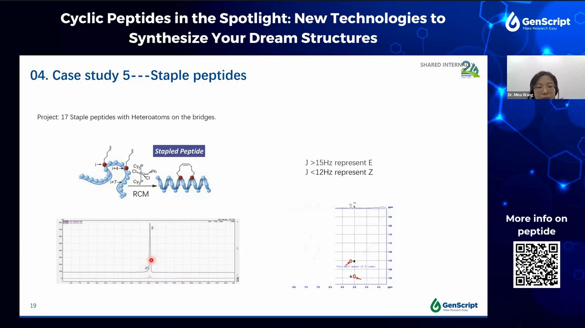
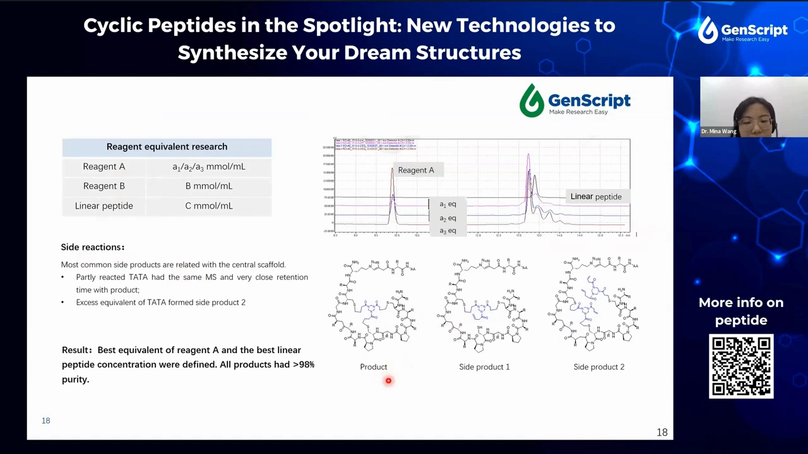
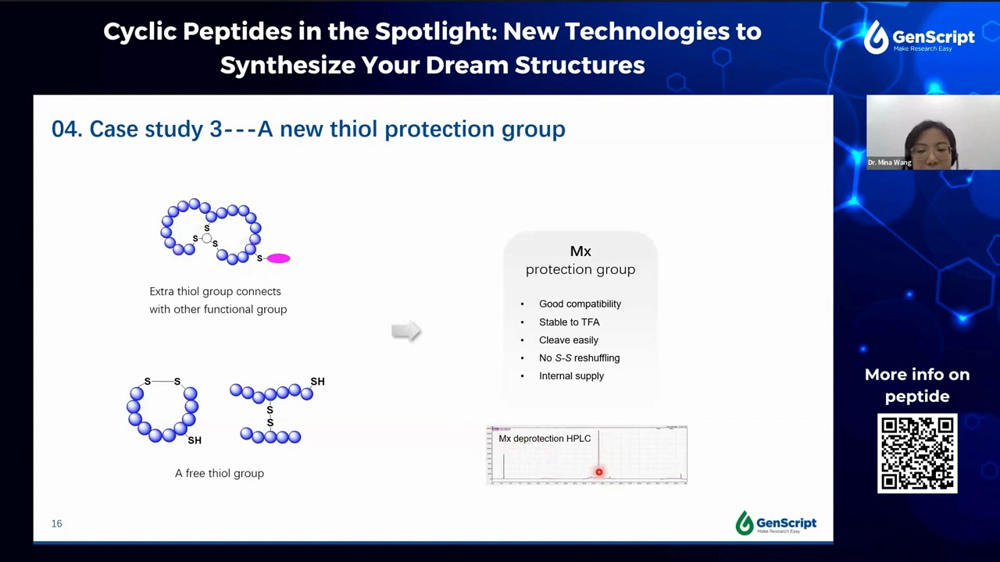
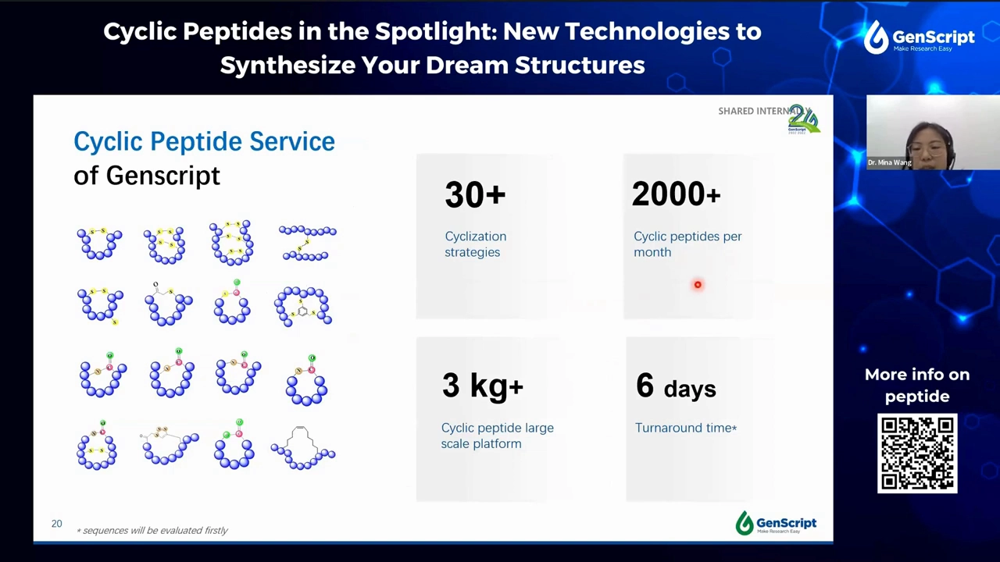

# 环肽的三条成环路线：二硫键、内酰胺与硫醚桥的可制造性

> 视频来源：[GenScript Webinar - Cyclic Peptides in the Spotlight](https://www.youtube.com/watch?v=vUSuCbXbkNQ)（YouTube · GenScript，讲者 Mina Wang 博士，环肽服务技术讲座）｜时长约 51 分钟
> 导读：这是一场环肽合同合成方主讲的技术讲座。它的独特价值不在"环肽有什么好处"，而在后半段：五种成环化学各自的副反应、HPLC 上长什么样、哪些杂质根本分不开、以及产能是怎么算出来的。本文只取与"合成与可制造性"有关的部分，环肽的拓扑分类与膜相互作用分别属于本系列 5.1.2 与 5.1.4，这里不重复。字幕为自动生成，术语已按上下文与幻灯片订正。

## 本讲要解决的核心问题（SCQA）

**背景**：环肽已经是药物发现里的常规分子形态。自 2001 年以来全球有 23 个环肽药物获批，去年的总销售额约 60 亿美元，还有很多候选分子在临床试验中 [【跳转到 02:32】](https://www.youtube.com/watch?v=vUSuCbXbkNQ&t=152)。

**冲突**：但一条环肽比线性肽多了一步——成环。这一步不是"把两头接起来"这么简单：接哪个原子、用什么化学、在树脂上做还是溶液里做，每一步都会引入新的副反应。讲者说得很直白：客户常常遇到"自己设计的环肽很难合成"的情况 [【跳转到 12:03】](https://www.youtube.com/watch?v=vUSuCbXbkNQ&t=723)。

**疑问**：常见的成环化学有哪几种？每一种的失败模式是什么？这些失败在分析数据上怎么被看见？设计时该怎么预判？

**回答（中心思想）**：**环肽的可制造性由"成环键的化学"决定，而不是由环的数目决定。** 二硫键便宜但容易被氧化和重排，内酰胺稳定但强烈依赖序列里有没有 Asp/Glu 类残基，硫醚桥条件最温和、对序列最不挑，因此成为库筛选的默认选择；订书肽用烯烃复分解，代价是 Z/E 异构体分不开。判断一条设计能不能做出来，要问的是"这条序列有没有可用的成环把手"，而不是"它有几个环"。

## 一、为什么值得为"多一步反应"付代价

讲者列出的环肽优势有四条：改善与蛋白—蛋白相互作用（PPI）的结合、提高抗蛋白水解能力、延长半衰期、改善细胞膜通透性 [【跳转到 02:32】](https://www.youtube.com/watch?v=vUSuCbXbkNQ&t=152)。

从可制造性角度看，这四条优势背后有一个共同的化学事实：**环化把一条柔性链变成了一个受约束的构象集合**。讲者的说法是，环化引入的约束结构使肽的构象更稳定，从而提高了抗蛋白水解能力，也提高了线性肽被延展时的抵抗力，半衰期因此延长 [【跳转到 03:47】](https://www.youtube.com/watch?v=vUSuCbXbkNQ&t=227)。

但对合成方来说，这句话要反过来读：**约束是花钱买的**。多一个环，就多一次成环反应、多一次纯化、多一组可能分不开的副产物。讲者在案例里给出了直接证据——一个 85 条双环肽的项目，困难来自三部分：线性肽合成、环化、纯化，而前两者的瓶颈都是肽的疏水性 [【跳转到 31:18】](https://www.youtube.com/watch?v=vUSuCbXbkNQ&t=1878)。

## 二、先看统计：已批药物用的是哪几种成环键

讲者给了一张很有用的统计图：2001–2020 年获批的肽类药物中，按成环策略分类，二硫键 7 个、内酰胺 6 个、醚键 4 个 [【跳转到 12:03】](https://www.youtube.com/watch?v=vUSuCbXbkNQ&t=723)。

这张图解释了为什么讲者把二硫键放在第一个讲：**它是最常见的成环策略，也最"便宜"**——半胱氨酸是标准氨基酸，巯基天然就是成环把手，不需要额外的非天然砌块。但统计只告诉我们"什么被用了"，不告诉我们"什么难做"。接下来的三节才是重点。

## 三、二硫键：四种氧化法，四种代价

二硫键成环的本质是把两个 Cys 的巯基氧化成 S–S。讲者列了四种氧化方式，并逐一给出优缺点 [【跳转到 12:28】](https://www.youtube.com/watch?v=vUSuCbXbkNQ&t=748)：

| 方法 | 优点 | 缺点 |
| --- | --- | --- |
| 空气氧化 | 条件极温和，副反应少 | 氧气氧化能力弱，反应很慢；要求肽溶于水 |
| 过氧化氢（H₂O₂） | 反应快 | 要求水溶；氧化能力太强，副反应比例高 |
| DMSO 氧化 | 不要求水溶，DMSO 还能提高肽的溶解度 | 反应慢，氧化能力不如 H₂O₂ |
| 碘（I₂）氧化 | 快、方便、便宜；可同时脱 Acm 保护基并成键 | 氧化能力强，有副反应；会出现二硫键重排 |

这张表本身就是一条"没有免费选项"的证据链：**温和的慢，快的粗暴，不要求水溶的也慢。** 讲者用一句话概括了选择逻辑——如果你的肽水溶性差，空气氧化和 H₂O₂ 就直接出局；如果你赶时间，DMSO 也出局。

碘氧化之所以特殊，是因为它同时干两件事：**脱掉 Cys 上的 Acm 保护基，并当场形成二硫键** [【跳转到 14:58】](https://www.youtube.com/watch?v=vUSuCbXbkNQ&t=898)。这让它成为"两个二硫键"场景的默认选择：第一个二硫键用空气/H₂O₂/DMSO 形成，第二个用 Acm + 碘形成。但代价也很明确：碘的氧化能力很强，近 30% 的序列在这一步会出现副反应 [【跳转到 22:33】](https://www.youtube.com/watch?v=vUSuCbXbkNQ&t=1353)。

### 3.1 两种失败模式：过度氧化与重排

讲者用两张 HPLC 图把失败讲得非常具体 [【跳转到 22:58】](https://www.youtube.com/watch?v=vUSuCbXbkNQ&t=1378)。

- **过度氧化**：反应前样品很纯，碘处理后杂质大量出现。原因就是碘太强，把不该氧化的残基（Met、Trp）也氧化了。
- **二硫键重排（reshuffling）**：图上看起来是一个单峰，放大看其实是两个峰，而且**两个峰的分子量相同**——说明二硫键的配对方式变了，连接关系从"1 配 2、3 配 4"变成了别的组合。

第二种失败模式最值得警惕，因为它是一个"分析上几乎不可见"的问题：分子量一样、保留时间非常接近，讲者直接说"几乎不可能把这两个峰分开" [【跳转到 23:48】](https://www.youtube.com/watch?v=vUSuCbXbkNQ&t=1428)。这意味着**你不能靠纯化来救它**——只能靠改反应条件不让它发生。

### 3.2 解法：把"脱保护"和"成键"拆成两步、但放在一锅里

讲者的团队开发了一种复合试剂：**region X 负责脱掉 Acm，region Y 负责形成二硫键**，整个反应是一锅法，脱完 Acm 之后再加一种试剂即可 [【跳转到 24:13】](https://www.youtube.com/watch?v=vUSuCbXbkNQ&t=1453)。

关键在于他们**不用氧化剂**来成键，而是用氰基化（cyanylation）活化机制。原因是氧化剂本身就会带来副反应。由于是一锅反应、副反应更少，收率更高；这个反应在他们部门已被广泛用于长序列或含 Met、Trp 这类敏感残基的序列 [【跳转到 25:03】](https://www.youtube.com/watch?v=vUSuCbXbkNQ&t=1503)。

这段是整场讲座里最有工程价值的部分：**它示范了一种思路——当副反应的根源是"试剂太活泼"时，正确做法不是优化条件，而是换一条机理不同的路。** 氧化成键靠的是"把硫氧化"，氰基化活化靠的是"把硫活化"，后者可以在没有强氧化剂的条件下完成同样的连接。

### 3.3 把方法变成产能

讲者随后给出了这套方法的产品化结果：含一个二硫键的环肽库，能力提高到每批 1500 到 2000 条，交付周期也缩短了 [【跳转到 25:28】](https://www.youtube.com/watch?v=vUSuCbXbkNQ&t=1528)。

新方法的指标是：反应时间通常 5 到 10 分钟，收率一般在 40% 到 80%，可以放大量生产；配套的肽库平台 24 小时可生产 600 条肽 [【跳转到 26:43】](https://www.youtube.com/watch?v=vUSuCbXbkNQ&t=1603)。图上还给了线性肽与环化粗产物的 HPLC 对比——两者都是干净的单峰，说明这个反应过程中没有多余的副反应 [【跳转到 27:08】](https://www.youtube.com/watch?v=vUSuCbXbkNQ&t=1628)。

## 四、内酰胺：稳定，但挑序列

内酰胺（lactam）环化是在肽的主链或侧链之间形成一个酰胺键，把两头连起来。讲者的幻灯片把它拆成两条路线 [【跳转到 17:03】](https://www.youtube.com/watch?v=vUSuCbXbkNQ&t=1023)。

### 4.1 树脂上环化：只有四种残基能用

讲者给了一条很硬的限制：**只有序列里含有 Asp、Asn、Gln 或 Glu 时，才能用这种树脂上合成**——这四个氨基酸里有一个在序列中就够 [【跳转到 17:28】](https://www.youtube.com/watch?v=vUSuCbXbkNQ&t=1048)。

原因在于机理：这四个残基的侧链（羧基或酰胺）可以连到树脂上，侧链上的羟基/羧基可以用来做环化。流程是：先把侧链连到树脂，α 氨基用保护基封住；脱保护后，羧酸基团与序列末端的一级胺在缩合试剂（如 Oxyma/DIC）作用下成环；最后用 TFA 把整条序列切下来 [【跳转到 17:53】](https://www.youtube.com/watch?v=vUSuCbXbkNQ&t=1073)。

但讲者对成功率的评价很保守：**这种反应有时效率不高，有时能成、有时不成，无法保证对所有序列都有效，这是树脂上环化的主要缺点** [【跳转到 18:43】](https://www.youtube.com/watch?v=vUSuCbXbkNQ&t=1123)。幻灯片上写得更直接：成功率不足（successful rate is insufficient），还有二聚体副产物。

### 4.2 溶液中环化：更可控，但更麻烦

溶液环化需要先拿到**全保护的氨基酸/肽段**，在溶液里用缩合试剂成环，之后再用 TFA 脱掉所有保护基 [【跳转到 19:08】](https://www.youtube.com/watch?v=vUSuCbXbkNQ&t=1148)。讲者的评价是：合成上其实简单，但比树脂上环化更复杂，因为多了一道"拿到全保护中间体"的门槛。

### 4.3 序列长度的边界与 NCL

讲者给了一条经验边界：**这两种反应适合 5 到 40 个氨基酸的序列**；比这更短或更长，效率就不够了 [【跳转到 19:58】](https://www.youtube.com/watch?v=vUSuCbXbkNQ&t=1198)。这时候要用 NCL（自然化学连接）环化——它通常用来合成 100 个氨基酸以上的长肽，也可以用于环化，代价是反应相当复杂，需要先把羧酸基团活化 [【跳转到 20:48】](https://www.youtube.com/watch?v=vUSuCbXbkNQ&t=1248)。

这张"长度—方法"的对应关系值得记住，因为它是一条**设计阶段就能自查的规则**：如果你的环肽只有 4 个残基，或者有 60 个残基，那么常规内酰胺路线从一开始就不在选项里。

## 五、硫醚桥：条件最温和，所以库筛选首选

硫醚桥（thioether bridge）是讲者推荐给库筛选的策略。机理是 **SN₂ 反应或 Michael 加成**，在碱性条件下把 Cys 的巯基连到一个多卤代的支架上 [【跳转到 21:30】](https://www.youtube.com/watch?v=vUSuCbXbkNQ&t=1290)。

讲者解释为什么它在 mRNA 展示和噬菌体展示里用得最多：**反应非常高效，条件也简单，只需要温和的碱性条件**，所以既可以在树脂上做，也可以在溶液里做 [【跳转到 21:13】](https://www.youtube.com/watch?v=vUSuCbXbkNQ&t=1273)。

在问答环节，讲者把这一点说得更明确：如果你有一个库，环化策略不是影响细胞活性的主要因素，**建议直接用硫醚桥，因为几乎可以保证库里所有序列都能环化**；换成其他策略就不能保证 [【跳转到 43:43】](https://www.youtube.com/watch?v=vUSuCbXbkNQ&t=2623)。这句话是"可制造性优先于化学优雅"的最好注脚。

## 六、订书肽：烯烃复分解与一个分不开的异构体问题

订书肽（stapled peptide）是用一个人工合成的桥把一个 α 螺旋的两段"钉"在一起。讲者说它通常用烯烃复分解反应（ring-closing metathesis，RCM）合成 [【跳转到 35:03】](https://www.youtube.com/watch?v=vUSuCbXbkNQ&t=2103)。

为什么要钉？α 螺旋是最常见的蛋白二级结构，在介导许多蛋白—蛋白相互作用中起关键作用。引入人工支架可以帮助肽采取特定构象，**降低它与靶点结合时的构象熵**，因此可以提高亲和力、提高细胞穿透，也能保护肽免受蛋白水解降解 [【跳转到 35:28】](https://www.youtube.com/watch?v=vUSuCbXbkNQ&t=2128)。

代价出现在产物层面：**RCM 形成的双键有 Z 和 E 两种异构体，两者保留时间相近，很难分离** [【跳转到 36:18】](https://www.youtube.com/watch?v=vUSuCbXbkNQ&t=2178)。

讲者给了两条实操经验：

1. **换催化剂可以调比例**。用 Grubbs I 时 Z 和 E 比例接近，分离更难；用 Grubbs II 情况会好一些，可以得到更高的 E 产物比例，也更容易分离 [【跳转到 36:43】](https://www.youtube.com/watch?v=vUSuCbXbkNQ&t=2203)。
2. **用二维 NMR 判读构型**。如果两个峰之间的耦合常数大于 15 Hz，说明是 E 异构体；小于 12 Hz 说明是 Z 异构体。通常 E 异构体的活性比 Z 更好 [【跳转到 37:33】](https://www.youtube.com/watch?v=vUSuCbXbkNQ&t=2253)。

这一段值得单独强调，因为它展示了一个"纯度问题"的另一种形态：**两个异构体都是目标分子，都通过了质谱，但只有一个是你要的。** 这种情况下，"纯度 95%"这个数字本身没有意义，必须说明是哪一个异构体的纯度。

## 七、案例：双环 PDC 的副产物与当量优化

讲者给了一个 85 条双环肽的项目，用于 PDC 应用，来自一家大型委托方。85 条里用了四种支架，第一种是商业可得的 TATA，另外三种由客户提供；总完成率 96.5% [【跳转到 30:53】](https://www.youtube.com/watch?v=vUSuCbXbkNQ&t=1853)。

合成困难来自三部分：线性肽合成、环化、纯化。前两者与纯化的瓶颈都是**疏水性**——疏水氨基酸太多，合成就很难做；有敏感氨基酸时，裂解时又容易被氧化。为此他们更新了策略：把缩合试剂从 Oxyma/DIC 换成更强的 HCTU、HBTU 这类；纯化时把柱子从常规 C18 换成 C4 或其他类型 [【跳转到 32:08】](https://www.youtube.com/watch?v=vUSuCbXbkNQ&t=1928)。

环化部分的失败模式讲得很细 [【跳转到 32:58】](https://www.youtube.com/watch?v=vUSuCbXbkNQ&t=1978)：

- **副产物一：支架反应不完全**。只有两个 Cys 参与了反应，另外三个 Cys 和双键还是游离的。**它的保留时间与产物非常接近**——又是一个"分不开"的杂质。
- **副产物二：支架过度反应**。一条肽上接了两个支架。

解法是**调当量**：把 region B 试剂调到 1、2、3 当量做 HPLC 对比，发现 1 当量最好 [【跳转到 34:13】](https://www.youtube.com/watch?v=vUSuCbXbkNQ&t=2053)。幻灯片上的结论是：确定了最佳试剂当量与最佳线性肽浓度，所有产品的纯度都大于 98%。

这个案例的教学价值在于：**"最优当量"不是从机理推出来的，是从色谱对比里试出来的。** 少加则反应不完全（副产物一），多加则过度反应（副产物二），中间那个窗口要靠实验找。

## 八、案例：游离巯基与一个新的保护基

第三个案例处理的是另一类问题：在含二硫键或硫醚键的环肽里，往往**还有另一个游离的 Cys 基团**。这个侧链可以用来做还原敏感连接臂或不可裂解连接臂（PDC 候选分子常用），有时它还是重要的结合位点，影响亲和力 [【跳转到 27:58】](https://www.youtube.com/watch?v=vUSuCbXbkNQ&t=1678)。

得到这类肽的常用办法是树脂上环化，或者用 Acm 这类保护基。但讲者的评价是"都不是令人满意的方案，成功率低，因为这些反应对序列依赖很强"——他们在生产里用过，有时能成、有时不成 [【跳转到 28:23】](https://www.youtube.com/watch?v=vUSuCbXbkNQ&t=1703)。

他们的解法是开发一个叫 **MX 的保护基**，特点是：对 TFA 稳定（不用担心切肽时被脱掉）、脱除条件对已有二硫键或其他键没有影响、**不依赖序列**、容易脱除，而且已实现内部供应，成本很低 [【跳转到 28:48】](https://www.youtube.com/watch?v=vUSuCbXbkNQ&t=1728)。

在问答里讲者补充：MX 也可以用于含三个二硫键的序列，反应可以停在 MX 这一步，也可以连续形成二硫键 [【跳转到 40:48】](https://www.youtube.com/watch?v=vUSuCbXbkNQ&t=2448)。

## 九、把"可制造性"变成几个可问的问题

讲者在结尾给了服务能力的总结：30 多种环化策略、每月 2000 条以上环化肽、大规模平台每月 3 公斤以上、快速合成交付周期 6 天以内（定制环肽除外）[【跳转到 37:58】](https://www.youtube.com/watch?v=vUSuCbXbkNQ&t=2278)。

把整场讲座压缩成设计阶段能自查的问题，就是下面这张表：

| 你的设计特征 | 该问的问题 | 对应的失败模式 |
| --- | --- | --- |
| 有两个以上 Cys | 二硫键配对怎么定？要不要 Acm 分步？ | 重排：分子量相同、保留时间相近，分不开 |
| 含 Met、Trp | 成环用氧化剂还是活化剂？ | 过度氧化，粗肽杂质骤增 |
| 想用内酰胺 | 序列里有 Asp/Asn/Gln/Glu 吗？长度在 5–40 之间吗？ | 树脂上环化成功率不足、二聚体 |
| 序列很短或很长 | 是否必须走 NCL？ | 常规缩合环化效率不够 |
| 要建库筛选 | 成环化学对序列挑不挑？ | 部分序列根本环不上，库不完整 |
| 用订书肽 | Z/E 比例怎么控？怎么证明是哪一个？ | 两个异构体都"合格"，但只有一个有活性 |
| 肽很疏水 | 缩合试剂与纯化柱选对了吗？ | 偶联不完全、C18 上洗不下来 |

## 十、问答里的四条经验

讲座最后的问答包含几条很实用的经验，值得单独记下来：

1. **稳定性取决于键的类型，不是环的数目。** 含三个二硫键的肽，仍然不如含内酰胺的环肽稳定，因为二硫键在细胞培养中很容易被还原；订书肽或内酰胺肽就稳定得多。而在同为二硫键的情况下，三个当然比一个稳定 [【跳转到 47:05】](https://www.youtube.com/watch?v=vUSuCbXbkNQ&t=2825)。
2. **成本随化学步骤数上升。** 三个二硫键的成本比一个高得多，尤其是还要求正确的配对 [【跳转到 48:20】](https://www.youtube.com/watch?v=vUSuCbXbkNQ&t=2900)。
3. **差向异构化可以用二肽偶联规避。** 某些残基（讲者以 Gly 与 Cys 相邻为例）逐个偶联时很容易消旋；先把两个氨基酸连成二肽再加进去，有时效果会很好 [【跳转到 49:18】](https://www.youtube.com/watch?v=vUSuCbXbkNQ&t=2958)。
4. **酶法环化很挑序列。** 化学合成没有这种限制，你想试任何环化都可以；酶的优点是绿色化学、不用有害试剂，但序列里必须有几种特定氨基酸才能用 [【跳转到 44:32】](https://www.youtube.com/watch?v=vUSuCbXbkNQ&t=2672)。

还有一条关于稳定性的实操建议：如果结构里同时有游离巯基和二硫键，二硫键重排甚至会在冻干过程中发生；讲者的经验是降低冻干温度，有时效果很好 [【跳转到 42:28】](https://www.youtube.com/watch?v=vUSuCbXbkNQ&t=2548)。

## 小结

- 环肽的可制造性由成环键的化学决定，而不是环的数目；判断一条设计能不能做，先问"有没有可用的成环把手"。
- 二硫键最常见也最便宜，但四种氧化法各有硬伤：温和的慢、快的粗暴、不要求水溶的也慢。
- 碘氧化能一步脱 Acm 并成键，代价是近 30% 的序列出副反应；最危险的副反应是重排——分子量相同、保留时间相近，纯化救不了。
- 内酰胺稳定，但树脂上环化只适用于含 Asp/Asn/Gln/Glu 的序列，且成功率不足；5–40 个残基之外要考虑 NCL。
- 硫醚桥条件最温和、对序列最不挑，因此是库筛选的默认选择。
- 订书肽用 RCM，Z/E 异构体保留时间相近，只能靠换催化剂调比例、靠二维 NMR 判读构型。
- 很多"纯度问题"其实是"分不开的异构体/重排体"问题，这时提高纯度指标没有意义，必须改化学。

## 关键术语速查

| 术语 | 一句话解释 |
| --- | --- |
| 环化策略（cyclization strategy） | 用哪种化学键把肽链两端或侧链连成环 |
| 二硫键（disulfide） | 两个 Cys 的巯基氧化形成的 S–S 键 |
| Acm | 半胱氨酸巯基的常用保护基，可用碘脱除并同时成键 |
| 重排（reshuffling） | 二硫键配对方式改变，产物分子量不变但连接关系变了 |
| 内酰胺环化（lactam） | 在主链或侧链之间形成酰胺键成环 |
| NCL | 自然化学连接，用 N 端硫酯与 C 端半胱氨酸连接，适合长肽与长序列环化 |
| 硫醚桥（thioether bridge） | Cys 巯基与卤代支架经 SN₂/Michael 加成形成的桥 |
| 订书肽（stapled peptide） | 用人工桥固定 α 螺旋构象的短肽，常用 RCM 合成 |
| RCM | 烯烃复分解关环，产物双键有 Z/E 两种构型 |
| 差向异构化（epimerization） | 手性 α 碳构型翻转，产生分子量相同的立体异构杂质 |