# 抗菌肽选择性窗口：MIC、溶血与细胞毒性三条曲线怎么读

> 视频来源：[AKC2020 Plenary Lecture 9: Development of Novel Antimicrobial Peptides](https://www.youtube.com/watch?v=BURe0DbVgC8)（YouTube · Zvi Hayouka，希伯来大学食品科学与营养研究所）｜时长约 46 分钟
> 导读：这是一场以"随机肽混合物（RPM）"为主线的报告，前半段讲怎么设计肽，后半段的重心其实是**怎么判断它能不能用**——MIC、溶血率、细胞毒性、在体安全四类读数轮番出现。本文只取与"端点与判读"有关的部分，把散落在各页幻灯片里的读数串成一条读图路线；肽的膜结合生物物理原理不在此展开。

## 本讲要解决的核心问题（SCQA）

**背景**：抗菌肽（antimicrobial peptide, AMP）是阳离子、两亲性的短肽，靠打细菌膜杀菌，广谱且不易诱导耐药，被视为抗生素的替代方向之一。评价它"强不强"，业界通用的读数是**最小抑菌浓度 MIC**——能压住细菌可见生长的最低浓度，越低越强。

**冲突**：报告里的随机肽混合物在 MIC 上表现极好：1:1 的 Leu-Lys（LK）和 Phe-Lys（FK）20-mer 混合物对大肠杆菌、枯草芽孢杆菌、金黄色葡萄球菌，甚至临床分离的 MRSA、VRE，MIC 都落在几 µg/mL 到十几 µg/mL。但同一批肽一做溶血试验，Phe-Lys 混合物在很低的浓度就出现大量溶血——**"抑菌最强"的那一条，恰好也是最伤红细胞的那一条**。

**疑问**：MIC 之外还要测哪些端点？溶血和细胞毒性这两类读数该怎么读、怎么和 MIC 放在一起比较？能不能像小分子那样，用一个"治疗指数"把几个端点一除了事？

**回答（中心思想）**：抗菌肽的选择性必须用**同一条肽、同一套浓度单位下的多条曲线**来读：MIC 是阈值型读数，溶血率是连续型曲线（要压成 HC50 才能比较），细胞毒性是另一个细胞体系里的另一条曲线（CC50）；所谓"窗口"就是毒性端点与有效端点的比值。这个比值**随立体化学、自组装状态和测量体系而变**，所以它是一条肽一个数，不能把"抗菌肽"当成一个整体去套小分子的治疗指数框架。

## 一、MIC 回答"多低浓度能压住细菌"，但不回答"对人安不安全"

[【跳转到 01:55】](https://www.youtube.com/watch?v=BURe0DbVgC8&t=115)

报告先从耐药危机讲起：抗生素滥用加速耐药，而过去几十年上市的新抗生素很少，抗菌肽因此被列为候选替代方案之一。

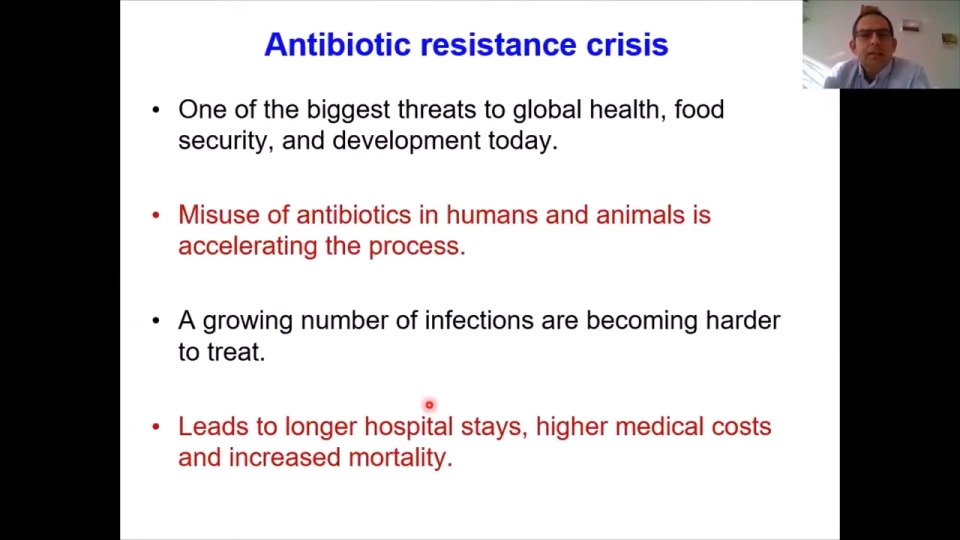

抗菌肽的共同特征是**净正电荷至少 +2**（多由精氨酸、赖氨酸带来）和**约 50% 的疏水氨基酸**——前者负责与带负电的细菌膜发生静电吸引，后者负责插入脂链、破坏膜结构。

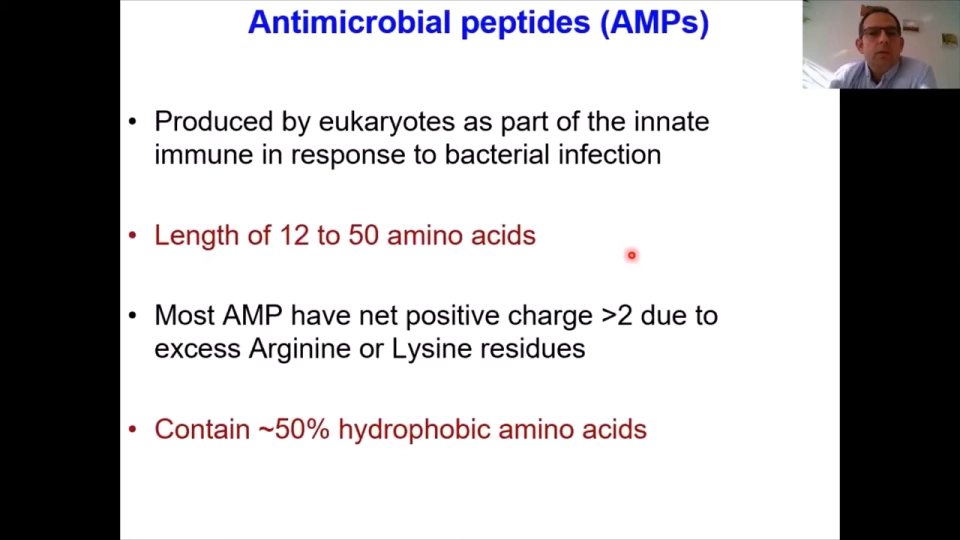

为了不依赖某一条天然序列，讲者用组合化学做了一个"随机肽混合物"：固相合成时每一步都同时投两种氨基酸（一种疏水、一种阳离子），走 20 步就得到 $2^{20}$ 种序列的混合物。

[【跳转到 10:05】](https://www.youtube.com/watch?v=BURe0DbVgC8&t=605)

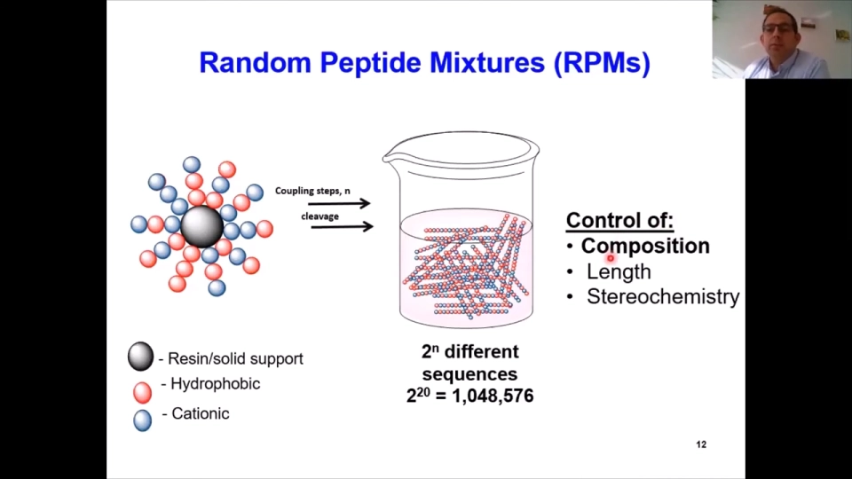

这个设计带来一个容易被忽略的读数问题：**这里的"浓度"是整锅肽混合物的总质量浓度（µg/mL），不是某一条序列的摩尔浓度**。后面所有 MIC、溶血率都建立在"总肽量"这个尺子上——这是抗菌肽与单一小分子在剂量概念上的第一处不同。

[【跳转到 10:29】](https://www.youtube.com/watch?v=BURe0DbVgC8&t=629)

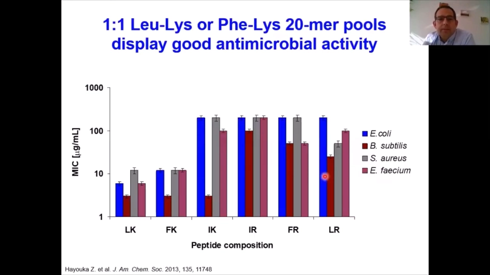

从这张 MIC 图能读出三件事：

- **有效浓度落在 4–11 µg/mL 量级**（LK、FK 两组），而其他组成（IK、IR、FR、LR）的 MIC 约为 200 µg/mL，相差一个数量级以上；
- **谱很宽**：同一锅混合物对革兰阴性（E. coli）、革兰阳性（B. subtilis、S. aureus）以及耐药株（E. faecium）都有活性；
- MIC 是**阈值型读数**：它只告诉你"这个浓度以上看不到生长"，不告诉你膜被破坏到什么程度，更不告诉你红细胞会怎样。

讲者紧接着给出一句判据："设计抗菌肽时，非常重要的是设计一个**选择性**的化合物，因为我们不想伤害宿主，只想破坏细菌的细胞膜。"——这句话把话题从"强不强"切换到"挑不挑"。

## 二、第二个端点：溶血曲线是连续的剂量-反应，而不是一个阈值

[【跳转到 12:31】](https://www.youtube.com/watch?v=BURe0DbVgC8&t=751)

讲者用溶血试验来回答"这条肽能不能区分原核膜和真核膜"。结果很不利：Phe-Lys 1:1 的 20-mer 混合物在很低浓度就出现明显溶血，曲线很快升到平台。

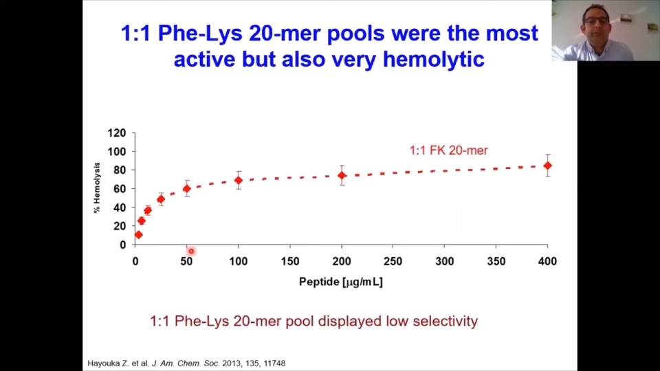

这张图的读法与 MIC 完全不同：

- **MIC 是一个点**（最低有效浓度），**溶血是一条线**（浓度-反应曲线）。线不能直接和点比，必须先把线压成一个特征值。
- 最常用的特征值是 **HC50**：使 50% 红细胞溶血的肽浓度。按图中曲线目测，Phe-Lys 混合物的 HC50 大约在 **30 µg/mL 上下**（25 µg/mL 时已接近 40%，50 µg/mL 时约 60%）。
- 曲线形状本身是信息：它在低浓度段很陡，随后饱和。**陡**意味着"安全"和"不安全"之间只隔很窄的一段浓度——这对后面理解治疗窗口很关键。

于是第一个"窗口"可以算出来了。若把选择性指数定义为毒性端点与有效端点之比：

$$
\mathrm{SI} = \frac{\mathrm{HC}_{50}}{\mathrm{MIC}}
$$

以 Phe-Lys 混合物为例，MIC 约 5 µg/mL、HC50 约 30 µg/mL，则 $\mathrm{SI} \approx 6$。这个数不算大：治疗浓度和溶血浓度只差几倍，临床上很难有安全余量。讲者也正是据此判断"这条肽不够选择性"。

## 三、同一 MIC、两种溶血曲线：选择性是肽的性质，不是"抗菌肽"这个类的性质

[【跳转到 15:09】](https://www.youtube.com/watch?v=BURe0DbVgC8&t=909)

报告的转折点是立体化学。讲者把 L-氨基酸换成 D-氨基酸，做出同手性（全 L、全 D）、异手性（部分 D）和外消旋几种版本，再分别测抗菌活性和溶血。

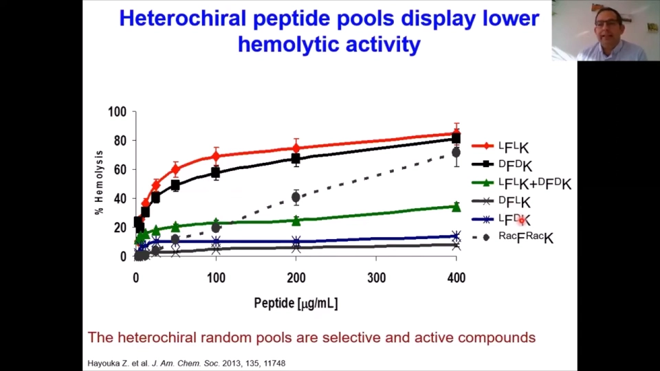

关键结果是**抗菌活性没有明显变化，溶血却变了**：讲者明确说"我们没有看到对（抗菌）活性的影响"，但异手性混合物的溶血被大幅削弱。于是出现了一个非常有教学价值的对照：

| 版本 | MIC（µg/mL，量级） | 溶血表现 | 选择性读数 |
| --- | --- | --- | --- |
| 全 L（LFLK） | 约 5 | 400 µg/mL 时约 80% | HC50 约 30 µg/mL，SI 约 6 |
| 全 D（DFDK） | 约 5 | 400 µg/mL 时约 85% | 与全 L 相近 |
| 异手性（LFDK） | 约 5 | 400 µg/mL 时约 12% | HC50 远高于 400 µg/mL，SI > 80 |
| 两种同手性等量混合 | 约 5 | 400 µg/mL 时约 35% | 介于两者之间 |

这张表说明：**"抗菌肽溶不溶血"不是类的属性，而是某一条具体序列、某一种立体化学的属性**。同一条序列骨架，只改一个手性中心，MIC 几乎不动，HC50 却可能差一个数量级以上。任何"抗菌肽的治疗窗口很窄"或"抗菌肽很安全"的整体判断，都会在这张表前失效。

## 四、溶血差异从哪来：自组装成孔，而不是单体浓度

[【跳转到 18:03】](https://www.youtube.com/watch?v=BURe0DbVgC8&t=1083)

为了解释"同样的 MIC，为什么溶血差这么多"，讲者用原子力显微镜在模拟膜的脂质双分子层上观察肽的组装：全 L 的同手性混合物会在膜上形成**直径约 200 nm、非常均匀的孔**。

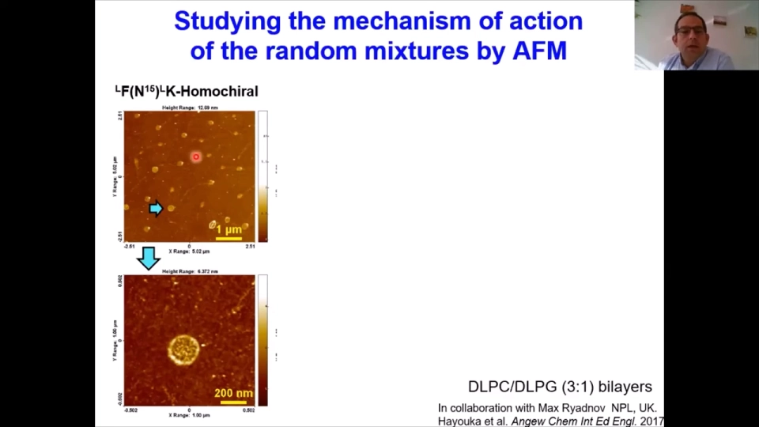

[【跳转到 18:37】](https://www.youtube.com/watch?v=BURe0DbVgC8&t=1117)

用同位素标记加二次离子质谱（SIMS）进一步看肽的位置：肽集中分布在孔内，说明孔是肽自组装形成的，而不是单个肽分子各自打洞。

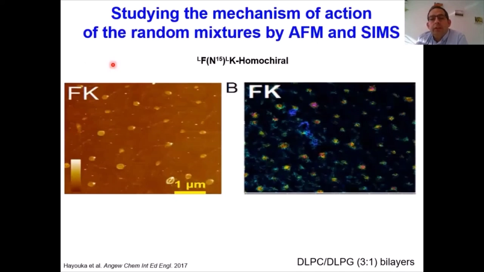

反过来，异手性混合物在任何条件下都观察不到这种组装结构，肽"散得到处都是"。讲者的结论是：改变手性中心，改变的不只是活性强弱，而是**作用方式**——从"自组装成孔"变成别的模式（例如 carpet model，需要更长时间才能造成损伤）。

这给端点判读加了一条重要注脚：**名义浓度不等于有效浓度**。同一 µg/mL 下，肽可能以单体、也可能以组装体存在，两者对膜的破坏力完全不同。这也解释了为什么"µg/mL"这个数不能跨肽直接比较，更不能拿来套小分子的剂量-反应假设。

## 五、第三个端点：细胞毒性与在体安全，是另一套体系

[【跳转到 29:59】](https://www.youtube.com/watch?v=BURe0DbVgC8&t=1799)

溶血只覆盖红细胞。要判断对宿主细胞的影响，还需要细胞毒性试验。讲者在细胞系上的结果是：**直到 500 µg/mL 都看不到细胞毒性**（同手性和异手性都一样）；在乳腺上皮细胞 EPH4 上，随机肽 LK-20 也不影响细胞活力与单层完整性。

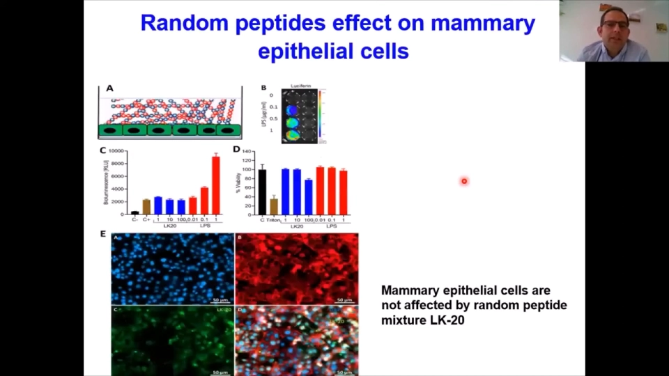

[【跳转到 31:45】](https://www.youtube.com/watch?v=BURe0DbVgC8&t=1905)

但讲者并没有停在体外：他们进一步做了在体安全性——把肽通过乳导管注入小鼠乳腺，即使浓度高到 1 mg/mL，腺体组织仍然健康；随后在乳腺炎模型中观察到细菌负荷下降（讲者强调这是很初步的结果）。

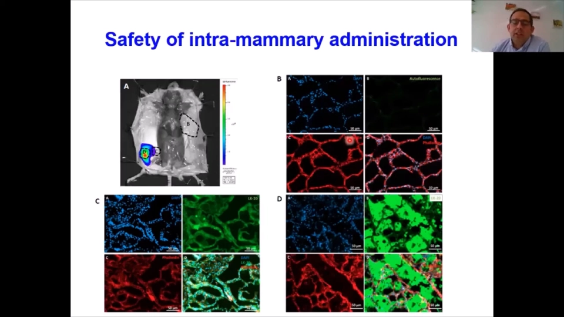

这里有三层读数，不能互相替代：

1. **溶血（HC50）**：只反映红细胞膜；
2. **细胞毒性（CC50 类）**：只反映所测细胞系，换一种细胞数值就可能变；
3. **在体安全**：还牵涉给药途径、局部浓度、组织修复等，只能用动物实验回答。

讲者在问答里也补了一句同方向的观察：nisin 在肠道里不细胞毒，但"注射进血液里可能就有细胞毒性"——**同一个分子，给药途径不同，毒性端点就不同**。

## 六、把端点放回剂量：一个"窗口"要同时交代四件事

把上面的读数合起来，"治疗窗口"在抗菌肽这里不是一个小分子式的单一比值，而是一组必须同时交代的条件：

| 端点 | 测什么 | 常见单位 | 读法 | 最容易踩的坑 |
| --- | --- | --- | --- | --- |
| MIC | 抑制可见生长的最低浓度 | µg/mL 或 µM | 阈值，越低越强 | 菌株、接种量、培养基不同则不可比 |
| 溶血 HC50 | 50% 红细胞溶血所需浓度 | µg/mL 或 µM | 连续曲线的特征点 | 红细胞来源、缓冲液、孵育时间不同则不可比 |
| 细胞毒性 CC50 | 50% 细胞活力下降所需浓度 | µg/mL 或 µM | 连续曲线的特征点 | 细胞系不同、暴露时间不同则不可比 |
| 在体安全 | 动物组织/行为/体重等 | 剂量 mg/kg 或局部浓度 | 只能整体判断 | 体外高浓度"无毒性"不能替代 |

由此得到三条判读规则：

- **比值要同单位、同体系**。MIC 用 µg/mL、溶血曲线也用 µg/mL，看似同单位，但一个是含培养基的抑菌体系、一个是红细胞悬液体系，两个"µg/mL"并不是同一个暴露条件。跨文献比较前，先确认单位和介质。
- **比值要带曲线形状**。Phe-Lys 的溶血曲线很陡，SI≈6 意味着有效浓度再往上一点点就进入溶血区；而异手性版本的曲线在 400 µg/mL 仍压得很低，SI>80 的"余量"是实打实的。只看一个比值、不看曲线陡峭程度，会高估安全性。
- **比值要绑定"哪一版肽"**。同一条序列骨架，换一个手性中心，MIC 不变而 HC50 变一个数量级；把不同立体化学版本的数据混在一起算"抗菌肽的平均窗口"，没有意义。

这也正是**不能把通用小分子治疗指数直接套到膜活性肽上**的原因：小分子的 $\mathrm{TI} = \mathrm{TD}_{50}/\mathrm{ED}_{50}$ 默认"同一个分子物种、同一个暴露、单调的剂量-反应"；而这里测的是一个**混合物**的总质量浓度，毒性端和有效端可能来自**不同的组装状态**，两条曲线还分别在**不同介质**里测得。公式可以借用，假设不能照搬。

## 七、端点之外的活性读数：杀菌速度、生物膜与抗性演化

[【跳转到 21:37】](https://www.youtube.com/watch?v=BURe0DbVgC8&t=1297)

同样是"有效"，杀菌速度和抑菌是两回事。讲者做了时间-杀菌曲线：4 µg/mL 处理 10 分钟几乎没有明显效果，而 20 µg/mL 的同手性混合物几乎把细菌杀光；异手性版本在同一浓度下活性更低，因为它走的是更慢的 carpet 模式。

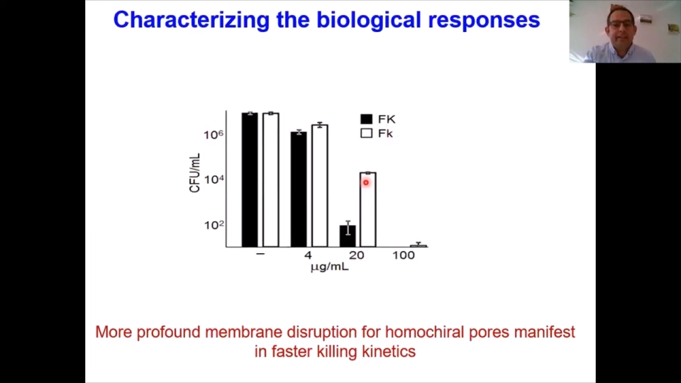

[【跳转到 24:04】](https://www.youtube.com/watch?v=BURe0DbVgC8&t=1444)

生物膜是另一个"有效浓度"完全不同的状态。成熟的 MRSA 生物膜在 25 µg/mL 时生物量已大幅下降；对李斯特菌生物膜，常规抗生素氨苄西林看不到效果，而随机肽在 200 µg/mL 能明显降解生物膜。

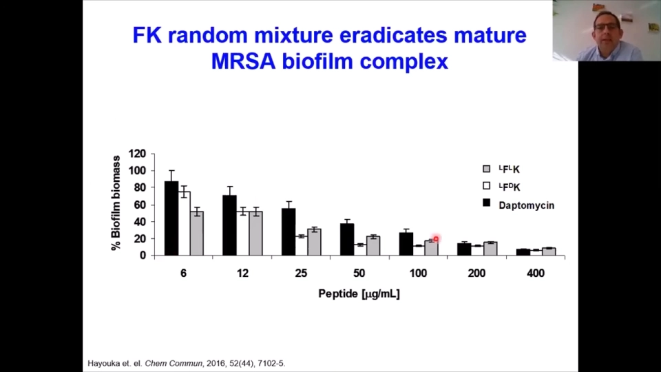

讲者还用实验演化比较了抗性出现的难易：在同样反复暴露的条件下，细菌对利福平很快产生耐药（MIC 明显上升），而对随机肽混合物在测试周期内没有看到明显变化——这是"混合物 + 多机制"策略的卖点，但它属于**活性持续性**的证据，不是安全性证据，不能拿来替代溶血/细胞毒性端点。

## 小结

- **MIC 是阈值，溶血和细胞毒性是曲线**。把曲线压成 HC50、CC50 之后，才能和 MIC 组成一个比值；只报 MIC 无法判断选择性。
- **选择性是"这一条肽、这一种立体化学"的性质**。同一 MIC 下，异手性版本的溶血可以低一个数量级，SI 从约 6 升到 80 以上。
- **溶血差异的机制是自组装**。同手性肽在膜上组装成约 200 nm 的孔，异手性肽不组装；因此名义浓度不等于有效浓度，µg/mL 不能跨肽直接比较。
- **三类毒性端点不能互相替代**：溶血只看红细胞，细胞毒性只看所测细胞系，在体安全只能靠动物实验；给药途径一变，毒性读数也会变。
- **窗口要连条件一起报**：端点、单位、介质、菌株/细胞系、曲线陡峭程度、以及"哪一版肽"。缺任何一项，比值都不可比。
- **小分子治疗指数的公式可以借用，假设不能照搬**：混合物、组装态、跨介质测量这三点，都会让一个简单的 $\mathrm{TD}_{50}/\mathrm{ED}_{50}$ 失真。

## 关键术语速查

| 术语 | 一句话解释 |
| --- | --- |
| MIC（最小抑菌浓度） | 能抑制细菌可见生长的最低药物浓度，是阈值型读数 |
| HC50 | 使 50% 红细胞发生溶血所需的肽浓度，由溶血曲线读出 |
| CC50 | 使 50% 细胞活力下降所需的浓度，由细胞毒性曲线读出 |
| 选择性指数 SI | 毒性端点与有效端点之比，如 $\mathrm{HC}_{50}/\mathrm{MIC}$ 或 $\mathrm{CC}_{50}/\mathrm{MIC}$ |
| 治疗窗口 | 有效浓度与毒性浓度之间的可操作区间；抗菌肽需按端点、介质、肽版本分别判读 |
| 随机肽混合物（RPM） | 固相合成时每步投两种氨基酸得到的序列混合物，20 步即 $2^{20}$ 条序列 |
| 同手性/异手性 | 全部使用 L（或 D）氨基酸 vs 混入 D 氨基酸；后者常改变组装与溶血行为 |
| carpet model | 肽在膜表面累积到临界密度后使膜整体崩塌的作用模式，比成孔慢 |