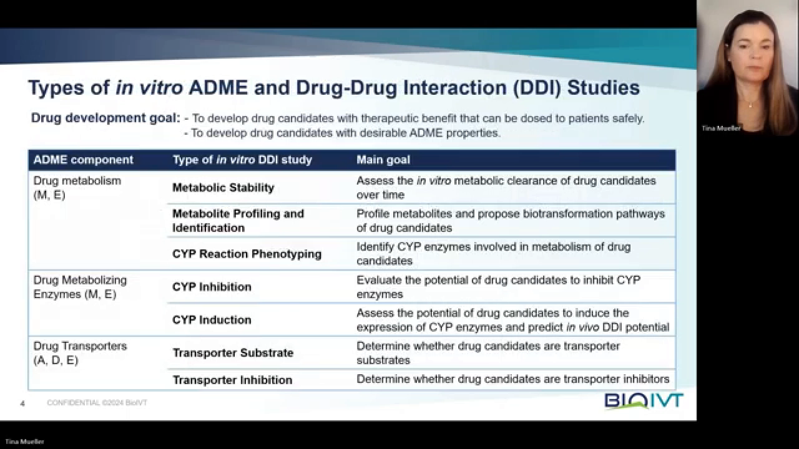
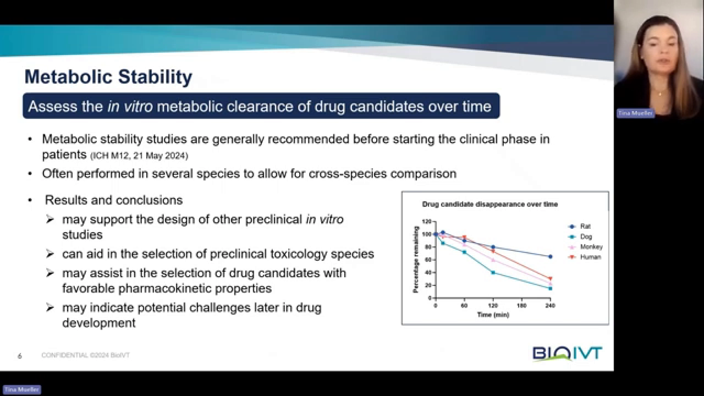
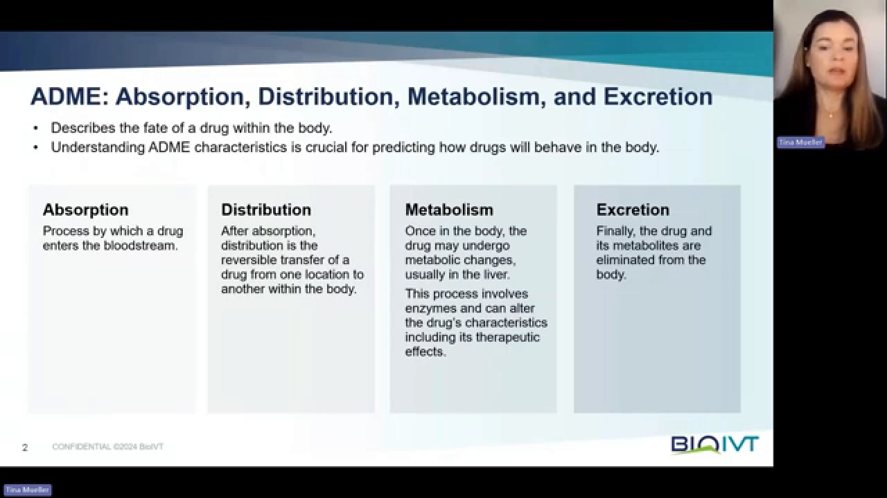
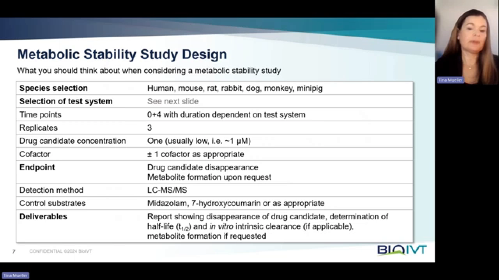
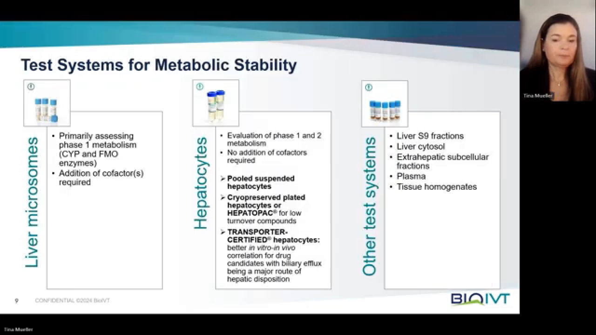
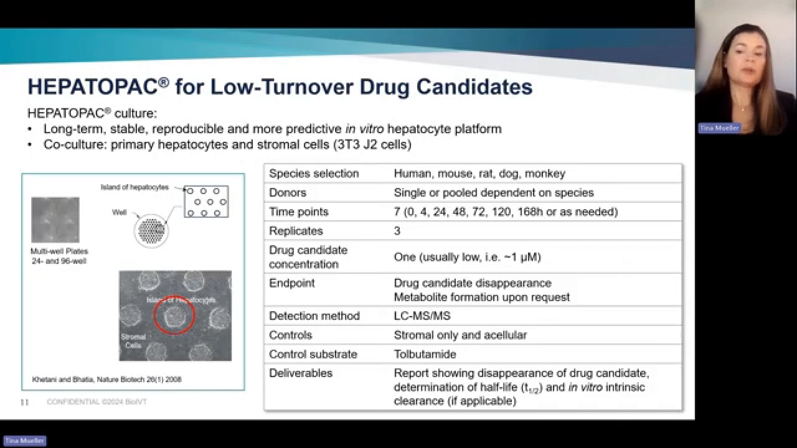
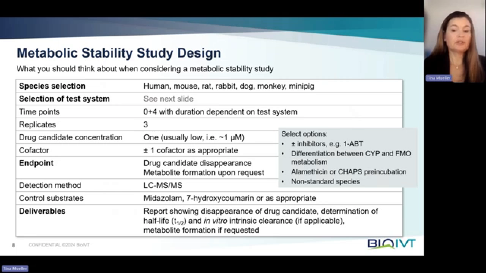
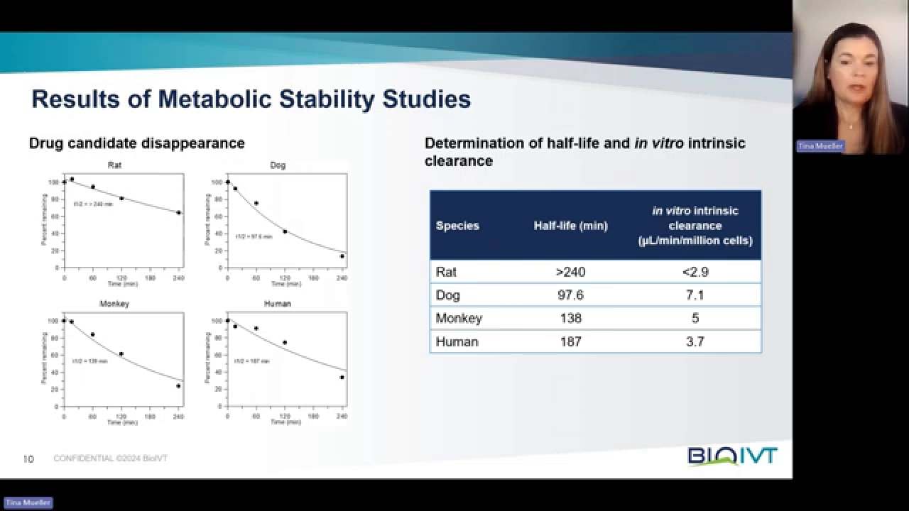
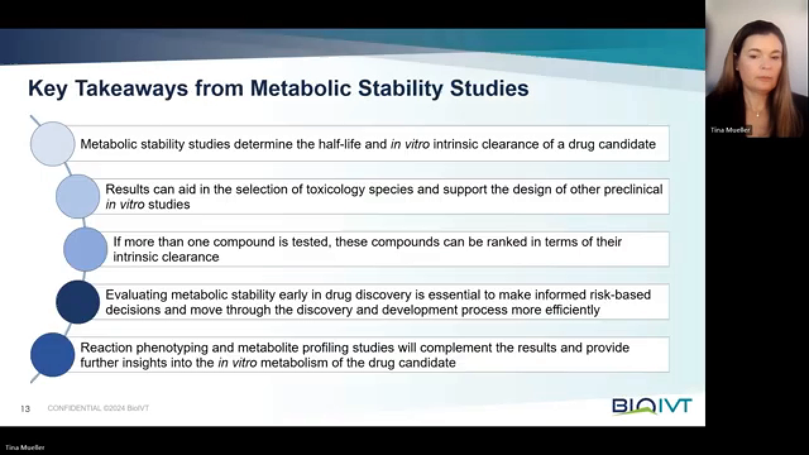

# 代谢稳定性实验怎么读：时间点、半衰期与固有清除率

> 视频来源：[ADME 101: Metabolic Stability](https://www.youtube.com/watch?v=Bqljyuy9q7s)（YouTube · BioIVT，ADME 101 系列教学短片）｜时长约 14 分钟
> 导读：这是一支面向新人的体外 ADME 方法学短片，讲者 Tina Miller 用四张幻灯片把"代谢稳定性实验"从头拆到尾：怎么选种属、怎么选基质、时间点怎么排、数据怎么变成半衰期和固有清除率。它的例子是小分子，但**实验设计与拟合逻辑对肽完全通用**——差别只在"切肽的酶是谁"。本文按这条线整理，并在末尾说明这套读数用在肽上时多出来的坑。字幕为自动生成，术语已按上下文订正。

## 本讲要解决的核心问题（SCQA）

**背景**：判断一个候选分子能不能成药，第一道关卡是"它在生物体系里活得够久吗"。体外 ADME 里专门回答这个问题的实验叫**代谢稳定性（metabolic stability）**：把候选物放进含酶的生物基质里孵育，隔一段时间测一次还剩多少。

**冲突**：实验做出来是一组"百分比剩余"对时间的点，看起来只是一条下降的曲线；但同一条肽放进不同基质、不同种属、不同时间窗，得到的曲线可以完全不同。如果不把"在什么基质里、测了多久、测的是谁"这三件事钉死，曲线上的数字就没法互相比较，更没法回答"这条肽稳不稳定"。

**疑问**：一次代谢稳定性实验该怎么设计？曲线怎么变成可以横向比较的参数？这些参数能说明什么、又不能说明什么？

**回答（中心思想）**：**代谢稳定性实验的本质，是把"消失"换算成一个速率常数：固定基质与种属、用 0 加 4 个时间点、在低浓度下用 LC-MS/MS 测母体剩余，再按一级动力学拟合出半衰期 $t_{1/2}$ 与体外固有清除率 $CL_{int}$。** 而这个数字的适用范围被三件事同时限定：它只覆盖所测基质里的那些酶、只覆盖所测的时间窗、只覆盖"母体消失"这一件事——它不告诉你被切成了什么，也不等于体内的暴露。

## 一、先定位：稳定性只是体外 ADME 的一张表里的一行

讲者先把代谢稳定性放进体外 ADME 与药物相互作用（DDI）研究的全景里。这类研究按 ADME 的组成分成三组 [【跳转到 00:57】](https://www.youtube.com/watch?v=Bqljyuy9q7s&t=57)：

| ADME 组成 | 体外研究 | 主要目的 |
| --- | --- | --- |
| 药物代谢（M、E） | 代谢稳定性 | 随时间评估候选物的体外代谢清除 |
| 药物代谢（M、E） | 代谢物谱与鉴定 | 找出代谢物、推测生物转化路径 |
| 药物代谢（M、E） | CYP 反应表型 | 确定是哪个 CYP 酶在代谢它 |
| 药物代谢酶（M、E） | CYP 抑制 / 诱导 | 评估它抑制或诱导 CYP 的潜力 |
| 药物转运体（A、D、E） | 转运体底物 / 抑制 | 判断它是不是转运体底物或抑制剂 |

这张表值得先看一眼，因为它说明**稳定性实验只回答"消失得多快"，不回答"消失成了什么"**。后者是同一列里的"代谢物谱与鉴定"（metabolite profiling and identification），是另一个实验。很多初学者把两者混为一谈，于是在稳定性报告里找不到代谢物结构时以为实验做错了——其实那是没做第二个实验。

讲者给代谢稳定性的定义很干脆：**在体外评估候选物的代谢清除随时间的变化** [【跳转到 01:32】](https://www.youtube.com/watch?v=Bqljyuy9q7s&t=92)。她还提到，按 ICH M12，代谢稳定性研究建议在进入临床阶段之前完成；而且这类研究通常会在多个种属里做，而不只做人，目的是拿到跨种属的比较 [【跳转到 01:57】](https://www.youtube.com/watch?v=Bqljyuy9q7s&t=117)。

为什么要多花这份钱做多物种？讲者列了四条用途 [【跳转到 02:22】](https://www.youtube.com/watch?v=Bqljyuy9q7s&t=142)：

1. 帮助设计后续的体外研究（例如 DDI 研究该怎么做）；
2. 帮助**挑选临床前毒理研究的种属**——毒理实验要用对药物代谢方式最接近人的动物；
3. 多个候选物一起测时可以**按清除率排序**，选出 PK 性质最好的那个；
4. 提前暴露后期开发可能遇到的麻烦。

这里要替初学者把"ADME"这个词落地：它是吸收（absorption）、分布（distribution）、代谢（metabolism）、排泄（excretion）四个词的缩写，描述药物进入体内之后的去向 [【跳转到 00:24】](https://www.youtube.com/watch?v=Bqljyuy9q7s&t=24)。代谢稳定性只盯住其中的 M。

## 二、一次实验的九个要素：把变量钉死

讲者把实验设计拆成一张要素表，并标注了哪些是"可以灵活调整的"（表中加粗项）。这张表是整支视频最实用的一页 [【跳转到 03:17】](https://www.youtube.com/watch?v=Bqljyuy9q7s&t=197)。

| 要素 | 常规做法 | 为什么这么定 |
| --- | --- | --- |
| 种属 | 人、小鼠、大鼠、兔、犬、猴、小型猪中选若干 | 用于跨种属比较、选毒理种属 |
| 测试体系 | 见下一节（微粒体、肝细胞等） | 决定"哪些酶在场" |
| 时间点 | 0 点 + 4 个点，总时长依体系而定 | 要覆盖母体明显下降的区间 |
| 重复 | 3 个重复 | 区分真实下降与孔间波动 |
| 候选物浓度 | 单一浓度，通常很低（约 $1\ \mu M$） | 避免酶饱和、避免溶解度问题 |
| 辅因子 | 按需加 1 种 | 微粒体缺辅因子就不反应 |
| 终点 | 母体消失；需要时加测代谢物生成 | 决定你拟合的是哪条曲线 |
| 检测方法 | LC-MS/MS | 定量母体（及代谢物） |
| 对照底物 | 咪达唑仑、7-羟基香豆素等 | 证明这批酶是有活性的 |
| 交付物 | 母体消失报告、$t_{1/2}$ 与体外 $CL_{int}$ | 把曲线变成可比较的参数 |

逐条解释几个容易被忽略的点。

**时间点为什么是"0 + 4"？** 讲者说最常见的是零时点加四个时间点，通常覆盖 60 到 100 分钟，但可以按体系和需要调整 [【跳转到 04:07】](https://www.youtube.com/watch?v=Bqljyuy9q7s&t=247)。这里的关键不是"四个"这个数字，而是**时间窗要落在母体还在明显下降的区间**：取太早，曲线还没弯下来，拟合不出斜率；取太晚，母体已经到底，剩下的平坦段只会把半衰期拉长。

**浓度为什么要低？** 约 $1\ \mu M$ 的单一浓度，是为了让酶处在"不饱和"的状态。酶一旦饱和，消失速率就不再反映酶对底物的亲和能力，而反映酶的总量——这时拟合出来的半衰期是实验条件的人为产物，不是分子的性质。

**对照底物为什么必须有？** 咪达唑仑、7-羟基香豆素这类已知会被代谢的底物，是用来证明"这一批微粒体或肝细胞是有代谢活性的" [【跳转到 05:22】](https://www.youtube.com/watch?v=Bqljyuy9q7s&t=322)。没有这一步，一个"母体几乎不消失"的结果就有两种解释：分子真的稳定，或者这批酶早就失活了。稳定性实验里最常见的假阴性就出在这里。

**辅因子为什么不能省？** 在肝微粒体里，CYP 与 FMO 这两类酶都需要 NADPH；如果测的是 UGT 代谢，则要加 UDPGA（UDP-葡萄糖醛酸），或者干脆用混合辅因子 [【跳转到 04:32】](https://www.youtube.com/watch?v=Bqljyuy9q7s&t=272)。微粒体是破碎的膜碎片，酶在，但供给电子的那套系统不在了——不加辅因子，反应根本跑不起来。

## 三、基质决定"谁在切"：几类体系的分工

讲者把常用测试体系画成三栏 [【跳转到 07:20】](https://www.youtube.com/watch?v=Bqljyuy9q7s&t=440)。

| 体系 | 覆盖哪些反应 | 要不要加辅因子 | 讲者点出的局限 |
| --- | --- | --- | --- |
| 肝微粒体 | 主要是一相代谢（CYP、FMO） | 要（NADPH；测 UGT 时用 UDPGA） | 只有膜结合酶，缺胞质酶 |
| 悬浮肝细胞 | 一相 + 二相 | 不要 | 更贵；候选物需被细胞摄取 |
| 冷冻保存贴壁肝细胞 / HepatoPac | 一相 + 二相，适合低周转化合物 | 不要 | 成本更高、周期更长 |
| 转运体认证肝细胞 | 一相 + 二相 + 胆外排 | 不要 | 针对胆外排为主的处置路径 |
| 肝 S9、肝胞质 | 不同细胞组分里的酶 | 视体系而定 | 只代表部分酶 |
| 肾微粒体、血浆、组织匀浆 | 肝外代谢 | 视体系而定 | 与肝代谢的贡献需要另行判断 |

这张表最该记住的一句话是：**你测到的稳定性，永远只是"你所选基质里那些酶"给出的稳定性。** 肝微粒体里没有胞质酶，血浆里没有肝酶，肾微粒体只代表肾脏的酶。同一分子换一套基质，半衰期可以差出一个数量级，这不是矛盾，而是两个不同的问题。

讲者还专门花了一段讲**低周转化合物**的麻烦：如果候选物在悬浮肝细胞里孵育 2 到 4 小时几乎不消失，普通体系就测不出斜率。她的替代方案是 HepatoPac——把原代肝细胞与基质细胞共培养，肝细胞形成"岛状"结构，被基质细胞稳定住，可以维持数天，时间点因此能拉长到 168 小时（7 天）[【跳转到 09:53】](https://www.youtube.com/watch?v=Bqljyuy9q7s&t=593)。

这个设计的用意值得说清楚：**低周转不是"没有代谢"，而是"代谢太慢，短时间窗里看不出来"。** 把时间窗从 4 小时拉到 7 天，等于把微小的斜率放大到可测；同时用"只有基质细胞"和"无细胞"的孔做阴性对照，确认下降不是来自非酶因素。

除了标准配置，讲者还给了几种"微调"选项 [【跳转到 06:12】](https://www.youtube.com/watch?v=Bqljyuy9q7s&t=372)：

- **加抑制剂**：例如 1-氨基苯并三唑（1-ABT）是 CYP450 的非特异性不可逆抑制剂，加与不加对比，就能判断消失是不是 CYP 干的；
- **区分 CYP 与 FMO**：两者都用 NADPH，靠热处理把 FMO 失活、CYP 保留，再看差异；
- **加膜打孔剂**：alamethicin 或 CHAPS 可以让 UGT 的活性位点暴露出来；
- **换非标准种属**：豚鼠、仓鼠等可以按需加入。

## 四、从曲线到参数：半衰期与固有清除率

讲者给出的结果页是整支视频的核心 [【跳转到 09:23】](https://www.youtube.com/watch?v=Bqljyuy9q7s&t=563)。

左边是四条"百分比剩余—时间"曲线（大鼠、犬、猴、人），右边是从曲线算出的半衰期与体外固有清除率：

| 种属 | 半衰期 $t_{1/2}$（min） | 体外固有清除率（$\mu L/min/10^6$ cells） |
| --- | --- | --- |
| 大鼠 | > 240 | < 2.9 |
| 犬 | 97.6 | 7.1 |
| 猴 | 138 | 5 |
| 人 | 187 | 3.7 |

这张表把"曲线"变成"数"的过程，就是一级动力学拟合。假设母体的消失服从一级速率过程：

$$
C_t = C_0\, e^{-k t}
$$

其中 $C_t$ 是 $t$ 时刻的母体浓度（实验里用百分比剩余表示），$C_0$ 是零时点浓度，$k$ 是表观消失速率常数。把两边取对数，得到一条直线：

$$
\ln C_t = \ln C_0 - k t
$$

于是**斜率就是 $-k$**，半衰期由它直接给出：

$$
t_{1/2} = \frac{\ln 2}{k} \approx \frac{0.693}{k}
$$

再用孵育体积与细胞（或蛋白）量把 $k$ 换算成单位时间、单位酶量能清除多少体积的介质，就得到表里的"体外固有清除率"：

$$
CL_{int} = k \cdot \frac{V}{N}
$$

式中 $V$ 是孵育体积，$N$ 是细胞数（用微粒体时换成蛋白量）。这一步的意义在于**去掉实验装置的影响**：不管你在 0.5 毫升还是 1 毫升里孵育、放了多少细胞，换算出来的 $CL_{int}$ 都能横向比较。这也解释了表里为什么大鼠写的是"> 240"和"< 2.9"——曲线几乎没降下去，$k$ 小到拟合不出确定值，只能给一个界限。

读这张表时，讲者提醒的用途是：**同一化合物在不同种属间的差异，是选毒理种属的依据**；多个化合物之间的 $CL_{int}$ 排序，是选候选物的依据 [【跳转到 12:34】](https://www.youtube.com/watch?v=Bqljyuy9q7s&t=754)。

## 五、判读的三条边界：这个数字不覆盖什么

到这里，实验和拟合都讲完了。真正容易出错的是最后一步——把这个数字读过头。讲者的表述里隐含了三条边界，值得单独拎出来。

**边界一：只覆盖所测基质里的酶。** 肝微粒体测出"稳定"，只说明 CYP/FMO 不怎么动它；如果这条分子主要被血浆里的肽酶或肾脏刷状缘的酶切，肝微粒体给出的半衰期再长也不能当作"体内稳定"。反过来，血浆里稳定也不代表肝里稳定。**基质不是中性的容器，它决定了你能看到哪一类降解。**

**边界二：只覆盖所测的时间窗。** 60 到 100 分钟里看不出下降，可能是真的稳定，也可能是"慢到看不见"——这正是 HepatoPac 把窗口拉到 7 天要解决的问题。报告里写"稳定"时，必须同时写清孵育了多久、用了什么体系，否则这个"稳定"没有信息量。

**边界三：只覆盖"母体消失"。** 稳定性实验测的是母体浓度下降，它不区分母体是变成了无活性的碎片、还是有活性的代谢物，也不区分是被酶切了还是非酶降解了。要回答"切在哪里、切成了什么"，必须做代谢物谱与鉴定；要回答"体内暴露够不够"，必须做 PK。讲者在结尾也把这一点点明：反应表型（reaction phenotyping）与代谢物谱研究，是把体外代谢特征补全的另外两块 [【跳转到 13:24】](https://www.youtube.com/watch?v=Bqljyuy9q7s&t=804)。

## 六、这套读数用在肽上，多出来的是什么

这支视频的例子全部是小分子，讲的是 CYP、FMO、UGT 这些"经典"代谢酶。把它套到肽上时，需要替换的正是"酶"这一项：

- **切肽的酶是肽酶（peptidase/protease），不是 CYP。** 肽酶几乎遍布全身——血浆、组织、肾脏刷状缘、溶酶体里都有，所以对肽来说，"血浆"和"组织匀浆"这些基质往往比肝微粒体更相关（这一点是本文的延伸，视频只把它们列为可选体系 [【跳转到 09:00】](https://www.youtube.com/watch?v=Bqljyuy9q7s&t=540)）。
- **"母体消失"对肽尤其不够用。** 一条肽被切掉一个氨基酸后，剩下的片段可能仍有活性、也可能完全失活，两者的药理学含义完全不同，而稳定性曲线看起来一模一样。
- **体外到体内没有通用换算。** 这一点在另一支讲治疗性肽代谢与排泄的讲座里被明确点出：肽没有"拿肝微粒体一算就能预测体内"的通用做法，基质要按给药途径和分子性质逐个试。

换句话说，这套实验设计与拟合逻辑是通用的，**变的是"你选了哪种酶源"和"你怎么解释消失"**。下一节要处理的，就是肽的降解位置与代谢物鉴定。

## 小结

- 代谢稳定性实验回答的是"母体消失得多快"，不回答"消失成了什么"；后者属于代谢物谱与鉴定。
- 设计上要钉死九件事：种属、体系、时间点（0 + 4，覆盖明显下降区间）、重复、低浓度（约 $1\ \mu M$）、辅因子、终点、LC-MS/MS 检测、对照底物。
- 基质决定"谁在切"：肝微粒体只覆盖一相代谢且必须加 NADPH；肝细胞覆盖一相与二相、不需辅因子；血浆、组织匀浆、肾微粒体代表肝外与肽酶路径。
- 低周转不等于不代谢：把时间窗拉到 168 小时的 HepatoPac 就是为了让微小斜率变得可测。
- 读数靠一级动力学：$\ln C_t = \ln C_0 - kt$，$t_{1/2} = \ln 2 / k$，再按体积与酶量换算成 $CL_{int}$。
- 三条边界：只覆盖所测基质的酶、只覆盖所测时间窗、只覆盖母体消失。跨过任何一条去下结论，都会把"体外稳定"误读成"体内有效"。

## 关键术语速查

| 术语 | 一句话解释 |
| --- | --- |
| 代谢稳定性（metabolic stability） | 在体外含酶基质中随时间测母体剩余，用来估算代谢清除快慢的实验 |
| 固有清除率（$CL_{int}$） | 去掉装置因素后、单位酶量在单位时间内能清除的介质体积，用于横向比较 |
| 肝微粒体（liver microsomes） | 肝细胞破碎后的膜碎片，保留 CYP/FMO 等膜结合酶，必须外加 NADPH 才有活性 |
| 辅因子（cofactor） | 酶反应需要的电子/基团供体，如 CYP 用的 NADPH、UGT 用的 UDPGA |
| 对照底物（control substrate） | 已知会被代谢的探针分子（如咪达唑仑），用来证明这批酶是有活性的 |
| HepatoPac | 原代肝细胞与基质细胞共培养的贴壁体系，可稳定数天，用于低周转化合物的长窗口孵育 |
| 反应表型（reaction phenotyping） | 确定是哪一个（些）酶在代谢该分子的实验 |
| 一级动力学 | 消失速率与剩余浓度成正比的过程，取对数后是直线，斜率即速率常数 |