# 治疗性肽的代谢与排泄：肽酶切点、基质选择与代谢物鉴定

> 视频来源：[Metabolism and Excretion of Therapeutic Peptides: Current Industry Practices, Perspectives and Recommendations](https://www.youtube.com/watch?v=beuf_Mnk7T4)（YouTube · IQ Consortium 肽 ADME 工作组网络研讨会）｜时长约 86 分钟
> 导读：这是一场由 IQ 联盟"肽 ADME 工作组"主讲的行业报告，前半段讲 2022 年 12 家药企的问卷调查与 2011–2022 年 31 个获批肽药的申报资料，后半段给出"什么时候必须做代谢与排泄研究"的决策树，最后 40 分钟是与听众的问答。它不谈具体实验操作，专谈**判据**：什么情况下体外/体内稳定性数据是必须的，什么情况下做了也没用。本文按"分型—切点—排泄—测法—判据"重排，问答部分单列一节。字幕为自动生成，术语已按幻灯片订正。

## 本讲要解决的核心问题（SCQA）

**背景**：治疗性肽（therapeutic peptide，讲者缩写为 TPep）已经是一大类上市药物，从环孢素这类环肽到司美格鲁肽这类带脂肪酸侧链的长肽都有。做小分子的人习惯了一套 ADME 范式：查代谢酶、做代谢物鉴定、按 MIST 指南看代谢物暴露。

**冲突**：肽既不像小分子，也不像抗体。它的"代谢"主要是被遍布全身的肽酶水解，它的"排泄"主要是肾脏滤过——**排泄过程本身就伴随降解**。行业里又没有针对肽的代谢/排泄专门指南，于是每家公司各做各的，有人照搬小分子范式，产出一堆对肽并不相关的数据；有人干脆什么都不做，又说不清外源片段去了哪里。

**疑问**：一条肽在体内到底在哪里被切、切成什么？用什么基质、什么样品能测到这些片段？测到什么程度才算"够了"？

**回答（中心思想）**：**肽的稳定性问题可以拆成两个可回答的问题——"肽酶在哪个位置切"和"肾脏怎么处置它"；而"要不要做、做到什么程度"的判据不是体外稳不稳，而是这条肽里有没有"人体从未验证过的外源结构"。** 全是天然氨基酸的肽，代谢路径就是降解成小肽和氨基酸，按生物制品指南（ICH S6(R1)）处理即可；含非天然氨基酸或脂肪酸连接臂的肽，要看这个外源片段是否已被其他获批药物在人体验证过；只有类小分子的肽才回到 MIST 指南。这条判据把"抗降解"与"体内暴露证据"分成了两件不同的事。

## 一、先分三型：TPP A、TPP B、TPP C

讲者开篇就把治疗性肽分成三个亚型，后面所有的建议都挂在这个分型上 [【跳转到 08:59】](https://www.youtube.com/watch?v=beuf_Mnk7T4&t=539)。

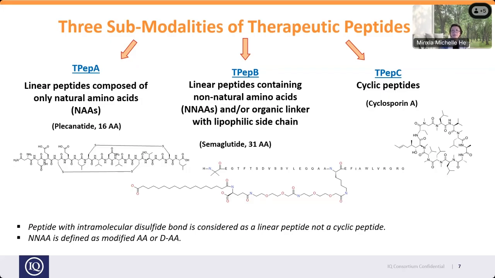

| 亚型 | 结构特征 | 讲者给的例子 | 代谢上的含义 |
| --- | --- | --- | --- |
| TPP A | 线性，只由天然氨基酸（NAA）组成 | 普卡那肽（plecanatide），16 个氨基酸 | 降解产物就是小肽与氨基酸，路径"已知" |
| TPP B | 线性，含非天然氨基酸（NNAA）和/或带亲脂侧链的有机连接臂 | 司美格鲁肽（semaglutide），31 个氨基酸，含 Aib 与长脂肪酸侧链 | 外源片段可能不被肽酶识别，去向需要单独交代 |
| TPP C | 环肽 | 环孢素 A（cyclosporin A） | 环化可能让它更像小分子，走转运体/胆排 |

幻灯片底部有两条定义，容易被忽略但很关键 [【跳转到 09:24】](https://www.youtube.com/watch?v=beuf_Mnk7T4&t=564)：

- **带分子内二硫键的肽算线性肽，不算环肽**——因为主链仍是开的，肽酶仍能从两端切；
- **非天然氨基酸（NNAA）包括"修饰过的氨基酸"和"D-型氨基酸"**。

这两条定义直接决定了后面"要不要做放射标记研究"的判断，因为判据问的是"有没有外源结构"，而二硫键、D-型、脂肪酸侧链在这套分类里地位完全不同。

## 二、行业现状：谁在做、做什么、什么时候做

工作组 2022 年做了一次会员调查，收到 12 家公司的回复（都是员工过万的大药企）。讲者特意声明样本量小、结论要谨慎解读，但这是目前少有的行业全景 [【跳转到 07:19】](https://www.youtube.com/watch?v=beuf_Mnk7T4&t=439)。调查范围有个明确的排除项：**蛋白-肽融合体、偶联物和 PEG 化肽都不在范围内**——它们被归为大分子，走另一套逻辑。

调查结果里最值得记的是三张图。

**第一，体外代谢物鉴定（met ID）主要做在 TPP B 和 TPP C 上，TPP A 几乎没人做。** 讲者的解释很直接：TPP A 全是天然氨基酸，代谢路径没有悬念 [【跳转到 11:08】](https://www.youtube.com/watch?v=beuf_Mnk7T4&t=668)。

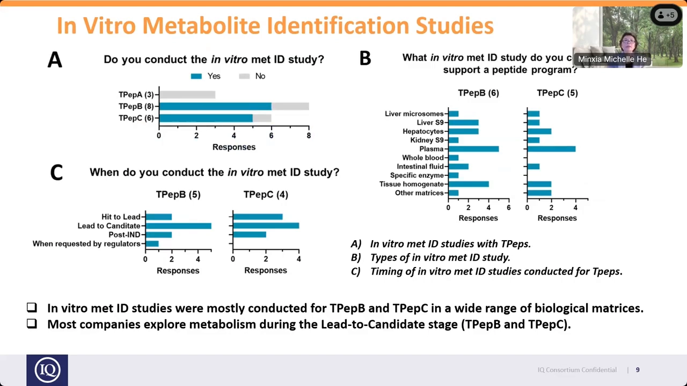

这张图的 B 面板值得单独看：**血浆、组织匀浆、肝细胞**是三类最常用的基质，此外还有肝微粒体、肝 S9、肾 S9、全血、肠液、特定酶、其他基质。请注意"血浆"和"肠液"出现在这个列表里——这在纯小分子项目里是很少见的组合，因为肽的降解酶不在肝里，而在血里、组织里、肠腔里。

**第二，体内代谢物鉴定同样集中在 TPP B 与 TPP C**，时点上 TPP B 多在候选后、IND 后或应监管要求时做，TPP C 则更早，在先导到候选阶段就做 [【跳转到 12:12】](https://www.youtube.com/watch?v=beuf_Mnk7T4&t=732)。这里的"体内研究"是个宽口径：既包括未标记的临床前 PK/TK 样品，也包括首次人体试验的样品，还包括动物与人的放射标记 ADME 研究。

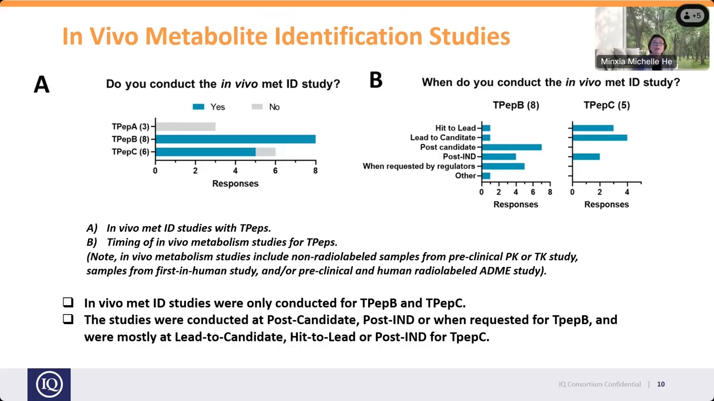

**第三，31 个获批肽药（2011–2022）里，71% 做过体内放射标记 ADME 研究，但 TPP A 一个都没做过人体 ADME 研究** [【跳转到 17:41】](https://www.youtube.com/watch?v=beuf_Mnk7T4&t=1061)。

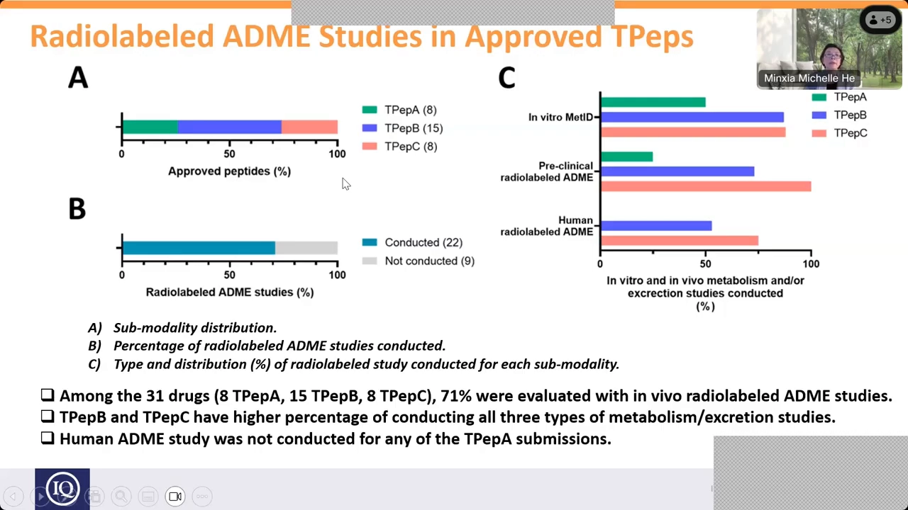

这张图是整场报告的"证据基础"：**监管实际接受的做法，是按亚型分档，而不是一刀切。** TPP A 靠"路径已知"免掉了大量研究；TPP B/C 则因为带着外源结构或环状骨架，被要求把去向讲清楚。

## 三、肽被切在哪里：肽酶在酰胺键上动手

讲者用一张示意图把"代谢"和"排泄"并排放在一起 [【跳转到 25:20】](https://www.youtube.com/watch?v=beuf_Mnk7T4&t=1520)。

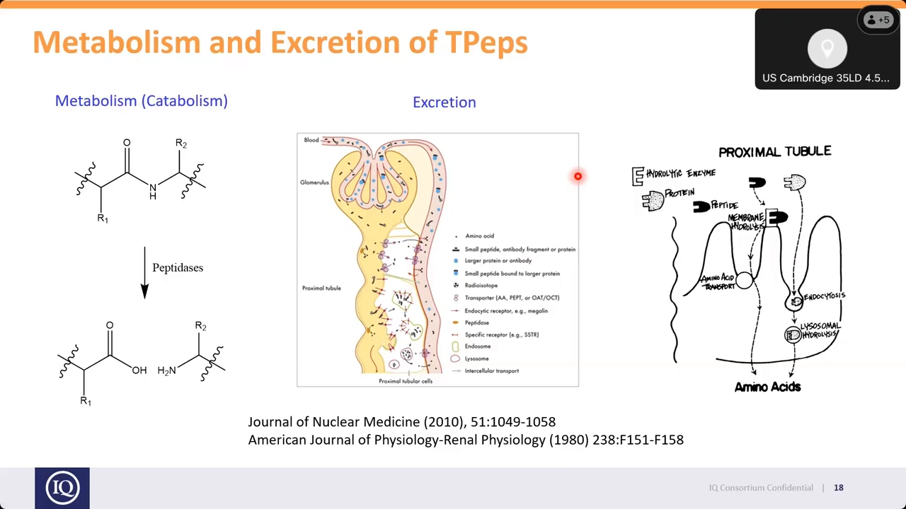

左半边是代谢：**肽酶（peptidase）水解酰胺键，把一个肽键拆成羧酸和胺**。这一步没有"氧化—结合"那样的多相反应，就是水解，产物是更短的肽和单个氨基酸。

中右半边是排泄：肽主要经**肾小球滤过**。讲者给了一个数量级：肾小球滤过的分子量截断大约在 40–60 kDa，而他们讨论的肽最多 50 个氨基酸、分子量几千道尔顿，所以**这类肽都能被滤过** [【跳转到 26:10】](https://www.youtube.com/watch?v=beuf_Mnk7T4&t=1570)。

滤过之后进入近端小管，肽有两种命运 [【跳转到 26:35】](https://www.youtube.com/watch?v=beuf_Mnk7T4&t=1595)：

1. 被近端小管细胞**内吞**，在溶酶体里被消化成氨基酸，再回到循环被利用；
2. 在细胞外被**刷状缘膜酶**（brush border membrane enzymes）直接降解，降解产物被重吸收，同样回到循环。

讲者对这一段的总结是全场最该记住的一句话：**对肽来说，排泄过程本身就是代谢过程** [【跳转到 27:25】](https://www.youtube.com/watch?v=beuf_Mnk7T4&t=1645)。这和小分子完全不同——小分子可以原形从尿里排掉，也可以被主动分泌进小管；而肽在肾里几乎一定会被切成氨基酸。

### 3.1 切点不是随机的：外肽酶与内肽酶的"地图"

讲者用一条含 Aib 的肽做例子，把理论上的切点画了出来 [【跳转到 32:55】](https://www.youtube.com/watch?v=beuf_Mnk7T4&t=1975)。

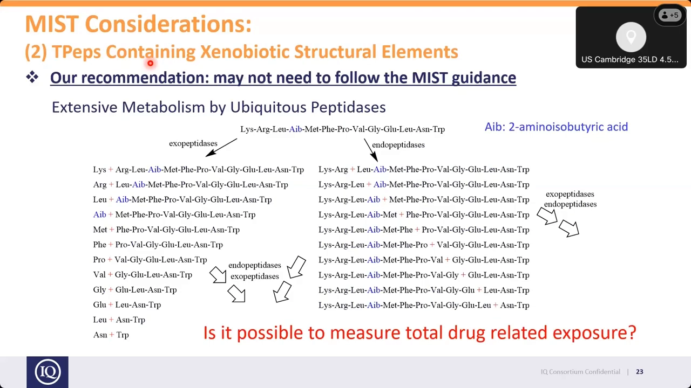

图上分两类酶：

- **外肽酶（exopeptidase）**：从链的一端开始，一个一个地把氨基酸切下来（氨肽酶从 N 端、羧肽酶从 C 端）；
- **内肽酶（endopeptidase）**：在链中间的某个位置切开，一次把一条肽断成两段。

讲者的要点是：一条 15 个残基的肽，理论上可以被切出**几十种**片段，这些片段还能继续被切，最终变成单个氨基酸。唯一的"减速带"是 Aib 旁边的酰胺键——**紧邻非天然残基的位置可能更耐水解**，但其余部分照切不误 [【跳转到 33:45】](https://www.youtube.com/watch?v=beuf_Mnk7T4&t=2025)。

这张图直接解释了为什么"测总药物相关暴露"对肽特别难：小分子用放射性标记一个位置，所有含这个标记的分子都能被同一个检测器看到；而肽被切成几十段之后，**标记在哪一段，就只看得见那一段**。

## 四、怎么测：基质、样品与标记位置

### 4.1 体外用什么基质

前面调查图已经给出答案：血浆、组织匀浆、肝细胞、肠液、特定酶都有人用。讲者在问答环节把这条讲得更透：**没有"从货架上拿一个就够"的通用体系**，选哪个基质取决于给药途径和分子本身 [【跳转到 59:15】](https://www.youtube.com/watch?v=beuf_Mnk7T4&t=3555)。

- 如果是静脉给药、只在循环里待着，血浆体系更相关；
- 如果是口服肽，**模拟胃肠液**（GI fluid）这类体系就要纳入；
- 肝微粒体、肝细胞这些"经典"体系仍然有用，但它们只覆盖肝里的酶，覆盖不到血浆肽酶与刷状缘酶。

同一位讲者还补了一句更硬的结论：**在小分子领域行之有效的"体外推算体内"（IVIVE），在肽上没有通用做法**。某些项目、某些亚型内部能找到血浆或肝细胞数据与体内的相关性，但跨公司、跨亚型找不到一条能推广的换算规则 [【跳转到 52:39】](https://www.youtube.com/watch?v=beuf_Mnk7T4&t=3159)。

### 4.2 体内用什么样品与标记

体内代谢物鉴定不一定要做新实验：**临床前 PK/TK 研究的剩余样品、首次人体试验的样品**都可以拿来做代谢物鉴定 [【跳转到 13:02】](https://www.youtube.com/watch?v=beuf_Mnk7T4&t=782)。真正需要新做的是**放射标记 ADME 研究**，而标记怎么选有讲究。

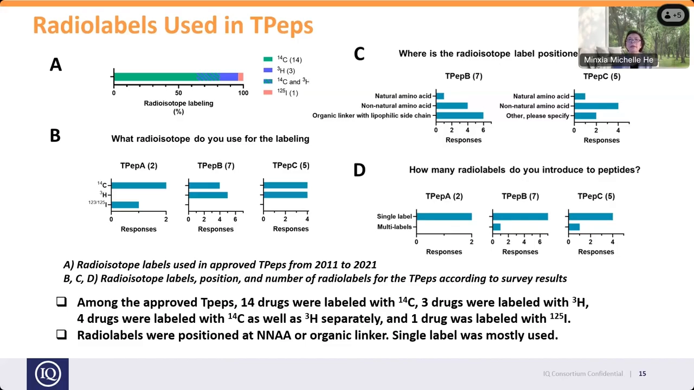

讲者解释了两个选择逻辑：

**为什么用放射性同位素而不是稳定同位素（碳-13）？** 因为放射标记 ADME 的核心是**质量平衡**：要数清给药的那份放射性去了尿里多少、粪里多少。碳-14 可以用放射性检测器（或加速器质谱）定量所有含标记的物质，碳-13 做不到这一点 [【跳转到 48:18】](https://www.youtube.com/watch?v=beuf_Mnk7T4&t=2898)。

**为什么标记位置要放在外源片段上？** 因为要回答的问题是"这个人体从未见过的结构去了哪里"。天然氨基酸的代谢路径已知，标它没有信息增量；把标记放在非天然氨基酸或脂肪酸连接臂上，才能追踪外源片段的去向 [【跳转到 84:17】](https://www.youtube.com/watch?v=beuf_Mnk7T4&t=5057)。讲者还补了一个实用考虑：带脂肪酸侧链的肽往往**蛋白结合高、循环时间长**，标记放在脂链上更可能跟到"待得最久的那部分"。

## 五、测到什么程度才算够：MIST 的三档判据

这是整场报告的方法学核心。讲者先交代了行业面临的规范空白 [【跳转到 22:41】](https://www.youtube.com/watch?v=beuf_Mnk7T4&t=1361)：**没有任何针对肽的代谢/排泄指南**；FDA 2022 年的"人体质量平衡"草案虽然写明单抗、内源性物质及其类似物（举例包括肽、激素、寡核苷酸）在"代谢与消除路径已知"时可不做人体质量平衡，却没有定义什么叫"已知"；而对含新型非天然氨基酸或脂肪酸侧链的化学修饰肽，代谢命运往往并不清楚，反而可能需要做人体代谢研究。

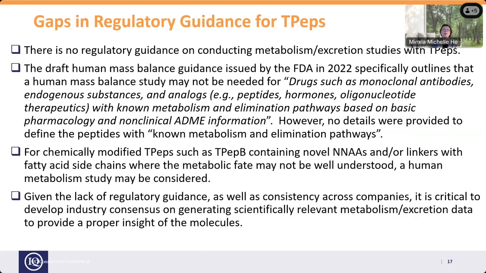

在这片空白之上，讲者先交代背景：FDA 的 MIST 指南（代谢物安全性测试）管的是**小分子非生物制品**，核心阈值是"人体循环中占比超过 10% 的代谢物"——如果某个代谢物在人体中的暴露超过总药物相关暴露的 10%，而临床前毒理种属里没有相应暴露，就要补做非临床安全性试验 [【跳转到 29:55】](https://www.youtube.com/watch?v=beuf_Mnk7T4&t=1795)。

用不等式写出来就是：

$$
\frac{AUC_{\text{代谢物}}}{AUC_{\text{总药物相关物质}}} \ge 10\%
$$

问题在于：**肽要不要套这个 10%？** 讲者按三个亚型分别给了答案。

### 5.1 TPP A（全天然氨基酸）：不适用 MIST，适用 ICH S6(R1)

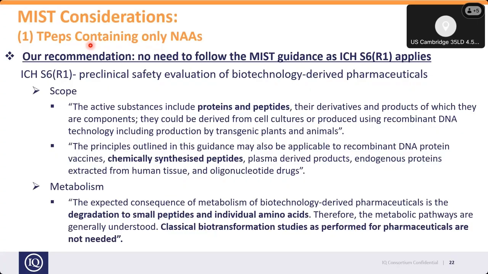

ICH S6(R1) 是生物技术来源药物的临床前安全性评价指南，其范围明确覆盖蛋白与肽，也包括化学合成的肽。它在代谢一节里写道：这类药物的代谢预期就是**降解成小肽和单个氨基酸**，因此代谢路径总体已知，**按小分子做的那套经典生物转化研究不需要做** [【跳转到 32:05】](https://www.youtube.com/watch?v=beuf_Mnk7T4&t=1925)。

这就是"全天然氨基酸"这一档能免掉代谢物鉴定的依据：不是因为它更安全，而是因为**它的降解产物是人体每天都在处理的东西**。

### 5.2 TPP B（含外源结构）：可能不需要套 MIST，因为根本测不出总暴露

讲者的论证很漂亮：肽是线性的，即使成环，被切开后也还是线性片段，会被无处不在的肽酶切成几十种代谢物。要套 MIST，前提是能测"总药物相关暴露"；而对线性肽来说，这个前提往往不成立 [【跳转到 34:10】](https://www.youtube.com/watch?v=beuf_Mnk7T4&t=2050)：

- 用放射标记？标在左段就看不到右段，标在右段就看不到左段；
- 每个氨基酸都标？一方面标记肽本身可能不稳定，另一方面数据没法处理——同一个代谢物可能带 1 个、2 个、3 个标记，定量口径完全不同。

**测不出分母，就定不了"哪个代谢物超过 10%"。** 所以这一档的结论是"可能不需要套 MIST"，而不是"不需要做任何研究"。

### 5.3 类小分子肽：回到 MIST

第三档是那些"看起来像肽、行为像小分子"的分子。讲者举了三个抗病毒药：特拉匹韦（telaprevir）、波普瑞韦（boceprevir）、奥比他韦（ombitasvir）[【跳转到 36:15】](https://www.youtube.com/watch?v=beuf_Mnk7T4&t=2175)。

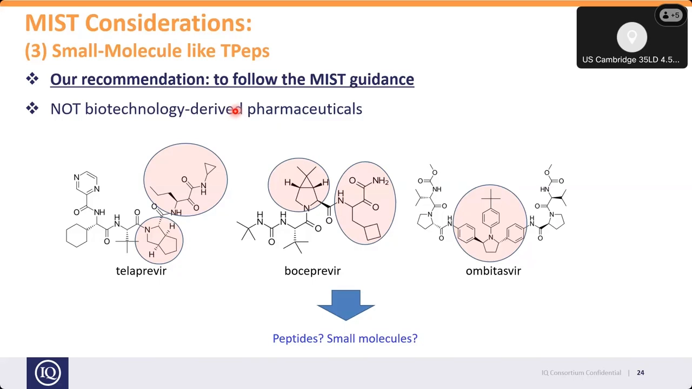

它们的共同点是含大量非天然结构、分子骨架被修饰得肽酶认不出，代谢命运更接近小分子（可能经 CYP 氧化、可能被转运体处置）。这一档**应当遵循 MIST 指南**，因为 ICH S6(R1) 不适用——它们不是生物技术来源药物。

## 六、抗降解的证据长什么样：三个真实判例

理论讲完，讲者用三个具体情形说明"修饰带来的抗降解"该怎么被证据支持。

### 6.1 Aib：已获批药物的"安全通行证"

Aib（2-氨基异丁酸）是最常见的非天然氨基酸之一，已经出现在阿巴洛肽（abaloparatide）、马西瑞林（macimorelin）和司美格鲁肽等获批药物里。讲者的推论是：**既然这些药已经在人身上用过、没有与 Aib 相关的安全性信号，那么含 Aib 的肽就不需要再单独研究 Aib 的代谢命运**，放射标记 ADME 研究也就不必要 [【跳转到 39:35】](https://www.youtube.com/watch?v=beuf_Mnk7T4&t=2375)。

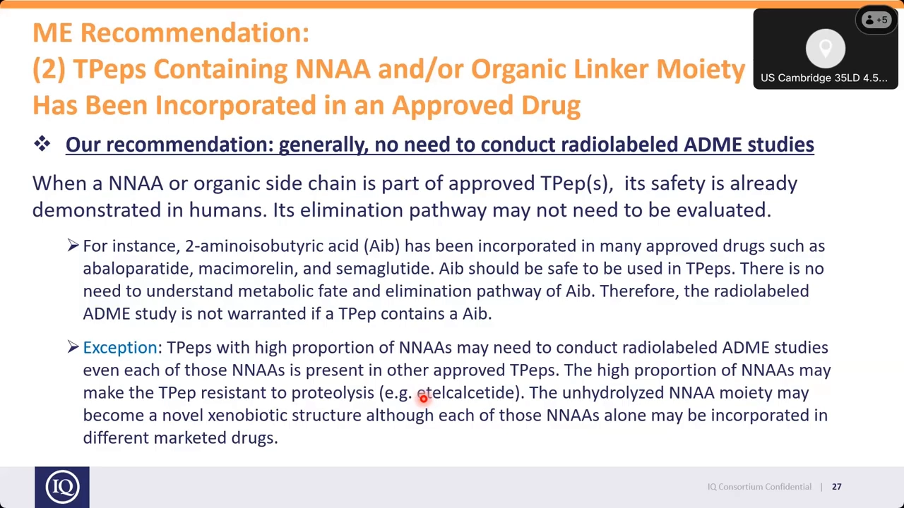

这条判据的本质是**"外源片段是否已被人体验证"**，而不是"这个修饰是否提高了稳定性"。换句话说，Aib 带来的稳定性收益并不需要在每个新肽上重新证明一遍——需要证明的是这个片段的安全性与去向。

### 6.2 依特卡肽：抗降解反而制造了新问题

例外出现在"非天然氨基酸比例很高"的肽上。讲者举的例子是依特卡肽（etelcalcetide）：**它的主链由 7 个 D-型氨基酸组成，对蛋白酶非常惰性**。在大鼠和人的 ADME 研究里，所有代谢物都保留了完整的主链 [【跳转到 40:50】](https://www.youtube.com/watch?v=beuf_Mnk7T4&t=2450)。

这个结果的含义要分两层读：

- 从"稳定性"看，这是巨大的成功——肽没被切；
- 从"暴露"看，这制造了一个新问题——**未被水解的外源骨架本身变成了一个从未在人体评价过的结构**，它的消除路径必须单独搞清楚。

所以这一档的建议是：即使每个非天然氨基酸单独都在别的药里出现过，只要比例高到让主链抗蛋白酶，就仍然需要做放射标记 ADME 研究。讲者还补了一句：当时行业里**没有"多高算高"的定量阈值**，只能按个案判断 [【跳转到 81:30】](https://www.youtube.com/watch?v=beuf_Mnk7T4&t=4890)。

### 6.3 环肽：可能走小分子路径

问答里有人问：环肽会不会经肝胆排泄？讲者的回答是"结构决定行为"——环化会把肽的"肽性"藏起来，8 到 10 个残基的环肽在形状上更接近小分子，**可能被转运体识别、也可能被经典的代谢酶识别**，因此可能出现胆排，也可能出现药物相互作用 [【跳转到 64:13】](https://www.youtube.com/watch?v=beuf_Mnk7T4&t=3853)。这也是为什么 TPP C 在分型里被单独拿出来：它既可能按肽处理，也可能按小分子处理。

## 七、决策树：把上面的判据串成流程

讲者最后给出一张决策树，把三档判据合并成一个可执行的流程 [【跳转到 43:20】](https://www.youtube.com/watch?v=beuf_Mnk7T4&t=2600)。

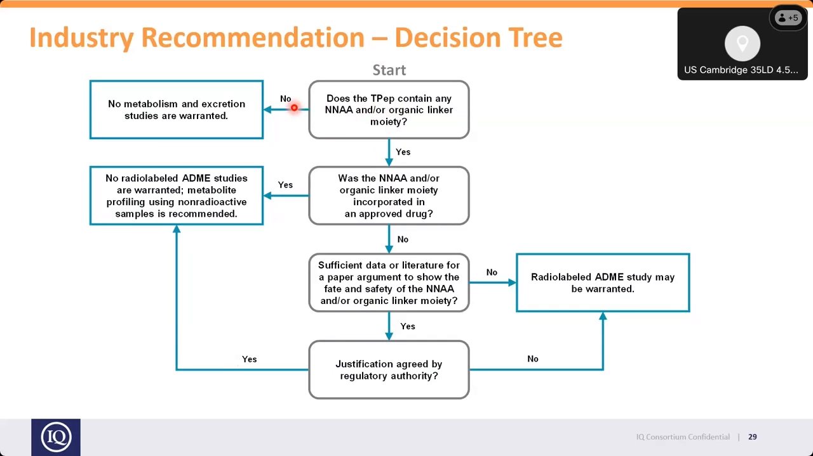

把这张图读成文字：

| 判断节点 | 答案 | 结论 |
| --- | --- | --- |
| 肽里有没有非天然氨基酸或有机连接臂？ | 没有 | 不需要代谢与排泄研究 |
| 有的话，这个外源片段是否已被某个获批药物纳入？ | 是 | 一般不需要放射标记 ADME；建议用非放射性样品做代谢物谱 |
| 否，那有没有足够数据或文献支持这个片段的安全性与去向？ | 没有 | 可能需要做放射标记 ADME |
| 有，且监管同意这套论证 | 是 | 可不做放射标记 ADME |
| 有，但监管不同意 | 否 | 仍需做放射标记 ADME |

这张树里最容易被误读的是第二个框：**"不需要放射标记 ADME"不等于"什么都不做"**，它对应的是"用非放射性样品做代谢物谱"——也就是从 PK/TK 样品里找片段，只是不用同位素。

## 八、问答里的四条硬结论

报告最后 40 分钟的问答，信息密度不比正文低。挑四条与"稳定性实验与判读"直接相关的记下来。

**第一，没有最好的体外体系，只有最合适的。** 工作组讨论过"哪个体外体系最能预测体内"，结论是找不到单一最优解；对小分子可以退回肝微粒体加 CYP，对肽则**必须在项目层面逐个试** [【跳转到 59:15】](https://www.youtube.com/watch?v=beuf_Mnk7T4&t=3555)。

**第二，种属差异没有定论，别默认猴更接近人。** 有人问非人灵长类的代谢物研究是否必要，讲者的回答是：没有明确证据表明非人灵长类的蛋白酶比啮齿类更接近人的肽酶，因此**大鼠往往就够了**；非人灵长类的 ADME 研究在肽上属于极罕见的情形 [【跳转到 58:09】](https://www.youtube.com/watch?v=beuf_Mnk7T4&t=3489)。

**第三，局部给药可以整段跳过。** 如果是局部给药、系统暴露很低，那么无论有没有外源片段，都不需要做放射标记 ADME——这与 FDA 人体质量平衡指南里"无明显系统暴露则不必做"的例外一致 [【跳转到 76:53】](https://www.youtube.com/watch?v=beuf_Mnk7T4&t=4613)。

**第四，有活性代谢物时，稳定性数据不够用。** 如果切出来的片段仍有活性、甚至占比超过 10%，那么"总暴露测不准"这个理由就不再成立——此时应该建立**生物分析方法**直接定量这些片段，而不是硬做放射标记 [【跳转到 68:06】](https://www.youtube.com/watch?v=beuf_Mnk7T4&t=4086)。讲者反复强调：工作组的建议只针对"常规申报所需"，不阻止任何为了理解分子而做的额外研究。

## 九、这套判据对"肽稳定性"意味着什么

回到本小节的问题：稳定性实验该怎么解释、抗降解与体内暴露证据怎么区分。这场报告给出了一个清晰的分界：

- **体外稳定性（血浆、肠液、组织匀浆里的半衰期）回答的是"肽酶切不切、切多快"**，它属于分子性质，可以用来比较序列修饰前后的差异；
- **体内暴露证据回答的是"外源结构去了哪里、有没有在人身上被验证过"**，它属于申报问题，判据是外源片段的新颖程度，而不是半衰期的长短。

把两者混为一谈会犯两个方向的错：拿体外半衰期长就宣称"体内够用"（忽略了蛋白结合、清除、分布），或者拿"外源片段已获批"就宣称"这条肽稳定"（那是别人的分子的证据）。

讲者在结尾也留了一句余地：这套最佳实践会随着数据积累和技术进步继续变化 [【跳转到 45:05】](https://www.youtube.com/watch?v=beuf_Mnk7T4&t=2705)。对初学者来说，最稳的读法是记住那条主线——**先问"切点在哪"，再问"外源片段新不新"，最后才问"半衰期多长"**。

## 小结

- 治疗性肽按结构分三型：TPP A（全天然氨基酸线性）、TPP B（含非天然氨基酸和/或亲脂连接臂）、TPP C（环肽）；带分子内二硫键的仍算线性肽。
- 肽的代谢是肽酶水解酰胺键：外肽酶从两端逐个切、内肽酶从中间切；一条十几残基的肽理论上能切出几十种片段。
- 肽的排泄主要经肾小球滤过（截断约 40–60 kDa），近端小管通过内吞-溶酶体或刷毛缘膜酶把它降解成氨基酸——**排泄本身也是代谢**。
- 测法上，血浆、组织匀浆、肝细胞、肠液都是常用基质；体内可用 PK/TK 剩余样品做代谢物谱，需要质量平衡时用碳-14 或氚标记，标记位置优先放在外源片段上。
- 判据的核心是 MIST 的 10% 阈值能否成立：全天然氨基酸肽按 ICH S6(R1) 免做经典生物转化；含外源结构的线性肽常因测不出总暴露而不适用 MIST；类小分子肽则回到 MIST。
- 抗降解的证据不等于体内暴露的证据：Aib 靠"已被获批药物验证"免做，依特卡肽因 7 个 D-型氨基酸使主链抗酶解、反而必须做放射标记 ADME。
- 没有通用的体外到体内换算；种属上大鼠往往够用；局部给药可跳过系统 ADME；有活性代谢物时应改用生物分析法定量。

## 关键术语速查

| 术语 | 一句话解释 |
| --- | --- |
| TPep | 治疗性肽（therapeutic peptide）的缩写，本讲按结构分 TPP A/B/C 三型 |
| NNAA | 非天然氨基酸，包括修饰过的氨基酸与 D-型氨基酸 |
| 肽酶（peptidase） | 水解酰胺键的酶；从链端切的叫外肽酶，从中间切的叫内肽酶 |
| 分解代谢（catabolism） | 肽被水解成更短片段与氨基酸的过程，是肽的"代谢"主要形式 |
| 刷状缘膜酶 | 肾近端小管细胞外表面的水解酶，可在细胞外把肽切碎 |
| 质量平衡（mass balance） | 给药后追踪放射性总量在尿、粪等排泄物中的分布，用于确认消除路径 |
| MIST 指南 | FDA 关于代谢物安全性测试的指南，核心是"人体循环占比超过 10% 的代谢物"需评估 |
| ICH S6(R1) | 生物技术来源药物的临床前安全性评价指南，明确"降解为小肽与氨基酸"的代谢预期 |
| 总药物相关暴露 | 所有含药物骨架（含代谢物）的物质的总暴露，是 MIST 判据的分母 |
| 放射标记 ADME | 用碳-14、氚等放射性同位素标记分子后做的吸收-分布-代谢-排泄研究 |