# 一条链还是几条链：AlphaFold-Multimer 如何定义、输入并评估蛋白质复合物

> 视频来源：[【公开课】基于AI预测蛋白质复合体的三维空间结构---AlphaFold-Multimer原理及使用](https://www.bilibili.com/video/BV1aF411b76x/)（Bilibili · 水木未来科技 × Thermo Fisher 联合公开课）
> 本文基于视频演说图文稿整理，配图截自视频。导读：这支 70 分钟的公开课把"复合物"当成一个**独立的预测对象**来讲——它先说明单体模型为什么拼不出复合物，再讲 AlphaFold-Multimer 如何用链索引、拷贝数把"几条链、各几条"编码进输入，最后用一整段答疑回答"同源多聚体要输几份""不知道几聚体怎么办"。本文覆盖全片，重点落在**预测对象的分类与化学计量**上；安装、输出文件等工程细节只作最小必要保留。

## 本讲要解决的核心问题（SCQA）

**背景**：AlphaFold2 把**单条链**的三维结构预测做到了接近实验精度——CASP14 上骨架碳原子 RMSD 0.96 Å、全原子 RMSD 1.5 Å。 [【跳转到 06:28】](https://www.bilibili.com/video/BV1aF411b76x/?t=388)

**冲突**：可是细胞里的蛋白很少单独干活。两条以上的链靠界面结合在一起，才是真正执行功能的"四级结构"；而 AlphaFold2 的输入只有**一条序列**，它压根没有"这是第几条链"这个概念。于是大家用加 linker、改索引、接对接软件等办法硬凑复合物，结果时好时坏。 [【跳转到 09:12】](https://www.bilibili.com/video/BV1aF411b76x/?t=552)

**疑问**：一条链、同源多聚体（同一种链的多个拷贝）、异源复合物（不同种链按一定比例组合），这三类对象的"预测目标"到底差在哪？链的**拷贝数**和**化学计量**怎样改变输入？改完之后，输出的分数还能不能照单全收？

**回答（中心思想）**：复合物预测的关键不在"把两条序列粘起来"，而在**把链的身份与拷贝数显式编码进输入**。AlphaFold-Multimer 的做法是给每个残基加上三层链索引（哪条链、哪条去重后的链、同序列链里的第几份），并用 ipTM 这类**专门盯界面**的分数来评估；由此它擅长异源复合物，对同源多聚体则依赖你手工把序列拷贝成正确的份数。而它仍然只是"蛋白-蛋白"模型——核酸、小分子、离子都不在它的预测对象里。

---

## 一、先分清预测对象：单体、同源多聚体、异源多聚体

### 1.1 "复合物"是结构层级里的第四层

讲者先把蛋白质结构层级摆清楚：一级结构是氨基酸的排列组合（序列）；二级结构是主链氢键形成的规律重复模式，主要是 α 螺旋和 β 折叠；三级结构是侧链相互作用形成的三维空间复杂结构；**四级结构就是多条链之间通过相互作用形成的结构**。 [【跳转到 01:04】](https://www.bilibili.com/video/BV1aF411b76x/?t=64)

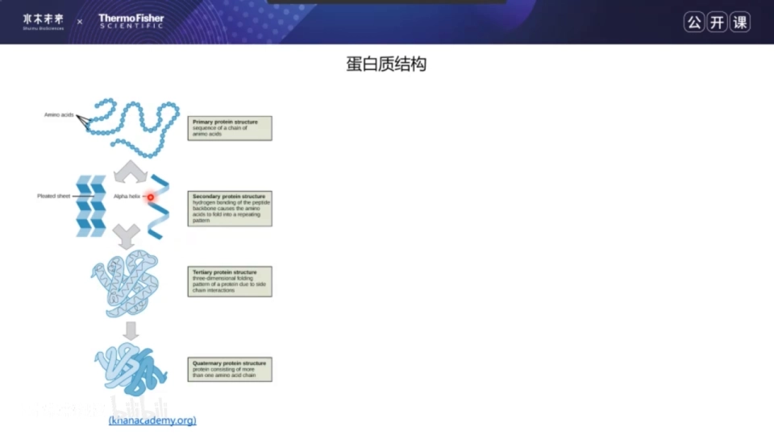

这张图值得记住的原因是：**前三级讲的都是"一条链内部"的事，第四级才是"链与链之间"的事**。所以"预测一个复合物"和"预测一个蛋白"不是同一个任务——前者要预测的不只是每条链自己怎么折叠，还包括它们**以什么相对姿态、在哪个界面上、按几比几**凑在一起。这就是本节要区分"预测对象"的由来。

### 1.2 界面靠什么力把链黏在一起

多条链要发生相互作用，需要满足两个条件：**形状上互补**；界面上有足够的相互作用力——疏水相互作用、盐桥、氢键等等，这些力让结合更强。 [【跳转到 01:36】](https://www.bilibili.com/video/BV1aF411b76x/?t=96)

这解释了一个常见误解：复合物不是"两个折叠好的球挨在一起"那么简单。界面上的互补与化学匹配是**具体的、可被破坏的**，所以把两条单体结构直接摆在一起（刚性对接）经常得不到真实界面——后面 1480 个复合物的对比实验里，纯对接方法的 DockQ 明显偏低。

### 1.3 三类对象，三种预测目标

把讲者全片用到的说法归并一下，可以得到这样一张对照表（这三类正是本节要区分的对象）：

| 预测对象 | 输入是什么 | 预测目标 | 主要难点 |
| :--- | :--- | :--- | :--- |
| 单链（单体） | 一条序列 | 这条链自己怎么折叠 | 无界面问题；低置信度区可能无序 |
| 同源多聚体 | 同一条序列，按拷贝数重复 N 份 | N 份相同链如何对称排列、界面怎么形成 | 拷贝数必须由人给定；同源链之间如何与真值对齐 |
| 异源复合物 | 多条不同序列，各按化学计量重复 | 不同链之间的界面与相对位置 | 需要"跨链"的共变证据，即配对的 MSA |
| 多分子体系（核酸、配体、离子） | 需要能表示非蛋白分子的输入 | 蛋白与这些分子的相互作用 | AlphaFold2 / Multimer **不支持**，属于下一代模型的对象 |

注意最后一行：这支公开课讲的是 AlphaFold2 家族，所以"多分子体系"在这里是以**能力边界**的形式出现的（见第五节），而不是作为可预测对象。

## 二、把单体模型直接拼成复合物，为什么会出错

### 2.1 AlphaFold2 的流程里没有"链"这个位置

回顾 AlphaFold2 的流程：输入一条序列 → 在 CPU 上用 HHblits、jackhmmer 搜索同源序列与模板 → 在 CPU 上构造特征 → 在 GPU 上跑 Evoformer（48 个 block）与 structure module（8 个 block）→ recycling 三次、五个模型各跑一遍 → OpenMM relax → 按 pLDDT 排序。 [【跳转到 07:42】](https://www.bilibili.com/video/BV1aF411b76x/?t=462)

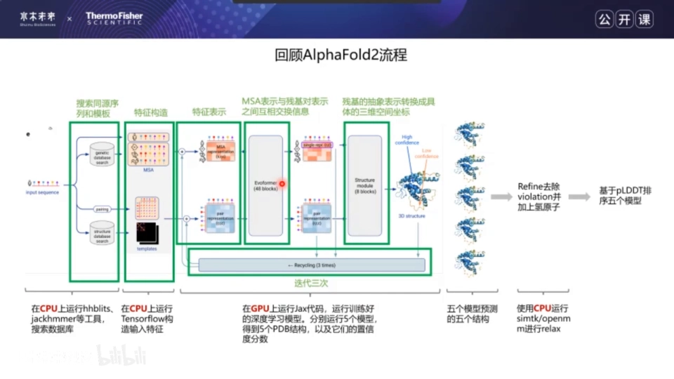

整条流水线里，唯一描述"位置"的量是**残基序号**（residue index），而它默认属于同一条链。所以当你想预测两条链时，模型看到的只是"一条很长的序列"——它不知道第 1 到 100 号和第 101 到 200 号其实分属两个分子。这就是"把单体模型拼成复合物"所有麻烦的源头。

### 2.2 四种"打补丁"的做法

讲者总结了当时大家用 AlphaFold2 预测蛋白-蛋白相互作用的四类做法： [【跳转到 09:12】](https://www.bilibili.com/video/BV1aF411b76x/?t=552)

1. **加 linker**：把两条序列用 poly-GS linker 连成一条，跑完再手动把 linker 去掉；
2. **改 residue index**：两条序列一起输入，在提取特征那一步手动改 residue index，让模型把它们当成两段；
3. **接 docking**：在上一类的基础上，把预测出的结构做对接，再把对接结果送回深度学习模型；
4. **接 RoseTTAFold**：用 RoseTTAFold 做大规模筛选，再用 AlphaFold2 精筛。

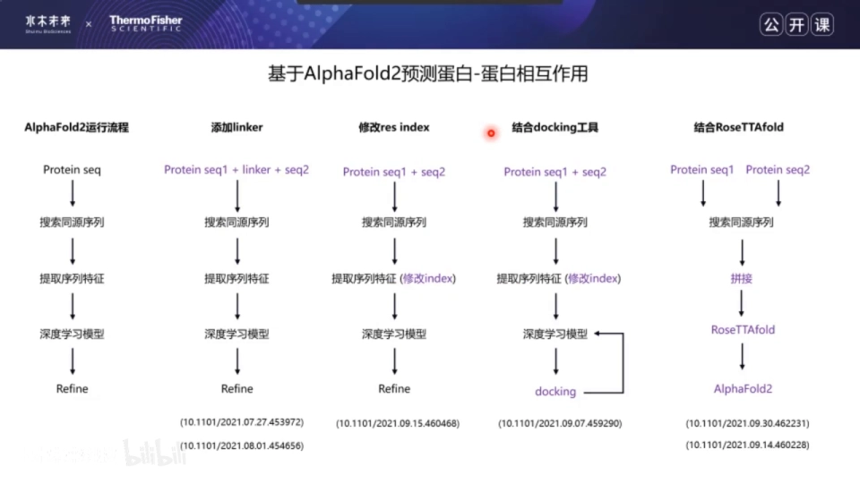

四类做法的共同点是：**都在"骗"模型，让它以为自己在处理一条链**。而骗法不同，得到的复合物质量差别极大——下面这条根因解释了为什么。

### 2.3 补丁失效的根因：MSA 只覆盖一端

用 linker 把两条序列连起来之后去搜索同源序列，会得到一个很说明问题的 MSA：**大部分行要么只匹配到左边那条蛋白，要么只匹配到右边那条，中间大片是 gap**。 [【跳转到 10:50】](https://www.bilibili.com/video/BV1aF411b76x/?t=650)

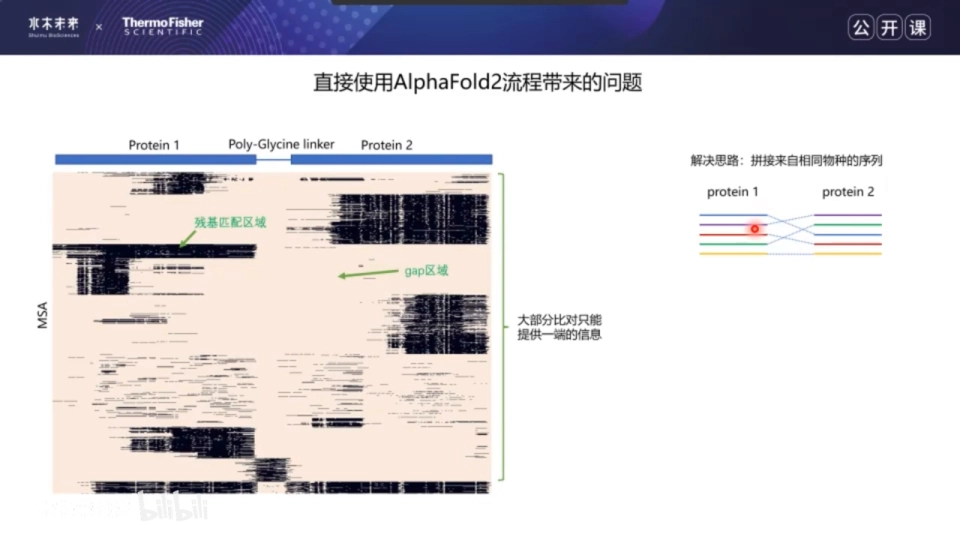

为什么这是致命的？因为 AlphaFold2 判断"两个残基是否接触"靠的是**同一列（或两列）在进化中一起变**的共变信号。如果一行序列只覆盖左半边，那么它给出的信息只关于左半边内部；右半边在这些行里全是 gap，**跨链的共变信号就整块缺失**。模型只能靠单链内部的证据去猜界面，自然不准。

解决思路很直接：**把来自同一物种的片段拼起来**，让一行序列同时覆盖两条链。但真核生物里同一物种可能有多条同源序列（比如紫色序列在蛋白一里有两条、在蛋白二里有三条），"哪一条配哪一条"本身就成了难题。于是有了两种拼接策略： [【跳转到 11:35】](https://www.bilibili.com/video/BV1aF411b76x/?t=695)

- **原核生物**：基于基因组——相互作用的蛋白基因在基因组上共定位、距离近，所以"更近的那一对"配在一起；
- **真核生物**：基于相似性——把同一物种的序列按与你查询序列的相似性从高到低排序，排序靠前的那些对一一配对。

### 2.4 拼对 MSA 之后，DockQ 从 0.01 跳到 0.9

这个改动的效果，讲者用两组数据说明。先是一个单例：只用 linker 时 DockQ 是 0.01，只拼接同物种序列是 0.02，而把"拼接的配对序列"和"未配对的序列"合在一起用，DockQ 达到 0.9——基本已经预测准了。 [【跳转到 14:02】](https://www.bilibili.com/video/BV1aF411b76x/?t=842)

再是 1480 个复合物上的系统对比：RoseTTAFold、GRAMM（刚体对接）、基于模板的对接工具、直接用 AlphaFold2，DockQ 都偏低；只使用配对序列有所提高但还不够；**把配对序列与不配对序列合在一起**，提升最明显。以 0.23 作为对接成功的 cutoff，按物种拼接后大约有一半以上的复合物能被成功预测。 [【跳转到 15:32】](https://www.bilibili.com/video/BV1aF411b76x/?t=932)

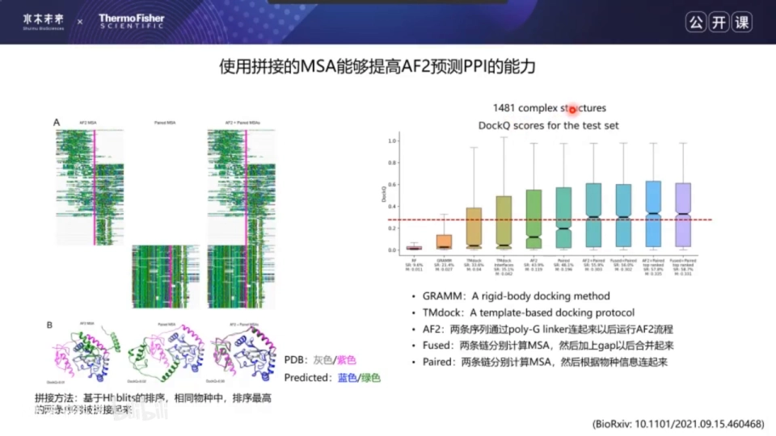

这张箱线图里，红虚线就是 0.23 的成功线；最右侧几组（Paired、Fused 及其组合）的中位数已经越过这条线，而 GRAMM、TMdock、纯 AF2 的中位数还在线下。**结论很明确：复合物预测的瓶颈不在"折叠"，而在"跨链证据有没有进到 MSA 里"。**
## 三、链拷贝数与化学计量：输入怎么变，结果怎么读

这是本节最核心的一节：**同一个蛋白，你输入一份还是三份，得到的是两个完全不同的问题。**

### 3.1 从 residue_index 到三层链索引

AlphaFold-Multimer 相比 AlphaFold2 最关键的输入改动，是给每个残基除了 residue_index 之外，再加一层"链的位置信息"，而这层信息被拆成三个字段： [【跳转到 25:47】](https://www.bilibili.com/video/BV1aF411b76x/?t=1547)

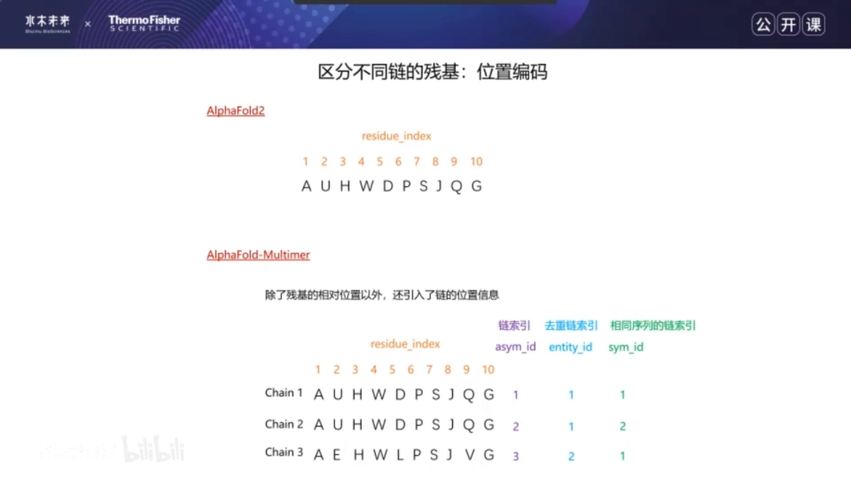

- **asym_id（链索引）**：纯粹的链编号，三条链就是 1、2、3；
- **entity_id（去重后的链索引）**：**序列相同**的链共用一个编号。图中 Chain 1 与 Chain 2 序列相同，所以 entity_id 都是 1；Chain 3 不同，所以是 2；
- **sym_id（相同序列的链索引）**：在同一条 entity 内部再编号——Chain 1、Chain 2 分别是 1 和 2，Chain 3 属于另一组，回到 1。

这三个字段恰好把"三类对象"编码清楚了：

- 只有一条链 → 只有 asym_id 起作用，等价于单体预测；
- **同源多聚体** → 多条链共享同一个 entity_id，靠 sym_id 区分第几份拷贝。模型因此知道"这几条链是同一个分子"，可以按对称性去建模界面；
- **异源复合物** → 每条不同的链各占一个 entity_id，asym_id 的数量就是化学计量里的"总链数"，而每个 entity 出现的次数就是"每组分几条"。

换句话说，**化学计量不是靠文字描述告诉模型的，而是靠"你把每条序列写了几份"表达出来的**。写错份数，模型就会去解一个错误的问题。

### 3.2 同源多聚体：把同一条序列拷贝 N 次

答疑里观众问得非常直接：一个亚基有同源多聚的情况，必须给定它是同源几聚体吗？讲者的回答是操作层面的标准答案： [【跳转到 49:32】](https://www.bilibili.com/video/BV1aF411b76x/?t=2972)

- 想预测**二聚体**：把这条序列在输入文件里**拷贝两次**，链名要不一样，比如 `名字-A`、`名字-B`；
- 想预测**三聚体**：拷贝三次，`-A`、`-B`、`-C`；
- 拷贝的份数就是化学计量，模型不会替你猜。

这解释了一个初学者常踩的坑：**只输入一条序列，然后期待模型告诉你"它其实是个二聚体"**——这是做不到的。单体输入只会得到单体结构；它是否"看起来像个界面"完全不在模型的预测目标里。

### 3.3 不知道几聚体：试 2、3、4 聚体，比较置信度

那如果确实不知道生理状态是几聚体呢？讲者给了一个很实用的经验做法：分别试二聚体、三聚体、四聚体，然后看它输出的置信度分数和矩阵（PAE），**哪一种拷贝数下置信度更高，那可能就是你想要的答案**。 [【跳转到 50:17】](https://www.bilibili.com/video/BV1aF411b76x/?t=3017)

这条经验背后有明确的逻辑：拷贝数错了，界面就是"凭空捏造"的，模型对自己的界面预测会不自信（ipTM 低、PAE 在界面区块偏大）；拷贝数对了，跨链证据能支撑界面，分数自然上去。所以**"扫一遍拷贝数、比较分数"本身就是一种化学计量的推断手段**，只是它给出的是假设，不是结论。

讲者还提醒了两种情况，读结果时要特别小心：

- **单体被误判成多聚体**：模型可能给出一个"看起来像真的"的界面。判断办法仍然是看 PAE 与 ipTM——如果它对这个界面很自信，这个相互作用更可能真实存在；
- **多种聚集形式共存**（比如二聚体与四聚体动态平衡）：讲者猜测，二聚体因为任务更简单，置信度可能更高；四聚体更难，置信度可能没那么高。所以**即便真实存在四聚体，也不见得能被很好地预测出来**——分数高低同时受"是否真实"和"任务难度"两个因素影响，不能只凭分数排序下结论。

### 3.4 同源多聚体的隐藏难题：对齐与 loss 匹配

同源多聚体还有一个别人不太注意的技术难点。构建复合物预测模型时会遇到一系列问题：复合物数据量比单体少；怎么从复合体 MSA 里拿到共变信号；复合体大、训练吃显存；**如果是同源多聚体，你不好把预测出来的其中一条链跟标准结构中的链对齐**；以及怎么区分不同链的残基。 [【跳转到 20:32】](https://www.bilibili.com/video/BV1aF411b76x/?t=1232)

为什么"对齐"在同源多聚体里变成难题？因为几条链序列完全相同，任何一条预测链都可以对应到真值里的任何一条链——**对应关系不唯一**。AlphaFold-Multimer 为此开发了一个启发式方法来给链做匹配，再计算 loss。 [【跳转到 27:02】](https://www.bilibili.com/video/BV1aF411b76x/?t=1622)

这也顺带解释了另一件事：同源多聚体的**对称性**是"序列相同"带来的额外约束，而模型并没有把对称性当成硬约束写进去——它只是从"这几条链是同一个 entity"这一事实里学到的。

## 四、同源 vs 异源：AlphaFold-Multimer 在哪类对象上更强

### 4.1 17 个异源二聚体上的对比

讲者给的第一组评测是 17 个**没有模板的异源二聚体**，比较六种做法：AlphaFold-Multimer、AlphaFold2+linker、AlphaFold2 改 residue index、ClusPro（纯对接）、ClusPro refine 的十个模型、以及这十个再加原始五个共 15 个模型。 [【跳转到 28:12】](https://www.bilibili.com/video/BV1aF411b76x/?t=1692)

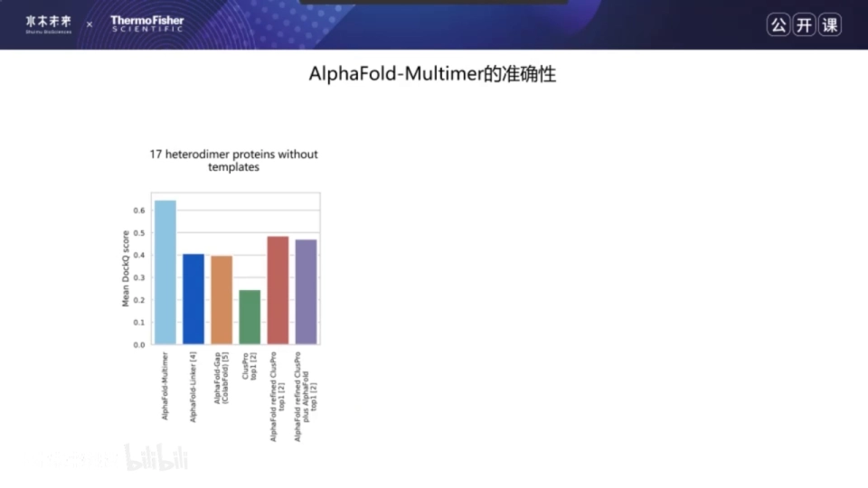

图中最左侧浅蓝柱（AlphaFold-Multimer）的平均 DockQ 超过 0.6，而 linker 方案约 0.4，改 residue index 约 0.4，纯 ClusPro 只有 0.25 左右。**这就是"把链身份显式编码"相对"打补丁"的收益。**

### 4.2 为什么同源多聚体反而更容易

有意思的是，讲者明确说 AlphaFold-Multimer 在**同源多聚体**上的预测效果比异源多聚体更好，原因很朴素：**同源多聚体的 MSA 更容易获得**——几条链序列相同，搜索一次就够，配对问题天然不存在；而异源多聚体必须做跨链的 MSA 拼接，那一步才是真正的难点。 [【跳转到 32:20】](https://www.bilibili.com/video/BV1aF411b76x/?t=1940)

这带来一个反直觉的结论：**"对象更复杂"不等于"预测更难"**。同源三聚体看起来比异源二聚体"大"，但它只需要一条序列的进化证据；异源复合物看起来"只有两条链"，却需要两条链在进化上被正确地配到一起。

### 4.3 异源多聚体为什么是 AF2 的软肋

讲者用一张图说明 AlphaFold2 在异源多聚体上的系统性偏差：一条链（绿色）与周围许多部分都有接触，而 AlphaFold2 单独预测这条链时（蓝色）很多地方对不上。 [【跳转到 29:34】](https://www.bilibili.com/video/BV1aF411b76x/?t=1774)

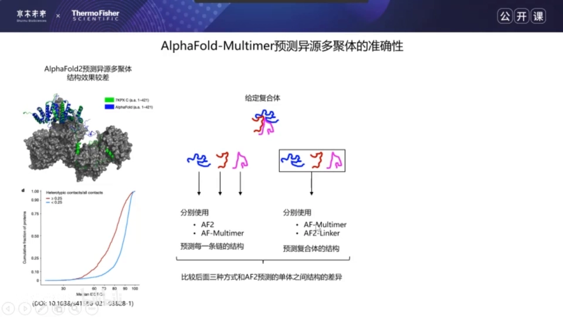

统计上也成立：把"异源接触占比"作为横轴，占比越高的蛋白，AlphaFold2 预测的 lDDT 越差。而把三条链合起来用 AlphaFold-Multimer 联合预测，结果比"逐条链单独预测"好；反过来，**用 AlphaFold-Multimer 只预测单条链，效果比 AlphaFold2 还差**。 [【跳转到 31:49】](https://www.bilibili.com/video/BV1aF411b76x/?t=1909)

这一点对"预测对象"的划分很重要：**同一个模型，输入对象的定义变了，它的适用性就变了**。AlphaFold-Multimer 是为"多链对象"训练的，拿它当单体模型用是错配。

### 4.4 四条明确的能力边界

讲者把论文里陈述的不足列了出来： [【跳转到 32:20】](https://www.bilibili.com/video/BV1aF411b76x/?t=1940)

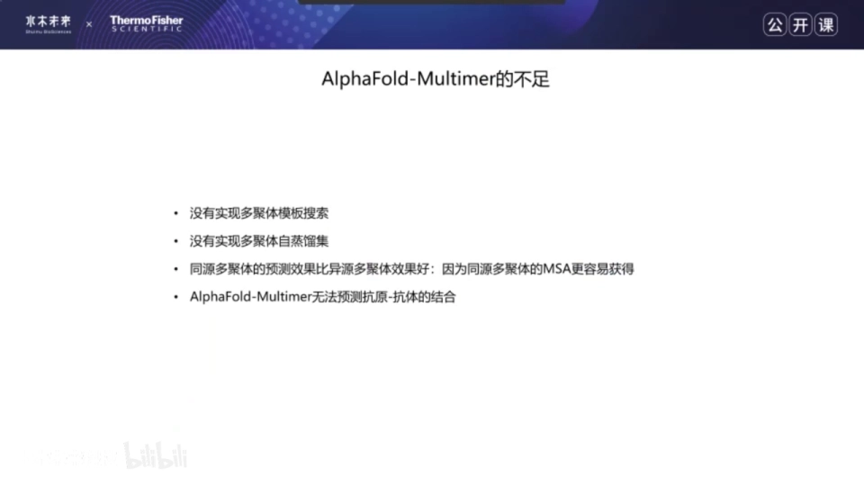

1. **没有实现多聚体模板搜索**：虽然会搜模板，但模板只用来指导单体结构，不指导复合体结构；
2. **没有实现多聚体自蒸馏集**：自蒸馏集都是单体的；
3. **同源多聚体优于异源多聚体**：因为同源 MSA 更易获得，异源要靠 MSA 拼接；
4. **无法预测抗原-抗体结合**。

第 4 条在答疑里被追问"为什么"。讲者的猜测是：抗原-抗体预测同样依赖 MSA 的共变信息，而抗体往往**搜不到足够的同源序列**，构不出可用的 MSA，所以做不了。 [【跳转到 52:32】](https://www.bilibili.com/video/BV1aF411b76x/?t=3152) 这个解释和前面"MSA 只覆盖一端"的根因是同一条逻辑：**没有跨链的进化证据，就没有界面。**

## 五、多分子体系的边界：这一代模型只做蛋白-蛋白

本节标题里的"多种分子"，在这支公开课里是以**排除法**出现的，而这些排除恰恰是判断"对象属于哪一类"的关键：

| 问题 | 讲者的回答 | 对"预测对象"的含义 |
| :--- | :--- | :--- |
| 能预测蛋白与小分子化合物吗？ | **不可以**。AlphaFold、AlphaFold2、AlphaFold-Multimer 都只能预测蛋白质，或蛋白质与蛋白质之间的相互作用 | 配体、离子不在对象集合内 |
| 能预测多肽与蛋白的相互作用吗？ | 可以，试过十几个氨基酸的序列也能出结果，但那一小段预测得并不太准确 | 短肽仍属"蛋白-蛋白"范畴，只是精度受限 |
| 不同物种来源的蛋白复合物能做吗？ | 从开发思想上应该不支持，因为构造 MSA 时默认把**相同物种**的序列拼在一起；但可以试 | 跨物种复合物违背了 MSA 拼接的基本假设 |
| 链的数量有限制吗？ | 目前测试下来，只要所有链的长度加起来不超过显存允许范围，应该没有限制 | 限制来自资源，不来自对象定义 |
| 翻译后修饰介导的 PPI 能预测吗？ | 讲者不确定，论文没有按 PPI 类型分类；可参考 David Baker 那篇 Science 的分类结果 | 对象类别相同，但证据类型可能不同 |

多肽那一条值得展开一句：讲者提到有文章测试过用 AlphaFold2 预测多肽与蛋白的相互作用，**大约 50% 以上能被预测得比较准**。 [【跳转到 67:54】](https://www.bilibili.com/video/BV1aF411b76x/?t=4074) 也就是说，同样是"蛋白-蛋白"对象，长度悬殊的一对（长链 + 短肽）成功率明显低于两条 globular 结构域——**对象的"形状类型"也会影响可预测性**。

另外两个答疑点也属于"输入怎么定义"的范畴：

- **序列顺序会影响结果吗？** 不会，代码里用 Python 的 set 做过去重； [【跳转到 61:40】](https://www.bilibili.com/video/BV1aF411b76x/?t=3700)
- **已有结构能不能当约束？** 可以加进模板库让它去搜，但那是**软约束**——只让结果偏向你给的结构，不保证一定是你给的结构；模型无法把"两个原子距离必须在某区间"当硬约束。 [【跳转到 60:10】](https://www.bilibili.com/video/BV1aF411b76x/?t=3610)

还有一条与"对象规模"直接相关的经验：讲者测试过一个 3900 个氨基酸的同源三聚体，预测结果出现明显错误，**而模型自己也表现得不自信**。 [【跳转到 40:42】](https://www.bilibili.com/video/BV1aF411b76x/?t=2442) 这说明对象越大，界面越多，误差累积越明显——"能不能预测"和"预测得准不准"是两件事。

## 六、怎么判断一个复合物预测靠不靠谱

对象分清了、输入写对了，最后一步是**读结果**。复合物的评估和单体不一样：单体看 pLDDT 就够，复合物必须看"界面"。

### 6.1 DockQ：评测复合物的专用指标

DockQ 把三个量平均起来，落在 0 到 1 之间： [【跳转到 04:31】](https://www.bilibili.com/video/BV1aF411b76x/?t=271)

$$
\mathrm{DockQ}(F_{nat}, LRMS, iRMS, d_1, d_2) = \frac{F_{nat} + \mathrm{RMS}_{scaled}(LRMS, d_1) + \mathrm{RMS}_{scaled}(iRMS, d_2)}{3} \in [0, 1]
$$

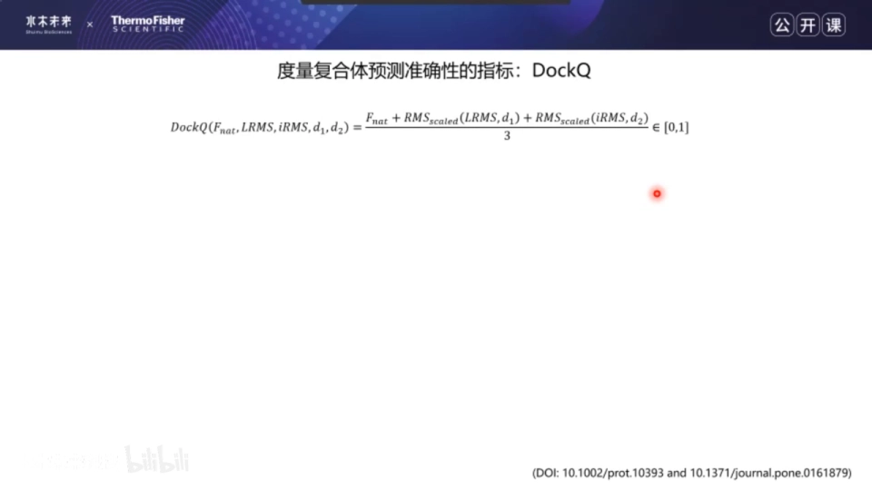

三个分量各自回答一个问题：

- $F_{nat}$：预测界面上的 contact 有多大比例在真实复合物里也存在（0 到 1）；
- $LRMS$：把两条相互作用链中**较长的链**对齐后，**较短的链**算出的 RMSD；
- $iRMS$：只考虑界面区域（两结构相距 10 Å 以内的原子）时，预测与真实的一致性。

后两项不是 0 到 1 的量，要用 RMSD scale 公式归一化，所以三项平均后仍在 $[0,1]$。经验判据：大于 0.23 算成功，0.49 是 medium accuracy，大于 0.8 是 high accuracy。 [【跳转到 06:01】](https://www.bilibili.com/video/BV1aF411b76x/?t=361)

这里要特别提醒：**0.23 这个"成功线"其实很低**——它只要求界面上一部分接触是对的。所以看到"成功率 80%"这类说法时，要先问清楚用的是哪个阈值、评的是哪类对象。

### 6.2 pTM、ipTM 与 PAE：没有真结构时看什么

真实结构未知时，只能看模型自己给的置信度。讲者先引入 TM-score：把预测结构与真实结构比对后算一个归一化的相似度，取值 0 到 1；AlphaFold2 让模型直接**预测**这个值，得到 pTM。AlphaFold-Multimer 又加了 ipTM，**更强调相互作用界面**。最终置信度是两者的加权： [【跳转到 27:14】](https://www.bilibili.com/video/BV1aF411b76x/?t=1634)

$$
\mathrm{confidence} = 0.8 \times \mathrm{ipTM} + 0.2 \times \mathrm{pTM}
$$

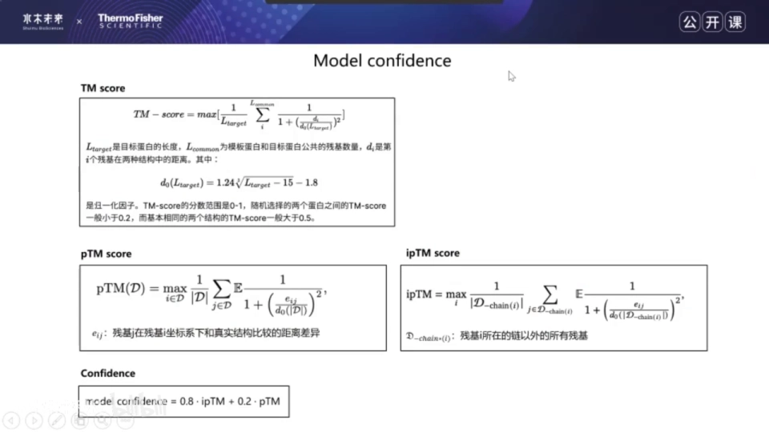

看这张图里的 ipTM 定义就明白它为什么"专盯界面"：求和范围是 $\mathcal{D}_{chain(i)}$，也就是**残基 i 所在链以外的所有残基**。换句话说，pTM 统计全部残基对，ipTM 只统计**跨链**的残基对——链内折叠得再好，也不会抬高 ipTM。

另一个指标是 PAE（predicted aligned error）：它是一个矩阵，元素 $(i,j)$ 表示"以残基 i 的坐标系对齐两个结构时，残基 j 的距离误差"，**越小越好**（图上颜色越深越好）。 [【跳转到 39:39】](https://www.bilibili.com/video/BV1aF411b76x/?t=2379)

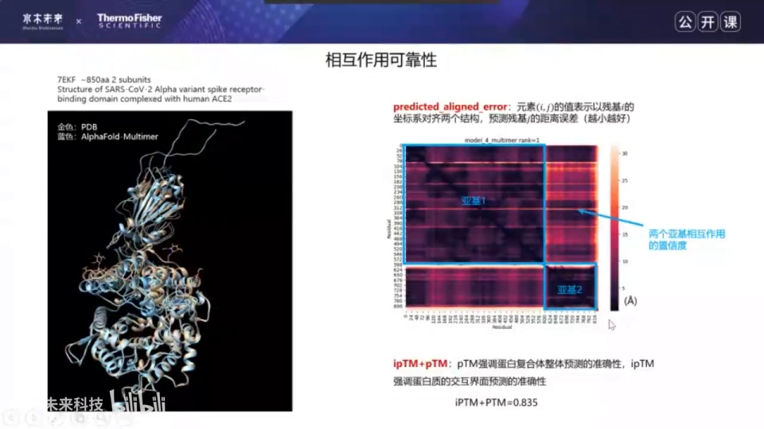

这张图是读复合物 PAE 的标准姿势：**矩阵被两条链切成三块**——左下大亚基内部、右下小亚基内部、以及中间那块"跨链区块"。**中间区块颜色越深（误差越小），界面预测越准。** 图上这个例子是 SARS-CoV-2 Alpha 变异株 spike 受体结合域与人 ACE2 的复合物（7EKF，约 850 个氨基酸、2 个亚基），ipTM+pTM 为 0.835。

### 6.3 阈值与实践经验

- **pTM / ipTM 尽量在 0.5 以上**：随机两个蛋白之间的 TM-score 一般小于 0.2，两个基本相同的结构一般大于 0.5； [【跳转到 56:03】](https://www.bilibili.com/video/BV1aF411b76x/?t=3363)
- **PAE 要跟"亚基内"比**：如果亚基间的误差跟亚基内的误差比较接近，说明界面预测得不错； [【跳转到 56:42】](https://www.bilibili.com/video/BV1aF411b76x/?t=3402)
- **clash 是危险信号**：原始流程里有 relax 迭代去 clash，如果 relax 都解决不了，说明预测准确率可能比较低，没必要继续深挖； [【跳转到 57:55】](https://www.bilibili.com/video/BV1aF411b76x/?t=3475)
- **想单看界面**：可以从输出里单独解析 ipTM，它比整体 confidence 更贴近"界面准不准"。 [【跳转到 62:23】](https://www.bilibili.com/video/BV1aF411b76x/?t=3743)

## 七、工程侧的最小必要

这一节只保留与"对象定义"直接相关的部分，其余（数据库更新、docker 命令、输出文件清单、ChimeraX 操作）属于实现细节。

**安装**本质上是三件事：更新代码（`git fetch` 或改 `PYTHONPATH`）、更新数据库（加 UniProt 以获得物种信息、更新 PDB seqres 与 mmCIF 目录以保持对应）、下载新模型。 [【跳转到 33:19】](https://www.bilibili.com/video/BV1aF411b76x/?t=1999)

**运行**时与对象定义相关的参数只有两个：输入序列（**两条或两条以上**），以及"复合体是否来自原核生物"——因为原核与真核的 MSA 拼接方式不同。 [【跳转到 34:42】](https://www.bilibili.com/video/BV1aF411b76x/?t=2082)

**搜索数据库**上有一处关键差异：AlphaFold-Multimer 额外引入 UniProt（相当于 UniRef90 的子集，但带完整物种信息）用于 MSA 拼接；模板从 PDB70 换成 PDB seqres（所有 PDB 模板序列），目的是搜得更全。 [【跳转到 22:08】](https://www.bilibili.com/video/BV1aF411b76x/?t=1328)

**训练数据**也围绕复合物做了两处调整：训练集仍是 2018-04-30 前的 PDB 数据（分辨率 9 Å 以下、氨基酸占比小于 80%），另建一个**自蒸馏集**（用 MGnify 序列、由模型自己预测结构得到），两者一起训练最终模型。 [【跳转到 23:09】](https://www.bilibili.com/video/BV1aF411b76x/?t=1389)

**显存**是对象规模的硬约束：讲者在 A100 40G 上测过 3600–3800 个残基的输入；一个降低显存的办法是不要一次 load 五个模型，而是 load 一个、跑完、删掉、再 load 下一个。 [【跳转到 48:07】](https://www.bilibili.com/video/BV1aF411b76x/?t=2887)

**输出**里要注意链名重映射：PDB 里的链名会被重命名（比如变成 A、B、AA 链），要和原始输入对应，得查 `msa_chain_id_map.json`。 [【跳转到 37:45】](https://www.bilibili.com/video/BV1aF411b76x/?t=2265)

**可视化**：在 ChimeraX 里同时打开预测结构与 PDB 标准结构，用 structure comparison / matchmaker 叠合；给每条链赋不同颜色，或直接显示 pLDDT。 [【跳转到 38:22】](https://www.bilibili.com/video/BV1aF411b76x/?t=2302)

**Colab 版**在对象层面有两个差别：不搜索模板（用 reduced BFD）、不使用 UniClust30。 [【跳转到 41:08】](https://www.bilibili.com/video/BV1aF411b76x/?t=2468) 这意味着同一个复合物在 Colab 与本地跑，证据来源不同，结果可能有差异。

## 小结

- **"复合物"是结构层级的第四层**：前三级讲一条链内部，第四级才讲链与链之间；界面靠形状互补与疏水作用、盐桥、氢键等具体的力维持。
- **把单体模型拼成复合物会失败，根因是 MSA 只覆盖一端**：linker 方案下大部分比对行只匹配一条链，跨链共变信号整块缺失；按物种拼接 MSA 后，单例 DockQ 从 0.01 升到 0.9，1480 个复合物上也有一半以上越过 0.23 的成功线。
- **链身份与拷贝数是显式编码的**：asym_id 给链编号，entity_id 把相同序列的链归并，sym_id 标注同序列链里的第几份——同源多聚体与异源复合物的差别，就体现在这三个字段的取值上。
- **化学计量由输入份数决定，模型不会替你猜**：想预测二聚体就拷贝两次（`-A`、`-B`），三聚体拷贝三次；不知道几聚体就扫 2/3/4 聚体比较置信度，但那只给出假设。
- **同源多聚体反而比异源复合物好预测**：因为同源 MSA 容易获得，异源必须做跨链配对——"对象更复杂"不等于"预测更难"。
- **这一代模型只做蛋白-蛋白**：小分子、离子不在对象集合内；跨物种复合物违背 MSA 拼接假设；抗原-抗体因搜不到足够同源序列而做不了。
- **复合物的评估要看界面**：DockQ 用于有真值的评测（0.23 成功、0.49 中等、0.8 高精度），pTM/ipTM/PAE 用于无真值的判读，其中 ipTM 只统计跨链残基对，confidence $= 0.8\,\mathrm{ipTM} + 0.2\,\mathrm{pTM}$。

## 关键术语速查

| 术语 | 一句话解释 |
| :--- | :--- |
| 四级结构 | 多条肽链通过非共价相互作用组装成的结构，是"复合物"这一层 |
| 同源多聚体 | 由同一种链的多个拷贝组成的复合物，如二聚体、三聚体 |
| 异源复合物 | 由不同种链按一定化学计量组成的复合物 |
| 化学计量 | 复合物里每种链各出现几份，如 $A_2B_2$ |
| residue_index | 残基在序列中的位置编号，AlphaFold2 里唯一的位置信息 |
| asym_id | 链索引，纯粹给每条链编号 |
| entity_id | 去重后的链索引，序列相同的链共用一个编号 |
| sym_id | 相同序列的链内部的编号，区分第几份拷贝 |
| MSA 拼接 | 把不同链的同源序列按物种配对，构造跨链的配对 MSA |
| DockQ | 复合物预测准确度指标，FNAT、LRMS、iRMS 三项平均 |
| pTM | 模型预测的 TM-score，衡量整体结构相似度 |
| ipTM | 只统计跨链残基对的 TM-score 类分数，专盯界面 |
| PAE | 预测对齐误差矩阵，元素 $(i,j)$ 表示以 i 的坐标系对齐时 j 的距离误差 |
| 软约束 | 通过模板等方式让结果"偏向"某个结构，但不保证满足 |
