# 共价几何与距离几何：分支定界如何把距离约束还原成蛋白质坐标

> 视频来源：[A study on the covalent geometry of proteins and its impact on distance geometry](https://www.youtube.com/watch?v=jkrUwAZsdrQ&t=0)（YouTube · GSI 2023 会议报告 · Simon B. Hengeveld，IRISA / 雷恩大学）
> 导读：这支报告讲的是"拿到一堆原子间距离之后，怎么把它变成三维坐标"——也就是距离几何问题（DGP）的求解器。讲者用分支定界（branch-and-prune）把连续的搜索空间切成离散分支，再逐条剪枝；他还专门研究了标题里那件事：被当作"精确值"喂进去的共价几何（键长、键角、ω 二面角）其实有可观的波动，这个波动会直接变成最终结构的误差。

## 本讲要解决的核心问题（SCQA）

**背景**：本系列前面几节已经能把序列信息变成"哪两个残基挨得近"——共演化分析给出接触图，进一步还能给出距离区间。也就是说，我们手上已经有了一张**成对距离表**。 [【跳转到 00:00】](https://www.youtube.com/watch?v=jkrUwAZsdrQ&t=0)

**冲突**：距离表不是结构。距离表只说了"谁离谁多远"，没有说"谁在哪"。而且这张表通常不完整（只覆盖一部分原子对）、不精确（是区间而不是数值）、还可能自相矛盾。更麻烦的是：**距离满足约束，并不等于坐标就是对的**——后面会看到一个具体的反例（二面角符号被翻过来）。 [【跳转到 12:21】](https://www.youtube.com/watch?v=jkrUwAZsdrQ&t=741)

**疑问**：怎么从一堆成对距离求出三维坐标？如果这些距离只是区间、还带噪声，重建出来的结构会差多少？"约束够不够"和"约束准不准"分别影响什么？

**回答（中心思想）**：距离几何把折叠写成一道**约束满足问题**：给定对象集合、成对距离（精确值或区间）、目标维数 $K$，求一组坐标使所有距离成立。对蛋白质，$K=3$，一个解就是一种可能的三维结构。求解的关键技巧是**离散化**——用三球相交把"连续无穷多个位置"压成"两个点"或"两段弧"，于是可以搭一棵**分支定界树**把所有解枚举出来；而在剪枝阶段插入**局部优化**（谱投影梯度法），能把"因为切分太粗而差点被剪掉"的解救回来。代价是：优化只盯着距离、不认角度，可能把二面角符号翻掉；而被当作"精确值"的共价几何本身也有波动，这构成了重建精度的天花板。

---

## 一、把"折叠"写成一道数学题：距离几何问题

**距离几何问题**（Distance Geometry Problem，DGP）的输入只有三样东西： [【跳转到 00:44】](https://www.youtube.com/watch?v=jkrUwAZsdrQ&t=44)

1. **一组对象**（objects）——可以是任何东西，分子里的原子、传感器网络里的节点；
2. **一些成对距离**（pairwise distances）——可以是**精确值**，也可以是**区间**（只知道下界 $\underline{d}$ 和上界 $\overline{d}$）；
3. **目标维数 $K$**——想把它们摆到几维空间里。

目标是：**在 $K$ 维空间里找出这些对象的位置，使所有给定的距离都被满足**。

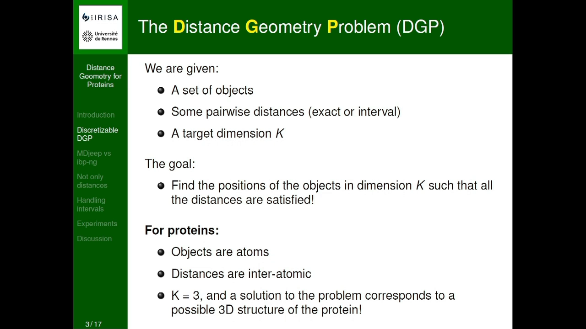

放到蛋白质上，这三样东西一一对应：**对象是原子，距离是原子间距离，$K=3$**。于是"问题的一个解"就对应"蛋白质在三维空间中的一种可能结构"。 [【跳转到 01:04】](https://www.youtube.com/watch?v=jkrUwAZsdrQ&t=64)

这里有个容易被忽略的措辞：讲者说的是"**一种**可能结构"，不是"那个"结构。距离约束定下来的往往是**一族**结构（比如整体镜像翻转后距离完全不变），所以求解器的任务不是"算出唯一答案"，而是"**把所有满足约束的答案都找出来**"。这一点决定了后面整套算法的形态——它是一棵**枚举树**，不是一个优化器。

## 二、离散化：三球相交把连续搜索变成有限分支

如果只有距离，搜索空间是连续的（每个原子可以在一个球面上任意位置），没法枚举。**离散化**（discretization）就是把这个连续空间压成有限个候选。

讲者的例子很直观：假设已经知道三个原子 $v_1,v_2,v_3$ 的坐标，现在要算第四个原子 $v_4$，同时知道 $v_1$–$v_4$、$v_2$–$v_4$、$v_3$–$v_4$ 这三个距离。以每个已知原子为球心、以相应距离为半径画球——**三个球面的交点，就是 $v_4$ 的全部可能位置**。 [【跳转到 01:24】](https://www.youtube.com/watch?v=jkrUwAZsdrQ&t=84)

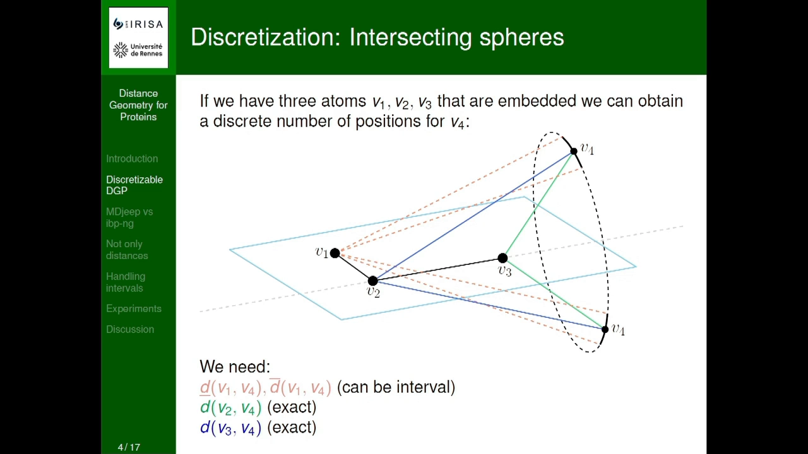

- 三个距离**全是精确值**：三个球面交出**两个点**（互为镜像）。搜索空间从"无穷多"变成"2"。
- 三个里**有一个是区间**：交出来的不是两个点，而是**两段圆弧**——因为那一个球变成了一层球壳（有厚度），交线就成了一段弧。$v_4$ 可以落在这段弧上的任何位置，于是还得再离散化一次。 [【跳转到 01:44】](https://www.youtube.com/watch?v=jkrUwAZsdrQ&t=104)

注意这里的**前提**：要能这样一步步往下算，每个新原子至少需要**两个精确距离**（第三个可以是区间）。这个前提在后面会变成整篇报告的题眼——因为蛋白质里能当"精确距离"用的，只有共价几何那一小撮。 [【跳转到 07:43】](https://www.youtube.com/watch?v=jkrUwAZsdrQ&t=463)

顺带说清"区间"这件事的分量：距离不是随便给个数就行的，它必须满足**三角不等式**——$d(v_1,v_4) \le d(v_1,v_2) + d(v_2,v_4)$。所以一张区间距离表（也就是常说的 **bounds matrix**，上下界矩阵）如果要"可实现"，各区间之间必须彼此相容；一旦不相容，就没有任何一组坐标能同时满足。这也是为什么区间情形比精确情形难得多：精确值只在球面上找点，区间要在球壳的交集里找，交集可能是一段弧、一个曲面片，甚至空集。

## 三、分支定界：把"所有解"枚举成一棵树

只要原子按正确的顺序排好，上面那个"三球相交"的动作就可以一直做下去，从而找出满足所有距离约束的**所有**可能解。做这件事的框架叫**分支定界**（Branch-and-Prune，BP）。 [【跳转到 02:04】](https://www.youtube.com/watch?v=jkrUwAZsdrQ&t=124)

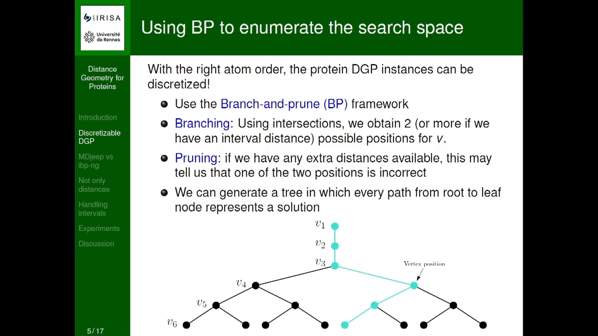

它由两个动作组成：

- **分支（branching）**：为某个原子计算候选位置。用相交法得到 2 个位置；如果那条距离是区间，就得到更多（两段弧上的若干点）。
- **剪枝（pruning）**：手上如果还有**额外的距离约束**没用到，就拿它去检验这些候选位置——一旦发现某个位置不对，就把整条分支砍掉。

于是整棵树的结构是：**每个节点 = 一个原子的一个候选位置；从根节点到叶节点的一条路径 = 一个完整解**。剪枝的作用是让这棵树"爆炸得少一点"——没有剪枝，分支数会指数增长到不可算。

这两个动作也解释了为什么"约束越多越好"：**多一条距离，就多一次剪枝的机会**。反过来，约束稀疏时树会失控，这正是后面实验里某些蛋白找不到解的原因之一。
## 四、蛋白质上的完整流程：从一条氨基酸链到一堆结构

把上面三步串起来，蛋白质上的完整流程是这样的： [【跳转到 02:36】](https://www.youtube.com/watch?v=jkrUwAZsdrQ&t=156)

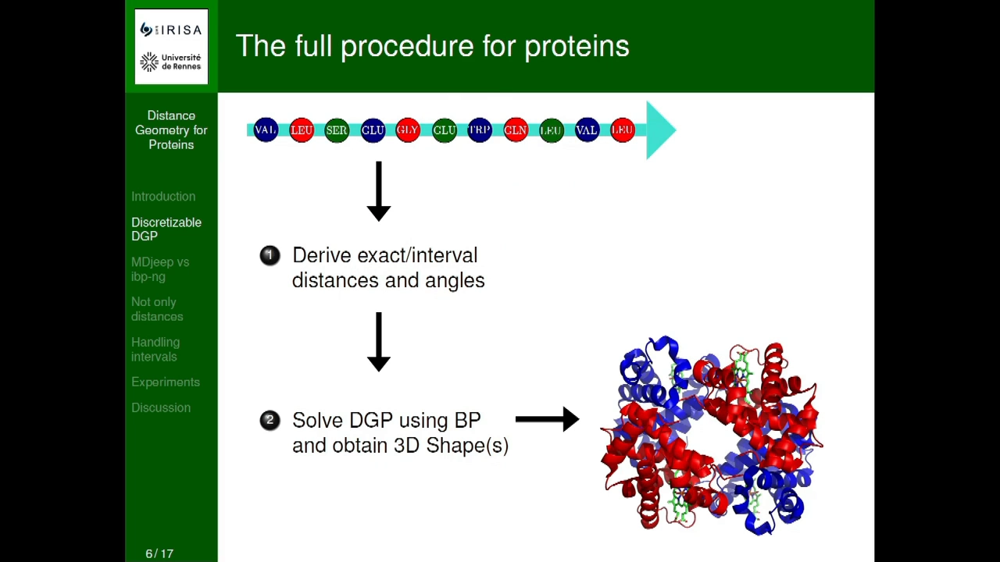

1. **输入是一条氨基酸链**——这意味着我们已知蛋白质里有哪些原子、它们之间怎么成键（这就是"共价几何"这个词的来历）；
2. 从这些信息**推出距离，也推出角度**（角度还能以另一种方式利用，见下一节）；
3. 用这些距离**构造一个距离几何问题的实例**；
4. 用**分支定界求解器**去搜结构，得到一个或多个三维形状。

值得注意的是第 2 步里"推出"这两个字：距离不是实验测出来的，而是**从化学键的几何规则算出来的**。键长、键角这些量在化学教科书里几乎是常数，所以直接当精确值用。这一步省掉了实验测距的麻烦，但也把"这些常数到底有多准"的问题埋进了整条流水线——报告的后半段就是来还这笔债的。

分支定界方法目前有两个实现，最初都用 C 写：**iBP-NG** 和 **MD-jeep**。这篇论文把两者做了对比：实验用的是 iBP-NG 原始的 C 版本；讲者把 MD-jeep 重新用 Java 实现了一遍并加了额外功能，论文发表之后又继续改进了这个实现。 [【跳转到 02:56】](https://www.youtube.com/watch?v=jkrUwAZsdrQ&t=176)

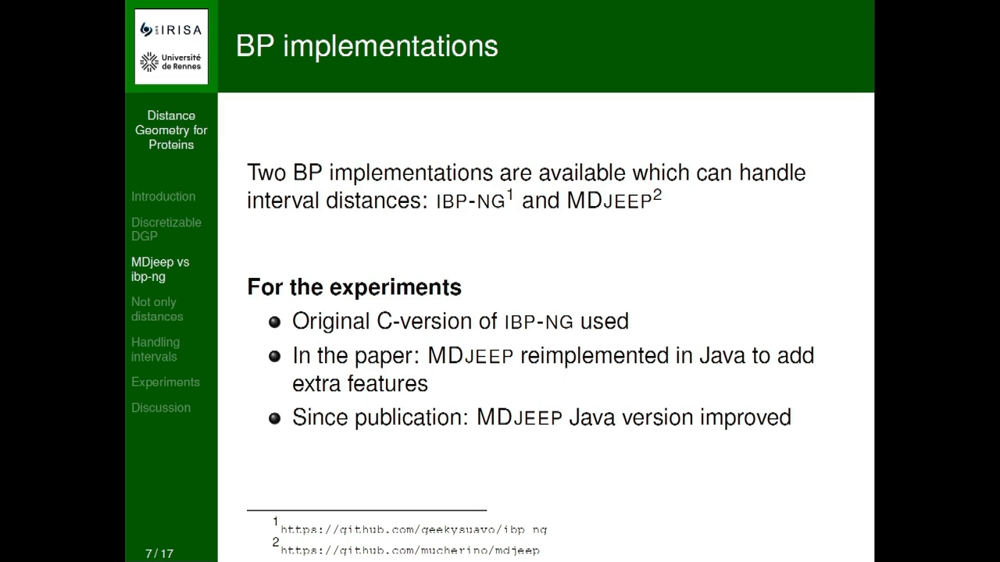

这两个实现在两个关键点上分道扬镳：**① 怎么利用输入里的二面角；② 分支时遇到"由区间距离得到的两段弧"该怎么处理**。下面两节分别讲。

## 五、二面角：距离之外的第二种信息

**二面角**（dihedral angle）的定义：给定四个原子 $v_1,v_2,v_3,v_4$ 组成的一个序列，二面角 $\tau$ 是**平面 $v_1v_2v_3$ 与平面 $v_2v_3v_4$ 之间的夹角**。 [【跳转到 03:33】](https://www.youtube.com/watch?v=jkrUwAZsdrQ&t=213)

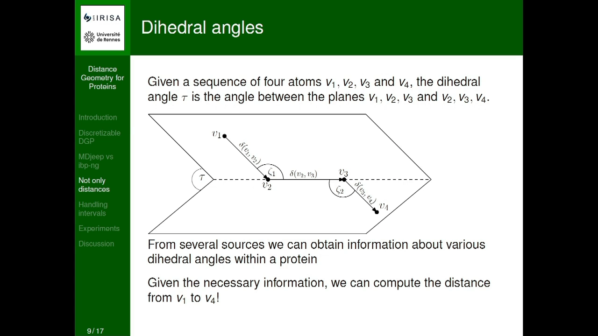

为什么二面角这么有用？因为当手上有一条氨基酸序列时，这些角的值**是可以推出来的**——来源可以是力场，也可以是别的建模工具。而拿到角之后，有两种用法： [【跳转到 03:58】](https://www.youtube.com/watch?v=jkrUwAZsdrQ&t=238)

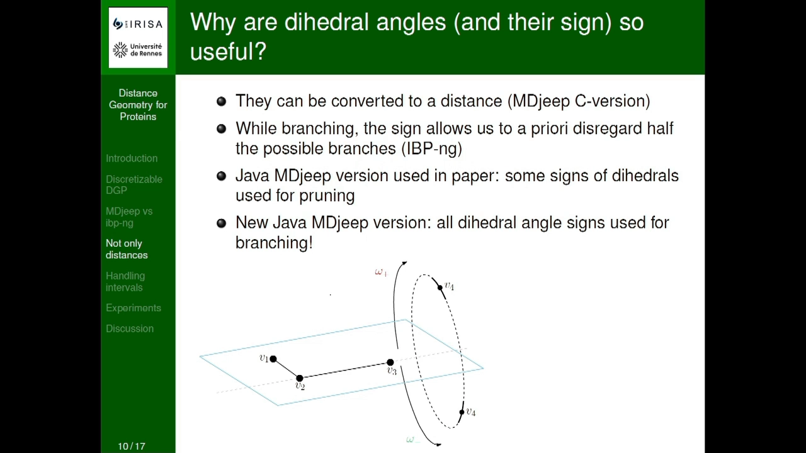

**用法一：把角换算成距离。** 信息足够时，一个二面角能多算出一个距离——比如从第一个原子到第四个原子的距离。MD-jeep 的 C 版本是**纯距离型**的实现，它利用二面角的唯一方式就是这种换算。

**用法二：用角的符号砍分支。** 回到分支过程：为 $v_4$ 算出了两个候选位置，但如果这串原子正好对应输入里已有的一个二面角，我们就**知道这个角的符号**（正/负，即往哪一边扭），于是知道两条分支里有一条是错的——可以**先验地砍掉一半**。iBP-NG 用的就是这一招。

讲者的 Java 版 MD-jeep 在这件事上走了三步：论文里的第一版只在**剪枝**阶段用了部分二面角符号；最新的版本在**分支**阶段就用上了**所有**二面角的符号。 [【跳转到 04:58】](https://www.youtube.com/watch?v=jkrUwAZsdrQ&t=298)

这里有个值得记住的细节：**距离丢掉了符号信息**。两个原子到第三个原子的距离相同，可以对应"往左扭"和"往右扭"两种完全不同的构象，而距离表上看不出区别。二面角的符号，本质上是在补距离表丢掉的那一维信息——也就是**手性**。这一点在最后一章会变成一个具体的失败模式。

## 六、区间距离怎么切：均匀采样 vs 包围盒加局部优化

第二个关键差别是：分支时遇到**区间距离**（一段弧），怎么把它变成有限个分支？

**iBP-NG 的做法很直接**：有一个分支参数 $B$，遇到一段弧就把它**均匀切成 $B$ 段**，每段取一个点，在树里新建一条分支。于是遇到区间距离会产生 $2B$ 条分支；如果还知道角的符号，就只产生一半（$B$ 条）。 [【跳转到 05:18】](https://www.youtube.com/watch?v=jkrUwAZsdrQ&t=318)

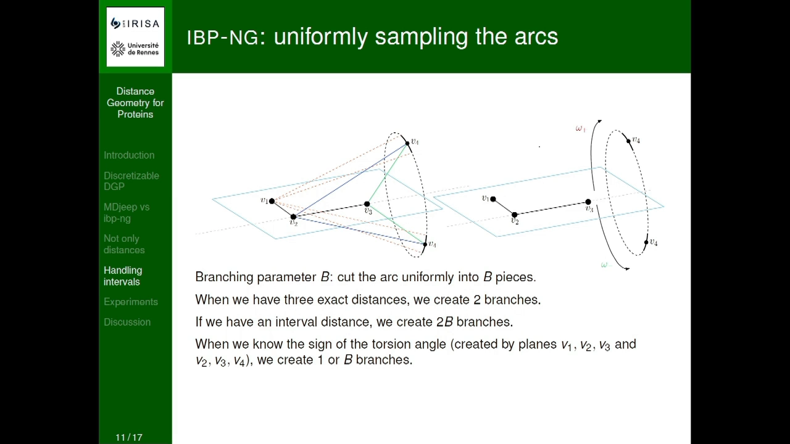

问题在于：**这个切法未必正确**。真实解可能落在两个采样点之间的缝里，于是被漏掉——表现出来就是"某些蛋白质我们一个解都找不到"。 [【跳转到 05:38】](https://www.youtube.com/watch?v=jkrUwAZsdrQ&t=338)

**MD-jeep 换了思路**：用带**分辨率参数 $\rho$** 的粗粒化表示。关键动作是**在每个原子位置周围定义一个盒子**（最大尺寸 $\rho$），然后**允许原子在盒子里移动**——本质上就是让这个原子在那段弧内滑动，这样仍然能找到所有解。 [【跳转到 05:58】](https://www.youtube.com/watch?v=jkrUwAZsdrQ&t=358)

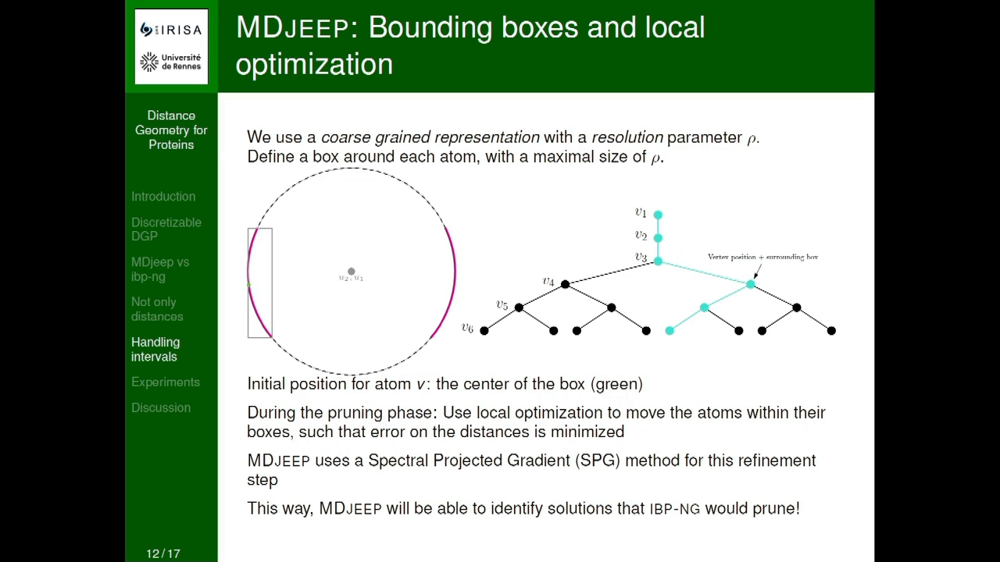

具体规则是：如果三个距离都是精确的，就定义一个**很小的盒子**（顶点位置相当确定）；如果有一个是区间距离，就用弧来定义盒子——弧很小就把整段弧装进一个盒子；弧太大就用 $\rho$ 把弧切成多段，每段周围定义一个盒子。于是树里每个节点不再只是"一个顶点位置"，而是"**顶点位置 + 它周围的盒子**"，位置初始化为盒子中心（图里的绿点）。 [【跳转到 06:23】](https://www.youtube.com/watch?v=jkrUwAZsdrQ&t=383)

那什么时候移动原子？在**剪枝阶段**：已经算出了若干候选位置，但遇到一个距离说其中某个位置不对。**在把整条分支剪掉之前，先跑一次局部优化**——用的是**谱投影梯度法**（spectral projected gradient，SPG），尽量把所有距离上的误差降到最小，看看还能不能满足那个卡住的距离。能满足就继续；仍然不行，才剪掉这条分支。 [【跳转到 07:03】](https://www.youtube.com/watch?v=jkrUwAZsdrQ&t=423)

一句话总结这个设计的价值：**它把"剪枝"从"一刀切"变成了"先救一救再决定"**。iBP-NG 因为切点没落准而误杀的解，MD-jeep 靠盒内微调能救回来——这正是后面实验里"iBP 只解出 359/391、MD-jeep 解出 391/391"的直接原因。

## 七、标题里的"共价几何"：被当成精确值的距离其实并不精确

现在回到报告标题里的那件事。前面反复强调：**离散化需要每个原子有一定数量的精确距离**——至少两个，其中一个可以是区间，但至少要有两个精确的。对蛋白质来说，被当作"精确"的距离来自**共价几何**，也就是键长，以及与键角、$\omega$ 二面角相关的距离。 [【跳转到 07:43】](https://www.youtube.com/watch?v=jkrUwAZsdrQ&t=463)

但这些距离**在实践中并不是真的精确**。讲者给了一张很有说服力的图：某些键角的变化相当大，而且变化**随氨基酸种类不同而不同，也随蛋白质所处的拉氏图（Ramachandran）区域不同而不同**。 [【跳转到 08:03】](https://www.youtube.com/watch?v=jkrUwAZsdrQ&t=483)

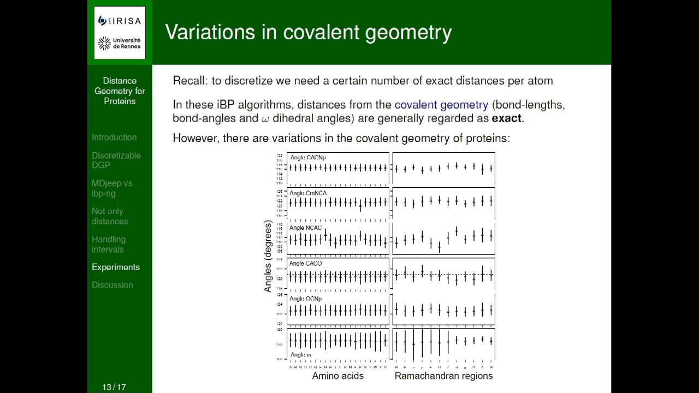

这张图是整篇报告的关键证据，值得细看它的结构：纵轴是角度（度），横轴分成两栏——左栏按**氨基酸种类**（A、N、C、D…）分组，右栏按**拉氏图区域**分组；每一行是一种键角（Cα-C-N、Cα-N-Cα、N-Cα-C、Cα-C-O、O-C-N、$\omega$ 等）。每个小竖线是一个分布，不是一根常数线。

它说明的事情是：**"键角是常数"只是一个近似**。真实蛋白质里，同一个键角在不同残基、不同主链构象下有零点几度到一两度的散布。当求解器把这些值当"精确距离"喂进去、并据此做离散化和剪枝时，这个散布就变成了**输入噪声**——而输入噪声会一路传到最后的结构误差上。

这也解释了为什么讲者要专门做实验：如果共价几何真的精确，那么"只用共价几何 + 少量二面角区间"就应该能重建出很好的结构；如果重建误差明显不为零，那误差的来源只能是共价几何的波动本身。**这就是把"约束的精度"和"结构的精度"分开测量的意义。**

## 八、实验：391 个蛋白、四类约束、一张 RMSD 表

**测试集**：391 个氨基酸数少于 100 的蛋白质，每一个都有 X 射线晶体学结构——也就是说，我们**知道标准答案**，算出结构后可以直接和实测结构比。 [【跳转到 08:23】](https://www.youtube.com/watch?v=jkrUwAZsdrQ&t=503)

**喂进去的约束有四类**： [【跳转到 08:41】](https://www.youtube.com/watch?v=jkrUwAZsdrQ&t=521)

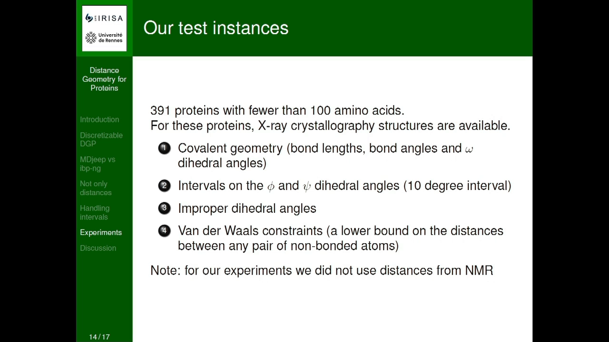

1. **共价几何**：键长、键角、$\omega$ 二面角（被当作精确值）；
2. **$\phi$ 和 $\psi$ 二面角的区间**：给的是 10 度的区间；
3. **反常二面角**（improper dihedral）：用来固定局部手性/平面性；
4. **空间位阻约束**（steric constraints / 范德华约束）：给"两个原子能靠近到什么程度"设一个**下界**，避免结构里出现原子碰撞。

讲者特意说明：**实验里没有用 NMR 约束**——虽然 NMR 距离在距离几何里非常常用。原因是这次想聚焦共价几何，而且处理的是 X 射线蛋白，手头本来就没有 NMR 信息。 [【跳转到 09:21】](https://www.youtube.com/watch?v=jkrUwAZsdrQ&t=561)

这句话很重要，它界定了整个实验的难度：**没有任何长程距离**。所有距离约束都是局部的主链/侧链几何，外加二面角区间和碰撞下界。这相当于问："只靠化学常识（键长键角）加上一点主链构象偏好，能不能把一个蛋白的三维结构拼出来？"

**评价指标**是算出的结构与 X 射线实测结构之间的**均方根偏差**（RMSD，root mean square deviation）——把两个结构叠合后，逐原子算偏差、平方、平均、开根号，单位是埃（Å）。RMSD 越小越接近实验结构。

| 实现 | 解出的蛋白数 | RMSD 范围 | RMSD 均值 | 备注 |
| :--- | :--- | :--- | :--- | :--- |
| iBP-NG | 359 / 391 | 0–6 Å | 1.61 Å | 原始 C 版本 |
| MD-jeep 1 | 391 / 391 | 0–12 Å | 3.23 Å | 论文里的 Java 重实现 |
| MD-jeep 2 | 391 / 391 | 0–6 Å | 1.68 Å | 最新 Java 版本 |

三条结论： [【跳转到 10:01】](https://www.youtube.com/watch?v=jkrUwAZsdrQ&t=601)

- **MD-jeep 对所有蛋白都找到了解，而 iBP-NG 在很多情况下找不到解**——那 32 个失败案例，很可能就是因为分支时把弧切成小段、错过了正确的切点。而 MD-jeep 因为用了盒内局部优化，把这 32 个都救回来了。
- **RMSD 差别很大**：第一版 Java 重实现偏差相当差（0 到 12 Å），而 iBP-NG 相当好；但最新版重实现的 RMSD 和 iBP-NG **非常接近**（1.68 vs 1.61 Å）。
- **最新版跑得很快**：大约 5 到 15 秒就能生成一个蛋白质结构。

讲者对"为什么最新版突然变准了"的解释很坦率：**很可能是因为他把分支方式改成了 iBP-NG 的方式**，也就是在分支阶段就用上每一个二面角的符号。 [【跳转到 11:01】](https://www.youtube.com/watch?v=jkrUwAZsdrQ&t=661)

这条因果关系值得单独拎出来：**"找得到解"和"解得好"是两个不同的指标，而且由不同的机制决定**。找到解靠的是盒内优化（不漏解）；解得准靠的是二面角符号（不选错分支）。第一版 MD-jeep 优化很强（391/391）但精度很差（3.23 Å 均值），恰恰是因为它优化做得好、却几乎没用符号信息——于是"解是找到了，但找到的是镜像里那个"。

## 九、结论与两个下一步：优化只看距离，就会翻手性

讲者的总结有两条，第二条是自我批评： [【跳转到 11:21】](https://www.youtube.com/watch?v=jkrUwAZsdrQ&t=681)

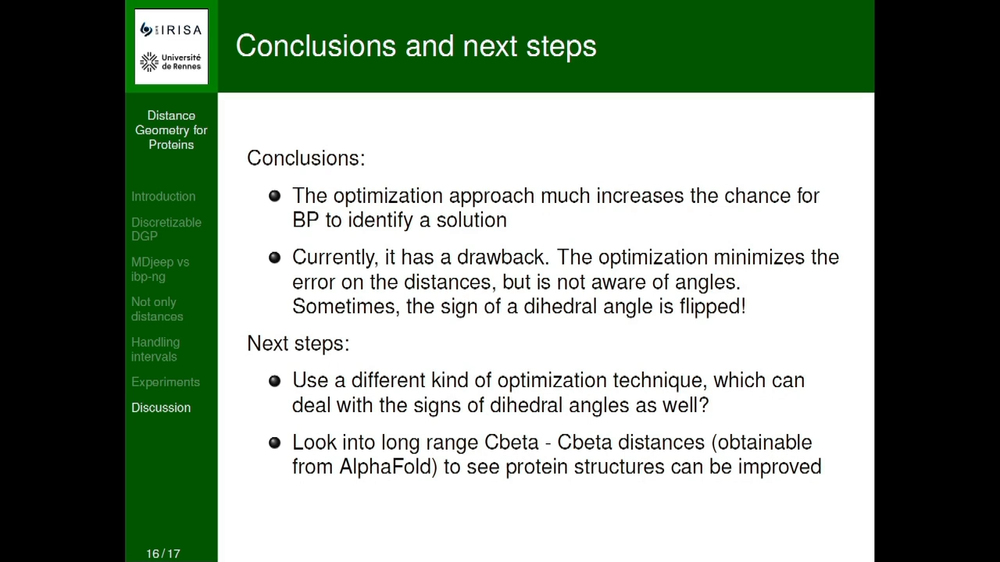

- **结论 1**：优化方法**大大提高了分支定界找到解的机会**——表里能看到，MD-jeep 对所有蛋白都识别出了解。
- **结论 2（缺点）**：因为我们用局部优化去**最小化距离上的误差**，却**对角一无所知**。而分支时是靠角的符号来正确摆放原子的；优化可能**把这个角翻过来，因为距离反正保持不变**。这样就会给结构引入误差。

这是一个非常干净的"约束不完备"演示：距离约束在**镜像翻转**下是不变的（把一段主链像翻手掌一样翻过来，所有原子间距离一模一样），所以一个只对距离求最小值的优化器，**看不出**自己把构象翻到了镜像里。而真实的蛋白质是有手性的——翻过来的结构在化学上就是错的。

对应的两个下一步： [【跳转到 12:41】](https://www.youtube.com/watch?v=jkrUwAZsdrQ&t=761)

1. **换一种能处理角度符号的优化技术**，把角度上的误差也一起最小化，或者加入角度约束；
2. **引入另一类距离**：$C_\beta$ 原子之间的距离（长程），这些距离可以从 AlphaFold 得到，也许能进一步改进所建结构。

第 2 条特别有意思：它说明这条"经典几何"路线并不排斥深度学习预测——**AlphaFold 给出的接触/距离可以直接当作额外的长程约束喂进距离几何求解器**。而第 1 条则说明，光有距离不够，**必须把角度（手性）也约束住**。

## 十、把这条路线放回证据链：稀疏性、噪声与"接触对不等于结构对"

回到本节的学习目标，用这支报告的证据把三件事说清。

### 10.1 约束稀疏性决定"解有多少个"，而不是"解有多准"

本实验里**没有任何长程距离**（没用 NMR，只有共价几何 + 二面角区间 + 碰撞下界）。结果是求解器必须**枚举出一族解**，而不是算出一个唯一结构——这正是分支定界树存在的理由。稀疏的直接后果有三层：

- **树会变大**：剪枝靠"额外距离"，距离少就没得剪；
- **解会变多**：根到叶的每条路径都是一个合法解，需要靠额外判据（比如和实测结构比 RMSD）才能挑；
- **容易漏解**：iBP-NG 那 32 个失败案例说明，离散化太粗时，稀疏约束下的解很容易掉进采样缝里。

所以"约束稀疏"影响的首先是**可解性与解的唯一性**，其次才是精度。

### 10.2 噪声决定"解能有多准"，而且噪声来自最不起眼的地方

被当成精确值的共价几何，实际有随残基种类与拉氏图区域变化的散布（第七节那张图）。即便求解器完全正确、一个解都不漏，**输入噪声也会把误差写进最终坐标**。这就是为什么"只用化学常识重建结构"的 RMSD 均值落在 1.6 Å 量级、最差能到 6 Å——误差不是算法 bug，而是**输入精度**的映射。

### 10.3 距离满足 ≠ 结构正确：三个具体的失效模式

这支报告给了三个可以对照检查的失效模式，它们共同说明"接触/距离预测得准"和"三维结构建得准"是两件事：

1. **手性翻转**：距离约束在镜像下不变，只优化距离的求解器会把二面角符号翻掉（第九节）。接触图/距离表**完全无法**表达手性。
2. **漏解**：离散化切点没落准，真实的解被剪掉——这时"约束全都满足"的解根本不存在于输出里（iBP-NG 的 32 个失败）。
3. **误差累积**：局部几何的零点几度波动，经过整条链的传递，放大成几埃的整体偏差（RMSD 0–6 Å 的分布）。

反过来说，这也解释了为什么现代流程里，**距离/接触预测的指标（如 top-L 精度）不能直接换算成 RMSD**：前者衡量"我给的约束对不对"，后者衡量"在约束不完备、有噪声、还带手性歧义的情况下，重建出来的坐标对不对"。中间隔着一整个求解器。

### 10.4 三条路线的分工

| 路线 | 输入 | 求解方式 | 优点 | 局限 | 本系列位置 |
| :--- | :--- | :--- | :--- | :--- | :--- |
| **嵌入（cMDS）** | 完整的距离矩阵 | 双中心化 + 特征分解，闭式解 | 一步出坐标、极快 | 要求距离矩阵完整且近似欧氏 | 本小节另一篇（经典多维标度 cMDS） |
| **约束优化 / 分支定界** | 稀疏、含区间的距离 | 离散化枚举 + 剪枝 + 局部优化 | 能处理区间、能枚举多解 | 树会爆炸、优化会翻手性 | 本篇 |
| **片段组装** | 序列 + 片段库 + 能量函数 | 片段插入 + 蒙特卡洛采样 + 能量最小化 | 不需要距离约束 | 慢、受片段库限制 | 见 1.2.8 |

一句话记住三者的差别：**嵌入是"一次算出来"，分支定界是"一条条试出来"，片段组装是"一段段拼出来"**。而本篇的教训是：无论走哪条路，**约束的完备性（有没有长程距离、有没有手性信息）和约束的精度（共价几何有多准）才是决定成败的两个变量**。

## 小结

- **距离几何问题（DGP）**：给定对象集合、成对距离（精确或区间）、目标维数 $K$，求坐标使所有距离成立。蛋白质上 $K=3$，一个解 = 一种可能的三维结构。
- **离散化靠三球相交**：三个精确距离 → 两个候选点；其中一个换成区间 → 两段圆弧，还得再切。前提是每个原子至少有两个精确距离。
- **分支定界 = 分支 + 剪枝**：分支产生候选位置，剪枝用额外距离砍掉错的分支；根到叶的一条路径就是一个解。
- **二面角是距离之外的第二种信息**：既能换算成距离，也能用**符号**先验砍掉一半分支——符号补的正是距离表丢掉的手性。
- **区间距离的两种切法**：iBP-NG 用参数 $B$ 均匀切弧（可能漏解）；MD-jeep 用分辨率 $\rho$ 的包围盒 + 谱投影梯度局部优化（能在盒内滑动原子，救回被误剪的解）。
- **共价几何并不精确**：键角随残基种类与拉氏图区域变化，"精确距离"其实是带噪声的输入，这构成了重建精度的天花板。
- **实验结论**：391 个蛋白上，iBP-NG 解出 359 个（RMSD 均值 1.61 Å），MD-jeep 两个版本都解出 391 个（3.23 Å 与 1.68 Å）；找到解靠盒内优化，解得准靠二面角符号。
- **最大的坑**：只最小化距离误差的优化"对角一无所知"，会把二面角符号翻掉——**距离全对，结构仍是镜像错的**。
- **两个改进方向**：能处理角度符号的优化；引入 AlphaFold 的 $C_\beta$–$C_\beta$ 长程距离。

## 关键术语速查

| 术语 | 一句话解释 |
| :--- | :--- |
| 距离几何问题（DGP） | 给定成对距离（精确或区间）与目标维数，求一组满足全部距离的坐标 |
| 离散化（discretization） | 用三球相交把"连续无穷多位置"压成有限个候选点或有限段弧 |
| 分支定界（branch-and-prune, BP） | 逐原子产生候选位置（分支）、用额外距离排除错误候选（剪枝），枚举出所有解 |
| 精确距离 / 区间距离 | 前者是确定的数值，后者只知下界与上界（球壳而非球面） |
| bounds matrix | 存放成对距离上下界的矩阵；各区间必须彼此相容（满足三角不等式）才可实现 |
| 二面角（dihedral angle） | 四个原子构成的两个平面之间的夹角；其**符号**编码手性 |
| 反常二面角（improper dihedral） | 用来约束局部平面性/手性的非主链二面角 |
| 共价几何（covalent geometry） | 键长、键角、$\omega$ 二面角等由化学键决定的局部几何量 |
| 谱投影梯度法（SPG） | 一种在盒约束下最小化距离误差的局部优化方法，MD-jeep 用它做剪枝前的"抢救" |
| 空间位阻约束 | 给非键合原子对的距离设下界，防止结构里出现原子碰撞 |
| RMSD | 两个结构叠合后逐原子偏差的均方根，单位埃（Å），越小越接近实验结构 |
| 手性翻转 | 距离完全不变但构象镜像翻转的失效模式，只优化距离的求解器看不出来 |
