# 从基因名到词表 ID：scGPT 输入编码里的标识、顺序与零填充

> 视频来源：[【文献分享】scGPT 一种应用生成式 AI 在单细胞组学数据中的基础模型](https://www.bilibili.com/video/BV1TF4beDEyr/)（Bilibili · 实验室文献分享，讲者李一恒）｜时长约 87 分钟
> 导读：这是一次按论文顺序逐页过 scGPT 的组会分享，前半段把输入编码（基因 token、词表、pad、分箱、排序）讲得最细，后半段是注释、扰动、整合、基因网络四类下游结果，最后约二十分钟是自由讨论。本文按视频顺序复述，并把"输入契约"抽成主线；标注为"本文推论/本文评述"的段落不是视频原话。

## 本讲要解决的核心问题（SCQA）

**背景**：scGPT 把单细胞数据当成"句子"来处理——一个细胞是一句话，一个基因是一个单词，表达量是这个词的某种属性。它在 cellxgene 收集的 3300 万个正常人类细胞、51 个组织、441 项研究上做自监督预训练，再微调到注释、扰动预测、多组学整合等下游任务。

**冲突**：但"单词"不是现成的。不同研究测到的基因集合不一样，测序深度不一样，表达量是连续计数，而 transformer 要的是**固定长度、整数 ID 组成的序列**。一张基因×细胞的稀疏矩阵，没法直接塞进这个框架。

**疑问**：scGPT 到底怎么把一张表达矩阵变成定长 token 序列？基因标识、词表、顺序、缺失基因这四件事分别怎么处理，又留下了什么代价？

**回答（中心思想）**：scGPT 用"**基因名 → 词表 ID**"的**并集词表**统一标识，用 `<cls>`/`<pad>` 两个特殊符号把序列凑成定长，用**表达值分箱**把连续计数压成档位，再用**按表达量排序**给无序的基因一个顺序。代价是：词表是固定的，没测到的基因和真的不表达的基因，在输入里都落在零档，模型拿不到"缺失"这个信息。

## 一、先造"词"：基因名 → 整数 ID → 词表

### 1.1 transformer 要的是 ID 序列，不是表达矩阵

讲者先交代了这张矩阵的形状。预训练数据可以写成一个矩阵 $X \in \mathbb{R}^{N \times G}$：$N$ 是细胞数，$G$ 是基因数，$X_{i,j}$ 是第 $i$ 个细胞里第 $j$ 个基因的表达量，取非负实数。

但模型真正吃的不是这个矩阵，而是三样东西拼起来的 input embedding：**基因 token**、**表达值**、**条件 token**。[【跳转到 10:30】](https://www.bilibili.com/video/BV1TF4beDEyr/?t=630)

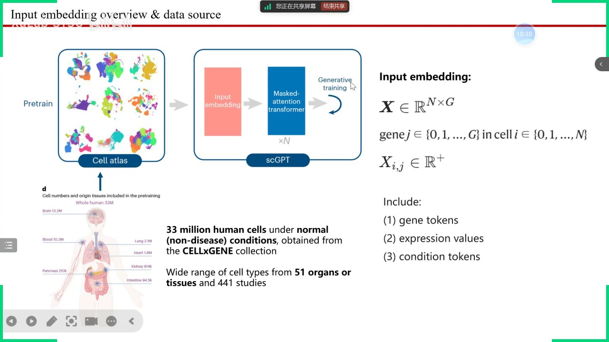

讲者的原话是：token 的意思就是字符或者单词，"相当于把基因作为语句里的单词"。所以第一步不是处理表达量，而是**给每个基因一个整数编号**。

### 1.2 词表是所有研究基因的并集

这是整支视频里对"基因标识"讲得最清楚的一页。幻灯片上写的是：

$$
\text{gene } g_j \;\longleftrightarrow\; \mathrm{id}(g_j) \;\longleftrightarrow\; \text{vocabulary word}
$$

也就是基因名、整数 ID、词表里的位置三者一一对应。讲者强调，不同研究、不同组织测到的表达基因是不一样的，scGPT 的做法是**取并集**：把所有研究里出现过的基因名整合进同一个词表（vocabulary），这样不同来源的数据才能落到同一套坐标系里。[【跳转到 11:10】](https://www.bilibili.com/video/BV1TF4beDEyr/?t=670)

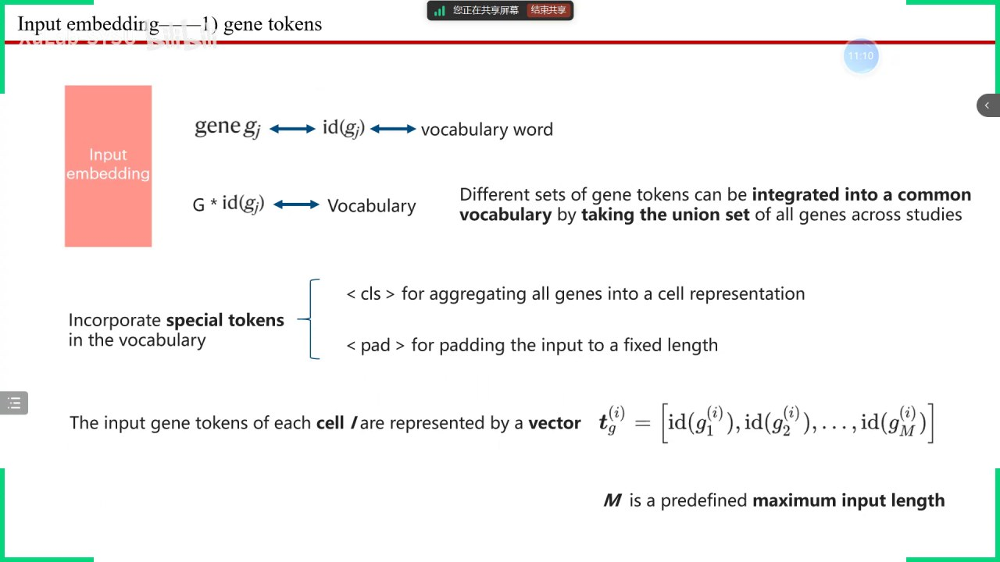

这一步看着平淡，其实是整个输入契约的地基：**词表一旦定下来，每个基因的编号就定下来了**，后面所有数据的第 $j$ 个位置指的都是同一个基因。反过来，词表外的基因没有 ID，也就没有位置——这是"基因名→ID→词表"这条链的直接后果（本文推论，视频没有单独展开）。

### 1.3 两个特殊符号：`<cls>` 与 `<pad>`

词表里不只有基因，还塞了两个特殊符号：

- `<cls>`：把整条序列的所有基因聚合成一个"细胞表示"，后面做细胞注释时用的就是它；
- `<pad>`：把不够长的序列补齐到固定长度。

一个细胞 $i$ 的基因 token 序列写成

$$
t_g^{(i)} = \left[\mathrm{id}(g_1^{(i)}), \mathrm{id}(g_2^{(i)}), \dots, \mathrm{id}(g_M^{(i)})\right]
$$

其中 $M$ 是**预先设定的最大输入长度**。讲者的解释很直白：基因组里有 $M$ 个基因，就把 $M$ 设成输入上限；但不可能所有数据都能达到 $M$ 个基因，所以不够长的序列要用 pad 补到最大长度。[【跳转到 12:00】](https://www.bilibili.com/video/BV1TF4beDEyr/?t=720) [【跳转到 12:25】](https://www.bilibili.com/video/BV1TF4beDEyr/?t=745)

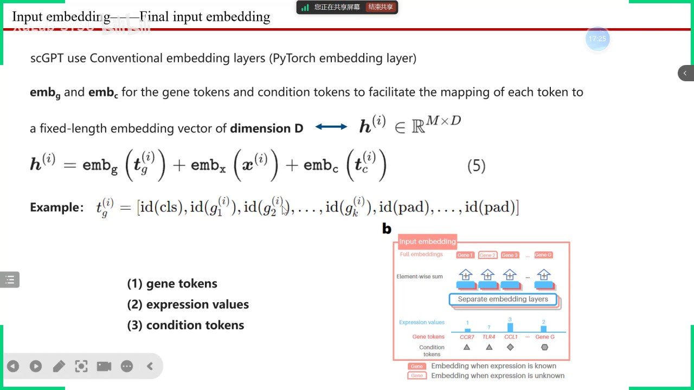

## 二、定长：pad 补齐与"长度上限"的含义

把上面几页连起来看，一个细胞的输入其实是一条**长度固定为 $M$ 的槽位表**：

1. 第 0 位是 `<cls>`；
2. 中间是若干个基因的 ID；
3. 剩下的位置全部是 `<pad>`。

三个 embedding 逐元素相加得到最终输入：

$$
h^{(i)} = \mathrm{emb}_g\left(t_g^{(i)}\right) + \mathrm{emb}_x\left(x^{(i)}\right) + \mathrm{emb}_c\left(t_c^{(i)}\right)
$$

其中 $t_g$ 是基因 ID 序列，$x$ 是分箱后的表达值向量，$t_c$ 是条件 token（批次、扰动条件等元信息）。[【跳转到 17:25】](https://www.bilibili.com/video/BV1TF4beDEyr/?t=1045) [【跳转到 18:01】](https://www.bilibili.com/video/BV1TF4beDEyr/?t=1081)

这里有个容易被忽略的细节：**pad 不是"没有这个基因"，而是"这个槽位不参与内容"**。它和"某个基因表达量为零"是两件不同的事——前者是序列长度问题，后者是表达值问题。视频里讲者把这两件事分开讲，但都归到"零"这个字上，初学时很容易混。

## 三、顺序：单细胞没有语法，所以顺序由表达量决定

这是全片最值得记的一段。讲者说，自然语言是顺序性的语言：你说一句话，后面跟什么是有倾向的；但**单细胞数据是无序的**，"你这样排序或那样排序都可以，它没有具体含义，因为里面没有语义"。[【跳转到 14:27】](https://www.bilibili.com/video/BV1TF4beDEyr/?t=867)

既然顺序本身不带信息，就可以人为给它一个顺序。scGPT 的选择是：把每个细胞里的非零表达值按原始值排序，再分到从 1 到 $B$ 的连续区间里。

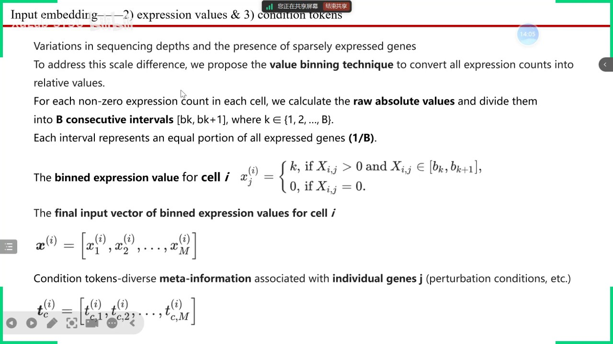

$$
x_j^{(i)} =
\begin{cases}
k, & \text{若 } X_{i,j} > 0 \text{ 且 } X_{i,j} \in [b_k, b_{k+1}) \\
0, & \text{若 } X_{i,j} = 0
\end{cases}
$$

讲者解释这样做的两个好处：一是解决不同测序深度、不同组织之间表达尺度不一致的问题（他提到普通的 log1p 归一化去不掉技术上的批次效应）；二是顺手给了数据一个顺序，让"原本无序的单细胞数据变成一个有序的数据，它的顺序是按照表达量来定的"。[【跳转到 14:05】](https://www.bilibili.com/video/BV1TF4beDEyr/?t=845) [【跳转到 14:55】](https://www.bilibili.com/video/BV1TF4beDEyr/?t=895)

注意这里"排序"和"分箱"是同一套操作的两种说法：先按表达量排，再切 B 段，段的编号就是分箱值。所以**顺序是表达量顺序，不是基因在染色体上的顺序，也不是词表里的字母顺序**。

## 四、零表达留在零档：模型看到的"零"是什么

分箱公式里最要紧的是第二行：$X_{i,j}=0$ 时 $x_j^{(i)}=0$。讲者的说法是"如果它本身是表达量是零，它就还是零"。[【跳转到 15:20】](https://www.bilibili.com/video/BV1TF4beDEyr/?t=920)

这意味着零表达的基因**仍然占一个槽位**，只是它的表达值落在第 0 档。它和 pad 的区别在于：pad 是长度填充，零档是"这个基因在这里确实没测到表达"。

对初学者来说，可以这样记这张对照表：

| 输入里的东西 | 来自哪里 | 含义 |
| --- | --- | --- |
| 基因 ID | 词表里的位置 | 这是哪个基因 |
| 非零分箱值 $k$ | 表达量排序后落在第 $k$ 段 | 表达量大概多高 |
| 零档 $0$ | 该基因表达量为 0 | 这个基因在这里没有表达信号 |
| `<pad>` | 序列不足 $M$ 位 | 这个槽位是补出来的，不是基因 |
| `<cls>` | 词表特殊符号 | 汇总整条序列，代表这个细胞 |

这张表也解释了为什么"零填充"在单细胞基础模型里是个绕不开的词：一个细胞的基因数通常远小于词表大小，绝大多数槽位都是零档或 pad，模型看到的是一个**极其稀疏、且零的含义被合并过的序列**。
## 五、缺失基因：并集词表解决了什么，又掩盖了什么

### 5.1 并集词表让不同数据集"说同一种语言"

假设研究 A 测了基因 $\{A, B, C\}$，研究 B 测了 $\{B, C, D\}$。如果各用各的列，两张矩阵根本对不上；取并集 $\{A, B, C, D\}$ 之后，两张矩阵都能放进同一个四列坐标系，只是各自有一列是空的。

讲者对这一点的表述是"通过取并集的方式，把它们这些不同的单细胞数据里面表达的基因都整合到一个词汇本，从而比较好地给它们做整合"。[【跳转到 11:28】](https://www.bilibili.com/video/BV1TF4beDEyr/?t=688)

### 5.2 没测到的基因，在输入里只能落在零档

并集词表的另一面是：对某个具体数据集来说，词表里那些它没测的基因，**没有单独的"缺失"标记可用**。按 scGPT 的编码规则，这些位置要么是零档（表达量为 0），要么在序列长度之外被 pad 掉。也就是说，"这个基因没测"和"这个基因测了但没表达"在输入层被合并成了同一个值。

这是本文从视频里的两条规则（并集词表 + 零表达取 0）推出来的结论，视频没有单独讨论这一点，但它对使用者的影响很实际：

- 如果一份数据测到的基因很少（比如靶向 panel），送进模型后大片位置都是零档，模型看到的是"这些基因不表达"，而不是"这些基因不在你的数据里"；
- 反过来，模型在预训练时见惯了零档，也就把"零"当成一种正常的输入状态，而不是异常。

### 5.3 掩码预训练本来就是为"信息不全"设计的

讲者在讨论环节被问到"这个 to predict 是为了解决本质上那些没有测到的基因吗"，他的回答是：这个 predict 就是训练的部分，目的是"已知一部分基因的表达，去预测另外一部分基因的表达"，而"测不到"的问题在前面处理数据的部分已经解决过了。[【跳转到 27:27】](https://www.bilibili.com/video/BV1TF4beDEyr/?t=1647)

这段话把"缺失基因"放回了它该在的位置：scGPT 并不要求每个细胞的基因都齐全，它训练的就是"从一部分已知推其余"。所以缺失基因不是 bug，而是预训练任务的前提；真正需要小心的是**缺失的比例和缺失的机制**——如果缺的恰好是某个细胞类型的关键 marker，模型只能靠剩下的基因去猜。

## 六、掩码预训练：ID 照给，只把表达值遮住

理解了输入，才能理解 scGPT 的预训练目标。它沿用 BERT 式的"完形填空"，但做了一处关键改动：**遮的是表达值，不是基因 ID**。

讲者的说法是"它基因 ID 还是给的，只是把这个基因的表达值给缺失了"，然后让模型去预测这个基因"不知道的状态应该是什么"。[【跳转到 16:01】](https://www.bilibili.com/video/BV1TF4beDEyr/?t=961)

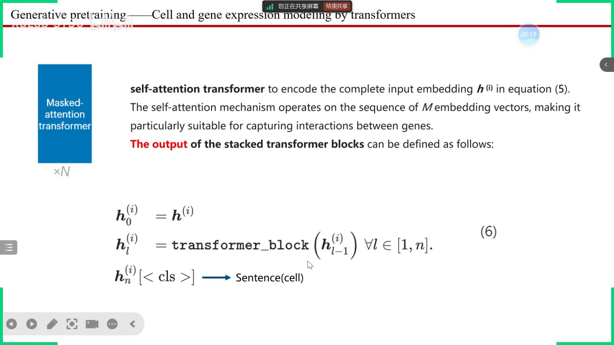

注意力掩码的规则写成一个分段函数：

$$
a_{i,j} =
\begin{cases}
0, & \text{若 } j \notin \text{unknown genes} \\
0, & \text{若 } i = j \text{ 且 } j \in \text{unknown genes} \\
-\infty, & \text{若 } i \neq j \text{ 且 } j \in \text{unknown genes}
\end{cases}
$$

翻成白话：已知基因的位置照常可见；未知基因自己可以看到自己（所以能给出自己的 ID 和零表达）；但未知基因之间互相看不见，避免"用未知猜未知"。[【跳转到 24:32】](https://www.bilibili.com/video/BV1TF4beDEyr/?t=1472)

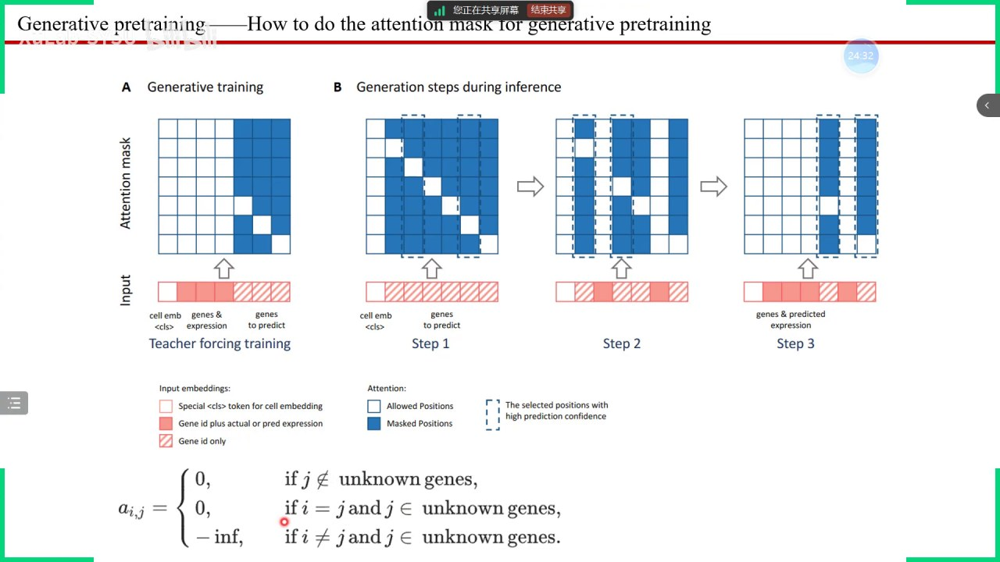

训练过程是迭代的：每一步从模型预测里挑出 K−1 个高置信度的位置，当成下一步的"已知"，再更新掩码。讲者用 3 步为例解释了这个循环。[【跳转到 25:47】](https://www.bilibili.com/video/BV1TF4beDEyr/?t=1547)

现场有一段很真实的问答：有听众问 $i$ 和 $j$ 到底代表什么，讲者回答"$i$ 是行、$j$ 是列"，并承认"其实我也不知道这个东西，但他就是按照这样一套规则去做掩盖的"。这段没有被剪掉，反而说明掩码矩阵的细节确实绕。[【跳转到 26:23】](https://www.bilibili.com/video/BV1TF4beDEyr/?t=1583)

## 七、四类下游任务：输入契约在结果上的投影

### 7.1 细胞注释：稀有类型是短板

注释的做法很直接：在带专家注释的参考数据上用交叉熵微调，再在留出的查询数据上预测。讲者重点看了胰腺数据里的两个稀有类型——肥大细胞和 MHC II 类细胞，它们在 10600 个细胞里只有 50 个，混淆矩阵上几乎全错。论文的解释是"这些细胞类型太少了"。[【跳转到 34:23】](https://www.bilibili.com/video/BV1TF4beDEyr/?t=2063)

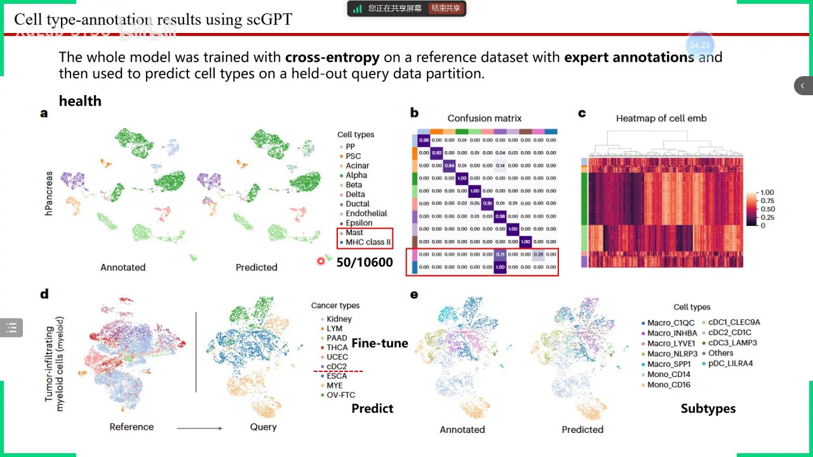

讲者对这张图的评价是"至少他是非常诚实地展示了这个结果"，并认为这是 expected 的：训练信息里非常 rare 的类型，模型大概率学不到。

### 7.2 扰动预测：从"敲一个基因"到"预测全转录组"

扰动任务的评测用皮尔森相关系数的差值（$\text{Pearson}_\Delta$），在 Adamson、Norman、Replogle 三个数据集上，微调后的 scGPT 好于线性模型和另一个基线，但讲者反复说"好的也有限"。[【跳转到 42:56】](https://www.bilibili.com/video/BV1TF4beDEyr/?t=2576)

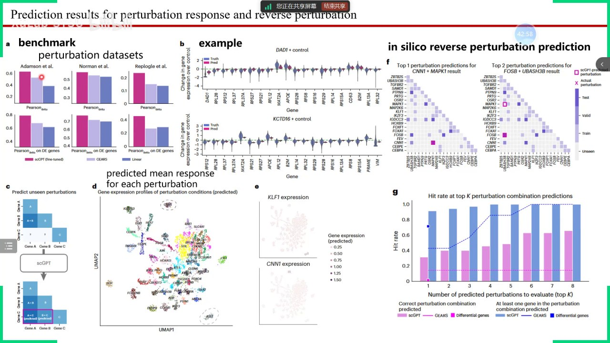

除了正向预测，scGPT 还能做反向预测：已知扰动后的表达谱，回溯是哪个基因/转录因子造成的。讲者举了 CNN1 + MAPK1、FOSB + UBASH3B 两组例子，说模型都正确预测到了。[【跳转到 47:00】](https://www.bilibili.com/video/BV1TF4beDEyr/?t=2820)

### 7.3 多批次与多组学整合：多组学上提升更明显

整合的指标是 AvgBIO，由三个聚类指标合成：归一化互信息（NMI）、调整兰德指数（ARI）、平均轮廓宽度（ASW）。[【跳转到 50:48】](https://www.bilibili.com/video/BV1TF4beDEyr/?t=3048)

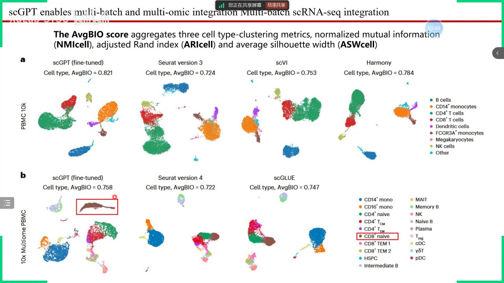

讲者的判断是：纯 RNA 数据上 scGPT 比 Harmony 等基线只好 5% 到 10%，但多组学数据上改进更明显——它把原本混在 T 细胞里的 CD8 naive 单独分了出来。[【跳转到 51:30】](https://www.bilibili.com/video/BV1TF4beDEyr/?t=3090)

另一个例子是 BMMC 和 ASAP 数据：BMMC 上 scGPT 的 AvgBIO 是 0.697、Seurat v4 是 0.600；ASAP 人类 PBMC 上 scGPT 的批次指标是 0.951、scMoMaT 是 0.916，细胞类型指标 0.587 对 0.546。[【跳转到 56:43】](https://www.bilibili.com/video/BV1TF4beDEyr/?t=3403)

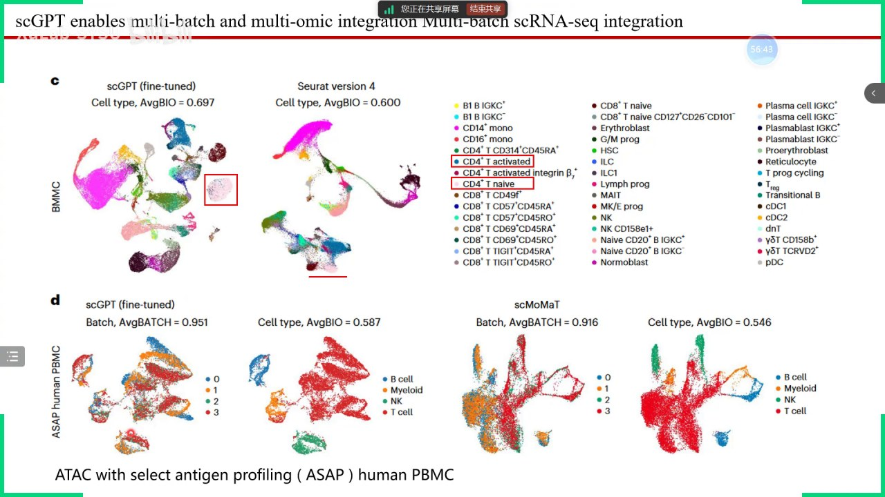

### 7.4 基因调控网络：从注意力里读基因关系

最后一个任务是基因网络。讲者展示了 HLA class II（与 CD4+ T 细胞相关）和 HLA class I（与 CD8+ T 细胞相关）的网络，以及 CD 基因网络里 B 细胞的 CD79A/CD79B、T 细胞的 CD8A/CD8B；微调之后还能看到 CD14 和 CD36 的关系。[【跳转到 58:37】](https://www.bilibili.com/video/BV1TF4beDEyr/?t=3517)

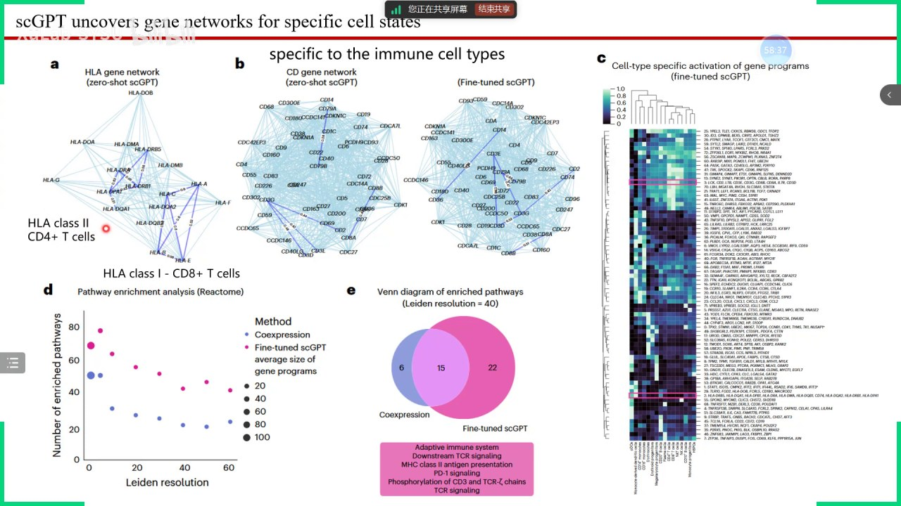

通路富集的结果是：两种传统方法和 scGPT 共同发现 15 条通路，scGPT 额外发现 22 条，其中 15 条与免疫系统相关（TCR 信号级联、MHC II 抗原提呈等）。讲者提醒，这是因为微调用的就是免疫细胞、看的是免疫细胞的高变基因。[【跳转到 62:00】](https://www.bilibili.com/video/BV1TF4beDEyr/?t=3720)

## 八、数据越多越好，但"表征"仍然有限

作者还做了一组规模实验：预训练数据从 30K 逐步加到 33M，细胞注释、reference mapping、扰动预测三类任务的指标都单调上升，到 33M 附近开始接近饱和。[【跳转到 65:54】](https://www.bilibili.com/video/BV1TF4beDEyr/?t=3954)

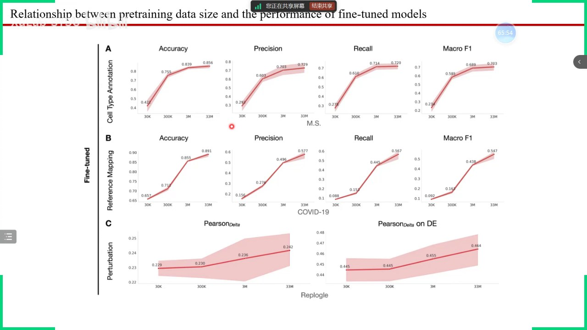

讲者对这篇文章的评价相当直接（以下为视频原话意思）：

- 除了分箱，几乎"没有任何创新"，本质是把自然语言模型那一套迁移到单细胞数据上；
- 分箱这种做法在以前的单细胞方法里也经常用；
- 它能做的是注释、reference mapping 这类相对简单的任务，表征能力"还是很有限"；
- 真正有价值的可能是后面的方向：多组学、空间组学、扰动与时间序列，以及跨物种数据。

他还顺带点评了同期几个模型：清华的工作基本沿用 scGPT 的方法、加了 batch token 去预测药物反应；GeneCompass 用人和小鼠的跨物种数据、数据量更大；阿里的 LucaOne 同时用 DNA、RNA 和蛋白质训练，想做"中心法则"的统一模型，他认为这个相对有新意。[【跳转到 71:00】](https://www.bilibili.com/video/BV1TF4beDEyr/?t=4260)

## 小结

- **标识**：基因名先映射成整数 ID，ID 就是词表里的位置；词表由所有研究出现过的基因取并集得到。
- **词表顺序**：词表一旦固定，每个基因的编号就固定；这是不同数据集能拼到一起的前提。
- **序列顺序**：单细胞数据本身无序，scGPT 用"按表达量排序 + 分 B 箱"给了一个顺序，顺序信息来自表达量而不是生物学位置。
- **定长**：序列长度上限是 $M$，不够就用 `<pad>` 补；`<cls>` 汇总整条序列代表细胞。
- **零填充**：零表达的基因仍占槽位、落在第 0 档；没测到的基因在输入里也只能表现为零档或 pad，模型拿不到"缺失"这个标记。
- **掩码**：预训练遮的是表达值、不是基因 ID；未知基因之间互相不可见，靠已知基因去猜。
- **代价**：并集词表 + 零档让异构数据能进同一个模型，但也把"没测到"和"不表达"合并了；这是使用这类模型时最需要自己核对的一环。

## 关键术语速查

| 术语 | 一句话解释 |
| --- | --- |
| gene token | 把一个基因名映射成词表里的整数 ID，当作句子里的一个单词 |
| vocabulary（词表） | 所有研究里出现过的基因名的并集，加上 `<cls>`、`<pad>` 两个特殊符号 |
| `<cls>` | 特殊符号，聚合整条基因序列，输出被当作这个细胞的表示 |
| `<pad>` | 特殊符号，把不足 $M$ 位的序列补到固定长度 |
| $M$ | 预设的最大输入长度，通常取词表里的基因数 |
| value binning | 把每个细胞的非零表达值排序后切成 $B$ 段，用段号代替原始计数 |
| 零档 | 表达量为 0 时取的分箱值，仍然占一个基因槽位 |
| 零填充 | 用零档或 pad 填满序列；"没测到"与"不表达"在输入层不可区分 |
| attention mask | 控制哪些位置可见的矩阵；未知基因之间用 $-\infty$ 屏蔽 |
| AvgBIO | scGPT 用的整合指标，由 NMI、ARI、ASW 三项合成 |
