# Harmony 的迭代循环：软聚类切出局部，线性回归在局部校正

> 视频来源：[Webinar: Fast, sensitive, and accurate integration of single-cell data with Harmony](https://www.youtube.com/watch?v=EIgZQwjblPM)（YouTube · BioTuring 单细胞研讨会，讲者 Ilya Korsunsky，Harmony 论文第一作者）｜时长约 61 分钟
> 导读：这是 Harmony 作者本人的一场「数学 + 实践」讲解。前 37 分钟讲算法，后 24 分钟是问答——**问答里藏着大量过校正与参数判读的实操经验**，本文一并收录。字幕为 YouTube 英文自动转写，`kale divergence`、`harley`、`surat`、`lizzy`、`shun` 等误识已按上下文校正为 KL divergence、Harmony、Seurat、LISI、Sean。

**本文与本小节另一篇博客的分工**：同节的《Harmony 最快、CCA 最狠：四种单细胞整合方法的整合力度与速度权衡》讲的是**选型与实操**——同一份数据用四种方法各跑一遍再比 UMAP；本文不重复那套对比，只回答一个问题：**Harmony 内部那两件事（软聚类、线性校正）是怎么交替迭代的，以及迭代结束时你凭什么判断它做对了还是做过头了。**

## 本讲要解决的核心问题（SCQA）

**背景**：单细胞数据整合的目标很朴素——把「来自哪个数据集」这个效应去掉，把「是什么细胞类型」这个效应留住。作者在开场画了一张卡通图：细胞既按形状（细胞类型）分组，也按颜色（数据集）分组，我们要消掉颜色、保住形状。

**冲突**：最自然的做法是回归掉批次——算每个数据集的中心，把中心对齐。这在 bulk 数据和芯片时代都工作得不错，但在单细胞上会**同时犯两个错**：颜色没混匀，原本混得不错的细胞反而被拆开，而不同细胞类型还被推到了一起。原因早在互近邻（MNN）那篇论文里就被点破：**批次效应是细胞类型依赖的**，你没法对每个细胞类型都套同一个校正因子。

**疑问**：既然全局线性回归必败，那能不能**仍然用线性回归，但让它学到细胞类型特异的校正量**？这个「局部」该怎么划、划完之后怎么校正、两件事怎么交替、什么时候停？停下来之后，又怎么知道它不是把所有东西都拉平了？

**回答（中心思想）**：Harmony 把「一次全局回归」换成了「**多轮局部回归**」——每一轮先用**带批次多样性惩罚的软聚类**把数据切成若干局部邻域，再在每个邻域内学一个**线性校正因子**，然后按细胞的软隶属概率把多个因子**加权平均**施加到每个细胞上；两件事交替进行，直到软聚类不再实质变化。**收敛只说明迭代停了，不说明校正对了**：簇数、邻近亚型、连续轨迹这三处存在本质的欠定性，必须回过头用「局部是否真的混匀」和「基因层面是否还讲得通」来判读，否则就会过校正。

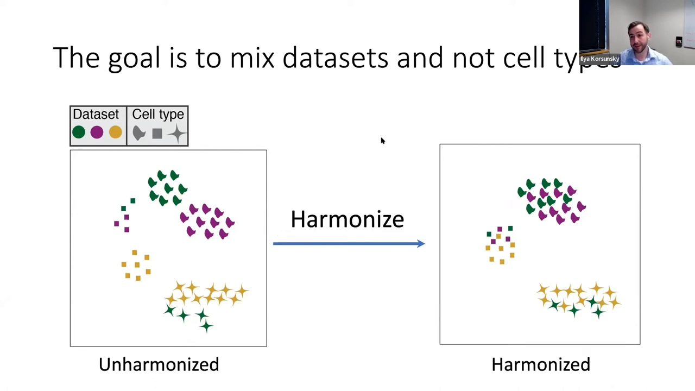

[【跳转到 12:12】](https://www.youtube.com/watch?v=EIgZQwjblPM&t=732)

## 一、全局线性回归为什么会失败：批次效应本身是细胞类型依赖的

作者把线性回归的几何含义说得很直白：**算出每个数据集（每种颜色）的中心，然后移动细胞让中心重合。**

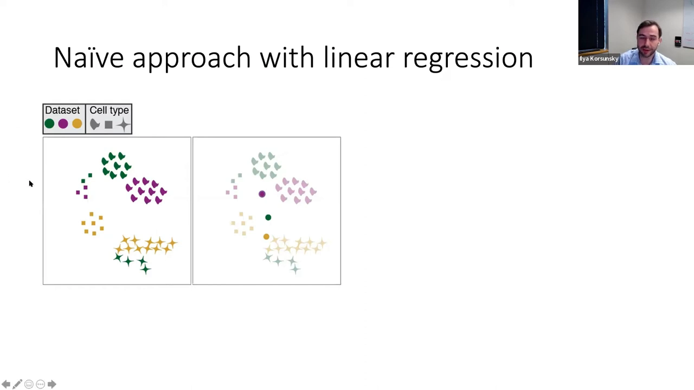

在这个玩具数据集上，中心一对齐，三件坏事同时发生：

1. **颜色没混好**——同一细胞类型的不同批次仍然分开；
2. **原本混好的被拆散**——绿色和紫色的方块本来混在一起，校正后完全不混了；
3. **不同细胞类型被推近**——星形和鱼形的细胞被拉到了一起。

[【跳转到 13:27】](https://www.youtube.com/watch?v=EIgZQwjblPM&t=807)

作者强调这不是意外，而是**早期算法就已经写明的结论**。他直接引了 Haghverdi 等人（MNN 那篇）的原文：

> "Such differences are not easily handled by methods based on linear models (because they would require explicit modeling of predefined groupings of cells, which would defeat the purpose of using scRNA-seq to study population heterogeneity in the first place)."

翻译过来就是：批次效应的大小和方向在不同细胞亚群之间不一样，线性模型处理不了这种差异——除非你**预先给定细胞分组**，而预先分组恰恰违背了用单细胞研究异质性的初衷。

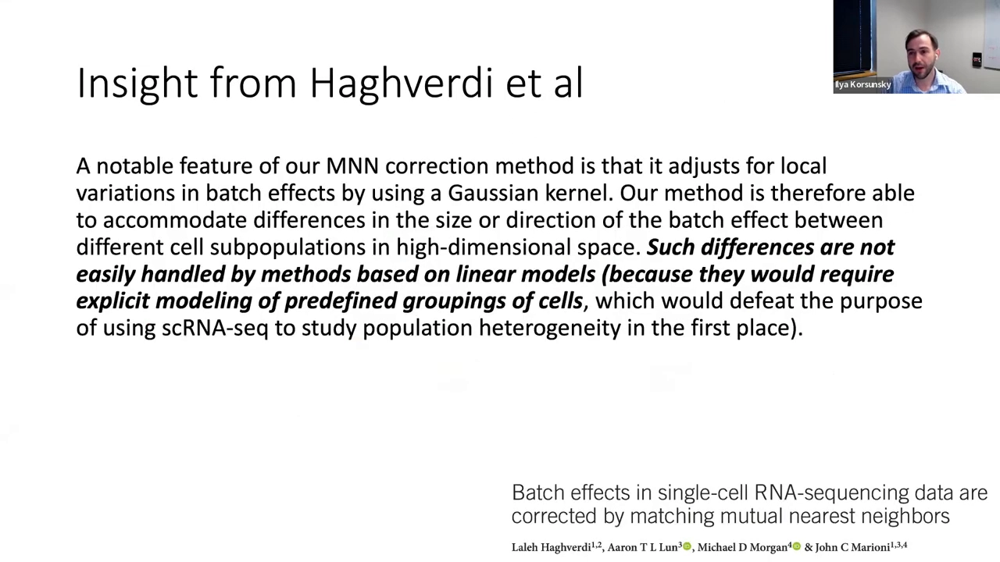

[【跳转到 14:22】](https://www.youtube.com/watch?v=EIgZQwjblPM&t=862)

这句话里藏着 Harmony 的全部动机：**问题不在「线性」，而在「全局」**。如果分组能自动学出来，那线性回归就可以继续用。作者原话是——「我们把这一点当成挑战：好，那就做一个仍然用线性回归、但能学到细胞类型特异的批次效应的算法」。

## 二、Harmony 的迭代循环：先切局部，再在局部里做回归

Harmony 的核心就是一张**闭环图**，作者把它当成全篇的骨架：

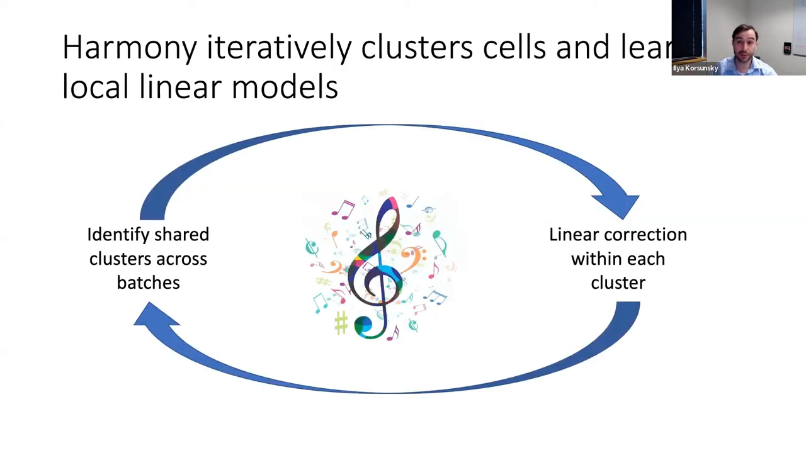

左边是「**识别跨批次共享的簇**」，右边是「**在每个簇内做线性校正**」，箭头首尾相接。也就是说：

- 聚类不是目的，**它是为了给回归划出「局部」**；
- 回归也不是一次性的，**它改变细胞位置，位置一变，下一轮的簇就变了**。

[【跳转到 14:55】](https://www.youtube.com/watch?v=EIgZQwjblPM&t=895)

具体到几何上，作者用四张图把一次迭代拆开：

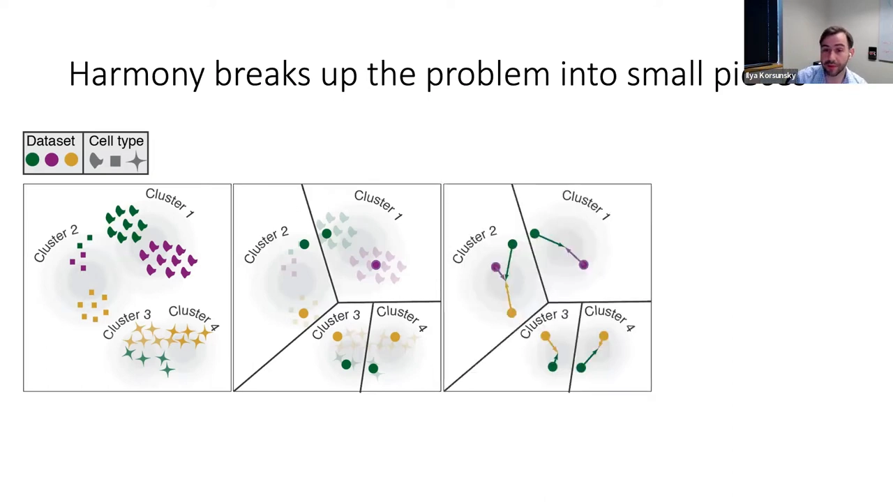

第一张是未校正的原始分布；第二张按区域把数据切开，区域边界就是簇边界；第三张在每个区域内部算出各批次的中心（图上的箭头就是**该簇的线性校正因子**）；第四张把箭头施加到细胞上，得到校正后的结果。

[【跳转到 15:16】](https://www.youtube.com/watch?v=EIgZQwjblPM&t=916)

所以「Harmony 仍然是线性回归」这句话要这样理解：**它做的是 K 个线性回归问题，而不是 1 个。** 全局线性回归在这个玩具数据上会失败，但把它拆成四个局部回归，每个局部内部的批次差异就近似是「同方向、同大小」的平移，线性假设重新成立。

## 三、软聚类：边界上的细胞拿到的是加权平均的校正量

这里有个容易被忽略的设计：**聚类是硬的，校正却是软的。**

作者特意把这个玩具数据集设计成包含单细胞里常见的两类流形结构：

- **离散团块**：cluster 1 是相当圆的簇；
- **连续轨迹**：cluster 3 和 cluster 4 其实是一条轨迹的两段。

他反复强调一件事：**整合时不能把轨迹切成离散的簇，也不能反过来把离散的簇连成轨迹。**

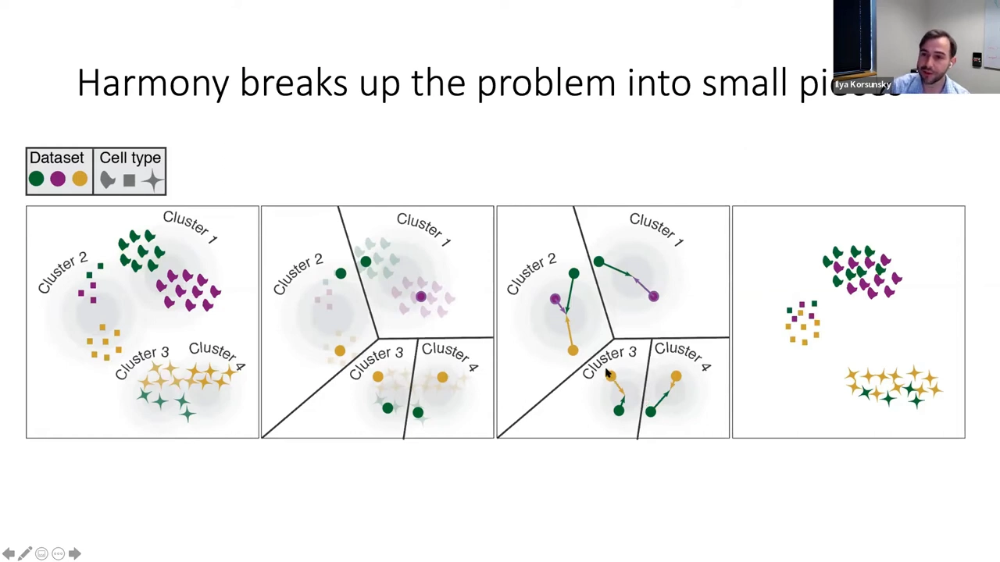

做法是：每个细胞拿到的不是「它所属那个簇」的校正因子，而是**所有簇校正因子的加权平均**，权重是它属于各个簇的概率。图中 cluster 3 说「把黄色细胞往右下移」，cluster 4 说「把黄色细胞往左下移」；正好卡在 3 和 4 边界上的黄色细胞，两个概率各约一半，于是**只往下移，不左也不右**——轨迹的形状就这样被保住了。

[【跳转到 16:31】](https://www.youtube.com/watch?v=EIgZQwjblPM&t=991)

作者的原话是：「通过这种软聚类和软校正，我们能在底层仍然做聚类的前提下，把轨迹整合好。」

> **为什么这一步对初学者重要**：很多人以为 Harmony 会先聚类、再按簇整体平移，于是担心「轨迹会被切成几段」。实际上**平移量是连续的**——它随隶属概率平滑变化，所以轨迹不会被切断。这也解释了为什么 Harmony 的输出里没有「簇标签」这个中间产物：簇只是用来定义局部回归的，用完即弃。

## 四、目标函数里的那项惩罚：为什么簇必须跨批次

软聚类用的是 k-means / 高斯混合模型这一族方法，但直接套用会掉进一个陷阱。作者把它做成了一个思想实验：

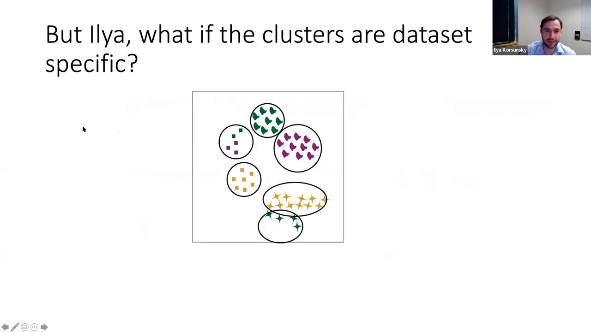

假设簇恰好都落在单个数据集内部（图里每个圈只含一种颜色），那么「在每个簇内对齐批次中心」这件事就无事可做——**没有跨批次的簇，就没有校正**。

[【跳转到 26:56】](https://www.youtube.com/watch?v=EIgZQwjblPM&t=1616)

更糟的是，普通 k-means 会主动制造这种局面。作者画了一个我和 Sean 各自测了 B 细胞和 T 细胞的例子：

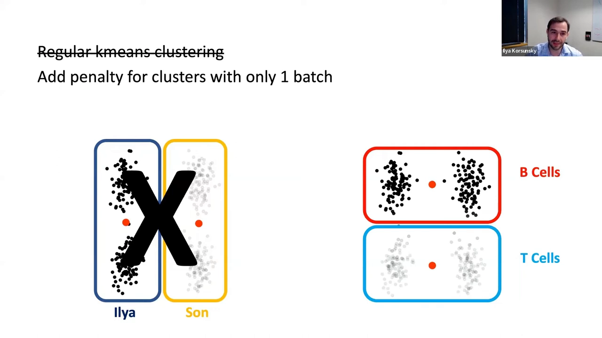

左边打了大红叉：普通 k-means 按批次的几何布局分组，结果是**我的 T 细胞和我的 B 细胞被归成一簇**。作者说这有两个问题：一是生物学上错了，二是我们就再也没机会把我的 T 细胞和 Sean 的 T 细胞放在一起比较。

[【跳转到 27:51】](https://www.youtube.com/watch?v=EIgZQwjblPM&t=1671)

解法是给目标函数加一项**惩罚**：「只含一个批次的簇」不被偏好，我们更希望簇里包含多个批次。作者说明这项惩罚由 **KL 散度**和**卡方列联表**构成，本质是修改 k-means 与高斯混合模型的目标函数，让簇在「你想控制的那个变量」上**多样性最大化**。

[【跳转到 28:16】](https://www.youtube.com/watch?v=EIgZQwjblPM&t=1696)

把它写成式子，大致是这样一种「软聚类 + 批次多样性惩罚」的结构：

$$
\min_{\{\beta_k\},\ \Pr(C_k \mid i)} \ \sum_{i}\sum_{k} \Pr(C_k \mid i)\,\big\lVert y_i - \beta_k \big\rVert^{2} \;+\; \lambda \sum_{k} \mathrm{KL}\big(p_k \,\Vert\, q\big)
$$

其中 $y_i$ 是细胞 $i$ 在 PCA 空间里的坐标，$\beta_k$ 是第 $k$ 个簇的批次校正因子，$\Pr(C_k \mid i)$ 是细胞 $i$ 属于簇 $k$ 的软隶属概率，$p_k$ 是簇 $k$ 内的批次组成分布，$q$ 是全局的批次组成分布，$\mathrm{KL}$ 项就是在惩罚「簇内批次组成偏离全局」。**需要说明的是：视频只讲了惩罚项由 KL 散度与卡方列联表构成、作用是最大化簇的批次多样性，没有给出系数与具体形式**，上式是按作者口述的结构写出的示意，不是论文公式的逐字复现。

这个惩罚项直接决定了一个行为：**当两个批次之间根本没有共享的细胞类型时，Harmony 不会硬把它们拉到一起。** 作者在问答里专门确认了这一点——他们做过大量阴性对照：一个批次全是同一种细胞类型，另一个批次全是另一种，然后确认 Harmony 不会跨批次匹配任何细胞。

[【跳转到 53:43】](https://www.youtube.com/watch?v=EIgZQwjblPM&t=3223)

> 「它们可以零共享，那我们就什么都不整合，完全不碰它。」
## 五、回归模型长什么样：一组按隶属概率加权的 β

把上面两件事合起来，就是 Harmony 的完整回归模型。作者先给了几何直觉：图上每个箭头就是一个**线性校正因子**。

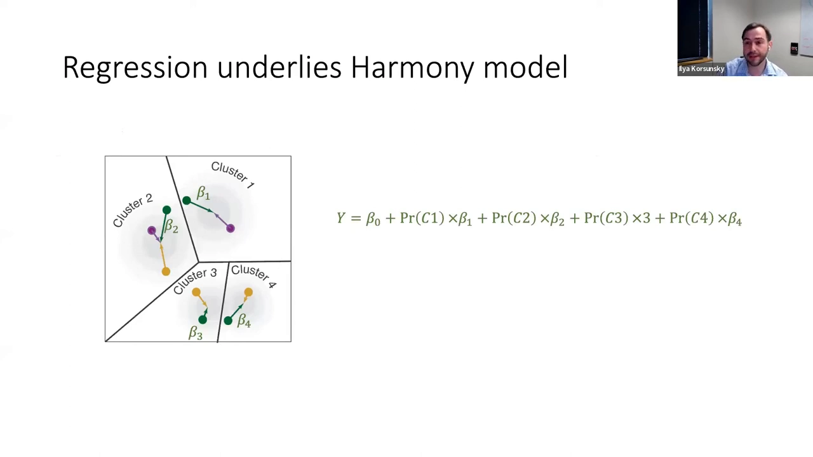

幻灯片上的公式是：

$$
Y = \beta_0 + \Pr(C_1)\times\beta_1 + \Pr(C_2)\times\beta_2 + \Pr(C_3)\times\beta_3 + \Pr(C_4)\times\beta_4
$$

（原幻灯片第三项误印为 $\times 3$，按上下文应为 $\beta_3$。）作者口述的版本更完整：

> 「我们试图解释 $y$，也就是细胞在 PCA 空间里的位置；把它表示成截距（某种批次项）的函数，然后对每个批次学一个批次校正因子。又因为每个细胞可以概率性地属于多个簇，我们要对该细胞可能属于的所有簇做加权平均。」

[【跳转到 29:35】](https://www.youtube.com/watch?v=EIgZQwjblPM&t=1775)

这里有三层含义，值得逐层拆开：

1. **$y$ 是低维嵌入，不是表达矩阵。** Harmony 在 PCA 坐标上工作，不产生「校正后的基因表达」。
2. **$\beta_k$ 是簇特异的。** 这正是对第一节那个批评的正面回应：批次效应细胞类型依赖，那就让每个局部有自己的 $\beta$。
3. **加权发生在簇维度上。** 一个细胞同时属于多个簇，就同时受多个 $\beta$ 影响，权重是隶属概率——这就是第三节「边界细胞只往下移」的数学来源。

## 六、参数不是开关，它们直接改写模型

作者说得很直接：**你传给 Harmony 的参数，就是在指定它背后那个模型。**

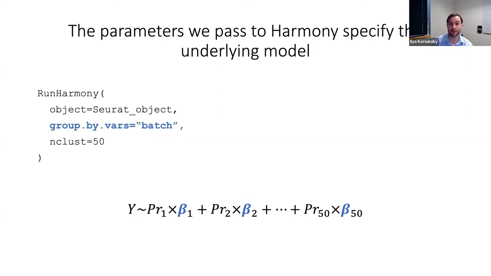

```r
RunHarmony(
  object = Seurat_object,
  group.by.vars = "batch",
  nclust = 50
)
```

对应的模型是 $Y \sim Pr_1\times\beta_1 + Pr_2\times\beta_2 + \cdots + Pr_{50}\times\beta_{50}$。所以 `nclust` 不是「聚类结果的精细度」这种审美参数，它**直接等于模型里 β 的项数、也等于局部邻域的个数**。

[【跳转到 31:15】](https://www.youtube.com/watch?v=EIgZQwjblPM&t=1875)

`group.by.vars` 则决定「为哪些变量学 β」。作者指出，因为 Harmony 本质是回归，**它可以同时建模并回归掉多个批次变量**——他明确说据他所知这是 Harmony 独有的能力。

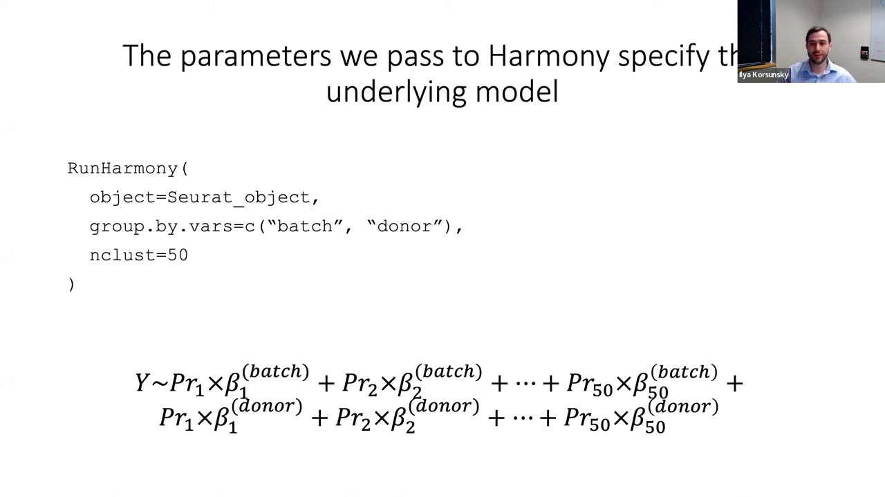

```r
RunHarmony(
  object = Seurat_object,
  group.by.vars = c("batch", "donor"),
  nclust = 50
)
```

$$
Y \sim \sum_{k=1}^{50} Pr_k \times \beta_k^{(\text{batch})} + \sum_{k=1}^{50} Pr_k \times \beta_k^{(\text{donor})}
$$

[【跳转到 30:50】](https://www.youtube.com/watch?v=EIgZQwjblPM&t=1850)

> **一个容易踩的坑**：`group.by.vars` 里的变量必须是**你已经打好标签**的。作者在问答里被问到「Harmony 会不会自动考虑批次分类变量」时回答：可以回归掉一个或多个因子，但**你得知道你想建模和去掉的是什么**。

## 七、收敛怎么判读：簇数存在一个「稳定区间」

这是本节学习目标里最难、也最容易被含糊带过的一点。作者的表述非常克制，但信息量足够：

> 「簇的数量存在一个范围，在这个范围里结果非常稳定。」

[【跳转到 25:41】](https://www.youtube.com/watch?v=EIgZQwjblPM&t=1541)

他用两个极端来说明为什么「稳定区间」这个概念有用：

| 簇数设置 | 模型退化成什么 | 后果 |
| --- | --- | --- |
| 只有 1 个簇 | 全局线性回归 | 回到第一节那个必败的做法，颜色去不掉、细胞类型被推近 |
| 簇数 ≈ 细胞数 | 每个细胞自成一簇 | 每个局部里没有跨批次结构，什么也校正不了 |

[【跳转到 26:06】](https://www.youtube.com/watch?v=EIgZQwjblPM&t=1566)

但作者紧接着补了一个重要的实现细节，**这条直接关系到「收敛是否可信」**：

> 「按我们的实现方式，这并不完全成立：如果你给一千个簇，它其实相当稳健，因为 Harmony 现在允许存在冗余的簇。所以如果真实只有 12 个簇、你给了 15 个，那多出来的三个簇会被折叠、完全和另外三个簇冗余。」

[【跳转到 26:31】](https://www.youtube.com/watch?v=EIgZQwjblPM&t=1591)

这句话的含义是：**Harmony 对「簇数给多了」有内建的失效保护**。多给的簇不会各自去拟合噪声，而是塌缩到已有簇上。所以调 `nclust` 时的风险是不对称的——

- **给太少**：局部变大，线性假设在局部内不再成立，退化成近似全局回归，校正不足；
- **给多了**：冗余簇被折叠，通常不会更糟，但也不是「越多越好」的免费午餐（局部过小同样会让 β 估不准）。

至于迭代的**停止条件**，幻灯片把 Harmony 画成一个闭环（第二节那张图），但作者在本次演讲中**没有展开具体的收敛阈值与停止准则**。可以确认的是：循环的两个半边互相依赖——聚类定局部、局部定 β、β 改位置、位置再定聚类——所以「收敛」在这里指的是**这个互相依赖的过程达到不动点**，而不是某个单独的损失值降到多少。

## 八、收敛不等于正确：过校正的三种判读

这是整场演讲里最实用的部分，也几乎全部来自问答。作者反复用同一个句式：**「我不会盲目套用。」**

### 8.1 第一种：簇数收敛了，但邻近的亚型被强行合并

作者把「细胞亚型彼此非常接近」这个问题称为**本质上的欠定性（underdeterminedness）**：

> 「如果两个簇彼此非常接近，我是该把它们推得更近，因为我认为那是批次差异？还是说这其实是同一条轨迹的两段——前中段在一个批次、中后段在另一个批次？你没法百分之百知道。」

[【跳转到 23:11】](https://www.youtube.com/watch?v=EIgZQwjblPM&t=1391)

而 Harmony 在这里做了一个**隐式决定**：

> 「Harmony 在回归里其实隐式地做了某种决定：如果你们彼此相当接近，我就整合你；如果你们离得相当远，我就不整合。」

[【跳转到 23:36】](https://www.youtube.com/watch?v=EIgZQwjblPM&t=1416)

这就是过校正的机制来源：**「接近」这个判断由数据自己给出，而数据已经被批次效应污染过。** 两个本来不同的亚型，如果恰好因为批次被推到了一起，Harmony 会把它们当成同一群来整合，于是差异被抹掉。

### 8.2 第二种：局部「靠在一起」但没「混匀」

作者给出的第一条实用判据，是把「整合成功」拆成两类指标，第一类是**局部混匀**：

> 「一次好的 Harmony 整合，最终应该得到真正局部混匀的结果。有时候你会看到，两个批次彼此靠得比较近、被归到一起，但局部并没有很好地混匀——那就是出问题的信号。」

[【跳转到 40:01】](https://www.youtube.com/watch?v=EIgZQwjblPM&t=2401)

这个区分很关键，因为 UMAP 上「两团贴在一起」和「两团交织在一起」在缩略图上看起来差不多，但前者说明校正只做了一半（中心对齐了，局部结构没打散），后者才是真的整合。作者说批次少（三到五个）时**给每个批次一个颜色直接看**就是很好的第一关。

[【跳转到 39:36】](https://www.youtube.com/watch?v=EIgZQwjblPM&t=2376)

批次一多（他举了 100 个数据集）就没法靠颜色了，这时要用指标。他提的是论文里提出的 **LISI**：

> 「LISI 很好用，因为它告诉你对任意一个细胞，它的邻域里良好地代表了多少个数据集。」

[【跳转到 40:26】](https://www.youtube.com/watch?v=EIgZQwjblPM&t=2426)

### 8.3 第三种：回头看基因落在哪里

这是作者给出的**最终裁决**，也是最容易被跳过的一步：

> 「这绝对不是可以盲目套用的方法，我会每次都回去问：整合之后基因落在哪里？我对这个结果满意吗？我是想更保守一点，还是更激进一点？」

[【跳转到 24:01】](https://www.youtube.com/watch?v=EIgZQwjblPM&t=1441)

他举了自己实验室的两个例子来支撑「可以激进」这一侧：用 Harmony 构建过含 60 种细胞类型的细胞图谱，也构建过成纤维细胞图谱——「在 UMAP 上看起来就是一大团」。也就是说，**对连续、无明显边界的细胞群，Harmony 是被验证过可用的**；但前提仍然是你回头查过。

### 8.4 一条反向判据：小细胞类型消失，通常不是 Harmony 的锅

被问到「很小的细胞类型、簇非常小，Harmony 能保住吗」时，作者的回答很干脆：

> 「Harmony 不是你的瓶颈，瓶颈是你在这之前做的事。因为你做归一化、缩放、降维，如果那个小细胞类型在低维空间里是可区分的，Harmony 不会做任何事把它去掉。」

[【跳转到 42:06】](https://www.youtube.com/watch?v=EIgZQwjblPM&t=2526)

这条判据的实用价值在于**归因**：如果整合后某个稀有亚型消失了，先去查归一化、高变基因选择和降维，而不是先怀疑 Harmony 的 `nclust`。

## 九、两个真实用例：从「10 个供体」到「80 个供体的嵌套效应」

### 9.1 标准用例：10 个病人各自一个 lane

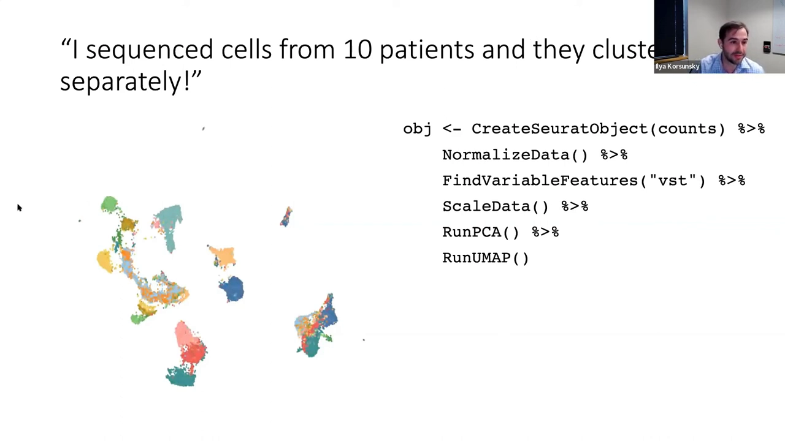

这是作者早期研究里的真实数据。代码链条是 `NormalizeData → FindVariableFeatures("vst") → ScaleData → RunPCA → RunHarmony("donor") → RunUMAP`。注意位置：**Harmony 在 PCA 之后、UMAP 和聚类之前**。

[【跳转到 31:40】](https://www.youtube.com/watch?v=EIgZQwjblPM&t=1900)


### 9.2 非标准用例：80 个供体、四个器官、八种疾病状态

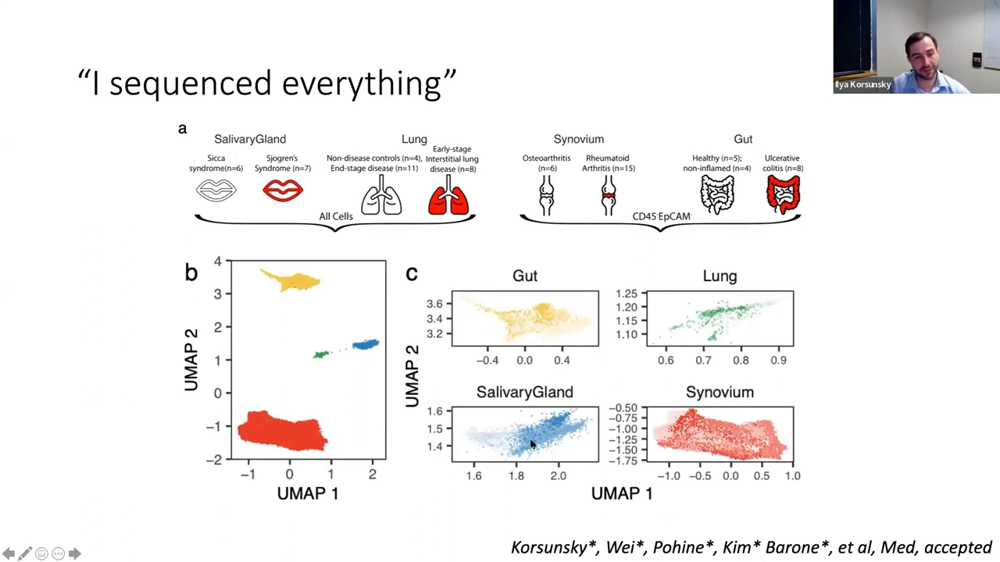

这个例子里，朴素的 PCA + UMAP 会先按组织分组，**组织内部再按供体分组**——两个效应叠在一起。作者的做法是把 `donor` 和 `tissue` 同时放进 `group.by.vars`，一次建模两个效应。

[【跳转到 36:10】](https://www.youtube.com/watch?v=EIgZQwjblPM&t=2170)

问答里有人追问：为什么是两个一起建模，而不是一次处理一个？作者的回答点出了这类数据的结构：

> 「两个都建模，而且是同时建模，因为在这个例子里它们不是独立变量，而是**嵌套变量**：每个组织的每个样本只有一个供体，我们没有同一个供体的配对组织。」

[【跳转到 38:45】](https://www.youtube.com/watch?v=EIgZQwjblPM&t=2325)

他还补了一个常被忽略的选项：**「我们选择把两个效应都去掉，但你其实也可以选择保留一个、去掉另一个，如果那对你的下游问题更合适。」** 这句话把 `group.by.vars` 从「技术参数」提升成了「研究设计决策」——去掉什么，取决于你接下来想问什么。

## 十、边界与常见误解：Harmony 是什么、不是什么

作者在问答里划出了几条清晰的红线，这几条比任何教程都值得记住。

**① Harmony 只作用在低维嵌入上，不产生「校正后的表达矩阵」。**

> 「我们目前没有把表达值做 Harmony 变换的方法。目前 Harmony 只在低维嵌入上工作，我们也只推荐在低维嵌入上用。」

[【跳转到 46:38】](https://www.youtube.com/watch?v=EIgZQwjblPM&t=2798)

他补充说，聚类、UMAP、DDRTree、Monocle 都可以直接在 harmonized PC 上做，因为「它们只需要一个 kNN 图作为输入」；但 RNA velocity 这类需要真实基因值的任务，目前没有现成方案。

[【跳转到 47:28】](https://www.youtube.com/watch?v=EIgZQwjblPM&t=2848)

**② 它不用 kNN，用高斯混合模型——这是它快的根本原因。**

> 「我们根本不用 kNN 图。……Harmony 完全不用最近邻，它用高斯混合模型代替最近邻，我认为这就是它比那些 kNN 方法快得多的原因。」

[【跳转到 51:38】](https://www.youtube.com/watch?v=EIgZQwjblPM&t=3098)

对比锚点法（Seurat 的整合）时，他把复杂度差异算得很清楚：找锚点最坏情况是「100 万乘 100 万次比较」，而**「我们从不比较一个细胞和另一个细胞，我们只把细胞和中心比较」**。

[【跳转到 56:38】](https://www.youtube.com/watch?v=EIgZQwjblPM&t=3398)

**③ 它不假设批次与生物学正交。**

> 「我们不假设正交。有时候确实正交——PC1 是细胞类型、PC2 是批次效应；但大多数时候不是，大多数时候批次效应和细胞类型高度相关，而那恰恰是有意思的情况。」

[【跳转到 52:28】](https://www.youtube.com/watch?v=EIgZQwjblPM&t=3148)

这一点直接回应了「如果细胞因为批次才看起来像最近邻怎么办」的质疑：Harmony 不依赖「先找对邻居」这一步，所以也就没有这个失败模式。

**④ 局部线性是它唯一真正依赖的假设。**

> 「全局线性绝对不是约束，但只要你能把空间划分成近似局部线性的块，就没问题。」

[【跳转到 43:21】](https://www.youtube.com/watch?v=EIgZQwjblPM&t=2601)

作者把哲学动机讲得很漂亮：流形是**局部线性、全局非线性**的，所以「既然流形是局部线性的，那就去建模局部的线性关系」。这也解释了为什么 `nclust` 不能设得太小——局部一大，局部线性就不成立了。

**⑤ SCTransform 不是整合方法。**

> 「SCTransform 是很好的归一化方法，但不是数据集整合方法。」

[【跳转到 54:33】](https://www.youtube.com/watch?v=EIgZQwjblPM&t=3273)

理由是它假设基因只有一个峰，不用混合模型、也不用流形对齐。

**⑥ 数据集规模悬殊时，危险在 Harmony 之前。**

被问到「七万个滑膜成纤维细胞和一千个肺成纤维细胞能不能整合」时，作者的答案很具体：

> 「我们最后用了加权 PCA，解决了 99% 的问题。……你也可以降采样，但我不喜欢降采样，因为那是在丢数据；你可以用加权策略让两个数据集权重相等。」

[【跳转到 57:28】](https://www.youtube.com/watch?v=EIgZQwjblPM&t=3448)

**⑦ 整合之后做差异表达，必须把批次放回模型里。**

> 「整合之后，在你的差异表达模型里不能忽略数据集效应，你必须在簇内对数据集效应建模。很多时候你不能只做一个朴素的 Wilcoxon 或 t 检验，因为它没有把供体效应、批次效应考虑进去。」

[【跳转到 41:16】](https://www.youtube.com/watch?v=EIgZQwjblPM&t=2476)

这条最容易被忽略：**Harmony 去掉的批次效应，并没有从数据里消失，它只是从 PC 坐标里被减掉了。** 差异表达要在原始表达上做，就必须重新把批次作为协变量写进设计。

## 小结

- **Harmony 的动机不是「线性不好」，而是「全局不好」。** 批次效应细胞类型依赖，一个全局校正因子必然同时造成「颜色没混匀」和「细胞类型被推近」。
- **它的做法是「多轮局部回归」。** 每一轮先用带批次多样性惩罚的软聚类划出局部邻域，再在每个邻域内学一个线性校正因子；聚类定局部、局部定 β、β 改位置、位置再定聚类，交替到不动点。
- **软聚类的作用是保住轨迹。** 每个细胞拿到的是所有簇校正因子的**隶属概率加权平均**，所以边界细胞只沿两个方向的合成方向移动，轨迹不会被切成离散的簇。
- **惩罚项决定了「零共享就不整合」。** 只含一个批次的簇不被偏好，所以两个没有任何共享细胞类型的批次不会被硬拉在一起——这一点有阴性对照验证。
- **参数即模型。** `nclust` 等于 β 的项数、等于局部邻域个数；`group.by.vars` 里每多一个变量就多一整套 β，因此可以同时去掉 batch 与 donor 这类嵌套效应。
- **簇数存在稳定区间，且给多了有冗余折叠的失效保护。** 给太少会退化成近似全局回归；给多了多出的簇会塌缩到已有簇上。
- **收敛不等于正确。** 邻近亚型与连续轨迹存在本质欠定性，Harmony 用「距离近就整合」的隐式规则做了决定，这正是过校正的来源。
- **过校正的判读有三条：** 局部是否真的混匀（而非只是靠在一起）、LISI 是否显示邻域里有多批次代表、以及回头看基因层面的结果是否还讲得通。
- **归因要准。** 稀有亚型消失，先查归一化与降维；数据集规模悬殊，先做加权 PCA；差异表达，必须把批次放回设计矩阵。

## 关键术语速查

| 术语 | 一句话解释 |
| --- | --- |
| 批次效应（batch effect） | 并非来自生物学、而来自技术或时间差异的表达偏移 |
| 软聚类（soft clustering） | 每个细胞以概率形式同时属于多个簇，而不是被硬性分配到唯一簇 |
| 软校正（soft correction） | 按隶属概率对各簇的校正因子加权平均后施加到细胞上 |
| 高斯混合模型（GMM） | 用多个高斯分布的加权和来刻画数据分布，是 Harmony 做软聚类的底层模型 |
| KL 散度（KL divergence） | 衡量两个概率分布差异的量，这里用来惩罚「簇内批次组成偏离全局」 |
| 卡方列联表（chi-square contingency table） | 检验两个分类变量是否独立的经典工具，这里用于刻画簇与批次的关联 |
| 局部线性（locally linear） | 流形的性质：全局弯曲，但足够小的局部可近似为平面，因此局部线性回归成立 |
| 隶属概率（membership probability） | 细胞属于某个簇的概率，是软聚类与软校正之间的桥梁 |
| LISI | 局部逆辛普森指数，衡量一个细胞的邻域里良好代表了多少个数据集 |
| 过校正（over-correction） | 把真实的生物学差异当成批次效应去掉，典型表现是邻近亚型被合并 |
| 嵌套变量（nested variable） | 一个变量完全包含在另一个变量内部，如每个组织样本只对应一个供体 |
| 冗余簇折叠 | Harmony 的实现特性：多给的簇会塌缩到已有簇上，形成失效保护 |
