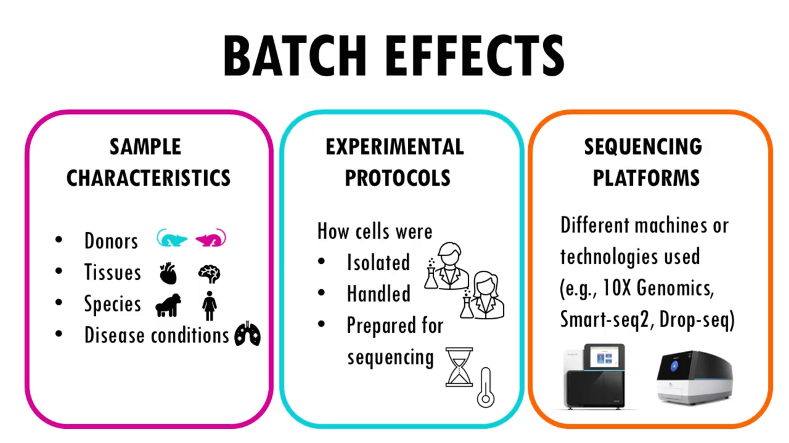
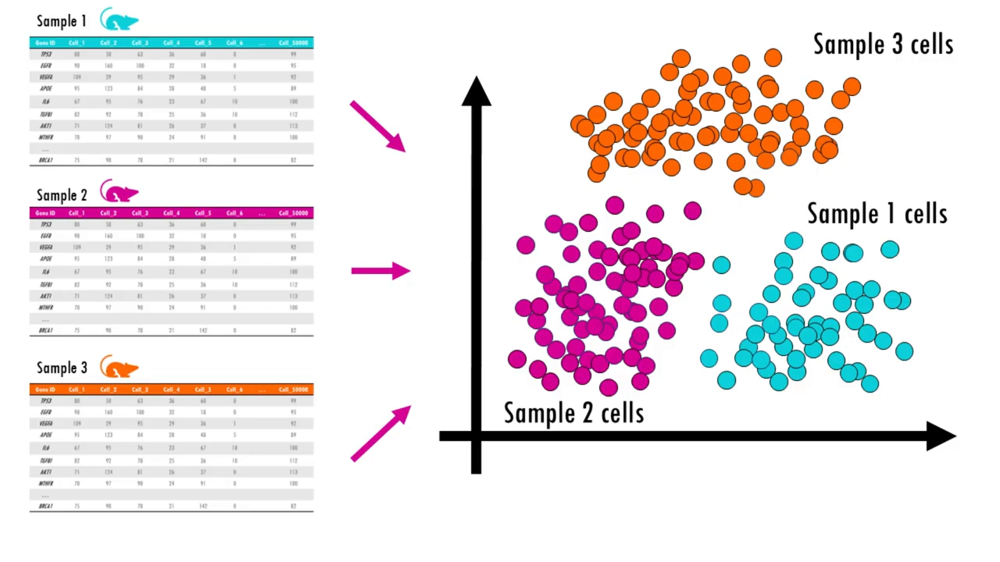
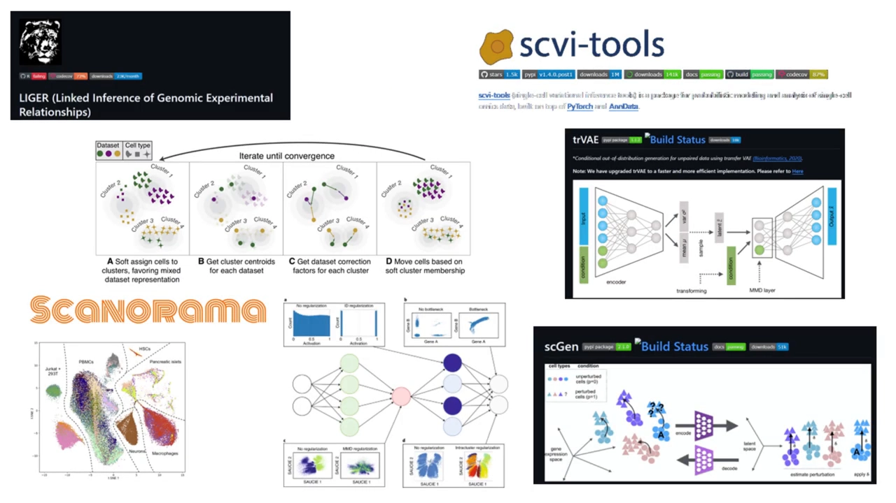
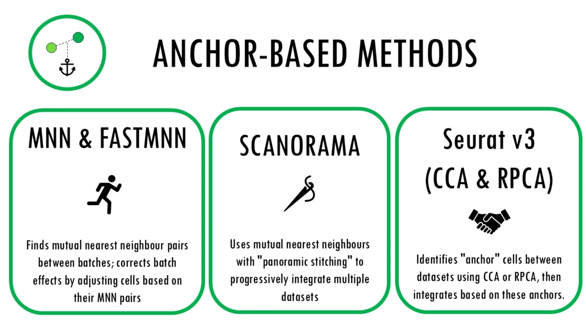
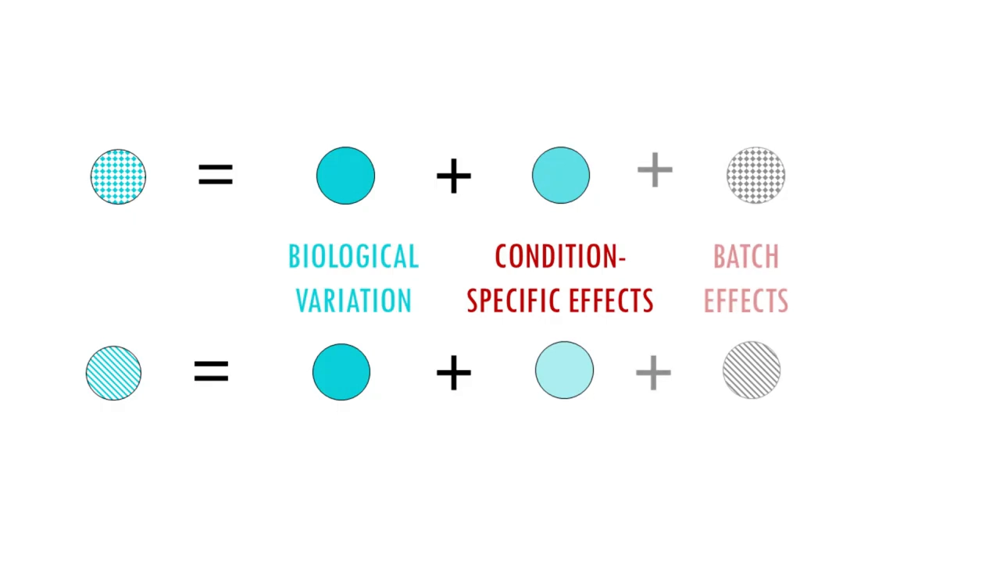
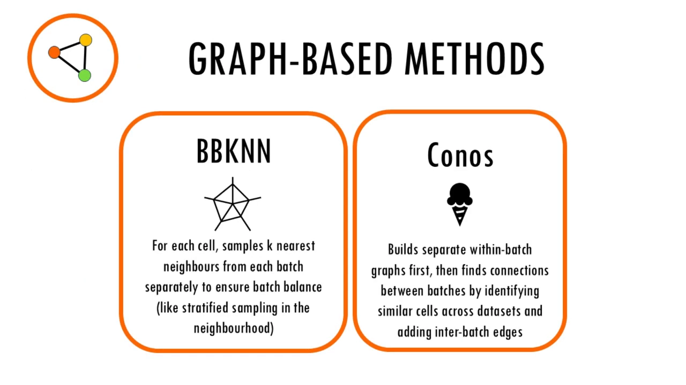
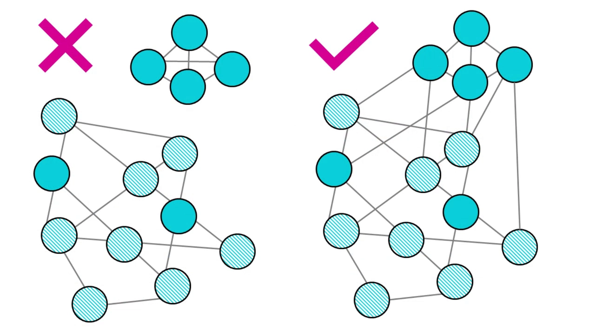
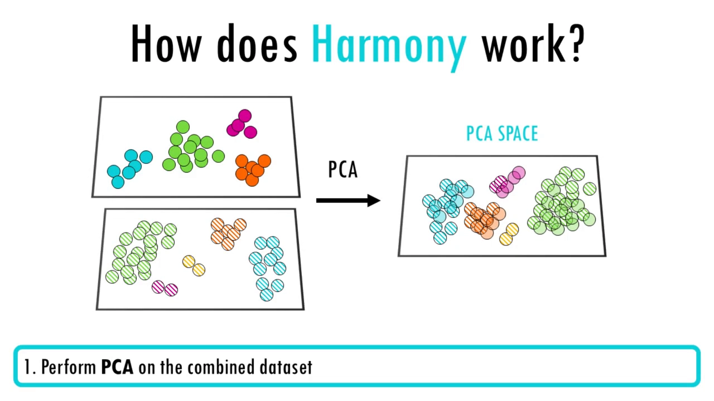
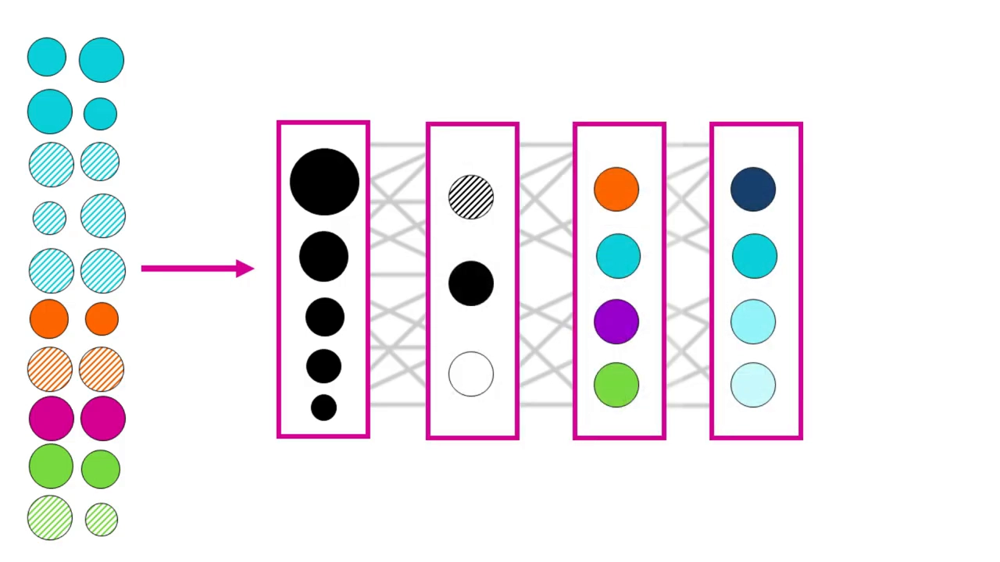

# 五种整合策略、五种假设：锚点匹配、矩阵分解、邻域图与生成模型

> 视频来源：[Single-cell integration methods: easily explained!](https://www.youtube.com/watch?v=dYKiMQbuOCY)（YouTube · 频道 Bias Squid）｜时长约 16 分钟
> 导读：这是一节**分类学**的课，不是调参课。作者按"用什么策略把细胞整合到一起"把主流方法分成五类，逐类讲清它到底产出什么、假设什么。看懂这五类，你就不会再问"哪个方法去批次效果最好"——因为它们根本不是同一件事。字幕为 YouTube 自动转写，术语错拼（M&N→MNN、Suras/Seurat、Konos→Conos、combat→ComBat 等）已按上下文校正。

**本文与本小节另一篇的关系**：本篇回答"方法家族之间假设差在哪"；另一篇《整合只改嵌入不改表达》用一份八样本数据把 CCA / RPCA / fastMNN / Harmony 四种方法并排跑出来，讲清"整合只改降维嵌入、不改表达"以及过度整合怎么定量判读。两篇互为经纬。

## 本讲要解决的核心问题（SCQA）

**背景**：单细胞 RNA 测序能测每个细胞的基因表达，而不是一整块组织的平均值，于是数据集爆炸式增长，堆在 GEO、人类细胞图谱这类公共仓库里。想把多个数据集合起来回答更大的问题，就会撞上**批次效应**——实验做法不同带来的、我们并不想要的技术性差异。

**冲突**：围绕这个难题已经发表了非常多方法和工具：MNN、fastMNN、Scanorama、Seurat 的 CCA 与 RPCA、ComBat、LIGER、BBKNN、Conos、Harmony、scVI、scANVI……每一篇都说自己"能校正批次效应"。于是最常见的做法是把它们当成同一个"去批次操作"，只比速度和默认参数。

**疑问**：这些方法对"跨批次什么算同一个细胞"的假设是一样的吗？如果不一样，差别落在哪一步，什么时候会失效？

**回答（中心思想）**：它们可以按**策略**分成五类——锚点匹配、矩阵分解、批次感知邻域图、迭代软聚类校正、深度生成模型。**五类方法对"整合的产物"和"跨批次对应关系"的假设各不相同**：锚点类先匹配相似细胞再对齐；矩阵分解把表达拆成生物学 + 条件 + 批次三部分；图方法只输出一张图，既不给新表达矩阵也不给校正坐标；软聚类在 PCA 空间里反复平移；生成模型学出潜变量再把批次那部分减掉。所以**不能把它们当成同一个去批次操作**——选方法就是选一套你愿意接受的假设。

## 一、批次效应从哪来：三类来源，一个相机类比

视频先把批次效应的来源摊开成三类：

- **样本特征**：不同供体、组织、物种、疾病状态；
- **实验流程**：细胞怎么分离、怎么处理、怎么准备测序；不只是时间和温度，还包括**做实验的人**——甚至同一个人在不同日期做，也会产生批次效应；
- **测序平台**：用不同机器或不同技术。

作者给了一个很好用的类比：**用不同的相机、在不同的光照条件下拍同一个物体**。物体本身没变，但照片看起来不一样。数据整合方法要做的，就是把这些差异归一化掉，让我们看到底下真正的生物学。

[【跳转到 02:00】](https://www.youtube.com/watch?v=dYKiMQbuOCY&t=120)

这个类比也顺手说明了整合的边界：如果"照片里到底是什么"本身不同（不同样本的细胞类型组成不一样），那么"把照片调成一样"就可能把真实差异也调掉。

三个样本的表达矩阵丢进降维，会得到三团彼此分离的细胞——这就是批次效应在低维空间里的样子。这里已经埋下了后面所有方法的分歧点：**"差异"到底该记在样本头上，还是记在细胞类型头上？**

[【跳转到 01:17】](https://www.youtube.com/watch?v=dYKiMQbuOCY&t=77)

## 二、先分类再比较：五类策略

为了做高层梳理，作者按"整合策略"把方法分成五类，并明确说明**这不是官方分类**，只是一种便于理解的划分：

1. **基于锚点（anchor-based）**：先找跨批次匹配的细胞，再据此对齐；
2. **矩阵分解（matrix factorization）**：把数据分解成共享因子与数据集特有因子；
3. **基于图（graph-based）**：构造批次感知的邻域图，图本身就是输出；
4. **迭代聚类 + 校正（iterative clustering & correction）**：软聚类与批次校正交替进行；
5. **深度生成模型（deep generative models）**：学概率性潜在表示，把生物学与批次分开。

[【跳转到 02:38】](https://www.youtube.com/watch?v=dYKiMQbuOCY&t=158)

下面逐类展开。**每一类我都会强调同一件事：它的产物是什么。** 这是区分它们最硬的判据。

## 三、锚点类：先匹配相似细胞，再对齐

这一类的主策略只有一句话：**先在不同批次之间找出相互匹配、彼此相似的细胞，然后以这些锚点为依据把数据对齐。**

作者举的例子很直观：如果你有两个来自不同物种的脑数据集，方法可能会找到某些跨物种共享的细胞类型，再用这些共同的细胞类型把两个数据集"叠"到一起。**关键原则是"先匹配相似细胞，再做整合"。**

[【跳转到 03:16】](https://www.youtube.com/watch?v=dYKiMQbuOCY&t=196)

### 3.1 Seurat 的 CCA 与 RPCA：三步流程相同，找锚点的方式不同

因为 Seurat 是单细胞分析里最流行的包，视频重点拆了它的两个方法。**两者都采用基于锚点的策略，都分三个主要步骤**：

1. 在数据集之间找出锚点细胞对；
2. 给锚点**打分并过滤**，只保留高置信度的配对；
3. 用这些锚点把数据集**变换到一个共享空间**里。

差别只在第一步"怎么找锚点"：

| 方法 | 找锚点的方式 | 打分依据 |
| --- | --- | --- |
| CCA | 先在每个数据集里各自找高变基因，再在这些高变基因的**并集**上做典型相关分析，找出数据集之间相关性最大的投影方向 | 在这个 CCA 空间里用最近邻找锚点对，再用**共享最近邻的重叠程度**给锚点打分 |
| RPCA | 在每个数据集上**独立**做 PCA，然后把每个数据集**投影到另一个数据集的 PCA 空间**里（互为投影，reciprocal PCA） | 在这些互相投影的空间里用最近邻找锚点对，再打分、过滤 |

[【跳转到 04:02】](https://www.youtube.com/watch?v=dYKiMQbuOCY&t=242)

注意这里"打分并过滤"这一步的意义：**锚点不是全盘接受的**。方法会按共享最近邻的重叠程度筛掉低置信度的配对，只留下高置信度的"真对应"。这一步是锚点类方法抵抗错误匹配的主要防线，也是它区别于"整体线性校正"的地方。

### 3.2 锚点类共同的假设与失效方式

把三个工具放在一起看，锚点类的隐含假设就浮出来了：**跨批次之间至少存在一批可以互相匹配的细胞类型。** 匹配得越准，整合越可信；如果某个细胞类型只在一个批次里出现，它根本没有锚点可用，也就不会被"拉"到别处——这既是它的保守之处，也是它在细胞组成差异大时仍然可用的原因。

反过来，**如果两个批次里"看起来最近"的细胞其实不是同一种细胞**（比如组成差异大到让 A 批次的 X 型细胞离 B 批次的 Y 型细胞最近），锚点就会配错，后续对齐也会跟着错。这是锚点类方法最典型的失效方式。

## 四、矩阵分解：把表达拆成"生物学 + 条件 + 批次"

第二类的策略是**把数据分解成共享因子与数据集特有因子**。换句话说，它把数据拆成"我们想保留的生物学变异"和"想去掉的批次变异"。

本质上，它用一个数学模型把数据分成若干成分：**整体基因表达、条件特异效应、批次效应和噪声**。ComBat 和 LIGER 用的就是这类策略。

[【跳转到 05:52】](https://www.youtube.com/watch?v=dYKiMQbuOCY&t=352)

[【跳转到 06:08】](https://www.youtube.com/watch?v=dYKiMQbuOCY&t=368)

这类方法的假设和锚点类完全不同：它不需要"找到对应的细胞"，而是假设**批次效应可以被表示成一组可加/可分的成分**，从数据里估出来再扣掉。好处是它给出的是**校正后的表达或因子**，可以直接进入下游；代价是"哪个成分算批次"这个判断依赖模型设定——条件特异效应和批次效应在数学上长得像，分错了就会把生物学当批次扣掉。

## 五、邻域图：输出不是坐标，而是边

第三类的策略是构造一个**批次感知（batch-aware）的邻域图**，直接表示整合之后的细胞关系。

这一类最容易被误解，作者专门强调了两遍：**整合后的图本身就是输出。**

- 每个细胞是图上的一个节点，边连接生物学上相似的细胞；
- 构图时方法要确保批次效应不会造成人为分离，所以**以批次感知的方式选邻居**；
- 一旦这张校正后的邻域图建好，**你不会得到新的表达矩阵，也不会得到校正后的坐标**——整合后的细胞关系被编码在图的边里。

BBKNN 和 Conos 是这一类里的两个代表，但它们的"批次感知"落点不同：**BBKNN 在选邻居时就做平衡**（每个细胞从每个批次各取 k 个最近邻，相当于在邻域里做分层抽样）；**Conos 则先建各批次内部的图，再补跨批次的边**。

[【跳转到 07:23】](https://www.youtube.com/watch?v=dYKiMQbuOCY&t=443)

这一类方法的假设非常"局部"：它不假设存在一个全局可对齐的坐标系统，只要求在**每个细胞的邻域尺度上**能做出批次平衡的选择。代价也很明确——**你拿不到一个"校正后的表达矩阵"**，任何需要连续坐标或表达值的下游分析都得另想办法。

## 六、迭代软聚类 + 校正：Harmony 这一类

第四类作者主要是为 Harmony 设的。它的步骤是：

1. 在**合并后的数据集**上算 PCA；
2. 做**软聚类**：用软 K 均值把细胞分配到各个簇，每个细胞对每个簇都有一个归属概率，这些簇代表算法想要保留的底层生物学结构；
3. **检查批次失衡**：在每个簇里看来自不同批次的细胞比例是否平衡。某个簇被单一批次占据，就解释为批次偏倚；各批次混合得好，就不需要校正；
4. 对每个簇计算各批次细胞数的**期望分布与实际分布**，对占比过高的批次施加校正，让它们向全局分布靠拢；
5. 在 PCA 空间里算出**校正向量**，描述每个批次的细胞要平移多少，才能让簇在批次上变得平衡；
6. **反复进行聚类和校正**，直到嵌入在批次之间充分混合、同时又保住了生物学结构。

[【跳转到 08:21】](https://www.youtube.com/watch?v=dYKiMQbuOCY&t=501)

这一类的假设藏在第 3 步里：**它把"簇内批次不均衡"直接当成批次偏倚的证据。** 如果某个细胞类型真的只存在于一个批次（真实的组成差异），Harmony 也会把它读成"批次偏倚"并试图校正——这就是它的过度整合风险所在。

## 七、深度生成模型：学出潜变量，再把批次那部分减掉

最后一类方法学习**概率性的潜在表示**，同时建模生物学变异和批次效应。用大白话说，它们学的是每个细胞的"隐藏蓝图"，这个蓝图同时解释了真实的生物学和技术性的批次差异。

它们不只是调整数据，而是通过对"数据是如何生成的"建模，学出哪些变异是生物学、哪些是批次噪声。也就是去推断：**如果我们能看见这个细胞不受批次效应影响的真实生物学，它会是什么样子。**

[【跳转到 10:05】](https://www.youtube.com/watch?v=dYKiMQbuOCY&t=605)

这类生成模型可以分两种：普通的自编码器（例如 SAUCIE）和变分自编码器（VAE，例如 scVI、scANVI）。作者用了一个很清楚的类比来讲 VAE 的两半：

- **编码器（压缩器）**把复杂数据压成更简单的形式：每个细胞不再有几千个测量值，只保留少数几个能抓住重要模式的关键数字——就像把一幅细节丰富的肖像压缩成"年轻女性微笑摆姿势"这样一句描述；
- **解码器（解压器）**拿这几个关键数字把完整数据重建出来，本质上就是根据描述重新生成整张照片。

至于"变分"：它学的是**概率分布而不是固定值**，这有助于处理不确定性。它不会说"这个细胞恰好在 X 点"，而是说"这个细胞大约在 X 点附近，上下浮动一点"。

[【跳转到 11:42】](https://www.youtube.com/watch?v=dYKiMQbuOCY&t=702)

这一类的假设最强：它假设**存在一个能把"生物学"和"批次"分开的生成过程**，并且这个分解可以被神经网络从数据里学出来。假设越强，能做的事也越多——它可以重建表达、可以生成、可以做扰动预测；但一旦"生物学"和"批次"在真实数据里纠缠得不可分，模型学到的分解就只是一种约定。

## 八、所以不能把所有方法当成同一个"去批次"操作

把五类并排放在一起，差异立刻显现——**它们连"整合的产物"都不是同一种东西**：

| 策略 | 代表工具 | 整合的产物 | 核心假设 | 典型失效方式 |
| --- | --- | --- | --- | --- |
| 锚点匹配 | MNN / fastMNN、Scanorama、Seurat CCA / RPCA | 共享空间里的校正坐标 | 跨批次存在可匹配的相似细胞 | 锚点配错（组成差异大到"最近邻"不是同类细胞） |
| 矩阵分解 | ComBat、LIGER | 校正后的表达 / 共享与特异因子 | 批次效应是可分离的成分 | 把条件特异效应当批次扣掉 |
| 批次感知邻域图 | BBKNN、Conos | 只有一张图（边），没有新矩阵、没有新坐标 | 只需在邻域尺度上做到批次平衡 | 下游要坐标或表达时无法直接使用 |
| 迭代软聚类校正 | Harmony | PCA 空间里被平移过的嵌入 | 簇内批次不均衡即批次偏倚 | 真实组成差异被当成批次偏倚抹平 |
| 深度生成模型 | scVI、scANVI、SAUCIE | 概率性潜表示（可重建表达） | 生物学与批次可被生成过程分开 | 分解只是约定，批次与生物纠缠时不可分 |

[【跳转到 13:16】](https://www.youtube.com/watch?v=dYKiMQbuOCY&t=796)

这张表就是这一节要的答案：**"去批次"是它们的共同目标，不是它们的共同机制。** 你选一个方法，等于同时接受了它对"什么算同一个细胞""什么算批次""整合应该产出什么"的三重假设。

## 小结

- **批次效应来自三类源头**：样本特征、实验流程（含操作者与日期）、测序平台；相机与光照的类比说明"物体没变、照片变了"。
- **五类策略**：锚点匹配、矩阵分解、批次感知邻域图、迭代软聚类校正、深度生成模型。
- **锚点类**先匹配相似细胞再对齐，三步是"找锚点对 → 打分过滤 → 变换到共享空间"；CCA 在共同相关方向上找锚点，RPCA 在互相投影的空间里找。
- **矩阵分解**把表达拆成生物学 + 条件 + 批次，直接给出校正后的成分。
- **图方法只输出图**：BBKNN 在选邻居时做批次平衡，Conos 先建批次内图再补跨批次边；**没有新矩阵，也没有新坐标**。
- **Harmony** 靠软聚类反复平移 PCA 嵌入，它的假设是"簇内批次不均衡 = 批次偏倚"。
- **生成模型**学潜变量再减掉批次，假设最强、能力也最强。
- **结论**：不能把所有方法当成同一个去批次操作——选方法就是选一套假设，并接受它对应的失效方式。

## 关键术语速查

| 术语 | 一句话解释 |
| --- | --- |
| 批次效应 | 实验做法不同带来的技术性差异，会掩盖真实的生物学信号 |
| 锚点（anchor） | 跨批次之间相互匹配的细胞对，锚点类方法据此对齐数据 |
| MNN / fastMNN | 互近邻，找批次间互为最近邻的细胞对，按配对调整细胞 |
| Scanorama | 用互近邻配合"全景拼接"逐步整合多个数据集 |
| CCA / RPCA | Seurat 的两个锚点方法：前者找共同相关方向，后者做互相投影 |
| 共享最近邻重叠 | 给锚点打分的方式，重叠越多说明配对越可信 |
| 矩阵分解 | 把表达拆成共享因子与数据集特有因子（含批次成分） |
| 批次感知邻域图 | 构图时按批次平衡地选邻居，整合结果只体现在边里 |
| 软聚类 | 每个细胞对每个簇都有归属概率，而不是硬分配 |
| 变分自编码器（VAE） | 编码器压缩、解码器重建，且学的是概率分布而非固定值 |