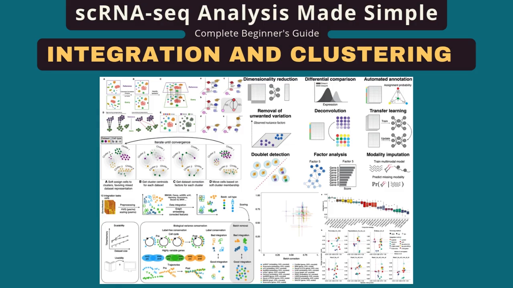
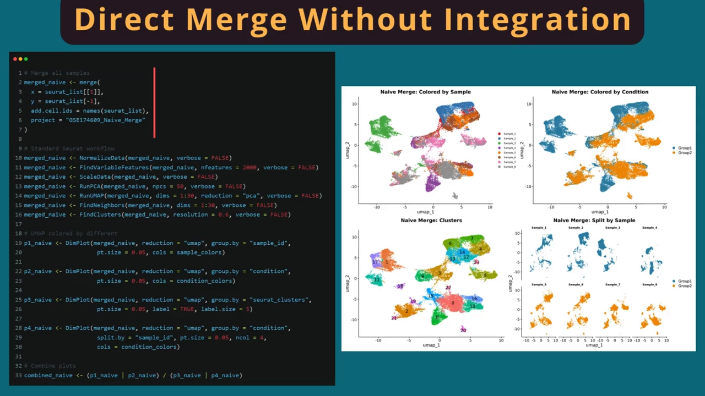
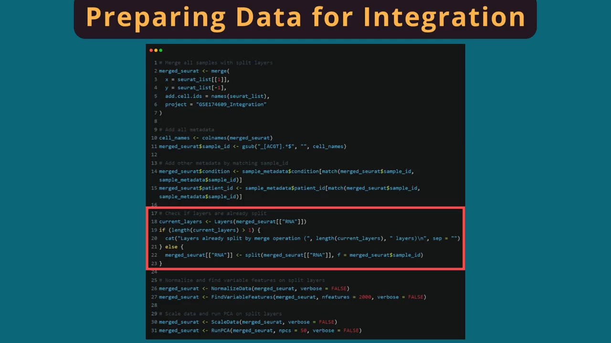
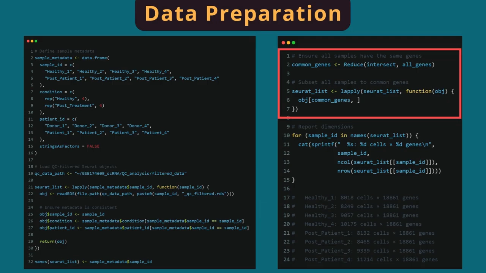
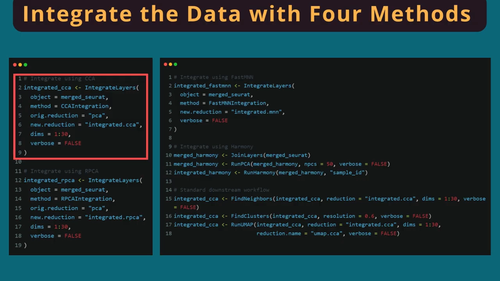
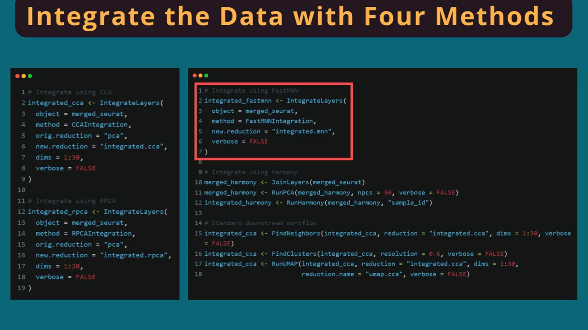
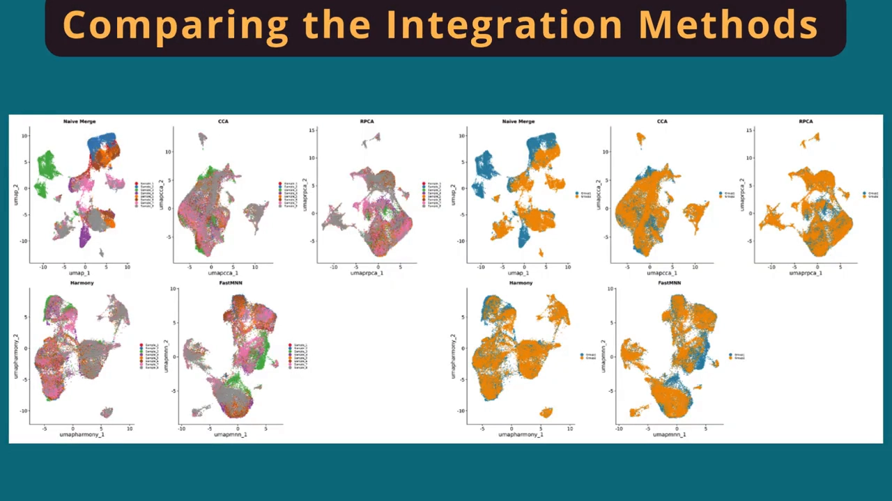
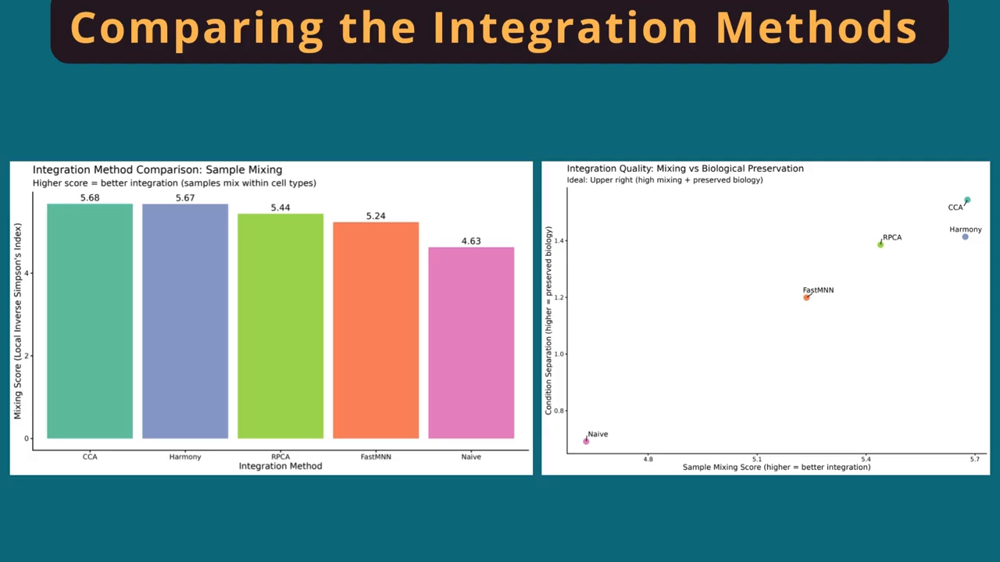
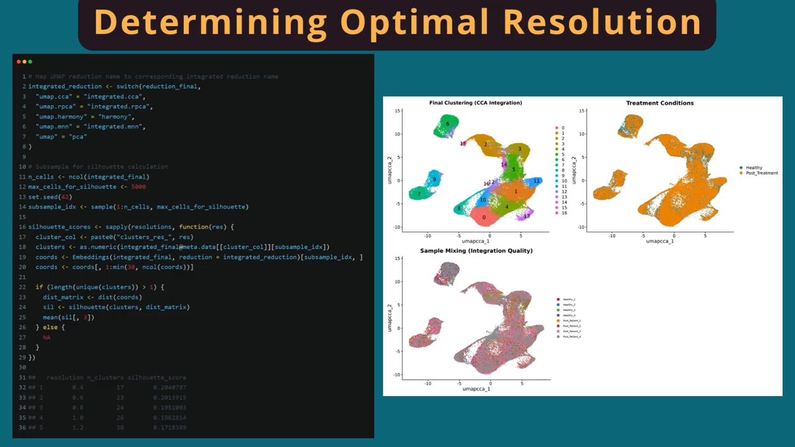

# 整合只改嵌入不改表达：CCA、RPCA、fastMNN 与 Harmony 的假设差异

> 视频来源：[scRNA-seq Integration & Clustering — CCA vs RPCA vs Harmony vs FastMNN | Beginner's Guide Part 3](https://www.youtube.com/watch?v=QNNUyWc73WA)（YouTube · 频道 ngs101，讲者 Ley）｜时长约 31 分钟
> 导读：这节课最值钱的不是"四种方法怎么调"，而是开头那三分钟——**整合改的是降维空间里的嵌入，不是基因表达矩阵**。想清楚这一点，后面"CCA 为什么能容忍细胞组成不同、fastMNN 为什么最保守、混合度高为什么反而危险"才有落脚点。本文按「整合改了什么 → 不整合会怎样 → 四种方法各自的对应关系假设 → 过度整合的定量信号 → 怎么选」组织，覆盖视频全部内容。字幕为 YouTube 自动转写，术语错拼已按上下文校正。

**本文与本小节另一篇的关系**：本篇讲的是**线性/邻域类方法在"共享低维空间"这条路线上的假设差异**；另一篇《五种整合策略、五种假设》把锚点、矩阵分解、邻域图、软聚类、生成模型五大家族并排比较，回答"为什么不能把所有方法当成同一个去批次操作"。两篇合起来才是这一小节要求的完整对照。

## 本讲要解决的核心问题（SCQA）

**背景**：八个样本（4 个健康 + 4 个处理）质控后各存成一个 Seurat 对象，一共七万多个细胞。把它们简单 `merge` 起来跑标准流程，UMAP 上每个样本各占一座彩色孤岛——细胞是按"来自哪个样本"分组的，不是按细胞类型。

**冲突**：初学者最容易犯的两个错都出在这里。第一，以为单细胞整合和 bulk RNA-seq 的批次校正一样，是在**表达值**上做加减，于是把整合后的矩阵直接拿去做差异表达；第二，看到整合后健康细胞和处理细胞在 UMAP 上混在一起，就以为"处理效应被抹掉了"。

**疑问**：整合到底改了数据的哪一部分？CCA、RPCA、fastMNN、Harmony 这四种方法，差别只是"整合力度"这种程度问题，还是它们对"跨批次什么算同一个细胞"的假设根本不同？

**回答（中心思想）**：**整合只在降维空间里生成一个调整后的嵌入（embedding），它只服务三件事——建近邻图、定义簇、画 UMAP；基因表达矩阵原封不动。** 四种方法的真正差别在于"用什么方式建立跨批次的对应关系"：CCA 找数据集之间的共同相关方向，RPCA 把每个数据集投影到对方的 PCA 空间，fastMNN 找互为最近邻的细胞对并在低维空间里局部调整，Harmony 用软聚类反复平移。这个差别直接决定了它们**对细胞类型组成差异的容忍度**和**保守程度**，也就决定了你手上的数据该用哪一个。

## 一、整合改的是嵌入，不是表达

视频开头先拿 bulk RNA-seq 做对照，这是最快的澄清方式。

在 bulk 测序里做批次校正，你校正的是**表达值本身**：在设计公式里加一个批次项，或者跑一下 `removeBatchEffect`，然后这些被调整过的表达值直接进入差异表达统计。单细胞整合完全不是这条路：

- 它工作在**降维后的空间**里，拿你的主成分，生成一个新的、调整过的嵌入；
- 你的**基因表达矩阵完全不动**；
- 这个调整后的嵌入只用于三件事：**构建近邻图、定义簇、生成 UMAP**。

所以后面做差异表达基因检验、找簇的标记基因时，你要回到**原始的归一化 RNA 数据**，而不是整合产生的东西。讲者的原话很干脆：**整合是一套"可视化与聚类"的范式，不是表达量校正。**

[【跳转到 01:30】](https://www.youtube.com/watch?v=QNNUyWc73WA&t=90)

### 1.1 由此推出：UMAP 上混在一起 ≠ 处理效应被抹掉

第二个常见困惑紧跟着解决。当你整合样本后，健康细胞和处理细胞在 UMAP 上叠在一起，这**不意味着**处理效应被抹掉了。

关键在于你**按什么变量整合**：这里是按**样本 ID** 整合，目的是让八个不同供体里同一类型的细胞落进同一个簇。处理带来的信号仍然留在表达值里，你之后会在**每个簇内部**做检验把它找回来。

[【跳转到 02:30】](https://www.youtube.com/watch?v=QNNUyWc73WA&t=150)

这条区分非常重要，因为它决定了"过度整合"该怎么判读：整合对象是样本（技术批次），不是处理（生物学条件）。如果你把条件也塞进整合变量，那才是真的在抹生物学。

## 二、先看清问题：不整合的合并会把细胞按样本分岛

在动手之前，视频专门做了一次"朴素合并"（naive merge）作为基线：八个对象一次 `merge`，用样本名给 barcode 加前缀保证唯一，然后跑完全不整合的标准流程——归一化、2000 个高变特征、缩放、50 个主成分的 PCA、用前 30 维跑 UMAP、同样 30 维找近邻、0.6 分辨率聚类。

四个面板把问题摊开了：

- **按样本上色**：每个样本占据自己的彩色区域；
- **按条件上色**：在"组"这个层面看到同样的分离，蓝色和橙色各占一块地盘；
- **按簇上色**：20 多个簇里，有些簇是按样本分开的，不是按细胞类型分开的；
- **按样本拆分**：每个样本只点亮整个空间的一部分。

讲者给了一句很重的判词：**如果这时候去注释，我们会把同一个 T 细胞描述四遍，每个供体一遍。**

[【跳转到 09:30】](https://www.youtube.com/watch?v=QNNUyWc73WA&t=570)

这里还埋了一个方法论提醒：他们自己的数据集有 **72,649 个细胞**，在这个量级上 UMAP 的点太密，**光靠颜色已经看不出批次处理效果**了。幻灯片上那些"一眼可见批次效应"的 UMAP 其实取自另一个小得多的数据集。结论是：**细胞数少于一万时，眼睛还能用；超过这个量级，必须上定量指标。**

[【跳转到 11:06】](https://www.youtube.com/watch?v=QNNUyWc73WA&t=666)

## 三、四种方法共用同一条流水线，差别只在"怎么建立跨批次对应"

### 3.1 共同的前置：分层，然后让每个方法去调整同一份 PCA

Seurat 第 5 版的核心概念是 **layer（层）**：一个分析对象里可以按样本分成多层，而不是压成一个合并矩阵。这一步不是形式主义——"数据被分成层之后，后面每一步处理都知道样本的边界"。

归一化、找 2000 个高变特征、缩放、50 个主成分的 PCA，这四个操作全部**逐层**进行。**这份分层 PCA 就是四种方法共同要调整的输入。** 如果忘了分层，下一步的 layer 整合功能就没有东西可以整合。

还有一个容易被忽略的前置：**不同样本过滤后剩下的基因列表可能不一样**。视频用 `Reduce(intersect, ...)` 取八个样本的共有基因，再把每个对象限制在这个集合上。

这一步**不是通用要求**，但对 fastMNN 是硬性的：fastMNN 通过 batchelor 实现，而 batchelor 对每个批次自己做归一化和方差建模，所以它要求各批次的基因一一对应。其他方法更宽松。讲者的建议是"反正只花一行代码"，统一了能给后面留更多选择。

[【跳转到 08:09】](https://www.youtube.com/watch?v=QNNUyWc73WA&t=489)

### 3.2 CCA：找"共同相关方向"，因此能容忍细胞组成不同

CCA（典型相关分析）识别的是**数据集之间的共同相关模式**。它先把各数据集的高变基因并起来，在这个并集上找让两个数据集投影相关性最大的方向，然后在这个共同空间里用最近邻找锚点。

讲者给 CCA 的定位很明确：**它真正的优势是能处理"细胞类型组成不同、细胞数也不同"的样本，而这正是大多数实验的真实情况，所以它是一个聪明的默认选择。**

### 3.3 RPCA：把每个数据集投影到对方的 PCA 空间，快，但要求组成大体相似

RPCA（互为投影的 PCA）不做共同空间，而是**把每个数据集投影到另一个数据集的 PCA 空间里**。代价是它假设两边"能对上"，收益是**更快、更省内存**。

因此它的适用条件被讲得很具体：**超过大约 10 万个细胞的超大数据集**，并且**样本的细胞类型组成大体相似**。注意这两个条件是"与"的关系——组成差异大时，互相投影的前提就不成立了。

### 3.4 fastMNN：找互为最近邻的细胞对，在低维空间里局部调整

fastMNN 在代码层面就露出了不同：**它不接受"原始 reduction"这个参数**。原因是互近邻方法的工作方式不一样——它在批次之间找**互为最近邻（mutual nearest neighbors）的细胞对**，然后**在低维空间里调整这些配对**。

这种"只在配对局部做调整"的做法带来一个直接后果：**fastMNN 是四种方法里最保守的**。讲者给的适用场景是：**生物学差异很小、你担心它被误删的时候，它是最合适的工具。**

### 3.5 Harmony：先合层，再在 PCA 嵌入上做软聚类迭代

Harmony 是唯一打破这套模板的方法。它**在 PCA 嵌入上工作，而不是在层上工作**，所以必须先 `JoinLayers` 把层合回一个矩阵，再跑一次 50 个主成分的 PCA，最后 `RunHarmony` 并把样本标识作为要校正的变量传进去。

它的机制是**对细胞做迭代软聚类，让每个簇近似为所有数据集混合而成的分布**。视频还提到一个版本更新：Seurat 5.5 之后的 `IntegrateLayers` 可以直接传 `method = "HarmonyIntegration"`、`reduction = "pca"`、`new.reduction = "harmony"`，并在同一次调用里配置 theta 这类 Harmony 专属参数；讲者本人因为版本兼容问题仍用 `RunHarmony`，两条路产出的都是"被 Harmony 调整过的嵌入"。

[【跳转到 16:18】](https://www.youtube.com/watch?v=QNNUyWc73WA&t=978)

### 3.6 下游三步对四种方法完全一样

整合之后，四种方法都走同样的三步：在整合后的降维上 `FindNeighbors`、用 0.6 分辨率 `FindClusters`、在同一个降维上 `RunUMAP` 并指定输出名（`integrated.cca` / `integrated.rpca` / `harmony` / `integrated.mnn`）。

讲者在这里点出了全篇最关键的一句实现细节：**每一步的 reduction 参数指向的都是调整后的嵌入，而不是基因表达数据。** 这就是开头那个"可视化范式"在代码里的具体样子。

[【跳转到 18:28】](https://www.youtube.com/watch?v=QNNUyWc73WA&t=1108)

## 四、混合度不是唯一指标：过度整合的定量信号

### 4.1 目测：四种方法都解决了问题，差别是程度

逐格看下来的观感是：

- **CCA**：颜色被仔细混开，每个区域都有来自每个样本的细胞，条件图上蓝橙到处混在一起；
- **RPCA**：混合也不错，但结构稍微更分裂、混合程度不如 CCA——**这正是一个更保守的方法该有的表现**；
- **Harmony**：混合很强，整体形状略有不同，因为它调整的是嵌入坐标而不是重组空间；
- **fastMNN**：也把样本混起来了，但**保留了一些单独的团块**，条件图上有些区域蓝橙没有完全混匀。

讲者的结论是：**四种方法都明显解决了问题，它们之间的差别是程度问题，不是本质问题。**

[【跳转到 20:07】](https://www.youtube.com/watch?v=QNNUyWc73WA&t=1207)

### 4.2 定量：局部辛普森倒置指数

目测是主观的，所以下一步上数字。混合度用**局部辛普森倒置指数（local inverse Simpson index, LISI）**衡量：对每个细胞，在 UMAP 空间里找它的 **50 个最近邻**，问这些邻居的样本标签有多多样。邻域来自很多不同样本 → 混合好；每个邻居都来自同一个样本 → 混合差。**分数越高越好。**

| 方法 | 混合度（LISI，越高越好） |
| --- | --- |
| CCA | 5.68 |
| Harmony | 5.67 |
| RPCA | 5.44 |
| fastMNN | 5.24 |
| 朴素合并 | 4.63 |

每种整合方法都比什么都不做好，这让人放心；在这个数据集上 CCA 和 Harmony 是最好的混合工具。

### 4.3 但只看混合是危险的：一个毁掉所有生物学的方法会混合得完美无缺

这是全篇最有价值的一句判断。所以视频用了第二个指标：**条件分离度**。

做法是：先找出所有健康细胞在 UMAP 上的平均位置、所有处理后细胞的平均位置，再量这两个中心之间的距离。

$$
d_{\text{cond}} = \left\lVert \bar{\mathbf{x}}_{\text{healthy}} - \bar{\mathbf{x}}_{\text{post}} \right\rVert
$$

距离大 → 两种条件仍能区分 → 生物学信号被保住了；**距离小 → 过度整合（over-integration）的警告信号**。

散点图上的位置关系本身就是一套判读规则：

- **右上角**是理想区：混合高、生物学保守；
- **左下角**是朴素合并：两个指标都低。讲者的解释很到位——**样本完全没混时，"条件之间表面的差异"其实被组间差异混淆了**，所以那个"分离度"是虚高的假象；
- **fastMNN 落在中间**：保守，混合度换来的分离度也有限；
- **RPCA 和 Harmony 在右上区域**；
- **CCA 在右上角最远处**，混合最好、条件分离也最大。

[【跳转到 22:03】](https://www.youtube.com/watch?v=QNNUyWc73WA&t=1323)

## 五、选型不是选冠军，是选与你的数据假设相符的那个

CCA 在这个数据集上赢了，但讲者反复强调：**要采纳的是这套方法，不是这个答案，因为排名取决于你的数据。**

他给了三条可以直接套用的换位规则：

1. **数据集大得多** → RPCA 或 Harmony 是实用选择，纯粹因为速度和内存；
2. **生物学差异非常细微、怕被抹平** → fastMNN 的保守性更安全；
3. **某个方法混合度很高、条件分离度却很低** → 这就是过度整合的信号，**无论它的混合表现看起来多好，都应该换一个方法**。

最后一条被讲成了行动项：**永远要为你的数据集画这张"混合度 vs 条件分离度"的图。**

[【跳转到 23:33】](https://www.youtube.com/watch?v=QNNUyWc73WA&t=1413)

把这一节和前面的方法假设对上，逻辑就闭环了：

| 方法 | 跨批次对应的建立方式 | 隐含假设 | 组成差异大时 |
| --- | --- | --- | --- |
| CCA | 在共同相关方向上找锚点 | 存在可对齐的共同结构 | 能容忍（视频称其为默认选择） |
| RPCA | 互相投影到对方的 PCA 空间 | 两边能"对上" | 前提变弱，视频限定"组成大体相似" |
| fastMNN | 找互为最近邻的细胞对，局部调整 | 至少存在一批共享细胞类型 | 保守，不易误删生物学 |
| Harmony | 软聚类迭代，把每簇拉成各数据集的混合 | 簇内批次应均衡 | 靠 theta 等参数调节 |

## 六、整合之后：簇该由细胞类型决定，而不是由处理组决定

视频最后用聚类结果给整合做了一次"验收"。它先纠正一个流行误解：**簇数不必等于预期的细胞类型数**。细胞类型存在于不同层级上——T 细胞在低分辨率下是一个簇，在高分辨率下是四个；再加上激活/静息这类状态，粒度还要更细。对 PBMC 来说，**12 到 15 个簇覆盖大约八种细胞类型是完全正常的**。分辨率是"你必须做出并说明理由的选择"，不是一个要去凑的数字。

他们实测了 0.4 / 0.6 / 0.8 / 1.0 / 1.2 五个分辨率，分别得到 17 / 23 / 24 / 26 / 30 个簇；再用**轮廓系数**（在整合空间的前 30 维上算，而不是在二维 UMAP 坐标上算，并对 5,000 个细胞下采样）客观挑选，结果分数在 0.4 时最高、随加簇而下降，于是停在 0.4。

这张图同时完成了两件事：

- **簇由细胞类型定义，不由处理组定义**——两种状态在所有簇里完全混合；
- **整合通过质量检查**——每个簇都包含来自每个样本的细胞。

[【跳转到 28:54】](https://www.youtube.com/watch?v=QNNUyWc73WA&t=1734)

## 小结

- **整合改的是嵌入，不是表达**：它在降维空间里生成调整后的嵌入，只服务近邻图、簇、UMAP；差异表达要回到原始归一化数据。
- **按样本 ID 整合不等于抹掉处理效应**：处理信号留在表达值里，之后在每个簇内部检验。
- **不整合的合并会让细胞按样本分岛**，而且细胞数上万后肉眼已不可靠，必须上定量指标。
- **四种方法的共同点远大于差异**：同一份分层 PCA 作为输入，下游三步完全相同；差别只在"怎么建立跨批次对应"。
- **CCA 容忍细胞组成不同，RPCA 要求组成大体相似但更快更省内存，fastMNN 只在互为最近邻的细胞对上做局部调整因而最保守，Harmony 用软聚类迭代平移嵌入。**
- **混合度不能单独看**：一个毁掉所有生物学的方法会混合得完美无缺；必须同时看条件分离度，落在"高混合 + 低分离"就是过度整合。
- **选型取决于你的数据**：大数据选快的方法，生物学差异细微选保守的方法，混合高但分离低就换方法。

## 关键术语速查

| 术语 | 一句话解释 |
| --- | --- |
| 嵌入（embedding） | 细胞在低维空间里的坐标，整合真正修改的对象；表达矩阵不动 |
| layer（层） | Seurat v5 里按样本分开存放的表达数据，让每一步处理都知道样本边界 |
| CCA | 典型相关分析，找两个数据集投影相关性最大的共同方向，在其上找锚点 |
| RPCA | 互为投影的 PCA，把每个数据集投影到对方的 PCA 空间，快但要求组成相似 |
| fastMNN | 快速互近邻，找批次间互为最近邻的细胞对并在低维空间局部调整，最保守 |
| LISI | 局部辛普森倒置指数，看每个细胞的近邻里样本标签有多杂，越高混合越好 |
| 条件分离度 | 两种条件细胞在嵌入中的平均位置距离，越小越可能是过度整合 |
| 过度整合 | 批次被抹平的同时生物学差异也被抹平，表现为高混合 + 低条件分离 |
| 轮廓系数 | 衡量每个细胞离自己簇更近还是离邻簇更近，用于客观挑聚类分辨率 |