# 小批量里放谁，决定对比学习对齐什么：CONCORD 的采样式批次整合

> 视频来源：[Contrastive Learning for Cross-domain Reconciliation and Discovery](https://www.youtube.com/watch?v=GNTaHc01KPY)（YouTube · ISMB/ECCB 2025 会议报告，讲者来自 UCSF Zev Gartner 实验室）｜时长约 16.5 分钟
> 导读：这支报告不讲网络结构，只讲一件更基础的事——对比学习的小批量（mini-batch）里"放了谁"，决定了模型会把什么当成需要拉近、什么当成需要推开的差异。适合已经知道批次整合要做什么、但想弄清"对比目标到底在优化什么"的读者。

## 本讲要解决的核心问题（SCQA）

**背景**：单细胞测序每次只拍到整个细胞状态景观（cell state landscape）的一个快照。为了拼出完整景观，人们会从不同时间点、不同空间位置采样，于是拿到许多批数据；整合的目标是把这些批次拼成一张连续、可追溯的流形。

**冲突**：整合方法各有假设，一旦假设不成立就会产生伪影——要么出现缺口（gap）把景观切断，要么流形整体错位，导致对细胞状态的误读。自监督对比学习本是一个自然的选择，但报告指出：**它默认并不解决批次效应，反而会放大批次效应**。

**疑问**：能不能不改网络结构、也不加辅助损失，只改"训练时模型看到细胞的顺序与组成"，就让对比学习同时做到去批次和高分辨率？

**回答（中心思想）**：能。对比学习的对齐对象不是由损失函数决定的，而是由**小批量里细胞的组成**决定的：把同一数据集内的邻居放进同一批，模型学到的是数据集内部的变化；把跨数据集的细胞混进同一批，模型学到的就是"生物差异 + 数据集差异"的混合体。CONCORD 用**数据集感知采样**把批次差异推到训练轴上被平均掉，用**邻域感知采样**保住局部结构，再用一个联合概率采样把两者合起来。

## 一、整合真正要保住的是流形的连通与分辨率

报告开头先把问题摆清楚。细胞并不是在高维表达空间里随机取点，而是被基因调控机制与细胞间通讯约束在一个低维流形上；在发育与疾病进程中，这个流形还会出现分叉（类似 Waddington 景观）和细胞周期环路。因此"好的降维/表征"的判据是：**这些关键结构要在潜空间里被保留下来**。

[【跳转到 01:43】](https://www.youtube.com/watch?v=GNTaHc01KPY&t=103)

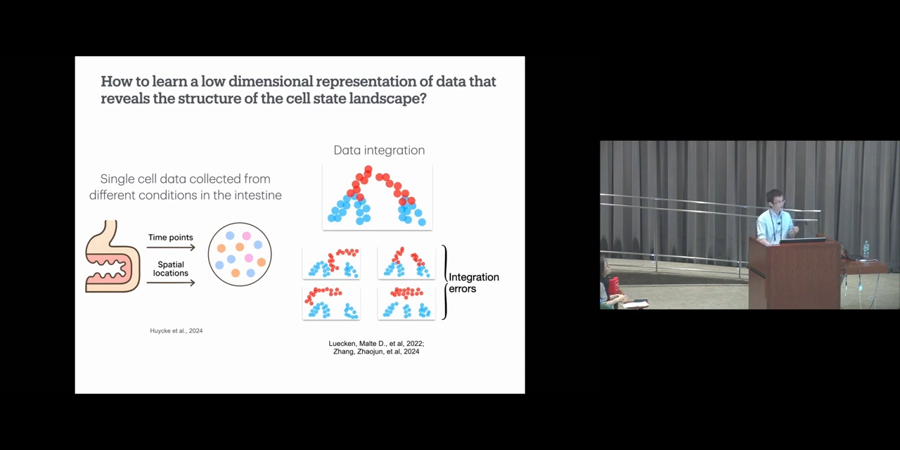

上图把失败模式画得很直白：左上是理想整合——两批细胞拼成一条连续的弧；右下的几种则是"整合误差"，包括批次之间留下缺口、以及流形被整体错位。缺口会让一条发育轨迹断成两截，错位会让本不相邻的状态被读成相邻。这两点后面会反复出现，因为它们是评价整合方法的具体尺子。

## 二、均匀采样的小批量只能看到"大类"，看不到"近邻状态"

对比学习的训练单元是一个小批量：从全数据集里抽 64 或 100 个细胞，让它们互相比对，模型从比对中提取各细胞状态背后的基因共表达程序。常规做法是**均匀随机采样**。

[【跳转到 03:28】](https://www.youtube.com/watch?v=GNTaHc01KPY&t=208)

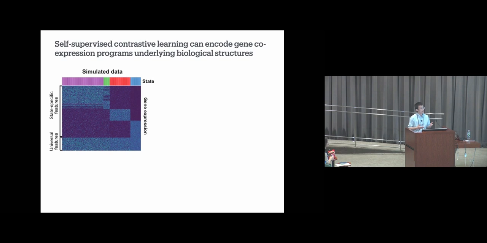

报告用一份模拟数据来暴露问题：数据由"状态特异特征"和"通用特征"两类基因构成，形成块状结构，共四个状态。均匀采样下，对比学习确实能分出彼此相距很远的状态簇——看起来和 PCA 差不多。

[【跳转到 04:18】](https://www.youtube.com/watch?v=GNTaHc01KPY&t=258)

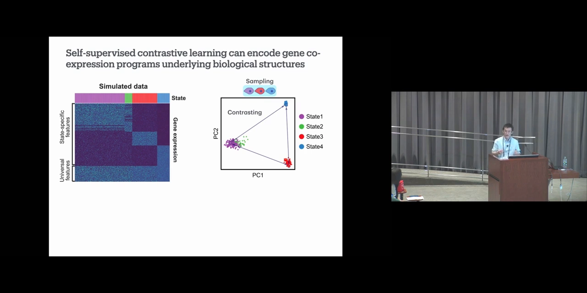

问题就在这张图上：**绿色和紫色在真实表达数据里是两个不同状态，但均匀采样的对比学习（以及 PCA）没能把它们分开**。原因不难理解——均匀采样让每个小批量里绝大多数细胞来自相隔很远的大簇，模型没有动机去区分"挨得很近的两个状态"，它们的差异在比对中被当成噪声。

## 三、把邻居塞进同一批，模型才会去分辨近邻状态

既然小批量组成会影响结果，那就工程化地改它。CONCORD 的第一个改动是**邻域感知采样（neighborhood-aware sampling）**：在均匀采样之外，用局部邻域采样给每个小批量"加料"，使模型既看到细胞类型之间的全局差异，也有机会比对细胞状态之间的细微差异。

[【跳转到 04:43】](https://www.youtube.com/watch?v=GNTaHc01KPY&t=283)

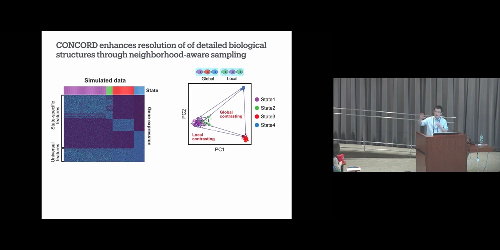

上图把两种比对并置：跨大簇的连线是"全局比对（global contrasting）"，簇内部近邻之间的连线是"局部比对（local contrasting）"。效果是潜空间变细——原本糊在一起的状态被拉开，邻近状态之间的边界显现出来。这一步说明了一个关键点：**对比学习的"负样本"其实是由采样决定的**，你不把近邻放进同一批，它们就永远不构成需要被推开的负对。

## 四、批次效应不会被对比学习自动消掉，反而会被学进去

接下来是本节最核心的一段。自监督对比学习**不解决批次效应**：只有一个批次时，一切正常，模型学到的是细胞状态景观；一旦数据来自多个批次，均匀随机采样会让同一个 mini-batch 里混着不同批次的细胞，模型在批内互相比对时，就把批次差异当成了一种需要编码的变异。

[【跳转到 06:23】](https://www.youtube.com/watch?v=GNTaHc01KPY&t=383)

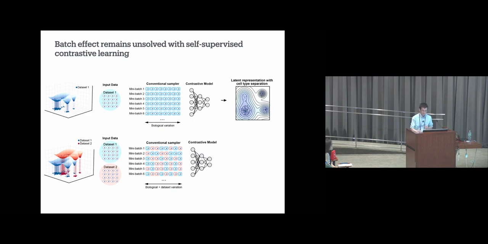

上图是这段论述的核心示意。上排只有 Dataset 1：小批量里只有生物变异，潜空间按细胞类型分开。下排有 Dataset 1 和 Dataset 2：常规采样器（conventional sampler）让每批都混着两个数据集，于是模型编码的是"生物 + 数据集"混合变异，输出里细胞类型之间分开了，**数据集之间也分开了**——这就是批次效应被保留下来。

报告还点评了常见的补救办法：给模型加一个对抗性辅助损失去"纠正"批次。作者认为这类附加目标与对比学习的中心目标（把不同细胞推开）相冲突，更像是打补丁而不是真正解决问题，最终得到的还是"细胞类型分开、数据集也分开"的结果。

## 五、数据集感知采样：把批次差异推到训练轴上被平均掉

CONCORD 的做法是改采样器：**把对比学习限制在单个数据集内部**，让模型没有机会在同一批里看到批次效应。

[【跳转到 07:13】](https://www.youtube.com/watch?v=GNTaHc01KPY&t=433)

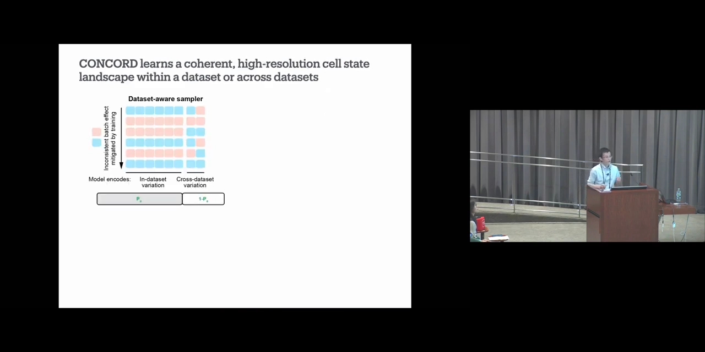

上图给出机制：每个小批量以概率 $p_{ds}$ 由同一数据集内的细胞组成（模型编码"数据集内变异"），以概率 $1-p_{ds}$ 允许跨数据集混合（模型编码"跨数据集变异"）。由于批次效应在不同小批量之间是**不一致的信号**，它无法在训练轴上累积成一个稳定的方向，于是被"洗掉"；而跨数据集的生物学差异在每一批里方向一致，会被保留下来。这正是"技术对齐"与"抹掉生物差异"的分界线：**被洗掉的是批间不一致的成分，被保住的是批间一致的成分**。

实践上作者发现不必让每批都严格来自单一数据集，只要做一定程度的富集，批次效应就足以被洗掉，同时仍保留学习跨数据集生物变异的机会。

## 六、联合概率采样：分辨率和去批次可以同时要

邻域感知采样解决"分辨率"，数据集感知采样解决"批次"，两者可以合成一个**联合概率采样器**。

[【跳转到 08:03】](https://www.youtube.com/watch?v=GNTaHc01KPY&t=483)

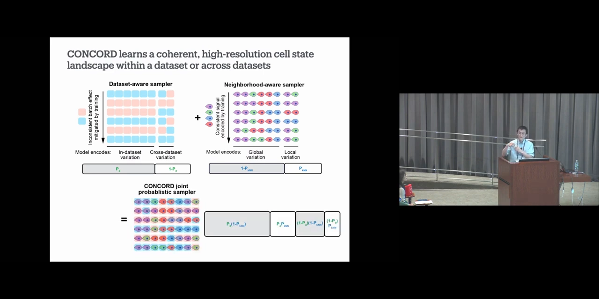

上图把它写成一个二维表：行对应"是否同数据集"，列对应"是否同邻域"，四种组合分别以 $p_{ds}(1-p_{nn})$、$p_{ds}p_{nn}$、$(1-p_{ds})(1-p_{nn})$、$(1-p_{ds})p_{nn}$ 的概率出现。换句话说，每个小批量里同时存在"同数据集同邻域""同数据集跨邻域""跨数据集同邻域""跨数据集跨邻域"四类细胞，模型在一次训练里就同时被要求分辨局部状态、并对齐跨数据集的一致结构。

值得一提的是，报告强调全部实验用的都是极简网络：一个输入层、一个隐藏层、一个输出层。**改进全部来自采样，而不是模型容量**。

## 七、验证：从模拟树到两个线虫物种，再到小鼠肠道

**模拟数据**：先造一棵带噪声、再叠加批次效应的树，看各方法能否把两批拼回同一棵树。

[【跳转到 08:28】](https://www.youtube.com/watch?v=GNTaHc01KPY&t=508)

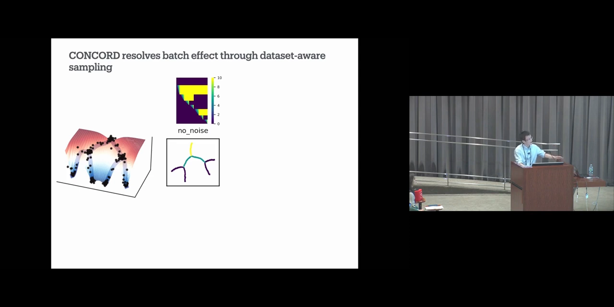

在这份数据上，Scanorama 与 Harmony 能大致对齐，但放大看局部时对齐并不完整；**标准对比学习不但没纠正批次，反而放大了批次效应**。CONCORD 不仅对齐了两批，还学出了去噪后的底层结构。

**真实数据**：线虫胚胎发育有一条不变的分支谱系，是检验"能否恢复发育树"的理想基准。报告使用 *C. elegans* 与近缘种 *C. briggsae* 两个物种、共 20 个实验批次的数据。

[【跳转到 09:41】](https://www.youtube.com/watch?v=GNTaHc01KPY&t=581)

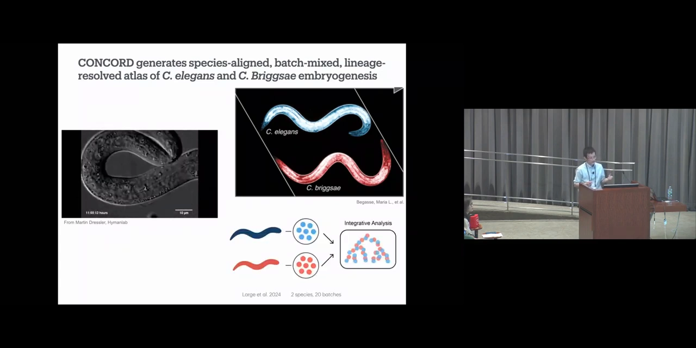

[【跳转到 10:42】](https://www.youtube.com/watch?v=GNTaHc01KPY&t=642)

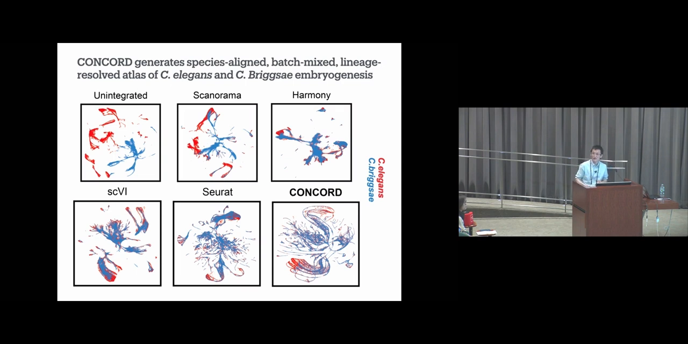

逐格看：未整合时数据按批次和物种分开；Scanorama 没能对齐两个物种；Harmony 能对齐，但丢失了单个细胞状态的分辨率；scVI 好得多，终端状态分开了，却分不开通向这些终端的早期祖细胞；Seurat 能解析终端状态、能看到轨迹的细丝，但**景观是断裂的**，中间有大量缺口。CONCORD 则给出了一张完整的流形图，可以从祖细胞状态一路追到终端状态。

[【跳转到 12:47】](https://www.youtube.com/watch?v=GNTaHc01KPY&t=767)

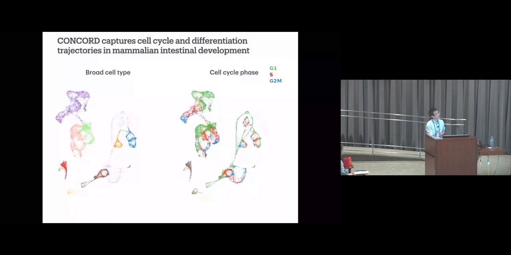

在小鼠肠道发育数据上，差别不在"大类分不分得开"，而在**大类内部还有没有结构**：CONCORD 能同时显示细胞周期环路与分化轨迹的耦合，甚至能在全局图上直接做放大分析，看到远端区与近端区两条平行的分化环路。

**速度**：因为网络极简，在 40 万细胞、两个物种、20 个批次的数据上，CONCORD 的运行时间显著短于 Liger、scVI、Seurat、Scanorama，与 Harmony 相当（报告注明 Harmony 跑在 300 维 PCA 上，其余方法跑在 10000 维表达矩阵上）。

[【跳转到 12:22】](https://www.youtube.com/watch?v=GNTaHc01KPY&t=742)

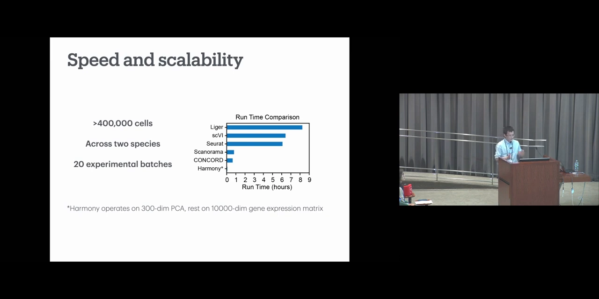

## 八、问答部分：细到"亚型"还能不能分辨

现场提问问到两件事，都值得记下来。

第一，**方法是否依赖数据类型**。作者回答：在跨物种、跨批次的多份单细胞数据以及一些空间组学数据上都做了基准，都观察到了相对现有最优方法的优势，因此不认为这是"只对某类数据有效"的技巧；原理足够简单，可以迁移到其他模态（例如影像数据）。

第二，**能不能分辨"不是细胞类型改变、而是状态改变"的细微差异**。作者临时翻出一张未展示的幻灯片回答：在 *C. elegans* 的 AS 神经元上，只有 CONCORD 的潜空间把它分成两簇。

[【跳转到 15:44】](https://www.youtube.com/watch?v=GNTaHc01KPY&t=944)

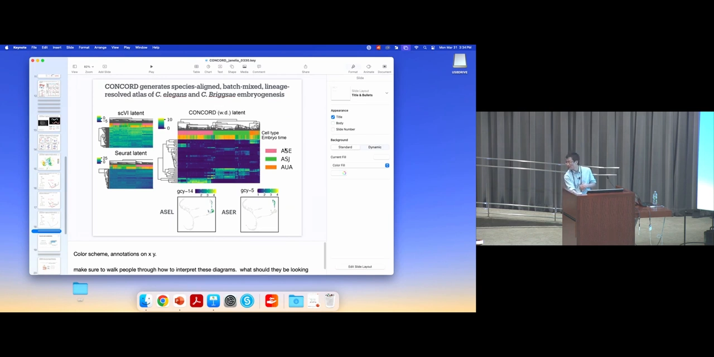

这张图的意义在于：AS 神经元左右对称、形态上相似，但功能不对称。能把它拆成两个亚型，说明"高分辨率"不只是把大类切得更碎，而是能落到功能相关的细胞状态层面。这也反过来印证了前面的取舍——如果对齐时把批间差异连同局部结构一起抹平，这类亚型差异就会消失。

## 小结

- 对比学习的对齐对象由**小批量里放了谁**决定，而不是由损失函数的形式决定；换采样器就等于换对齐目标。
- 均匀采样只能分辨相距很远的大类，近邻状态会糊在一起；把局部邻居放进同一批（邻域感知采样）才逼出状态级分辨率。
- 自监督对比学习默认**不解决批次效应**：批内混着多个数据集时，模型会把批次差异当成需要编码的变异；外挂对抗损失与"推开不同细胞"的中心目标相冲突，只是打补丁。
- 数据集感知采样把批次差异变成**跨批不一致的信号**，让它在训练轴上被平均掉；批间一致的生物差异则被保留——这就是"技术对齐"与"抹掉生物差异"的操作性分界。
- 联合概率采样把"同/跨数据集"与"同/跨邻域"两个维度同时参数化，用 $p_{ds}$ 与 $p_{nn}$ 两个概率控制分辨率与去批次的权衡。
- 全部收益来自采样，网络只有一层隐藏层；在双物种线虫数据与小鼠肠道数据上，它同时给了完整的流形和更细的内部结构。

## 关键术语速查

| 术语 | 一句话解释 |
| --- | --- |
| 细胞状态景观 | 细胞在高维表达空间中被调控约束出的低维流形，发育时会出现分叉与环路 |
| 小批量（mini-batch） | 对比学习的基本训练单元，一批若干细胞互相比对；它的组成决定模型学什么 |
| 正对 / 负对 | 被要求拉近的一对细胞 / 被要求推开的一对细胞，二者都由采样或配对规则产生 |
| 邻域感知采样 | 在均匀采样之外额外抽取局部邻居，使小批量内出现近邻状态之间的比对 |
| 数据集感知采样 | 让批内对比主要发生在单一数据集内部，使批次效应成为跨批不一致信号而被洗掉 |
| 联合概率采样 | 用 $p_{ds}$ 与 $p_{nn}$ 同时控制"同数据集"与"同邻域"的比例 |
| 整合伪影 | 整合后出现的缺口（切断流形）与错位（把不相邻状态读成相邻） |
| 过整合 / 抹除生物差异 | 对齐力度过大，把本该保留的跨状态差异一起抹平 |