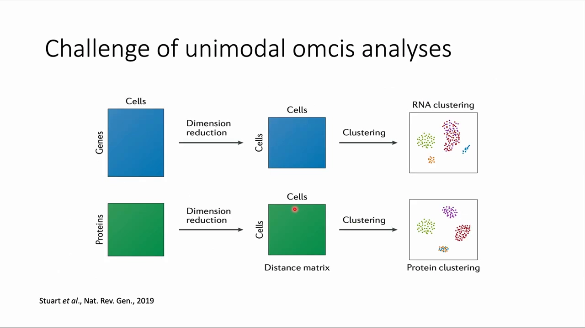
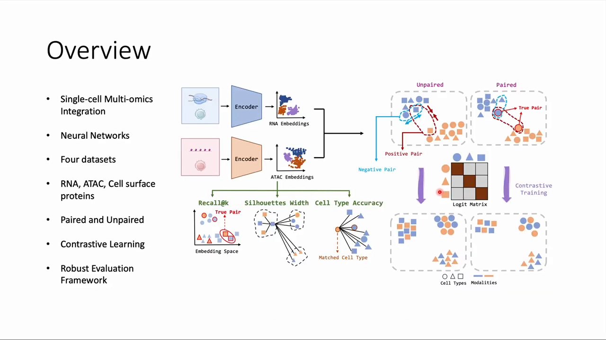
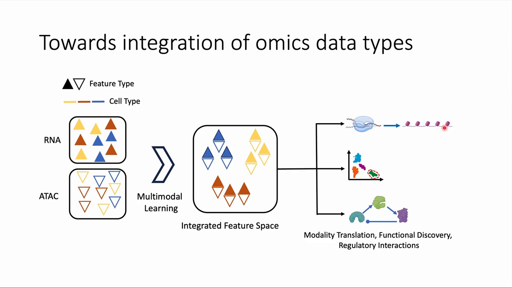
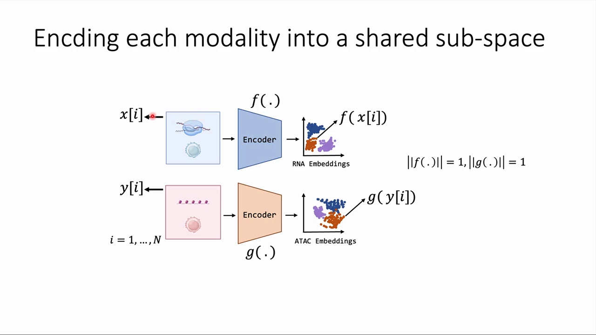
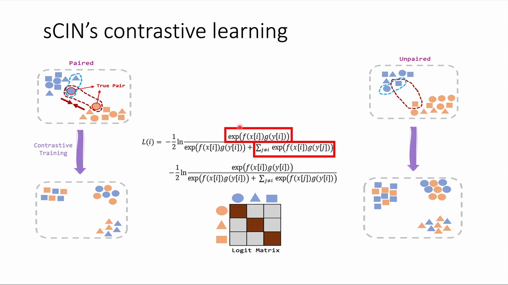
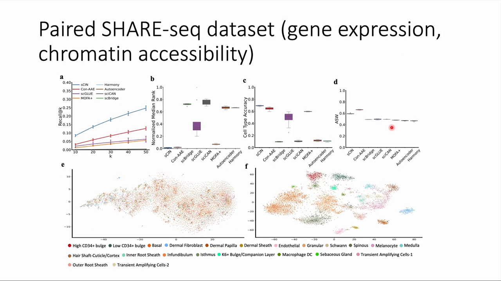
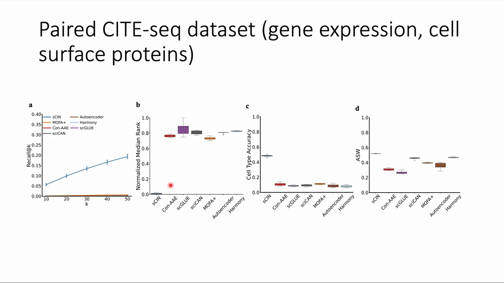
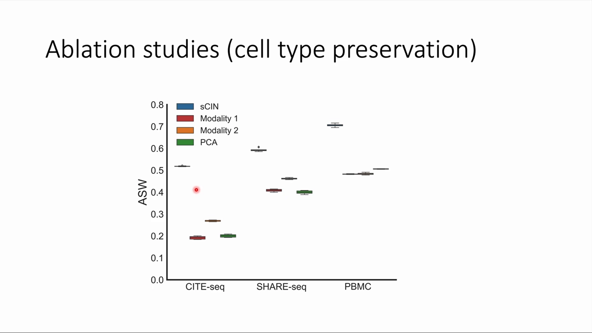
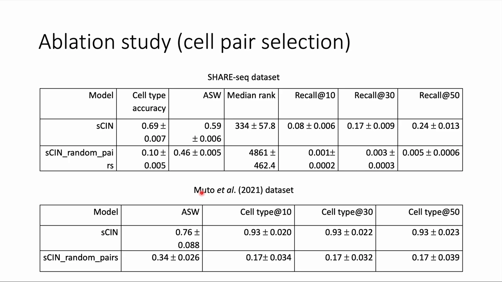

# 正负对怎么定义，就对齐什么：sCIN 的配对与伪配对对比学习

> 视频来源：[sCIN: A Contrastive Learning Framework for Single-Cell Multi-omics Integration](https://www.youtube.com/watch?v=rNmdBIdkupw)（YouTube · ISMB/ECCB 2025 海报报告，讲者 Amir Ebrahimi，德黑兰大学）｜时长约 7 分钟
> 导读：这是一份短报告，但把对比整合里最容易被跳过的一步讲清楚了——正对和负对到底按什么规则挑出来。它给出的两套规则（一对一真配对、按细胞类型伪配对）以及"把配对换成随机"的消融，正好说明匹配依据如何决定模型对齐什么、又可能抹掉什么。

## 本讲要解决的核心问题（SCQA）

**背景**：单细胞多组学对同一批细胞测得多种模态（转录组、染色质可及性、细胞表面蛋白）。单独分析每个模态，会得到互相矛盾的聚类结果：RNA 里分开的两群，在蛋白数据里可能是一群。

**冲突**：要得到统一表征，就得把不同模态的细胞"对齐"到同一个子空间。但不同模态之间往往不是一对一测量的：有的数据集是同一批细胞同时测了两种模态（paired），有的则是两批细胞分别测、没有一一对应关系（unpaired）。没有对应关系时，正对从哪来？

**疑问**：对比学习要求"拉近正对、推开负对"。当数据没有真配对时，正负对应该按什么依据构造？这个依据会把什么样的差异当成"该对齐的技术差异"，又会把什么当成"该保留的生物差异"？

**回答（中心思想）**：sCIN 用两个编码器把各模态映射到归一化的共享子空间，再用对称的 InfoNCE 式对比损失训练；**正对的来源随数据条件切换**——有真配对就用一对一匹配，没有就用细胞类型标签做伪配对。消融实验证明配对规则是这套方法的主要承重结构：把配对换成随机，各项指标全面崩塌。

## 一、单模态分析会给出互相矛盾的答案

报告先摆出一个具体的困惑：同一批细胞，分别测基因表达和蛋白，各自走完降维、聚类流程后，RNA 数据给出橙、蓝两群分开的结果，蛋白数据给出的却是整合在一起的结果。

[【跳转到 00:51】](https://www.youtube.com/watch?v=rNmdBIdkupw&t=51)

讲者的回答是"可能两个都对"：每个模态只捕捉了生物系统的一部分信息。于是自然的想法是把这些信息合成一个统一表征，供下游任务使用——模态间翻译、稀有细胞类型发现、调控互作识别。

[【跳转到 01:16】](https://www.youtube.com/watch?v=rNmdBIdkupw&t=76)

## 二、两个编码器把各模态送进同一个归一化子空间

sCIN 的结构很简单：每个模态一个神经网络编码器。对第 $i$ 个细胞，$x[i]$ 与 $y[i]$ 分别是它在两个模态上的测量，编码器 $f(\cdot)$ 与 $g(\cdot)$ 把它们映射到同一维度的潜空间，并且**把嵌入归一化到单位长度**：$\lVert f(\cdot)\rVert = 1$、$\lVert g(\cdot)\rVert = 1$。

[【跳转到 02:00】](https://www.youtube.com/watch?v=rNmdBIdkupw&t=120)

归一化这一步在对比学习里很关键：它把"相似度"变成余弦相似度，使损失只关心方向、不关心模长，避免模型靠放大嵌入尺度来降低损失。

## 三、损失函数本身是对称的 InfoNCE

训练目标是双向的 InfoNCE：一个方向以 RNA 细胞为锚、在蛋白细胞里找它的正对；另一个方向反过来。

[【跳转到 02:25】](https://www.youtube.com/watch?v=rNmdBIdkupw&t=145)

写成公式就是幻灯片上的形式：

$$
L(i) = -\frac{1}{2}\ln\frac{\exp\left(f(x[i])g(y[i])\right)}{\exp\left(f(x[i])g(y[i])\right) + \sum_{j \neq i}\exp\left(f(x[i])g(y[j])\right)} - \frac{1}{2}\ln\frac{\exp\left(f(x[i])g(y[i])\right)}{\exp\left(f(x[i])g(y[i])\right) + \sum_{j \neq i}\exp\left(f(x[j])g(y[i])\right)}
$$

读法：分子只包含一个正对 $(x[i], y[i])$，分母是正对加上同一批里其余所有跨模态组合。最小化这个损失，等价于让"正对的相似度"在"正对 + 所有负对"的分布里占据尽可能大的概率质量。幻灯片右侧的 logit 矩阵把这件事画成了棋盘：对角线（正对）应当最亮，非对角线（负对）应当被压暗。

这里要特别注意：**损失函数只规定了"怎么比"，没有规定"跟谁比"**。谁是正对、谁是负对，完全由外面的配对规则决定——这正是下一节的内容。

## 四、正对的来源随数据条件切换：真配对与类型伪配对

sCIN 定义了两种情形。

**有真配对（paired）**：数据里存在细胞级的一一对应，例如同一个细胞同时测了 RNA 和 ATAC。此时直接用这份匹配信息定义正对，其余所有细胞都是负对。

**无真配对（unpaired）**：不存在一一对应，于是退而使用**细胞类型标签**——类型相同的细胞视为正对，类型不同的视为负对。

[【跳转到 02:50】](https://www.youtube.com/watch?v=rNmdBIdkupw&t=170)

这张图值得多看几眼，因为它把"匹配依据"的差别画在了数据布局上：左图里每个细胞的搭档是唯一的（红圈标出的 True Pair）；右图里同类型的所有细胞互为搭档，正对从"一个"变成了"一组"。

[【跳转到 03:15】](https://www.youtube.com/watch?v=rNmdBIdkupw&t=195)

从对齐目标的角度看，这两种规则做的事并不相同：

- **真配对**对齐的是"同一个细胞在两个模态里的表示"。它要求模型学到的是**跨模态的测量不变性**——同一份生物样本换一种测法，表示应当一致。技术差异（模态、批次、测序深度）在这一层被抹掉，而细胞自身的状态差异被完整保留，因为配对是逐细胞的。
- **类型伪配对**对齐的是"同一类细胞的平均表示"。它要求模型把同类型的细胞拉到一起，这实际上是一种**更粗的对齐**：类型内的状态差异（细胞周期、激活程度、亚型）不再被保护，反而可能被这个"同类相吸"的力压平。

换句话说，**匹配依据越粗，被抹掉的生物差异越多**。用真配对时，抹掉的是模态差异；用类型标签时，抹掉的是类型内部的差异。这不是实现细节，而是目标函数层面的取舍。

## 五、评测同时看守两件事：对齐质量与类型保留

报告强调评测是"稳健的"：在留出测试集上做 10 次重复。指标分两类，恰好对应上一节的两件事。

[【跳转到 03:27】](https://www.youtube.com/watch?v=rNmdBIdkupw&t=207)

- **Recall@k**：在嵌入空间里检索，看正对是否出现在前 $k$ 个近邻里——衡量**对齐得好不好**（技术层面）。
- **归一化中位秩（normalized median rank）**：正对在排序中的位置有多靠前，越小越好。
- **细胞类型准确率**与**平均轮廓宽度 ASW**：按细胞类型评估聚类质量——衡量**生物差异有没有被保住**。

在配对的 SHARE-seq 数据上，sCIN 在几乎所有指标上都优于六个现有模型以及一个只有重建损失的基线自编码器。同一套流程在配对的 CITE-seq 数据（基因表达 + 细胞表面蛋白）上也得到类似结论。

[【跳转到 03:52】](https://www.youtube.com/watch?v=rNmdBIdkupw&t=232)

这里的方法论值得初学者记住：**只用"对齐得好不好"来评价整合是不够的**。一个把所有细胞都映到同一点的方法，Recall@k 会非常漂亮，但 ASW 会崩掉。两类指标必须一起看，才能区分"技术对齐"和"抹掉生物差异"。

## 六、无配对时性能随配对比例平滑变化

为了研究 unpaired 情形，报告从配对数据里**按比例把细胞分到不同模态**来模拟：例如 90% 的细胞只保留 RNA、10% 只保留 ATAC，然后与"完全配对"的理想情形、以及"随机分配"的基线比较。

结论是单调的：**保留配对的比例越高，sCIN 的性能越好**，并且始终优于随机分配的基线。这给了一个实用判据——如果手头数据只有部分细胞做了多模态测量，配对比例就是可预期的性能上限指示器。

报告还在真实的无配对数据上做了验证：一份基因表达与染色质可及性分别测量的数据集，sCIN 的表现优于其他能处理无配对数据的现有方法。

## 七、消融实验：配对规则是这套方法的主要承重结构

第一个消融是"整合之后细胞信息还在不在"。用 ASW（按细胞类型评估的聚类指标，原始范围 $[-1,1]$，报告归一化到 $[0,1]$，越高表示按细胞类型的聚类越好）比较 sCIN、两个单模态、以及基于 PCA 的整合。

[【跳转到 05:32】](https://www.youtube.com/watch?v=rNmdBIdkupw&t=332)

sCIN 的 ASW 明显更高。讲者的解读是：这说明它还能处理单细胞数据本身的噪声与稀疏性——换句话说，对齐没有以牺牲类型结构为代价。

第二个消融直接针对本节主题：**把 sCIN 的细胞配对换成随机配对**，其余不变。

[【跳转到 05:57】](https://www.youtube.com/watch?v=rNmdBIdkupw&t=357)

结果非常悬殊。在 SHARE-seq 数据上，细胞类型准确率从 0.69 掉到 0.10，ASW 从 0.59 掉到 0.46，中位秩从 334 涨到 4861，Recall@10 从 0.08 掉到 0.001；在另一份数据上 ASW 从 0.76 掉到 0.34，类型检索准确率从 0.93 掉到 0.17。

[【跳转到 06:22】](https://www.youtube.com/watch?v=rNmdBIdkupw&t=382)

这张表是整份报告最有说服力的地方：损失函数、网络结构、归一化、优化器全都没变，**只改了"谁和谁算一对"，模型就几乎失效**。它反证了前面的论断——对比学习的对齐目标是被配对规则定义的。随机配对等于告诉模型"这两个细胞是同一个东西"，而这个信号是错的，于是模型把不该合并的状态合在了一起，生物差异被抹掉，对齐也随之失去意义。

## 小结

- 单模态分析会给出互相矛盾的细胞分组；多组学整合的目标是得到一个能支撑翻译、稀有类型发现与调控分析统一表征。
- sCIN 的结构是"每模态一个编码器 + 单位长度归一化 + 对称 InfoNCE"，损失只规定怎么比，不规定跟谁比。
- 正对的来源随数据条件切换：有真配对用细胞级一一匹配，没有则用细胞类型标签做伪配对。
- 匹配依据决定对齐什么：真配对对齐的是"同一细胞跨模态的测量不变性"，抹掉的是模态/技术差异；类型伪配对对齐的是"同类细胞的平均表示"，代价是类型内部的状态差异可能被压平。
- 评价必须同时看守两端：Recall@k、中位秩看技术对齐，ASW、类型准确率看生物差异是否保留。
- 配对比例越高性能越好；把配对换成随机，各项指标全面崩塌——配对规则是这套方法的主要承重结构。

## 关键术语速查

| 术语 | 一句话解释 |
| --- | --- |
| 正对 / 负对 | 训练时被要求拉近 / 推开的跨模态细胞组合 |
| 真配对（paired） | 同一细胞同时测得两种模态，存在细胞级一一对应 |
| 伪配对（unpaired） | 没有一一对应时，用细胞类型标签等替代依据构造正对 |
| InfoNCE | 把正对相似度放进"正对 + 负对"的 softmax 中最大化的对比损失 |
| 共享子空间 | 各模态编码器共同输出的低维空间，嵌入归一化到单位长度 |
| Recall@k | 正对是否落在前 $k$ 个近邻中，衡量对齐质量 |
| ASW（平均轮廓宽度） | 按细胞类型评估的聚类分离度，衡量生物差异是否保留 |
| 归一化中位秩 | 正对在相似度排序中的典型名次，越小对齐越好 |