# 生成图落到代码：scVI 里潜变量、批次键与观测计数各占哪一行

> 视频来源：[Single-cell analysis with scVI machine-learning toolkit](https://www.youtube.com/watch?v=YT9qTuF6YFk)（YouTube · Sanbomics）｜时长约 13 分钟
> 简要导读：一支纯实操的 scvi-tools 教程——三个样本、32943 个细胞，从冻结原始计数一路走到潜变量、归一化表达与差异表达。本文把它的每一步操作指回 scVI 生成图上的节点：哪一层是观测、哪一层是已知的批次条件、哪一层是模型推断出来的量。

## 本讲要解决的核心问题（SCQA）

**背景**：单细胞数据是一张"细胞 × 基因"的计数矩阵，一次实验常常横跨多个样本、多条 10x 通道。批次带来的技术差异和细胞类型带来的生物差异，混在同一个数字里。

**冲突**：scVI 的模型图上画着一串符号——潜变量 $z_n$、批次 $s_n$、文库大小 $\ell_n$、表达比例 $\rho_{ng}$、观测计数 $x_{ng}$。但在真实分析里，这些符号从不以符号的形式出现，它们只表现为几行代码：某个 layer 的名字、某个 key 的名字、某个函数返回的矩阵。分不清哪个符号对应哪行代码，就会犯两类错误：把批次当成生物差异，或者把模型归一化后的值当成原始测量。

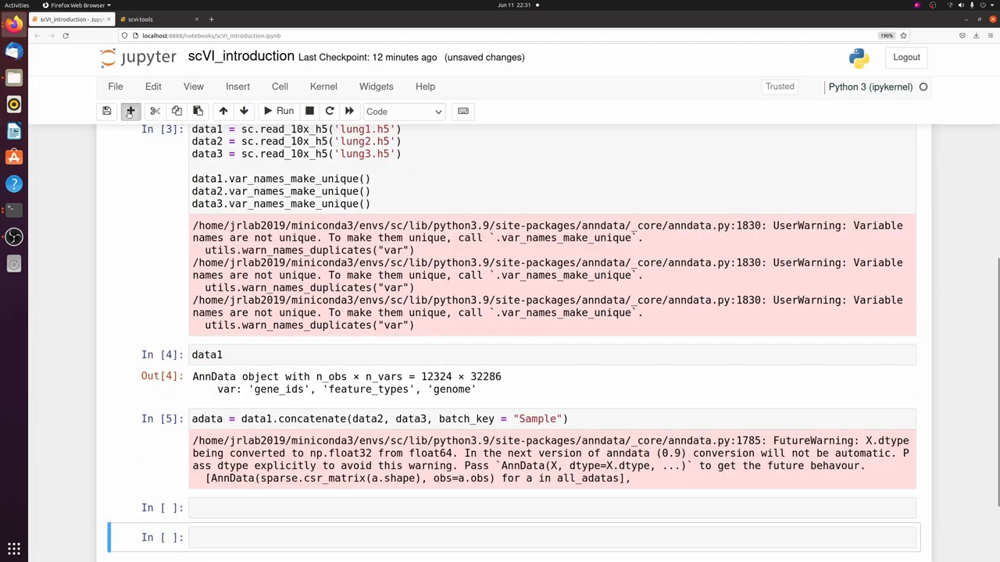

**疑问**：scVI 的生成图里，哪些节点是"观测到的"，哪些是"已知的输入"，哪些是"模型推断出来的"？它们在 scvi-tools 里各自落在哪一行？

**回答（中心思想）**：整张图里只有**一个节点真正被观测**——原始计数；**批次与协变量是已知输入**，必须由你显式点名，模型不去猜它们；**潜变量与表达比例是推断出来的中间量**，只能通过模型接口取回。这支视频用一次三样本实操把这三层依次摆开：先冻结计数，再声明批次键与连续协变量，训练后分别取潜表示和归一化表达，最后才做聚类与差异表达 [【跳转到 03:16】](https://www.youtube.com/watch?v=YT9qTuF6YFk&t=196)。

---

## 一、先把生成图画出来：一条从细胞状态到计数的单行道

这条路径是本节要画的图。视频没有画它，但它的每一步代码都对应其中一段：

```
   s_n（批次，已知）          c_n（连续协变量，已知）
          \                    /
  z_n ~ N(0, I)  →  解码器 f_w  →  ρ_n（表达比例，Σ_g ρ_ng = 1）
                                            ↓  × ℓ_n（文库大小，观测尺度）
                                         μ_n（期望计数）
                                            ↓  计数似然（NB / ZINB）
                                         x_n（观测计数，唯一被观测的节点）
```

写成三段式子：

$$
\rho_{ng} = f_w(z_n, s_n), \qquad \mu_{ng} = \ell_n \rho_{ng}, \qquad x_{ng} \sim \mathrm{NB}(\mu_{ng}, \theta_g)
$$

三段各管一件事：

1. **解码器 $f_w$** 把低维的细胞状态 $z_n$ 和批次身份 $s_n$ 一起映射成"每个基因占多大比例"。注意 $s_n$ 是**进解码器**的，不是进潜空间的——这就是"批次条件解码"：同一个 $z_n$ 在不同批次下可以解出不同的表达比例。
2. **文库大小 $\ell_n$** 把比例放大回计数尺度。比例说的是"组成"，计数说的是"总量"，两者差一个 $\ell_n$。
3. **计数似然** 把期望计数变成一个带离散度和零膨胀的概率分布。这一层是 3.1.6 的主题，本文不展开；离散度与文库大小的具体参数化留给 3.1.8。

> 说明：视频讲的是"怎么用"。上面这条路径是 scVI 模型本身的结构，本文的写法是把视频的每一步操作指回路径上的某个节点；凡视频没有讲到的参数化细节，一律不在这里补。

## 二、观测节点只有一个：原始计数必须先被冻结

视频的顺序很值得注意：做完质控、**还没做任何归一化之前**，先把计数抄一份到 layer 里 [【跳转到 03:16】](https://www.youtube.com/watch?v=YT9qTuF6YFk&t=196)。

```python
adata.layers['counts'] = adata.X.copy()
```

讲者的原话是：这就是 scVI 要用的数据，之后我们再也不动它了。紧接着才做 scanpy 自己的归一化——每个细胞缩放到 10000 个计数、取对数——再存一份 `raw` 给别的工具用；他也明确说了，对 scVI 来说这一步在技术上并不需要 [【跳转到 03:36】](https://www.youtube.com/watch?v=YT9qTuF6YFk&t=216)。

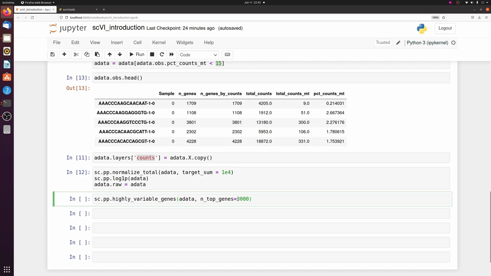

为什么顺序不能反？因为生成图里的似然项是定义在**计数**上的：$x_{ng}$ 是那个"被观测到的随机变量"。如果喂进去的是对数归一化后的连续值，模型建模的就不是同一个随机变量了，似然、离散度、零膨胀这一整套假设都失去意义。换句话说，`counts` 这一层不是"另一种格式的数据"，它就是图上那个唯一带观测标记的节点。

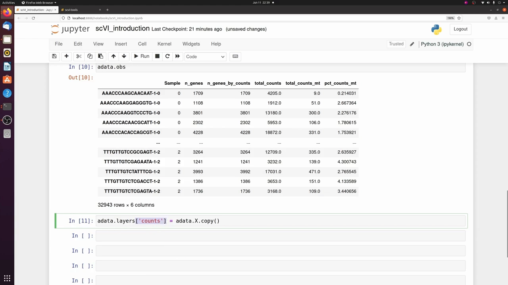

## 三、批次协变量是已知输入，所以必须被"点名"

批次在图上记作 $s_n$，它是一个**观测到的**节点，不是待推断的隐变量：细胞来自哪个样本，实验记录里写得清清楚楚。模型要做的是"条件在它上面"，让同一套潜变量在不同批次下走不同的解码路径。

这个设计在代码里的表现，就是你必须亲手把那一列指出来。视频里分两步：

- 合并数据时给批次列起名：

```python
adata = data1.concatenate(data2, data3, batch_key="Sample")
```

于是观测表里多出 `Sample` 列，三个样本被编成 0、1、2 [【跳转到 01:19】](https://www.youtube.com/watch?v=YT9qTuF6YFk&t=79)；
- 设置模型时把它声明成分类协变量 [【跳转到 04:56】](https://www.youtube.com/watch?v=YT9qTuF6YFk&t=296)：

```python
scvi.model.SCVI.setup_anndata(
    adata,
    layer="counts",
    categorical_covariate_keys=["Sample"],
    continuous_covariate_keys=[],
)
```

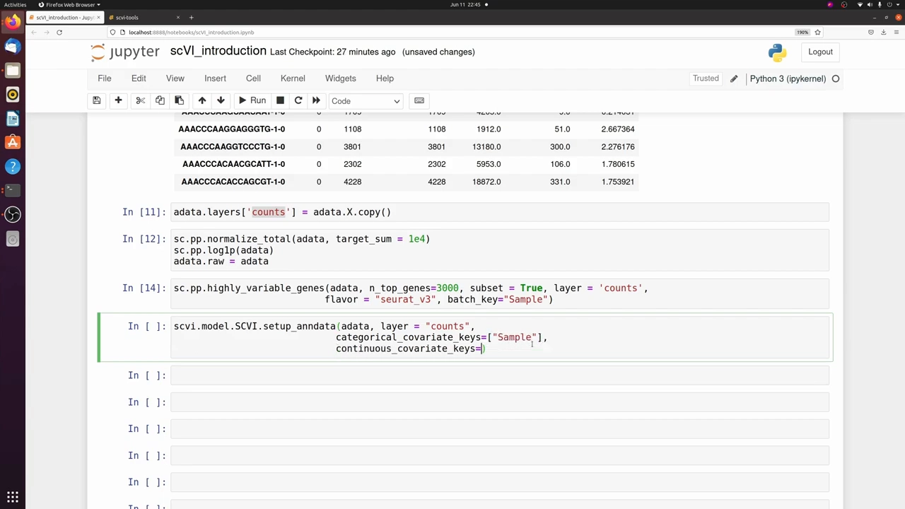

讲者对这一行的解释是"批次就是在这里进来的" [【跳转到 05:16】](https://www.youtube.com/watch?v=YT9qTuF6YFk&t=316)。这句话点出了本节最容易混淆的地方：**批次不是模型学出来的，是模型被告知的**。学出来的只有 $z_n$ 和 $\rho_{ng}$。也正因为它是已知输入，视频才说：如果你只有一个样本，这一项根本不用传。

还有一条实用提醒：分类协变量可以不止一个。讲者说，如果数据来自不同的测序技术，你完全可以把技术平台也作为第二个键传进去——图上就多一个条件变量，解码器要同时按批次和技术条件化。

## 四、连续协变量：把技术噪音也写进条件

分类协变量之外，还有一类"已知的连续量"。视频把线粒体比例和总计数放了进去 [【跳转到 05:16】](https://www.youtube.com/watch?v=YT9qTuF6YFk&t=316)：

```python
continuous_covariate_keys=['pct_counts_mt', 'total_counts']
```

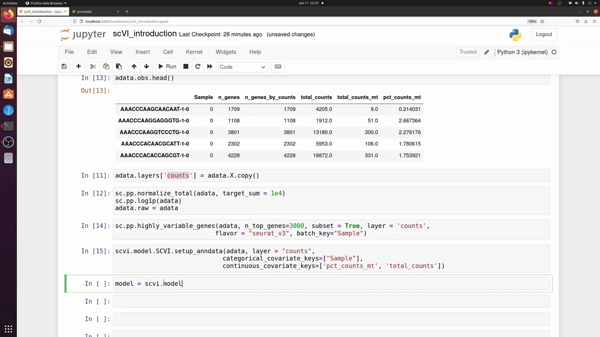

这两个量的身份要看清：

- `total_counts` 是每个细胞的总计数，和文库大小 $\ell_n$ 直接相关；
- `pct_counts_mt` 是线粒体计数占比，一个典型的质控指标，高值往往意味着细胞状态差或膜破损。

把它们写进条件，等于告诉模型："这部分变异是技术性的，不要花力气用 $z_n$ 去解释它。"这正是生成图里 $c_n$ 那条边的意义：**协变量是解释力的分流器**，把技术来源的方差从潜空间里引走，剩下的才归生物差异。

## 五、潜变量 $z$：训练之后才存在，维度由你选

模型初始化之后用 `model.train` 训练 [【跳转到 05:36】](https://www.youtube.com/watch?v=YT9qTuF6YFk&t=336)。讲者提到，即便有 GPU 也要五六分钟，没有 GPU 会回退到 CPU、可能要跑很久。

训练完，第一件事是取潜表示 [【跳转到 06:40】](https://www.youtube.com/watch?v=YT9qTuF6YFk&t=400)：

```python
latent = model.get_latent_representation()
latent.shape          # (32943, 10)
adata.obs['X_scVI'] = latent
```

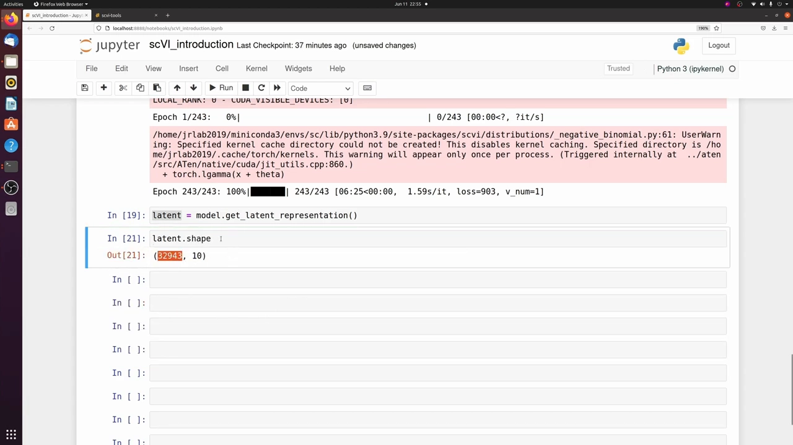

这个 `(32943, 10)` 值得停一下：三万个细胞，每个细胞被压成 **10 个数字**。它对应图上的 $z_n$——先验是标准正态 $z_n \sim \mathcal{N}(0, I)$，实际取值是训练后由编码器给出的后验推断结果。它既不是原始数据的线性变换，也不是某个基因的表达量，而是"模型认为这个细胞处于什么状态"的一组坐标。

也正因为它是推断量，取它的方式和取数据不一样：`get_latent_representation` 是模型的方法，不是 AnnData 的属性。

## 六、表达比例与文库大小：`get_normalized_expression` 的两个身份

紧接着的一行是本节点题的核心 [【跳转到 07:00】](https://www.youtube.com/watch?v=YT9qTuF6YFk&t=420)：

```python
adata.layers['scvi_normalized'] = model.get_normalized_expression(library_size=1e4)
```

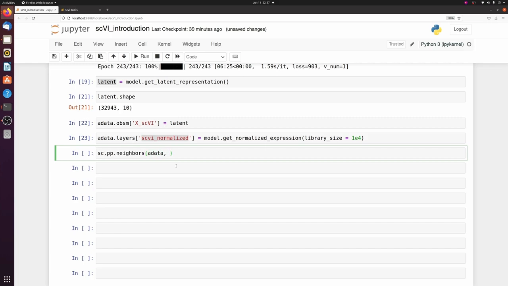

要读懂这一行，得把它拆成两个身份：

- 函数名里的 **normalized** 指的是解码器输出的表达比例 $\rho_{ng}$——它已经和文库大小无关了；
- 参数 `library_size` 取 1e4，则是把比例重新乘回一个**你指定的**文库大小 $\ell_n = 10^4$。

所以这一层既不是原始计数，也不是"纯比例"，而是"假设每个细胞的文库大小都是 1 万时，模型期望你看到的表达量"：

$$
\text{scvi\_normalized}_{ng} = 10^4 \times \rho_{ng}, \qquad \mu_{ng} = \ell_n^{\text{obs}} \times \rho_{ng}
$$

两式只差那个 $\ell_n$：前者用你给的固定值，后者用细胞真实的观测文库大小。这也解释了视频里那个看似矛盾的安排——counts 层从头到尾不动，归一化表达却另存一层。它们本来就是图上两个不同的节点：一个是 $x_{ng}$，一个是 $\rho_{ng}$。

## 七、三层分清楚之后，下游每一步该用哪一层

有了 $z$ 和 $\rho$，后面的分析就变成"按需取层"：

- **聚类与降维用 $z$**。算邻居图时把 `use_rep` 指向 `X_scVI`，再做 UMAP 和 leiden [【跳转到 07:20】](https://www.youtube.com/watch?v=YT9qTuF6YFk&t=440)。讲者说，这基本上就是和常规聚类唯一的区别。

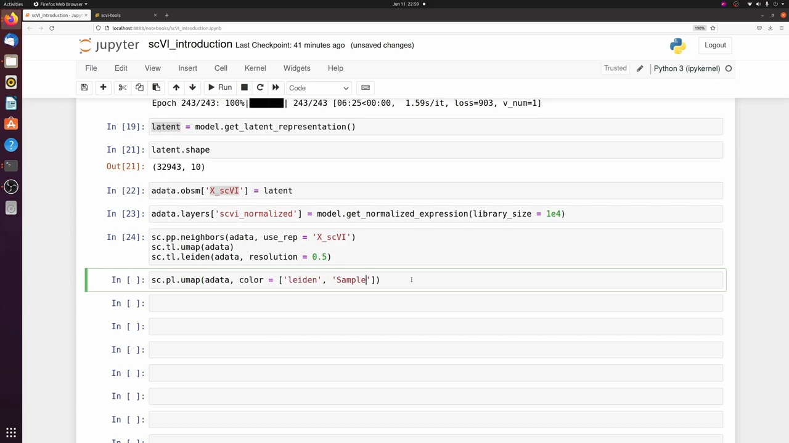

- **看整合效果要按样本上色**。视频得到 19 个聚类，三个样本在同一张 UMAP 上重叠得很好；同时他也提醒，其中两个样本是被刺激过的，所以本来就该看到一些差异 [【跳转到 08:20】](https://www.youtube.com/watch?v=YT9qTuF6YFk&t=500)。这句话是判读的关键：**批次键让不该分开的细胞混在一起，但不会抹掉真实的处理差异**。

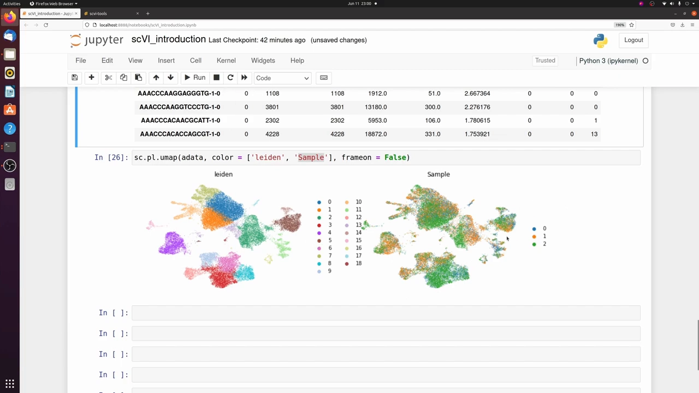

- **画基因表达用 $\rho$**。在常规 scanpy 画图函数里把 `layer` 传成 `scvi_normalized` 就能用上这一层；不传就用 scanpy 自己的归一化值 [【跳转到 08:40】](https://www.youtube.com/watch?v=YT9qTuF6YFk&t=520)。

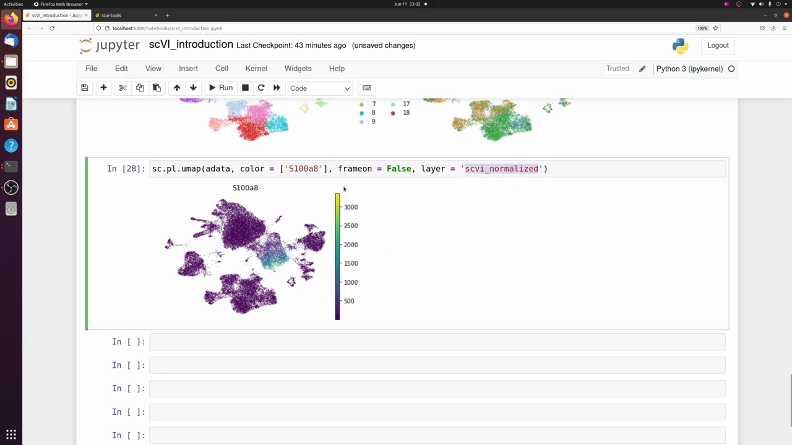

- **差异表达用模型的似然**。`model.differential_expression` 按 `groupby` 指定的 leiden 分组，直接返回对数倍数变化、概率等列 [【跳转到 09:20】](https://www.youtube.com/watch?v=YT9qTuF6YFk&t=560)；拿每个聚类前两个基因做点图 [【跳转到 10:40】](https://www.youtube.com/watch?v=YT9qTuF6YFk&t=640)。

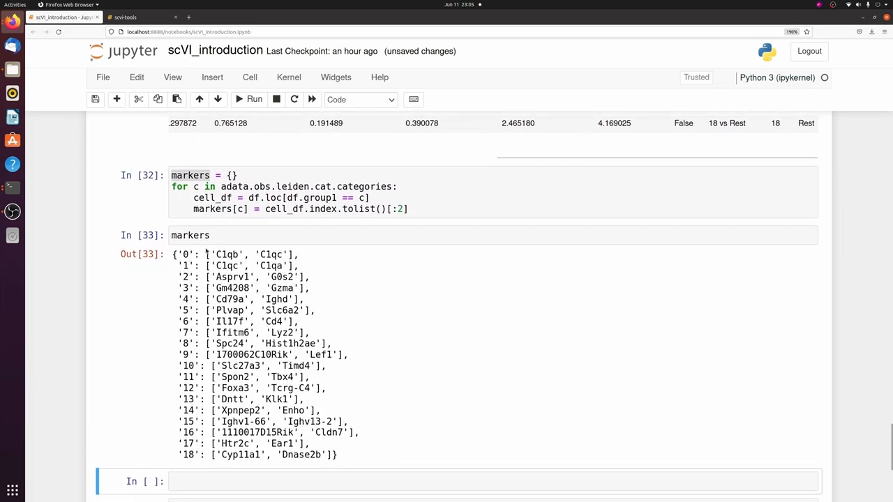

- **两组细胞比较可以指定得更细**。除了按样本比较（讲者形容这几乎相当于对两个样本做伪 bulk）[【跳转到 11:00】](https://www.youtube.com/watch?v=YT9qTuF6YFk&t=660)，还可以传两个布尔数组 `idx1`、`idx2`，指定任意两组细胞，比如 lung1 的 cluster1 对 lung2 的 cluster1 [【跳转到 11:20】](https://www.youtube.com/watch?v=YT9qTuF6YFk&t=680)。

## 八、边界：这张图能回答什么，不能回答什么

把三层分开之后，几条边界也就清楚了：

1. **批次键选错，等于把生物差异交给技术项去解释。** 图上 $s_n$ 一旦写错，解码器就会把处理效应当成批次效应吸收掉；反过来，把本该校正的技术差异漏掉，它就会挤进 $z_n$，污染聚类。
2. **只有一个样本时不需要批次键。** 视频明确说了这一点；此时图上没有 $s_n$，模型退化成"只有潜变量和文库大小"的版本。
3. **潜空间维度是一个选择，不是数据的固有属性。** 视频里默认给出 10 维；换成 20 维，聚类结果和下游判读都会变。
4. **基因数影响训练成本。** 视频选了 3000 个高变基因，并转述 scVI 的建议范围大约 1000 到 10000，且不要超过细胞数；基因越多，训练越慢 [【跳转到 04:16】](https://www.youtube.com/watch?v=YT9qTuF6YFk&t=256)。
5. **归一化表达是模型输出，不是测量。** 它依赖你传的 `library_size`，换一个值整层数值都会变；把它当成"更干净的原始数据"去做统计检验，是把推断量当观测用。

## 小结

- 生成图里只有**一个观测节点**：原始计数。它必须先被冻结到独立 layer，之后任何归一化都不许碰它。
- **批次协变量是已知输入**，在图上记作 $s_n$，在代码里是一个必须点名的分类键；它进解码器，不进潜空间。
- **连续协变量**（线粒体比例、总计数）是解释力的分流器，把技术方差从潜空间引走。
- **潜变量 $z$ 是推断量**，形状 `(细胞数, 10)`，只能通过模型方法取回；聚类、UMAP 都建在它上面。
- **表达比例 $\rho$ 与文库大小 $\ell$** 是两件事：`get_normalized_expression` 把文库大小定成 1e4 后返回的是"比例乘上你指定的文库大小"，所以它既不是计数，也不是纯比例。
- 三层分开之后，下游每一步都有明确归属：聚类用 $z$，画基因用 $\rho$，差异表达用似然。

## 关键术语速查

| 术语 | 一句话解释 |
| --- | --- |
| 生成图（generative model） | 用概率关系描述"细胞状态如何生成我们看到的计数"的有向图，节点是随机变量，边是条件依赖 |
| 潜变量 $z_n$ | 每个细胞的低维状态坐标，先验为标准正态，训练后由编码器推断得到 |
| 批次协变量 $s_n$ | 细胞所属样本或技术批次，观测已知，作为条件输入解码器 |
| 连续协变量 $c_n$ | 线粒体比例、总计数这类已知连续量，同样作为条件输入 |
| 表达比例 $\rho_{ng}$ | 解码器输出、对基因求和为 1 的组成向量，与文库大小无关 |
| 文库大小 $\ell_n$ | 每个细胞的总测序深度，把比例放大成计数尺度的观测因子 |
| 观测计数 $x_{ng}$ | 矩阵里真正测到的那个整数，唯一带观测标记的节点 |
| 条件解码（conditional decoder） | 解码器同时接收 $z_n$ 与 $s_n$，同一潜变量在不同批次下解出不同表达参数 |
| `counts` layer | AnnData 中存放原始计数的独立层，scVI 的输入，全程不改动 |
| `X_scVI` | 存放潜表示的观测列，聚类与降维的输入 |
| `scvi_normalized` | 存放模型归一化表达的层，等于比例乘以指定文库大小 |