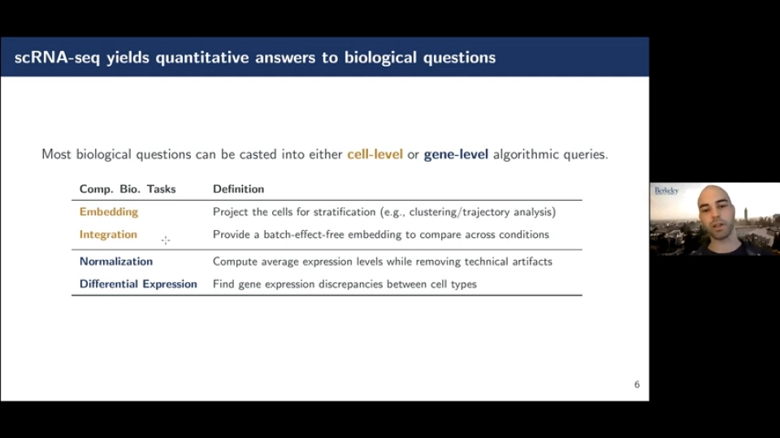
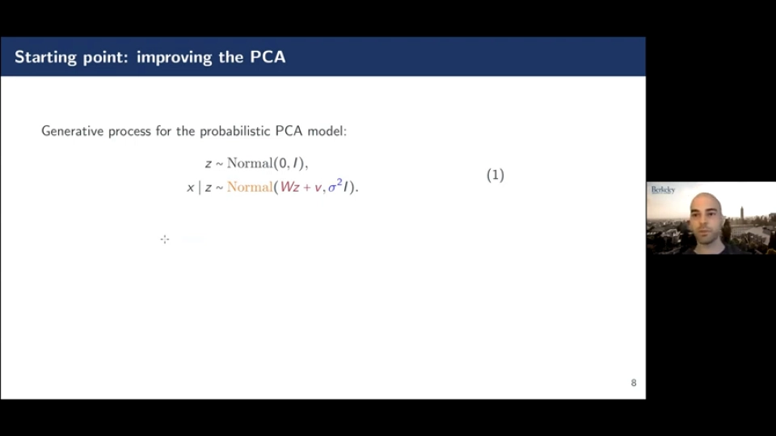
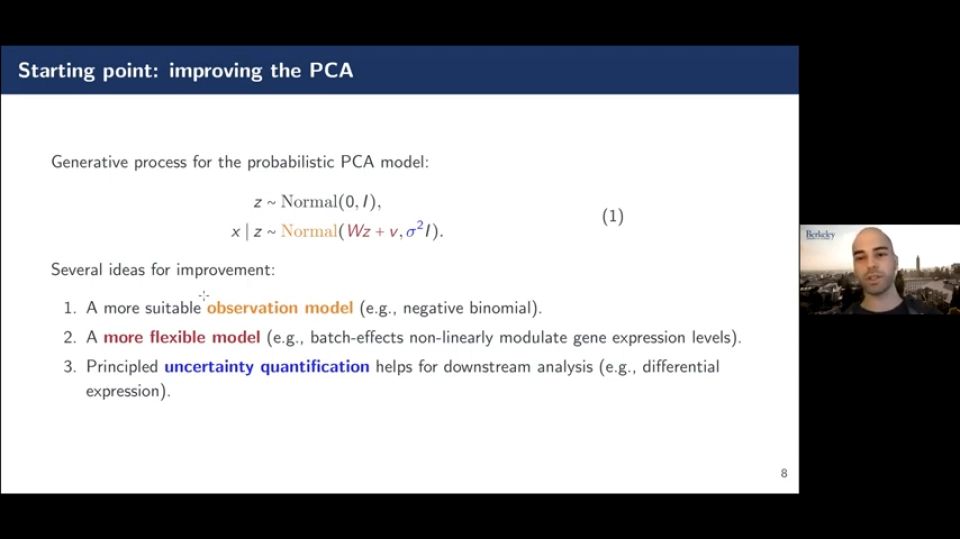
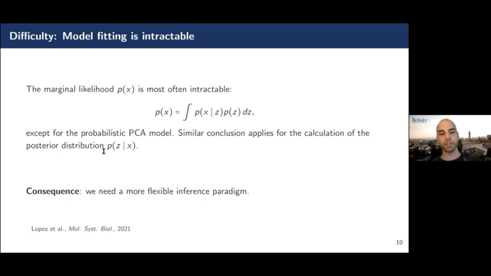
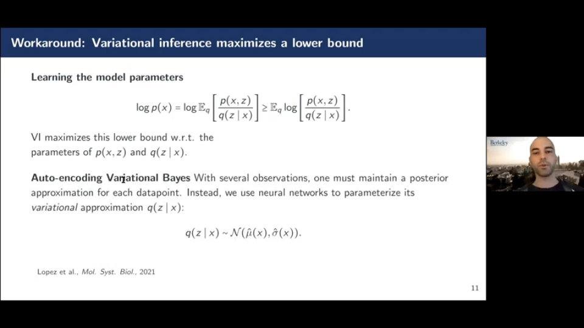
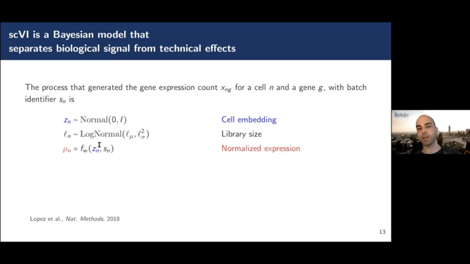
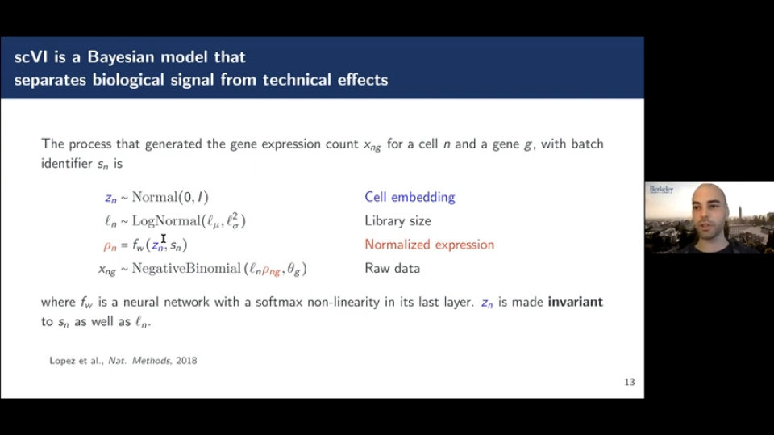
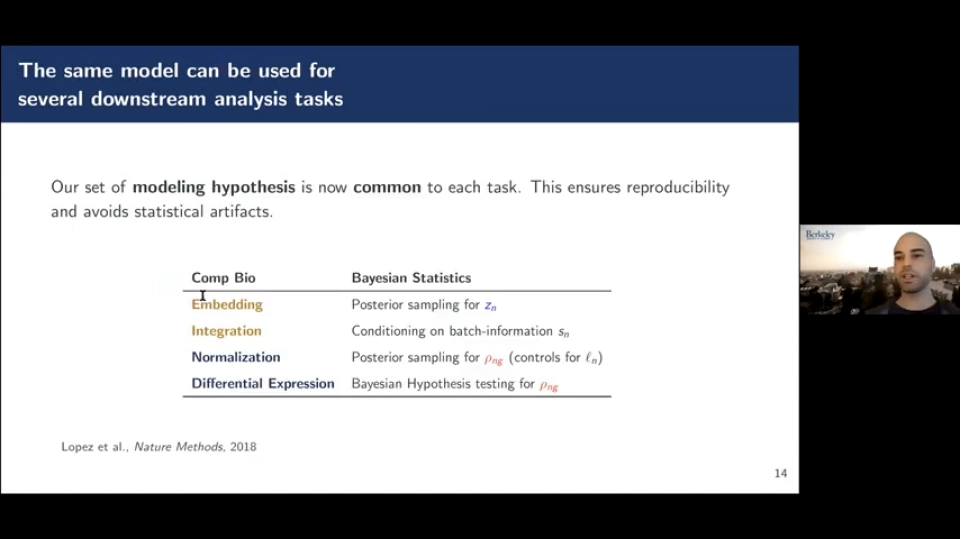
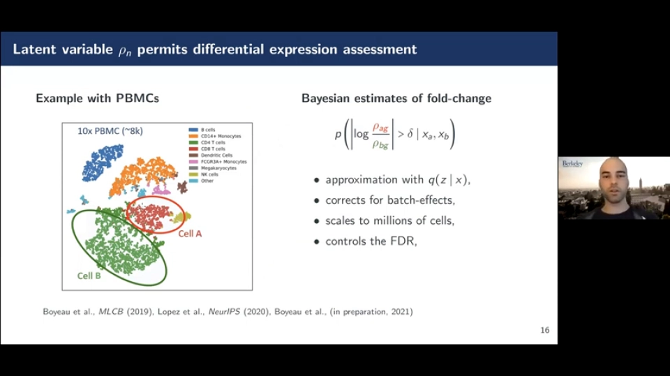
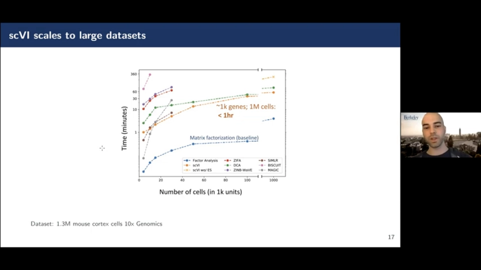

# 文库大小乘表达比例：scVI 如何把计数均值拆成规模与组成

> 视频来源：[AI & Single Cell Genomics](https://www.youtube.com/watch?v=tpf-BgqNxwY)（YouTube · Immunai 主办研讨会，报告人 Romain Lopez）｜全长约 2 小时，本文覆盖 01:25:11 之后约 40 分钟的 scVI 报告
> 简要导读：这是一场多讲者的单细胞 AI 研讨会，最后一场由 scVI 论文第一作者 Romain Lopez 讲 scVI 的生成模型。本文只整理这场报告里与**计数参数**有关的部分——文库大小、表达比例、离散度三者如何拼出负二项的均值；其余三场报告（体外免疫模型、图方法、CRISPR 筛选）与本节主题无关，不在此展开。

## 本讲要解决的核心问题（SCQA）

**背景**：单细胞 RNA 测序给出的是一张计数矩阵，每个格子是"某个细胞里、某个基因上被测到的转录本条数"。这是一堆整数，不是一个连续测量值。

**冲突**：常规流程把这张矩阵对数变换、做 PCA、聚类、再回头做差异表达。讲者对这个流程的不满很具体：**中间每一步都在换假设，而最后一步做检验时又要退回原始计数** [【跳转到 01:33:53】](https://www.youtube.com/watch?v=tpf-BgqNxwY&t=5633)。前面归一化时假设了一个模型，后面检验时又假设了另一个，中间没有人对过账。

**疑问**：能不能用一个统一的概率模型，从计数出发，把嵌入、归一化、差异表达全部做完——而且每一步都能说清自己在假设什么？

**回答（中心思想）**：能。scVI 的做法是**把每个观测到的计数看成一个随机过程的抽样结果**，然后只对这个过程的**均值**建模。而这个均值被拆成两个因子的乘积：一个只管"这个细胞总共测到多少条转录本"（文库大小 $\ell_n$），另一个只管"这些转录本里各个基因占多大比例"（表达比例 $\rho_{ng}$）[【跳转到 01:41:10】](https://www.youtube.com/watch?v=tpf-BgqNxwY&t=6070)。围绕这个均值，再挂一个逐基因的离散度参数 $\theta_g$，就得到了完整的负二项观测模型。

$$
x_{ng} \sim \mathrm{NegativeBinomial}\left(\ell_n \rho_{ng},\ \theta_g\right)
$$

这一篇就沿着这条主线，把四个量——$\ell_n$、$\rho_{ng}$、$\theta_g$、以及它们和批次 $s_n$ 的关系——逐个拆开讲清楚。

---

## 一、先把"归一化"这个词重新定义：它问的是均值，不是比例

讲者做的第一件事不是给公式，而是重新定义"归一化" [【跳转到 01:31:59】](https://www.youtube.com/watch?v=tpf-BgqNxwY&t=5519)：

> 我们观测到的是矩阵里的一个个条目。这些条目本质上是随机的——它来自一个计数过程，我们观测到某个整数，但它本来完全可能是别的数。所以对我来说，**归一化就是去问这个过程的均值**，尤其是搞清楚这个计数过程会被哪些技术因素调制。

这个定义值得停一下，因为它把"归一化"从"除以一个数"变成了"估计一个期望"。差别在于：

- 除以总数（或中位数比值）是一种**操作**，做完之后你只知道"每个细胞缩放到同一量级"，但不知道缩放的依据对不对；
- 估计均值是一种**推断**，你必须先说清"这个计数是由什么过程生成的"，然后才能问"在没有技术干扰的情况下，这个过程的均值是多少"。

讲者紧接着给出这个定义的用处：**只有当你能够对给定的技术协变量求出这个均值，差异表达才是有依据的** [【跳转到 01:32:23】](https://www.youtube.com/watch?v=tpf-BgqNxwY&t=5543)。换句话说，归一化不是预处理里一道可有可无的工序，它是差异表达的前提。

## 二、从概率 PCA 出发：问题出在观测分布上

要构造一个"有均值可问"的模型，讲者选了一个所有人都熟悉的起点：**概率 PCA**（probabilistic PCA）[【跳转到 01:35:26】](https://www.youtube.com/watch?v=tpf-BgqNxwY&t=5726)。

它的生成过程是两步：

$$
z \sim \mathrm{Normal}(0, I), \qquad
x \mid z \sim \mathrm{Normal}(Wz + \nu,\ \sigma^2 I)
$$

先给每个细胞采一个标准正态的隐变量 $z$，再由 $z$ 线性变换出一个高斯观测。讲者对这个模型提了三条改进意见 [【跳转到 01:36:10】](https://www.youtube.com/watch?v=tpf-BgqNxwY&t=5770)：

1. **换一个更合适的观测模型**。因为把 $z$ 积掉之后，边缘似然是高斯；而单细胞的观测显然不是高斯的，所以应该换成计数分布，比如负二项或泊松。
2. **让模型更灵活**。把那个线性函数换成神经网络——因为批次效应是**非线性**地调制基因表达的，线性校正只对很轻微的批次效应管用。
3. **把不确定性保留下来**。概率 PCA 其实是"$\sigma$ 趋于 0"时的极限；而要做贝叶斯式的差异表达，就必须保留这份不确定性。

这三条里，第一条正是本节的主题：**换分布**。而换分布的直接后果是——你要开始关心"这个分布的均值由什么构成"。

## 三、非线性一上身，似然就算不出来了

把线性函数换成神经网络之后，模型表达能力上去了，但代价立刻出现 [【跳转到 01:37:47】](https://www.youtube.com/watch?v=tpf-BgqNxwY&t=5867)：

$$
p(x) = \int p(x \mid z)\, p(z)\, \mathrm{d}z
$$

这个积分在概率 PCA 里有解析解，换成神经网络之后就没有了。后果有两个：**参数没法用最大似然直接学**，**后验 $p(z \mid x)$ 也算不出来**——也就是说，即使模型训好了，你也没法直接知道某个细胞的嵌入是什么。

出路是变分推断：不去优化数据似然，而是优化它的**下界** [【跳转到 01:38:21】](https://www.youtube.com/watch?v=tpf-BgqNxwY&t=5901)：

$$
\log p(x) = \log \mathbb{E}_{q}\left[\frac{p(x,z)}{q(z \mid x)}\right] \ge \mathbb{E}_{q}\log\left[\frac{p(x,z)}{q(z \mid x)}\right]
$$

再加一步"摊还"（amortization）：每个数据点都维护一个后验太贵了，所以用神经网络把后验参数化成输入的函数，$q(z \mid x) \sim \mathcal{N}(\hat{\mu}(x), \hat{\sigma}(x))$。这就是变分自编码器（VAE）。

到这里，讲者已经把"为什么需要 VAE"讲完了。下面才是本节真正要看的东西：**scVI 在这个 VAE 里放了哪些变量**。

## 四、scVI 的生成过程：三个变量，一个均值

讲者用一页幻灯片把整个生成过程写了出来 [【跳转到 01:40:11】](https://www.youtube.com/watch?v=tpf-BgqNxwY&t=6011)。这一页是全文的核心，值得逐行读。

### 4.1 第一行：细胞嵌入是标准正态的隐变量

$$
z_n \sim \mathrm{Normal}(0, I)
$$

每个细胞 $n$ 有一个低维嵌入 $z_n$，先验是标准正态。这一行和概率 PCA 完全一样，没有新东西——它是"细胞状态"这个概念的数学写法。

### 4.2 第二行：文库大小是一个潜在变量

$$
\ell_n \sim \mathrm{LogNormal}(\mu_\ell, \sigma_\ell^2)
$$

这是第一个关键点。讲者的原话是 [【跳转到 01:40:30】](https://www.youtube.com/watch?v=tpf-BgqNxwY&t=6030)：

> 然后我们有另一个潜在变量，它对应这样一个事实：某个细胞可能被测到了一万条转录本，也可能只测到一千条。这也叫**文库大小**。我们要把它考虑进来，否则就没法正确地做差异表达。

请注意这句话里的两个词：**潜在变量**、**文库大小**。在幻灯片上，$\ell_n$ 的先验是**对数正态**。这意味着：

- 文库大小不是被当作一个已知常数塞进模型的，而是**被推断出来的**一个量；
- 用对数正态做先验，等价于说"取对数之后的文库大小大致服从正态"——这与"测序深度在 log 尺度上波动"的直觉一致，也保证 $\ell_n$ 恒为正。

### 4.3 第三行：表达比例由神经网络给出，末端是 softmax

$$
\rho_n = f_w(z_n, s_n)
$$

$\rho_n$ 是一个长度等于基因数的向量，由神经网络 $f_w$ 从 $(z_n, s_n)$ 算出来。幻灯片下方有一句极重要的注释：**$f_w$ 是一个最后一层带 softmax 非线性的神经网络** [【跳转到 01:40:53】](https://www.youtube.com/watch?v=tpf-BgqNxwY&t=6053)。

softmax 在这里的作用，讲者说得很直白：

> 因为神经网络最后有一个 softmax 非线性，它让所有东西加起来等于一。所以这个向量的每一个条目，基本上就是**某个基因所占的期望表达比例**。

这句话解释了 $\rho$ 这个名字的来历：它不是一个"表达量"，而是一个**组成**（composition）。把所有基因的 $\rho_{ng}$ 加起来恰好是 1，这是 softmax 强制出来的约束，也是"比例"这个词的数学含义。

### 4.4 第四行：均值 = 规模 × 组成

现在把前三个变量拼起来 [【跳转到 01:41:10】](https://www.youtube.com/watch?v=tpf-BgqNxwY&t=6070)：

$$
x_{ng} \sim \mathrm{NegativeBinomial}\left(\ell_n \rho_{ng},\ \theta_g\right)
$$

负二项的第一个参数就是它的**均值**。也就是说：

$$
\mathbb{E}\left[x_{ng}\right] = \ell_n \cdot \rho_{ng}
$$

这一步是整节的枢纽。它把"一个细胞里某个基因测到多少条"这个观测，拆成了两个来源完全不同的因子：

| 因子 | 含义 | 由谁决定 | 类比 |
| :--- | :--- | :--- | :--- |
| $\ell_n$ | 这个细胞总共测到多少条转录本 | 测序深度、细胞大小、捕获效率 | 一篇文章的总字数 |
| $\rho_{ng}$ | 这些转录本里基因 $g$ 占多大比例 | 细胞状态、细胞类型、批次 | 各章节的字数占比 |
| $\ell_n \rho_{ng}$ | 基因 $g$ 的期望计数 | 两者相乘 | 某章节的期望字数 |
| $\theta_g$ | 逐基因的离散度 | 从数据里学 | 字数的波动幅度 |

用"文章字数"这个类比来读：一篇文章有多长（$\ell_n$）和文章里某一章占多少比例（$\rho_{ng}$）是两件独立的事。想知道"这一章写了多少字"，必须把两者乘起来。而**真正有生物学意义的只有比例**——总字数受测序深度影响，换个测序批次就变了；比例才是细胞状态决定的。

这也正是为什么 scVI 的差异表达要建在 $\rho$ 上而不是建在 $x$ 上（见第六节）。

### 4.5 第五个量：离散度 $\theta_g$

讲者在念完均值之后补了一句 [【跳转到 01:41:17】](https://www.youtube.com/watch?v=tpf-BgqNxwY&t=6077)：

> 我们还有另一个离散度参数，可以在这个过程中一起学出来。

注意两点：

1. **下标是 $g$ 不是 $n$**。离散度是**逐基因**的，不是逐细胞的。这符合生物学直觉：不同基因的表达波动幅度本来就不同，管家基因很稳，某些基因则忽高忽低。
2. **它是"学"出来的**，不是事先用矩估计算好再固定住的。这一点与 DESeq2 那类"先逐基因估计、再做跨基因收缩"的做法不同——scVI 把离散度也交给优化器。

## 五、观测文库大小与潜在文库大小：一个必须核对的口径问题

这是本节最容易被跳过、却最容易踩坑的地方。

在讲者的幻灯片上，$\ell_n$ 是**潜在变量**：它有一个对数正态先验，它是被推断出来的。讲者在描述生成过程时用的词也是"另一个潜在变量" [【跳转到 01:40:30】](https://www.youtube.com/watch?v=tpf-BgqNxwY&t=6030)。

但在实际代码里，"文库大小"这个词经常指另一件东西：**每个细胞所有基因计数之和**，也就是从数据里直接算出来的那个观测值。这两者不是同一个量：

| 口径 | 是什么 | 从哪来 | 风险 |
| :--- | :--- | :--- | :--- |
| 潜在文库大小 | 模型里的随机变量 $\ell_n$ | 从先验出发、由数据推断 | 需要确认模型确实把它当作潜变量在学 |
| 观测文库大小 | 每细胞计数总和 | 直接从矩阵按行求和 | 它是数据的函数，不是模型的参数 |

两者在数值上通常接近，但在模型里的**地位完全不同**：一个是待推断的随机变量，一个是输入的确定性特征。这个差别会直接影响你在做什么：

- 如果你要**从模型里采样生成新细胞**，你需要的是 $\ell_n$ 的分布；
- 如果你要**把新数据投影进已有模型**，你手里只有观测到的计数总和；
- 如果你要**比较两个批次的归一化结果**，你得知道归一化到底是在哪个口径上做的。

所以核对配置时的第一个问题不是"用什么似然"，而是：**这个模型里的文库大小，是观测到的还是推断出来的？** 讲者这一版幻灯片给出的答案是后者（对数正态先验的潜变量）。

同一页幻灯片底部还有一句注释，同样值得抄下来：**$z_n$ 被做得对 $s_n$ 和 $\ell_n$ 都不变**。也就是说，细胞嵌入里不允许残留批次信息，也不允许残留测序深度信息——这两样都被显式地赶到了 $s_n$ 和 $\ell_n$ 里。这是一句关于"信息该放在哪个变量上"的设计声明，比任何调参技巧都重要。

## 六、同一套参数，支撑四类任务

讲者反复强调的一个卖点是"模型一致性"：**同一组建模假设，对每一个任务都通用** [【跳转到 01:42:39】](https://www.youtube.com/watch?v=tpf-BgqNxwY&t=6159)。他把四类任务翻译成了贝叶斯语言：

| 计算生物学任务 | 贝叶斯统计里的对应操作 |
| :--- | :--- |
| 嵌入（Embedding） | 对 $z_n$ 做后验采样 |
| 整合（Integration） | 以批次信息 $s_n$ 为条件 |
| 归一化（Normalization） | 对 $\rho_{ng}$ 做后验采样（同时控制 $\ell_n$） |
| 差异表达（Differential Expression） | 对 $\rho_{ng}$ 做贝叶斯假设检验 |

这张表里，"归一化"那一行括号里的 **controls for $\ell_n$** 是本节的关键证据：归一化之所以成立，是因为模型里有一个独立的 $\ell_n$ 把规模因素吸收掉了；剩下被采样的 $\rho_{ng}$ 就是"去掉规模之后的比例"。

差异表达同理 [【跳转到 01:43:05】](https://www.youtube.com/watch?v=tpf-BgqNxwY&t=6185)。讲者的说法是：你不需要做 t 检验，也不需要做 Wilcoxon 检验，可以直接针对你想问的假设设计检验。幻灯片上写的是一个贝叶斯版的倍数变化估计：

$$
\rho\left(\left\vert \log \frac{\rho_{ag}}{\rho_{bg}} \right\vert > \delta \ \middle\vert\ x_a, x_b\right)
$$

也就是"在给定两组细胞数据的前提下，这两组在这个基因上的 log 倍数变化超过阈值 $\delta$ 的概率"。这比"p 值小于 0.05"多给了一层信息：你可以直接说"有 87% 的概率倍数变化超过 1"，而不是只能说"显著"。

## 七、为什么这套参数化能跑到百万细胞

讲者给了一张运行时间对比图 [【跳转到 01:46:16】](https://www.youtube.com/watch?v=tpf-BgqNxwY&t=6376)：在 130 万个小鼠皮层细胞、约 1 千个基因的设定下，scVI 能在**一小时内**跑完，而不少同类方法的时间随细胞数超线性增长。

原因讲者也说了：优化时可以**对细胞做子采样**，不需要把所有细胞同时放进内存。这一点和参数化方式直接相关——因为 $\ell_n$ 和 $\rho_{ng}$ 都是逐细胞的局部量，用一个小批量就能估出它们的梯度，不需要全局闭式解。换句话说，**"把均值拆成两个因子"这个设计，同时也是它能扩展的前提**。

## 八、用之前必须核对的三件事：版本、似然、离散度

这一节不是视频里的内容，而是读完视频后必须自己补的一步。原因是：**这场报告是 2021 年前后的版本**。幻灯片上引用的文献包括 Lopez et al., *Nature Methods* 2018、Lopez et al., *NeurIPS* 2020、Boyeau et al. 2021，说明这套符号和默认设定反映的是那个时间点的实现。

所以在自己的环境里跑 scVI 之前，至少核对三件事：

1. **似然（likelihood）到底是什么**。讲者在这一页写的是负二项，并在"改进方向"里说"换成计数分布，比如负二项或泊松"。但不同版本、不同任务里，似然是可以配置的。**不要因为"scVI 就是负二项"就跳过这一步**。
2. **零膨胀开没开**。这场报告从头到尾没有提零膨胀（zero inflation），幻灯片上的观测模型就是负二项。零膨胀是另一个独立的开关，开与不开对应两套不同的观测假设，必须显式确认。
3. **离散度的粒度**。幻灯片上写的是 $\theta_g$——逐基因。但实现上离散度可以按基因、按基因-批次、甚至按基因-细胞来给。粒度不同，参数量和过拟合风险都不同。

判断方法很朴素：**把模型对象打印出来，看它的配置**。看似然名、看零膨胀标志、看离散度的维度。这比记住任何一句"scVI 默认是 X"都可靠——因为默认值会随版本变，而你的配置不会骗你。

## 小结

- scVI 不从"归一化后的表达"出发，而是从**计数**出发，只对计数过程的**均值**建模。
- 均值被拆成两个因子：$\ell_n$（文库大小，管规模）× $\rho_{ng}$（表达比例，管组成）。这个分解是本节的全部核心。
- $\rho_n$ 由神经网络 $f_w(z_n, s_n)$ 给出，**最后一层是 softmax**，所以所有基因的比例之和为 1——它是组成，不是表达量。
- $\ell_n$ 在幻灯片上是**潜在变量**（对数正态先验），不是直接塞进去的观测总数。用之前要核对自己那一版用的是哪个口径。
- 离散度 $\theta_g$ 是**逐基因**的，并且是学出来的，不是事先估好固定的。
- 同一套参数支撑四类任务：嵌入采样 $z$、整合条件于 $s$、归一化采样 $\rho$（控制 $\ell$）、差异表达检验 $\rho$。
- 版本与配置必须核对：似然、零膨胀开关、离散度粒度——三样都不能靠"我记得默认是……"。

## 关键术语速查

| 术语 | 一句话解释 |
| :--- | :--- |
| 文库大小（library size） | 一个细胞总共被测到多少条转录本，决定计数的整体规模 |
| 表达比例（normalized expression） | 某个基因在全部转录本里所占的期望比例，所有基因加起来为 1 |
| softmax | 把一组实数变成和为 1 的正数的函数，用在解码器最后一层 |
| 离散度（dispersion） | 负二项里控制波动幅度的参数，scVI 中逐基因给出 |
| 对数正态先验 | 取对数后服从正态的分布，保证取值恒正，用于文库大小 |
| 摊还推断（amortization） | 用神经网络把每个数据点的后验参数化成输入的函数，避免逐点存后验 |
| 变分下界（ELBO） | 对数似然的可计算下界，变分推断优化的目标 |
| 模型一致性 | 同一套生成假设支撑嵌入、整合、归一化、差异表达多个任务 |