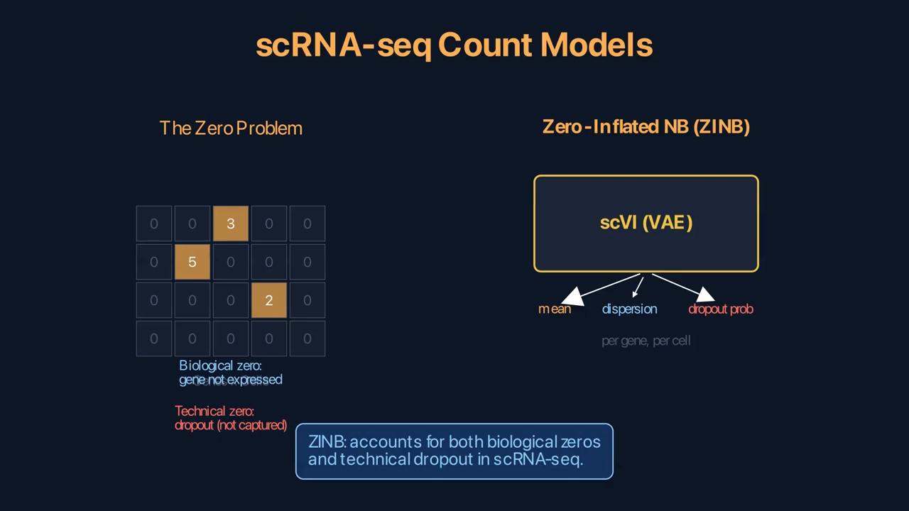
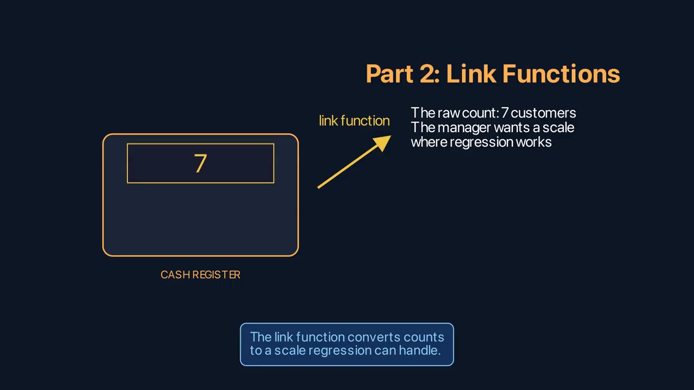
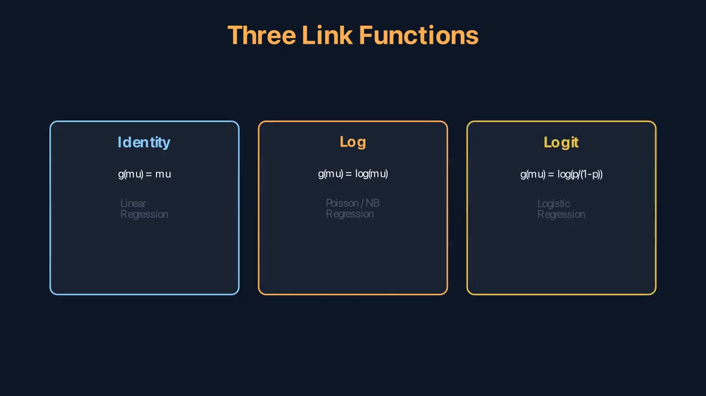
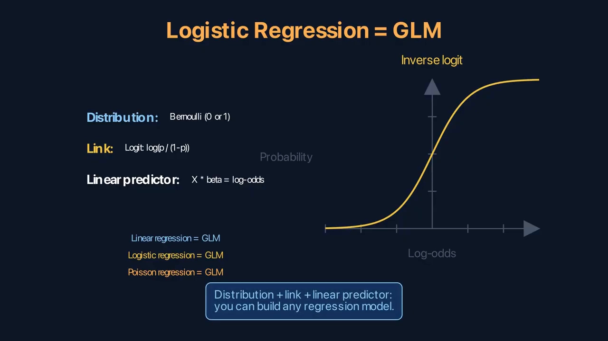
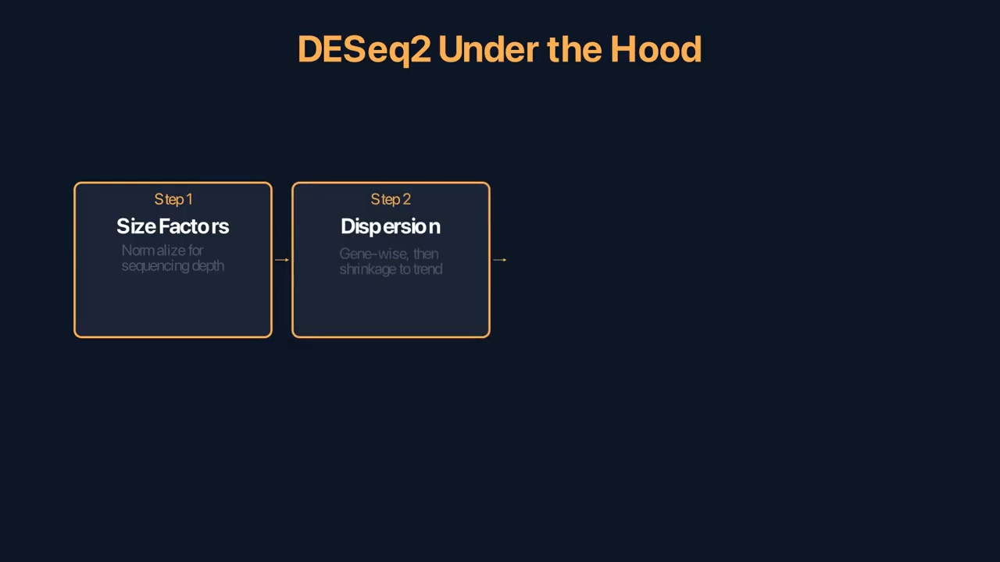
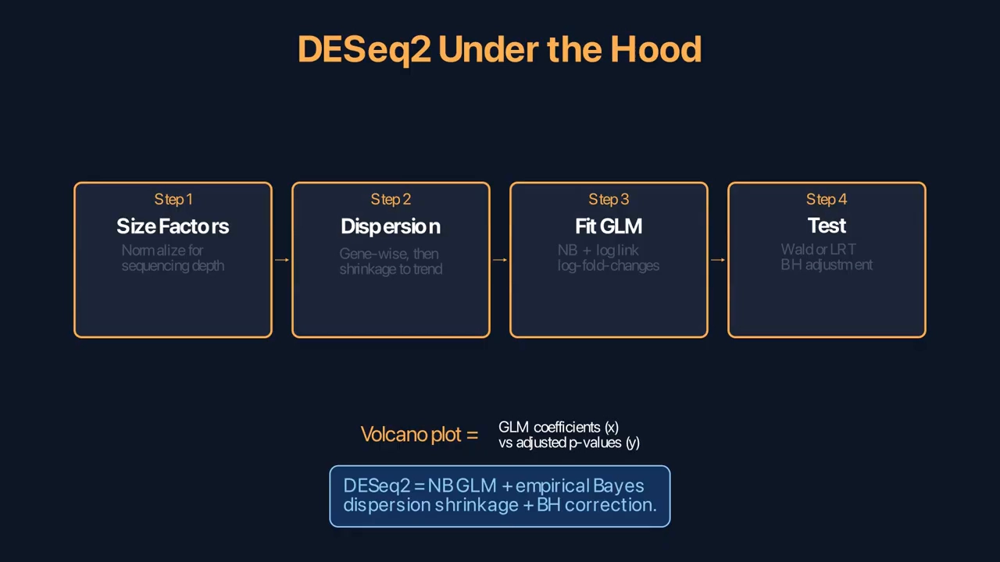
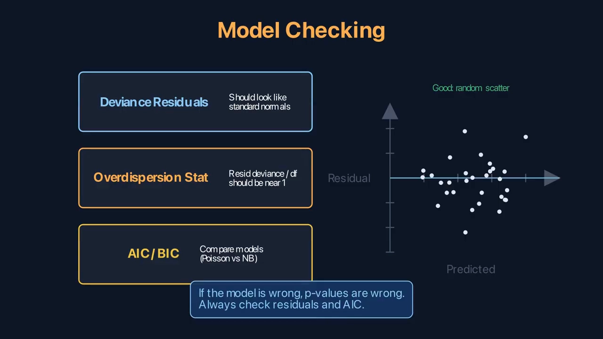
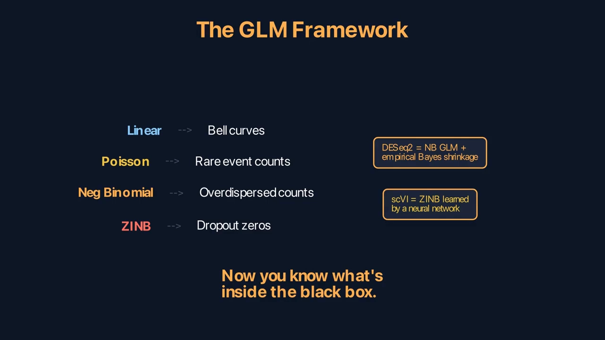

# 离散度与零膨胀：scVI 的计数模型从哪里来

> 视频来源：[GLMs Part 2: Link Functions, DESeq2 Under the Hood, Zero-Inflated Models & scVI](https://www.youtube.com/watch?v=QjZ6EuHWQsk)（YouTube · QSPplus）｜时长约 3 分 50 秒
> 简要导读：这支四分钟的动画讲解用"收银机上的 7 个顾客"把广义线性模型（GLM）讲完，再顺着 DESeq2 的四步走到单细胞的零膨胀负二项（ZINB），最后一句落到 scVI。本文只取其中与**计数参数**相关的部分：连接函数、size factor、离散度、零膨胀概率，以及"scVI 到底估了哪几个数"。

## 本讲要解决的核心问题（SCQA）

**背景**：单细胞测序的原始数据是一张整数矩阵——每个细胞、每个基因一个计数。计数是"数出来的"，不是"量出来的"：某个基因在某个细胞里被测到 0 次、3 次、5 次。

**冲突**：这种整数不能直接丢进线性回归。一方面，回归的预测值可以是负数，而计数不可能是负数；另一方面，矩阵里零太多，而零有两种完全不同的来源——基因真的没表达，或者表达了却没被测到 [【跳转到 02:30】](https://www.youtube.com/watch?v=QjZ6EuHWQsk&t=150)。

**疑问**：那么一个计数模型究竟要估哪些参数？DESeq2 估的和 scVI 估的，是同一批参数吗？

**回答（中心思想）**：一个计数模型只需要三件套——**分布、连接函数、线性预测器**；真正决定拟合好坏的是分布里那几个参数。DESeq2 用"size factor + 收缩后的基因级离散度"来定这些参数，scVI 则把**均值、离散度、零膨胀概率**全部交给神经网络去学 [【跳转到 03:20】](https://www.youtube.com/watch?v=QjZ6EuHWQsk&t=200)。正因为参数是"学"出来的而不是"查表"出来的，配置里开不开零膨胀、离散度按基因还是按细胞给，才会直接影响结果。

---

## 一、连接函数：把"数出来的整数"搬到回归能工作的尺度

讲者开篇用了一个很具体的例子 [【跳转到 00:00】](https://www.youtube.com/watch?v=QjZ6EuHWQsk&t=0)：收银机上显示的是原始计数，比如今天来了 7 位顾客；但经理想分析的是趋势，而趋势要在"回归能工作的尺度"上才谈得上。**连接函数（link function）就是把计数搬到那个尺度上的桥**，逆连接函数再把预测值搬回计数。

视频列了三种常见连接函数 [【跳转到 00:25】](https://www.youtube.com/watch?v=QjZ6EuHWQsk&t=25)：

| 连接函数 | 形式 | 用在哪 | 保证什么 |
| :--- | :--- | :--- | :--- |
| 恒等（identity） | $g(\mu)=\mu$ | 线性回归 | 无约束 |
| 对数（log） | $g(\mu)=\log(\mu)$ | 泊松、负二项回归 | 预测值恒为正，计数不会为负 |
| logit | $g(p)=\log\dfrac{p}{1-p}$ | 逻辑回归 | 预测值落在 0 与 1 之间 |

表格里最关键的一行是 log：**它保证"预测出来的均值"永远大于零**。这不是数学上的洁癖，而是计数数据的硬约束——你不可能预测出 -3 个转录本。对 scVI 这类模型来说，解码器输出的均值同样要满足这个约束，只是它用的不是简单的 log 连接，而是一整套"规模 × 组成"的构造（见同小节的另一篇）。

## 二、一个 GLM 只有三件套：分布、连接函数、线性预测器

视频把逻辑回归拆开当例子 [【跳转到 00:50】](https://www.youtube.com/watch?v=QjZ6EuHWQsk&t=50)：结局是二元的 0 或 1，所以**分布**是伯努利；**连接函数**是 logit；**线性预测器**给出 log-odds。把 log-odds 取指数得到优势比，再套一次逆 logit 就得到概率。

讲者由此给出一句可以当口诀用的话：**分布 + 连接 + 线性预测器，你就能搭出任何回归模型**。线性回归是 GLM，逻辑回归是 GLM，泊松回归也是 GLM。理解这一点之后，"负二项"就不再是一个孤立的公式，而只是把"分布"这一格换成了允许方差大于均值的那个分布。

## 三、DESeq2 的四步：先定规模，再定离散度

视频用 DESeq2 演示了这套框架落地时的完整顺序 [【跳转到 01:15】](https://www.youtube.com/watch?v=QjZ6EuHWQsk&t=75)，四步依次是：

1. **估 size factor**：按测序深度做归一化，每个样本得到一个缩放因子，用中位数比值法（median ratio method）算。
2. **估离散度**：先对每个基因单独拟合一个负二项，得到基因级离散度；再做**收缩（shrinkage）**，把极端的离散度估计往跨基因的平滑趋势线上拉。
3. **拟合 GLM**：负二项 + log 连接，系数就是 log fold change。
4. **检验显著性**：Wald 检验或似然比检验，再用 Benjamini-Hochberg 校正多重检验。

第 2 步里的"收缩"值得停一下。低计数基因的离散度估计极不稳定——样本里只有几个计数，方差估计几乎全靠运气 [【跳转到 01:40】](https://www.youtube.com/watch?v=QjZ6EuHWQsk&t=100)。所谓经验贝叶斯收缩，就是承认"这个基因自己的数据不够"，把它往所有基因共享的趋势上拉一把，让估计稳定下来。视频把它总结成一句：**DESeq2 = 负二项 GLM + 经验贝叶斯离散度收缩 + BH 校正** [【跳转到 02:05】](https://www.youtube.com/watch?v=QjZ6EuHWQsk&t=125)。

顺带说清火山图：横轴是 GLM 系数（效应量），纵轴是校正后的 p 值。它不是另一种统计，只是把第 3、4 步的结果画在同一张图上。

## 四、单细胞多出来的一件事：零太多，而且零有两种

到了单细胞，问题多了一层 [【跳转到 02:30】](https://www.youtube.com/watch?v=QjZ6EuHWQsk&t=150)：矩阵里零特别多。一个基因可能确实表达了，但那个转录本没被捕获——这就是**脱落（dropout）**。视频给出的对策是**零膨胀负二项（ZINB）**：在负二项之外再加一个"这个位置是不是结构性的零"的开关。

ZINB 因此要同时容纳两种零：

- **生物学零**：基因真的没表达；
- **技术零**：基因表达了，但转录本没被捕获。

这两个零在数据里长得一模一样（都是 0），只有模型里的额外参数才能把它们区分开。这也解释了为什么"零膨胀"不是一个可有可无的装饰：它对应着一个实实在在的观测机制假设。

## 五、scVI 把这三个参数交给神经网络

视频对 scVI 的概括只有一句，但信息量不小 [【跳转到 02:30】](https://www.youtube.com/watch?v=QjZ6EuHWQsk&t=150)：**变分自编码器（VAE）学习负二项的均值、离散度，以及每个基因在每个细胞里的脱落概率**。

注意"逐基因、逐细胞"（per gene, per cell）这个限定。它意味着 scVI 里的离散度不是一个全局常数，也不是每个基因一个固定值，而是可以由网络根据细胞状态算出来的量。这正是它与 DESeq2 的分水岭：DESeq2 的离散度是"每个基因一个数"，靠跨基因收缩来稳定；scVI 的离散度是网络的一个输出，靠数据量和先验来约束。

### 5.1 关于"scVI = ZINB"这句话，要打个版本补丁

视频结尾把 scVI 直接标成"由神经网络学出来的 ZINB" [【跳转到 03:45】](https://www.youtube.com/watch?v=QjZ6EuHWQsk&t=225)。这句话作为**入门概括**是准确的：scVI 的观测模型确实建立在负二项之上，零膨胀也是它最初处理脱落的手段。

但视频没有标注任何版本号，也没有区分"似然"与"零膨胀开关"这两个独立的配置项。实际使用时请注意三点：

1. **似然与零膨胀是两个开关**，不是一个。选了负二项不等于开了零膨胀，反之亦然。
2. **默认值会随版本变化**。同一个函数名在不同版本的 scVI-tools 里，默认似然和默认离散度设置可能不同；照抄几年前的教程代码，很可能拿到的是过时的默认值。
3. **以自己环境里的文档为准**。跑之前先把模型配置打印出来核对一遍：似然是什么、零膨胀开没开、离散度是按基因还是按基因-批次给。这比记住"scVI 就是 ZINB"有用得多。

换句话说，视频给的是"这个模型大致长什么样"，而配置核对要解决的是"我手上这一版到底长什么样"。后者只能查文档、看源码、打印配置，不能靠记忆。

## 六、模型对不对，要检查：残差、过度离散统计量、AIC/BIC

视频最后一段讲模型检验 [【跳转到 02:55】](https://www.youtube.com/watch?v=QjZ6EuHWQsk&t=175)，给了三个可操作的检查：

- **偏差残差（deviance residuals）**应该看起来像标准正态。把它们对预测值作散点图，看有没有残留的结构——有结构就说明模型没吃干净。
- **过度离散统计量**＝残差偏差除以残差自由度，应该接近 1。远大于 1 说明模型没抓住过度离散。
- **AIC / BIC** 用来比较模型。一个过度离散很严重的泊松 GLM，AIC 会比负二项差。

讲者在这里说了一句很实在的话：**模型错了，p 值就是错的**。对 scVI 的使用者来说，这句话可以翻译成：如果离散度或零膨胀的配置和数据的真实生成机制不匹配，后面的差异表达、聚类、嵌入都会带着这个偏差往下走。

## 七、一张图收束：四种分布对应四类数据

视频用一张对照表收尾 [【跳转到 03:45】](https://www.youtube.com/watch?v=QjZ6EuHWQsk&t=225)：

- 线性回归 → 钟形曲线；
- 泊松 → 稀有事件计数；
- 负二项 → 过度离散的计数；
- ZINB → 带脱落零的计数。

而 DESeq2 站在"负二项 + 经验贝叶斯收缩"这一格，scVI 站在"由神经网络学出来的 ZINB"这一格。两者的差别不在分布的名字，而在**参数是谁估的、怎么估的**。

## 小结

- 计数不能直接做线性回归，**连接函数**负责把计数搬到回归能工作的尺度；log 连接保证预测均值恒正。
- 任何 GLM 都只有三件套：**分布、连接函数、线性预测器**。换分布就是换模型。
- DESeq2 的四步是：size factor → 离散度（基因级 + 收缩）→ 负二项 GLM → 检验与多重校正。
- 单细胞的零有两种：**生物学零**与**技术零**；ZINB 用一个额外的零膨胀参数把它们分开。
- scVI 用 VAE 学三个量：**均值、离散度、脱落概率**，且都是逐基因、逐细胞的。
- "scVI = ZINB"只是入门概括。**似然与零膨胀是两个独立开关，默认值随版本变化**，用前必须核对自己环境里的配置。
- 模型检验靠偏差残差、过度离散统计量、AIC/BIC；模型错了，下游的 p 值和嵌入都会跟着错。

## 关键术语速查

| 术语 | 一句话解释 |
| :--- | :--- |
| 连接函数（link function） | 把计数均值映射到线性预测器所在尺度的函数，log 连接最常用于计数 |
| GLM | 广义线性模型，等于分布 + 连接函数 + 线性预测器 |
| size factor | 每个样本的测序深度缩放因子，用中位数比值法估计 |
| 离散度（dispersion） | 负二项里控制"方差比均值大多少"的参数；越大越离散 |
| 收缩（shrinkage） | 把不稳定的逐基因估计往跨基因趋势线上拉，降低方差 |
| 零膨胀（zero inflation） | 在计数分布之外再加一个"结构性零"的开关 |
| 脱落（dropout） | 基因表达了但转录本没被捕获，表现为技术零 |
| 偏差残差 | 衡量观测与拟合偏差的残差形式，理想情况下近似标准正态 |
| 过度离散统计量 | 残差偏差除以残差自由度，接近 1 表示离散度已被模型吸收 |