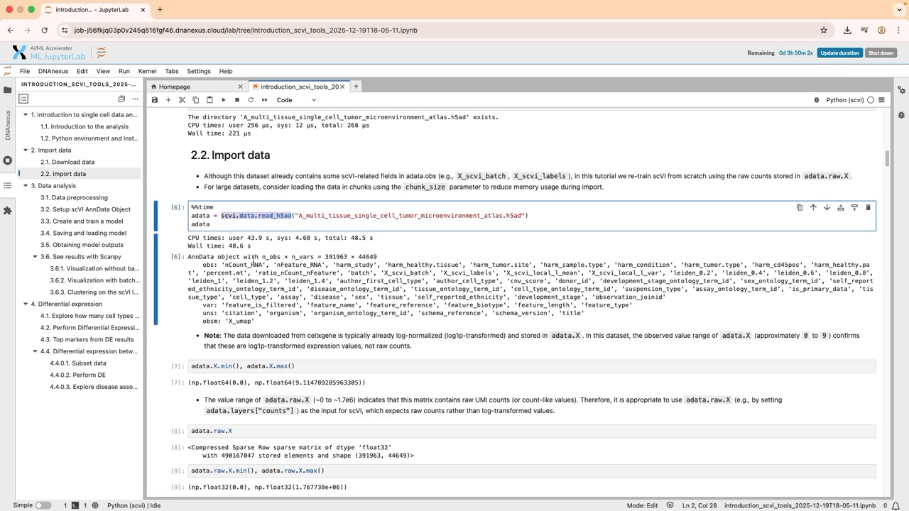
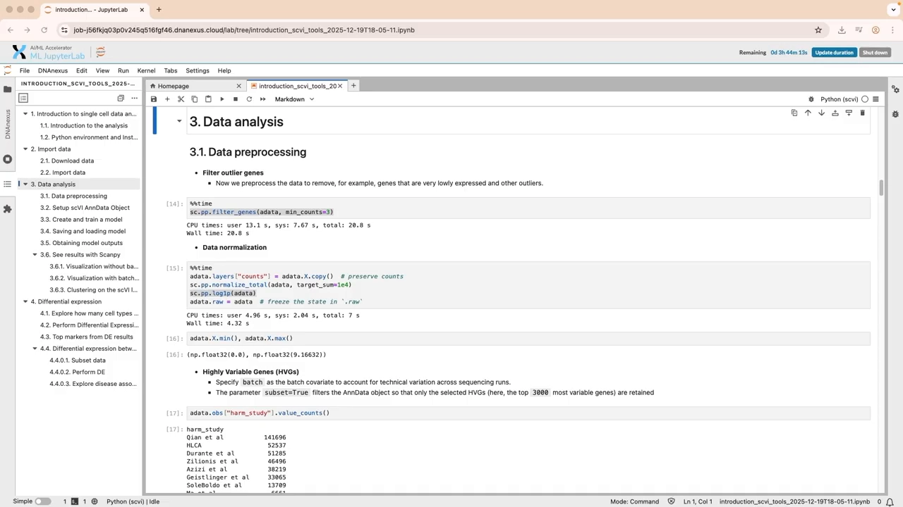
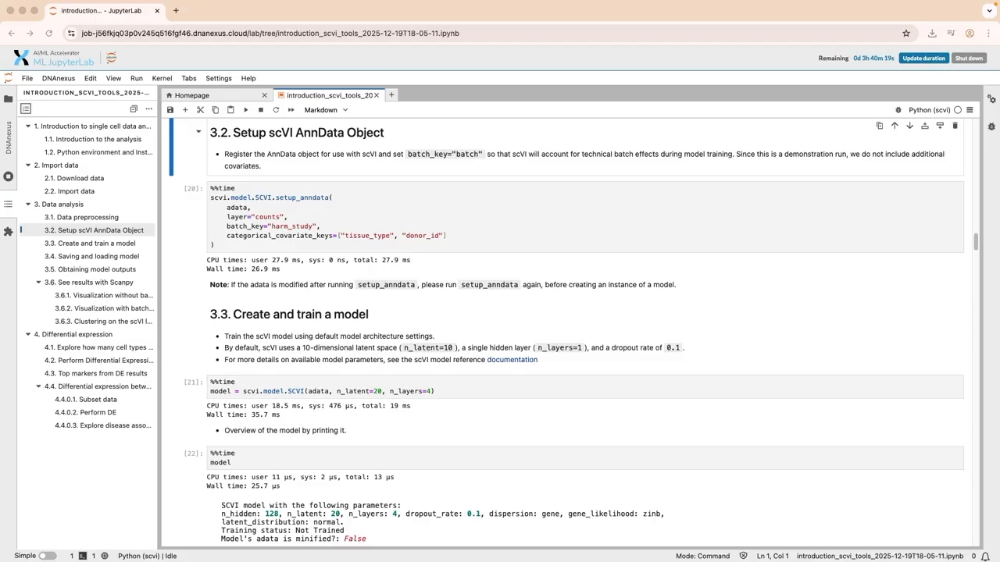
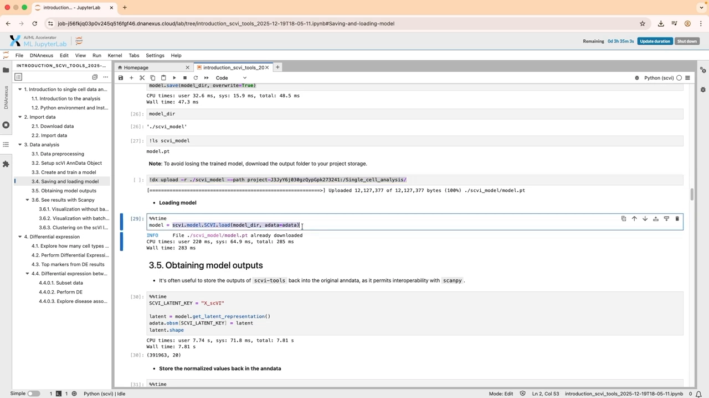
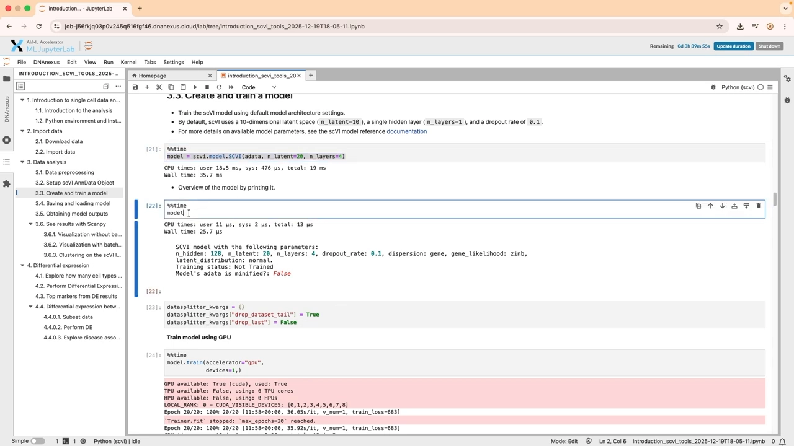
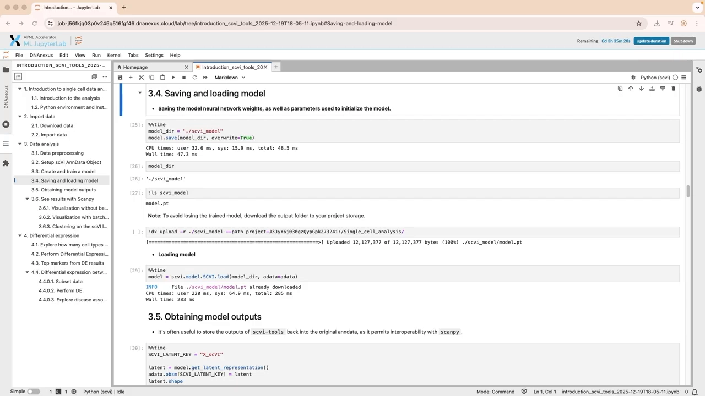
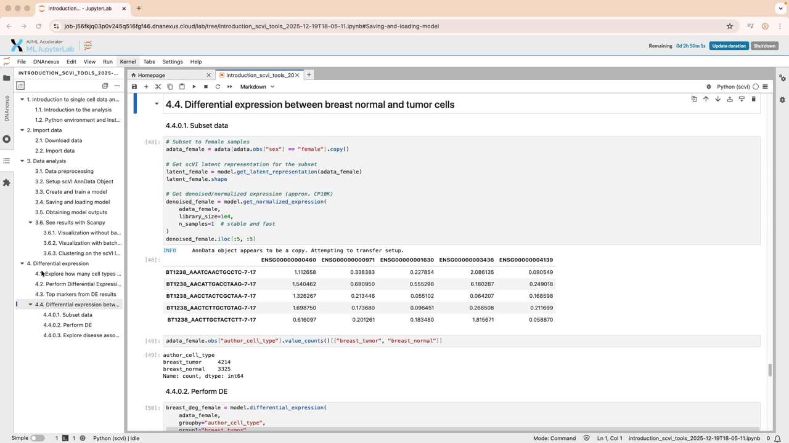
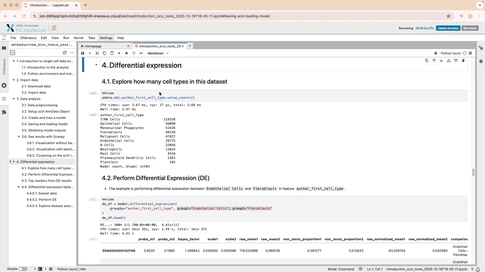
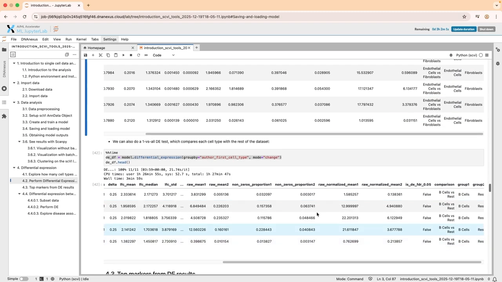

# 把 scVI 训练起来：计数输入、20 维潜空间与 20 个 epoch

> 视频来源：[Utilizing scvi-tools and CZ CELLxGENE on the DNAnexus Platform](https://www.youtube.com/watch?v=Ok3yqz5UCB4)（YouTube · DNAnexus 官方教程）｜时长约 9 分钟
> 简要导读：一支把 scVI 完整跑一遍的实操短片——GPU 环境、数据导入、预处理、建模型、训练、存盘、下游分析。它不讲公式，但把**训练这一步的每个旋钮**都摆在了屏幕上。本文只整理与训练配置有关的部分：输入怎么准备、容量怎么调、似然是哪种、跑多少轮、训练完怎么存。后验怎么用见同小节的另一篇（Adam Gayoso 那支），生成图与计数参数见 3.1.7、3.1.8。

## 本讲要解决的核心问题（SCQA）

**背景**：在 scvi-tools 里训练一个 scVI 模型，代码只有三行——建模型、`model.train()`、存盘。看起来没有多少需要决定的事。

**冲突**：但默认值是为"一般情况"设的。这支视频的数据集有 39 万个细胞、4.4 万个基因、来自多个研究，讲者把 `n_latent` 从默认的 10 提到 20、`n_layers` 从 1 提到 4，并明确说这是为了"给模型更多容量"。同时，数据导入那一步如果搞错——把已经 log 归一化的 `adata.X` 当计数喂进去——模型不会报错，只会安静地学出一个错的模型。

**疑问**：从一张计数矩阵到"训练完成"的模型，中间到底有哪些必须做对的决定？

**回答（中心思想）**：训练 scVI 的关键不在那三行代码，而在三件事——**输入必须是原始计数**、**容量要与数据规模匹配**、**训练轮数要跑够并留下可复现的模型文件**。这三件事决定了你后面拿到的后验值有没有意义。

## 一、输入：CELLxGENE 下载的 `X` 不是计数

视频用的数据是 CELLxGENE 上的多组织肿瘤微环境图谱，h5ad 格式，约 2 GB，加载后是 392,000 个细胞 × 44,000 个基因。

讲者特意停下来解释这个数据集的两种数值：



> "Data downloaded from CELLxGENE is typically log-normalized and stored in adata.X. For this dataset, the values in adata.X range roughly from 0 to 9, confirming they are log1p transformed. The dataset also stores the raw UMI counts in adata.raw.X."
> ——[【跳转到 02:32】](https://www.youtube.com/watch?v=Ok3yqz5UCB4&t=152)

这是一个非常常见的坑：从公共数据库下载的表达矩阵，默认那一层往往是**已经归一化、取过对数**的。而 scVI 的似然是负二项或零膨胀负二项，它建模的对象是"数出来的整数"（见 3.1.8）。把 log 值喂进去，等于让模型去拟合一个它没有假设过的分布。

所以下一步是显式地把计数搬到正确的位置：

> "To make sure scVI uses the correct input, we copy the raw counts into a layer called counts and also replace adata.X with these raw values."
> ——[【跳转到 02:57】](https://www.youtube.com/watch?v=Ok3yqz5UCB4&t=177)

代码上就是 `adata.layers["counts"] = adata.raw.X`，再用 setup_anndata 指定 layer 为 counts，告诉模型去这一层取数。这一步和 Adam Gayoso 那支视频里的做法完全一致——**先存计数，再登记**。

## 二、预处理只做三件事，但顺序有讲究



讲者的预处理分三步（[【跳转到 03:21】](https://www.youtube.com/watch?v=Ok3yqz5UCB4&t=201)）：

1. **过滤极低表达基因**：要求每个基因在所有细胞中至少有 3 个计数。理由是"保持数据集可管理，并去掉由测序噪声驱动的离群基因"。
2. **归一化与对数变换**：normalize_total 到 1e4 加 `log1p`，让不同细胞的表达可比。注意代码里先把 `adata.X` 复制进 `layers["counts"]` 再做归一化——**计数被保留下来了**，因为后面 scVI 还要用。
3. **高变基因选择**：按 `harm_study` 这一列分批选，保证跨测序批次选出的基因一致。基因数从 44,000 降到 3,000。

[【跳转到 03:46】](https://www.youtube.com/watch?v=Ok3yqz5UCB4&t=226)

第 3 步的 `batch_key` 值得注意：如果不同研究之间批次差异很大，不按批次选高变基因，选出来的可能全是批次效应驱动的基因。这与 1.1.3 讨论的均值—方差关系是同一个问题。

## 三、登记：告诉模型计数在哪、批次是什么

```python
scvi.model.SCVI.setup_anndata(
    adata,
    layer="counts",
    batch_key="harm_study",
    categorical_covariate_keys=["tissue_type", "donor_id"],
)
```

[【跳转到 04:21】](https://www.youtube.com/watch?v=Ok3yqz5UCB4&t=261)

三个参数分别对应生成图上的三类输入（3.1.7）：

- `layer="counts"`：观测计数从哪来；
- batch_key 为 harm_study：技术批次，模型要为它学一个偏移；
- `categorical_covariate_keys`：组织类型与供体，属于**生物协变量**，也要进模型，但语义上和批次不同。

把生物协变量也放进模型，是为了让潜空间在扣除这些已知因素后仍然保留变异；这一步做不做、放哪些，会直接改变后面潜变量的含义。

## 四、容量：为什么把 10 改成 20、把 1 改成 4



讲者的解释很直接：

> "In this example, we'll use a slightly larger architecture than default. We increase n_latent to 20 and n_layers to four, to give the model more capacity for this large multi-tissue dataset."
> ——[【跳转到 04:21】](https://www.youtube.com/watch?v=Ok3yqz5UCB4&t=261)

笔记本里的说明写得更清楚：**默认是 10 维潜空间、单隐层（n_layers 为 1）、dropout 0.1**。

这三个参数各自在改什么：

| 参数 | 默认 | 本例 | 改变的是什么 |
| --- | --- | --- | --- |
| `n_latent` | 10 | 20 | 潜空间维度，也就是后验的维数；维度越高能装的变异越多，也越难解释 |
| `n_layers` | 1 | 4 | 编码器/解码器的隐层数，也就是网络的表达能力 |
| `n_hidden` | 128 | 128 | 每层宽度，本例未改 |
| `dropout_rate` | 0.1 | 0.1 | 训练时的随机丢弃比例，本例未改 |

注意 `n_latent` 是**后验的维度**：模型训练完，get_latent_representation() 方法 返回的矩阵形状就是"细胞数 × 20"。视频后面确实打印出了 `(391963, 20)`。



[【跳转到 05:36】](https://www.youtube.com/watch?v=Ok3yqz5UCB4&t=336)

模型摘要里还有三行是**似然侧**的配置，本例没有改，但值得读：

- `dispersion: gene` —— 每个基因一个离散度参数（3.1.6）；
- gene_likelihood 为 zinb —— 零膨胀负二项，比默认的负二项多一个零膨胀概率；
- latent_distribution 为 normal —— 潜变量后验取正态，所以编码器输出的是均值与方差两组数。

这三行决定了模型"认为数据是怎么生成的"，改动它们比改动层数影响更大。

## 五、训练：20 个 epoch，跑到 max_epochs 为止

```python
model.train(accelerator="gpu", devices=1)
```



[【跳转到 04:46】](https://www.youtube.com/watch?v=Ok3yqz5UCB4&t=286)

日志里有三件事值得注意：

1. **`accelerator="gpu"` 生效了**：`GPU available: True (cuda), used: True`。视频开头专门花时间选 GPU 实例、装环境，就是为了这一步。
2. **训练是分小批量走的**：日志里出现 train_loss 为 683 这样的每轮损失，说明数据被切成 minibatch 迭代（这是 VAE 类模型的标准做法，ELBO 在 minibatch 上估计）。
3. **停在 max_epochs=20 reached 这一行**：这支视频用的是**固定轮数**，没有验证集，也没有早停。也就是说，"训练完成"在这里的含义是"跑满了 20 轮"，而不是"损失不再下降"。

第 3 点值得单独强调：`n_epochs`（或 `max_epochs`）是**你自己设的上限**，不是模型自己判断的收敛点。数据量大、模型容量高时，20 轮可能不够；反过来，轮数太多也可能过拟合。这支视频没有讨论怎么判断"够不够"，只演示了怎么设。

## 六、存盘：训练几小时的东西不能只活在 session 里



讲者的理由很实际：

> "This is crucial for large datasets where training can take hours. We use the save command to export the neural network weights and metadata."
> ——[【跳转到 05:06】](https://www.youtube.com/watch?v=Ok3yqz5UCB4&t=306)

model.save 指向 ./scvi_model 导出的 `model.pt` 里既有**网络权重**，也有**初始化模型所需的参数**（摘要里那句 "as well as parameters used to initialize the model"）。重载时：

```python
model = scvi.model.SCVI.load(model_dir, adata=adata)
```

注意 `load` 仍然需要 `adata`——模型权重是网络的，细胞和基因的对应关系在 AnnData 里。这也意味着**重载时用的 AnnData 必须和训练时一致**（同样的基因顺序、同样的批次编码）。

因为 notebook 跑在 DNAnexus 上，讲者还多做了一步 `dx upload`，把模型文件传进项目存储，避免 session 结束后丢失。

## 七、训练完拿到什么：潜变量与去噪表达

训练完，模型给出两类输出（[【跳转到 05:36】](https://www.youtube.com/watch?v=Ok3yqz5UCB4&t=336)）：

```python
latent = model.get_latent_representation()
denoised = model.get_normalized_expression(adata, library_size=1e4, n_samples=1)
```



[【跳转到 08:13】](https://www.youtube.com/watch?v=Ok3yqz5UCB4&t=493)

这里有两个参数值得对照着看：

- library_size 取 1e4：把去噪表达缩放到每细胞总和 10000，这样它和常规的 log-normalized 表达在同一量纲上，可以直接比较（Adam Gayoso 那支视频里专门澄清过这个量纲问题）；
- n_samples 取 1：只采一次样。笔记本注释写的是"stable and fast"——采一次快且稳定，但也就放弃了用多次采样估计不确定性的可能。

同一个 API，`n_samples` 取 1 还是取 5，决定了你拿到的是"一个数"还是"一个分布的摘要"。这是 scVI 输出最容易被忽略的一个自由度。

## 八、训练之后的下游：先看混合，再看差异

模型的潜变量拿去做了三件事，这里只简单带过（分别属于 3.2.1、3.2.2、3.2.3）：

1. **看批次是否混开**：用原始表达画 UMAP，细胞按研究聚成一块块；换成 scVI 潜变量再画，不同数据集混在一起（[【跳转到 06:05】](https://www.youtube.com/watch?v=Ok3yqz5UCB4&t=365)）。
2. **聚类**：直接在潜变量上跑 Leiden，`resolution=0.5`（[【跳转到 06:46】](https://www.youtube.com/watch?v=Ok3yqz5UCB4&t=406)）。
3. **差异表达**：先用两组对比验证——内皮细胞 vs 成纤维细胞，结果里出现 CLDN5、PECAM1 这些经典内皮 marker。



[【跳转到 07:24】](https://www.youtube.com/watch?v=Ok3yqz5UCB4&t=444)

再做 one-vs-rest，给每个细胞类型找 marker：



[【跳转到 07:49】](https://www.youtube.com/watch?v=Ok3yqz5UCB4&t=469)

最后一节把范围收窄到女性样本、比较乳腺肿瘤与正常组织，并按"在肿瘤中上调、Bayes factor 高、至少在 10% 的肿瘤细胞中表达"三条规则筛基因，再按对数倍数变化排序，最后给每个基因挂上 Open Targets 的链接做外部验证（[【跳转到 08:18】](https://www.youtube.com/watch?v=Ok3yqz5UCB4&t=498)）。

这套筛选规则和 Adam Gayoso 那支视频里的做法几乎一样：**先看效应量，再看确定性，最后看稀疏程度**。

## 小结

- 训练 scVI 之前必须确认输入是**原始计数**：CELLxGENE 下载的 `adata.X` 通常是 log1p 后的值，真正的 UMI 计数在 `adata.raw.X`。
- 预处理三步：过滤极低表达基因（≥3 counts）、normalize_total 到 1e4 加 `log1p`、按批次选高变基因（44,000 → 3,000）；计数要另存一份。
- `setup_anndata` 要登记三样：计数层、技术批次、生物协变量。
- 容量旋钮：`n_latent`（默认 10，本例 20）、`n_layers`（默认 1，本例 4）、`n_hidden`（128）、`dropout_rate`（0.1）。潜空间维度直接决定后验的维数。
- 似然旋钮：gene_likelihood 为 zinb、`dispersion: gene`、latent_distribution 为 normal；这三行比层数更根本。
- 训练用 `accelerator="gpu"`，本例固定 20 个 epoch，日志停在 max_epochs=20 reached 这一行——是跑满上限，不是自动收敛判断。
- 训练完立刻 `model.save()`，导出的 `model.pt` 含权重与初始化参数；重载用 `scvi.model.SCVI.load(dir, adata=adata)`，AnnData 必须与训练时一致。
- 取输出时 `n_samples` 是关键参数：取 1 是快而稳的点值，取多次才能估计不确定性。

## 关键术语速查

| 术语 | 一句话解释 |
| --- | --- |
| `adata.raw.X` | AnnData 里保存的原始 UMI 计数，scVI 真正需要的输入 |
| `layer="counts"` | 把计数显式登记给模型的入口，避免误用 log 归一化数据 |
| `n_latent` | 潜空间维度，等于后验的维数，也等于 get_latent_representation() 方法 的列数 |
| `n_layers` | 编码器/解码器的隐层数，控制网络表达能力 |
| `gene_likelihood` | 重建项用的似然；`zinb` 表示零膨胀负二项 |
| `dispersion` | 离散度参数的组织方式；`gene` 表示每个基因一个 |
| `max_epochs` | 训练轮数上限，跑满即停，不等于收敛判据 |
| `model.pt` | `model.save()` 导出的文件，含网络权重与初始化参数 |
| `library_size` | 去噪表达的目标总和，设 1e4 才能与常规归一化表达对齐 |
| `n_samples` | 从后验采样的次数；取 1 是点值，取多次才能看分布 |