# 训练完的 scVI 不是嵌入机器：后验分布与差异表达的不确定性

> 视频来源：[Single-cell data analysis with Scanpy and scvi-tools](https://www.youtube.com/watch?v=EKTg9NV5hEA)（YouTube · CCB Skills Seminar，讲者 Adam Gayoso，Yosef Lab / UC Berkeley）｜全长约 54 分钟，本文覆盖 29:00 之后约 18 分钟的 scVI 部分
> 简要导读：一场边写代码边讲的 scvi-tools 实操课。前半段是 Scanpy 常规流程（AnnData、质控、归一化、高变基因、PCA、BBKNN），后半段切到 scVI。本文只整理与**训练和后验**有关的部分：模型要吃什么、训练完留下什么、以及后验分布怎样变成差异表达的概率。VAE 与 ELBO 的通用推导见 3.1.4，生成图与计数参数见 3.1.7、3.1.8，此处只引用不重讲。

## 本讲要解决的核心问题（SCQA）

**背景**：单细胞流程里，PCA 给每个细胞一组坐标，BBKNN、Harmony 这类方法给一张混合了批次的邻域图。它们都是**点估计**：一个细胞对应一个坐标，一个基因对应一个数。

**冲突**：可是下游真正要问的问题往往不是"坐标是多少"，而是"这个基因在两个细胞群之间到底变没变、有多确定"。点估计回答不了这个问题——它没有给出"不确定"的位置。讲者展示 BBKNN 的结果时也承认：批次没混好，方法之间的差别很难只靠看 UMAP 判断。

**疑问**：scVI 训练完之后，除了一个可以画 UMAP 的嵌入矩阵，还留下了什么？

**回答（中心思想）**：scVI 训练的是一个**贝叶斯生成模型**，训练完留下的核心产物是**后验分布**——每个细胞一组潜变量的分布、每个基因每个组一个表达值的分布、两个组之间对数倍数变化的分布。嵌入只是从后验里顺手取出的一个摘要；去噪表达、差异表达的概率、基因排序，全都是从后验里采样算出来的。理解这一点，才知道哪些输出能用来下结论、哪些只能用来画图。

## 一、训练之前：scVI 要的是计数，不是归一化后的表达

讲者的 AnnData 里有两份数据：`X` 是已经做过对数归一化的表达，原始计数被存进了一个叫 `counts` 的 layer。跑 scVI 之前必须先做一步登记：

```python
scvi.data.setup_anndata(adata, layer="counts", batch_key="batch")
```

[【跳转到 31:42】](https://www.youtube.com/watch?v=EKTg9NV5hEA&t=1902)

`setup_anndata` 的作用是告诉 scVI：**计数在哪一层、批次信息在哪个列**。视频里的注释写得很直白：scvi-tools 的模型需要计数数据，所以要指明 counts 所在的 layer；同时要在 `batch` 这个元数据上做整合。

这一步有两个容易被忽略的细节。

第一，模型吃的是**计数**，不是对数归一化后的连续值。原因在 3.1.8 讲过：scVI 的似然是负二项（或零膨胀负二项），它建模的对象是"数出来的整数"。把 log 归一化数据喂进去，似然假设就错了。

第二，**批次必须被编码成整数**。讲者点开 `view_anndata_setup` 的输出来确认这件事：四个批次 `SLN111-01`、`SLN111-02`、`SLN208-01`、`SLN208-02` 被依次映射成 0、1、2、3。

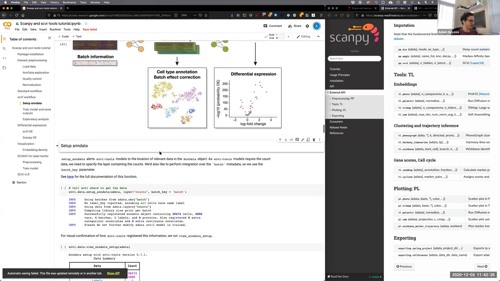

讲者特意强调这一步"让我少紧张一点"，因为这些登记信息一旦错了，后面训练出来的模型全是错的，而且不会报错。

## 二、训练目标：一个用神经网络参数化的贝叶斯生成模型

### 2.1 编码器把基因压成因子，解码器再把它还原

讲者对 scVI 的一句话概括是：**它是 PCA 的非线性替代品**。

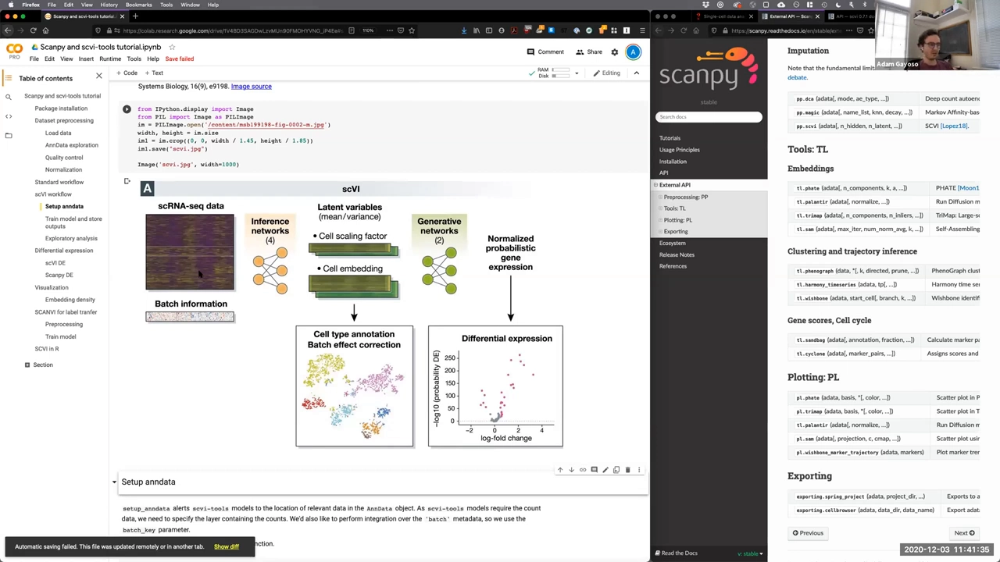

流程是：数据（基因×细胞）→ 神经网络编码成"因子×细胞"的低维矩阵 → 这个低维空间同时就是整合后的空间 → 另一侧把低维嵌入"吹回去"，重建数据。

[【跳转到 30:27】](https://www.youtube.com/watch?v=EKTg9NV5hEA&t=1827)

注意讲者的措辞：他说"我们**尝试**重建数据"（we try to blow it back up and reconstruct the data）。重建不是目的，重建是训练信号——只有重建得足够好，低维空间里才可能留下真实的生物变异。

### 2.2 训练目标就是让这个生成模型拟合数据

讲者没有推导公式，但他把关键的一句说清楚了：

> "scVI is a Bayesian model, so we can leverage the uncertainty over all these things."
> ——[【跳转到 31:17】](https://www.youtube.com/watch?v=EKTg9NV5hEA&t=1877)

这句话把 scVI 和 PCA 的区别讲透了：PCA 学的是**一个投影**，scVI 学的是**一个概率模型**。概率模型意味着每个待估的量都有分布，而不是一个点。

把前面几节的部件拼起来，scVI 的训练目标就是 3.1.4 里那个 ELBO 在计数数据上的具体形态：

$$
\mathcal{L} = \mathbb{E}_{q_\phi(z \mid x, s)}\left[\log p_\theta(x \mid z, s, \ell)\right] - \mathrm{KL}\left(q_\phi(z \mid x, s)\,\Vert\,p(z)\right)
$$

其中重建项 $p_\theta(x \mid z, s, \ell)$ 是负二项或零膨胀负二项（3.1.8），$s$ 是批次、$\ell$ 是文库大小，$q_\phi$ 是编码器输出的近似后验，$p(z)$ 是标准正态先验。第一项要求"从潜变量解码出来的计数分布要能解释观测计数"，第二项要求"编码器给出的后验不要离先验太远"。训练就是在最大化这个下界。

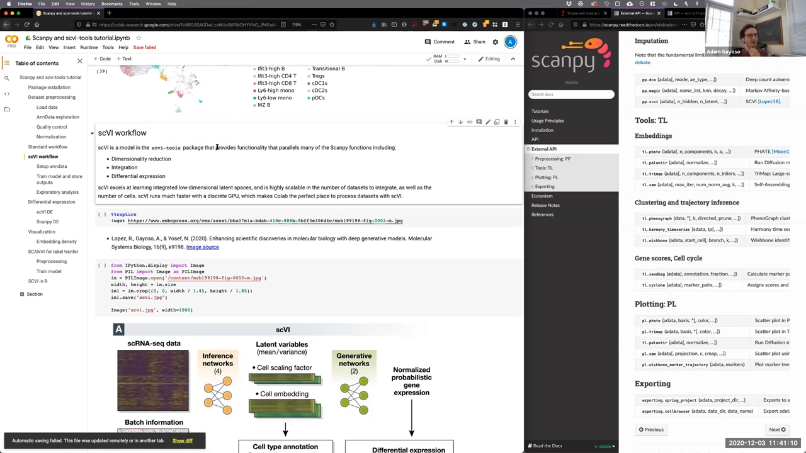

这张图把 ELBO 里的每一项都对应到了具体的网络：左侧的推断网络就是 $q_\phi(z \mid x, s)$，中间的"latent variables (mean/variance)"就是后验的两个参数，右侧的生成网络就是 $p_\theta(x \mid z, s, \ell)$。

模型卡片把这几件事写在一屏里：

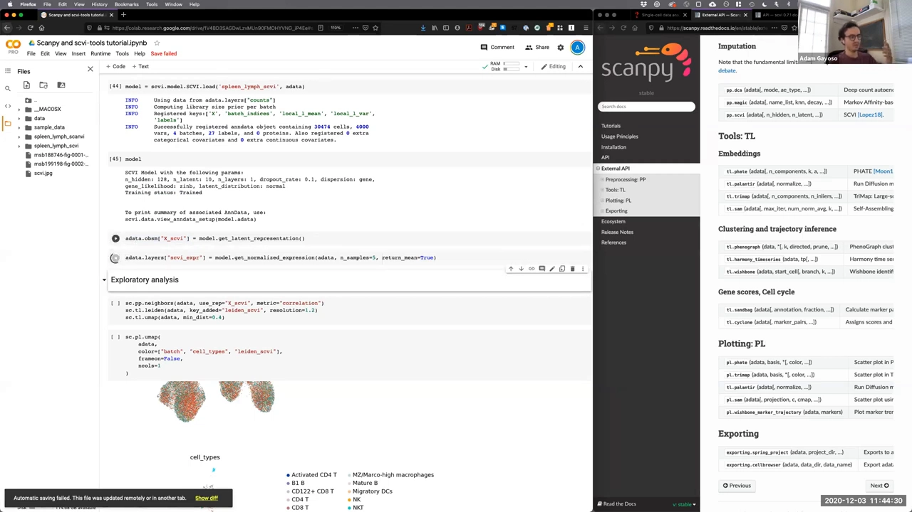

这张摘要值得逐行读：

- gene_likelihood 为 nb —— 重建项用的是负二项似然，不是高斯；
- `dispersion: gene` —— 每个基因一个离散度参数；
- latent_distribution 为 normal —— 后验取正态，所以编码器输出的是**均值与方差**两组数，而不是一个点；
- n_latent 取 10 —— 潜空间只有 10 维；
- `Training status: Trained` —— 模型对象自己记录训练状态。

[【跳转到 33:47】](https://www.youtube.com/watch?v=EKTg9NV5hEA&t=2027)

### 2.3 训练本身要花多久

讲者跳过了训练，直接加载预训练模型，理由是省时间：

> "I think this dataset would take on the order of 10 to 15 minutes on Colab."
> ——[【跳转到 32:32】](https://www.youtube.com/watch?v=EKTg9NV5hEA&t=1952)

三万细胞、四千基因、四个批次，在 Colab 的 GPU 上十几分钟。他还提到自己一开始就把运行时切成 GPU，因为"scvi-tools 的模型在有 GPU 时跑得快得多"。

[【跳转到 05:00】](https://www.youtube.com/watch?v=EKTg9NV5hEA&t=300)

训练接口本身极简：

```python
model = scvi.model.SCVI(adata, use_cuda=True)
model.train()
model.save("spleen_lymph_scvi", overwrite=True)
```

[【跳转到 32:57】](https://www.youtube.com/watch?v=EKTg9NV5hEA&t=1977)

三行：建模型、训练、存盘。讲者说这个接口"很像 scikit-learn"。默认超参就是上面那张卡片里的值，一般不需要动；真正需要想清楚的是前面的数据登记。

## 三、训练完的模型留下两类后验量

模型训练完，讲者只取了两样东西：

```python
adata.obsm["X_scvi"] = model.get_latent_representation()
adata.layers["scvi_exp"] = model.get_normalized_expression(adata, n_samples=5, return_mean=True)
```

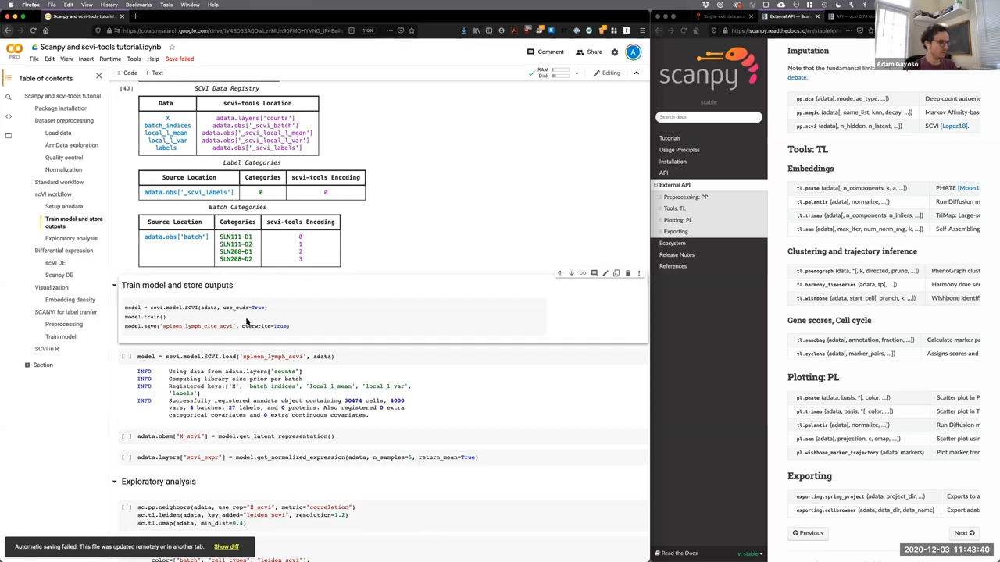

[【跳转到 33:47】](https://www.youtube.com/watch?v=EKTg9NV5hEA&t=2027)

第一行是潜变量表示，也就是大家熟悉的"scVI 嵌入"，用来算邻域图、做 UMAP、做 Leiden 聚类。这部分属于 3.2.1 的主题，这里不展开。

第二行才是本节的重点：**去噪表达（denoised expression）**。注意它的参数 n_samples 取 5——这不是取一个确定值，而是**从后验里采样 5 次再平均**。这个参数暴露了 scVI 输出的本质：它给的是分布，`get_normalized_expression` 只是把分布压成了一个数给你看。

讲者对这份去噪表达的态度非常克制：

> "There's a lot of literature now... whether people should be using these. This would also be called imputed data. We typically use it at this point just for visualizing data."
> ——[【跳转到 33:47】](https://www.youtube.com/watch?v=EKTg9NV5hEA&t=2027)

也就是说：**去噪表达默认只用来可视化**。它把采样噪声抹平了，看起来更"干净"，但抹平的过程也抹掉了真实的不确定性。把它当成真实测量值去做统计检验，等于把模型的假设当成了数据。

这里还有一个量纲陷阱，讲者在提问环节专门澄清：

> "The default output of the scVI expression is scaled to sum to one, and these were scaled to sum to 10000. There's an option in the function where you can scale these to 10000."
> ——[【跳转到 45:27】](https://www.youtube.com/watch?v=EKTg9NV5hEA&t=2727)

如果直接拿 scVI 表达和原始计数对比，会以为表达量掉了一两个数量级；其实只是归一化的目标总和不同（1 对 10000）。这类"看起来像 bug 的差异"在跨工具比较时非常常见。

## 四、后验的第一个用途：给每个组、每个基因一个表达分布

讲者用一张示意图解释差异表达（DE）在 scVI 里到底算什么：

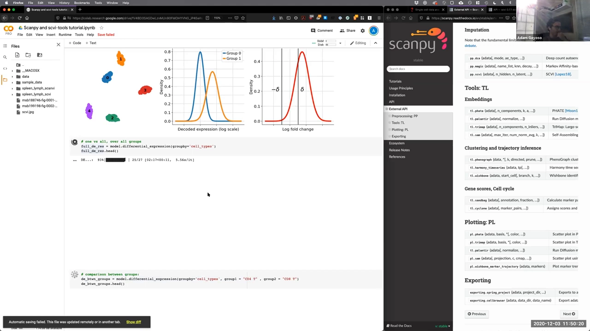

> "What scVI does is it gives you a distribution over this sort of denoised expression. For example, in group one, the expression of gene CD4 has followed this distribution, and CD4 in group zero follows this distribution."
> ——[【跳转到 36:17】](https://www.youtube.com/watch?v=EKTg9NV5hEA&t=2177)

这是和传统 DE 最本质的区别。`t-test` 或 Wilcoxon 检验拿到的是每个组每个基因的**一堆观测值**，然后假设某个分布去算检验统计量；scVI 直接给出每个组每个基因表达值的**后验分布**——一条曲线，不是一个均值。

有了两条曲线，就可以问一个比 p 值更直接的问题：这两条曲线的差，落在零附近的概率有多大？

## 五、后验的第二个用途：把"有没有差异"变成概率

### 5.1 假设与判定规则

讲者把 scVI 的 DE 判定写成两个假设：

- $M_1^g$：$f(h_{g1}, h_{g2}) > \delta$，即两个组的表达差异超过阈值 $\delta$；
- $M_2^g$：$f(h_{g1}, h_{g2}) \le \delta$，即差异不超过阈值。

其中 $f$ 是对数倍数变化，$\delta$ 是效应量阈值，文档里写作 user-defined effect size threshold——由使用者自己设定，不是一个固定的统计量。

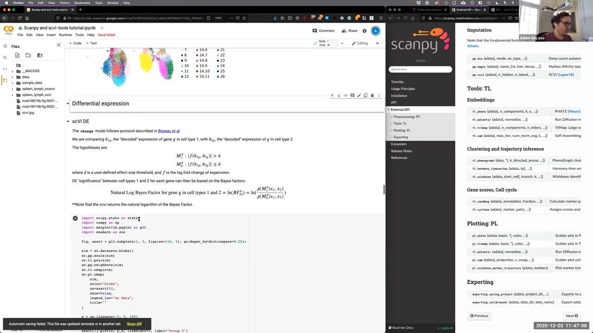

判定靠的是**贝叶斯因子**：两个假设下数据的边际似然之比，取对数后就是 `bayes_factor` 这一列。

[【跳转到 36:42】](https://www.youtube.com/watch?v=EKTg9NV5hEA&t=2202)

### 5.2 概率是采样算出来的

关键的一句话：

> "We compute this using Monte Carlo samples."
> ——[【跳转到 36:42】](https://www.youtube.com/watch?v=EKTg9NV5hEA&t=2202)

具体做法是：从后验里反复采样两个组的表达值，每次算一个对数倍数变化，得到一条 $\log\text{FC}$ 的分布；然后数一数这条分布里落在 $[-\delta, \delta]$ 之外的比例。这个比例就是 `proba_de`——"该基因差异表达"的后验概率。

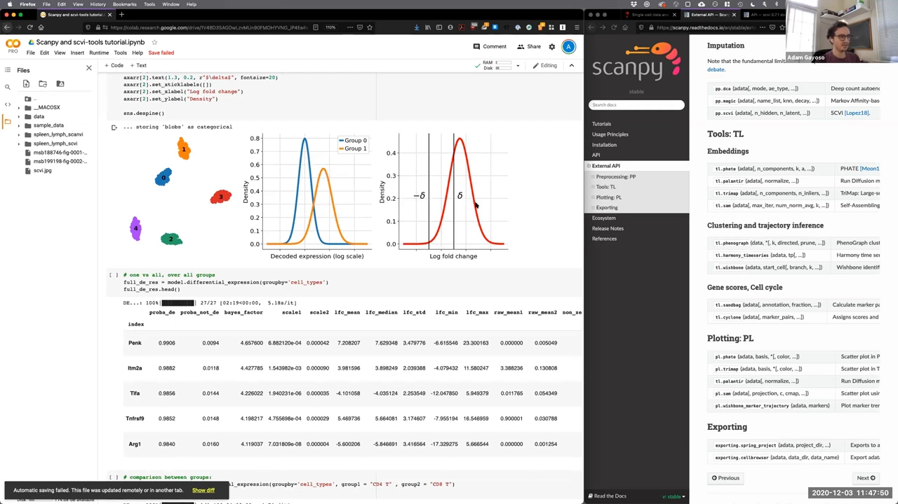

这张图把"概率"的几何含义讲清楚了：**概率就是面积**。曲线越窄（不确定性越小）、离零越远，落在 $\pm\delta$ 之外的面积就越大。

### 5.3 输出表里每一列是什么

调用一次 differential_expression（groupby 设为 cell_types），得到的是一张很长的表，每个"组 vs 其余"的比较各占一段。

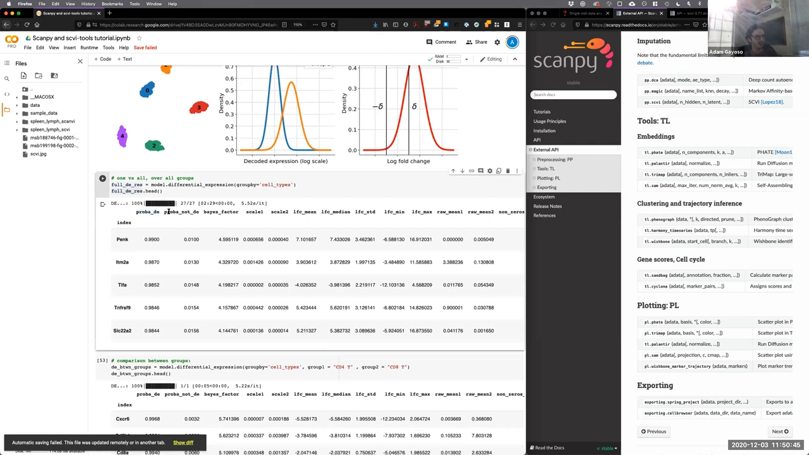

讲者逐列解释（[【跳转到 39:37】](https://www.youtube.com/watch?v=EKTg9NV5hEA&t=2377)、[【跳转到 40:02】](https://www.youtube.com/watch?v=EKTg9NV5hEA&t=2402)）：

- `proba_de` / `proba_not_de`：两个假设的后验概率，两者互补；
- `bayes_factor`：两个假设的对数几率（log odds）；
- `scale1` / `scale2`：两个组的去噪表达水平；
- `lfc_mean`、`lfc_median`、`lfc_std`、`lfc_min`、`lfc_max`：**对数倍数变化分布的摘要统计量**——不是单个值，而是一条分布的均值、中位数、标准差和极值；
- `raw_mean1` / `raw_mean2`：原始计数的均值；
- 非零细胞数与比例：有多少细胞真的测到了这个基因；
- 文库大小归一化后的表达。

一张表里同时有"模型认为的效应"和"数据里实际测到的东西"，这是 scVI DE 输出最实用的地方：你可以用后者的稀疏程度去校验前者的可信度。

## 六、后验的第三个用途：one-vs-all 排序与不确定性的保留

`differential_expression` 支持两种用法（[【跳转到 37:07】](https://www.youtube.com/watch?v=EKTg9NV5hEA&t=2227)）：

1. **one-vs-all**：指定 groupby 设为 cell_types，函数自动把每个细胞类型和其余所有细胞比一遍，一次拿到全部类型的 marker；
2. **两组对比**：指定 `group1` 与 `group2`，比如 `"CD4 T"` 对 `"CD8 T"`。

讲者还顺手对比了 Scanpy 自己的 DE：`rank_genes_groups` 给出 t 检验统计量、对数倍数变化和 FDR 校正后的 p 值。两套结果放在一起看，差别在于 scVI 那边多了一列"这个结论有多确定"。

[【跳转到 38:47】](https://www.youtube.com/watch?v=EKTg9NV5hEA&t=2327)

拿到这张长表之后，讲者的筛选方式是：按 `lfc_mean` 排序、按 `bayes_factor` 卡阈值、再按非零比例过滤掉太稀疏的基因。

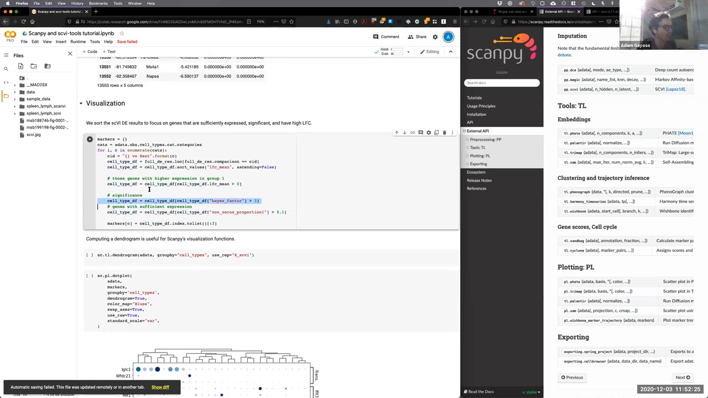

[【跳转到 41:42】](https://www.youtube.com/watch?v=EKTg9NV5hEA&t=2502)

## 七、读这些输出时的四个陷阱

### 7.1 p 值几乎没有意义：你在用同一份数据挑基因又检验基因

讲者说得毫不含糊：

> "The p-values are kind of almost meaningless because you're double dipping with the data... but the ranks should be fine."
> ——[【跳转到 41:17】](https://www.youtube.com/watch?v=EKTg9NV5hEA&t=2477)

原因很朴素：先聚类、再在同一个聚类结果上做 DE，等于用同一份数据既定义了组、又检验了组间的差异（double dipping）。所以他把 p 值降级为"参考"，把**排序**当成主要产物。这一点在 3.2.3 讨论统计单位时会再展开。

### 7.2 点图上的"零"可能只是采样噪声

dot plot 的圆点大小表示该组中非零表达细胞的比例，颜色表示表达高低。但讲者提醒：一个点很小，可能只是因为这个基因本身表达低、采样噪声大，于是观察到很多零。

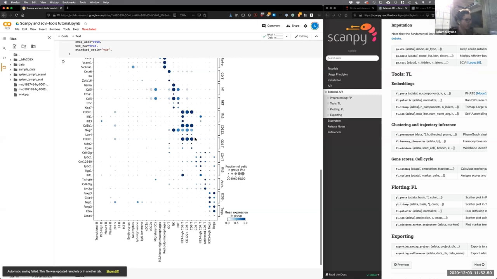

[【跳转到 41:42】](https://www.youtube.com/watch?v=EKTg9NV5hEA&t=2502)

### 7.3 热图比点图更忠实

被问到"点图和热图更信哪个"时，讲者选了热图：

> "A dot might be small just because it's a lowly expressed gene and you have a lot of sampling noise... the matrix plot or a heat map is maybe a little bit more faithful to that property of the data."
> ——[【跳转到 44:24】](https://www.youtube.com/watch?v=EKTg9NV5hEA&t=2664)

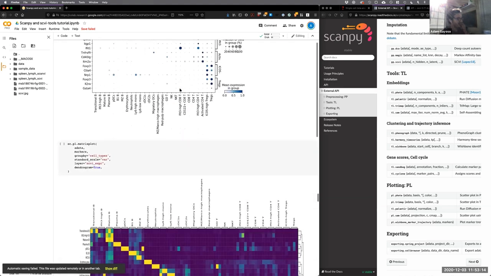

[【跳转到 42:31】](https://www.youtube.com/watch?v=EKTg9NV5hEA&t=2551)

### 7.4 去噪表达可以画图，但别拿去做别的

把去噪表达贴到 UMAP 上，确实比原始表达更好看：

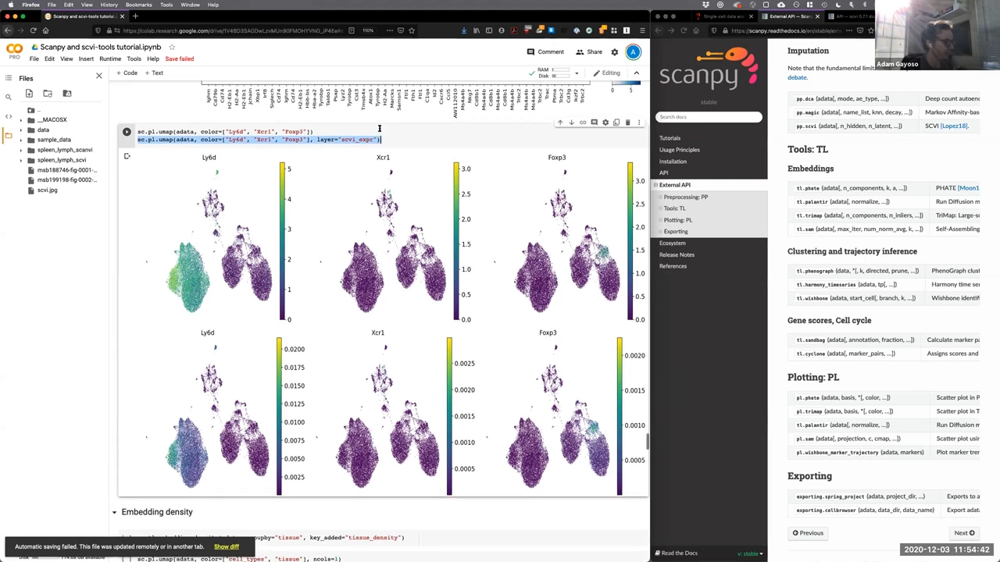

但讲者的结论只有一句：**用于可视化可以，用于其他任务要小心**（[【跳转到 44:24】](https://www.youtube.com/watch?v=EKTg9NV5hEA&t=2664)）。因为去噪表达是模型的后验期望，它已经包含了模型对数据的全部假设；用它再做一次统计，等于在假设之上再叠一层假设。

## 八、后验到底改变了什么

回到开头的问题：scVI 训练完之后留下了什么？

| 你想要的输出 | 传统流程给什么 | scVI 给什么 |
| --- | --- | --- |
| 细胞的低维坐标 | PCA 得分，一个点 | 潜变量后验，一个分布，取均值才是点 |
| 细胞的表达值 | 观测计数或归一化值 | 去噪表达的后验，可采样多次 |
| 两个组是否有差异 | 检验统计量与 p 值 | 对数倍数变化的后验分布，以及落在 $\pm\delta$ 之外的概率 |
| 结论有多确定 | 需要额外的置信区间 | 直接写在 `proba_de`、`lfc_std` 里 |

这张表也解释了为什么讲者反复强调"scVI 是贝叶斯模型"：**它的输出不是数，是分布；取均值只是把分布压成数的一种选择**。n_samples 取 5 这个参数、`lfc_std` 这一列、`proba_de` 这个概率，都是同一个事实的不同侧面。

理解了这一点，才不会把 scVI 当成"更高级的 PCA"来用，也才不会把去噪表达当成真实测量值。

## 小结

- scVI 训练前必须做数据登记：**计数放进 layer，批次键指给模型**，批次会被编码成整数。
- scVI 是一个**用神经网络参数化的贝叶斯生成模型**：编码器给出潜变量后验（均值与方差），解码器用负二项似然重建计数；训练目标就是 3.1.4 的 ELBO 在这个模型上的具体形态。
- 模型卡片上的 gene_likelihood 为 nb、`dispersion: gene`、latent_distribution 为 normal 决定了后验的形状——后验是正态，所以编码器输出的是两组数。
- 训练完的模型留下两类后验量：**潜变量表示**与**去噪表达**；后者用 n_samples 取 5 采样得到，默认只用于可视化。
- 差异表达在 scVI 里是**后验概率**：比较两个假设 $M_1^g$ 与 $M_2^g$，用蒙特卡洛采样估计对数倍数变化落在 $\pm\delta$ 之外的比例，这个比例就是 `proba_de`。
- 输出表里的 `lfc_std`、`lfc_min`、`lfc_max` 是分布的摘要，不是单点估计；`bayes_factor` 是两个假设的对数几率。
- 四个陷阱：p 值因 double dipping 而几乎无意义（排序仍可用）、点图的零可能是采样噪声、热图比点图更忠实、去噪表达别拿去做二次统计。
- 量纲要对齐：scVI 表达默认缩放到和为 1，原始计数常缩放到 10000，差一两个数量级不是 bug。

## 关键术语速查

| 术语 | 一句话解释 |
| --- | --- |
| setup_anndata | 告诉 scVI 计数在哪一层、批次在哪一列；登记错了后面全错 |
| 近似后验 $q_\phi(z \mid x, s)$ | 编码器输出的分布，用均值和方差两个向量参数化，不是一个点 |
| 去噪表达（denoised expression） | 从后验采样得到的表达值，抹平了采样噪声，默认只用于可视化 |
| n_samples | 采样次数；采样多次再平均，说明输出本来是分布 |
| 对数倍数变化后验 | 两个组表达差异的分布，用蒙特卡洛采样得到 |
| proba_de | 对数倍数变化落在 $\pm\delta$ 之外的后验概率，即"该基因差异表达"的概率 |
| bayes_factor | 两个假设的对数几率，越大越支持"有差异" |
| double dipping | 用同一份数据既定义分组又检验分组，导致 p 值失真 |
| gene_likelihood | 重建项用的似然，`nb` 表示负二项 |
| latent_distribution | 潜变量的后验分布形式，`normal` 表示正态，编码器因此输出均值与方差 |