# 从潜表示到邻域图：scVI 嵌入取出来之后怎么用

> 视频来源：[Single-cell data analysis with Scanpy and scvi-tools](https://www.youtube.com/watch?v=EKTg9NV5hEA)（YouTube · CompBio Skills Seminar UC Berkeley · 讲者 Adam Gayoso，Yosef 实验室）｜时长约 54 分钟
> 简要导读：一支从 AnnData 对象讲到 scVI 的完整实操，数据是脾脏与淋巴结的 CITE-seq（30474 个细胞、约 13000 个基因、4 个批次）。本文只取后半段：从 PCA 到 scVI 潜表示、邻域图、UMAP、Leiden 聚类与差异表达，重点回答"嵌入怎么取、取到的是什么、取出来之后接哪几步、哪些地方不能当 PCA 用"。前半段的质控、归一化与高变基因选择只作背景提及。

## 本讲要解决的核心问题（SCQA）

**背景**：单细胞分析的标准流水线里，PCA 把每个细胞压成几十个主成分分数，存进 `adata.obsm`；邻域图、UMAP、Leiden 聚类都从这份坐标出发。这套流程人人都在用。

**冲突**：PCA 是线性的，而批次差异会直接写进前几个主成分。讲者在 UMAP 上按批次上色时，四个 10x 通道清清楚楚地分开，而且"隔天的差异比同一天两个通道的差异更大" [【跳转到 27:52】](https://www.youtube.com/watch?v=EKTg9NV5hEA&t=1672)。scVI 号称能给出"批次校正后的潜空间"，还能当 PCA 的替代品——可这个潜空间到底以什么形式交到你手里？

**疑问**：scVI 的细胞表示怎么取出来？取到的是一个点还是一个分布？取出来之后要接哪几步才能画 UMAP、做聚类？哪些下游分析可以直接用它，哪些不能？

**回答（中心思想）**：get_latent_representation() 交给你的是**每个细胞一行向量**——一个确定性的嵌入点，写进 `obsm` 之后，邻域图、UMAP、Leiden 的代码与 PCA 流程完全同构，只是把 use_rep 换成 X_scvi、把距离换成相关距离。但这份坐标**只能整体当"细胞状态的位置"用，不能逐维解释**；凡是要谈不确定性的地方（差异表达），scVI 走的是另一条路——从后验分布里采样，而不是读这个点。

---

## 一、PCA 那条流水线：obsm 里存的是坐标，不是基因

### 1.1 从 4000 个高变基因压到几十维

讲者的数据在质控、归一化、高变基因选择之后剩下 30474 个细胞 × 4000 个基因。即便如此，直接用 4000 维算距离仍然吃力，而且基因高度共调控——"我大概可以用少得多的维度解释数据里的大部分变异" [【跳转到 24:57】](https://www.youtube.com/watch?v=EKTg9NV5hEA&t=1497)。于是先 `scale` 让每个基因权重相同（否则 PCA 会偏向高表达基因），再跑 PCA。

跑完 PCA 之后最关键的一件事是**结果存在哪里**：

```python
# 输出存在 obsm 里，和 X 一样按细胞对齐
adata.obsm["X_pca"]   # 30474 行 × 50 列
```

`obsm` 是 AnnData 里专门存放"行数与细胞数相同"的矩阵的地方，可以塞任意多个，各起一个名字。讲者强调这一点，是因为后面 scVI 的潜表示要放进同一个抽屉里 [【跳转到 26:12】](https://www.youtube.com/watch?v=EKTg9NV5hEA&t=1572)。

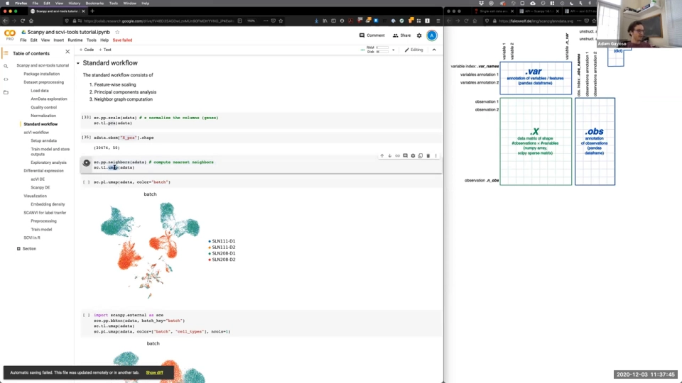

### 1.2 邻域图和 UMAP 都只是"消费"这份坐标

`sc.pp.neighbors` 默认拿 X_pca 算细胞之间的近邻关系（近似最近邻，实现来自 UMAP 包），默认距离是欧氏距离；`sc.tl.umap` 再把这份高维关系压成两维，同样存进 `obsm`。也就是说，**UMAP 不是一种新的测量，它只是把邻域图铺平到纸面上**。

### 1.3 批次差异会直接出现在 UMAP 上

按批次给 UMAP 上色，四个通道分得很开：同一天的两个通道（SLN111-01 / SLN112-02）挨得近，隔天的两批（SLN208-01 / SLN208-02）离得远。按作者原来注释的细胞类型上色，则能看到类型结构确实存在，只是被批次位移搅在一起 [【跳转到 28:17】](https://www.youtube.com/watch?v=EKTg9NV5hEA&t=1697)。

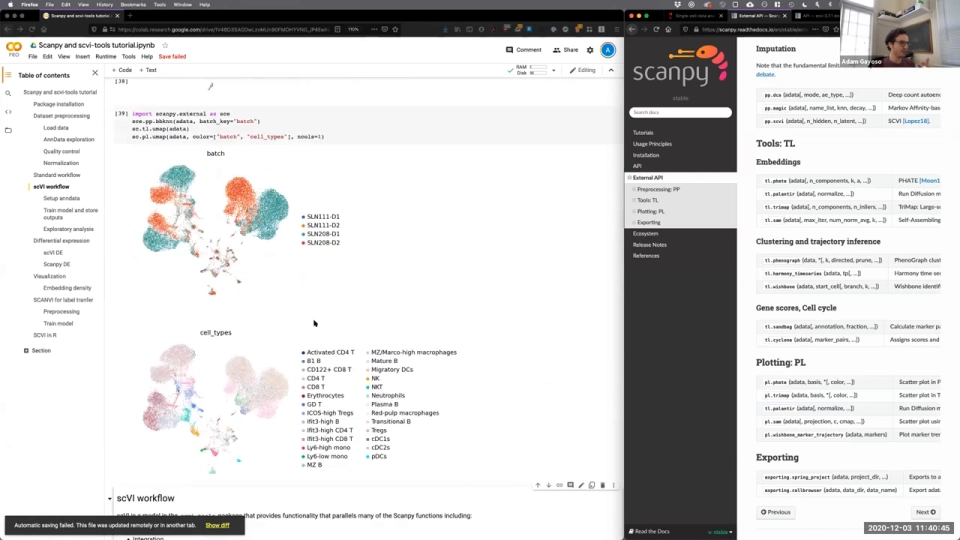

讲者顺手试了 BBKNN 做整合，效果不理想——批次没有真正混开。他补了一句很实在的话：BBKNN 在那篇基准评测里得分其实不错，所以问题可能出在这份数据上，"有时候换一两个方法在你自己数据上试试是值得的" [【跳转到 30:02】](https://www.youtube.com/watch?v=EKTg9NV5hEA&t=1802)。这就是转向 scVI 的动机。

## 二、scVI 是 PCA 的非线性替代：降维和整合一次做完

### 2.1 编码器把基因压成 factors，解码器再重建回去

讲者对 scVI 的定位说得非常克制：**"可以把它看成 PCA 的非线性替代品"**——数据是基因 × 细胞，用一个神经网络编码成 factors × 细胞，这个低维矩阵同时就是整合后的空间；另一侧再把低维嵌入"吹回"去重建数据。因为是贝叶斯模型，它还能利用不确定性来判断一个基因在两组细胞之间是否差异表达 [【跳转到 30:27】](https://www.youtube.com/watch?v=EKTg9NV5hEA&t=1827)。

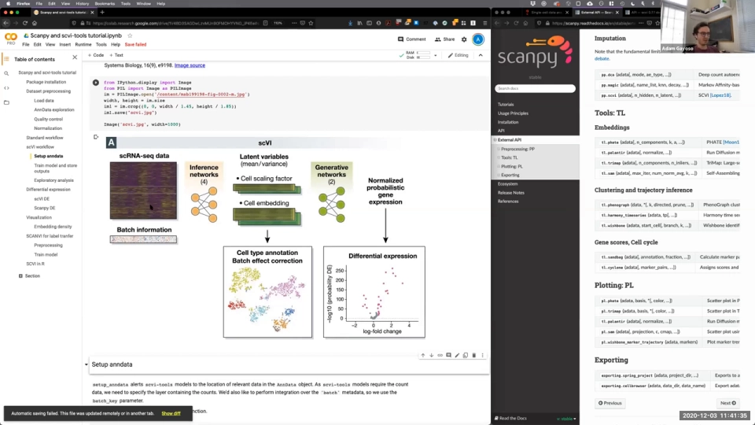

这张图里最该记住的是中间那个方块：**潜变量（cell embedding）**。左边是"从数据推断它"，右边是"用它生成数据"，而本文关心的是——怎么把它取出来。

### 2.2 setup_anndata：先告诉模型哪一层是计数、哪一列是批次

scVI 不会猜你的数据结构，必须显式点名：

```python
scvi.model.SCVI.setup_anndata(adata, layer="counts", batch_key="batch")
```

`layer="counts"` 指定原始计数存在哪一层（前面归一化之前抄出来的那份），batch_key="batch" 指定批次信息在 `obs` 的哪一列。view_setup_anndata(adata) 会把登记结果打出来：数据位置 `X`、层 `counts`、标签 `batch`，以及批次类别被编码成的整数 0、1、2、3——模型内部只认整数 [【跳转到 31:17】](https://www.youtube.com/watch?v=EKTg9NV5hEA&t=1877)。

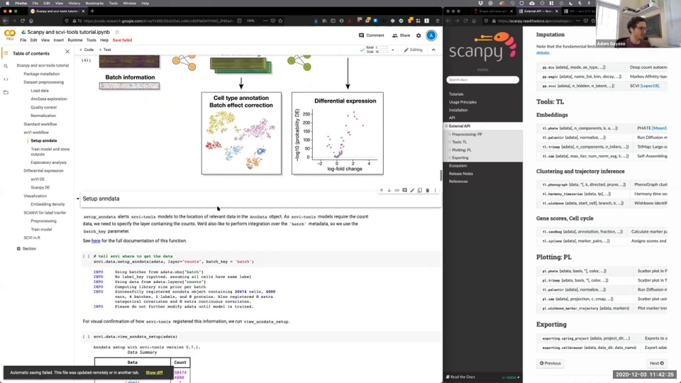

### 2.3 训练接口像 scikit-learn

```python
model = scvi.model.SCVI(adata)
model.train()
```

讲者的评价是"到这一步接口和 scikit-learn 很像"。这份数据在 Colab 上训练大约 10 到 15 分钟，为了节省时间他直接加载了预训练模型 [【跳转到 32:32】](https://www.youtube.com/watch?v=EKTg9NV5hEA&t=1952)。

## 三、取表示：一行代码，拿到的是后验均值

### 3.1 写进 obsm，和 PCA 放在同一个抽屉

```python
adata.obsm["X_scvi"] = model.get_latent_representation()
```

讲者的原话是：把"批次校正后的整合潜空间"取出来，像 PCA 那样存回 AnnData 对象 [【跳转到 32:57】](https://www.youtube.com/watch?v=EKTg9NV5hEA&t=1977)。同一段代码里他还取了另一份东西：

```python
adata.layers["scvi_denoised"] = model.get_normalized_expression(
    adata, n_samples=1, return_mean=True
)
```

这就是文献里常说的"去噪表达"或"填补（imputed）表达"。他的态度很明确：这类值**通常只用来做可视化**，用不用、怎么用有一批专门讨论的文献 [【跳转到 33:22】](https://www.youtube.com/watch?v=EKTg9NV5hEA&t=2002)。

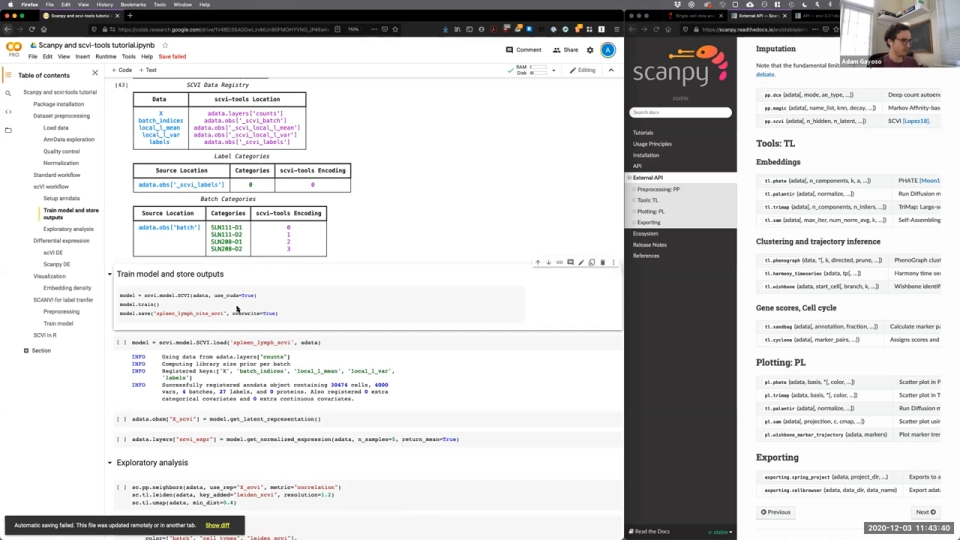

### 3.2 为什么说它是"均值"

VAE 的编码器对每个细胞输出的不是一个点，而是一个分布的参数——均值与方差；真正喂给解码器的是从这个分布里抽出来的样本。那么"取表示"时该拿什么？最常用的选择就是**取均值**：

$$
\hat{z}_n = \mathbb{E}_{q_\phi(z \mid x_n)}\left[z\right]
$$

均值是这条分布的中心，**同一个细胞、同一个模型、同一份输入，算多少次都是同一个向量**——这正是"确定性嵌入"的含义。它适合当坐标用：聚类、邻域图、UMAP 都需要一个固定的位置，如果每个细胞每次的位置都抖一下，图就没法复现了。

### 3.3 采样是另一条路：同一个细胞每次都不一样

与均值相对的是**从后验里抽一个样本**：

$$
\tilde{z}_n \sim q_\phi(z \mid x_n), \qquad \tilde{z}_n = \mu_\phi(x_n) + \sigma_\phi(x_n) \odot \epsilon, \quad \epsilon \sim \mathcal{N}(0, I)
$$

同一个细胞抽两次会得到两个不同的向量（差别由方差决定）。这条路径不用于画 UMAP，而用于**需要传播不确定性的计算**。

这支视频里，两条路径的分工其实演示得很清楚：

| 用途 | 用的是哪个量 | 视频里的位置 |
| --- | --- | --- |
| 邻域图、UMAP、Leiden | 一次算出的嵌入（后验均值） | 32:57 起 |
| 差异表达的后验概率 | 从后验分布里抽的蒙特卡洛样本 | 36:42 起 |

讲者在讲 DE 时说的是：这个后验概率"是用蒙特卡洛样本算出来的" [【跳转到 36:42】](https://www.youtube.com/watch?v=EKTg9NV5hEA&t=2202)；紧接着一句是"因为 scVI 是贝叶斯方法，我们可以推断出两组细胞之间某个基因 log 倍数变化的后验分布" [【跳转到 37:07】](https://www.youtube.com/watch?v=EKTg9NV5hEA&t=2227)。换句话说，**嵌入提取和采样不是同一件事**：前者把分布压成一个点，后者保留分布的宽度。scvi-tools 也提供直接采样的接口（例如从后验抽潜变量的 sample_from_posterior_z），但在做聚类与可视化时，大家默认用的仍是均值——因为要的是一张稳定的地图，而不是一堆略有差异的地图。

> 补充说明：视频演示的是"取嵌入"与"DE 用蒙特卡洛样本"这两处；sample_from_posterior_z 这类采样接口属于 scvi-tools 的模型 API，视频没有逐行演示，这里只点出它与均值的关系，不展开用法。

## 四、接上下游：邻域图、UMAP、Leiden 与再聚类

### 4.1 只改两个参数：use_rep 与距离

```python
sc.pp.neighbors(adata, use_rep="X_scvi", metric="correlation")
sc.tl.leiden(adata)
sc.tl.umap(adata)
```

和 PCA 版本相比只有两处不同：**用哪份坐标**（use_rep="X_scvi"）和**用什么距离**（`metric="correlation"`，相关距离）。讲者没有解释为什么换成相关距离，只是说"我要用另一个距离度量" [【跳转到 33:47】](https://www.youtube.com/watch?v=EKTg9NV5hEA&t=2027)。相关距离衡量的是两个向量形状是否同向，而不是绝对长度：

$$
d_{\text{corr}}(z_i, z_j) = 1 - \frac{\sum_k (z_{ik} - \bar z_i)(z_{jk} - \bar z_j)}{\sqrt{\sum_k (z_{ik} - \bar z_i)^2}\sqrt{\sum_k (z_{jk} - \bar z_j)^2}}
$$

对潜空间来说这有直觉上的理由：嵌入向量的**方向**编码细胞状态，整体缩放未必有生物学意义。

### 4.2 批次混开了，聚类和独立注释对得上

换成 scVI 潜空间之后，同一张 UMAP 上批次已经混在一起，而细胞类型的结构保留了下来。讲者特意说明：这些细胞类型标签来自他们论文里一次**独立分析**（当时用的不是 scVI），所以"看起来它做得挺合理"——聚类结果与那套标签大体吻合 [【跳转到 34:37】](https://www.youtube.com/watch?v=EKTg9NV5hEA&t=2077)。

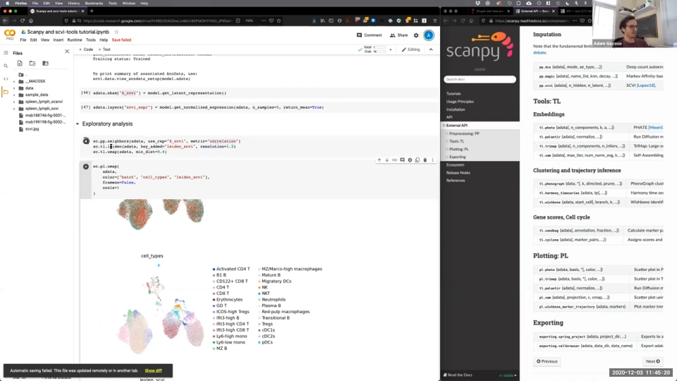

### 4.3 再聚类可以，但要克制

Scanpy 允许只对某个 cluster 重新聚类。讲者对 myeloid 亚群（cluster 14）单独跑了一次 Leiden，果然又分出更多小簇 [【跳转到 35:27】](https://www.youtube.com/watch?v=EKTg9NV5hEA&t=2127)。紧接着是一句提醒：**"你可以任意地一直再聚类下去，我确信你总能找到点什么，但它有没有意义，得由你自己判断"**。判断的办法通常是差异表达。

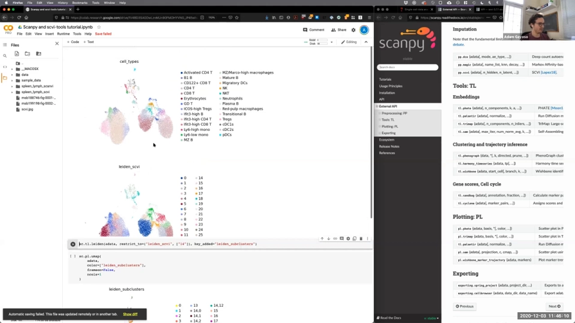

## 五、潜空间能拿来干什么：聚类、可视化、DE 输入、标签迁移

### 5.1 聚类与可视化

这是最直接的用途：潜空间就是一张"细胞状态的地图"，邻域图、UMAP、Leiden 都在这张地图上做。讲者反复强调潜空间是"批次校正后的整合空间"，所以不同实验、不同实验室、甚至不同物种的数据可以放在同一张图上比较。

### 5.2 DE 的输入不是坐标，而是后验分布

差异表达是 scVI 的另一条输出路径。讲者给了一个很清楚的图像：对某个基因，两组细胞各自有一个**去噪表达的概率分布**；模型能算出"两组之间 log 倍数变化落在 $[-\delta, \delta]$ 之外"的后验概率，这个概率用蒙特卡洛样本估计：

$$
P\left(\left\lvert \log_2 \mathrm{FC}_g \right\rvert > \delta \;\middle\vert\; \text{data}\right)
$$

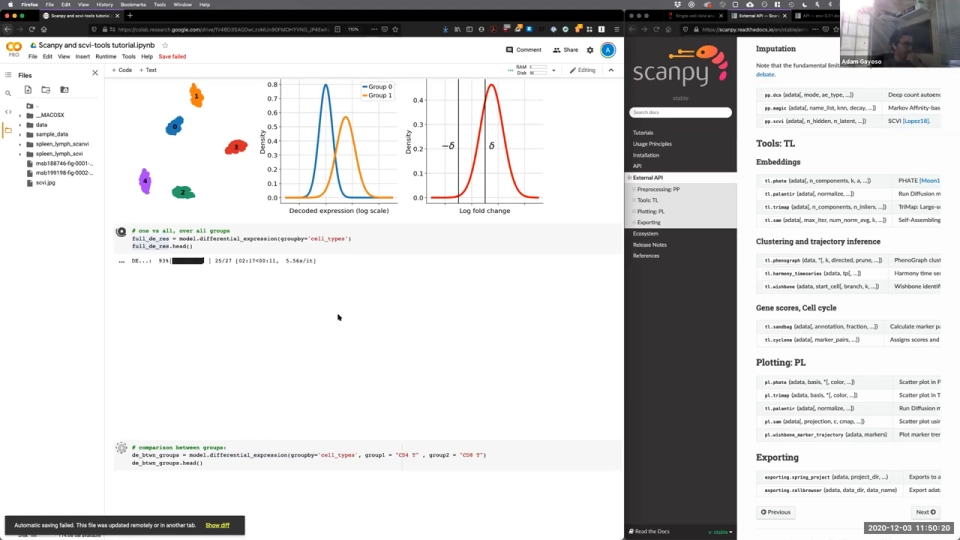

输出的表格里除了"差异表达概率""非差异表达概率"，还有两者的对数几率（贝叶斯因子）、两组去噪表达的均值、log 倍数变化分布的均值/中位数/标准差/极值、原始计数均值、非零细胞数、文库大小归一化后的表达等 [【跳转到 39:37】](https://www.youtube.com/watch?v=EKTg9NV5hEA&t=2377)。它支持 one-vs-all（一个细胞类型对其余所有），也支持指定两组做比较。

讲者还顺手做了一个重要的对照：用 Scanpy 自己的 t 检验做同样的 one-vs-all，然后指出"这些 p 值几乎没有意义，因为你是在同一份数据上先聚类再检验（double dipping）"，但**排名的顺序还是可以用的** [【跳转到 41:17】](https://www.youtube.com/watch?v=EKTg9NV5hEA&t=2477)。这段细节属于 3.2.3 的主题，这里只留一句：DE 的可信度来自模型对不确定性的处理，而不是来自坐标本身。

### 5.3 去噪表达只适合"看"

拿到 DE 结果之后，讲者用点图（dot plot）展示每个细胞类型的标志基因：圆点大小表示该组中非零表达细胞的比例，颜色深浅表示表达高低 [【跳转到 42:07】](https://www.youtube.com/watch?v=EKTg9NV5hEA&t=2527)。这些图可以直接画在 scvi_denoised 这一层上。

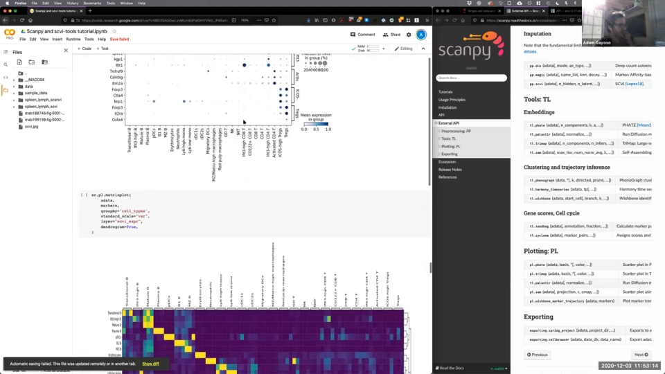

被问到「点图和热图更信哪个」时，讲者的回答很实用：点图里一个点小，可能只是因为该基因本身低表达、观测到大量零，而热图（matrix plot）更忠实于这种「零也是信息」的性质 [【跳转到 44:24】](https://www.youtube.com/watch?v=EKTg9NV5hEA&t=2664)。

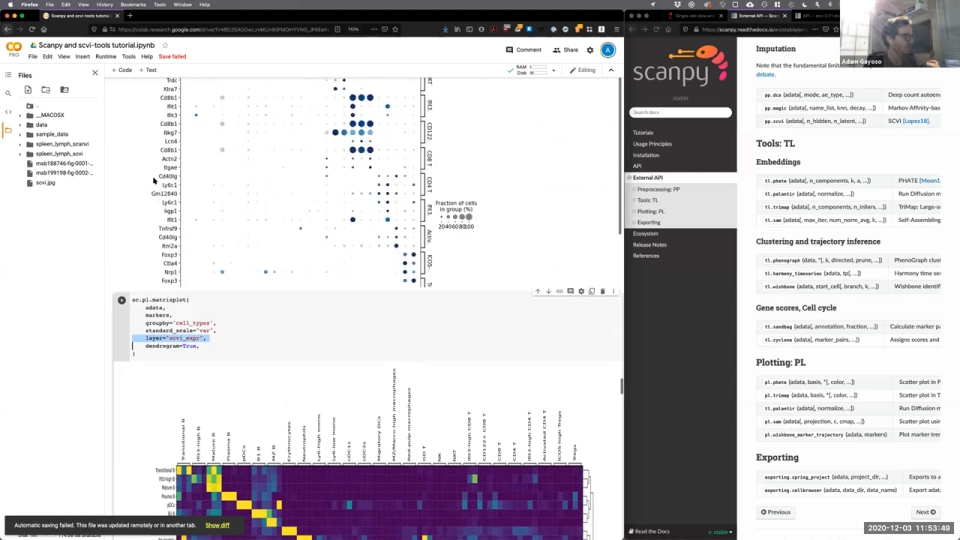

但他对"去噪值能不能当测量值用"划了很清楚的界线：**"拿这些填补值做可视化大概是最合适的用法，用在其他任务上我会很小心"** [【跳转到 43:59】](https://www.youtube.com/watch?v=EKTg9NV5hEA&t=2639)。还有一个实操细节：get_normalized_expression 默认把每个细胞缩放到总和为 1，所以数值看起来比原始计数小一两个数量级；函数里有选项可以缩放到 10000 [【跳转到 45:25】](https://www.youtube.com/watch?v=EKTg9NV5hEA&t=2725)。

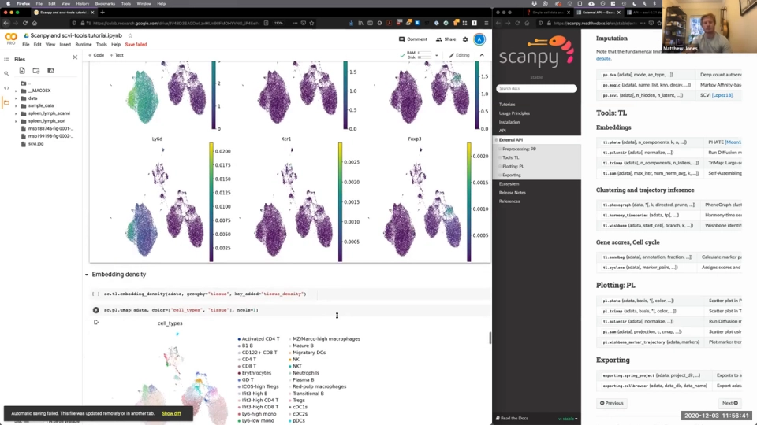

### 5.4 scANVI：把潜表示接到标签迁移上

最后三分钟讲的是 scANVI。场景很具体：你已经把一批数据注释好了，合作者又送来一批没注释的样本。做法是把两份数据拼在一起，告诉模型哪些细胞有标签、哪些没有，然后让它自动给没标签的细胞打标签 [【跳转到 47:23】](https://www.youtube.com/watch?v=EKTg9NV5hEA&t=2843)。

讲者把数据一半当无标签来验证：大多数类型对得上，只有一个类型（浆细胞 B）只有 9 个细胞，模型很难预测出来。混淆矩阵的对角线基本干净 [【跳转到 48:24】](https://www.youtube.com/watch?v=EKTg9NV5hEA&t=2904)。被问到"遇到训练集里没有的新细胞类型怎么办"，他的回答是：大概会表现为各类预测概率上的高熵，可以据此察觉"这个细胞有点不一样"。

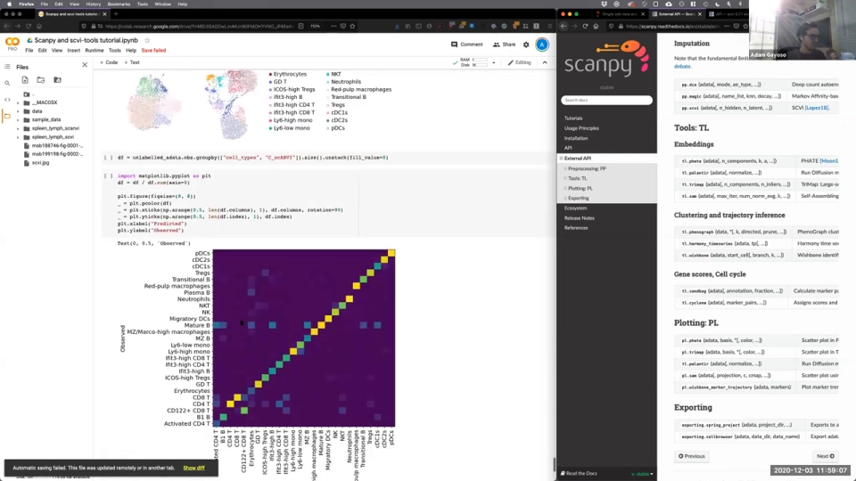

## 六、潜空间的维度不能逐个解释

### 6.1 n_latent 是超参数，不是"第 1 维 = 细胞周期"

视频里没有直接调 n_latent，但它在讲 PCA 时给出了同类推理：4000 个基因高度共调控，"我大概可以用少得多的维度解释大部分变异"，于是取 30 维（PCA 存了 50 维）[【跳转到 25:22】](https://www.youtube.com/watch?v=EKTg9NV5hEA&t=1522)。scVI 的 n_latent 是同一类选择：**它决定这张地图有多少个坐标轴，而不是每个轴对应什么生物学过程**。

### 6.2 与 PCA 的对照：一个有载荷，一个没有

PCA 的每个主成分都能回溯到基因：第一主成分 = 一组基因的加权和，权重（载荷）可以画出来、可以解释"这个轴偏向哪类基因"。scVI 的潜空间没有这个性质：它是编码器在重建损失与先验约束下自己组织出来的坐标，维度之间可以任意旋转、混叠，**单个维度通常不对应任何可命名的生物学量**。讲者只说它是"factors × cells"的低维矩阵，从没把某一维叫作某个生物过程 [【跳转到 30:52】](https://www.youtube.com/watch?v=EKTg9NV5hEA&t=1852)。

### 6.3 判读规则

由此可以落成三条实操规则：

1. **整体用，不逐维读**：把一行向量当作"这个细胞在地图上的位置"，用距离、邻域、聚类去解读，不要问"第 3 维高说明什么"。
2. **坐标的稳定性来自均值**：要复现的图（UMAP、聚类）用后验均值；要谈不确定性的量（DE、生成）才采样。
3. **地图不是结论**：再聚类总能分出东西，批次混匀也不等于生物学正确——最终仍要靠独立注释、标志基因和差异表达来核对。

## 小结

- PCA 把细胞压成几十维存进 `obsm`，邻域图、UMAP、Leiden 都只是消费这份坐标；批次差异会直接写进这份坐标里。
- scVI 可以当作 PCA 的非线性替代：编码器给出低维 factors，解码器重建计数，同时把批次作为条件处理掉。
- get_latent_representation() 取到的是**后验均值**——一个确定性的嵌入点，写进 obsm["X_scvi"]，与 PCA 完全同构。
- 采样是另一条路径：同一个细胞每次抽到的向量不同，用于需要传播不确定性的计算（如 DE 的蒙特卡洛估计）。
- 接下游只改两处：use_rep="X_scvi" 与 `metric="correlation"`，之后照常 Leiden 与 UMAP。
- 去噪表达适合可视化，不适合当测量值；DE 的可信度来自后验分布，而不是坐标。
- 潜空间的维度不能逐个解释：n_latent 是地图的轴数，不是生物学标签；判读要靠聚类、标志基因与独立注释交叉验证。

## 关键术语速查

| 术语 | 一句话解释 |
| --- | --- |
| `obsm` | AnnData 里存放"行数等于细胞数"的矩阵的抽屉，PCA 与 scVI 嵌入都放这里 |
| X_scvi | scVI 潜表示在 `obsm` 里的键名，一行对应一个细胞 |
| 后验均值 | 编码器输出的分布的期望，同一细胞每次算都一样，适合当坐标 |
| 后验采样 | 从编码器输出的分布里抽一个样本，同一细胞每次不同，用于传播不确定性 |
| n_latent | 潜空间维度，模型超参数，决定地图有几个轴，不对应具体生物学含义 |
| 相关距离 | $1$ 减去两个向量的相关系数，只看方向不看长度，常用于潜空间的邻域图 |
| 去噪表达 | 解码器输出的期望表达，也叫填补值，适合可视化、慎用于其他任务 |
| 蒙特卡洛样本 | 从后验分布里反复抽样来估计一个概率或分布，DE 的后验概率就是这么算的 |
| scANVI | scVI 的半监督延伸，用带标签细胞训练后给新细胞迁移标签 |