# 潜编码不是生物学坐标：它压缩了什么、能用来做什么

> 视频来源：[Deep Generative Networks for single-cell transcriptomics (4 of 5)](https://www.youtube.com/watch?v=BMogp-ufJwY)（YouTube · SIB Swiss Institute of Bioinformatics · 讲者任职于 Friedrich Miescher Institute）｜时长约 43 分钟
> 简要导读：这是一门单细胞深度生成模型课程中的第四节，讲者用大量幻灯片把"表示编码（representation code）"这个概念讲透，再逐条展开它在单细胞里的用途。本文只抓一条主线：潜编码到底是什么、为什么它有用、以及为什么它的每一维不能当成生物学坐标来读。关于 VAE 的训练目标只作一句话交代，推导留给 3.1.9。

## 本讲要解决的核心问题（SCQA）

**背景**：单细胞转录组的数据是"细胞 × 两万个基因"的计数矩阵。做分析时，人们习惯先用 PCA 把它压到几十维，再在这几十维上画图、聚类、找差异。

**冲突**：PCA 假设观测值是若干潜因子的**线性**组合，而生物调控充满阈值、开关和反馈回路——一个细胞在分化轨迹上的位置，是它基因表达状态的**非线性**函数。线性方法压不住这种结构。深度生成模型给出的答案是"非线性潜编码"，可"潜空间"这个词又容易让人误以为每个轴都对应某个生物过程。

**疑问**：潜编码到底是什么东西？它为什么能替代 PCA？它能拿来做什么？为什么不能像 PCA 的载荷那样逐维解释？

**回答（中心思想）**：潜编码是**数据流形的一个低维坐标估计**——它给出的是"这个细胞在流形上的位置"，而不是"这个细胞带有哪几个标签"。它的价值在于把细胞状态变成可计算、可比较、可生成的对象：可视化、聚类、轨迹、去噪、批次校正、注释都建立在它之上。但**单个维度默认没有独立的生物学含义**；想要维度更独立，得专门用 beta-VAE 一类方法去"鼓励解耦"，而解耦也只是统计意义上的独立，不等于生物学命名。

---

## 一、为什么需要潜编码：单细胞的方差是混在一起的

### 1.1 一句话概括单细胞数据：多重混杂方差

讲者给整门课定的一句话是：单细胞数据集是**多个、且常常互相混淆的方差来源**的产物 [【跳转到 08:45】](https://www.youtube.com/watch?v=BMogp-ufJwY&t=525)。他把它拆成两栏：

- **生物学来源**：细胞类型异质性、遗传背景、细胞状态与微环境、基因表达的随机性、细胞周期、转录爆发与振荡……
- **技术来源**：捕获效率、扩增偏好、PCR 伪影、污染、双细胞、细胞损伤、采样效应……

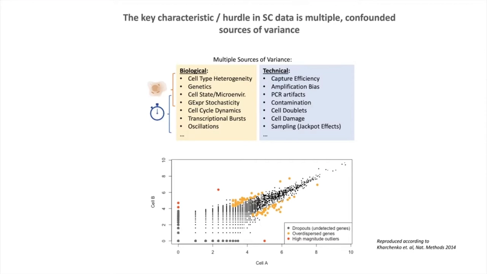

两类来源叠在一起，结果就是同一类型的两个细胞之间相关性也不高、大量 dropout、过散布基因、边缘离群点。讲者特别指出：批次效应在单细胞里被放大了，因为单细胞的处理步骤比 bulk 多得多，而且批次之间的细胞组成往往不同——**技术方差和生物方差是纠缠在一起的** [【跳转到 12:17】](https://www.youtube.com/watch?v=BMogp-ufJwY&t=737)。

### 1.2 线性方法的天花板

传统降维（PCA、因子分析）假设观测是潜因子的线性组合。讲者的判断很直接：这些方差来源对数据的作用**高度非线性**，用传统机器学习方法去建模并不直接 [【跳转到 17:13】](https://www.youtube.com/watch?v=BMogp-ufJwY&t=1033)。这就是要把非线性潜变量模型搬进来的理由。

## 二、自编码器的中间层就是潜编码

### 2.1 压缩再重建

自编码器是无监督模型，不需要标签，因此可以吃很大的训练集。它的目标很朴素：让输出尽量接近输入；但做法很特别——**让数据穿过逐层变窄的网络**，在最窄的那一层得到一个"编码"，再把它解码回去 [【跳转到 13:12】](https://www.youtube.com/watch?v=BMogp-ufJwY&t=792)。

```text
输入 x（两万个基因） → 编码器（逐层变窄） → 潜编码 z（比如 10 维） → 解码器 → 重建 x̂
```

训练只用一个重建损失，衡量输入与输出差多少：

$$
\mathcal{L}_{\text{rec}} = \left\lVert x - \hat{x} \right\rVert^2
$$

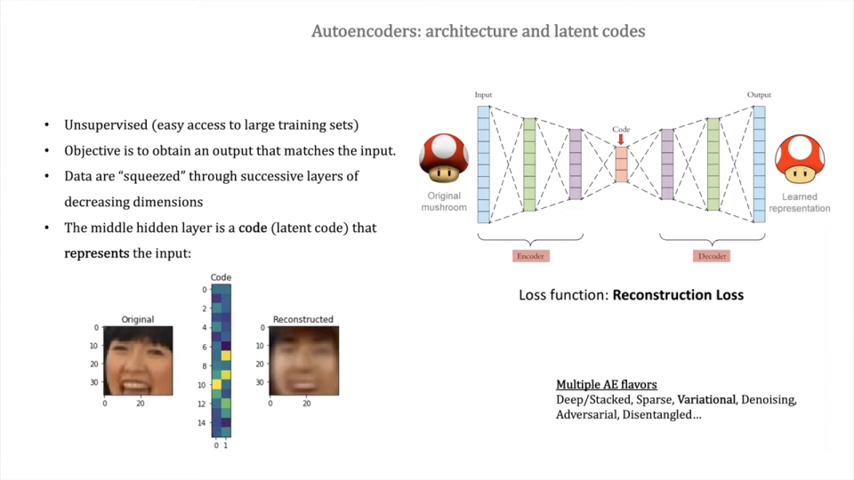

### 2.2 瓶颈为什么能逼出结构

讲者的解释是：网络**没法**把两万个数值原样塞进十个维度再原样取出来，所以它必须找到数据里最显著的结构。潜编码因此是"输入最显著特征"的压缩表示 [【跳转到 14:27】](https://www.youtube.com/watch?v=BMogp-ufJwY&t=867)。这句话里最重要的词是"压缩"——它是一个**有损**的摘要，不是一个完整的测量记录。

### 2.3 几何直觉：流形上的一个位置

讲者给了一个非常生物学家的类比：潜编码是**复杂转录组流形的一个简洁生成式表示**，流形上的每个位置代表一种**可以真实出现的细胞状态**；这与发育生物学里用了几十年的 Waddington 地形图是同一件事——细胞像一颗球在山谷间滚动，每个位置是一种状态 [【跳转到 25:45】](https://www.youtube.com/watch?v=BMogp-ufJwY&t=1545)。

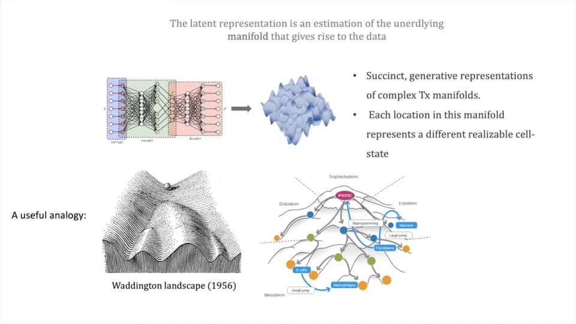

这个类比解释了潜编码"是什么"，也顺手解释了它"不是什么"：**地形图上的一个位置有意义，但"海拔"这一维本身没有生物学名字**。

## 三、VAE 把"点"换成"分布"：均值与采样是两件事

### 3.1 潜层不再是一个点，而是一个分布

变分自编码器（VAE）在自编码器上加了一点随机性：潜层不再是一个确定的点，**而是表示一个分布**。代价是训练目标多了一项——编码器输出的分布要靠近一个标准正态先验：

$$
\mathcal{L} = \underbrace{\mathbb{E}_{q_\phi(z \mid x)}\left[\log p_\theta(x \mid z)\right]}_{\text{重建}} \;-\; \beta \cdot \underbrace{D_{\mathrm{KL}}\left(q_\phi(z \mid x) \,\Vert\, p(z)\right)}_{\text{与先验的距离}}
$$

讲者对这两项只做了功能性的说明：前者管重建得像不像，后者把潜空间往一个连续、无断裂的流形上拉。$\beta$ 是可调超参数：$\beta=1$ 就是标准 VAE（这一项合起来叫 ELBO），$\beta<1$ 放松正则、重建更好，$\beta>1$ 则得到 beta-VAE（下一节会用到）[【跳转到 19:30】](https://www.youtube.com/watch?v=BMogp-ufJwY&t=1170)。推导不是本文主题，这里只需要记住结论。

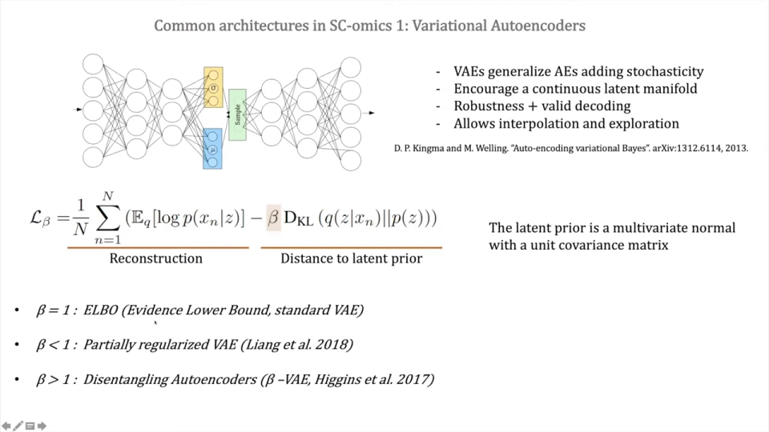

### 3.2 好处：连续流形、可插值、可采样

讲者列了 VAE 相对普通自编码器的四点好处：鼓励**连续**的潜流形（数据各部分之间没有断裂）、模型更鲁棒、解码更"合法"、以及最重要的一点——**允许插值和探索**，因为它站在一个完整的统计推断框架上 [【跳转到 18:15】](https://www.youtube.com/watch?v=BMogp-ufJwY&t=1095)。

### 3.3 于是"取表示"有两种取法

因为潜层是分布，同一个细胞对应的是 $q_\phi(z \mid x)$，而不是一个数。于是有两种取法：

$$
\hat{z} = \mathbb{E}_{q_\phi(z \mid x)}\left[z\right] = \mu_\phi(x)
\qquad\text{对比}\qquad
\tilde{z} = \mu_\phi(x) + \sigma_\phi(x) \odot \epsilon, \quad \epsilon \sim \mathcal{N}(0, I)
$$

- **取均值**：同一个细胞、同一份输入，算多少次都是同一个向量。适合当坐标——画图、聚类、算距离都需要一张可复现的地图。
- **取样本**：每次抽到的向量都不同，差异由 $\sigma_\phi(x)$ 决定。适合需要传播不确定性的计算，也适合做生成与插值。

这两条路在 scVI 这类模型里都保留着：get_latent_representation() 走的是前者，DE 的后验概率走的是后者（用蒙特卡洛样本估计）。**把两者混为一谈，就会误以为"嵌入"里已经含有不确定性**——它没有，它只是分布的中心。

## 四、什么叫"好的表示"：四条判据，以及"可解释"的位置

### 4.1 四条判据

讲者说，不同的任务对"好表示"的要求不同，但有几条共性 [【跳转到 24:05】](https://www.youtube.com/watch?v=BMogp-ufJwY&t=1445)：

1. **鲁棒**：对无意义的输入扰动不敏感；
2. **可迁移**：能用到多个相关设置与相关问题上去；
3. **平滑一致**：相似的输入得到相似的编码；
4. **可解释**：如果数据由若干独立的方差来源生成，理想情况下编码应当把这些来源**解耦**，用不同的节点承载不同的来源。

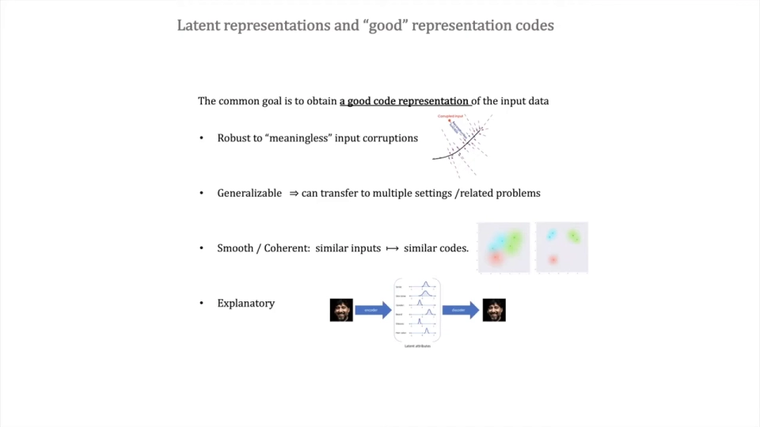

### 4.2 解耦是"鼓励"出来的，不是默认的

第四条正是"潜空间能不能逐维读"的关键。讲者的说法很克制：这是**理想情况**。标准 VAE 的先验是单位协方差的正态分布，它假设各维独立，但训练出来并不保证每一维对应一个生物过程。

想往这个方向推，办法是调 $\beta$：$\beta>1$ 的 beta-VAE 会更用力地把编码拉向单位协方差先验，从而**鼓励**各维之间更独立 [【跳转到 20:45】](https://www.youtube.com/watch?v=BMogp-ufJwY&t=1245)。注意措辞——是鼓励，不是保证；而且"统计上独立"与"生物学上可命名"之间还隔着一步验证。

### 4.3 所以默认的判读是：位置有意义，轴没有

把 4.1 与 4.2 合起来，就得到本文最想强调的一条：**潜编码整体是一个位置，单个维度默认不是一个生物学量**。讲者从头到尾没有把任何一维叫作"细胞周期维"或"T 细胞维"；他谈的一直是"流形上的位置""不同节点承载不同来源"这种整体性描述 [【跳转到 25:20】](https://www.youtube.com/watch?v=BMogp-ufJwY&t=1520)。

## 五、潜编码能拿来做什么：六类下游

讲者把应用讲得很具体，而且每一类都对应"潜编码是一个位置"这个性质。

### 5.1 可视化与聚类

最自然的用途。潜层本身就是降维结果，可以直接拿去跑 t-SNE / UMAP 做二维可视化，也可以直接把每个细胞的潜编码当作聚类算法的输入——不必再走一遍特征选择 [【跳转到 30:32】](https://www.youtube.com/watch?v=BMogp-ufJwY&t=1832)。

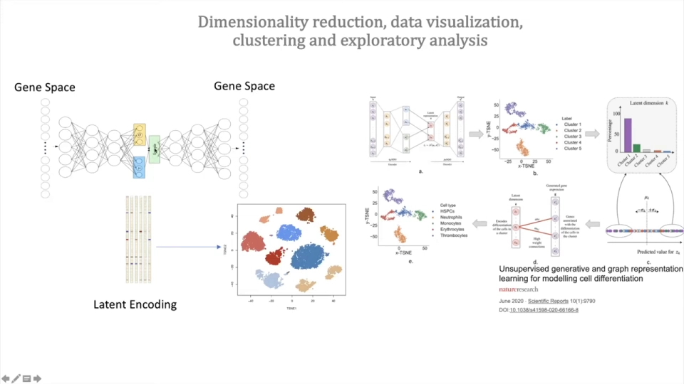

### 5.2 轨迹

研究细胞动态时，可以用潜编码重建群体的轨迹，而不必先做一轮特征选择 [【跳转到 31:22】](https://www.youtube.com/watch?v=BMogp-ufJwY&t=1882)。这与 2.3 的流形图景是同一件事：轨迹就是流形上的一条路径。

### 5.3 去噪与填补

解码器的输出本质上是输入的**去噪版本**，所以自编码器天然可以做填补。讲者展示了一份视网膜数据的例子：原始数据里满是 dropout 与高杠杆离群点，去噪之后细胞间关系变得干净；更关键的是，**均值—方差关系被"抹平"了**——原本随表达升高而下降的变异关系在解码输出里消失，说明模型把采样噪声吸收掉了 [【跳转到 33:27】](https://www.youtube.com/watch?v=BMogp-ufJwY&t=2007)。

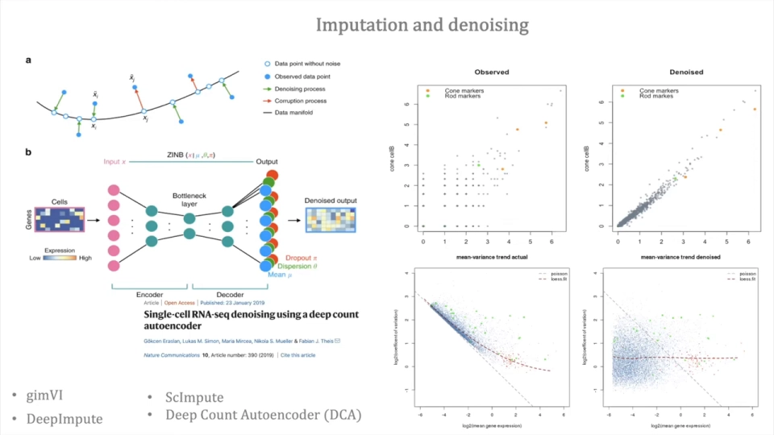

这也解释了为什么去噪表达适合"看"而不适合当测量值：它已经按模型假设被修正过，不再是原始观测。

### 5.4 批次校正：在潜空间里做算术

讲者给了三种做法，第一种最能说明潜空间的性质——**潜空间算术**：把某个实验室（或某个批次）所有细胞的潜向量取平均，得到一个"批次向量"，再从该批次的细胞里减掉它，就把两批数据挪到同一区域 [【跳转到 34:42】](https://www.youtube.com/watch?v=BMogp-ufJwY&t=2082)。

$$
z' = z - \bar{z}_{\text{batch}}
$$

另外两种是：用 one-hot 编码表示批次来源、按位平移；或者用**条件 VAE**，让潜表示以批次这个" nuisance 因子"为条件 [【跳转到 35:32】](https://www.youtube.com/watch?v=BMogp-ufJwY&t=2132)。

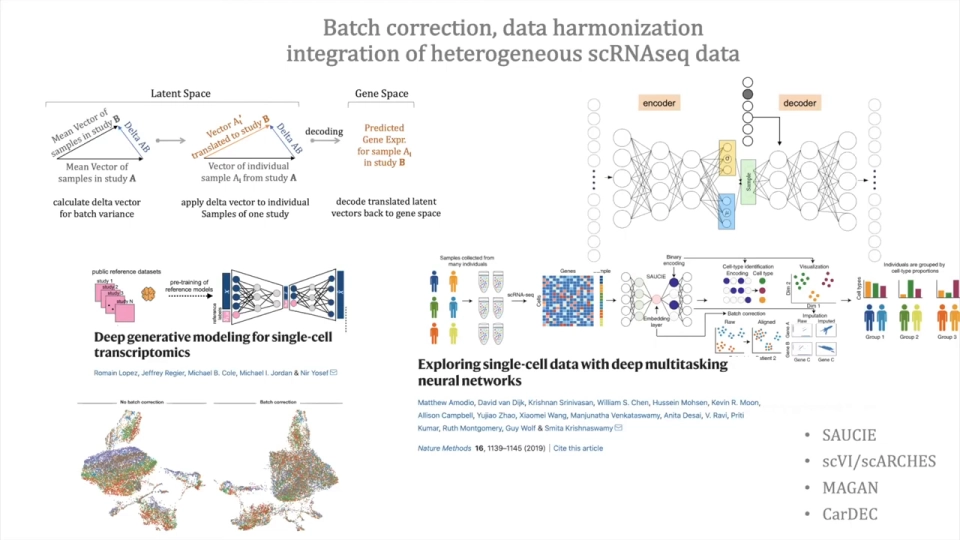

能做减法这件事本身就说明：潜空间是一个**向量空间**，方向与差值有几何意义，但每个坐标轴没有独立语义。这也正是它不能像 PCA 那样逐维解释的原因——PCA 的轴由载荷定义，潜空间的轴可以被任意旋转而不改变模型。

### 5.5 条件潜空间：注释与标签迁移

把细胞类型也作为条件喂进编码器，得到的潜表示就同时条件于批次与类型；模型既能校正批次，又能顺便做分类——从编码器的后验里直接读出某个细胞的类型概率 [【跳转到 37:39】](https://www.youtube.com/watch?v=BMogp-ufJwY&t=2259)。这就是 scANVI 一类模型的做法：潜表示 + 分类头，一次训练两件事。

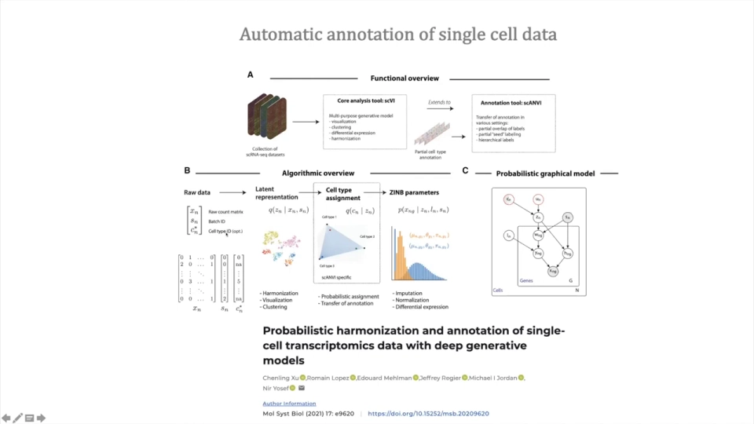

### 5.6 分布外推断

最后一类应用最能体现生成模型的野心：**分布外推断**——去检查转录组景观里从未被采样过的区域。比如推断未在实验中观察到的扰动效果、推断只在部分细胞类型上见过的轨迹 [【跳转到 38:19】](https://www.youtube.com/watch?v=BMogp-ufJwY&t=2299)。讲者同时列了同一思路下的一串工具：空间转录组的解卷积、scATAC 的 PeakVI、双细胞检测的 Solo、CITE-seq 的 totalVI、零膨胀评估的 AutoZi、把查询数据映射到参考上的 scArches 等 [【跳转到 38:49】](https://www.youtube.com/watch?v=BMogp-ufJwY&t=2329)。

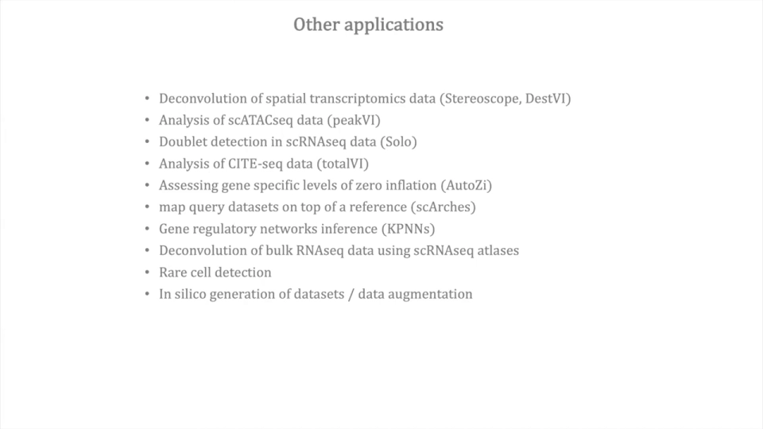

## 六、判读潜空间的三条纪律

### 6.1 位置有意义，轴没有

聚类、轨迹、批次算术都只用"位置"与"距离"，从不用"第几维等于什么"。这是潜空间与 PCA 最本质的差别：PCA 的每一维有载荷、可以回溯到基因；潜空间的维度可以被旋转、混叠，单个维度通常不可命名。

### 6.2 生成能力不等于因果理解

讲者在结尾泼了一盆很必要的冷水：尽管过去四五年深度学习在单细胞里论文数量庞大，但底层原理与主流架构其实相当有限；现有应用大多不是概念上的突破，而是对已有问题的另一种实现，性能提升也不算惊人——以至于有人说"拿深度学习做转录组，就像拿枪去打一场刀战" [【跳转到 40:22】](https://www.youtube.com/watch?v=BMogp-ufJwY&t=2422)。他引用 Fabian Theis 实验室的评测结论作结：在 14 个数据集上比较 6 种分类方法后，深度学习并没有胜过经典机器学习，**单细胞基因组学仍在等待它的"ImageNet 时刻"** [【跳转到 42:02】](https://www.youtube.com/watch?v=BMogp-ufJwY&t=2522)。

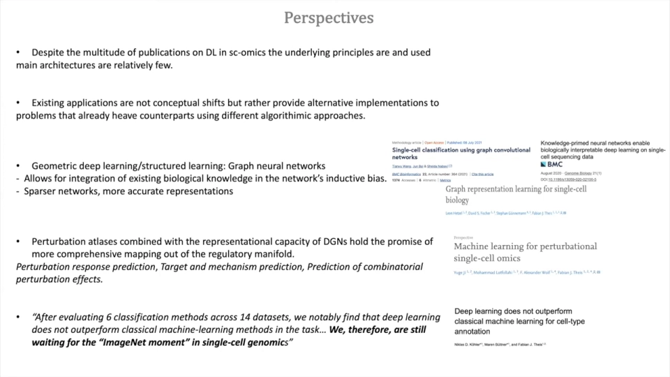

### 6.3 把它当坐标，不当结论

由此得到一条实操纪律：潜编码可以用来**组织**分析（排序、分群、找邻居、做插值），但不能用来**下结论**。要下结论，仍要回到标志基因、差异表达、独立注释与实验验证。

## 小结

- 单细胞数据的方差是生物与技术两类来源混在一起的产物，线性降维压不住其中的非线性结构。
- 自编码器用"瓶颈"逼出潜编码：它是输入最显著结构的**有损压缩**，是流形上的一个位置。
- VAE 把潜层从点变成分布，于是"取表示"有两条路：取均值（确定性、可复现，适合当坐标）与取样本（随机、携带不确定性，适合生成与推断）。
- "好表示"的四条判据是鲁棒、可迁移、平滑一致、可解释；解耦要靠 beta-VAE 去鼓励，且不等于生物学可命名。
- 潜编码的下游用途包括可视化、聚类、轨迹、去噪、批次校正（潜空间算术）、条件注释与分布外推断。
- 判读纪律：位置有意义、轴没有；生成能力不等于因果理解；潜编码用来组织分析，不用来下结论。

## 关键术语速查

| 术语 | 一句话解释 |
| --- | --- |
| 潜编码 | 网络瓶颈层给出的低维向量，表示细胞在数据流形上的位置 |
| 表示编码 | 泛指从高维输入学到的低维摘要，潜编码是其中一种 |
| 自编码器 | 压缩再重建的无监督网络，训练信号只有重建损失 |
| 变分自编码器 | 潜层表示分布而非点的自编码器，训练时多一项与先验的距离 |
| 后验均值 | 编码器输出分布的期望，同一输入每次算都一样 |
| 后验采样 | 从编码器输出的分布里抽一个样本，每次不同，用于生成与不确定性估计 |
| beta-VAE | 把先验正则项加权到 $\beta>1$ 的 VAE，用来鼓励各潜维更独立 |
| 解耦 | 让不同潜维承载不同方差来源，是"可解释表示"的理想，不是默认结果 |
| 潜空间算术 | 在潜空间里做加减（如减去批次平均向量）来消除技术差异 |
| 条件 VAE | 让潜表示以批次、细胞类型等因子为条件，从而同时做校正与分类 |
| 分布外推断 | 用生成模型检查数据中从未被采样过的区域，如未做过的扰动 |