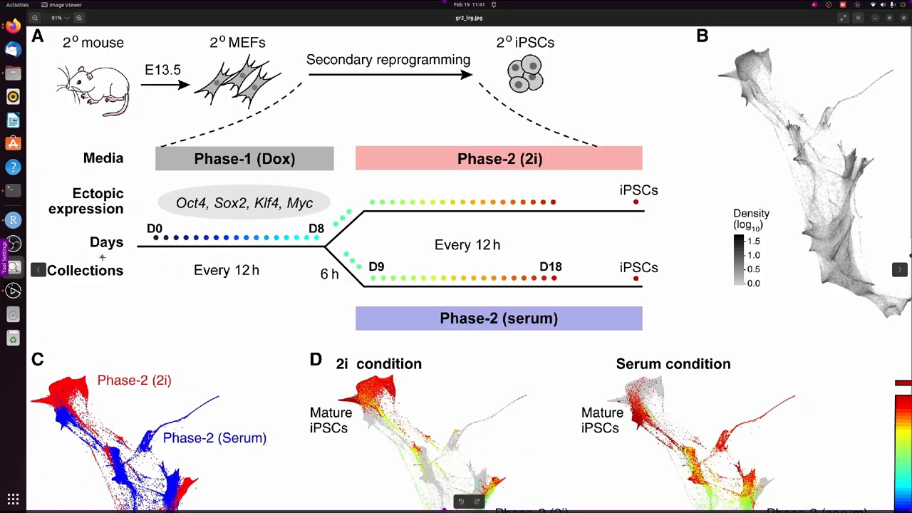
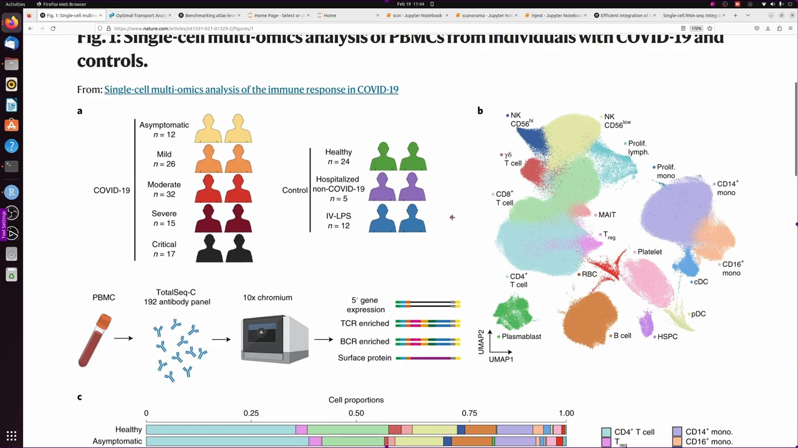
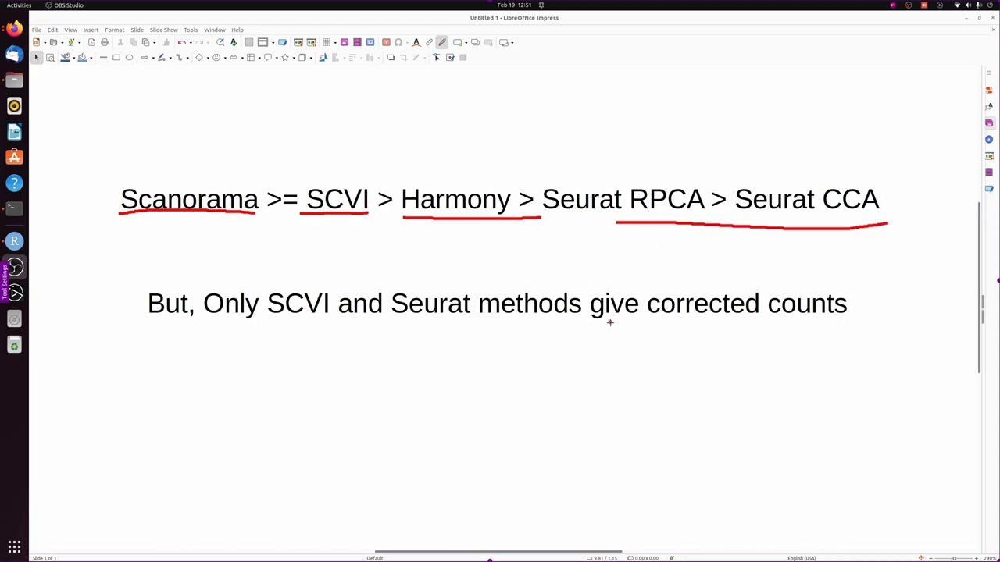
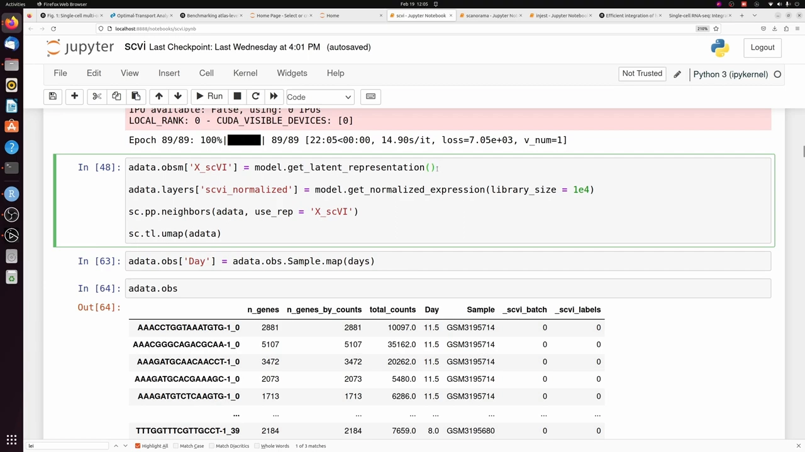
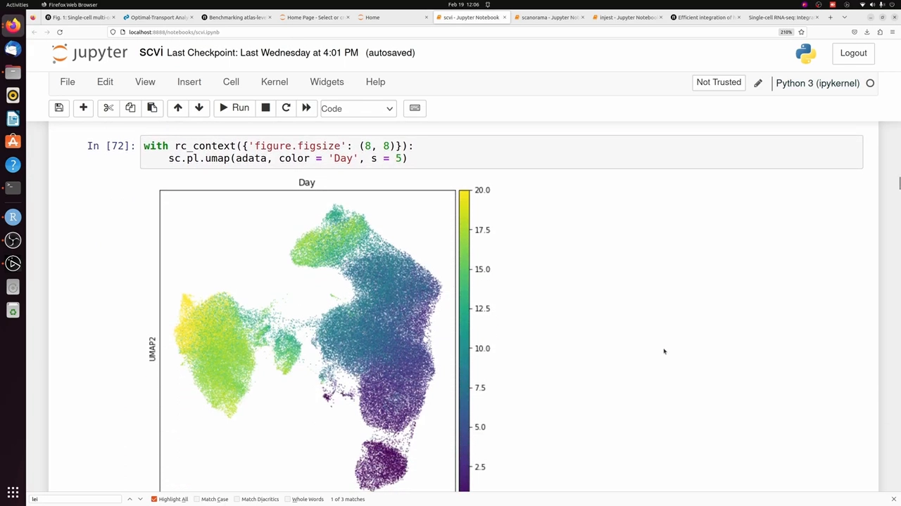
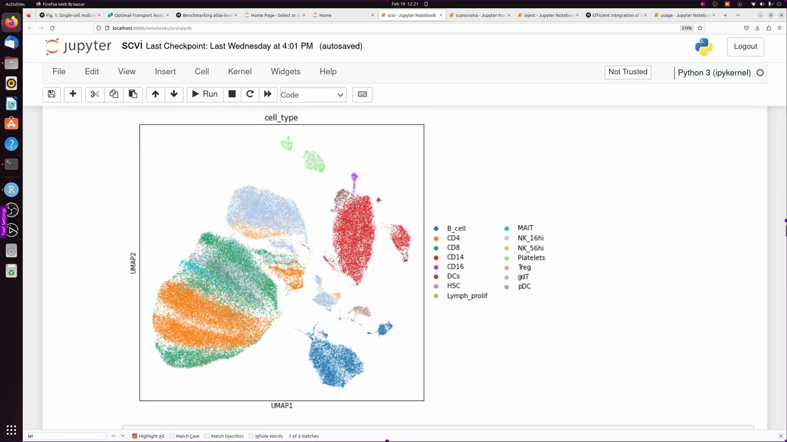
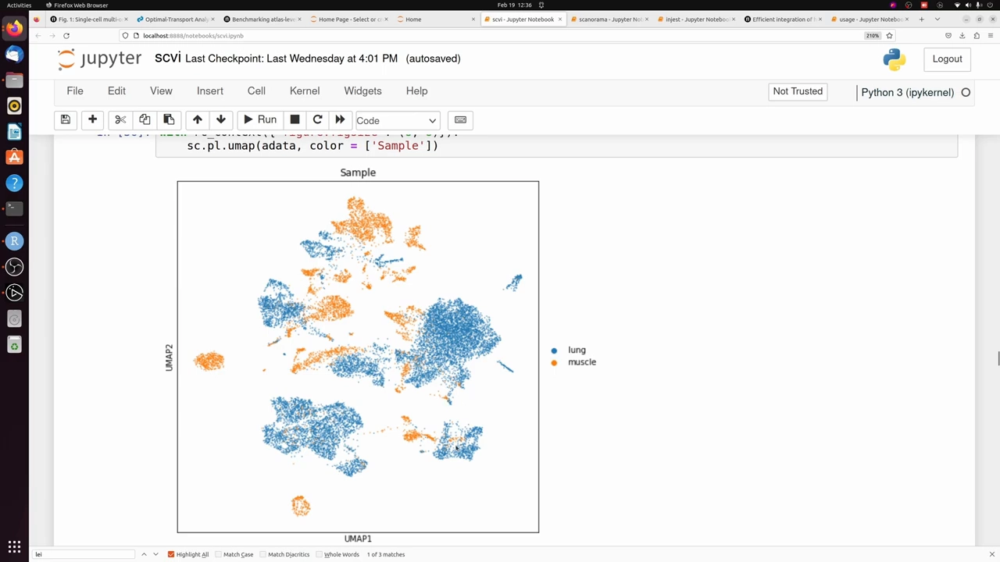
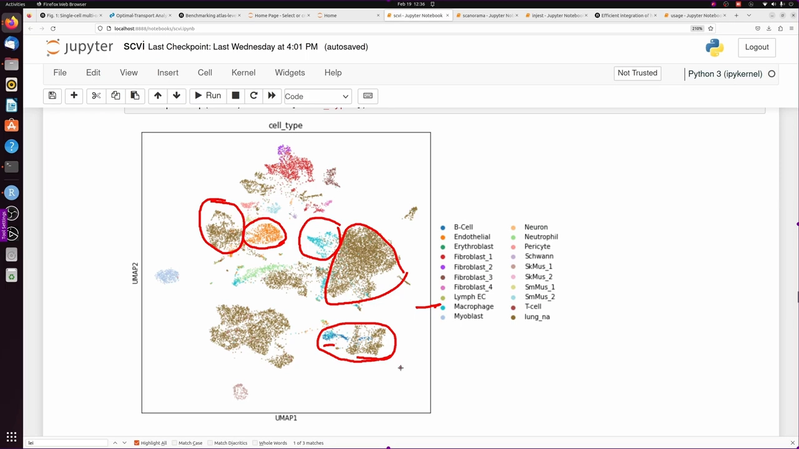
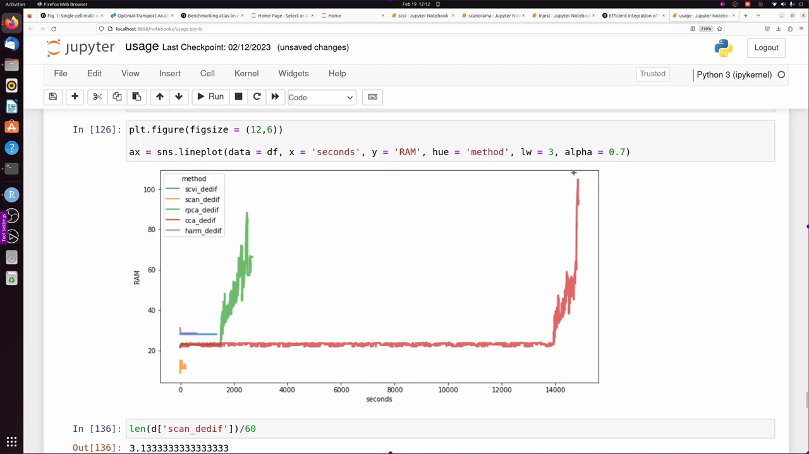

# scVI 交出的是归一化表达矩阵，不只是降维坐标

> 视频来源：[Comparing single-cell RNA integration methods | Which is the best?](https://www.youtube.com/watch?v=NFA2YGshATs)（YouTube · Sanbomics）｜时长约 20 分钟
> 简要导读：一支纯实操的方法横评——五种整合方法（Seurat CCA、Seurat RPCA、Harmony、scVI、Scanorama）在三个刻意设计的数据集上跑一遍，比较整合保真度、时间和内存。本文只取与"解码产物"相关的部分：为什么只有 scVI 和 Seurat 两类方法能交出基因层面的归一化表达矩阵、那两行代码在做什么、以及怎么用三个数据集检验"校正后的表达有没有把生物差异一起抹掉"。差异表达的统计推断见 3.2.3。

## 本讲要解决的核心问题（SCQA）

**背景**：整合方法大多只交给你一个低维坐标。Harmony 往你的对象里塞一个 40 维的矩阵，Scanorama 给你一个整合后的降维结果，你拿它建邻域图、画 UMAP、做聚类——这些都很顺手。

**冲突**：但下游有一大类分析要的不是坐标，而是**基因层面的数值**：画一个 CDH5 看内皮细胞、画一个 CD45 看免疫细胞、做差异表达。坐标给不了这个。scVI 能给——它把归一化表达作为一个新矩阵交出来。可这个矩阵不是测出来的，是模型算出来的，那它凭什么能替代归一化后的原始计数？

**疑问**：这个归一化表达矩阵到底是什么？它和普通的 log-normalize 差在哪？怎么知道它没有把生物差异一起"校正"掉？

**回答（中心思想）**：scVI 的归一化表达是**解码器的输出**——把细胞的后验表示和批次键一起送进解码器，得到一个按目标文库大小缩放的表达矩阵，存在 adata.layers['scvi_normalized'] 里。它比 log-normalize 多的那一步，正是"批次键参与了解码"；而它的可信度不能靠指标自证，只能靠**压力测试**：拿几个"生物差异已知在哪"的数据集，看这些差异在整合后还在不在。

---

## 一、五种方法，两种产物

### 1.1 五个方法、三个数据集

讲者选了五种方法：Seurat 的 CCA（最出名、很多人还在用）、Seurat 的 RPCA（较新、据说更保守）、Harmony，这三个是 R 的；再加上两个 Python 库——scVI（深度概率模型）和 Scanorama [【跳转到 00:23】](https://www.youtube.com/watch?v=NFA2YGshATs&t=23)。

三个数据集都是刻意挑的，每一个都在考一件事 [【跳转到 01:23】](https://www.youtube.com/watch?v=NFA2YGshATs&t=83)：

1. **重编程／去分化数据**：小鼠成纤维细胞重编程成 iPSC，每 12 小时采一次样、跨 18 天。讲者的理由很直接——整合的挑战之一就是会抹掉样本之间真实的生物学差异，而每 12 小时一个样本意味着样本之间**一定**存在细微差异，这是最难的场景。
2. **PBMC 数据**：他做了手脚，把健康样本里除一个之外的所有 CD16 阳性单核细胞都删掉了。一次成功的整合，应该仍然能看到一个独立的 CD16 阳性群体，尽管它只出现在一个样本里。
3. **肺 + 肌肉**：把两个不同组织拼在一起，它们有相似群体（内皮细胞、一些免疫细胞），但也有很多完全不同的细胞。这是一个"不该被凑到一起的东西会不会被硬凑"的测试。





### 1.2 只有两类方法交出"基因层面的数值"

这是全篇和我们主题最相关的一句话。讲者说，scVI 和 Harmony、Scanorama 相比最大的差别之一是：**scVI 你实际能得到归一化表达值**。Harmony 只是产出了那个 40 维的降维结果，做聚类和 UMAP 很好用，但你拿不到基因的实际数值；scVI 则把归一化表达作为一个新矩阵交给你 [【跳转到 07:50】](https://www.youtube.com/watch?v=NFA2YGshATs&t=470)。

他在总结时又强调了一遍，并加了一个重要前提：**只有 scVI 和 Seurat 的方法真正给你可以在下游使用的校正后计数**——但如果它们把计数校正得很差，你的下游分析也会被带偏 [【跳转到 19:13】](https://www.youtube.com/watch?v=NFA2YGshATs&t=1153)。



这句话值得拆成两层来读：

- **能力层**：能不能给你基因层面的矩阵，是一个"有／没有"的差别。Harmony 和 Scanorama 在这一层就直接出局了，不管它们的 UMAP 画得多好看。
- **质量层**：给了矩阵不等于给对了矩阵。校正得差的矩阵会把下游分析一起带偏，所以"有"之后还要验"对不对"。

## 二、归一化表达矩阵是怎么来的

### 2.1 那两行代码

讲者的 scVI 流程非常默认：`sample` 作为 categorical key、`total_counts` 作为 covariate key，其余都保持默认 [【跳转到 07:16】](https://www.youtube.com/watch?v=NFA2YGshATs&t=436)。9 万个细胞、默认设置，训练大约 22 分钟。

关键在训练完之后的两行：

```python
adata.obsm['X_scVI'] = model.get_latent_representation()
adata.layers['scvi_normalized'] = model.get_normalized_expression(library_size=1e4)
sc.pp.neighbors(adata, use_rep='X_scVI')
sc.tl.umap(adata)
```



这两行放在一起看，正好把"两个产物"讲清楚了：

- get_latent_representation() 给出的是**每个细胞一行向量**，写进 `obsm`，和 PCA 的坐标是同一个抽屉，所以后面的 `neighbors` / `umap` 代码完全不用改，只是把 `use_rep` 换成 `X_scVI`。
- get_normalized_expression(library_size=1e4) 给出的是**细胞 × 基因的矩阵**，写进 `layers`，和原始计数 `X` 形状一致、可以按基因取列。

library_size=1e4 这个参数的意思是"把表达缩放到目标文库大小 1e4"，也就是常说的 CP10K 那个量级。所以这个矩阵的量纲和你自己 `normalize_total` 之后再 `log1p` 得到的矩阵是**可以并排放的**——这正是它能直接拿去画 marker、做差异表达的原因。

### 2.2 它和 log-normalize 差在哪一步

普通的归一化是纯算术：每个细胞除以自己的总计数、乘一个常数、再取对数。它不知道批次是谁，也不做任何校正。

scVI 的这个矩阵不一样的地方在于：它是**模型的解码器在给定批次键的情况下生成的**。也就是说，同一个细胞如果换一个批次键，解码出来的表达会不同——这正是 3.2.2 主篇讲的"反事实批次"。所以这个矩阵里已经包含了"批次被条件化掉"这一步，而不只是"把文库大小拉平"。

这里要说清一个边界：**"校正后的表达"不等于"真实的表达"**。它是模型对"如果没有批次效应，这个细胞应该测到什么"的一个估计。这个估计好不好，只能靠外部证据检验——这就是下一节三个数据集的作用。

## 三、三个数据集就是三次"生物差异还在不在"的压力测试

### 3.1 每 12 小时一个样本：时序梯度

去分化数据里，细胞沿着"成纤维细胞 → iPSC"这条轴连续变化，每 12 小时一个采样点。所以一个保真的整合，应该让 UMAP 上按天数呈现**连续的颜色渐变**，而不是把不同天的细胞混成一锅。

按这个标准看：Seurat CCA 的 UMAP 上完全看不到时序回归，iPSC 几乎是随机分布的，没有清晰的时间进程 [【跳转到 05:01】](https://www.youtube.com/watch?v=NFA2YGshATs&t=301)。RPCA 有一些按天的分层，但出现了两个互不相连的岛，生物学上讲不通 [【跳转到 06:35】](https://www.youtube.com/watch?v=NFA2YGshATs&t=395)。Harmony 有一些分层但也不理想。

scVI 的结果则清楚得多：下面是第 0 天的细胞，随着天数增加颜色变亮，形成一个连续的进程——**它没有抹掉样本之间的这种生物变异** [【跳转到 08:49】](https://www.youtube.com/watch?v=NFA2YGshATs&t=529)。



Scanorama 在这个数据集上表现同样好甚至略好，但它只给降维结果、不给归一化数值 [【跳转到 10:04】](https://www.youtube.com/watch?v=NFA2YGshATs&t=604)。

### 3.2 只有一个样本有的细胞类型

CD16 测试考的是另一件事：**只在一个批次里出现的群体，会不会被整合抹掉**。这在方法学上是个硬约束——如果模型假设"每个批次里都该有相同的细胞类型"，那这种独有群体就会被压到别的簇里去。

结果分化得很明显。Seurat CCA 失败了：CD16 阳性的细胞和 CD14 的细胞被放在同一个簇里，没分开 [【跳转到 12:04】](https://www.youtube.com/watch?v=NFA2YGshATs&t=724)。RPCA 和 Harmony 都成功地把 CD16 分成了自己的簇。scVI 也通过了：CD16 是一个非常独立的簇 [【跳转到 13:54】](https://www.youtube.com/watch?v=NFA2YGshATs&t=834)。



讲者顺带指出，这里的细胞类型注释和原论文略有出入，T 细胞那一大团注释有点乱，但他没有深究。Scanorama 在这个测试里 T 细胞群体看起来比 scVI 更分明一些，不过他也说这只是没深入分析时的直观印象。

### 3.3 两个不同组织：不该被凑到一起的细胞

第三个测试最"不常规"，讲者自己也说不太确定这是不是检验整合保真度最好的办法，他就是好奇。把肺和肌肉放在一起，考的是：**本来不该像的细胞，会不会被硬凑到一起**。

他给了两个很具体的观察点：

- CCA 把肺的肺泡巨噬细胞和肌肉的巨噬细胞放到了一起，而"我不认为肌肉里的巨噬细胞应该和肺泡巨噬细胞聚在一起" [【跳转到 15:34】](https://www.youtube.com/watch?v=NFA2YGshATs&t=934)。
- RPCA 把内皮细胞硬凑到一起了，而实际上肺内皮和肌肉内皮应该略有不同；它分开了内皮，但巨噬细胞那里还是怪。

scVI 在这个数据集上最好：簇之间的重叠明显更少，肺泡巨噬细胞是一大群，肌肉巨噬细胞分到了自己的组里，肌肉和肺的内皮细胞也分开了 [【跳转到 17:04】](https://www.youtube.com/watch?v=NFA2YGshATs&t=1024)。



而 Scanorama 在这个数据集上翻车了：出现一个说不清的大团块簇，看不到明显结构，按细胞类型看更是完全说不通 [【跳转到 17:59】](https://www.youtube.com/watch?v=NFA2YGshATs&t=1079)。

### 3.4 拿到矩阵之后能做什么

讲者在这里顺手演示了归一化表达矩阵的用处：因为有了基因层面的数值，可以直接画 CDH5（内皮标记）看两个数据集里的内皮细胞，也可以画 CD45 看所有免疫细胞 [【跳转到 17:34】](https://www.youtube.com/watch?v=NFA2YGshATs&t=1054)。



这一步看着平淡，但它正是"降维坐标"和"表达矩阵"的分水岭：坐标只能告诉你"这两个细胞挨得近"，矩阵才能告诉你"它们都在表达 CDH5"。前者是几何，后者是生物学。

## 四、代价：时间和内存

讲者把资源占用也当成评估维度，因为这在真实数据上是硬约束。

- **Seurat CCA**：9 万细胞、128 GB 内存，跑了五六个小时之后内存不足失败。6.1 万细胞那次成功了，花了 1.3 小时 [【跳转到 03:34】](https://www.youtube.com/watch?v=NFA2YGshATs&t=214)。小数据集上它很快——1.6 万细胞只用了 3 分钟。
- **Seurat RPCA**：9 万细胞约 44 分钟，需要大约 90 GB 内存。
- **Harmony**：约 10 分钟，是三个 R 方法里最快最省内存的，和 scVI 差不多。
- **scVI**：9 万细胞默认设置约 22 分钟；6.2 万细胞约 19 分钟。
- **Scanorama**：3 分钟，占用最少、速度最快。



这里有个值得注意的取舍：**scVI 用 22 分钟换来的不只是一个坐标，还有一个可以拿去做差异表达的矩阵**。如果只比"谁画 UMAP 快"，Scanorama 完胜；但如果你下游要做差异表达，那 Scanorama 根本没交出可用的东西。

## 五、结论与边界

讲者的总排序是 Scanorama ≥ scVI > Harmony > Seurat RPCA > Seurat CCA，但每个数据集上的赢家并不一样 [【跳转到 18:32】](https://www.youtube.com/watch?v=NFA2YGshATs&t=1112)：

| 数据集 | 表现 |
| --- | --- |
| 去分化（时序梯度） | Scanorama 最好，scVI 紧随其后，三个 R 方法都没达到预期 |
| CD16 群体移除 | Scanorama 或 Harmony 最好，Seurat CCA 是唯一真正失败的 |
| 肺 + 肌肉（不同组织） | scVI 最好，其他都不太好，Scanorama 最差 |

他自己的结论是：如果非要选一个总冠军，他会说 Scanorama，紧随其后的是 scVI；Harmony 也相当不错；至少在这三个数据集上，RPCA 和 CCA 表现不太好。但紧接着他就加了那个关键限定——**只有 scVI 和 Seurat 的方法给出可以用于下游的校正后计数**，所以如果你需要归一化计数、要做差异表达，那从这些测试看 scVI 是明确的赢家 [【跳转到 19:13】](https://www.youtube.com/watch?v=NFA2YGshATs&t=1153)。

他还提到，那篇 Nature Methods 的基准评测结果大体上反映了同样的事：他们那边 Scanorama 排第一，Harmony 也表现很好，而两个 Seurat 方法排在没展示出来的另外 55 行里的某个位置 [【跳转到 19:43】](https://www.youtube.com/watch?v=NFA2YGshATs&t=1183)。另外 scvi-tools 里还有一个他没测的 scANVI，会用参考数据集，据说能更好。

## 小结

- **整合方法有两种产物**：低维坐标和基因层面的表达矩阵。Harmony、Scanorama 只给前者；scVI 和 Seurat 给后者。
- **scVI 的归一化表达来自解码器**：get_normalized_expression(library_size=1e4) 把解码结果按目标文库大小缩放，写进 layers['scvi_normalized']，形状与原始计数一致。
- **它比 log-normalize 多的一步是"批次键参与解码"**，所以它是"校正后的表达"，不是"真实的表达"。
- **"有矩阵"和"矩阵对不对"是两件事**：校正得差的矩阵会把下游分析一起带偏。
- **可信度只能靠压力测试**：时序梯度还在不在、独有细胞类型还在不在、不该像的细胞有没有被硬凑到一起。
- **三个测试里没有全胜的方法**：Scanorama 在时序和 CD16 上强，但在跨组织上翻车；scVI 在跨组织上最好，另外两个测试也过关。
- **资源是硬约束**：CCA 在 9 万细胞上直接内存不足，Scanorama 3 分钟跑完，scVI 22 分钟但多给一个矩阵。

## 关键术语速查

| 术语 | 一句话解释 |
| --- | --- |
| 归一化表达矩阵 | 细胞 × 基因的数值矩阵，量纲与 normalize_total 后一致，可以直接按基因取列 |
| `get_latent_representation` | 取出每个细胞的潜表示（一行一个细胞），写进 `obsm`，用法与 PCA 坐标相同 |
| `get_normalized_expression` | 取出解码得到的归一化表达，写进 `layers`，`library_size` 指定目标文库大小 |
| 校正后的计数 | 模型估计的"去掉批次效应后应有的表达"，不等于真实测量值 |
| 整合保真度 | 整合后生物差异被保留的程度，本讲用三个刻意设计的数据集来测 |
| CD16 测试 | 只在一个样本里出现的细胞类型，成功的整合应当仍然把它单独分出来 |
| 过度整合 | 把本不该像的细胞（如肺与肌肉的巨噬细胞）硬凑到一起 |
| scANVI | scvi-tools 里用参考数据集做标签迁移的方法，本讲未测 |