# 换掉批次键再解码：条件解码、反事实批次与生物差异检查

> 视频来源：[Integrating single-cell data with substantial batch effects](https://www.youtube.com/watch?v=i-a4BjAn90E)（YouTube · M22 系列讲座 · 讲者 Karin Hrovatin，慕尼黑 Helmholtz 中心 Theis 实验室）｜时长约 51 分钟
> 简要导读：一支把"整合"拆成两半来讲的方法学报告——一半是批次校正，一半是生物保留，然后用同一套指标把 cVAE（scVI 所属的模型族）的三种改法比出高下。本文只取与"条件解码"直接相关的部分：批次键在解码器里做了什么、为什么换掉批次键就能得到反事实批次、以及拿什么指标判断换完之后生物差异还在不在。生成图与 ELBO 的细节见本系列 3.1.7–3.1.9，差异表达的统计推断见 3.2.3。

## 本讲要解决的核心问题（SCQA）

**背景**：scVI 这类模型属于条件变分自编码器（cVAE）。它的输入不只有基因表达 $x$，还有一个批次键 $c$——编码器吃一次 $c$，解码器再吃一次 $c$。正因为解码器知道批次是谁，潜空间 $z$ 才被允许"不含批次信息"，于是 $z$ 就成了大家口中的"整合后表示"。

**冲突**：可解码器既然吃批次键，那么同一个细胞的潜向量 $z$，配上另一个批次键 $c'$，就会解码出另一套表达。这就是"反事实批次"（counterfactual batch）：把细胞放到它从未被测过的批次里去问"你会长什么样"。这条路走不走得通，全押在一个假设上——批次效应能被一个离散的键完全条件化，而且它和生物变异可以分开。这个假设没有任何数据能直接验证，它只能被间接检验。

**疑问**：条件解码到底在算什么？反事实批次凭什么可信？换完批次键之后，怎么知道生物差异还在？

**回答（中心思想）**：条件解码做的是"把细胞状态 $z$ 和批次键 $c$ 一起翻译成表达"；反事实批次就是把 $z$ 固定、把 $c$ 换掉再翻译一次。它成立的前提是批次可条件化、生物与批次可分离，而这个前提必须靠**同时看两类指标**来间接检验：iLISI 看批次有没有混开，NMI 看细胞类型结构还在不在，Moran's I 看细胞类型内部的连续梯度还在不在。只报其中一个数，就分不清"整合得好"和"把生物学一起抹平了"。

---

## 一、整合的目标不是"混在一起"，而是"混开批次、留住类型"

### 1.1 先定义什么叫"不想要的批次效应"

讲者一上来就把目标画成一张双向图：整合前，批次（紫色和橙色）和细胞类型（圆形和三角形）两个因素都在分开；整合后要求批次混开、细胞类型仍然分开 [【跳转到 09:45】](https://www.youtube.com/watch?v=i-a4BjAn90E&t=585)。

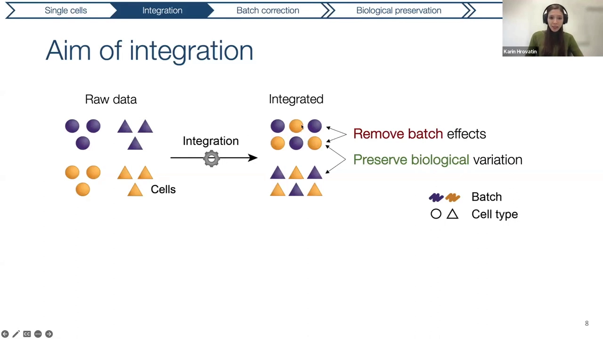

但"哪些效应该被当成批次"没有标准答案。讲者把数据里的变异拆成两根轴：生物学轴（供体特征如性别年龄、物种、体外模型）和技术轴（样本处理、测序方案、数据预处理）[【跳转到 11:00】](https://www.youtube.com/watch?v=i-a4BjAn90E&t=660)。

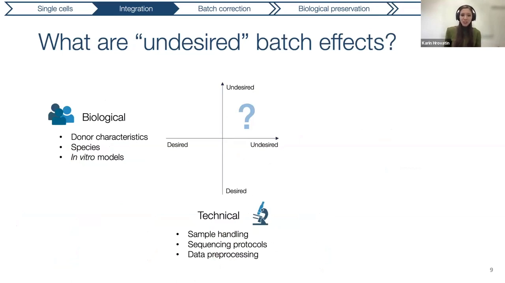

她给了一个很具体的判据：如果你想比较不同小鼠品系来挑模式生物，那**绝对不该**去掉品系效应，因为这正是你要研究的对象；但如果你只是研究糖尿病，品系效应就是在混淆你的结论，该去掉。所以"批次键里放什么"是一个由下游问题决定的建模决定，而不是数据自带的属性。

### 1.2 批次校正看邻域：iLISI

判断批次有没有混开，最直接的办法是看每个细胞的邻域：邻居主要来自同一批次（橙蓝分明）就是没整合好；邻居是混合的就是整合好了 [【跳转到 12:15】](https://www.youtube.com/watch?v=i-a4BjAn90E&t=735)。这个思路对应的指标叫 iLISI（KNN 批次结构），本质是"邻域里批次分布的均匀程度"。

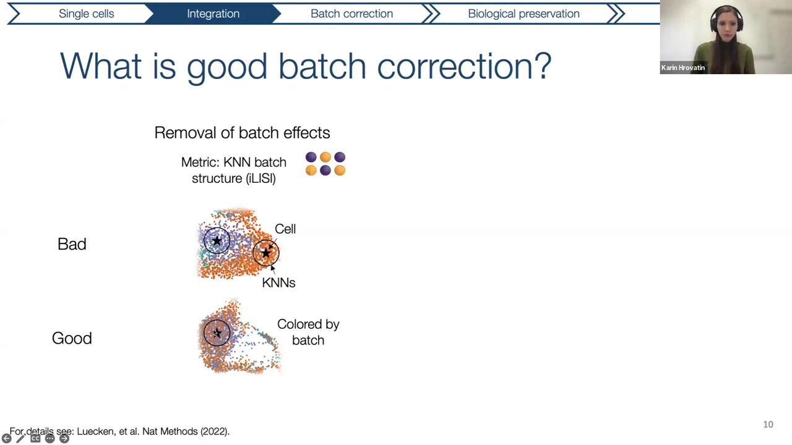

### 1.3 生物保留要看两层：NMI 与 Moran's I

反过来，判断生物差异有没有被保住，讲者强调要看两个层次，缺一不可 [【跳转到 14:45】](https://www.youtube.com/watch?v=i-a4BjAn90E&t=885)。

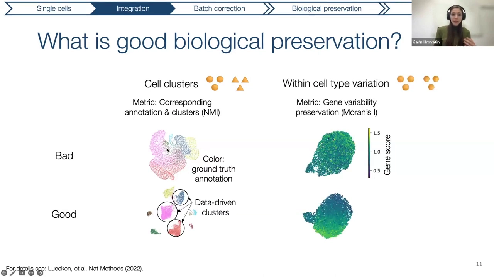

- **粗粒度（细胞类型层面）**：先验的细胞类型注释和数据自己聚出来的簇对不对得上，用 NMI 衡量。对不上就说明细胞类型被混掉了。
- **细粒度（细胞类型内部）**：同一种细胞类型内部往往还有基因表达的连续梯度，用空间自相关指标 Moran's I 衡量。梯度被抹平，说明模型把"类型内部的状态差异"也当成批次去掉了。

讲者特意指出，数据里的变异常常比我们的注释更细，所以只做粗粒度检查是不够的，"必须组合多个衡量不同方面生物变异的指标" [【跳转到 15:10】](https://www.youtube.com/watch?v=i-a4BjAn90E&t=910)。这句话是后面所有结论的评估框架。

顺带一个很实在的提醒：被问到"怎么判断欠整合还是过度整合"时，她的回答是**没法直接测**，因为没有"最优批次校正"的真值；你能做的只是让批次校正和生物保留这两个数都尽量高 [【跳转到 19:54】](https://www.youtube.com/watch?v=i-a4BjAn90E&t=1194)。

## 二、条件解码：批次键在编码器和解码器各出现一次

### 2.1 三种整合思路的对照

讲者只挑了三类方法做对照：iNMF 把每个批次的矩阵分解成"批次特有成分"和"批次共享成分"，用共享部分当整合表示；MNN 靠跨批次的互近邻把批次对齐；cVAE（scVI 属于这一类）则把批次作为条件喂进网络 [【跳转到 16:17】](https://www.youtube.com/watch?v=i-a4BjAn90E&t=977)。

前两类方法的产物是"一个对齐后的坐标"；cVAE 的产物是"一个能重新生成表达的函数"。这个差别正是本文的关键：只有后者才谈得上"换掉批次键再解码"。

### 2.2 cVAE 的结构：$c$ 进编码器，也进解码器

架构图上，协变量 $c$（就是批次键）被画成一个小方块，同时连到编码器和解码器 [【跳转到 17:49】](https://www.youtube.com/watch?v=i-a4BjAn90E&t=1069)：

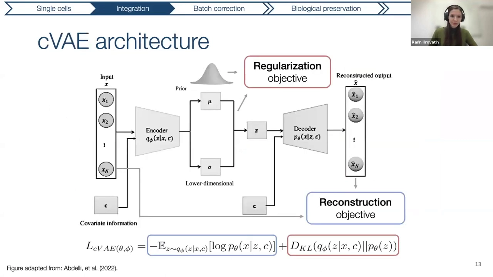

写成式子就是：

$$
L_{cVAE}(\theta,\phi) = -\,\mathbb{E}_{z \sim q_\phi(z \mid x, c)}\left[\log p_\theta(x \mid z, c)\right] + D_{KL}\left(q_\phi(z \mid x, c) \,\Vert\, p_\theta(z)\right)
$$

这里有两个要点，讲者都点了名：

1. **解码器是"条件于 $c$"的**。同一个 $z$，喂不同的 $c$，$p_\theta(x \mid z, c)$ 就是不同的分布。这就是条件解码，也是反事实批次的全部技术基础。
2. **编码器也是"条件于 $c$"的**。所以后验 $q_\phi(z \mid x, c)$ 在推断时就已经把批次信息"扣掉"了，扣掉的那部分由解码器用 $c$ 补回来。

### 2.3 为什么潜空间可以叫"无批次"

讲者的解释很干脆：因为批次信息在解码时又被输入了一次，潜空间就不需要包含任何批次信息，因此可以被看作"无批次"的、也就是整合后的表示 [【跳转到 16:57】](https://www.youtube.com/watch?v=i-a4BjAn90E&t=1017)。

这句话值得翻译成一句更容易检查的话：**"潜空间无批次"不是模型的一个性质，而是模型的一个设计承诺**。模型承诺"批次效应全部由 $c$ 承担"，于是 $z$ 里剩下的只能是别的东西。这个承诺能不能兑现，取决于 $c$ 是不是真的能吸收掉全部批次差异——而这正是后面所有实验在质疑的地方。

### 2.4 交到下游手里的是后验均值

训练目标有两项：重建项检查预测表达是否接近输入表达；正则项检查后验参数是否接近先验。讲者说正则项有两个作用，一是让采样出的表示正确，二是正则化潜空间、减少过拟合、让它"行为良好"——因为后面大量下游分析和人工判断都建立在这个表示上 [【跳转到 18:14】](https://www.youtube.com/watch?v=i-a4BjAn90E&t=1094)。

而真正交到下游手里的，是**每个细胞的后验均值** [【跳转到 18:59】](https://www.youtube.com/watch?v=i-a4BjAn90E&t=1139)。这一点和 3.2.1 讲的"嵌入取出来是一个点"是同一件事。

## 三、调大正则化权重不是"去批次"，是"少用几个维度"

### 3.1 最流行的做法：把 KL 权重调大

因为正则项本来就写在 cVAE 里，最省事的"去批次"手段就是调大它的权重。讲者说这等于把所有细胞推向先验分布——而先验是标准正态，所以所有细胞都被推向同一个地方，批次当然混在一起了，但生物学信息也一起没了 [【跳转到 21:08】](https://www.youtube.com/watch?v=i-a4BjAn90E&t=1268)。

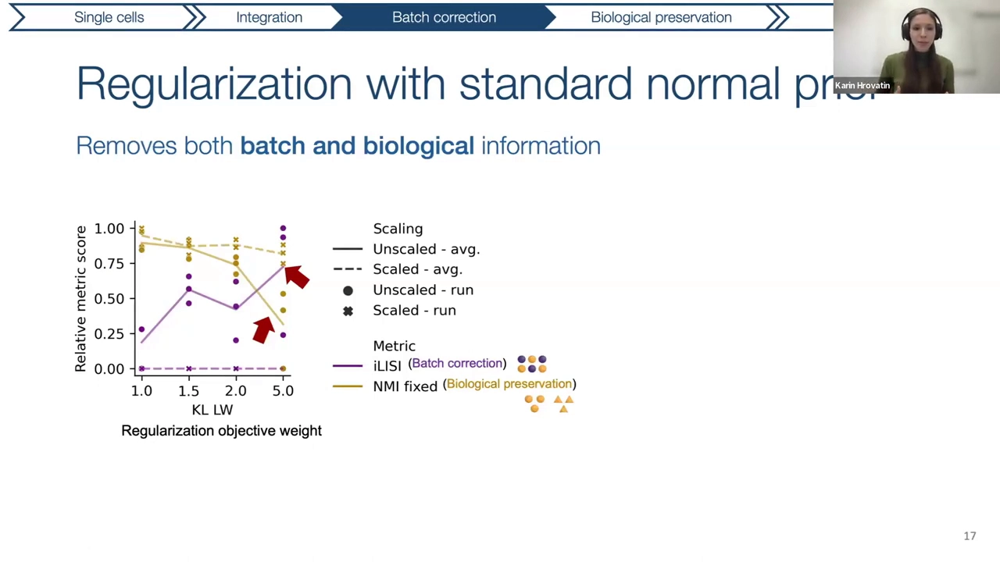

图上的两条曲线很说明问题：横轴是 KL 权重，紫色 iLISI 往上走，黄色 NMI 往下走。**它们不是"一个变好另一个不变"，而是"一个变好另一个变坏"**，这是典型的用生物学换批次。

### 3.2 后验均值被压向零，特征跨度塌缩

讲者没有停在这张曲线上，而是去问机制：既然下游用的是后验均值，那调大正则化时后验均值发生了什么？答案是**被推向零**，也就是越来越多的特征在所有细胞上都变成零 [【跳转到 23:13】](https://www.youtube.com/watch?v=i-a4BjAn90E&t=1393)。

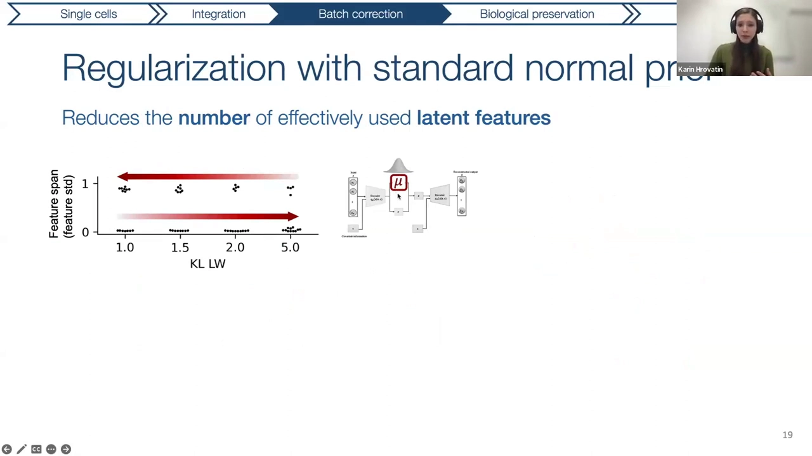

这里有个容易被忽略的细节：单细胞下游的惯例是用细胞之间的**中位距离**建邻域图，再在上面做聚类和可视化。只有少数特征还撑得开，就意味着**只有少数特征真正参与了距离计算**，其余维度虽然还在，但对结果没有贡献。

### 3.3 缩放特征后，指标不再随权重变化

于是她做了一个诊断性实验：把这些特征缩放一下，让它们在细胞间距离的计算中被更平等地使用。结果，随着 KL 权重增大，批次校正**并没有上升**，生物保留**也没有真的下降** [【跳转到 24:28】](https://www.youtube.com/watch?v=i-a4BjAn90E&t=1468)。

这个结果的含义相当重：**信息一直都在潜空间里，既没被去掉生物学、也没被去掉批次，变的只是"实际用到了几个特征"**。所以"调 KL 权重能去批次"是一种测量假象——它改变的是距离度量里各维的权重，而不是潜空间的内容。讲者的结论是：这个策略不加区分地丢信息，而且带不来跨物种场景需要的高强度整合 [【跳转到 24:53】](https://www.youtube.com/watch?v=i-a4BjAn90E&t=1493)。

## 四、对抗学习会把"比例不平衡"的群体混掉

### 4.1 判别器分不出，就必然混在一起

对抗学习的思路是主动区分批次与生物：在潜空间上加一个判别器，试图分类每个细胞来自哪个批次，再由分类损失驱动编码器去"骗过"判别器 [【跳转到 25:54】](https://www.youtube.com/watch?v=i-a4BjAn90E&t=1554)。

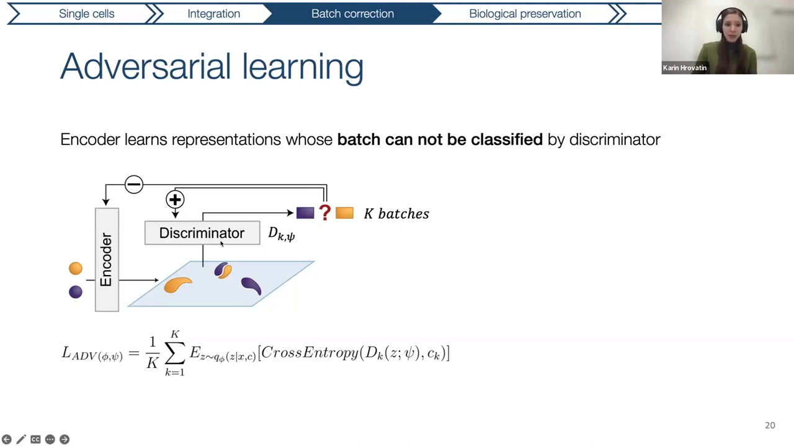

$$
L_{ADV}(\phi,\psi) = \frac{1}{K}\sum_{k=1}^{K} \mathbb{E}_{z \sim q_\phi(z \mid x, c)}\left[\mathrm{CrossEntropy}\left(D_{k,\psi}(z),\, c_k\right)\right]
$$

问题就出在"骗过判别器"这个目标本身：如果某个群体在两个批次里的细胞比例严重不平衡，判别器**本来就没法**靠它区分批次，于是这个群体不会被推到一起；反过来，判别器分不出的那些差异，就会一律被当成批次抹掉 [【跳转到 26:19】](https://www.youtube.com/watch?v=i-a4BjAn90E&t=1579)。

### 4.2 用 log 比值找出最不平衡的簇

讲者把这个现象量化得很清楚：在普通 cVAE 的 UMAP 上，她给每种细胞类型标了一个数，是**两个批次细胞数的 log 比值**——接近零表示比例平衡，离零越远表示越不平衡 [【跳转到 26:49】](https://www.youtube.com/watch?v=i-a4BjAn90E&t=1609)。

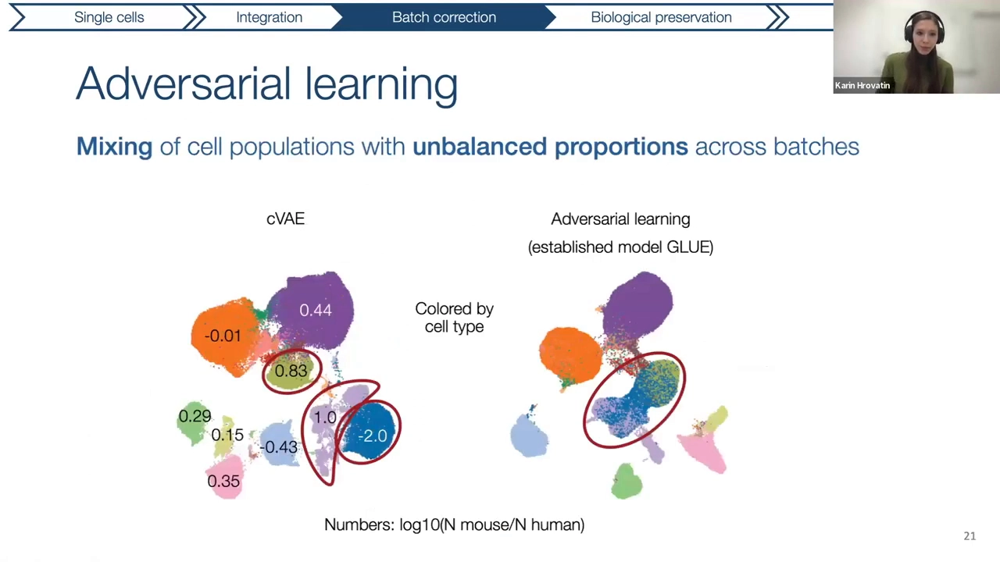

右边是对抗模型（用的是已发表的 GLUE）：被圈出的不平衡群体确实被混到了一起。讲者补充说，这也不是必然发生——如果混的是生物学上差异极大的细胞，重建损失会掉下去，模型会"抗拒"；但当我们看更细的分辨率时它经常发生，因为**细胞类型内部的变异混起来对重建损失的影响相对较小** [【跳转到 27:14】](https://www.youtube.com/watch?v=i-a4BjAn90E&t=1634)。

### 4.3 Moran's I 掉下去 = 类型内部梯度被抹平

后果可以直接用指标看到。同一个已知在特定细胞类型内可变的基因程序：非整合数据里梯度很漂亮（Moran's I = 0.67），cVAE 里基本保留（0.51），对抗模型里被混成一片（0.27）[【跳转到 28:01】](https://www.youtube.com/watch?v=i-a4BjAn90E&t=1681)。

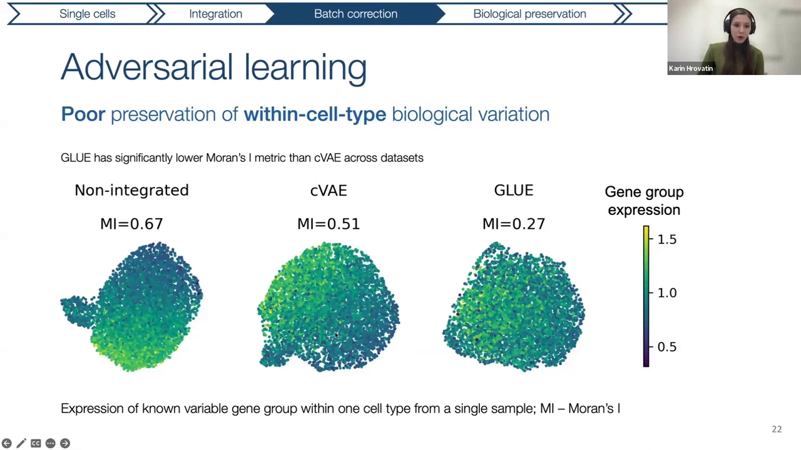

这里要注意指标的方向：**Moran's I 高说明相邻细胞在该基因上更相似**，也就是结构被保住了。0.27 不是"更好的混合"，而是"结构消失"。讲者的结论是：对抗学习不适合单细胞整合，因为批次之间经常存在细胞比例不平衡，这会带来下游错误的生物学解释 [【跳转到 28:26】](https://www.youtube.com/watch?v=i-a4BjAn90E&t=1706)。

## 五、反事实批次：换掉批次键，再把细胞编码回来

### 5.1 循环一致性的两步

这是全篇最核心的一页。做法是两步 [【跳转到 28:37】](https://www.youtube.com/watch?v=i-a4BjAn90E&t=1717)：

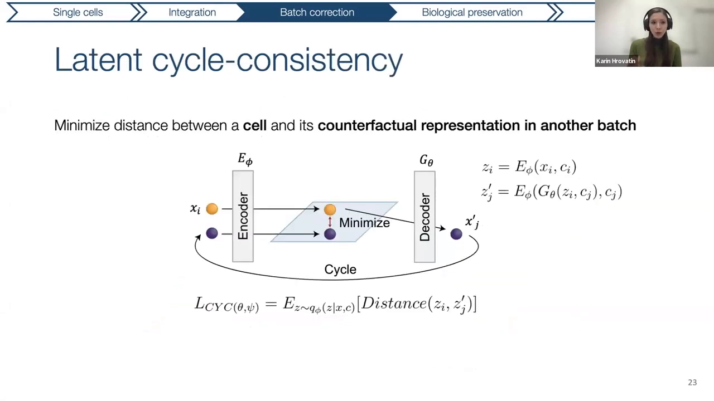

$$
z_i = E_\phi(x_i, c_i), \qquad z'_j = E_\phi\left(G_\theta(z_i, c_j),\, c_j\right)
$$

$$
L_{CYC} = \mathbb{E}_{z \sim q_\phi(z \mid x, c)}\left[\mathrm{Distance}(z_i,\, z'_j)\right]
$$

用文字说就是：

1. 把细胞 $x_i$ 连同它自己的批次键 $c_i$ 编码成 $z_i$；
2. 解码时**把批次键换成另一个批次的 $c_j$**，得到这个细胞在批次 $j$ 里的"反事实表达" $x'_j = G_\theta(z_i, c_j)$；
3. 再把这个反事实表达连同 $c_j$ 编码回潜空间，得到 $z'_j$；
4. 最小化 $z_i$ 与 $z'_j$ 的距离。

第 2 步就是"反事实批次"这个词的字面意思：**同一个细胞的生物学身份不变，只把批次标签换掉，问模型"它在该批次里会表达成什么样"**。第 3、4 步是把它变成一个可训练的损失——如果模型真的学到了"批次只是可加的条件"，那么换批次再换回来应该回到原处。

### 5.2 为什么它不会混掉不平衡群体

讲者的解释是本文最该记住的一句：这样做我们**永远只在比较生物学背景相同、只是批次不同的细胞**，所以不会像对抗学习那样把跨批次比例不平衡的群体混在一起 [【跳转到 29:02】](https://www.youtube.com/watch?v=i-a4BjAn90E&t=1742)。

这句话点出了两种做法的根本差别：

- 对抗学习是在**分布层面**对齐——它要求"整个潜空间的批次分布看起来一样"，于是任何在批次间分布不同的东西（包括真实的生物差异）都会被抹平；
- 循环一致性是在**细胞层面**对齐——它只要求"这个细胞换批次再换回来还在原地"，于是它没有动机去动那些根本不在另一个批次里出现的细胞类型。

讲者也很坦白地说，循环一致性不是新方法，单细胞领域以前用过，但它总是和对抗日学习捆在一起，所以真正的潜力被忽视了 [【跳转到 28:26】](https://www.youtube.com/watch?v=i-a4BjAn90E&t=1706)。

### 5.3 三个数据集上的指标对比

效果用同一套指标来比：三行是三个数据集（跨物种小鼠-人胰岛、类器官对原发组织、单细胞对单核），三列分别是 NMI（粗粒度生物保留）、Moran's I（细粒度生物保留）、iLISI（批次校正），绿色是循环一致性模型，深粉是普通 cVAE [【跳转到 29:41】](https://www.youtube.com/watch?v=i-a4BjAn90E&t=1781)。

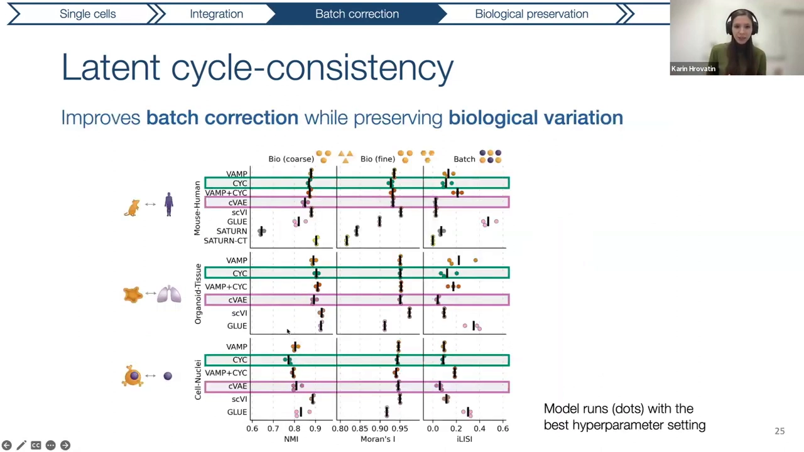

读这张图要注意两件事。第一，循环一致性在生物保留两列上和 cVAE 差不多，**提升全部来自批次校正那一列**——这正是我们想要的形状。第二，浅粉色的对抗模型 GLUE 在批次校正上比谁都高，但讲者认为这个数被高估了，因为它同时丢掉了生物学信息，属于过度整合 [【跳转到 30:06】](https://www.youtube.com/watch?v=i-a4BjAn90E&t=1806)。

这就是"反事实批次"的验收方式：**不是看批次校正有多高，而是看批次校正上升时生物保留有没有跟着掉**。

## 六、先验决定潜空间能有多"多峰"

### 6.1 VAMP 先验：参数在输入空间学

第二条改进路线动的是先验。标准正态先验是单峰的，等于假设所有细胞的状态都围绕一个中心分布；而真实的单细胞数据里细胞类型是多个团。VAMP 先验用多个高斯成分，但和高斯混合的关键区别是：**先验参数是在输入空间里学出来的**——把先验参数送进编码器得到它们的后验表示，这个表示又被当作先验的参数，于是先验和后验直接耦合 [【跳转到 32:08】](https://www.youtube.com/watch?v=i-a4BjAn90E&t=1928)。

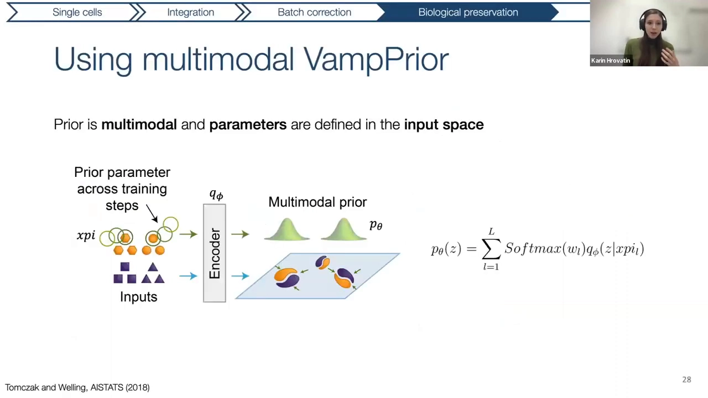

$$
p_\theta(z) = \sum_{l=1}^{L} \mathrm{Softmax}(w_l)\, q_\phi(z \mid x_{p_l})
$$

### 6.2 每个先验成分只吸一部分细胞类型、但吸两个批次

讲者说这里有个**意外的发现**：多峰先验当然改进了生物保留（潜空间更灵活），但它同时也改进了批次去除——只要把先验成分数从 1 增加到多于 1，两个方向的指标一起变好 [【跳转到 32:33】](https://www.youtube.com/watch?v=i-a4BjAn90E&t=1953)。

为什么？她把每个细胞分配给概率最高的先验成分，然后看这些成分吸到了谁：**每个先验成分只吸引一部分细胞类型的细胞，但这些细胞来自两个批次** [【跳转到 33:48】](https://www.youtube.com/watch?v=i-a4BjAn90E&t=2028)。

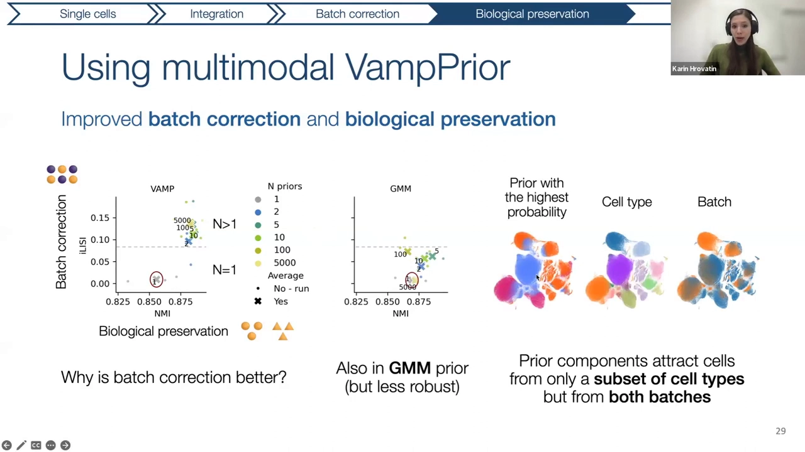

这个观察很值得停下来想一秒。它说明多峰先验给模型提供了一个"按细胞类型分桶"的天然结构，而桶是按生物学分的、不是按批次分的，于是批次自然就在桶内混开了。作为对照，普通的高斯混合先验随着成分数增加整合也会变好，但从来没有 VAMP 那么好，而且成分数加太多性能还会掉回去，稳健性差 [【跳转到 32:58】](https://www.youtube.com/watch?v=i-a4BjAn90E&t=1978)。

### 6.3 细胞类型监督：分类比对比更安全

第三条路线是用细胞类型标签做监督。讲者先讲清了它的三个局限：需要事先有标签、跨数据集的标签可能对不上、标签本身也未必真实，都可能给整合带来偏差 [【跳转到 34:38】](https://www.youtube.com/watch?v=i-a4BjAn90E&t=2078)。

在这条路线上，她比较了两种损失：对比学习（同类推近、异类推远）和分类（只要求类型可分）。问题出在对比学习：**同一细胞类型内的细胞被推到一起，会破坏类型内部的信息**，尤其当生物变异存在于比监督标签更细的分辨率上时 [【跳转到 35:53】](https://www.youtube.com/watch?v=i-a4BjAn90E&t=2153)。

讲者明确说这只是观察、还需要更多验证，但它和前面 Moran's I 那一节讲的是同一件事：**任何"把同类拉近"的目标，都会顺手抹掉类型内部的连续结构**。

## 七、组合与验证：反事实批次最后要落到"样本对齐是否讲得通"

### 7.1 用相关系数看"加强批次校正会不会伤生物保留"

把循环一致性和 VAMP 先验组合起来，讲者用了一个很聪明的评估方式：把调节批次校正强度的超参数逐步调大，然后看它与各个指标的相关性。理想情况是——与批次校正**正相关**（调大就真的更强），与生物保留**不相关**（不会顺带伤害）[【跳转到 38:12】](https://www.youtube.com/watch?v=i-a4BjAn90E&t=2292)。

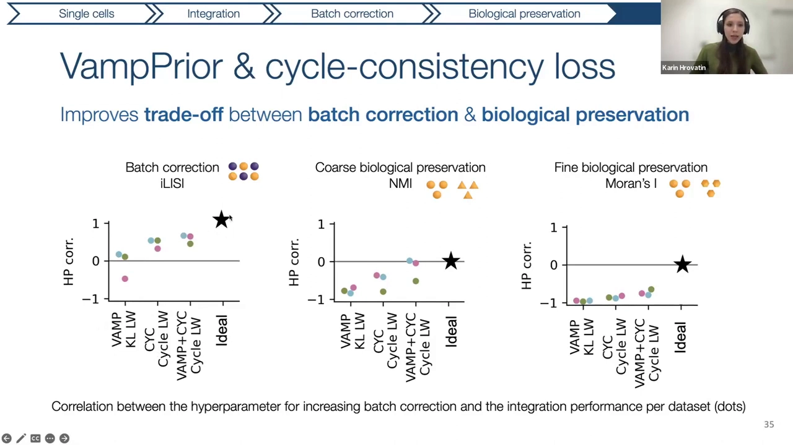

结果 VAMP+CYC 与批次校正的正相关最高，与生物保留的负相关最小。讲者据此认为组合确实改善了权衡 [【跳转到 39:02】](https://www.youtube.com/watch?v=i-a4BjAn90E&t=2342)。

这个评估框架值得单独记下来：**它检验的不是"某个设置下指标好不好"，而是"往加强批次校正的方向走，会不会伤到生物保留"**。前者是一个点，后者是一条方向。

### 7.2 视网膜类器官：反事实批次最终要对得上生物学预期

最后一个验证用的是视网膜类器官加两个视网膜组织区域的数据。原研究的结论是：类器官组织与组织外周相当相似，而这两者与组织中央凹（fovea）相当不同，中央凹还有特定标记基因的表达 [【跳转到 39:34】](https://www.youtube.com/watch?v=i-a4BjAn90E&t=2374)。

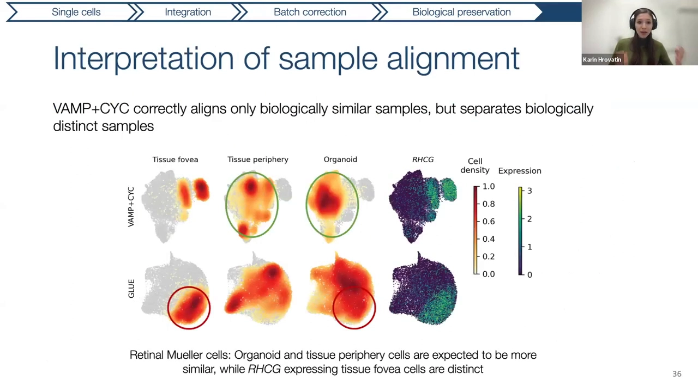

VAMP+CYC 的结果与这个预期一致：类器官和外周组织靠在一起，中央凹单独分开。而 GLUE 把类器官同时和两个区域混在一起，包括中央凹——这在生物学上是错的 [【跳转到 39:59】](https://www.youtube.com/watch?v=i-a4BjAn90E&t=2399)。

这一页把前面所有抽象指标落回了地面：**"批次转换是否可信"最终要看转换后的样本对齐关系是否符合已知的生物学预期**。指标告诉你"混得够不够、结构还在不在"，但"混得对不对"只能靠领域知识判断——这也正是讲者在 12:40 那段说的：这类评估非常依赖先验知识，很难为基准测试标准化，但在整合评估的某个阶段仍然必须看。

## 小结

- **条件解码 = 用批次键翻译潜变量**。cVAE 的编码器和解码器都吃批次键 $c$，所以 $z$ 被允许"不含批次信息"，这是"整合表示"这个说法的来源。
- **反事实批次 = 固定 $z$、换掉 $c$ 再解码**。循环一致性把它变成可训练的损失：换批次解码后重新编码，应该回到原处。
- **它成立的前提是"批次可条件化、生物与批次可分离"**，这个前提没有直接检验，只能靠多指标间接验证。
- **调 KL 权重不是去批次，是少用几个维度**。缩放特征后指标不再随权重变化，说明信息一直都在，变的是距离度量用到了哪些维。
- **对抗学习会混掉比例不平衡的群体**，因为判别器本来就分不出它们；后果可以用 log 比值定位、用 Moran's I 量化。
- **验收要看"批次校正上升时生物保留有没有掉"**，而不是只看批次校正有多高；GLUE 的高 iLISI 就是过度整合的例子。
- **多峰先验（VAMP）能同时改善两侧**，因为先验成分是按细胞类型分桶、而不是按批次分桶的。
- **最后一步必须回到生物学预期**：类器官该和外周组织像、该和中央凹不像，反事实批次的对齐结果要经得起这个判断。

## 关键术语速查

| 术语 | 一句话解释 |
| --- | --- |
| cVAE（条件变分自编码器） | 把协变量（这里是批次键）作为条件同时喂给编码器和解码器的 VAE，scVI 属于这一类 |
| 批次键 $c$ | 表示"这个细胞来自哪一批"的离散标签，是条件解码的输入之一 |
| 条件解码 | 在给定潜变量 $z$ 和批次键 $c$ 的情况下生成表达分布，记作 $p_\theta(x \mid z, c)$ |
| 反事实批次 | 固定细胞的 $z$、把批次键换成另一个批次再解码，得到"它在该批次里会怎么表达" |
| 循环一致性 | 换批次解码后再编码回潜空间，要求回到原来的位置，从而约束批次变换是可逆的 |
| iLISI | 衡量 KNN 邻域里批次混合程度的指标，越高说明批次混得越开 |
| NMI | 衡量先验细胞类型注释与数据聚类的一致程度，看粗粒度生物保留 |
| Moran's I | 空间自相关指标，用来衡量细胞类型内部基因梯度是否被保住 |
| 过度整合 | 批次校正指标很高但生物信息被抹掉的状态，指标本身无法与"整合得好"区分 |
| VAMP 先验 | 参数在输入空间学出来的多峰先验，能让潜空间按细胞类型分桶 |