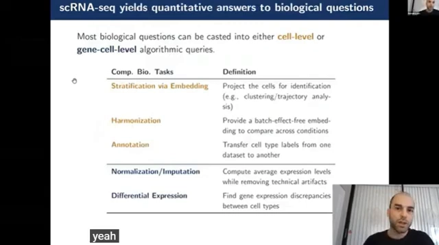
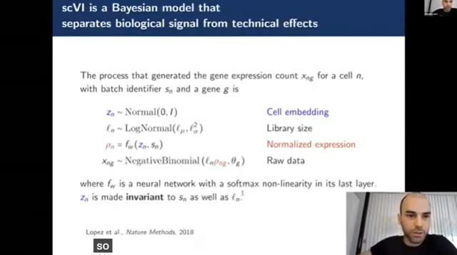
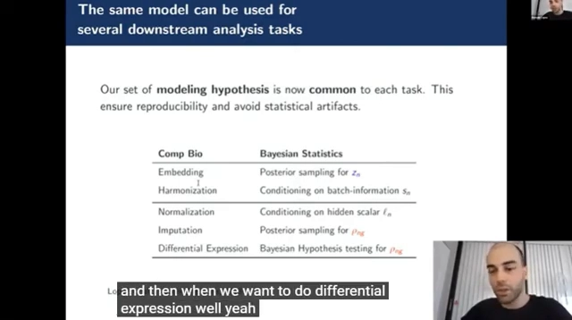
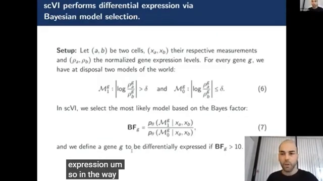
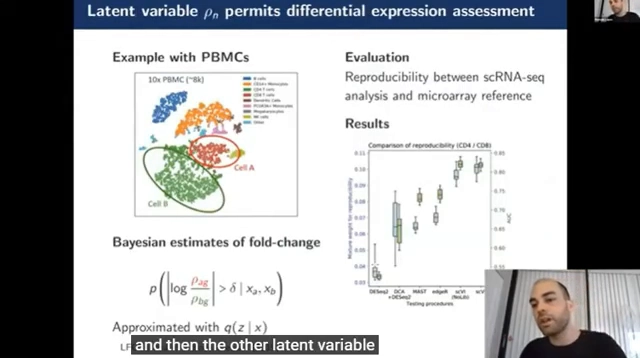
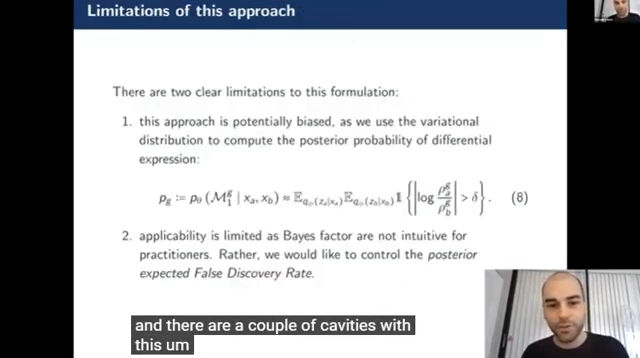
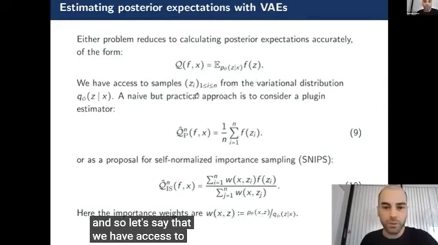
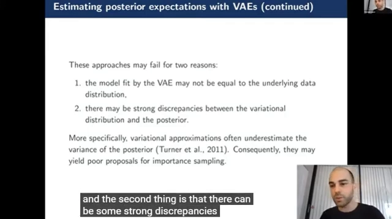
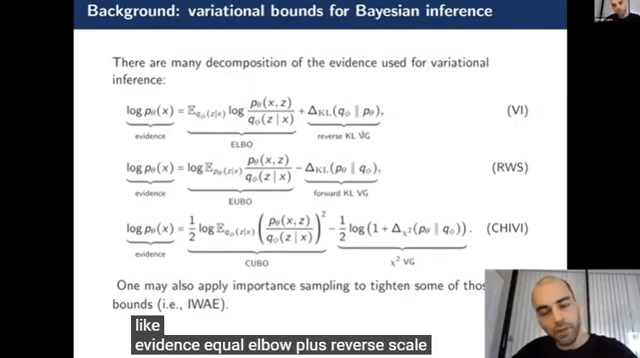
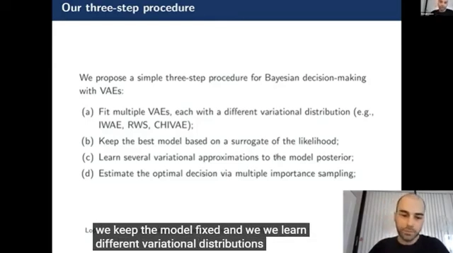

# scVI 差异表达比的是模型内的表达比例，不是原始计数

> 视频来源：[Single Cell Genomics (Deep Learning Lecture)](https://www.youtube.com/watch?v=TSMX7UWqESo)（YouTube · Seung-Tai Park 的深度学习课程第 10 讲 · 客座讲者 Romain Lopez，scVI 第一作者）｜时长约 88 分钟
> 简要导读：本讲是 Romain Lopez 讲 scVI 的客座报告。本文只取后半段，重点在他最后十分钟才展开的差异表达：scVI 不在原始计数上做检验，而是在模型内部的表达比例上做贝叶斯模型选择；以及幻灯片上那两个"细胞"在实验设计里究竟代表什么。

## 本讲要解决的核心问题（SCQA）

**背景**：单细胞分析的最后一步通常是差异表达——找出哪些基因在两组细胞之间不同。大家熟悉的做法是回到原始计数矩阵上，套一个负二项模型，算 p 值再校正。

**冲突**：scVI 把归一化、批次校正、插补都做进了同一个概率模型，可流水线走到差异表达时又回到原始计数上另起一套假设。讲者当年正是被这件事卡住的："为什么我们非得把数据改这么多、为什么每一步要用假设不同的算法？差异表达建的是负二项模型，这挺好的，为什么不能把它回收去干别的活？" [【跳转到 52:04】](https://www.youtube.com/watch?v=TSMX7UWqESo&t=3124)

**疑问**：如果差异表达也在这个模型里做，它比的到底是什么量？它凭什么说一个基因"显著"？这个"显著"跟实验设计里的重复、样本、伪重复又是什么关系？

**回答（中心思想）**：scVI 的差异表达是**在模型内部做贝叶斯模型选择**。它不看原始计数，而是看解码出来的归一化表达比例 $\rho$；对每个基因定义"$\lvert\log(\rho_a/\rho_b)\rvert > \delta$"这个假设，用 Bayes factor 判定。"模型条件"在这里的作用是：批次和文库大小已经被条件化掉，比较发生在净化后的 $\rho$ 上；而"统计单位"在这里是**细胞**——样本层级的结构模型并不知道，得由使用者自己补。

---

## 一、scVI 把分析任务分成两层，差异表达在第二层

### 1.1 生物问题要先被翻译成"查询"

讲者一开始就把话说得很清楚：生物问题总是先被提出来，然后才被翻译成算法上的"查询"；这些查询并没有被严格定义过，但可以一路推到数学和统计上 [【跳转到 50:24】](https://www.youtube.com/watch?v=TSMX7UWqESo&t=3024)。

他把这些查询分成两类：

- **细胞层级的查询**：给细胞分层（投影到低维流形，也就是 PCA、各种 VAE）、轨迹推断、多个数据集的整合、注释迁移。
- **基因—细胞层级的查询**：归一化与插补、差异表达。

这张表值得多看一眼，因为它决定了后面所有讨论的位置：**差异表达是"基因 × 细胞"这一层的事**，它的输出是逐基因的，不是逐细胞的。所以它天然要跟"细胞属于谁"这件事打交道——你想比较的是哪些细胞、这些细胞从哪来。

### 1.2 差异表达问的是"两袋细胞之间哪个基因不同"

讲者对差异表达的描述只有一句话，但这句话里藏了本节的关键词：

> "我们有两群细胞——讲者原话是'两个细胞，或者两种细胞类型，我猜是两袋细胞'——想知道哪个基因在两者之间显著不同。这是一个假设检验问题。" [【跳转到 52:29】](https://www.youtube.com/watch?v=TSMX7UWqESo&t=3149)

注意中间那次改口："两个细胞" → "两袋细胞"。这不是口误，而是这件事最要紧的地方：**差异表达从来不是在两个细胞之间做的**，它比的是两个**细胞群体**的表达分布。而 scVI 的差异表达幻灯片上，写的偏偏就是两个细胞 $a$ 和 $b$（后面第三章会看到）。这个落差正是"统计单位"问题的入口。

### 1.3 为什么不能直接对计数做检验：两个混杂因子

讲者列了单细胞分析的几类技术噪声，其中两类被明确点名为**差异表达里的混杂因子（confounder，字幕里被识别成 co-founder）**：

1. **测序深度可变**。同一个细胞可能测到一千条转录本，也可能测到一万五千条。这里面有一些生物学信息，但大多数时候要校正掉，因为它会混进差异表达里 [【跳转到 52:04】](https://www.youtube.com/watch?v=TSMX7UWqESo&t=3124)。
2. **批次效应**。数据集特有的偏倚，让一个数据集里的测量值没法直接和另一个数据集比。

还有一点：计数矩阵来自一个高维的多元计数分布，而它的均值被压得很靠近零，所以观测值**非常不高斯**。讲者的结论是——"我们得认真想想，往生成模型里放什么类型的分布"。

这三条合起来解释了为什么"直接在计数上做检验"让人不放心：深度和批次都在里面，而计数分布本身又不是高斯的。scVI 的应对办法是把这两件事都变成模型里的**条件**。

## 二、同一个模型干五件事，差异表达是"对 ρ 做假设检验"

### 2.1 生成过程：z、l、ρ 三层

scVI 的生成过程，讲者用四行公式写完了：

$$
\begin{aligned}
z_n &\sim \mathrm{Normal}(0, I) && \text{细胞嵌入} \\
\ell_n &\sim \mathrm{LogNormal}(\mu_\ell, \sigma_\ell^2) && \text{文库大小} \\
\rho_n &= f_w(z_n, s_n) && \text{归一化表达} \\
x_{ng} &\sim \mathrm{NegativeBinomial}(\ell_n \rho_{ng}, \theta_g) && \text{原始计数}
\end{aligned}
$$

其中 $s_n$ 是这个细胞的批次标识，$f_w$ 是一个末端带 softmax 的神经网络，$\theta_g$ 是逐基因的离散度。

这四行里有三个细节直接决定了差异表达长什么样：

- $\rho_n$ 是一个**和为 1 的向量**（softmax 的功劳），讲者的说法是它给出"期望的表达频率"。所以 $\rho$ 是一个**比例**，不是计数，也不是经过 log 变换的标准化表达。
- $\rho$ 是 $z$ 和 $s$ **两个输入**的函数。也就是说，同一个细胞的 $\rho$ 会随你把它放在哪个批次下解码而改变——这就是"模型条件"的字面含义。
- $z_n$ 被明确要求对 $s_n$ 和 $\ell_n$ **不变**（"$z_n$ is made invariant to $s_n$ as well as $\ell_n$"）。技术信息被推到 $\ell$ 和 $s$ 这两条支路上，$z$ 只留生物学变异。

### 2.2 五种任务对应五种贝叶斯操作

有了这个模型，前面那张任务表就可以逐行翻译成贝叶斯语言。讲者给了一张对照表，标题是"同一个模型可以用于多个下游分析任务"，副标题是"我们的建模假设现在是**共享**的，这保证了可重复性、避免了统计伪影"：

| 计算生物学任务 | 贝叶斯统计里的对应操作 |
| :--- | :--- |
| 嵌入（Embedding） | 对 $z_n$ 做后验采样 |
| 整合（Harmonization） | 以批次信息 $s_n$ 为条件 |
| 归一化（Normalization） | 以隐标量 $\ell_n$ 为条件 |
| 插补（Imputation） | 对 $\rho_{ng}$ 做后验采样 |
| **差异表达（Differential Expression）** | **对 $\rho_{ng}$ 做贝叶斯假设检验** |

这张表是本节最该记住的东西。它说明了两件事：

第一，**差异表达不是模型外面的一步，而是模型的第五种查法**。它跟插补用的是同一个 $\rho$，只不过插补要的是 $\rho$ 的取值，差异表达要的是 $\rho$ 的一个假设检验结论。讲者的原话是："至于差异表达——我们可以把某个生物学假设检验问题写出来，基于 $\rho$ 去解，scVI 的差异表达就是这么做的。" [【跳转到 67:54】](https://www.youtube.com/watch?v=TSMX7UWqESo&t=4074)

第二，**"归一化"和"整合"在表里是"条件"，不是"预处理"**。这一点跟传统流水线正好相反：传统做法是先除文库大小、再跑 Harmony 之类的方法校正批次，然后拿校正后的矩阵去做检验；scVI 里这两件事是模型的结构约束，$\rho$ 天生就已经在"给定 $\ell$ 和 $s$"的条件下定义了。

### 2.3 "模型条件"在这里的确切含义

把上面两条合起来，就能给"模型条件"一个不含糊的说法：

> scVI 的差异表达比较的是 $\rho$，而 $\rho = f_w(z, s)$ 是**在给定批次条件下**解码出来的表达比例。你比较的不是"测到的计数"，也不是"除完文库大小再取 log 的表达量"，而是"模型认为这个细胞在某个批次条件下应该有的表达频率"。

这带来一个直接后果：**同一批细胞，换一个 $s$ 去解码，$\rho$ 就变了，差异表达的结果也会变**。这既是 scVI 的卖点（可以把批次当作可控旋钮），也是它的责任所在——你必须说清楚自己在哪个条件下做的比较。（把同一批细胞放到另一个批次条件下解码，就是所谓"反事实批次"，属于相邻小节 3.2.2 的范围，这里不展开。）

## 三、差异表达 = 贝叶斯模型选择：δ 定义"差异"，Bayes factor 定义"证据"

### 3.1 两个模型

真正的差异表达幻灯片只有一页，标题一句话就把立场摆明了：**"scVI 通过贝叶斯模型选择来做差异表达。"**

设定是这样的：令 $(a, b)$ 是**两个细胞**，$(x_a, x_b)$ 是它们各自的测量值，$(\rho_a, \rho_b)$ 是它们的归一化表达水平。对每个基因 $g$，我们手上有两个关于世界的模型：

$$
\mathcal{M}^g_1:\ \left\lvert \log \frac{\rho_{ag}}{\rho_{bg}} \right\rvert > \delta,
\qquad
\mathcal{M}^g_0:\ \left\lvert \log \frac{\rho_{ag}}{\rho_{bg}} \right\rvert \le \delta
$$

这里有两个设计决定值得停下来看：

- **被检验的量是 $\log(\rho_a/\rho_b)$，也就是两个细胞表达比例之比的对数**。因为 $\rho$ 是比例、是和为 1 的向量，这个比值的对数就是通常说的 log fold change（对数倍变化），只不过它是在模型内部算的，不是在观测计数上算的。
- **零假设不是一个点，而是一个区间**。传统检验的零假设是"差值为 0"，而这里 $\mathcal{M}_0$ 是"$\lvert\log(\rho_a/\rho_b)\rvert \le \delta$"——一个宽度为 $2\delta$ 的区间。$\delta$ 就是**效应量阈值**：小于 $\delta$ 的变化，我们干脆不认为它算"差异"。讲者举的例子是 $0.5$。

这个改动看起来小，实际上把"统计显著"和"实际有意义"两件事缝在了一起。传统做法里，效应量阈值是你在拿到 p 值之后自己加的一道过滤；这里它进了假设本身。

### 3.2 Bayes factor 与阈值 10

有了两个模型，判定方式是算 Bayes factor：

$$
\mathrm{BF}_g = \frac{p_\theta\!\left(\mathcal{M}^g_1 \mid x_a, x_b\right)}{p_\theta\!\left(\mathcal{M}^g_0 \mid x_a, x_b\right)}
$$

然后规定：$\mathrm{BF}_g > 10$ 就说这个基因差异表达。讲者补了一句出处——"这是很老的贝叶斯教材里写的：如果优势比大于 10，你就可以说这个基因差异表达了" [【跳转到 79:39】](https://www.youtube.com/watch?v=TSMX7UWqESo&t=4779)。

这两个后验概率是怎么算出来的？幻灯片上的公式是：

$$
p_g := p_\theta\!\left(\mathcal{M}^g_1 \mid x_a, x_b\right)
\approx \mathbb{E}_{q_\phi(z_a \mid x_a)}\,\mathbb{E}_{q_\phi(z_b \mid x_b)}\!\left[\mathbb{1}\!\left(\left\lvert \log \frac{\rho_{ag}}{\rho_{bg}} \right\rvert > \delta\right)\right]
$$

读法很直白：**从两个细胞各自的后验分布里采样 $z$，解码出 $\rho$，看这对 $\rho$ 的比值是否超过阈值，再对指示函数取平均**。这个平均值就是"这个基因差异表达"的后验概率。Bayes factor 就是两个模型后验概率的比。

注意这里出现了两个近似符号：$\approx$ 和 $q_\phi$。它意味着整个判定建立在**变分后验**上，而不是真实后验——这一点在第五章会变成一个明确的局限。

### 3.3 为什么这样写，而不是套一个 t 检验

讲者在别处解释过为什么非要走概率路线：PCA 那种做法"等价于让 $\sigma \to 0$ 解概率 PCA"，一旦这么做，"我们就丢掉了'本来是在一个概率模型里工作'这件事"；而"有些应用里，**拿到测量值的不确定性**真的很重要，**差异表达尤其如此**" [【跳转到 52:04】](https://www.youtube.com/watch?v=TSMX7UWqESo&t=3124)。

换成直白的话：差异表达的每一个结论，本质上都是在比较两个**我们没能直接观测到**的量（$\rho_a$ 和 $\rho_b$）。你观测到的是带噪声的计数 $x_a$、$x_b$。所以"这两个 $\rho$ 到底差多少"只能是一个后验问题。t 检验把这件事压缩成一个点估计加一个标准误；模型选择则保留了整个后验，然后直接问"差值超过 $\delta$ 的概率有多大"。

代价是：你必须相信这个模型，而且你必须能算准那个后验。这两条正是下一章和第五章的主题。
## 四、PBMC 上的验证：看的是排序一致性

### 4.1 做法：用后验概率给基因排序

模型写完了，怎么知道它给出的差异表达可信？讲者的验证思路是：不去争"哪个基因真的差异表达"（没有金标准时这没法判），而是看**排序**。

在 PBMC 数据上，他圈出两群细胞（幻灯片上标为 Cell A 和 Cell B），然后对每个基因算

$$
p\!\left(\log \frac{\rho_{ag}}{\rho_{bg}} > \delta \;\middle|\; x_a, x_b\right),
$$

幻灯片下方注明这个量是"用 $q(z \mid x)$ 近似的"。按这个概率从大到小排，就得到一个基因排序。

### 4.2 结果：不输其他方法，甚至略好

参照物选的是**微阵列**。讲者解释了这个选择：微阵列"稳定得多，而且是在非常明确的细胞类型上做的" [【跳转到 71:02】](https://www.youtube.com/watch?v=TSMX7UWqESo&t=4262)。把 scVI 和其他方法给出的基因排序跟微阵列比一致性，结果是"scVI 排得一样好、甚至略好一点"。

这个结果对讲者的意义不止是"这个方法不错"，而是"**同一个模型可以拿来做所有这些任务**"——从嵌入、整合到差异表达，不需要在流水线中途换一套假设。

### 4.3 这个验证证明了什么、没证明什么

值得替他补一句边界：

- **证明了**：$\rho$ 上的后验概率排序，跟一个独立技术平台给出的差异排序是吻合的。这说明模型内部的比较没有跑偏。
- **没证明**：$\mathrm{BF} > 10$ 这个阈值校准得好不好。排序一致只说明"相对次序对"，不说明"被这条线切出来的基因集合里假阳性有多少"。这正是讲者接下来自己承认的第二个局限。

## 五、两个局限：后验是近似的，阈值不是 FDR

讲者没有把这一页藏起来，而是直接标题写成"这个做法的局限"，然后列了两条。

### 5.1 局限一：这个做法可能有偏

幻灯片上的原话是："这个做法可能有偏，因为我们用变分分布来计算差异表达的后验概率。" 对应到公式里就是那个 $q_\phi$：

$$
p_g \approx \mathbb{E}_{q_\phi(z_a \mid x_a)}\,\mathbb{E}_{q_\phi(z_b \mid x_b)}\!\left[\mathbb{1}\!\left(\left\lvert \log \frac{\rho_{ag}}{\rho_{bg}} \right\rvert > \delta\right)\right]
$$

讲者的口头解释是："我们算这些后验概率时，是拿变分分布去顶替真正的后验；如果后验是错的，我们就麻烦了。" [【跳转到 80:04】](https://www.youtube.com/watch?v=TSMX7UWqESo&t=4804)

### 5.2 局限二：Bayes factor 大于 10 不是 FDR

第二条更实际："这类方法的适用性有限，因为很多人想看到的是一个他们熟悉的量的控制——'Bayes factor 大于 10'这个说法，不如控制错误发现率（FDR）那么可信。" [【跳转到 80:29】](https://www.youtube.com/watch?v=TSMX7UWqESo&t=4829)

这句话点出了一个非常具体的使用障碍：$\mathrm{BF} > 10$ 是一个**没有校准过的经验阈值**，它来自"很老的贝叶斯教材"，而不是来自任何关于假阳性比例的保证。审稿人问"你控制了 FDR 吗"，你没法用"我的 BF 都大于 10"回答。

### 5.3 两个问题其实是同一件事

讲者把这两条收在一句话里："这两个问题其实是同一件事的两面，也就是**如何准确地计算后验期望**。" [【跳转到 80:54】](https://www.youtube.com/watch?v=TSMX7UWqESo&t=4854)

- 第一条直接就是"后验算不准"。
- 第二条绕一点：要控制 FDR，你得对每个基因算出"它差异表达的后验概率"，再把这些概率按某种规则转成拒绝集合——这同样是在算后验期望，只不过算的是一个更复杂的泛函。

于是问题被规约成一个干净的数学任务：**给定变分分布，怎么准确估计 $\mathbb{E}_{p_\theta(z\mid x)} f(z)$？**

$$
Q(f, x) = \mathbb{E}_{p_\theta(z \mid x)} f(z)
$$

## 六、变分后验低估方差，所以决策要另想办法

### 6.1 两个朴素估计量

假设我们手上有从变分分布 $q_\phi(z \mid x)$ 采出来的样本 $(z_i)_{1 \le i \le n}$，最直接的两个做法是：

**plug-in 估计**——把变分分布上的东西全平均掉：

$$
\hat{Q}^{\mathrm{P}}_n(f, x) = \frac{1}{n}\sum_{i=1}^{n} f(z_i)
$$

**自归一化重要性采样（SNIPS）**——用密度比给样本重新加权，把"更有希望"的样本留下来：

$$
\hat{Q}^{\mathrm{S}}_n(f, x) = \frac{\sum_{i=1}^{n} w(x, z_i) f(z_i)}{\sum_{j=1}^{n} w(x, z_j)},
\qquad
w(x, z) := \frac{p_\theta(x, z)}{q_\phi(z \mid x)}
$$

### 6.2 为什么这两个在朴素 VI 上都不太行

讲者给了两个原因，第二个是本节最实用的一条知识：

1. **VI 拟合出来的模型可能不等于数据分布**。这是模型本身的问题——"你能找到更好的模型总是更好，无论算差异表达还是用 VAE 做决策"。
2. **变分分布和真实后验之间可能有很大的差距**。而且这个差距有方向性：**变分推断会低估后验的方差**（幻灯片上引的是 Turner et al., 2011）。

第二条为什么致命？因为重要性采样的正确性依赖于提议分布能覆盖目标分布。如果 $q_\phi$ 太窄，你采到的样本全都挤在众数附近，"你根本没有覆盖整个众数，或者采样不够，分布非常局部化" [【跳转到 82:34】](https://www.youtube.com/watch?v=TSMX7UWqESo&t=4954)。结果不是稍微差一点，而是**方差巨大、性能灾难性**——你以为自己拿到了无偏估计，实际上拿到的是一个方差失控的估计。

### 6.3 换一个方向：用"高估方差"的界

讲者的转折很漂亮：既然下界（ELBO）配的变分分布**低估**方差，那就去找**高估**方差的上界。证据的三种分解摆在一起是这样的：

$$
\begin{aligned}
\log p_\theta(x) &= \underbrace{\mathbb{E}_{q_\phi(z\mid x)} \log \frac{p_\theta(x,z)}{q_\phi(z\mid x)}}_{\text{ELBO}} + \underbrace{\Delta_{\mathrm{KL}}\!\left(q_\phi \,\Vert\, p_\theta\right)}_{\text{reverse KL 间隙}} \\[4pt]
\log p_\theta(x) &= \underbrace{\log \mathbb{E}_{p_\theta(z\mid x)} \frac{p_\theta(x,z)}{q_\phi(z\mid x)}}_{\text{EUBO}} - \underbrace{\Delta_{\mathrm{KL}}\!\left(p_\theta \,\Vert\, q_\phi\right)}_{\text{forward KL 间隙}} \\[4pt]
\log p_\theta(x) &= \underbrace{\tfrac{1}{2}\log \mathbb{E}_{q_\phi(z\mid x)} \left(\frac{p_\theta(x,z)}{q_\phi(z\mid x)}\right)^{2}}_{\text{CUBO}} - \underbrace{\tfrac{1}{2}\log\!\left(1 + \Delta_{\chi^2}(p_\theta \,\Vert\, q_\phi)\right)}_{\chi^2 \text{ 间隙}}
\end{aligned}
$$

讲者的解读是：EUBO 和 CUBO 都是**上界**，它们的间隙分别对应前向 KL 和卡方散度；这些上界"不是低估方差，而是高估方差，这对重要性采样来说好得多" [【跳转到 83:49】](https://www.youtube.com/watch?v=TSMX7UWqESo&t=5029)。

### 6.4 三步流程

把这些拼起来，就是论文提出的流程。幻灯片上写的是四小步，讲者口头上叫"三步"：

1. **拟合多个 VAE**，每个用不同的变分分布（例如 IWAE、RWS、CHIVAE）；
2. **按似然的替代指标留下最好的那个模型**；
3. **固定模型**，再学出若干个对模型后验的变分近似；
4. **用多重重要性采样估计最优决策**。

实践中他们观察到的分工很有意思：**EUBO 很擅长学模型，卡方散度很擅长在模型学好之后做决策**，所以两者要结合起来用 [【跳转到 84:14】](https://www.youtube.com/watch?v=TSMX7UWqESo&t=5054)。论文里还有一部分理论，用集中不等式量化重要性采样的误差，并提出了一种基于卡方界的新 VI；实验除了单细胞数据，还在概率 PCA 和 MNIST 上做过 [【跳转到 84:39】](https://www.youtube.com/watch?v=TSMX7UWqESo&t=5079)。

这条线的意义在于：**差异表达的可靠性问题，最后被还原成了一个数值积分问题**。你不需要换模型，你需要的是把后验期望算准；而算准的办法不是把变分族调得更灵活（那反而会带来第五章之外的另一类问题），而是换一个方向的界、再用多重重要性采样把几个提议分布合起来。

## 七、统计单位：幻灯片上写的是"两个细胞"

到这里，视频里关于差异表达的内容就讲完了。但回到本节的学习目标，还有一半没落地：**这套东西的统计单位是什么？细胞级推断和样本级推断差在哪？**

这一章要把话说清楚：**视频里没有讨论样本层级结构**——它从头到尾的设定都是"两个细胞 $a$ 和 $b$"。所以下面不是转述，而是把这张幻灯片翻译成实验设计的语言，看它在什么条件下成立、在什么条件下会出问题。

### 7.1 从"两个细胞"到"两袋细胞"

幻灯片写的是两个细胞；讲者在第 52:29 秒处说的是"两个细胞，或者两种细胞类型，我猜是**两袋细胞**"。这两句话的差别，就是统计单位的差别。

- 如果真的是**两个细胞**：你比的是这两个具体细胞此刻的表达比例。它回答的是"这两个细胞像不像"，不是"这两个条件有没有差别"。
- 如果是**两袋细胞**：你比的是两个群体的表达分布。这时 $\rho_a$ 和 $\rho_b$ 应该理解成群体的代表值（比如群体平均的 $\rho$），而"这个基因是否差异表达"是一个关于**群体**的陈述。

scVI 的接口在这一点上是诚实的：它接收的是两组细胞的索引，内部对每组分别做后验采样再比较。也就是说，**它默认把"一袋细胞"聚合成一个代表值，然后把这个代表值的不确定性归因于"细胞的抽样"**。这正是问题所在。

### 7.2 细胞当独立重复 = 伪重复

假设你的实验是这样的：3 个健康供体、3 个处理供体，每个供体测了几千个细胞。你在处理组和对照组之间做差异表达。

在这个设计里，**独立的实验单位是供体（6 个），不是细胞（几万个）**。同一个供体的一千个细胞共享同一套基因组、同一个捕获批次、同一次文库制备，它们之间是高度相关的。如果模型把每个细胞都当成一次独立抽样，那么"细胞数"这个分母会被算得极大，任何微小的差异都会变得"显著"——这就是**伪重复（pseudo-replication）**。

伪重复的危害不是"结果一定错"，而是**不确定性的尺度错了**。你会得到一堆 $\mathrm{BF}$ 远超 10 的基因，但这些基因在不同供体之间可能根本不一致。换句话说：你检验的是一个关于"这一批细胞"的陈述，却把它当成了关于"这个条件"的陈述。

### 7.3 模型的条件能吸收什么、不能吸收什么

scVI 的条件化设计很容易让人误以为它已经处理了这个问题。把它的条件逐条对一遍：

| 模型里的条件 | 吸收了什么 | 没吸收什么 |
| :--- | :--- | :--- |
| $\ell_n$（文库大小） | 测序深度差异 | 与深度相关的细胞质量差异 |
| $s_n$（批次标识） | 数据集/通道级别的技术偏倚 | **供体身份**（除非你把供体当成批次） |
| $z_n$（潜变量） | 细胞状态、类型、连续变异 | 供体内相关性 |

关键在第二行和第三行之间：**批次和供体不是一回事**。批次是技术分组（哪一天、哪个通道、哪台机器），供体是生物学分组。把供体塞进 $s_n$ 会让模型把"供体差异"当成技术噪声抹掉——这既可能抹掉你想要的生物学信号，也掩盖了"处理效应在供体间不一致"这个事实。

讲者自己提到过这个方向的边界：批次效应"在很多场景下其实相当容易"因子化掉，真正难的是把连续信息、对齐误差、其他协变量因子化出去；而他给出的例子（tvi 处理细胞周期）恰恰是失败的——"问题出在参数化变分分布的那个神经网络太灵活了" [【跳转到 78:57】](https://www.youtube.com/watch?v=TSMX7UWqESo&t=4737)。这句话的教训是：**条件化不是万能的，它能不能真的把某个因素摘干净，是要检验的，不能假定。**

### 7.4 把统计单位补回来的四种做法

既然模型的默认单位是细胞，样本层级就得由使用者补。按"改动发生在哪一层"排序：

1. **改比较对象：在样本层级做比较**。先把每个样本的细胞聚合成一个伪 bulk 表达谱，再在样本之间比。这样独立单位回到供体，代价是丢掉了细胞类型分辨率——除非你在每个细胞类型内部各做一次。
2. **改输入：把供体作为条件显式写进模型**。让 $s_n$ 编码供体而不是批次，或者同时编码两者；这样 $\rho$ 是在"给定供体"的条件下解码的，比较发生在供体内。代价是每个供体都要有足够细胞，且条件之间要有配对结构。
3. **改推断：在细胞级结果上做样本级的汇总**。对每个基因，先算出每个供体内的效应量，再看这 6 个（或更多）效应量是否一致地偏离 0。这把"细胞数"从分母里拿掉了。
4. **不改模型，改报告方式**：明确写出"本分析的统计单位是细胞"，把 $\mathrm{BF}$ 当作**排序工具**而不是显著性判据，并且同时报告效应量 $\log(\rho_a/\rho_b)$ 的后验区间和供体间一致性。

这四条不是互斥的，实际工作里最稳的组合是 2 + 4：模型里保留供体结构，报告时把效应量和一致性一起给出。

### 7.5 一份对照实验设计的检查清单

把这一章压成一张可以照着问的清单：

- **独立单位是什么？** 供体、小鼠、培养孔、还是细胞？写下来。
- **每个条件有几个独立单位？** 少于 3 个的话，任何细胞级的"显著"都要打问号。
- **$s_n$ 里装的是什么？** 批次、供体、还是两者混在一起？如果是后者，$\rho$ 的条件含义就不清楚了。
- **$\delta$ 定在多少，为什么？** $\delta = 0.5$ 是讲者举的例子，不是通用默认值；它应该由"多大的倍变化在生物学上值得追"决定。
- **$\mathrm{BF} > 10$ 之后你打算怎么报告？** 如果答案是"当作显著"，那你需要补一个 FDR 或者一个样本级的验证——这正是讲者第五章承认的缺口。
- **换一个 $s$ 解码，结论还稳吗？** 这是 scVI 特有的检查：差异表达依赖条件，条件换了结论变了，说明你看到的"差异"里混着技术成分。

## 小结

- scVI 把分析任务分成**细胞层级**和**基因—细胞层级**两类；差异表达属于后者，输出是逐基因的。
- 差异表达在这个模型里不是外部的一步，而是**第五种查法**：对 $\rho_{ng}$ 做贝叶斯假设检验。$\rho$ 是 softmax 之后的表达比例，是 $z$ 和批次 $s$ 的函数。
- "模型条件"的确切含义是：**比较发生在给定 $\ell$ 和 $s$ 解码出的 $\rho$ 上**，而不是在原始计数或 log 标准化表达上。换条件，结论会变。
- 判定方式是**贝叶斯模型选择**：$\mathcal{M}_1$ 是 $\lvert\log(\rho_a/\rho_b)\rvert > \delta$，$\mathcal{M}_0$ 是落在 $\delta$ 以内；用 Bayes factor 比较，$\mathrm{BF} > 10$ 判为差异表达。$\delta$ 把"效应量阈值"写进了假设本身。
- 两个局限讲者自己点明了：后验是用变分分布近似的（可能有偏），$\mathrm{BF} > 10$ 也不等于控制了 FDR。两者都归结为**后验期望算不准**。
- 变分推断**低估**后验方差，所以朴素的重要性采样会给出方差失控的估计；出路是用 EUBO/CUBO 这类**高估**方差的上界，配合"多模型 + 多提议分布 + 多重重要性采样"的流程。
- 统计单位是这套方法最容易被忽略的一环：**模型默认的单位是细胞**，样本层级的结构与伪重复必须由使用者补上——改比较对象、改条件、改汇总层级，或者至少改报告方式。

## 关键术语速查

| 术语 | 一句话解释 |
| :--- | :--- |
| 归一化表达 $\rho_{ng}$ | 模型解码出的、每个细胞上各基因表达频率组成的向量（和为 1），差异表达比的就是它 |
| 文库大小 $\ell_n$ | 每个细胞测到的转录本总量的缩放因子，从对数正态先验采样，用来吸收测序深度差异 |
| 批次标识 $s_n$ | 显式写进生成模型的技术分组变量；$\rho$ 以它为条件，因此潜空间对批次不变 |
| 贝叶斯模型选择 | 把"是否差异表达"写成两个互斥模型，用后验概率（或其比值）来选，而不是算 p 值 |
| $\delta$（效应量阈值） | 定义"算不算差异"的 log fold change 门槛；$\mathcal{M}_0$ 是 $\lvert\log(\rho_a/\rho_b)\rvert \le \delta$ 这个区间 |
| Bayes factor | 两个模型后验概率之比；讲者用的经验阈值是大于 10 |
| 变分后验 $q_\phi(z \mid x)$ | 用来顶替真实后验的近似分布；它低估方差，是差异表达偏差的来源 |
| ELBO / EUBO / CUBO | 证据的三种界；前两个分别是下界与上界，CUBO 是配卡方散度的上界，方差被高估，适合做重要性采样 |
| SNIPS | 自归一化重要性采样，用密度比 $p(x,z)/q(z\mid x)$ 给样本加权 |
| 伪重复 | 把同一供体内高度相关的细胞当作独立重复，导致不确定性的尺度被低估 |
