# 密码子：3 个碱基如何决定 1 个氨基酸——遗传密码的定义与破译

> 来源：Bilibili 视频《【分子生物学】第4章 翻译 | 第1节 mRNA | 遗传密码（三联子密码及其破译）》（UP 主：轻轻松松学分子，[BV1Ui42127rX](https://www.bilibili.com/video/BV1Ui42127rX/)，时长 39:27）。
> 本文基于视频字幕与画面逐窗口整理而成，配图取自视频截图，时间戳可跳回原视频对应位置核对。这一讲把「密码子」讲透：它是什么、为什么恰好是三联体、科学家如何一步步破译出 64 个密码子的密码子表。视频语言面向分子生物学初学者，用摩斯密码类比破译过程，非常适合入门。

## 本讲要解决的核心问题（SCQA）

**背景**：中心法则告诉我们，遗传信息从 DNA 流向 RNA、再流向蛋白质；上一讲（mRNA 的结构）已经说明，mRNA 是翻译的直接模板——它把 DNA 上的"档案"抄写出来，带到核糖体上指导蛋白质合成。

**冲突**：可 mRNA 上只有 4 种碱基（A、U、G、C），蛋白质却由 20 种氨基酸组成——4 对 20，"字母表"根本不够用。而且即使知道每个"词"的意思，如果不知道该从哪里开始"断句"，读出来的句子也会完全不同。

**疑问**：mRNA 上的碱基序列究竟按什么规则"翻译"成氨基酸序列？这套规则又是怎么被人类破译的？

**回答（中心思想）**：这套规则叫**遗传密码（密码子）**——mRNA 从 5′ 端、由起始密码子 AUG 开始，**每 3 个相邻核苷酸为一组**（三联子密码），决定肽链上的 1 个氨基酸，或提供翻译的起始/终止信号。4 种碱基共组成 4³ = **64 个密码子**：61 个编码氨基酸（有义密码子），3 个是终止密码子。科学家用**移码突变实验**确定了"连续阅读"的断句方式，再用**体外合成实验**逐个破译，最终绘出完整的密码子表。

## 一、密码子是什么：三联子密码的定义

### 1.1 一句话定义

[【跳转到 00:55】](https://www.bilibili.com/video/BV1Ui42127rX/?t=55)

遗传密码又叫**三联子密码**（有的教材叫三联体密码），也叫**密码子**——三个名字是同一个意思。定义是：mRNA 分子从 **5′ 到 3′ 方向**，由**起始密码子 AUG** 开始，**每 3 个相邻的核苷酸为一组**，决定肽链上的某一个氨基酸，或者作为蛋白质合成的起始/终止信号。

[【跳转到 01:20】](https://www.bilibili.com/video/BV1Ui42127rX/?t=80)

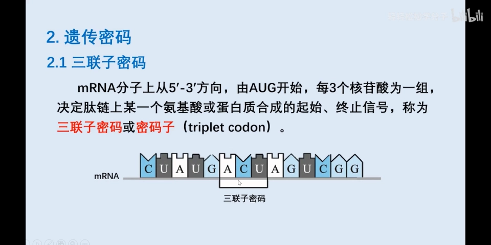

### 1.2 64 个密码子的分工

[【跳转到 02:10】](https://www.bilibili.com/video/BV1Ui42127rX/?t=130)

- 64 个密码子中，**61 个**能够编码氨基酸，称为**有义密码子**；
- **3 个终止密码子**（UAA、UAG、UGA）不编码氨基酸，只提供"到此为止"的终止信号；
- 起始密码子 **AUG** 比较特殊：它既提供起始信号，本身又编码氨基酸——**甲硫氨酸（Met）**。

也就是说，密码子只有两种"身份"：要么决定某个氨基酸，要么为翻译提供起始或终止信号；而"既是起点、又编码氨基酸"的，只有 AUG 一个。

## 二、破译之前：先解决"断句"和"查表"两个问题

### 2.1 从摩斯密码说起

[【跳转到 03:25】](https://www.bilibili.com/video/BV1Ui42127rX/?t=205)

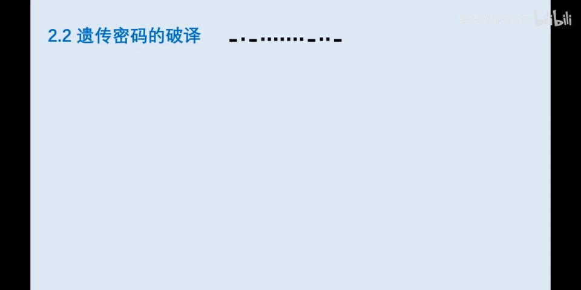

视频用谍战片里的**摩斯密码**做了个类比：给你一串点划符号和一张摩斯密码表，你能读出它传递的信息吗？答案是——不一定，因为你还不知道**阅读方式**：这串字符应该从哪里断开？同样是点划组合，断法不同读出的字母完全不同（比如"短横线+点"断成一组是 N，断成"点+短横线+点"就是别的字母）。

只有既知道**断句方式**、又拿到**密码表**，才能读出这串符号的含义是 CHINA（中国）。从符号到含义的推导过程，就是"破译"。

### 2.2 遗传密码的破译同样需要这两个条件

[【跳转到 08:08】](https://www.bilibili.com/video/BV1Ui42127rX/?t=488)

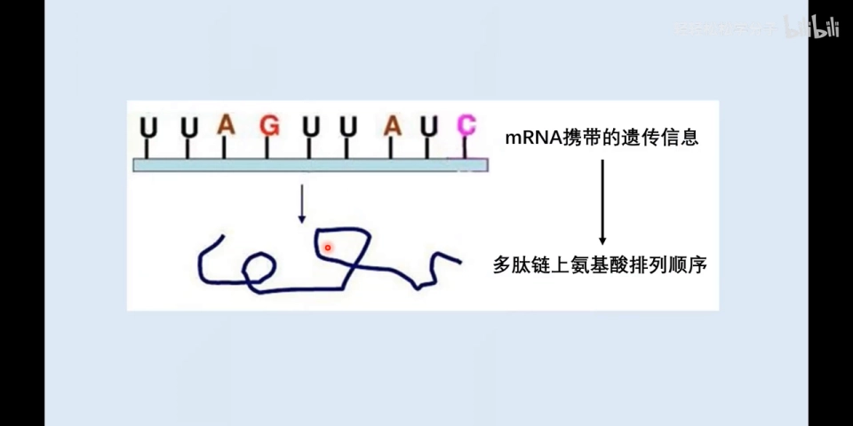

已知 mRNA 上的碱基排列顺序，要推出它翻译出的多肽链上氨基酸的排列顺序，同样需要两个条件：

1. **阅读方式**：碱基序列从哪里断开？假设每 3 个相邻碱基为一组，每组的"分隔符"怎么定？
2. **密码表**：每个分隔符内的 3 个碱基，决定哪一种氨基酸？

这两个条件，在 20 世纪 60 年代分别被两类经典实验解决：前者靠克里克与布伦纳的**移码突变实验**（第四节），后者靠尼伦伯格与马泰的**体外合成实验**（第五节）。

遗传密码的破译因此成为科学史上的杰出成就：它不仅为研究蛋白质合成提供了理论基础，也证实了中心法则的正确性，还是诺贝尔奖级别的工作。

## 三、为什么恰好是三个碱基：伽莫夫的算术

[【跳转到 10:50】](https://www.bilibili.com/video/BV1Ui42127rX/?t=650)

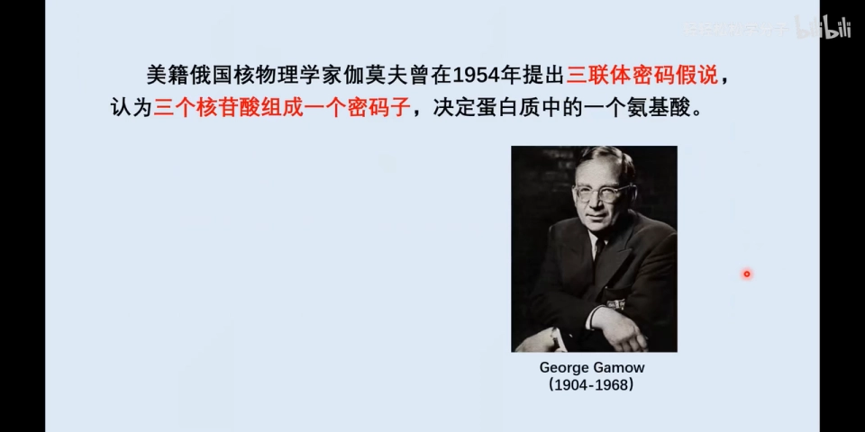

1954 年，美国核物理学家**伽莫夫**提出**三联体密码假说**：三个核苷酸组成一个密码子，决定蛋白质中的一个氨基酸。为什么是"三"？一组简单的算术（mRNA 上有 4 种核糖核苷酸，对应 A、U、G、C 四种碱基）：

[【跳转到 12:05】](https://www.bilibili.com/video/BV1Ui42127rX/?t=725)

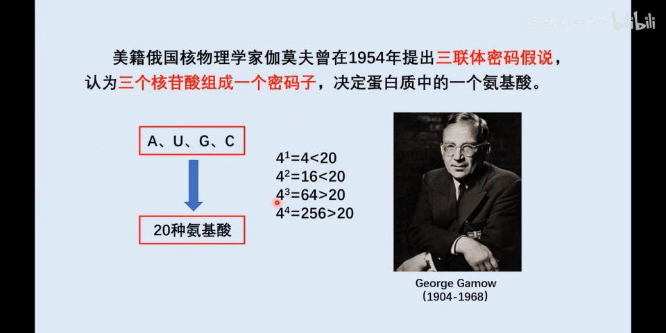

| 几个碱基决定 1 个氨基酸 | 能表示的组合数 | 够编码 20 种氨基酸吗？ |
| --- | --- | --- |
| 1 个 | 4¹ = 4 | 不够（4 < 20） |
| 2 个 | 4² = 16 | 不够（16 < 20） |
| **3 个** | **4³ = 64** | **够（64 > 20），且最节省** |
| 4 个 | 4⁴ = 256 | 够，但对生物体太浪费 |

一个碱基决定一种氨基酸，最多 4 种，不够；两个碱基 16 种，也不够；三个碱基 64 种，大于 20，刚好满足需要；四个碱基 256 种，远远大于 20，对生物体来说比较浪费——三种碱基已经足够，所以"三联体"是**既能满足、又最经济**的方案。

但伽莫夫只提出了假说：每三个核苷酸决定一个氨基酸，可这"三个三个"的读法还有好几种可能，当时人们并不知道遗传密码的阅读方式。

## 四、怎么"断句"：移码突变实验证明连续阅读

### 4.1 三种可能的阅读方式

[【跳转到 13:59】](https://www.bilibili.com/video/BV1Ui42127rX/?t=839)

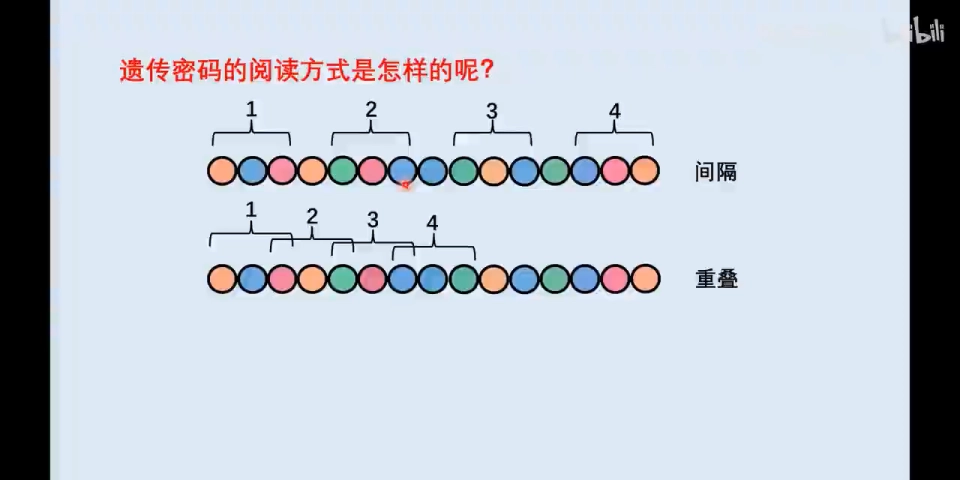

如果每 3 个核苷酸决定 1 个氨基酸，理论上有三种读法：

- **间隔阅读**：每两个密码子之间空出 1 个碱基；
- **重叠阅读**：相邻密码子共用 1~2 个碱基；
- **连续阅读**：密码子之间既没有间隔、也不重叠。

到底是哪一种？

### 4.2 克里克与布伦纳的 T4 噬菌体实验

[【跳转到 16:34】](https://www.bilibili.com/video/BV1Ui42127rX/?t=994)

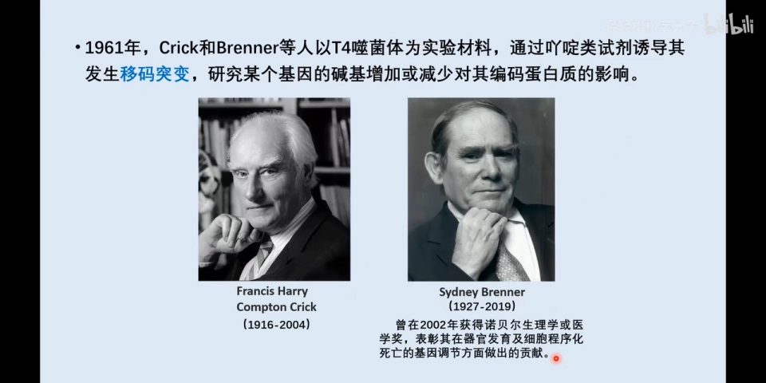

1961 年，**克里克**（与沃森提出 DNA 双螺旋结构模型，并因此与沃森、威尔金斯同获诺贝尔奖）和**布伦纳**（2002 年因器官发育及细胞程序性死亡的基因调控获诺贝尔生理学或医学奖）两位诺奖得主"强强联合"：以 **T4 噬菌体**为材料，用**吖啶类试剂**诱导基因发生**移码突变**，观察碱基的增加或缺失对其编码蛋白质的影响：

- **插入 1 个碱基**（如在 U 和 A 之间插入 C）：从这个位点开始，后面所有密码子的分组全部错位，编码的氨基酸全都变了，蛋白质活性受到严重影响；
- **删除 1 个碱基**（如删去 A 和 C 之间的 G）：同样从这个位点开始"全盘皆错"；

[【跳转到 18:20】](https://www.bilibili.com/video/BV1Ui42127rX/?t=1100)

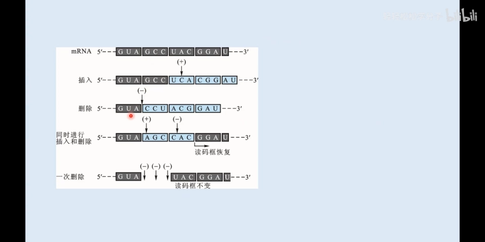

- **同时插入 1 个 + 删除 1 个**：两个位点附近的氨基酸改变，但之后读码框恢复，后面的氨基酸恢复正常，对蛋白质影响很小；
- **一次性删除 3 个相邻碱基**：最终蛋白质只缺少 1 个氨基酸，其余全部正常。

[【跳转到 21:15】](https://www.bilibili.com/video/BV1Ui42127rX/?t=1275)

这组结果只有用"连续阅读"才能解释：每个碱基都属于某个固定的密码子，单碱基增删会让后面**所有**密码子错位（即"移码"），蛋白质彻底报废；而插入+删除相互抵消、或增删 3 的整数倍，读码框就能恢复。由此得出两个结论：

1. 遗传密码确实是**三联子**——3 个碱基编码 1 个氨基酸；
2. 阅读方式是**连续阅读**：从一个固定起点开始、非重叠、密码子之间无间隔。

## 五、第一个密码子：尼伦伯格与马泰的体外合成实验

### 5.1 搭一个"体外翻译工厂"

[【跳转到 23:13】](https://www.bilibili.com/video/BV1Ui42127rX/?t=1393)

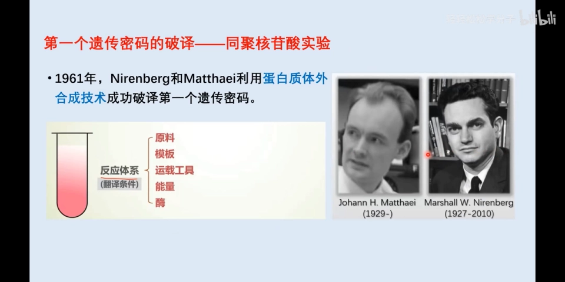

1961 年，**尼伦伯格**和**马泰**建立了**蛋白质体外合成技术**，用它在试管里破译了第一个遗传密码。回忆翻译需要的条件：原料（氨基酸）、模板（mRNA）、运载工具（tRNA）、能量（ATP、GTP）和多种酶。他们在试管里重建这个体系：

- 取细胞裂解液，**人工去除 DNA 和 mRNA**：DNA 是转录的模板，留着它就会不断转录出新的 mRNA 干扰实验（而且当时人们并不确定翻译的模板是 DNA 还是 RNA，索性全部去除）。剩下的提取液里就是 tRNA、能量物质和酶；
- 再加入**人工合成的 mRNA 模板**和**指定种类的氨基酸**——原料和模板完全受人为控制，翻译出什么多肽，只取决于加了什么。

### 5.2 人工模板从哪来：奥乔亚的多核苷酸磷酸化酶

[【跳转到 26:58】](https://www.bilibili.com/video/BV1Ui42127rX/?t=1618)

人工合成 mRNA 要得益于**多核苷酸磷酸化酶**——它在**没有模板**的情况下就能把核苷酸连接起来合成 RNA。研究这个酶的**奥乔亚**（西班牙裔美籍生物化学家）因此与阿瑟·科恩伯格共享 1959 年诺贝尔生理学或医学奖。尼伦伯格和马泰往体外体系里加的人工 mRNA，正是由这个酶催化合成的——科学研究都是站在巨人的肩膀上。

### 5.3 20 支试管定乾坤：UUU 编码苯丙氨酸

[【跳转到 28:57】](https://www.bilibili.com/video/BV1Ui42127rX/?t=1737)

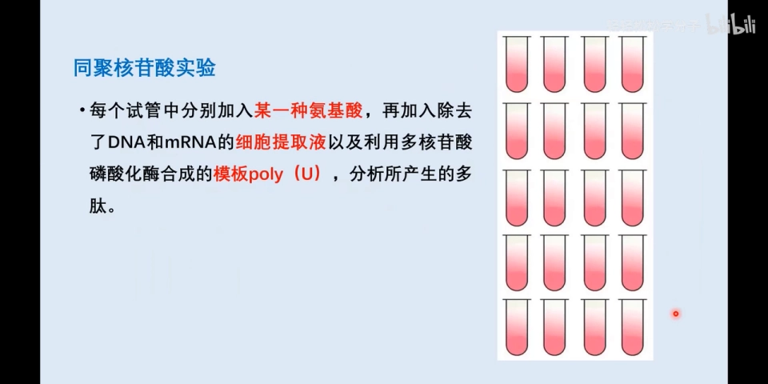

具体实验：先用多核苷酸磷酸化酶合成 **poly(U)**——一条只含 U 的 RNA，这就是**同聚核苷酸**（碱基组成非常单一，除了 U 什么都没有）。然后准备 **20 支试管**，每支都是一个体外合成体系：都加入 poly(U) 模板和细胞提取液，唯一区别是各加入**一种不同的氨基酸**（20 种氨基酸各占一管）。

[【跳转到 31:02】](https://www.bilibili.com/video/BV1Ui42127rX/?t=1862)

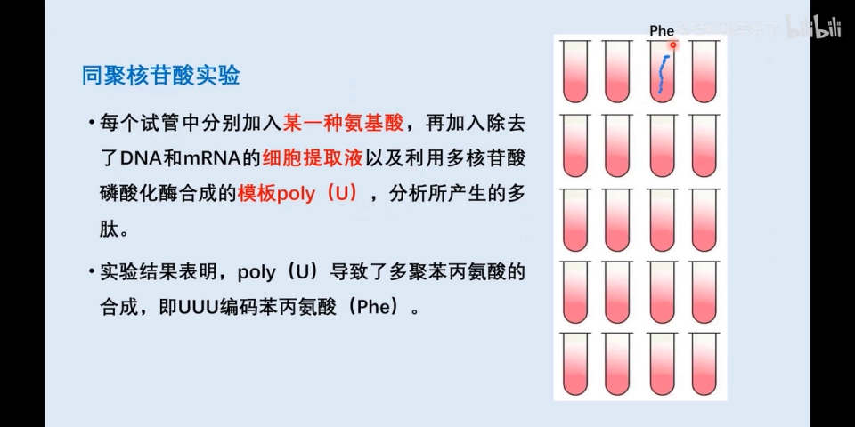

结果：20 支试管中**只有一支**检测到多肽链，而那支试管里放的是**苯丙氨酸**。这说明 poly(U) 翻译出了**多聚苯丙氨酸**——模板上唯一的密码子 UUU 对应苯丙氨酸。**第一个遗传密码 UUU → 苯丙氨酸**就此破译。

## 六、从 UUU 到 64：密码子表的完成

[【跳转到 31:52】](https://www.bilibili.com/video/BV1Ui42127rX/?t=1912)

之后的五六年里，多位科学家沿着尼伦伯格-马泰的体外合成思路不断改进方法：

- **同聚核苷酸**实验（尼伦伯格-马泰）：加入碱基组成单一的人工 mRNA，破译了第一批密码子；
- **异聚核苷酸**实验（奥乔亚、霍拉纳等人）：加入更复杂的模板——两种核苷酸**随机排列**（如只含 C 和 A 的随机链）、两种核苷酸**交替排列**（如 GUGUGU）、以及 GGU GGU 这样的重复排列，破译了更多密码子。

最终，**64 个密码子全部破译**，密码子表编制完成。

> 视频在本节还推荐了一个演示「遗传密码的破译」全过程的视频（在 B 站搜索"遗传密码的破译"即可找到），其他密码子的破译细节可以看它补充。

## 七、读懂密码子表：起始、终止与第 21/22 种氨基酸

[【跳转到 34:41】](https://www.bilibili.com/video/BV1Ui42127rX/?t=2081)

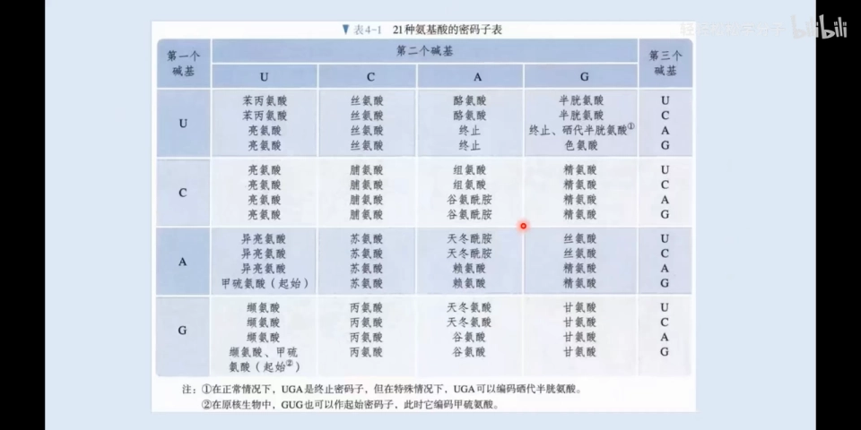

通过科学家的不懈努力，最终绘制出了完整的密码子表。视频展示的是新版人教版高中教材的插图——一张"21 种氨基酸"版本的密码子表。看表时要注意两个特殊之处：

### 7.1 起始密码子：AUG，但原核与真核编码的氨基酸不同

[【跳转到 37:06】](https://www.bilibili.com/video/BV1Ui42127rX/?t=2226)

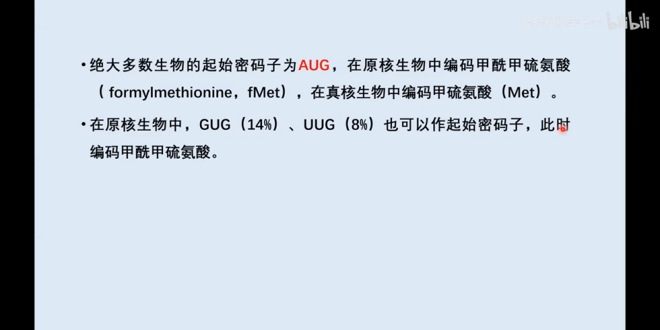

- 绝大多数生物的起始密码子是 **AUG**；
- AUG 在**原核生物**中编码**甲酰甲硫氨酸（fMet）**，在**真核生物**中编码**甲硫氨酸（Met）**——两者只差一个甲酰基；
- 原核生物中 **GUG、UUG** 偶尔也可作为起始密码子（此时编码甲酰甲硫氨酸），但频率很低；绝大多数情况下起始密码子还是 AUG。GUG 平时编码的是**缬氨酸**。

### 7.2 终止密码子与第 21、22 种氨基酸

[【跳转到 38:21】](https://www.bilibili.com/video/BV1Ui42127rX/?t=2301)

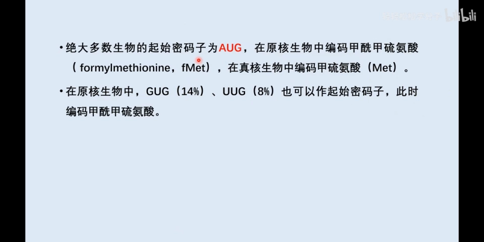

- 终止密码子有 3 个：**UAA、UAG、UGA**，正常情况下不编码任何氨基酸；
- 特殊情况下，**UGA** 可以编码**第 21 种氨基酸——硒代半胱氨酸**；**UAG** 可以编码**第 22 种氨基酸——吡咯赖氨酸**，这种氨基酸目前只在甲烷菌中出现；
- 所以人体的氨基酸是 **21 种**（包括硒代半胱氨酸），第 22 种只在甲烷菌中出现。

### 7.3 破译者的桂冠：1968 年诺贝尔奖

1968 年，三位科学家因破译遗传密码获得诺贝尔生理学或医学奖：**霍利**（测定了丙氨酸 tRNA 的二级结构，提出三叶草形二级结构）、**霍拉纳**和**尼伦伯格**——表彰他们破译了遗传密码，并阐明其在蛋白质合成中的作用。

## 小结

- **密码子 = 三联子密码**：mRNA 从 5′ 端、由 AUG 开始，每 3 个相邻碱基一组，决定 1 个氨基酸或提供起止信号；
- 4³ = **64** 个密码子：61 个编码氨基酸（有义密码子），3 个终止（UAA/UAG/UGA）；AUG 既是起始又编码 Met；
- "三"是伽莫夫算术的最优解：1 个碱基 4 种、2 个 16 种都不够 20 种氨基酸，3 个 64 种刚好够用，4 个 256 种太浪费；
- **克里克-布伦纳移码突变实验**证明密码子**连续阅读**：非重叠、无间隔；单碱基增删让后续氨基酸全变，插入+删除相抵或按 3 整数倍增删则影响很小；
- **尼伦伯格-马泰体外合成实验**破译第一个密码子：poly(U) 模板 + 20 支试管，只有苯丙氨酸试管出多肽 → **UUU 编码苯丙氨酸**；异聚核苷酸实验补齐其余，64 个密码子全部破译；
- 密码子表使用须知：原核 AUG 编码 fMet（真核为 Met），GUG/UUG 偶尔作起始；UGA 特殊时编码硒代半胱氨酸（第 21 种），UAG 编码吡咯赖氨酸（第 22 种，仅甲烷菌）。

## 关键术语速查

| 术语 | 一句话解释 |
| --- | --- |
| 密码子（三联子密码） | mRNA 上每 3 个相邻碱基一组，决定 1 个氨基酸或提供起止信号 |
| 有义密码子 | 61 个能编码氨基酸的密码子 |
| 终止密码子 | UAA、UAG、UGA，正常情况下不编码氨基酸 |
| 三联体密码假说 | 伽莫夫 1954 年提出：3 个核苷酸决定 1 个氨基酸 |
| 移码突变 | 插入/缺失非 3 整数倍的碱基，导致后续密码子分组全部错位 |
| 蛋白质体外合成技术 | 尼伦伯格-马泰建立：细胞提取液+人工 mRNA+指定氨基酸，在试管里完成翻译 |
| 多核苷酸磷酸化酶 | 无需模板即可连接核苷酸合成 RNA 的酶（奥乔亚，1959 诺奖） |
| 同聚核苷酸 | 只由一种核苷酸重复组成的 RNA，如 poly(U) |
| 异聚核苷酸 | 由两种及以上核苷酸按随机/交替方式排列的人工 RNA |
| 硒代半胱氨酸 | 第 21 种氨基酸，特殊情况下由 UGA 编码 |
| 吡咯赖氨酸 | 第 22 种氨基酸，由 UAG 特殊编码，目前只在甲烷菌中发现 |
| fMet | 甲酰甲硫氨酸，原核生物中起始密码子 AUG 编码的氨基酸 |
