# 遗传密码的七个特点：读懂密码子表的"使用说明书"

> 来源：Bilibili 视频《【分子生物学】第4章 翻译 | 第1节 mRNA | 遗传密码（遗传密码的特点）》（UP 主：轻轻松松学分子，[BV17bGj6rEvo](https://www.bilibili.com/video/BV17bGj6rEvo/)，时长 20:00）。
> 本文基于视频字幕与画面逐窗口整理而成，配图取自视频截图，时间戳可跳回原视频对应位置核对。上一讲（密码子的定义与破译）讲了密码子"是什么、怎么破译"，这一讲讲密码子"怎么用"——七个特点合起来就是一份密码子的阅读与配对规则说明。

## 本讲要解决的核心问题（SCQA）

**背景**：上一讲已经明确：密码子是三联体，从 mRNA 的 5′ 端、AUG 开始连续阅读；64 个密码子中 61 个编码氨基酸、3 个终止，密码子表已全部破译。

**冲突**：但光有一张密码子表还不够用。同一种氨基酸为什么对应好几个密码子？人和细菌读同一条 mRNA，结果会一样吗？翻译的时候，tRNA 上的反密码子怎么"认出"密码子？这些"使用规则"都藏在密码子表的背后。

**疑问**：翻译时，密码子的阅读与配对到底遵循哪些规律？

**回答（中心思想）**：遗传密码有**七个特点**——**通用性、方向性、连续性、专一性、简并性、偏爱性、摆动性**。前四个保证遗传信息被"原样"读出（读的方向、断句、一一对应），后三个解释密码子的"灵活用法"（一氨基酸多码、用得不一样多、第三位配对可摆动）。视频是全新录制版本，在旧版五个特点（通用、连续、简并、偏爱、摆动）的基础上新增了**方向性**与**专一性**。

## 一、通用性：一套密码子几乎全生物通用

[【跳转到 00:48】](https://www.bilibili.com/video/BV17bGj6rEvo/?t=48)

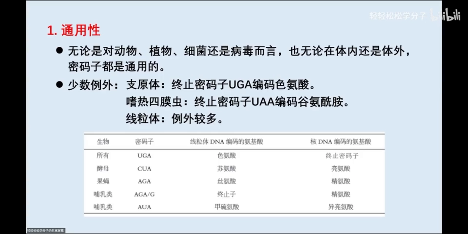

无论对动物、植物、细菌还是病毒而言，也无论在体内还是体外，密码子都是**通用**的——地球生命共用同一套密码。但有少数例外：

- 支原体中，终止密码子 **UGA** 能编码色氨酸；
- 嗜热四膜虫中，终止密码子 **UAA** 能编码谷氨酰胺；
- **线粒体**里的例外更多：UGA 在线粒体中编码色氨酸，而在核 DNA 中是终止密码子；酵母中 CUA 在线粒体中编码苏氨酸，而在核 DNA 中编码亮氨酸。

对生信的启示：绝大多数场景可以直接套用标准密码子表，但处理**线粒体基因组**或某些特殊物种时要留意例外。

## 二、方向性：从 5′ 端读到 3′ 端

[【跳转到 01:51】](https://www.bilibili.com/video/BV17bGj6rEvo/?t=111)

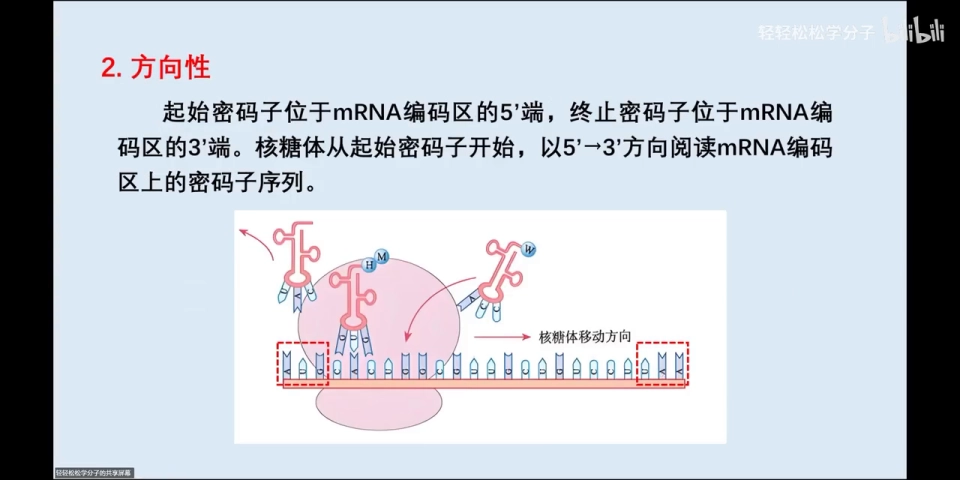

方向性指的是：核糖体从**起始密码子**开始，以 **5′ 到 3′** 的方向阅读 mRNA 编码区上的密码子序列。原因很直观——起始密码子位于 mRNA 编码区的 **5′ 端**，终止密码子位于 **3′ 端**，所以阅读只能从 5′ 往 3′ 走。

## 三、连续性：不间隔、不重叠——阅读框存在的基础

[【跳转到 03:06】](https://www.bilibili.com/video/BV17bGj6rEvo/?t=186)

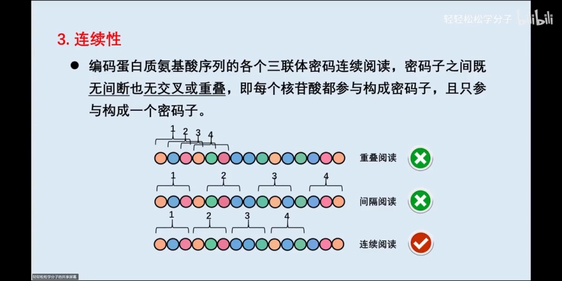

连续性指的是：编码蛋白质氨基酸序列的各个三联体密码是**连续阅读**的，密码子之间**既无间断、也无交叉或重叠**——每个核苷酸都参与构成密码子，且只参与构成一个密码子。

对照两种错误的读法就明白了（间隔阅读：相邻密码子之间空 1 个核苷酸；重叠阅读：相邻密码子共用 1~2 个核苷酸，同一个核苷酸参与了两个密码子）：

[【跳转到 03:56】](https://www.bilibili.com/video/BV17bGj6rEvo/?t=236)

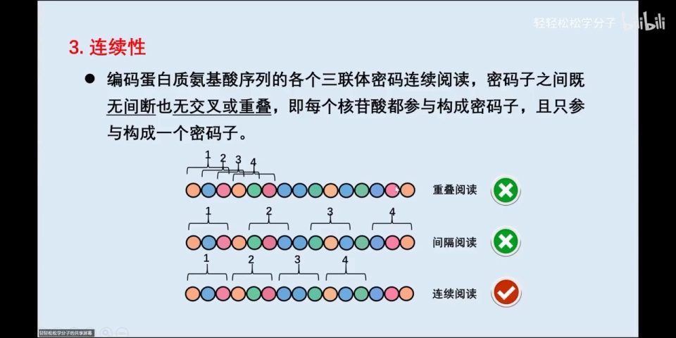

间隔阅读和重叠阅读都是不正确的，实际是连续阅读。**密码子的连续性是开放阅读框（ORF）赖以存在的基础**——正因为断句规则固定，从起始密码子出发按三联体一路读下去，才能得到确定的氨基酸序列。

**移码突变的警示**：如果基因插入或缺失了**非 3 的整数倍**个碱基，就会发生**移码突变**——连续阅读的规则被破坏，从突变点往后的所有密码子全部错位，翻译产物全面错误。

[【跳转到 05:14】](https://www.bilibili.com/video/BV17bGj6rEvo/?t=314)

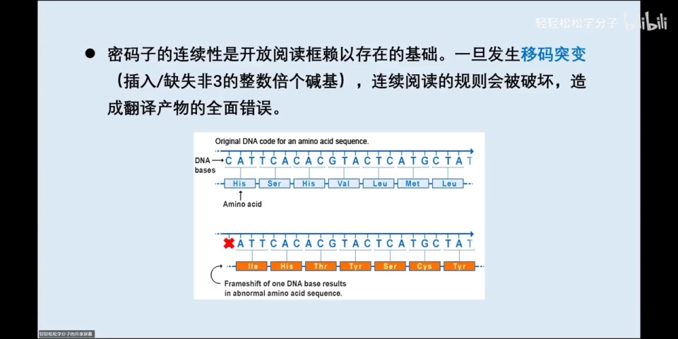

图中示例：序列中 1 个胞嘧啶（C）发生缺失后，转录产生的 mRNA 从缺失点往后，密码子的分组与之前完全不同，编码的氨基酸也就完全变了。

## 四、专一性：一个密码子只编码一种氨基酸

[【跳转到 06:36】](https://www.bilibili.com/video/BV17bGj6rEvo/?t=396)

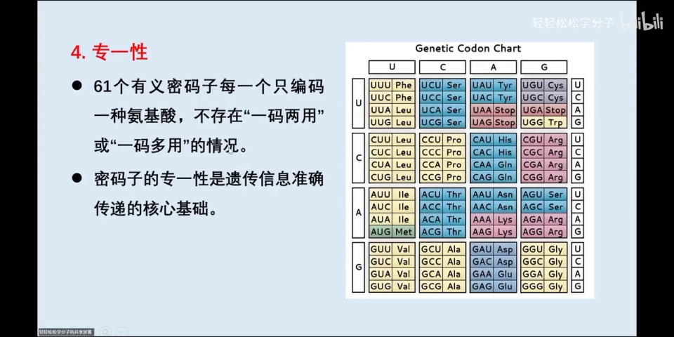

64 个密码子中有 3 个终止密码子，其余 **61 个都是编码氨基酸的有义密码子**。专一性说的是：这 61 个密码子**每一个只编码一种氨基酸**，不存在"一码两用"或"一码多用"。查右侧的密码子表可以验证：没有任何一个密码子能编码两种或以上的氨基酸。

专一性是遗传信息**准确传递的核心基础**——如果一个密码子能编码两种氨基酸，同一条 mRNA 翻译出来的多肽链就不确定了。

注意方向：专一性说的是"**密码子 → 氨基酸**"唯一；下一节的简并性说的是"**氨基酸 → 密码子**"可以不唯一。两者并不矛盾。

## 五、简并性：一种氨基酸可以有多个密码子

[【跳转到 08:26】](https://www.bilibili.com/video/BV17bGj6rEvo/?t=506)

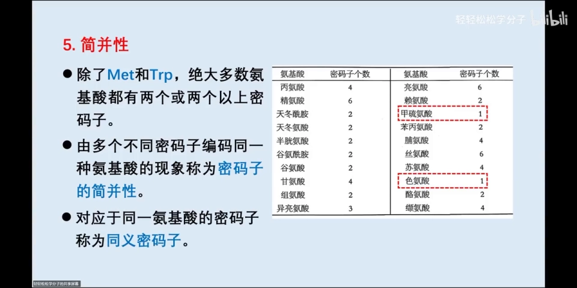

20 种氨基酸中，除了**色氨酸**和**甲硫氨酸**各只有 1 个密码子外，其他氨基酸都有 2 个或 2 个以上的密码子。**多个不同密码子编码同一种氨基酸**的现象称为**简并性**；编码同一种氨基酸的这些密码子互称**同义密码子**——比如精氨酸有 6 个密码子，这 6 个就是精氨酸的同义密码子。

简并性有两条可查表的规律：

**规律一：同义密码子越多，该氨基酸在蛋白质中出现的频率越高。**（10:02 起）丝氨酸、亮氨酸、精氨酸的同义密码子最多（各 6 个），在蛋白质中出现频率很高；色氨酸、甲硫氨酸只有 1 个密码子，频率最低。例外是精氨酸——虽然也有 6 个同义密码子，实际频率却高于理论预测。

[【跳转到 10:02】](https://www.bilibili.com/video/BV17bGj6rEvo/?t=602)

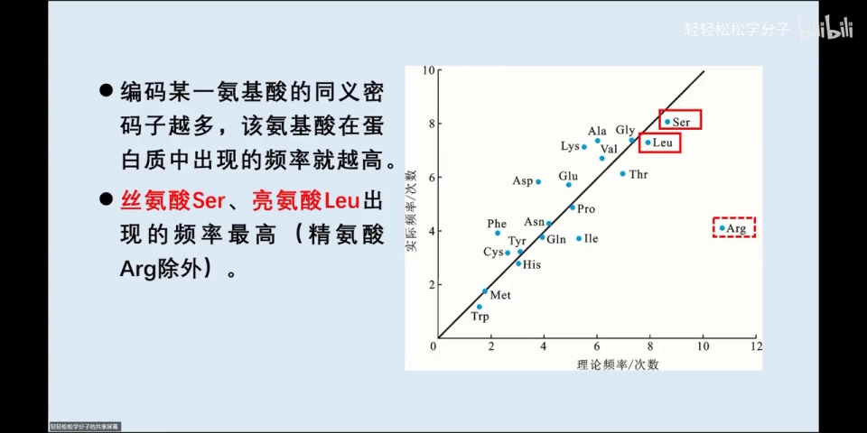

**规律二：同义密码子前两位碱基往往相同，第三位不同。**（10:44 起）比如丙氨酸的 4 个密码子，前两位碱基都一样、只有第三位不同。"往往"二字很重要——它说的是大多数情况，也有特例：亮氨酸的 UUG 与 CUU 单独比较时，只有第二位相同。

[【跳转到 10:44】](https://www.bilibili.com/video/BV17bGj6rEvo/?t=644)

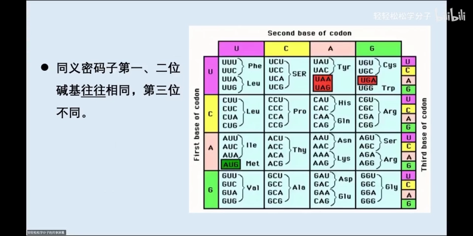

## 六、偏爱性：同义密码子并非"雨露均沾"

[【跳转到 12:22】](https://www.bilibili.com/video/BV17bGj6rEvo/?t=742)

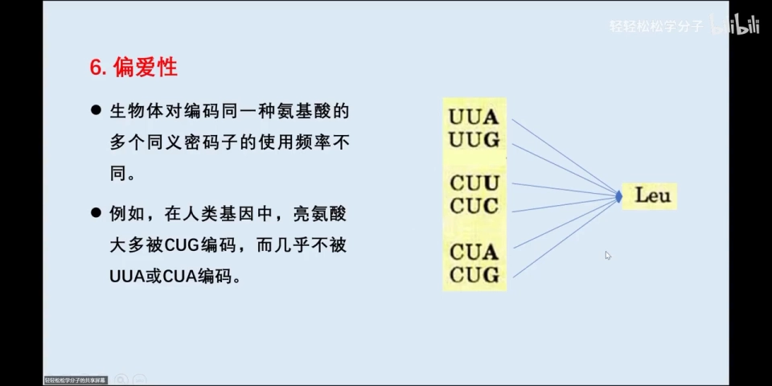

简并性之后自然产生一个问题：编码同一种氨基酸的多个同义密码子，生物体是平均使用的吗？**不是**。在人类基因中，亮氨酸大多被 **CUG** 编码，而几乎不被 UUA 和 CUA 编码——这就是**密码子偏爱性**：生物体对编码同一种氨基酸的多个同义密码子的使用频率不同。使用频率高的叫**偏爱密码子**（图中的"爱心"），几乎不用的叫**稀有密码子**（图中的"心碎"）。

再如大肠杆菌的甘氨酸：4 个同义密码子中 GGU、GGC 使用频率较高，GGA、GGG 相对较低。

**为什么有的密码子用得多、有的用得少？**（15:47 起）这跟它所对应的**同工 tRNA 的丰度**有关——**同工 tRNA** 指携带相同氨基酸的一组 tRNA。亮氨酸有 6 个同义密码子，对应 6 种同工 tRNA：都能携带亮氨酸，但识别的密码子各不相同。哪个密码子对应的同工 tRNA 丰度高（含量高），它被使用得就多。

[【跳转到 15:47】](https://www.bilibili.com/video/BV17bGj6rEvo/?t=947)

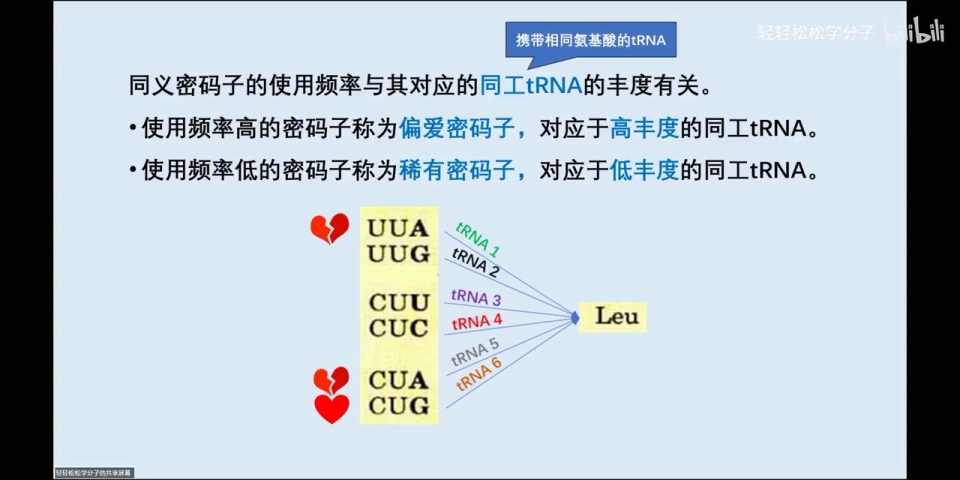

对生信的启示：这正是**密码子使用偏好分析**（如 RSCU、ENC 等指标）的生物学基础，也是异源表达中"密码子优化"的依据。

## 七、摆动性：第三对碱基的配对有"自由度"

[【跳转到 16:32】](https://www.bilibili.com/video/BV17bGj6rEvo/?t=992)

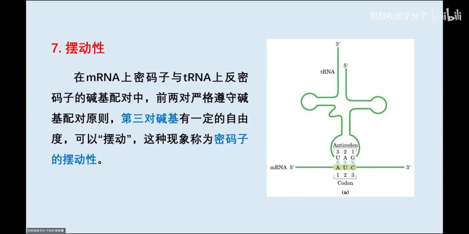

翻译时，mRNA 上的密码子要与 tRNA 上的**反密码子**碱基配对。把 tRNA 想象成抻直的一条链，它与 mRNA 是**反向平行**的：tRNA 的 3′ 端对应 mRNA 的 5′ 端，tRNA 的 5′ 端对应 mRNA 的 3′ 端。于是配对关系是：

- 反密码子第 1 位 ↔ 密码子第 3 位
- 反密码子第 2 位 ↔ 密码子第 2 位
- 反密码子第 3 位 ↔ 密码子第 1 位

以 mRNA 为标准：**前两对严格遵守碱基配对原则**（A-U、G-C），而**第三对——密码子第 3 位与反密码子第 1 位——有一定自由度，可以发生"摆动"**，这就是密码子的**摆动性**。

摆动配对规则（17:47 起，按反密码子第 1 位查表；视频强调这个表需要记下来）：

[【跳转到 17:47】](https://www.bilibili.com/video/BV17bGj6rEvo/?t=1067)

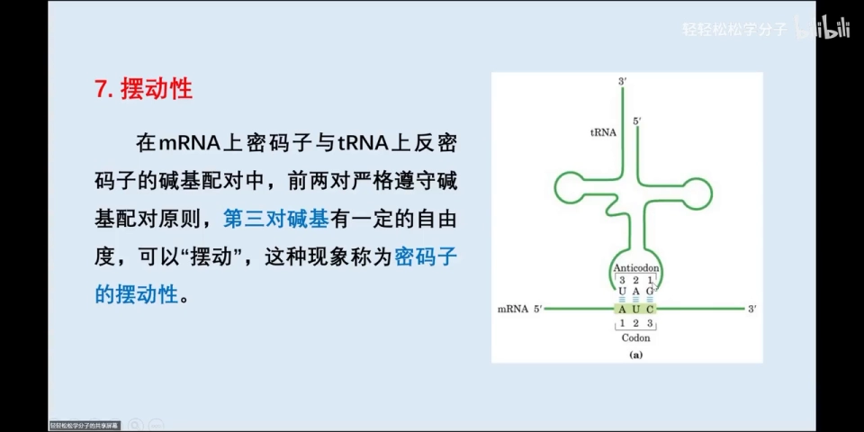

| 反密码子第 1 位 | 可配对的密码子第 3 位 | 是否摆动 |
| --- | --- | --- |
| A | U | 否（正常配对） |
| C | G | 否（正常配对） |
| G | C 或 U | 是 |
| U | A 或 G | 是 |
| 次黄嘌呤（I） | U、C 或 A | 是 |

**例子**（19:02 起）：反密码子第 1 位是次黄嘌呤的 tRNA（反密码子 ICC），可以识别 mRNA 上三个不同的密码子——它们编码的都是同一种氨基酸。摆动配对让**一种 tRNA 能识别多个同义密码子**，这也解释了为什么细胞里的 tRNA 种类少于密码子种类。

[【跳转到 19:02】](https://www.bilibili.com/video/BV17bGj6rEvo/?t=1142)

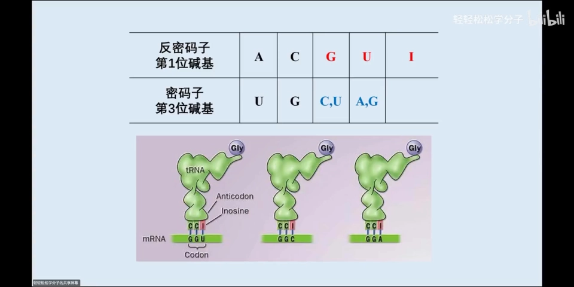

## 小结

- **通用性**：动物、植物、细菌、病毒共用一套密码子；线粒体等有少数例外（如线粒体 UGA 编码色氨酸）；
- **方向性**：核糖体从起始密码子（5′ 端）向终止密码子（3′ 端）方向阅读；
- **连续性**：三联体密码连续阅读、不间隔、不重叠，每个核苷酸只属于一个密码子——这是开放阅读框（ORF）存在的基础；非 3 整数倍的碱基增删会导致移码突变，翻译产物全面出错；
- **专一性**：每个有义密码子只编码一种氨基酸——遗传信息准确传递的底线；
- **简并性**：一种氨基酸可由多个同义密码子编码（色氨酸、甲硫氨酸除外）；同义密码子越多，该氨基酸出现频率越高；同义密码子前两位往往相同、第三位不同；
- **偏爱性**：同义密码子使用频率不同——偏爱密码子对应高丰度同工 tRNA，稀有密码子对应低丰度同工 tRNA；
- **摆动性**：密码子第 3 位与反密码子第 1 位（5′ 端）配对有自由度（G↔C/U、U↔A/G、I↔U/C/A），一种 tRNA 可识别多个同义密码子。

## 关键术语速查

| 术语 | 一句话解释 |
| --- | --- |
| 通用性 | 密码子在几乎所有生物中通用，线粒体等存在少数例外 |
| 方向性 | 从起始密码子开始，沿 5′→3′ 方向阅读密码子 |
| 连续性 | 密码子之间无间隔、不重叠地连续阅读 |
| 开放阅读框（ORF） | 从起始密码子到终止密码子之间按三联体连续阅读的编码区 |
| 移码突变 | 插入/缺失非 3 整数倍碱基，破坏阅读框、后续翻译全错 |
| 专一性 | 每个有义密码子只编码一种氨基酸 |
| 简并性 | 多个不同密码子编码同一种氨基酸 |
| 同义密码子 | 编码同一种氨基酸的一组密码子 |
| 偏爱性 | 生物体对不同同义密码子的使用频率不同 |
| 偏爱密码子 / 稀有密码子 | 使用频率高 / 几乎不使用的同义密码子 |
| 同工 tRNA | 携带同一种氨基酸的一组 tRNA |
| 摆动性 | 密码子第 3 位与反密码子第 1 位配对有一定自由度 |
| 次黄嘌呤（I） | 反密码子第 1 位可出现的碱基，可与 U、C、A 配对 |
