# RNA 全家福：mRNA 是唯一编码 RNA，非编码 RNA 分「管家」与「调控」两大班底

> 来源视频：[五分钟了解所有RNA（B站）](https://www.bilibili.com/video/BV1cG4y147U7/) ｜ 时长 5:01 ｜ 本文为该视频的图文整理稿，与[《细胞中的那些非编码RNA》](细胞中的那些非编码RNA.md)互为姊妹篇：本篇给 RNA 全家福拍「合影」，姊妹篇聚焦非编码 RNA 的功能细节。

## 本篇要解决的核心问题

**背景**：中心法则告诉我们，遗传信息从 DNA 流向 RNA，再流向蛋白质。前一讲我们看过转录与翻译：DNA 先转录出 RNA，mRNA 再把信息带去核糖体翻译成蛋白质。

**冲突**：但如果以为细胞里的 RNA 只有 mRNA，就漏掉了大半个家族——事实上，**不编码蛋白质的 RNA 占了大多数**，而且种类繁多、分工明确。

**疑问**：RNA 到底分成哪几类？mRNA 与非编码 RNA 的本质区别是什么？那些不编码蛋白的 RNA 都在干什么？

**回答（中心思想）**：按「能否翻译成蛋白质」一刀切，RNA 分为两大类——**编码 RNA 只有 mRNA 一种**；其余全是**非编码 RNA**，又分**组成性**（翻译机器的固定班底）与**调控性**（基因表达的调节器）两个班组，各司其职。

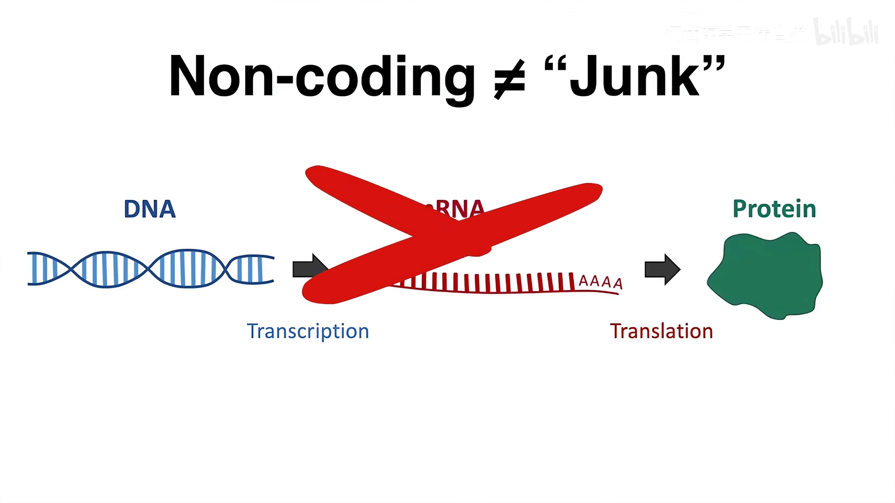

## 一、先分类：编码 RNA 只有一个成员——mRNA

[【跳转到 00:00】](https://www.bilibili.com/video/BV1cG4y147U7/?t=0)

- **编码 RNA**：从基因组上转录而来、核苷酸序列**可以翻译成蛋白质**的 RNA——只有 **mRNA**（信使 RNA）。视频还提到，mRNA 在生物体内**种类最多**：有多少种要生产的蛋白质，基本就有多少种对应的 mRNA。
- **非编码 RNA**：**不编码蛋白质**的 RNA。它们是 RNA 家族的多数派，又分两类：
  - **组成性非编码 RNA**：细胞常年需要的「固定工位」，如 tRNA、rRNA 等（第三节逐一介绍）；
  - **调控性非编码 RNA**：调节基因表达的「调节器」，如 miRNA、siRNA、lncRNA、circRNA（第四节介绍）。

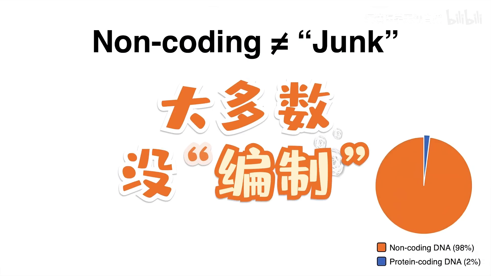

## 二、编码方代表：mRNA 的「出厂流程」

[【跳转到 00:32】](https://www.bilibili.com/video/BV1cG4y147U7/?t=32)

真核生物的 mRNA 并不是一转录出来就能上岗，它有一套「出厂流程」：

1. 初级产物叫 **hnRNA**（不均一核 RNA），在**细胞核内**合成；
2. 经过一系列**转录后修饰与剪接**，才成为**成熟 mRNA**；
3. 成熟后被**转运到细胞质**，执行翻译任务。

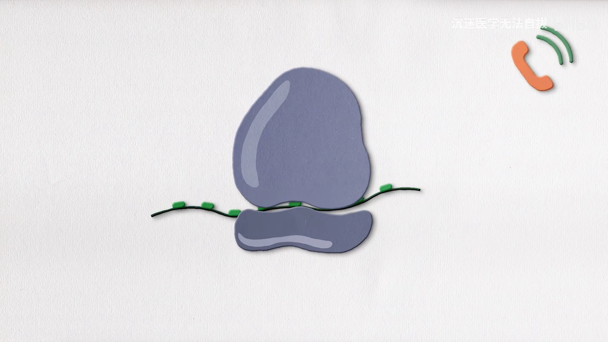

mRNA 身上还有两件「护身装备」：**5′ 端的帽结构**和 **3′ 端的多聚 A 尾**。视频特别强调：去掉两者中的任何一个，细胞内的 mRNA 都会**迅速降解**——所以二者的作用是**维持 mRNA 的稳定性**，并**参与翻译起始的调控**。

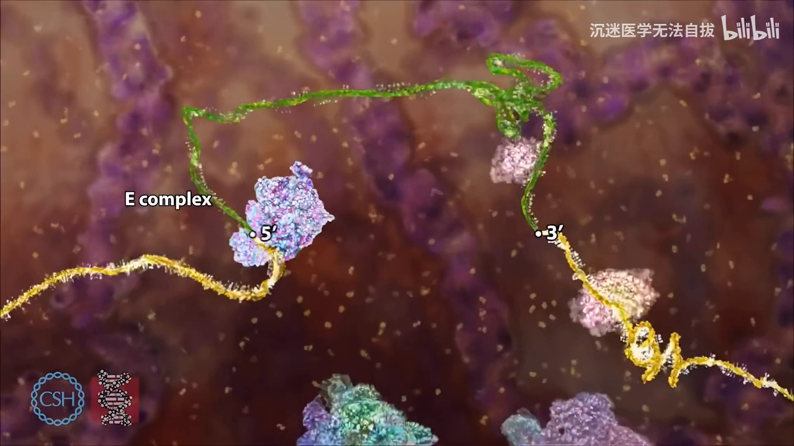

## 三、组成性非编码 RNA：翻译机器的固定班底

### 3.1 tRNA：氨基酸的搬运工

[【跳转到 01:07】](https://www.bilibili.com/video/BV1cG4y147U7/?t=67)

- tRNA 作为**氨基酸的载体**参与蛋白质合成——一手抓氨基酸，一手对密码子。
- 它是**含稀有碱基最多**的 RNA（稀有碱基＝在正常 A/U/G/C 基础上做过化学修饰的碱基）。
- 二级结构**酷似三叶草**。

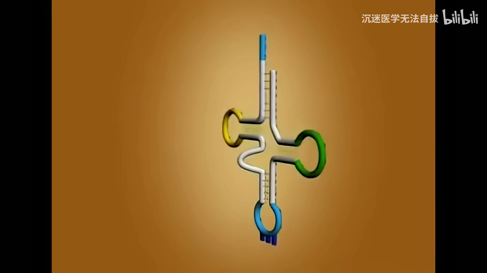

### 3.2 rRNA：核糖体的骨架，含量最多的 RNA

[【跳转到 01:29】](https://www.bilibili.com/video/BV1cG4y147U7/?t=89)

- rRNA 是细胞内**含量最多**的 RNA。
- rRNA 与**核糖体蛋白**共同构成**核糖体**（翻译的场所）。
- **原核生物**有三种 rRNA：**5S、16S、23S**（S 是沉降系数，可粗略理解为「个头编号」），它们与不同的核糖体蛋白结合，分别形成核糖体的**大、小亚基**。
- **真核生物**有四种 rRNA（5S、5.8S、18S、28S），以类似方式构成大小亚基。
- 视频给了两条记忆口诀：原核是「圆圆16岁爱上我」，真核是「我爸真是恶霸给我一巴掌」。另一条要点：无论原核还是真核，**小亚基 rRNA 的沉降系数都以 1 开头**——原核是 16S，真核是 18S。

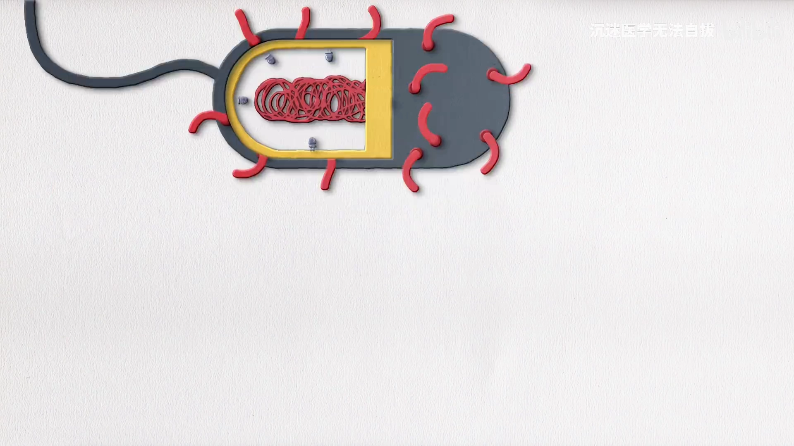

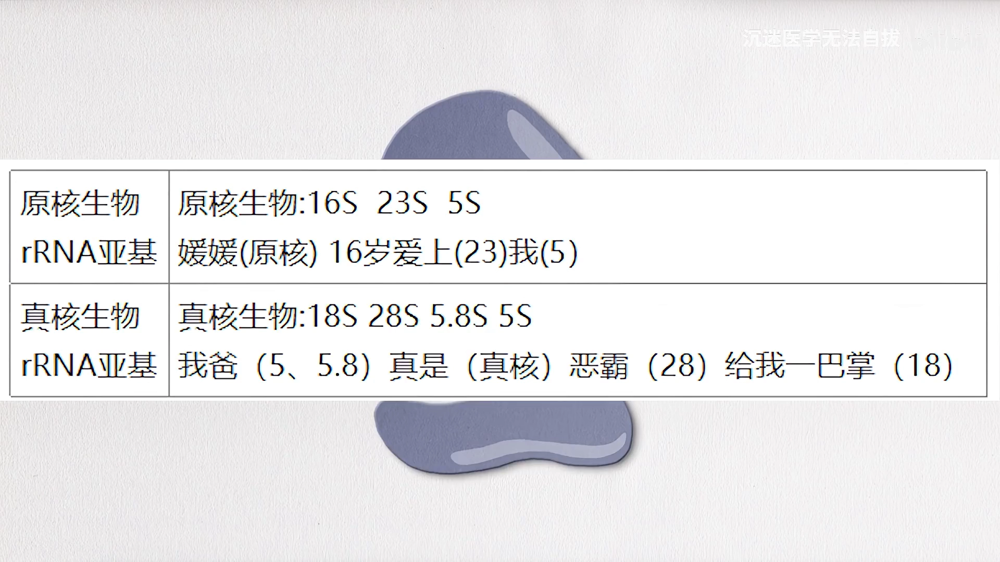

### 3.3 几位「小个子」组成性非编码 RNA

[【跳转到 02:28】](https://www.bilibili.com/video/BV1cG4y147U7/?t=148)

除了 tRNA 和 rRNA，真核细胞（尤其细胞核）里还有一组小 RNA：

- **核酶（催化小 RNA）**：具有**催化功能**的小 RNA，能催化特定 RNA 的降解、用于剪切 RNA。视频特别提醒：核酶虽然是「酶」，但组成成分是 **RNA**——也就是说，**酶不一定都是蛋白质，也可以由 RNA 构成**。[【跳转到 02:38】](https://www.bilibili.com/video/BV1cG4y147U7/?t=158)
- **端粒酶**：由**蛋白质**和**自带的 RNA 模板**组成。[【跳转到 03:03】](https://www.bilibili.com/video/BV1cG4y147U7/?t=183)
- **snoRNA（核仁小 RNA）**：参与 **rRNA 的加工**。例如真核生物的 5.8S、18S、28S rRNA，就是由 **45S 前体 rRNA** 经 snoRNA **剪切**而成。[【跳转到 03:08】](https://www.bilibili.com/video/BV1cG4y147U7/?t=188)
- **snRNA（小核 RNA）**：参与**真核 mRNA 的成熟过程**——别忘了 hnRNA 是 mRNA 的前体，把前体加工成成熟 mRNA 的工程里就有 snRNA 的参与。[【跳转到 03:37】](https://www.bilibili.com/video/BV1cG4y147U7/?t=217)
- **scRNA（胞质小 RNA）**：参与形成**信号识别颗粒**。[【跳转到 03:52】](https://www.bilibili.com/video/BV1cG4y147U7/?t=232)

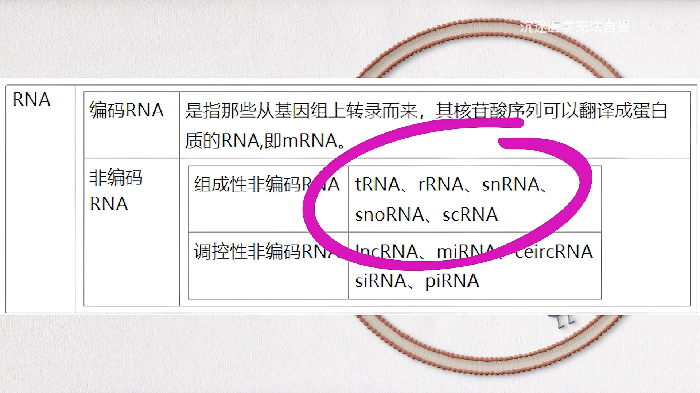

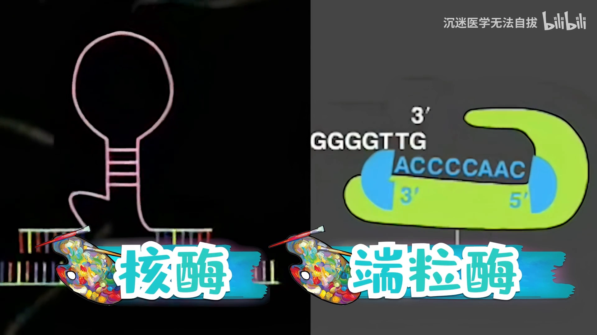

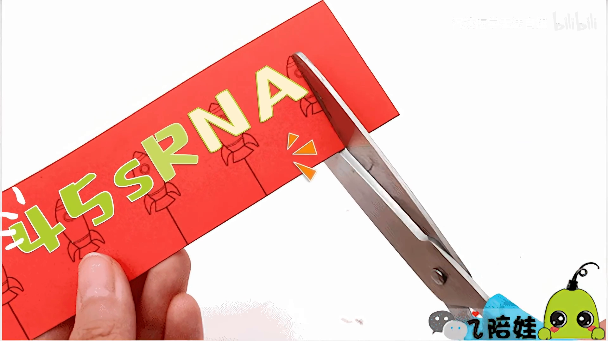

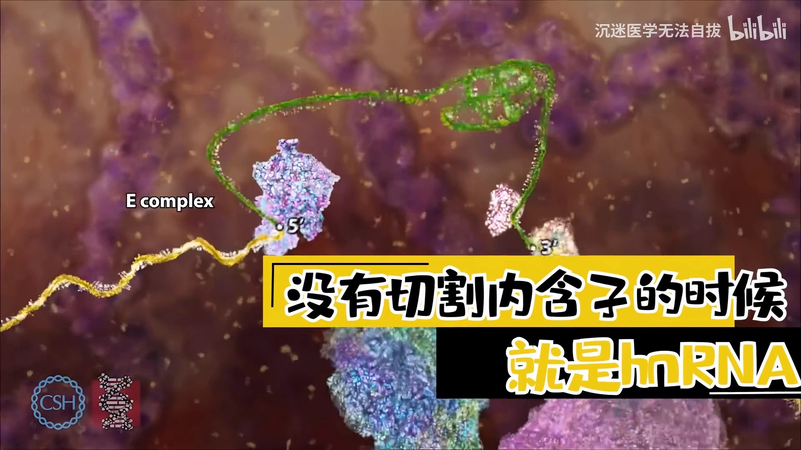

## 四、调控性非编码 RNA：基因表达的调节器

[【跳转到 04:02】](https://www.bilibili.com/video/BV1cG4y147U7/?t=242)

这类 RNA 同样不编码蛋白质，却承担着调节基因表达的重要生理功能。

### 4.1 miRNA 与 siRNA：一对「剪刀」，一个对内、一个对外

[【跳转到 04:12】](https://www.bilibili.com/video/BV1cG4y147U7/?t=252)

- **miRNA**：作用于**内源** RNA——与 mRNA 的 **3′ 端非翻译区**结合，**抑制翻译**。
- **siRNA**：对**外源侵入的双链 RNA**（如病毒 RNA）进行切割。
- 两者区别一句话：**一个切内源，一个切外源**。

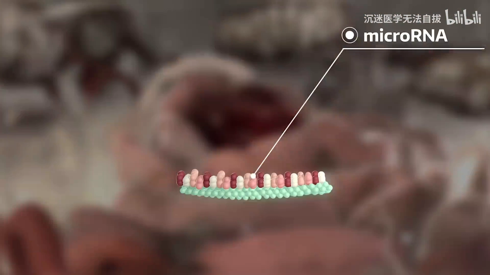

### 4.2 lncRNA：长得像 mRNA，却不能编码

[【跳转到 04:37】](https://www.bilibili.com/video/BV1cG4y147U7/?t=277)

长链非编码 RNA（lncRNA）的**结构类似于 mRNA**，但序列中**不存在可读框（ORF）**，因此**不能编码蛋白质**；可定位于细胞核和细胞质当中。

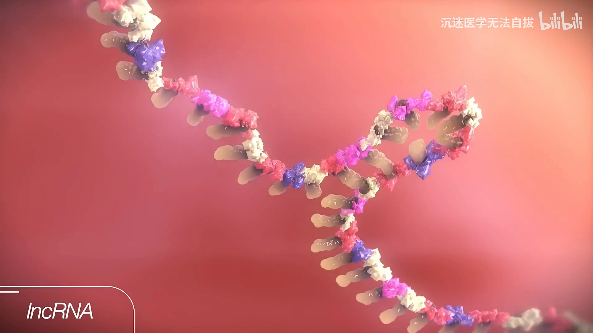

### 4.3 circRNA：首尾相连的「环」

[【跳转到 04:45】](https://www.bilibili.com/video/BV1cG4y147U7/?t=285)

环状 RNA（circRNA）与线性 RNA 不同：呈**封闭的环状**，**没有 5′ 端和 3′ 端**，因此表达**更加稳定、不易被降解**——线状 RNA 的降解常从端点「下手」，而 circRNA 没有端点可啃。

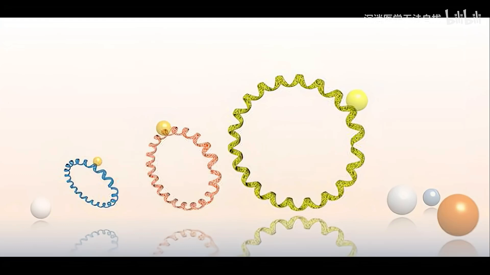

## 小结

- RNA 按「能否翻译成蛋白质」二分：**编码 RNA 只有 mRNA**；**非编码 RNA 占大多数**，又分**组成性**与**调控性**。
- mRNA 的出厂流程：**hnRNA（核内前体）→ 转录后修饰/剪接 → 成熟 mRNA → 出核翻译**；5′ 帽与 3′ polyA 维持其稳定性并参与翻译起始调控。
- 组成性班底：**tRNA**（搬氨基酸、三叶草、稀有碱基最多）、**rRNA**（核糖体骨架、含量最多；原核 5S/16S/23S，真核 5S/5.8S/18S/28S，小亚基以 1 开头）、**核酶**（RNA 也能当酶）、**端粒酶**（蛋白＋RNA 模板）、**snoRNA**（加工 rRNA）、**snRNA**（参与 mRNA 成熟）、**scRNA**（信号识别颗粒）。
- 调控班底：**miRNA**（结合 3′UTR 抑制翻译，对内）、**siRNA**（切割外源双链 RNA，对外）、**lncRNA**（似 mRNA 而无 ORF）、**circRNA**（闭环更稳定）。

## 关键术语速查

| 术语 | 一句话解释 |
| --- | --- |
| mRNA | 唯一的编码 RNA，序列可翻译成蛋白质，种类最多 |
| hnRNA | 真核 mRNA 的核内初级产物（不均一核 RNA） |
| 5′ 帽 / 3′ polyA | mRNA 的「护身装备」，维持稳定性并调控翻译起始 |
| tRNA | 氨基酸载体，含稀有碱基最多，二级结构三叶草 |
| rRNA | 含量最多的 RNA，与蛋白构成核糖体；原核 5S/16S/23S，真核 5S/5.8S/18S/28S |
| 核酶 | 有催化功能的 RNA——酶也可以不是蛋白质 |
| 端粒酶 | 蛋白质＋自带 RNA 模板的复合物 |
| snoRNA | 核仁小 RNA，参与 rRNA 加工（45S 前体 → 5.8S/18S/28S） |
| snRNA | 小核 RNA，参与真核 mRNA 的成熟 |
| scRNA | 胞质小 RNA，参与形成信号识别颗粒 |
| miRNA | 作用于内源 RNA，结合 mRNA 3′UTR 抑制翻译 |
| siRNA | 切割外源侵入的双链 RNA |
| lncRNA | 长链非编码 RNA，似 mRNA 但无可读框，不编码蛋白 |
| circRNA | 封闭环状 RNA，无 5′/3′ 端，稳定不易降解 |
