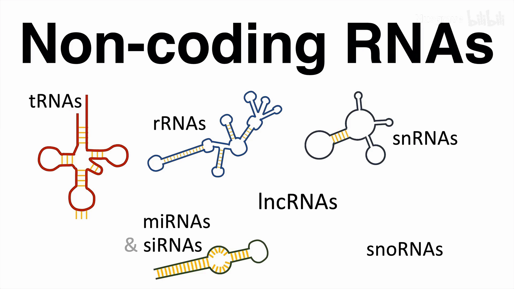
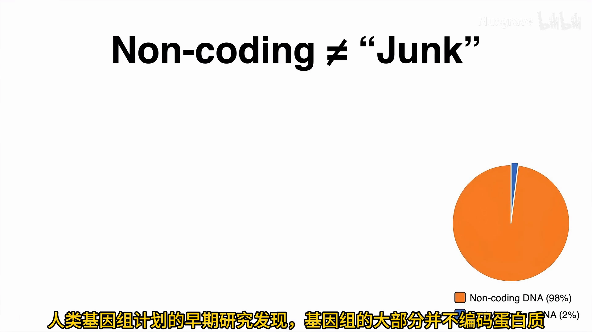
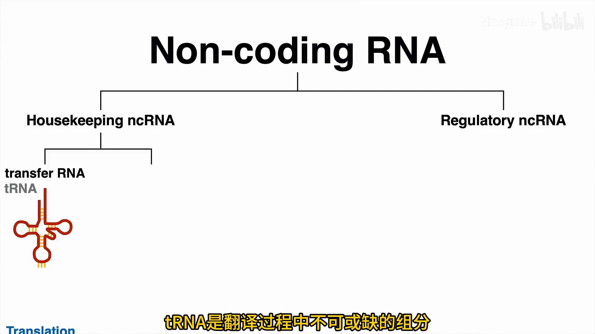
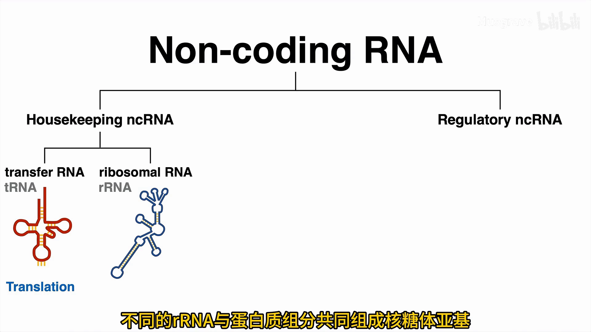
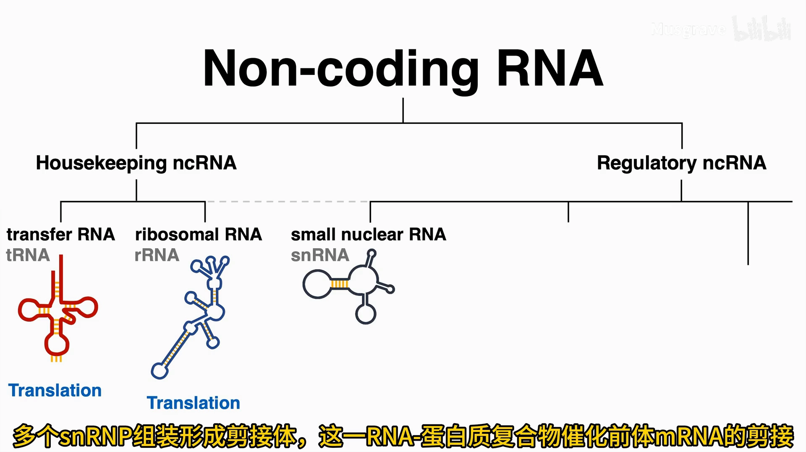
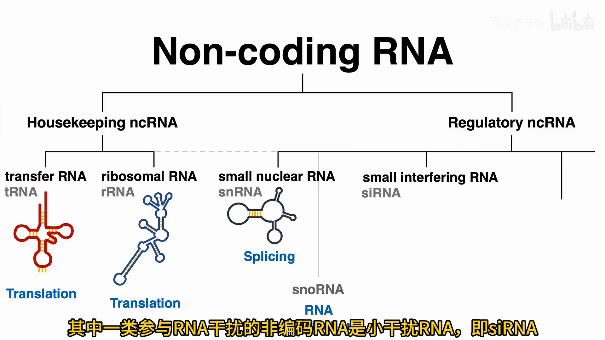
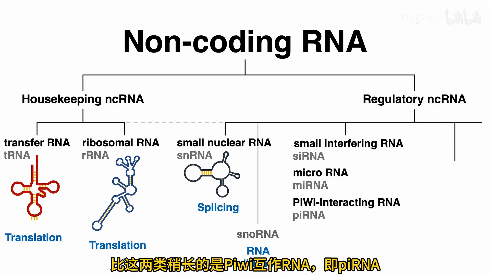
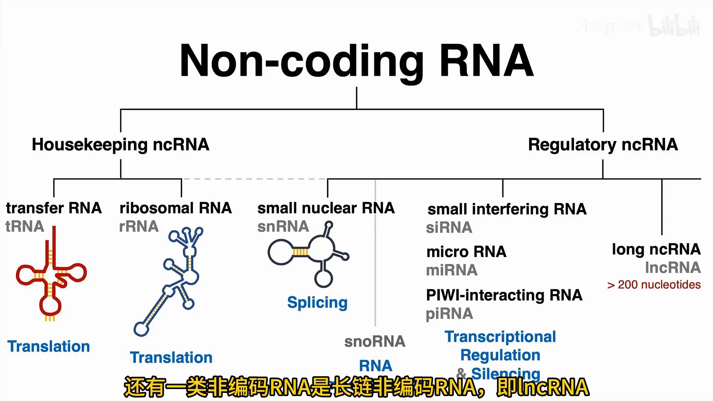

# 非编码 ≠ 无用：细胞里的 ncRNA 既当管家、又做调控

> 来源视频：[细胞中的那些非编码RNA（B站）](https://www.bilibili.com/video/BV1jKK968Evy/) ｜ 时长 4:57 ｜ 本文为该视频的图文整理稿，是[《RNA 全家福：五分钟了解所有RNA》](五分钟了解所有RNA.md)的姊妹篇——上篇给 RNA 全家福拍「合影」，本篇聚焦其中最大的群体：非编码 RNA（ncRNA）。

## 本篇要解决的核心问题

**背景**：mRNA 是 DNA 上的遗传信息被转录后产生的分子，它经过加工修饰后被翻译成蛋白质——所以 mRNA 属于**编码 RNA**（它的「出厂流程」见姊妹篇）。

**冲突**：人类基因组计划的早期研究却发现：基因组的大部分**并不编码蛋白质**，编码蛋白的只占极小比例。于是有科学家把这部分戏称为**「垃圾 DNA」**。然而出人意料的是，基因组的绝大部分似乎**都会被转录**——既然不编码蛋白质，为什么还要花力气转录？

**疑问**：这些不编码蛋白质的 RNA，究竟有什么功能？

**回答（中心思想）**：非编码 RNA 具有多种关键的生物学功能——它们可分为**管家型**与**调控型**两大类：管家型搭建并维护翻译机器，调控型精细调节基因表达。**「非编码」绝不意味着「无用」。**

## 一、「垃圾 DNA」是一场误会

[【跳转到 00:21】](https://www.bilibili.com/video/BV1jKK968Evy/?t=21)

- 提到 RNA，我们通常想到 mRNA：转录产物 → 加工修饰 → 翻译成蛋白质，所以它是编码 RNA。
- 而有些 RNA 分子**不会被翻译成蛋白质产物**——按定义，它们就是**非编码 RNA**。
- 人类基因组计划的早期发现：基因组大部分不编码蛋白质，于是「垃圾 DNA」概念诞生。
- 剧情反转：基因组绝大部分都会被转录 → 不编码 ≠ 不干活 → 研究发现非编码 RNA 具有多种关键生物学功能。

一句话结论：**非编码，绝不意味着无用**。[【跳转到 01:12】](https://www.bilibili.com/video/BV1jKK968Evy/?t=72)

## 二、管家型 ncRNA：翻译线上的固定工位

视频把非编码 RNA 分为**管家型**和**调控型**两大类（两者并非截然对立，功能上有时会相互交叉）。[【跳转到 01:17】](https://www.bilibili.com/video/BV1jKK968Evy/?t=77)

### 2.1 tRNA：翻译不可或缺的搬运工

- tRNA 通过**三核苷酸反密码子**，把**特定氨基酸**运送到核糖体；
- 人类基因组中拥有**超过 500 个 tRNA 基因**——阵容相当庞大。

### 2.2 rRNA：核糖体的骨架

- 不同的 rRNA 与蛋白质组分共同组成**核糖体亚基**；
- rRNA 的核心功能很明确：**它也是翻译所必需的**。[【跳转到 01:42】](https://www.bilibili.com/video/BV1jKK968Evy/?t=102)

## 三、剪接与修饰的「向导」：snRNA 与 snoRNA

### 3.1 snRNA：拼装剪接体，剪出成熟 mRNA

[【跳转到 02:07】](https://www.bilibili.com/video/BV1jKK968Evy/?t=127)

- snRNA（小核 RNA）与蛋白质结合，形成**小核核糖核蛋白（snRNP）**；
- 多个 snRNP 组装成**剪接体**——这一 RNA-蛋白质复合物**催化前体 mRNA 的剪接**。

### 3.2 snoRNA：指导 RNA 的化学修饰

[【跳转到 02:32】](https://www.bilibili.com/video/BV1jKK968Evy/?t=152)

- snoRNA（小核仁 RNA）与蛋白质形成 **snoRNP 复合物**，发挥**「向导 RNA」**的功能；
- 通过**碱基互补配对**识别靶标 RNA，指导特定的化学修饰，如 **2′-O-甲基化**和**假尿嘧啶化**。

## 四、调控型 ncRNA：RNA 干扰与基因沉默

[【跳转到 02:57】](https://www.bilibili.com/video/BV1jKK968Evy/?t=177)

**RNA 干扰**是一类在进化上保守的**基因沉默机制**：通过降解 RNA 分子保护细胞——例如病毒入侵时降解外源性 RNA。

### 4.1 siRNA 与 miRNA：Dicer 加工，RISC 执行

[【跳转到 03:22】](https://www.bilibili.com/video/BV1jKK968Evy/?t=202)

- **siRNA**（小干扰 RNA）：长度 **20~25 个核苷酸**，参与基因沉默；**miRNA** 也属于这一类别；
- 这两类小 RNA 在细胞内均被 **Dicer 酶**加工，整合到 **RISC 复合物**后，在**转录后水平**调控基因表达。

### 4.2 piRNA：沉默转座子的「大一号」

[【跳转到 03:47】](https://www.bilibili.com/video/BV1jKK968Evy/?t=227)

- 比 siRNA/miRNA 稍长的是 **Piwi 互作 RNA（piRNA）**；
- piRNA 引导 **Piwi 蛋白**结合靶标 RNA，Piwi 蛋白通过其**内切核酸酶活性**执行切割；
- 它能**沉默转座子**（基因组里会「乱跳」的序列）。

> 归纳：siRNA、miRNA、piRNA 三者都通过**调控基因表达 / 沉默靶基因**来工作。

## 五、lncRNA：超过 200 nt 的多面手

[【跳转到 04:12】](https://www.bilibili.com/video/BV1jKK968Evy/?t=252)

- lncRNA（长链非编码 RNA）分子显著更长——**长度超过 200 个核苷酸**；
- 功能**高度多样**，同样参与基因调控；
- 著名例子 **Xist RNA**：介导 **X 染色体失活**的大型转录本——在雌性哺乳动物中，把两条 X 染色体中的一条「沉默」掉；
- lncRNA 的异常调控与**多种人类疾病密切相关**，包括多种类型的癌症；这些分子的多功能性仍在深入研究之中。

## 小结

- mRNA 是编码 RNA；不编码蛋白的 RNA ＝ **非编码 RNA（ncRNA）**；
- 「垃圾 DNA」是一场误会：基因组大部分都会被转录，产物 ncRNA 具有多种关键功能；
- ncRNA 分**管家型**（tRNA、rRNA——翻译必需）与**调控型**（RNA 干扰三兄弟＋lncRNA）；
- **snRNA → snRNP → 剪接体**：催化前体 mRNA 剪接；**snoRNA → snoRNP**：向导 2′-O-甲基化与假尿嘧啶化；
- **siRNA/miRNA**（20~25 nt，Dicer 加工 → RISC）与 **piRNA**（引导 Piwi 切割、沉默转座子）都是基因沉默工具；
- **lncRNA**（>200 nt）功能高度多样，Xist 介导 X 染色体失活，异常调控与癌症等疾病相关。

## 关键术语速查

| 术语 | 一句话解释 |
| --- | --- |
| 非编码 RNA（ncRNA） | 不被翻译成蛋白质的 RNA，功能多样 |
| 管家型 / 调控型 | ncRNA 的两大功能分组（并非截然对立） |
| tRNA | 通过反密码子运送特定氨基酸，翻译必需 |
| rRNA | 与蛋白构成核糖体亚基，翻译必需 |
| snRNA / snRNP / 剪接体 | 小核 RNA → 核蛋白复合物 → 催化前体 mRNA 剪接 |
| snoRNA / snoRNP | 「向导 RNA」，指导 2′-O-甲基化、假尿嘧啶化 |
| RNA 干扰 | 进化保守的基因沉默机制，可降解外源 RNA |
| siRNA | 20~25 nt 的小干扰 RNA，经 Dicer 加工进入 RISC |
| miRNA | 与 siRNA 同类，在转录后水平调控基因表达 |
| RISC | 执行转录后基因表达调控的复合物 |
| piRNA / Piwi | piRNA 引导 Piwi 蛋白切割靶 RNA、沉默转座子 |
| lncRNA | 长度超过 200 nt 的长链非编码 RNA，功能多样 |
| Xist | 介导 X 染色体失活的大型 lncRNA 转录本 |
