# 【基因表达】转录、翻译与表观遗传——看这篇就够了！

> 来源：Bilibili 视频《【基因表达】转录/翻译/表观遗传，看这篇就够了！》（UP 主：云鹏生物，[BV1z8AJzLExP](https://www.bilibili.com/video/BV1z8AJzLExP/)，时长 17:55）。
> 本文基于视频字幕与画面逐窗口整理而成，配图取自视频截图，时间戳可跳回原视频对应位置核对。视频以高中必修二考点为纲、风格轻松，适合作为"中心法则"的入门第一课。

## 本讲要解决的核心问题（SCQA）

**背景**：你已经知道 DNA 是遗传物质的载体——它像一本"生命说明书"，记录着生物体生长、发育的全部信息。

**冲突**：可这份"说明书"锁在细胞核里，而真正干活的蛋白质却在细胞质中合成。一份静态的 DNA 字符串，怎么变成动态的、有功能的蛋白质？而且同样一套基因，为什么头发会黑也会白、细胞之间会各不相同？

**疑问**：遗传信息究竟按什么规则从 DNA 流向蛋白质？这套流程又受哪些因素调控？

**回答（中心思想）**：遗传信息按照**中心法则**流动——DNA 先**转录**成 RNA，RNA 再**翻译**成蛋白质；基因并非一股脑表达，而是**选择性表达**，还会受**表观遗传**的调控（碱基序列不变，表达水平却可遗传地改变）。

## 一、中心法则：遗传信息流动的"交通规则"

### 1.1 一张图看懂信息流向

中心法则（central dogma）是分子生物学的总纲，规定遗传信息的流动方向。对绝大多数生物而言，信息沿 **DNA → RNA → 蛋白质** 这条主路流动，对应三个过程：

- **复制**：基因（DNA）可以自我复制，一份变两份，把遗传信息传给子代；
- **转录**：以 DNA 为模板合成 RNA，把"细胞核里的档案"抄写成"可以带出核的工作单"；
- **翻译**：以 mRNA 为模板合成蛋白质，工作单变成真正干活的工人。

[【跳转到 00:25】](https://www.bilibili.com/video/BV1z8AJzLExP/?t=25)

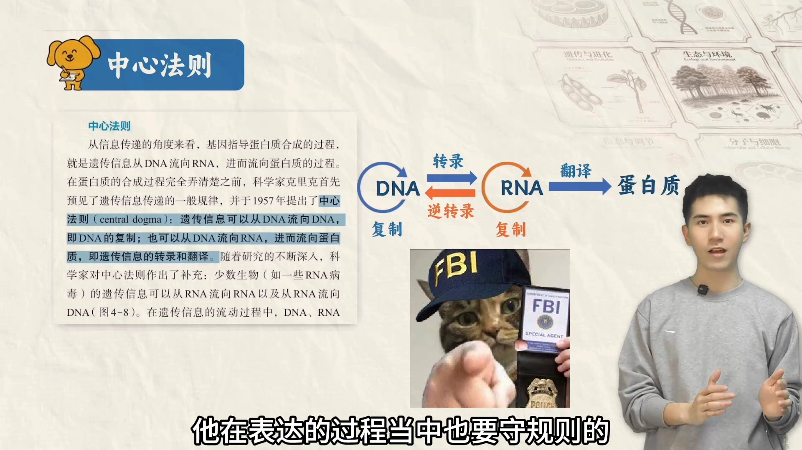

### 1.2 主路之外的"小路"

[【跳转到 00:30】](https://www.bilibili.com/video/BV1z8AJzLExP/?t=30)

对极少数生物——**RNA 病毒**来说，规则还有"扩展包"：它们的遗传物质是 RNA，可以进行 **RNA 自我复制**，甚至存在**逆转录**（以 RNA 为模板合成 DNA）。把所有过程加起来，才是完整的中心法则。

### 1.3 三个过程，一句话分清

[【跳转到 00:46】](https://www.bilibili.com/video/BV1z8AJzLExP/?t=46)

| 过程 | 模板 | 产物 | 一句话 |
| --- | --- | --- | --- |
| 复制 | DNA 的**两条链** | 新的 DNA 子链 | 一份变两份 |
| 转录 | DNA 的**一条链** | RNA | 抄写工作单 |
| 翻译 | mRNA | 蛋白质（多肽链） | 照单生产 |

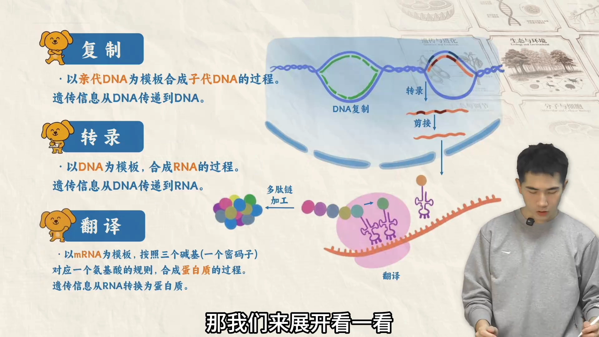

这部分知识本身不难，但有很多容易忽略的细节。下面依次展开复制、转录和翻译。

## 二、DNA 复制：有方向、分段进行

> 1.1.1 条目的主角是转录和翻译，但视频对复制也做了完整铺垫（中心法则的第一步），这里一并整理，供后续条目引用。

### 2.1 复制需要什么

[【跳转到 01:09】](https://www.bilibili.com/video/BV1z8AJzLExP/?t=69)

体内 DNA 复制的"开工条件"：

1. **解旋酶**：把 DNA 双链打开——双链不解开，新子链就结合不上去；
2. **引物**：一段本质上是 RNA 的短序列，指示合成从哪里开始；
3. **原料**：四种脱氧核糖核苷酸（A/T/G/C）；
4. **DNA 聚合酶**：把核苷酸逐个连上去、合成新子链的"施工队"。

### 2.2 前导链与后随链：为什么一条快一条慢

[【跳转到 01:34】](https://www.bilibili.com/video/BV1z8AJzLExP/?t=94)

DNA 合成有条铁律：**新链只能从 5′ 端向 3′ 端延伸**。而解旋不是一瞬间把整个双链全打开，而是从一个部位开始、逐渐延伸——于是两条模板链的"处境"不同：

- **前导链**：合成方向与解旋方向相同，可以从 5′ 端向 3′ 端一路连续合成，中间不停，速度快；
- **后随链（滞后链）**：合成方向与解旋方向相反，只能"打开一段、合成一段"，反复合成出许多短片段——这些短片段叫**冈崎片段**（视频字幕误作"钢琴片段"，已纠正），最后由 **DNA 连接酶**缝合为完整子链。

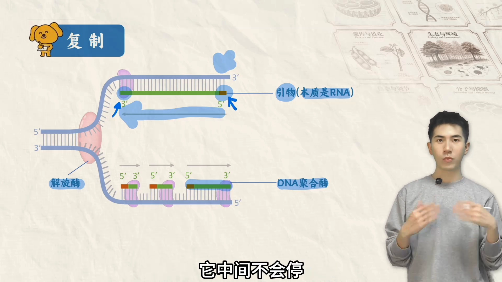

### 2.3 复制泡：真核多起点，原核单起点

[【跳转到 03:14】](https://www.bilibili.com/video/BV1z8AJzLExP/?t=194)

复制时 DNA 双链被打开，会形成一个"圈状"结构，叫**复制泡**。课本特意用它强调原核与真核的区别：**真核生物**复制往往有**多个起点**，可多处同时开工、同时存在多个复制泡；**原核生物**往往只有**一个起点**。

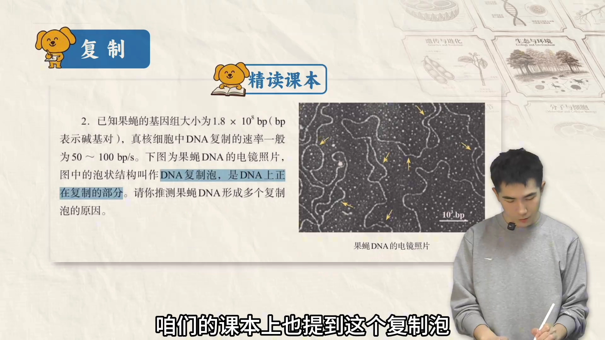

还有两个细节：其一，解旋从中间向两端延伸，所以真实情况下**同一条模板链往往既是前导链、也是后随链**（起点一侧连续合成、另一侧间断合成）；其二，子链合成完还要用**酶切掉 RNA 引物**、补上 DNA，再由 DNA 连接酶连成完整子链——毕竟我们要的是纯 DNA 子链，不希望里面残留 RNA 片段。

[【跳转到 02:49】](https://www.bilibili.com/video/BV1z8AJzLExP/?t=169)

## 三、转录：以一条链为模板，把 DNA 抄写成 RNA

### 3.1 模板链与编码链：千万别搞混

[【跳转到 03:55】](https://www.bilibili.com/video/BV1z8AJzLExP/?t=235)

转录和复制最大的区别：**只有一条 DNA 链当模板**，另一条链不转录，叫做**编码链**。

为什么叫编码链？因为它的序列"等于" mRNA：编码链与模板链互补配对，模板链又与转录出的 mRNA 互补配对——所以把 mRNA 里的所有 U（尿嘧啶）换回 T（胸腺嘧啶），得到的序列就和编码链完全一样。也就是说，**mRNA 的编码序列 = 编码链的序列**，不转录的那条链因此得名。

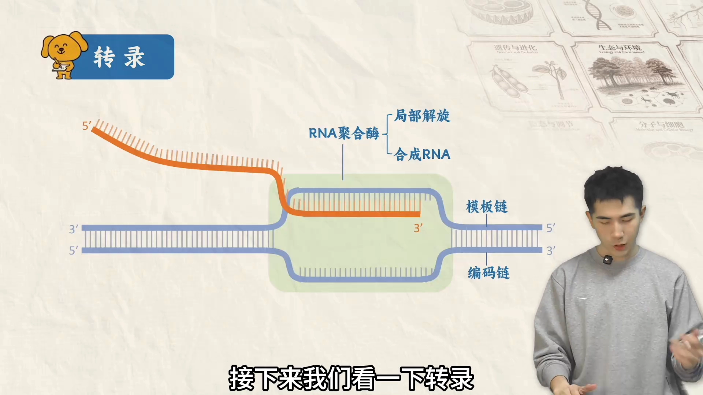

分清两条链非常实用：判断转录方向、做基因工程题（引物选择与设计）时都要用到。

### 3.2 原核与真核转录的两点区别

[【跳转到 04:45】](https://www.bilibili.com/video/BV1z8AJzLExP/?t=285)

1. **空间分隔**：原核生物没有细胞核，转录和翻译都在细胞质里，可以**一边转录一边翻译**；真核生物必须先在细胞核里完成转录，mRNA 再出核、到细胞质里翻译——转录与翻译在空间上被隔开。[【跳转到 04:57】](https://www.bilibili.com/video/BV1z8AJzLExP/?t=297)
2. **剪接**：真核生物的基因更复杂，既有**内含子**（不编码蛋白质的间隔序列）也有**外显子**（编码序列）；两者都会被转录，所以初产物只能叫**前体 RNA**，还要经过**剪接**——剪掉内含子、拼接外显子——才得到能翻译的成熟 RNA。[【跳转到 05:13】](https://www.bilibili.com/video/BV1z8AJzLExP/?t=313)

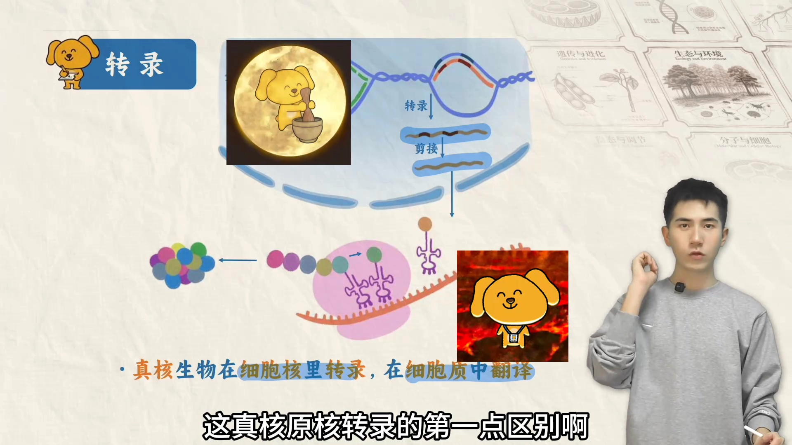

### 3.3 认识 RNA 家族：mRNA、tRNA、rRNA、miRNA

[【跳转到 05:35】](https://www.bilibili.com/video/BV1z8AJzLExP/?t=335)

| RNA | 名字由来 | 功能 |
| --- | --- | --- |
| mRNA | 信使 RNA（message） | 携带遗传信息，是蛋白质合成的**模板** |
| tRNA | 转运 RNA（transfer） | 把**氨基酸**转运到核糖体上 |
| rRNA | 核糖体 RNA（ribosome） | 核糖体的组成成分 |
| miRNA | 微小 RNA（microRNA） | **调控基因表达**（第六节展开） |

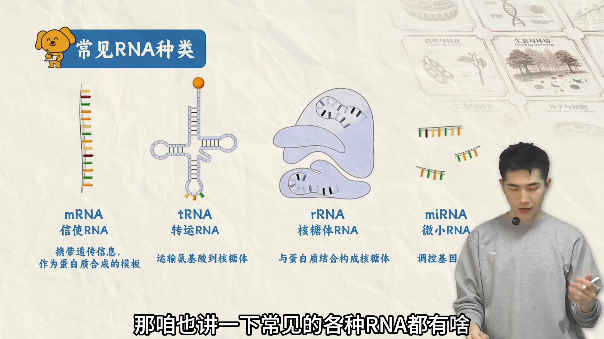

以前掌握前三类就够用了，现在还要加上 miRNA——它在表观遗传里扮演重要角色。

## 四、翻译：在核糖体上把密码子"读"成氨基酸

### 4.1 翻译的主角：核糖体与它的三个位点

[【跳转到 06:11】](https://www.bilibili.com/video/BV1z8AJzLExP/?t=371)

核糖体长得像一个"石墩子"：上面是大亚基，下面是小亚基。很多人不知道的是，它体内有三个位点：

- **A 位点**：迎接**新到来**的 tRNA（arrival，抵达）；
- **P 位点**：中间位点，结合携带**正在延长的肽链**的 tRNA（像临时停车）；
- **E 位点**：即将**释放**空载 tRNA 的位点（exit，出口）。

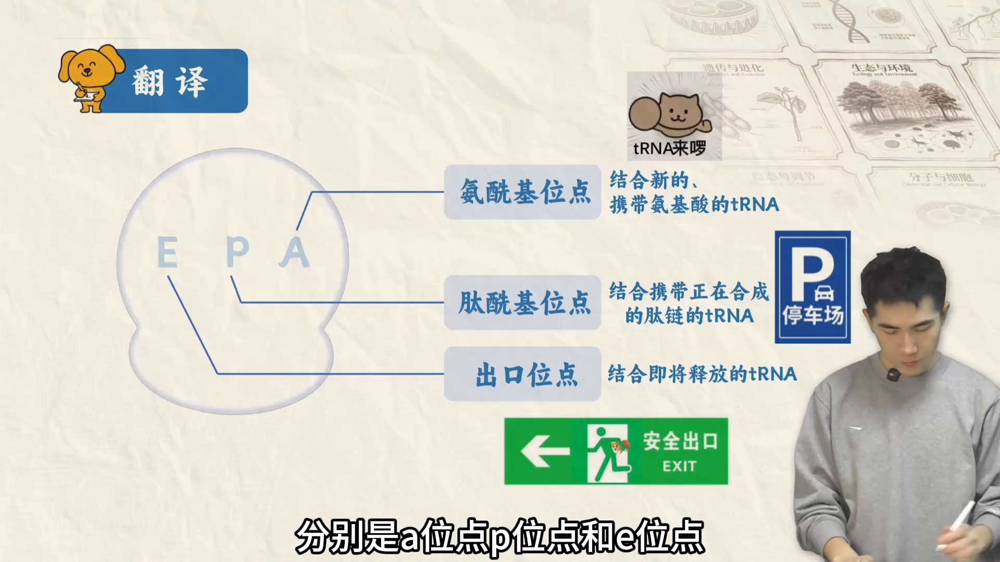

一个选择题爱挖的坑：**虽然有三个位点，但一个核糖体最多同时只结合两个 tRNA**——三个位点从不同时被占用。[【跳转到 07:01】](https://www.bilibili.com/video/BV1z8AJzLExP/?t=421)

### 4.2 密码子与反密码子：3 碱基对应 1 氨基酸

[【跳转到 07:18】](https://www.bilibili.com/video/BV1z8AJzLExP/?t=438)

- mRNA 上**每 3 个碱基 = 1 个密码子**；
- tRNA 上**每 3 个碱基 = 1 个反密码子**；
- 密码子与反密码子**互补配对**，所以 tRNA 能精准地把携带的氨基酸送到对应位置——这就是"3 碱基决定 1 氨基酸"的分子机制。

翻译从**起始密码子**开始：有了它，核糖体才能结合到 mRNA 上。

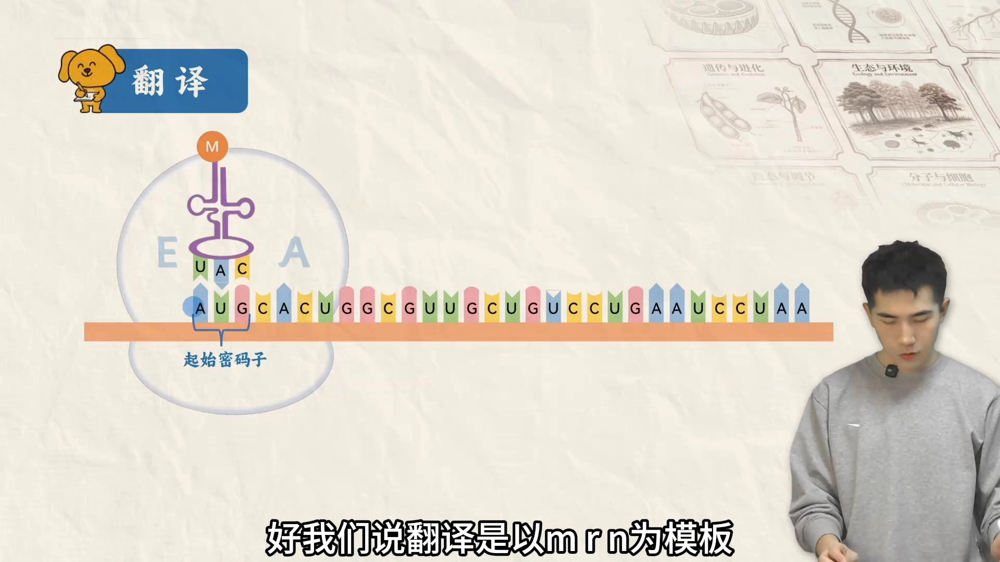

### 4.3 翻译全程：进位、成肽、移位，循环往复

翻译按这样的循环推进：

1. 新的 tRNA 携带新氨基酸进入；
2. 之前那条肽链转移到新氨基酸上（肽链延长）；
3. 核糖体沿 mRNA **前移 3 个碱基**，不携带氨基酸的 tRNA 释放；
4. 下一个新 tRNA 进入……如此反复。

无论在哪个瞬间，核糖体三个位点上最多只结合两个 tRNA。这个循环一直持续，直到遇到**终止密码子**，翻译才停止。在真核生物体内，刚合成的多肽链往往还要**进一步加工**，才具有生物学活性。[【跳转到 08:08】](https://www.bilibili.com/video/BV1z8AJzLExP/?t=488)

还有一个高效设计：**一个 mRNA 分子上可以同时结合多个核糖体**、各自翻译——所以体内只需要少量 mRNA，就能快速合成大量蛋白质。[【跳转到 08:28】](https://www.bilibili.com/video/BV1z8AJzLExP/?t=508)

### 4.4 一张表总结：复制 vs 转录 vs 翻译

[【跳转到 08:39】](https://www.bilibili.com/video/BV1z8AJzLExP/?t=519)

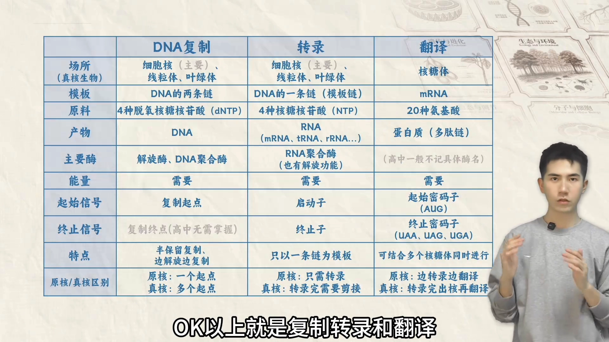

## 五、基因如何决定性状：两条路径，还有例外

基因表达与性状的关系，比想象中复杂得多。视频用两个例子开场：

- 同卵双胞胎基因几乎相同，头发和瞳色却可能不一样——可能与**表观遗传**有关（第六节展开）；
- 植物水毛茛在水里和空气里长出的形态完全不同，但上下部分的基因肯定是一样的——这是**环境影响基因表达**。[【跳转到 09:10】](https://www.bilibili.com/video/BV1z8AJzLExP/?t=550)

先看基因如何决定性状。基因转录出 RNA、翻译出蛋白质，而蛋白质控制性状有**两条路径**：[【跳转到 09:28】](https://www.bilibili.com/video/BV1z8AJzLExP/?t=568)

### 5.1 间接路径：控制酶的合成 → 控制代谢 → 控制性状

大多数酶是蛋白质。基因通过控制酶的合成来控制代谢过程，进而控制性状。经典例子是**酪氨酸酶**：它是一种酶（蛋白质），催化"酪氨酸 → 黑色素"这个化学反应。酪氨酸酶含量正常，该黑的地方就黑；缺少酪氨酸酶，黑色素无法正常合成，就会出现**白化**症状。

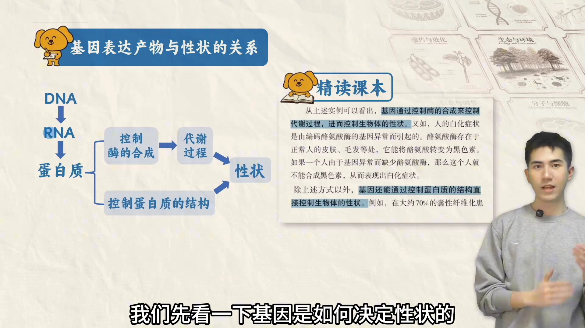

### 5.2 直接路径：控制蛋白质的结构

[【跳转到 09:53】](https://www.bilibili.com/video/BV1z8AJzLExP/?t=593)

生物的很多性状由蛋白质结构直接决定：头发、指甲盖、皮肤表面都是**角蛋白**——你是自来卷还是黑长直，就直接和角蛋白的结构密切相关。

### 5.3 选择性表达与细胞分化

[【跳转到 10:28】](https://www.bilibili.com/video/BV1z8AJzLExP/?t=628)

大多数细胞都带着生物生长发育的**全套基因组**，但绝不会一股脑表达。不同细胞**特异性、选择性地**表达基因，造成的结果就是**细胞分化**——反过来说，**细胞分化的本质就是基因的选择性表达**。

基因按表达范围分两大类：[【跳转到 10:53】](https://www.bilibili.com/video/BV1z8AJzLExP/?t=653)

- **几乎所有细胞都表达**：维持基本生命活动所必需，比如核糖体蛋白基因（所有活细胞都得有核糖体）、ATP 合成酶基因（所有活细胞都得能合成 ATP，不然没有能量）；
- **特定细胞特异表达**：比如血红蛋白基因主要在红细胞里表达，不会在神经细胞里表达。

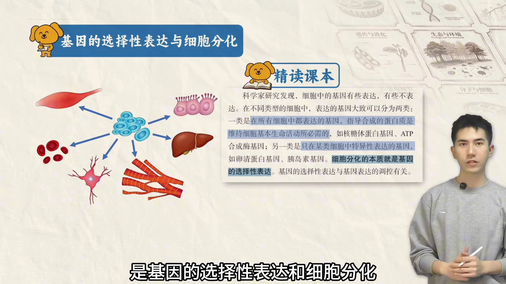

## 六、表观遗传：碱基序列不变，表达却可遗传地改变

### 6.1 定义：一份"没改代码"的遗传

[【跳转到 11:14】](https://www.bilibili.com/video/BV1z8AJzLExP/?t=674)

课本定义：**生物体基因的碱基序列保持不变，但基因表达和表型发生了可遗传变化**的现象，叫做**表观遗传**。

可以把 DNA 碱基对排列顺序想象成一串控制生长发育的"代码"——表观遗传就是：**代码本身一个字都没改，但基因表达变了，而且这个变化还能遗传下去**。遗传物质没变、变化却可遗传，这正是它匪夷所思、值得科学家研究的地方。

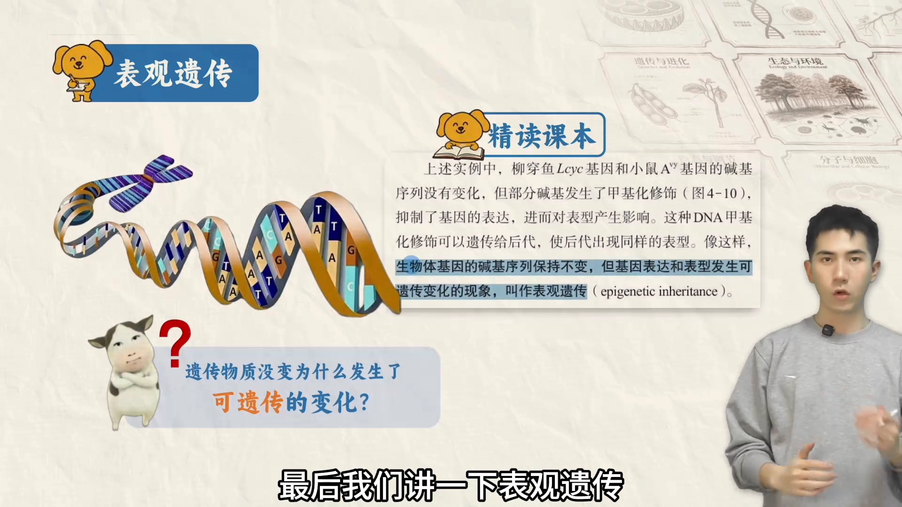

表观遗传的方式非常多样，高中阶段掌握最基础的三种即可：**DNA 甲基化**、**组蛋白修饰**（这两者都是转录前水平的修饰）和 **RNA 干扰**（转录后水平的修饰）。[【跳转到 11:54】](https://www.bilibili.com/video/BV1z8AJzLExP/?t=714)

### 6.2 DNA 甲基化：给启动子"贴符"

[【跳转到 12:11】](https://www.bilibili.com/video/BV1z8AJzLExP/?t=731)

先看"不甲基化"的正常情况：基因表达要先转录，而转录的起始，需要 RNA 聚合酶等转录相关蛋白结合到**启动子**（基因上游、负责"点火"的区域）上——所以未甲基化的基因可以正常表达。

**甲基化**顾名思义，就是给 DNA 添加甲基，通常加在**胞嘧啶**上。如果甲基化恰好落在启动子区域：转录相关蛋白的结构被改变、结合不上启动子，RNA 聚合酶都到不了位，更别提启动转录——**甲基化的基因无法正常表达**。[【跳转到 12:36】](https://www.bilibili.com/video/BV1z8AJzLExP/?t=756)

视频里给了一个记忆梗：把基因想成一个"僵尸"，甲基化就是一张"符咒"——贴到僵尸脸上，僵尸就不能动了。[【跳转到 13:01】](https://www.bilibili.com/video/BV1z8AJzLExP/?t=781)

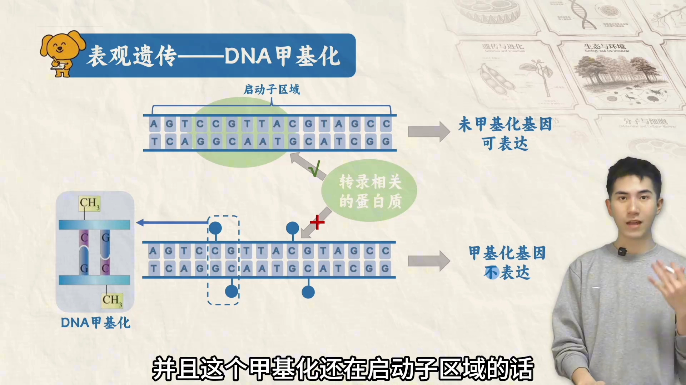

### 6.3 组蛋白修饰：调 DNA 缠绕的"松紧"

[【跳转到 13:18】](https://www.bilibili.com/video/BV1z8AJzLExP/?t=798)

组成染色体的物质包括 DNA 和蛋白质，这里的蛋白质主要是**组蛋白**：DNA 紧紧缠绕在组蛋白外侧，形成**核小体**。组蛋白修饰方式很多（乙酰化、甲基化、磷酸化……），具体机制高中不要求，只需知道它通过**调控 DNA 缠绕的松紧程度**来影响表达：

- 缠得**太紧** → 转录所需物质结合不上 → 表达被**抑制**；
- 缠得**松散** → DNA 更容易打开、更容易结合合成 RNA 所需的各种物质 → 表达被**促进**。

到底是促进还是抑制？具体题目具体分析。[【跳转到 13:43】](https://www.bilibili.com/video/BV1z8AJzLExP/?t=823)

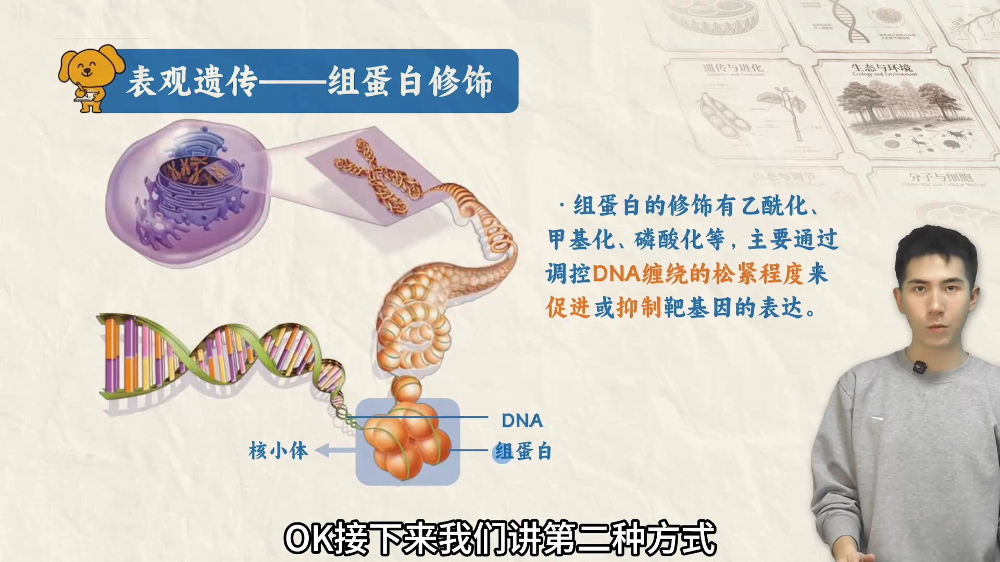

### 6.4 RNA 干扰：直接拦截 mRNA

[【跳转到 14:28】](https://www.bilibili.com/video/BV1z8AJzLExP/?t=868)

RNA 干扰是近年高考热门（诺奖工作曾涉及）。原理非常简单：翻译时 mRNA 要通过密码子-反密码子配对、结合到核糖体上；而一些**小的 RNA 片段**与**靶 mRNA** 的序列互补配对，先结合了上去——mRNA 就没法再结合核糖体，无法翻译，基因表达被终止。

再展开一点：这类小 RNA 通常指 **siRNA**（small interfering RNA），它会先形成一个**沉默复合体 RISC**；RISC 结合在 mRNA 上，使其无法结合核糖体、翻译被终止——这是它的一种作用机制。更极端的情况：沉默复合体会**把 mRNA 切割成片段**（把靶 mRNA 分解掉），那就更没法翻译、更无法表达了。[【跳转到 14:53】](https://www.bilibili.com/video/BV1z8AJzLExP/?t=893)

**siRNA 与 miRNA 的区别**（做题常见）：[【跳转到 15:18】](https://www.bilibili.com/video/BV1z8AJzLExP/?t=918)

| | siRNA | miRNA（microRNA） |
| --- | --- | --- |
| 来源 | 往往**外源**：人工合成或来自病毒 | **内源**：人体内自身就有 |
| 与靶 mRNA 配对 | 可**完全互补**（人工合成可精准设计序列） | 通常**不完全互补** |
| 作用结果 | 一般**直接分解**靶 mRNA（作用程度深） | 一般**阻止 mRNA 与核糖体结合**、抑制翻译，通常不直接分解 |

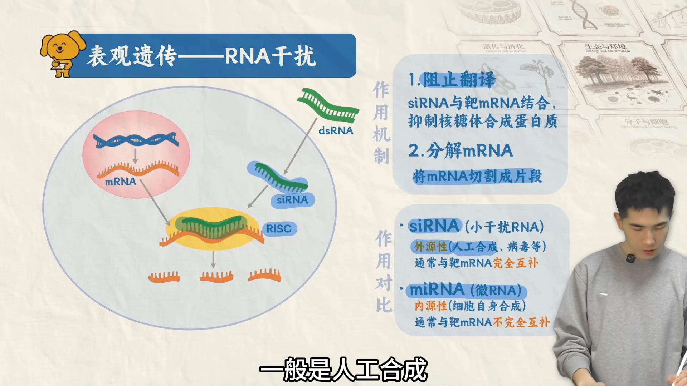

视频最后提醒：表观遗传在课本里内容不多（不到半页），但近几年高考考察频率相对较高——23 年广东卷、24 年广西卷、24 年黑吉辽卷、25 年河南卷、25 年江苏卷第 15 题与第 20 题等都考过，值得重视。[【跳转到 16:33】](https://www.bilibili.com/video/BV1z8AJzLExP/?t=993)

## 小结

[【跳转到 16:54】](https://www.bilibili.com/video/BV1z8AJzLExP/?t=1014)

- 遗传信息按**中心法则**流动：基因可以自我复制、**转录**出 RNA、RNA **翻译**出蛋白质；RNA 病毒还有 RNA 自我复制与**逆转录**两条"小路"。
- 复制需要解旋酶、引物（RNA）、四种脱氧核糖核苷酸与 DNA 聚合酶；新链只能 5′→3′ 延伸，于是有连续合成的**前导链**和分段合成（**冈崎片段** + DNA 连接酶）的**后随链**；真核复制多起点（多个复制泡）、原核单起点。
- 转录只以一条链为模板：**模板链**被转录，**编码链**序列 = mRNA（U 换 T）；原核可边转录边翻译，真核有空间分隔且要**剪接**（剪掉内含子、拼接外显子）。
- 翻译在核糖体上进行：mRNA 每 3 碱基一个**密码子**、tRNA 每 3 碱基一个**反密码子**，互补配对精准对应氨基酸；核糖体有 A/P/E 三个位点但最多同时占用两个；遇**终止密码子**停止；一条 mRNA 可挂多个核糖体高效生产。
- 基因控制性状两条路径：经**酶 → 代谢**间接控制（酪氨酸酶与黑色素、白化），或直接决定**蛋白质结构**（角蛋白与发质卷直）；**细胞分化的本质是基因的选择性表达**（管家基因 vs 特异表达基因）；环境（水毛茛、营养）也影响性状——基因相同、环境相同，仍可能因**表观遗传**而表达不同。
- **表观遗传** = 碱基序列不变、表达与表型可遗传地改变；三种入门机制：**DNA 甲基化**（启动子贴"符"，抑制转录）、**组蛋白修饰**（调核小体缠绕松紧）、**RNA 干扰**（siRNA/miRNA 拦截靶 mRNA）。

## 关键术语速查

| 术语 | 一句话解释 |
| --- | --- |
| 中心法则 | 遗传信息流动规则：DNA→RNA→蛋白质，外加 RNA 自我复制与逆转录 |
| 前导链 / 后随链 | 复制中连续合成的一条 / 分段合成、更慢的一条 |
| 冈崎片段 | 后随链上分段合成的短 DNA 片段，由 DNA 连接酶缝合 |
| 复制泡 | 复制时双链打开形成的泡状结构；真核多个、原核一个 |
| 模板链 / 编码链 | 被转录的那条链 / 序列与 mRNA（U→T）相同的那条链 |
| 前体 RNA | 真核转录初产物，需剪接掉内含子才成为成熟 RNA |
| 密码子 / 反密码子 | mRNA 上每 3 个碱基 / tRNA 上与之互补配对的每 3 个碱基 |
| A/P/E 位点 | 核糖体上迎接新 tRNA / 携带肽链 / 释放空载 tRNA 的三个位点（最多同时占用两个） |
| 多聚核糖体 | 一条 mRNA 上同时结合多个核糖体，少量 mRNA 快速产出大量蛋白 |
| 细胞分化 | 本质是基因的选择性表达：不同细胞表达不同的基因组合 |
| 表观遗传 | 碱基序列不变，但基因表达/表型发生可遗传变化 |
| 启动子 | 基因上游、RNA 聚合酶结合以起始转录的区域 |
| DNA 甲基化 | 在胞嘧啶上加甲基（常见于启动子），使转录无法起始 |
| 组蛋白修饰 | 通过改变核小体上 DNA 缠绕松紧，促进或抑制表达 |
| RNA 干扰 / RISC | 小 RNA 结合靶 mRNA 使翻译终止；siRNA 经沉默复合体 RISC 起作用 |
| siRNA / miRNA | 外源、完全互补、直接分解靶 mRNA / 内源、不完全互补、抑制翻译 |
