# 核酸重难点详解：碱基与序列表示——DNA 用 A/T/G/C，RNA 用 A/U/G/C

> 源视频：[核酸重难点详解，你的DNA动了么？ | 知识【高中生物必修1】](https://www.bilibili.com/video/BV1Le4y1B7zb/)（喵喵老师，25 分 22 秒）。本博客基于视频逐窗口字幕与幻灯片整理，所有内容可在原视频中核查。

## 本讲要解决的核心问题（SCQA）

**背景**：生物信息模型读入的"序列"就是一串字母——DNA 用 A/T/G/C 四个字母，RNA 用 A/U/G/C 四个字母。FASTA 文件、参考基因组、蛋白设计模型的输入，底层都是这些碱基的排列。

**冲突**：很多初学者背下了这五个字母，却说不清它们从哪来：碱基和核苷酸是什么关系？DNA 为什么用 T 而 RNA 用 U？字母串成的"序列"又是怎么从化学分子里来的？

**疑问**：碱基、核苷酸、核酸链、双螺旋，这几层结构到底怎么搭起来？所谓"遗传信息"又藏在哪一层？

**回答（中心思想）**：核酸由核苷酸连接而成，每个核苷酸 = 磷酸 + 五碳糖 + 含氮碱基三件套；DNA 的碱基是 A/T/G/C，RNA 的是 A/U/G/C，两套字母表唯一的差别是 T 与 U 不可互换；核苷酸靠磷酸二酯键串成链，就得到"序列"——遗传信息就写在碱基的排列顺序里。

---

## 一、核酸有两种：DNA 与 RNA

### 1.1 双链的 DNA 与单链的 RNA

核酸分两大类。第一类是 **DNA 分子**，中文名**脱氧核糖核酸**——"脱氧核糖"这个糖我们在讲糖类时见过。看它的结构：两条链结合在一起，像拧麻花一样拧起来，这就是著名的 **DNA 双螺旋结构**。

第二类是 **RNA 分子**，中文名**核糖核酸**，构成它的是核糖。RNA 一般是**单链**的——虽然是单链，自己也可以拧吧拧吧，形成一定的空间结构。

[【跳转到 00:46】](https://www.bilibili.com/video/BV1Le4y1B7zb/?t=46)

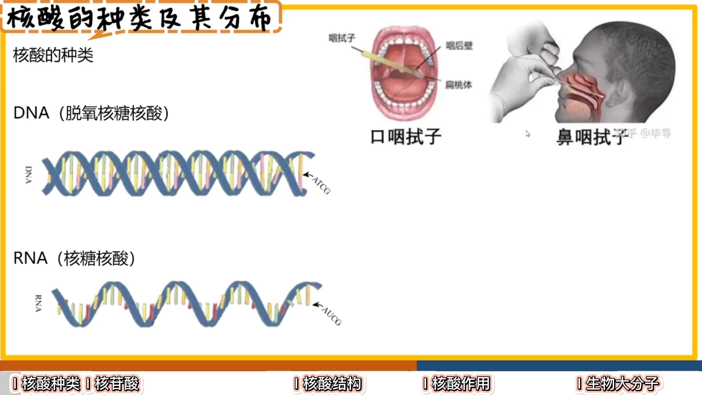

### 1.2 在细胞里的分布

在真核生物（比如动物、植物）细胞里：

- **DNA** 主要分布在**细胞核**里——就像细胞的"宫殿"，调控整个细胞的工作；此外**线粒体**和**叶绿体**里也有 DNA。
- **RNA** 主要分布在**细胞质**当中；当然细胞核、线粒体、叶绿体里也会有部分 RNA。

[【跳转到 01:36】](https://www.bilibili.com/video/BV1Le4y1B7zb/?t=96)

核酸分子又长又大，属于**生物大分子**之一（第七节展开）。既然是大分子，就得先搞清楚：构成它的最基本的小单位是什么？——**核苷酸**。

---

## 二、核苷酸：核酸的基本单位

### 2.1 命名：比"核酸"中间多一个"苷"字

基本单位的名字和核酸的名字一一对应：

- DNA 叫脱氧核糖核酸 → 基本单位叫**脱氧核苷酸**（脱氧核糖核苷酸）；
- RNA 叫核糖核酸 → 基本单位叫**核糖核苷酸**。

也就是在"核酸"中间加了一个"苷"字。本讲后面所有"名词混乱"，都源于这一对名字，先把它们对应好。

### 2.2 三件套：磷酸 + 五碳糖 + 含氮碱基

以 DNA 的基本单位（脱氧核苷酸）为例，一个核苷酸由三部分构成：

1. **磷酸基团**：常用一个"P"加个圈来表示；
2. **五碳糖**：DNA 里是脱氧核糖。五个碳在哪？沿着糖环数，每个拐点是一个碳，一共五个——第 5 个碳连着磷酸；
3. **含氮碱基**：常用一个长方形来表示，连在糖环上。

[【跳转到 03:03】](https://www.bilibili.com/video/BV1Le4y1B7zb/?t=183)

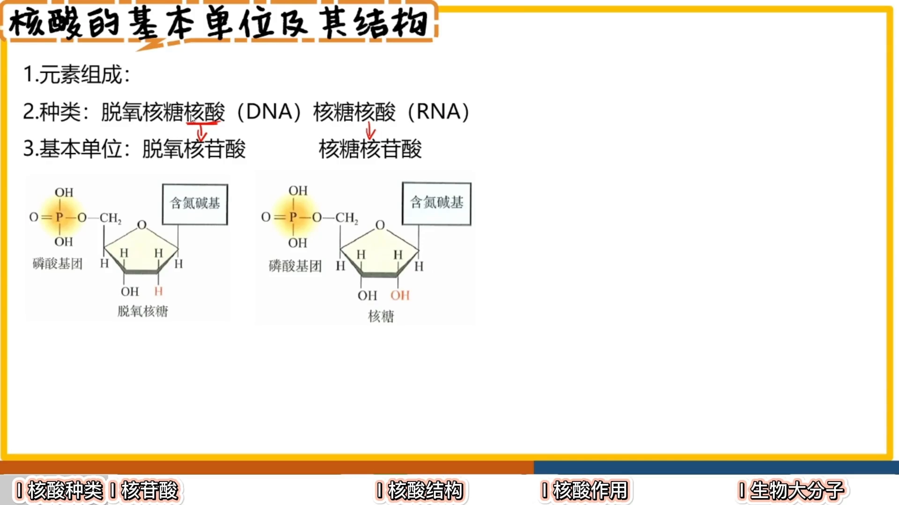

### 2.3 脱氧核糖 vs 核糖：一字之差

DNA 和 RNA 的基本单位，直观区别就在糖上：

- **核糖**：某个位置上是**羟基（—OH）**；
- **脱氧核糖**：同一个位置上只有**一个氢（—H）**——"脱氧"就是少了那个氧。

这个细节知道即可，一般不会细考化学结构。但要记住：**DNA 由脱氧核糖构成，RNA 由核糖构成**——听名字就能记住。

[【跳转到 04:18】](https://www.bilibili.com/video/BV1Le4y1B7zb/?t=258)

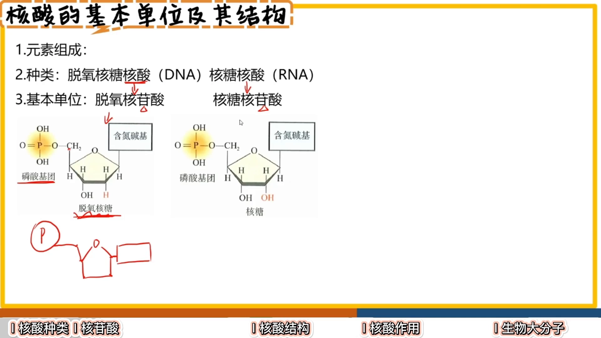

---

## 三、五种含氮碱基与字母编码（本讲核心）

### 3.1 嘧啶三个、嘌呤两个

含氮碱基分两大类：

- **嘧啶**（小个子）：**胞嘧啶、尿嘧啶、胸腺嘧啶**，共 3 个；
- **嘌呤**（大个子）：**鸟嘌呤、腺嘌呤**，共 2 个。

[【跳转到 04:43】](https://www.bilibili.com/video/BV1Le4y1B7zb/?t=283)

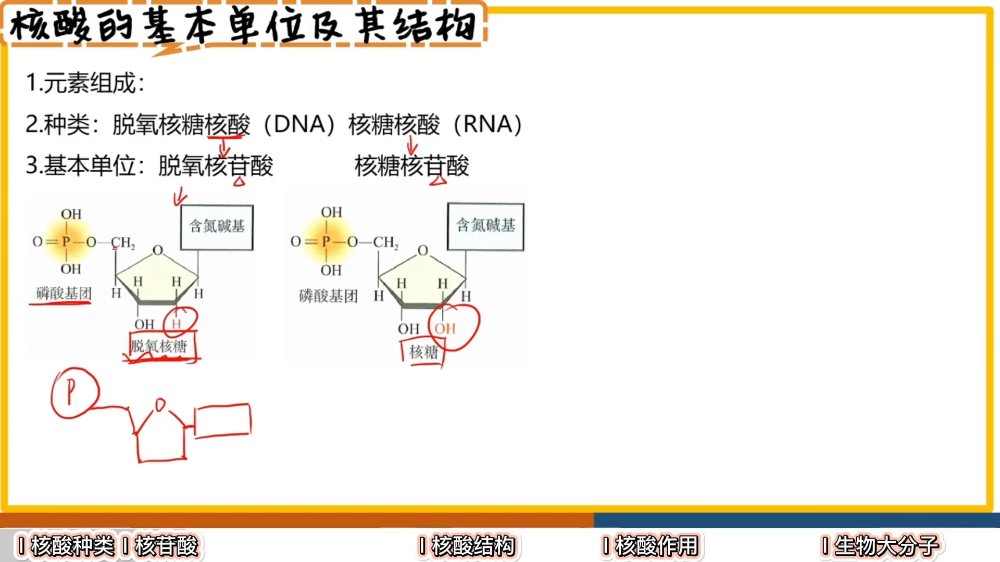

### 3.2 五个字母怎么记

中英文缩写必须对上号——考试经常中英文混着考：

| 中文 | 字母 | 视频里的记忆法 |
| --- | --- | --- |
| 胞嘧啶 | **C** | "胞"取自 cell（细胞），取 C |
| 尿嘧啶 | **U** | U 像个尿盆儿 |
| 胸腺嘧啶 | **T** | 张开双臂就是一个大 T |
| 鸟嘌呤 | **G** | 小鸟"叽叽咕咕"，都离不开 G 的音 |
| 腺嘌呤 | **A** | 直接记"啊"——字母表首字母 |

[【跳转到 06:23】](https://www.bilibili.com/video/BV1Le4y1B7zb/?t=383)

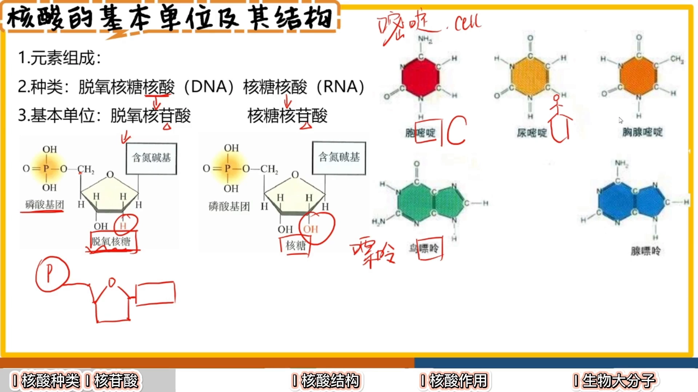

---

## 四、DNA 与 RNA 的碱基差异：T 与 U 不可互换

### 4.1 两点区别总结

DNA 和 RNA 基本单位的区别有两点：

1. **糖**：一个是脱氧核糖、一个是核糖（磷酸基团都一样）；
2. **碱基**：DNA 碱基里特殊的是 **T**，RNA 碱基里特殊的是 **U**。

DNA 的基本单位带 **A/T/C/G** 四种碱基，RNA 的基本单位带 **A/U/C/G** 四种碱基——**T 是 DNA 的组成碱基，U 是 RNA 的组成碱基，它俩不能互换**。

答题提示：题目里若画一个不带详细结构的"五碳糖"，它既可以代表核糖也可以代表脱氧核糖，具体是哪个要看题目条件。

[【跳转到 08:28】](https://www.bilibili.com/video/BV1Le4y1B7zb/?t=508)

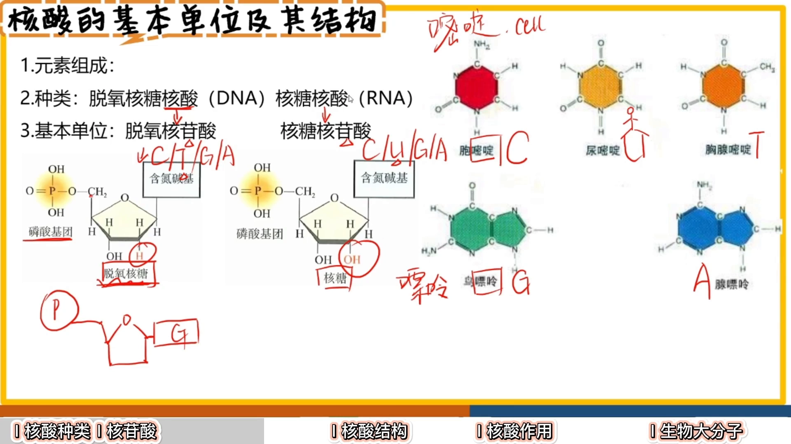

### 4.2 数目账：8 种核苷酸、5 种碱基

把数目算清楚（考试常考）：

- **脱氧核苷酸**：碱基可带 A/T/C/G → 共 **4 种**；
- **核糖核苷酸**：碱基可带 A/U/C/G → 共 **4 种**；
- **核苷酸合计**：4 + 4 = **8 种**；
- **含氮碱基合计**：A/G/C/T/U → 共 **5 种**；
- **组成元素**：糖含 C/H/O，磷酸基团含 P，含氮碱基含 N → 核酸的组成元素是 **C、H、O、N、P**。

[【跳转到 09:43】](https://www.bilibili.com/video/BV1Le4y1B7zb/?t=583)

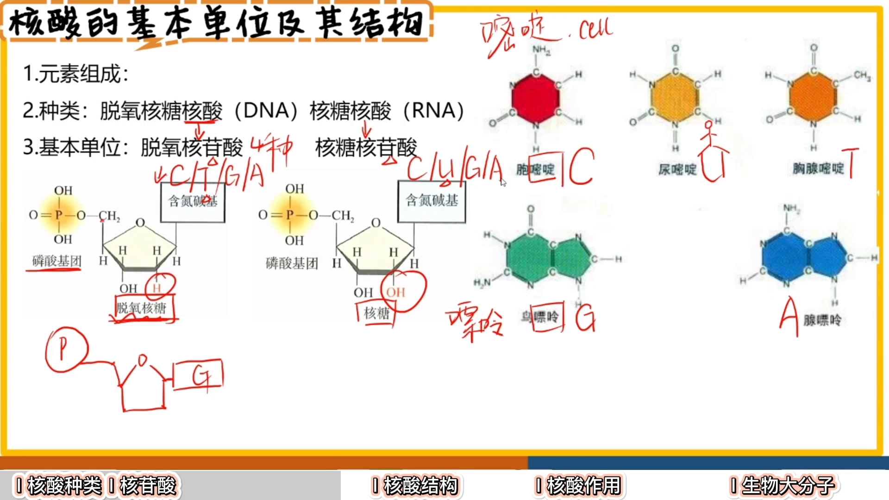

---

## 五、从核苷酸到双螺旋：链是怎么连起来的

### 5.1 磷酸二酯键把核苷酸穿成链

就像一个个氨基酸脱水缩合串成碳链一样，核苷酸也要"穿成一串"：

- 相邻两个基本单位之间**脱水缩合**：糖上一个位置的碳与下一个核苷酸的磷酸根形成一个键——这个键叫**磷酸二酯键**；
- 穿成的一条链叫**脱氧核苷酸链**。

RNA 是单链，一条链拧一下就成型了；而 DNA 是双螺旋，需要两条链。

[【跳转到 11:47】](https://www.bilibili.com/video/BV1Le4y1B7zb/?t=707)

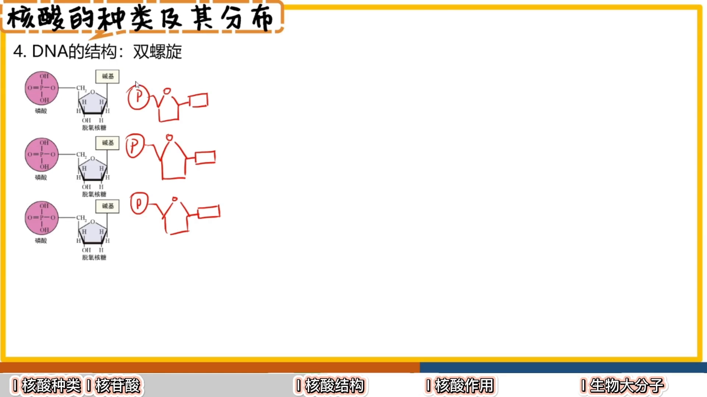

### 5.2 两条链反向平行，靠氢键配对

DNA 的两条链是**反向平行**的：画第二条链时要反着画——一条链上五碳糖的氧朝上，另一条就朝下。

两条链之间靠**碱基互补配对**形成**氢键**绑在一起：

- **G 与 C 配对**：中间形成**三个**氢键（"胖的连三条"）；
- **T 与 A 配对**：中间形成**两个**氢键（"瘦的连两条"）；
- RNA 的 U 正常情况下**不配对**（特殊配对情形后面章节再讲）。

这个规则就叫**碱基互补配对原则**。

[【跳转到 13:52】](https://www.bilibili.com/video/BV1Le4y1B7zb/?t=832)

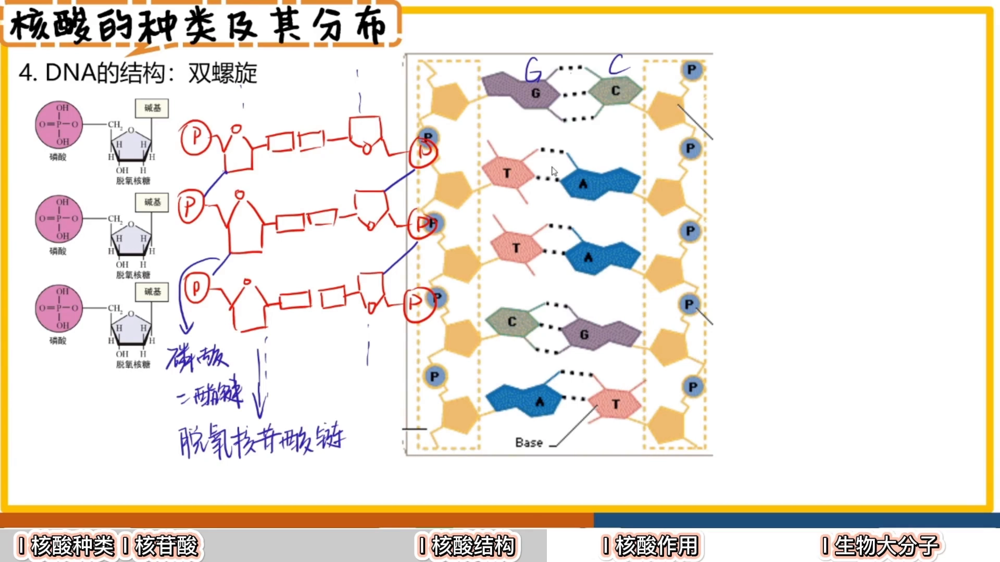

### 5.3 拧一下：双螺旋成型

两条链通过氢键绑定后，再像拧麻花一样一拧，**DNA 双螺旋结构**就形成了。回顾一下完整路径：核苷酸 →（脱水缩合 / 磷酸二酯键）→ 脱氧核苷酸链 →（反向平行 + 碱基互补配对 + 氢键）→ 双螺旋。

---

## 六、序列即信息：遗传信息写在碱基排列顺序里

### 6.1 为什么信息在"顺序"里

核酸的作用之一：**核酸是细胞内携带遗传信息的物质**。

问：DNA 分子上到底是什么在携带遗传信息？

- **磷酸**：大家都一样，都在边边上；
- **五碳糖**：也都一样；
- 唯一不同的是**碱基的排列顺序**——同样多的碱基，可以是 `GTTC`，也可以是 `GAAT`……

所以**遗传信息在碱基的排列顺序当中**。这正是生物信息学里"序列"一词的生物学含义：一串字母（A/T/G/C 或 A/U/G/C）的排列本身就是信息。

[【跳转到 15:54】](https://www.bilibili.com/video/BV1Le4y1B7zb/?t=954)

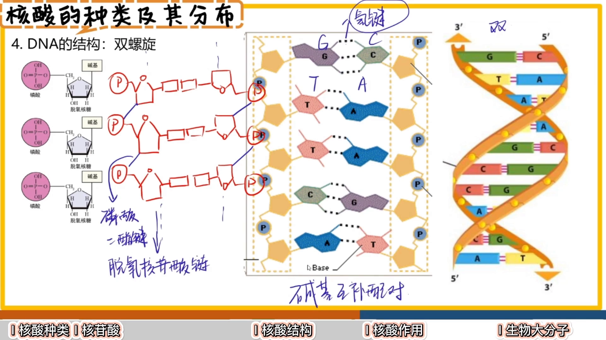

### 6.2 核酸的两大作用

1. **携带遗传信息**（见上）；
2. 核酸在生物体的**遗传、变异和蛋白质的生物合成**中具有极其重要的作用：
   - **遗传**：孩子的遗传物质一半来自爸爸（精子）、一半来自妈妈（卵细胞），一人一半；亲子鉴定检测的就是遗传物质的匹配程度；
   - **蛋白质合成**：核糖体（画面里像汉堡包）上夹着一条长链——后面要学的 **mRNA**，多肽链（一串串的碳链）就在核糖体上合成，而整个过程受 **DNA 的指导**。

[【跳转到 16:53】](https://www.bilibili.com/video/BV1Le4y1B7zb/?t=1013)

### 6.3 哪些生物有什么核酸

- **有细胞结构的生物**（真核、原核都算，不管有没有细胞核）：DNA 和 RNA **两种都有**，但遗传物质是 **DNA**——"DNA 说了算，RNA 都得听 DNA 的"；
- **病毒**：按核酸分两类——**DNA 病毒**只含 DNA（遗传物质是 DNA）；**RNA 病毒**只含 RNA（遗传物质就是 RNA）。

数目账总结：

| 生物类型 | 核苷酸 | 碱基 |
| --- | --- | --- |
| 细胞生物（DNA、RNA 都有） | 8 种（脱氧 4 + 核糖 4） | 5 种（A/T/C/G/U） |
| DNA 病毒 | 4 种（脱氧核苷酸） | 4 种（A/T/C/G） |
| RNA 病毒 | 4 种（核糖核苷酸） | 4 种（A/U/C/G） |

[【跳转到 19:13】](https://www.bilibili.com/video/BV1Le4y1B7zb/?t=1153)

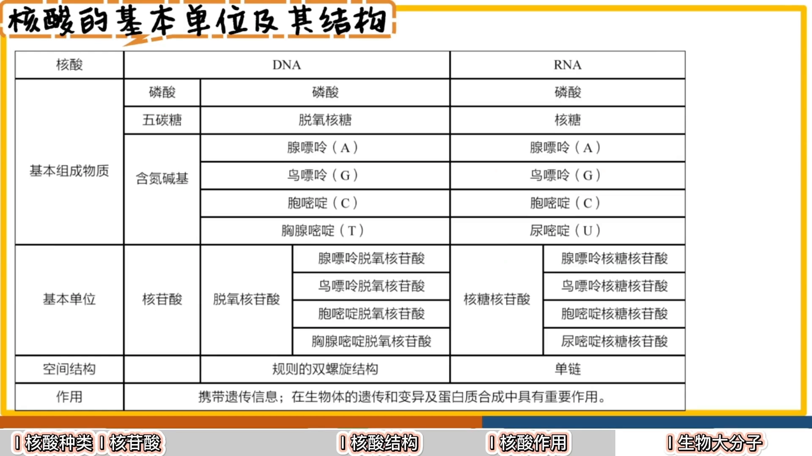

---

## 七、放进生物大分子家族看

**生物大分子** = 由许多**单体**连接成的**多聚体**，以**碳链为骨架**：

| 生物大分子 | 基本单位（单体） | 例子 |
| --- | --- | --- |
| 多糖 | 葡萄糖（单糖） | 淀粉、糖原、纤维素 |
| 蛋白质 | 氨基酸（脱水缩合成多肽链） | 酶、结构蛋白等 |
| 核酸 | 核苷酸 | DNA、RNA |

[【跳转到 21:39】](https://www.bilibili.com/video/BV1Le4y1B7zb/?t=1299)

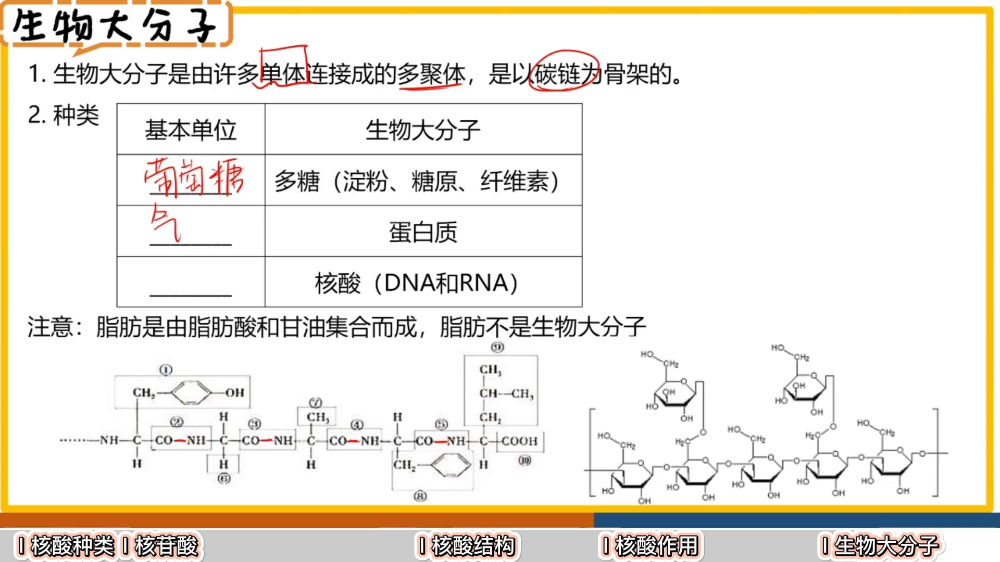

注意例外：**脂肪不是生物大分子**——人胖是因为脂肪多，但脂肪分子本身只由**一分子甘油 + 三个脂肪酸**相连而成，不是很多单体连接成的多聚体。这一点容易想当然，要记住。

---

## 八、课堂例题自测（3 道）

### 例题 1：核苷酸组成的判断

由一分子磷酸、一分子碱基和一分子 A（五碳糖）构成化合物 B，判断**不正确**的是：

- A 选项：组成元素有 C/H/O/N/P —— **对**（糖含碳氢氧、磷酸含磷、碱基含氮）；
- B 选项：A 属于不能水解的糖 —— **对**（单糖不能水解，是构成核酸的主要成分）；
- C 选项：若 A 为核糖，则 B 是 DNA 的基本单位 —— **错**！核糖构成的是 RNA，不是 DNA；
- D 选项：根据 A 的不同，B 可分为两类 —— **对**（脱氧 → 脱氧核糖核苷酸；不脱氧 → 核糖核苷酸）。

答案：**C**。

[【跳转到 19:34】](https://www.bilibili.com/video/BV1Le4y1B7zb/?t=1174)

### 例题 2：三种有机物的图示判断（限植物细胞）

1～3 表示植物细胞中常见的三种有机物：

- 图三单体只有一种、全是圆形连成串 → **多糖**（淀粉/纤维素/糖原都是多糖，选项里全放多糖就是干扰）；
- 图二单体四种 → **RNA 或 DNA**（都有四种含氮碱基）；
- 图一单体约七种 → 只能是**氨基酸构成的多肽**。

结合"植物细胞"的限定（C、D 选项生物类群不对），答案选 **A（多肽、RNA、淀粉）**。

[【跳转到 22:29】](https://www.bilibili.com/video/BV1Le4y1B7zb/?t=1349)

### 例题 3：按元素组成判断化合物

- 一：某种大分子的组成单位，元素 C/H/O/N → 最可能是**氨基酸**（对）；
- 二：细胞中重要储能物质，元素 C/H/O → **脂肪**（对）；
- 三：储存遗传信息的大分子 → 说法"一定是 DNA"——**错**！RNA 也可以储存遗传信息（如 RNA 病毒）；
- 四：主要在动物肝脏和肌肉中储能 → **糖原**（对，分肌糖原和肝糖原）。

答案：**C**。

[【跳转到 24:09】](https://www.bilibili.com/video/BV1Le4y1B7zb/?t=1449)

---

## 小结

- 核酸分两类：**DNA**（脱氧核糖核酸，双螺旋）与 **RNA**（核糖核酸，一般为单链）；
- 基本单位是**核苷酸** = 磷酸 + 五碳糖 + 含氮碱基三件套；
- 五种含氮碱基：嘧啶（C/U/T）+ 嘌呤（G/A）；**DNA 用 A/T/G/C，RNA 用 A/U/G/C，T 与 U 不可互换**；
- 数目账：脱氧核苷酸 4 种 + 核糖核苷酸 4 种 = **8 种核苷酸**，碱基共 **5 种**；组成元素 **C/H/O/N/P**；
- 核苷酸经**磷酸二酯键**串成链；DNA 两条链**反向平行**，靠**碱基互补配对**（G-C 三氢键、A-T 两氢键）结合并拧成**双螺旋**；
- **遗传信息 = 碱基的排列顺序**——这就是生物信息模型读入的"序列"的生物学本质；
- 有细胞结构的生物 DNA、RNA 都有（遗传物质是 DNA）；病毒只含其一（DNA 病毒或 RNA 病毒）；
- 核酸与多糖、蛋白质同为以碳链为骨架的生物大分子；**脂肪不是生物大分子**。

## 关键术语速查

| 术语 | 一句话解释 |
| --- | --- |
| 核酸 | 携带遗传信息的生物大分子，分 DNA 与 RNA 两类 |
| 核苷酸 | 核酸的基本单位 = 磷酸 + 五碳糖 + 含氮碱基 |
| 含氮碱基 | 分嘧啶（C/U/T）与嘌呤（G/A）两类的含氮环状分子 |
| 脱氧核糖 / 核糖 | 分别构成 DNA / RNA 的五碳糖，差一个氧 |
| 磷酸二酯键 | 相邻核苷酸之间连接的化学键 |
| 碱基互补配对 | A-T（两个氢键）、G-C（三个氢键）的配对原则 |
| 双螺旋 | DNA 两条反向平行链拧成的空间结构 |
| 遗传信息 | 储存在碱基排列顺序中的信息 |
| 生物大分子 | 多糖 / 蛋白质 / 核酸等多聚体，以碳链为骨架 |
