# 一级结构决定空间结构：蛋白质"序列→结构→功能"的因果链

> 本文是「生物模型知识体系」条目 **1.2.3 序列→结构→功能：为什么预测结构就等于预测功能的基础** 的配套笔记（基础篇），基于 B 站课程视频《3 蛋白质结构与功能的关系》（[BV1ip4y1L7Lo](https://www.bilibili.com/video/BV1ip4y1L7Lo/)，时长 18:02）整理，关键知识点均附时间戳跳转链接。

## 本讲在解决什么问题（SCQA）

**背景**：在上一讲（1.2.2 结构四层级）里，你已经认识了蛋白质的一级到四级结构：一级是氨基酸序列，二级到四级是越来越复杂的空间结构。

**冲突**：但"序列到底如何变成有功能的结构"常常被一句"一级结构决定高级结构"带过——为什么换掉一个氨基酸就能让人贫血？为什么把空间结构搅乱、氨基酸一个没少，蛋白质就彻底失去功能？

**疑问**：序列、结构、功能三者之间到底是什么关系？

**回答（中心思想）**：**一级结构通过决定侧链基团之间的相互作用力来决定空间结构；蛋白质的功能直接依赖空间结构、间接依赖一级结构。**于是有三条推论：序列相似 → 结构相似 → 功能相似（不同动物的胰岛素）；关键位点变异 → 结构改变 → 分子病（镰刀型贫血）；折叠出错 → 空间结构改变 → 构象病。这也是"预测结构 ≈ 拿到理解功能的基础"的生物学根据——有了结构，就能从原子层面解释功能。

---

## 一、序列如何变成结构：侧链作用力驱动的折叠

[【跳转到 00:00】](https://www.bilibili.com/video/BV1ip4y1L7Lo/?t=0)

**一级结构是高级结构和功能的基础。**一级结构，就是氨基酸残基的排列顺序（"残基"即氨基酸接入肽链后的形态）。

这句话背后的物理机制是：

1. 多肽链的**主链骨架原子**一旦确定，各个氨基酸残基**侧链基团的位置**也就随之固定；
2. 侧链化学基团与周围分子之间必然形成**各种各样的相互作用力**；
3. 在这些力量的驱使下，一条"平面的"多肽链**在三维空间中相互作用、各就各位**，折叠出蛋白质的空间结构。

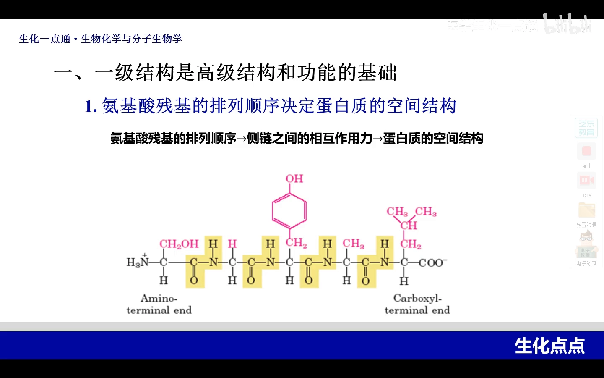

所以反过来看：**氨基酸残基的排列顺序，本质上决定了侧链基团之间的相互作用力，而这个力量造就了空间结构**——这就是"一级结构决定空间结构"的物理含义。视频还补了更完整的图景：多肽链不是静止的，它在复杂的细胞内环境中同时受到内部、外部的各种力量，最终稳定在**一个特定的三维空间结构**上（[【跳转到 02:05】](https://www.bilibili.com/video/BV1ip4y1L7Lo/?t=125)）。

## 二、序列相似 → 结构相似 → 功能相似：胰岛素的例子

[【跳转到 02:55】](https://www.bilibili.com/video/BV1ip4y1L7Lo/?t=175)

什么叫两条多肽链的**一级结构"相似"**？主体的氨基酸残基一样，只在个别位点上换成了**同一类**氨基酸——比如天冬氨酸和谷氨酸都是酸性氨基酸，相应位置上一个换成另一个。因为形成的是相近的作用力，所以有相似的空间结构，也就**可能有相同的功能**。

最典型的例子是**胰岛素**：人胰岛素由 A、B 两条链组成，链间形成三对**二硫键**（两个半胱氨酸侧链脱氢连接的共价键）。对比不同物种（[【跳转到 03:37】](https://www.bilibili.com/video/BV1ip4y1L7Lo/?t=217)）：

- **猪胰岛素**：与人只差一个氨基酸——B 链羧基端的脯氨酸、赖氨酸都一样，只是**苏氨酸换成了丙氨酸**；
- **牛胰岛素**：差异更多——不仅 B 链 N 末端与人不同，A 链相应部位还有两处差异。

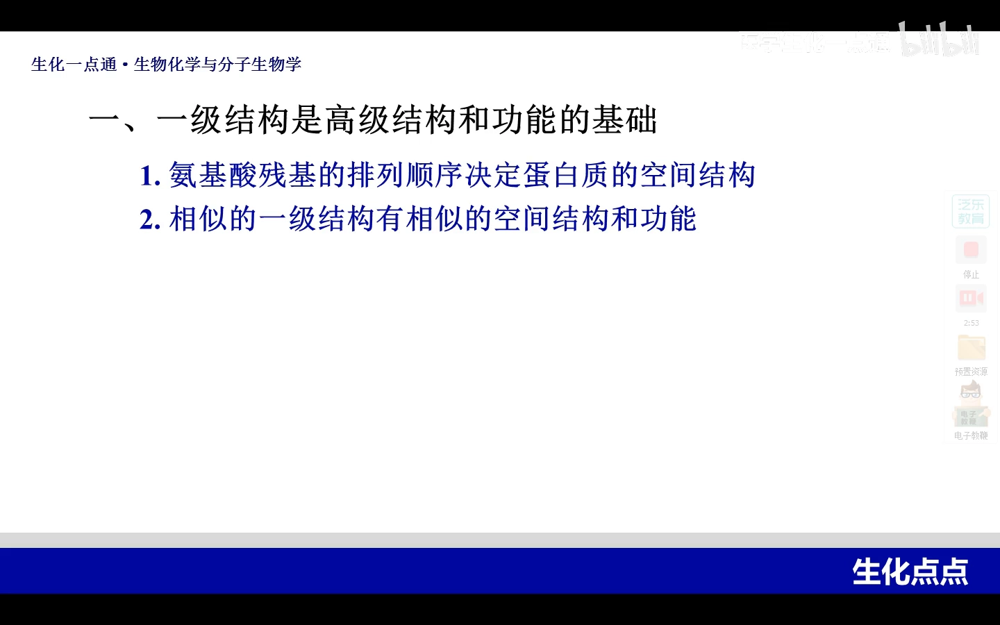

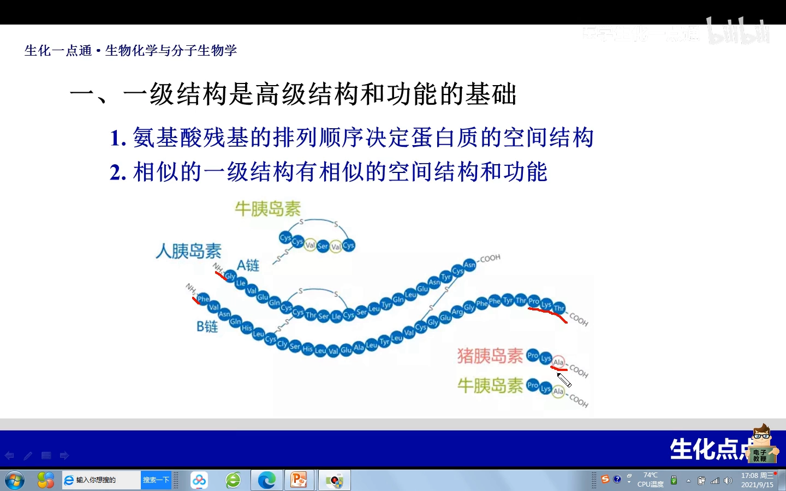

差异再多也属于"相似的一级结构"，所以**不同动物的胰岛素都具有降血糖的功能**。

## 三、关键位点变异 → 结构改变 → 分子病：镰刀型红细胞贫血症

[【跳转到 04:36】](https://www.bilibili.com/video/BV1ip4y1L7Lo/?t=276)

如果情形反过来——两条链大多数氨基酸相同，但个别位点换成了**理化性质完全不同**的氨基酸，就可能引发疾病，这就是**分子病**。最典型的例子是**镰刀型红细胞贫血症**。

正常人的成熟红细胞是**双凹圆盘形**，变形能力很强；患者的红细胞变成**镰刀状**，变形能力减弱。问题出在血红蛋白上：

- 血红蛋白是 **α2β2 型**（两条 α 链、两条 β 链），缺陷在 **β 亚基**上：多肽链 N 端第 6 位，正常人是**谷氨酸**（酸性、亲水），患者换成了**缬氨酸**（脂肪族、疏水）；
- **根本原因是基因水平的点突变**——DNA 上一个碱基改变导致一个氨基酸被替换，这类突变叫**错义突变**（[【跳转到 05:08】](https://www.bilibili.com/video/BV1ip4y1L7Lo/?t=308)）。

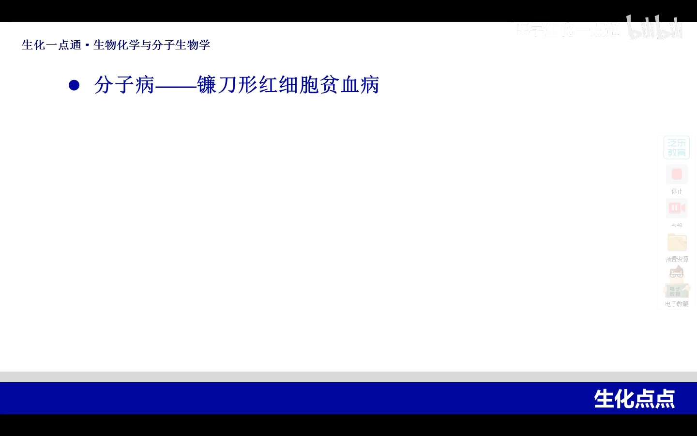

一级结构一变，这个位点的作用力就不再是原有的力量，**β 亚基的三维结构随之改变**：正常人血红蛋白 β 亚基表面这个位置饱满突出；患者的位置因为换成了疏水的缬氨酸而**向内凹陷**（[【跳转到 05:47】](https://www.bilibili.com/video/BV1ip4y1L7Lo/?t=347)）。

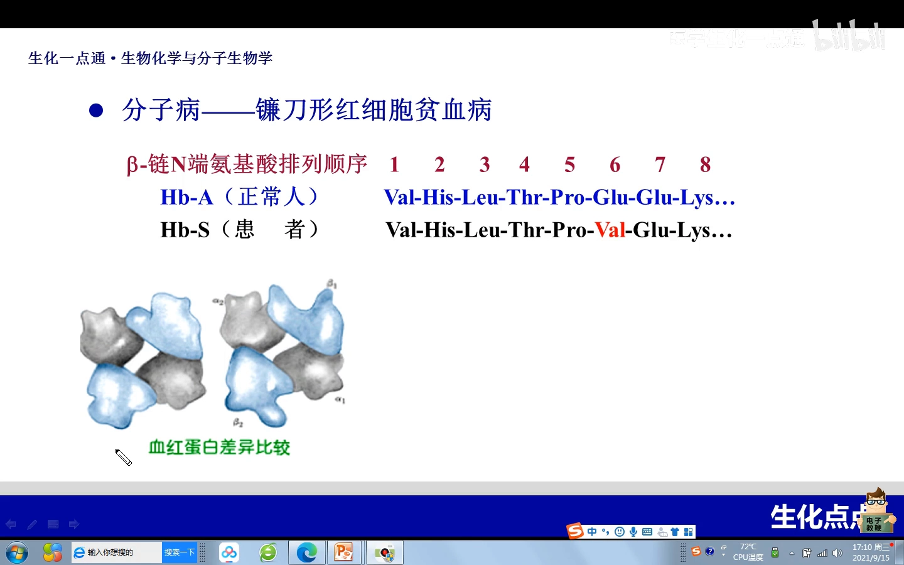

后续的连锁反应是：

1. 正常人血红蛋白表面**亲水**，一个个游离散在红细胞里；
2. 患者血红蛋白表面出现了**疏水的缬氨酸**，于是彼此靠疏水部位**相互嵌合**，形成**条索样结构**（[【跳转到 06:37】](https://www.bilibili.com/video/BV1ip4y1L7Lo/?t=397)）；
3. 红细胞膜沿着条索被拉伸成**镰刀状**，通过毛细血管时容易破裂，造成**溶血性贫血**（[【跳转到 07:02】](https://www.bilibili.com/video/BV1ip4y1L7Lo/?t=422)）。

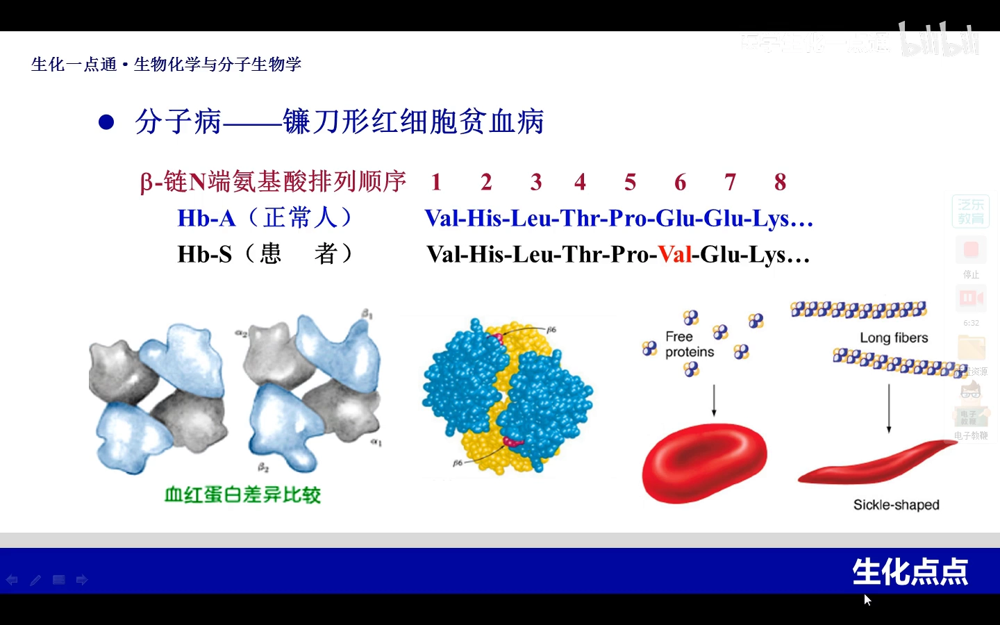

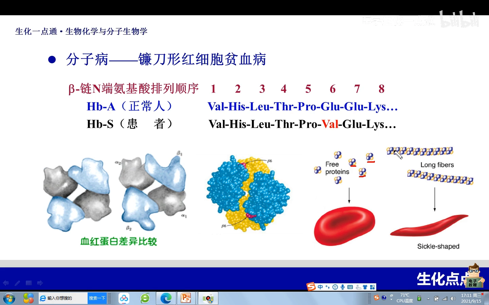

一个氨基酸的更换，沿着"一级结构 → 作用力 → 空间结构 → 细胞形态 → 疾病"的链条一路传导——这是序列决定结构与功能的病理版。

## 四、空间结构直接决定功能：两个经典证据

[【跳转到 07:27】](https://www.bilibili.com/video/BV1ip4y1L7Lo/?t=447)

### 证据一：酶的变性实验

把一个有催化功能的酶蛋白，用试剂**破坏维持空间结构的力量和二硫键**，让它只剩一条多肽链——催化功能立刻消失。但此时**氨基酸残基一个都没变**。这说明：**催化功能与空间结构相关**；一级结构再完整，空间结构没了，功能就没了。

### 证据二：血红蛋白的 T 态与 R 态

[【跳转到 08:22】](https://www.bilibili.com/video/BV1ip4y1L7Lo/?t=502)

体内血红蛋白以两种状态存在：

- **T 态（紧张态）**：未结合氧时，四个亚基之间的作用力比较紧密；
- **R 态（松弛态）**：结合氧之后，结构趋于疏松，亚基之间变得松弛。

两种状态的**氨基酸残基完全相同**，只是构象不同、功能状态不同（不结合氧 vs 结合氧），而且 T 态与 R 态可以互相转变。

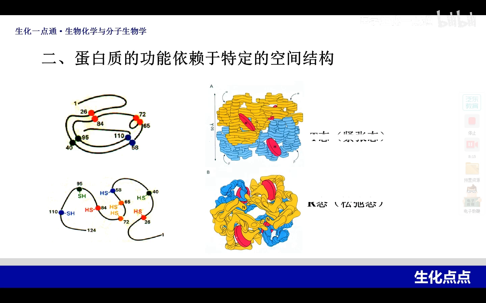

两个证据共同说明：**蛋白质的什么功能，一定与它特定的空间结构相符合。**

## 五、结构错了也会生病：构象病与分子伴侣

[【跳转到 09:48】](https://www.bilibili.com/video/BV1ip4y1L7Lo/?t=588)

### 构象病：一级结构没变，空间结构变了

有一类**蛋白质构象疾病**——疯牛病、库鲁病、老年性痴呆都是典型。它们的共同特点：脑细胞中某种蛋白质的**空间结构发生改变，但一级结构不变**。原因只能是：它从一级结构折叠成空间结构的过程中**发生了差错（错误折叠）**。这也提醒我们：一级结构是空间结构形成的重要基础，但**绝不是唯一因素**——折叠过程可能受外来干扰。

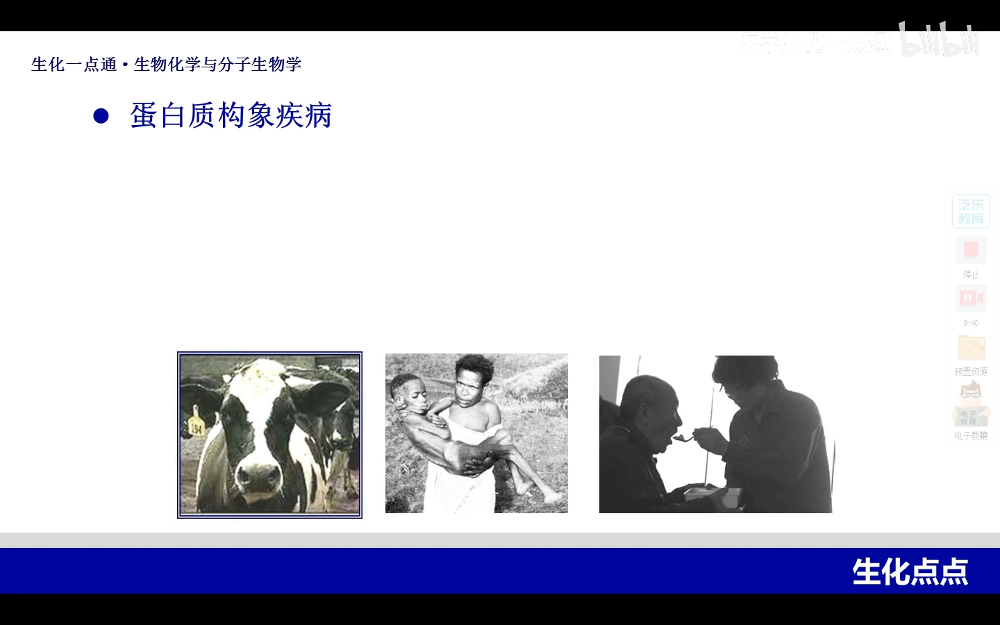

### 朊病毒蛋白：把正常蛋白"带坏"

[【跳转到 11:40】](https://www.bilibili.com/video/BV1ip4y1L7Lo/?t=700)

正常人脑细胞中一种蛋白质的二级结构以 **α 螺旋**为主；老年性痴呆患者中，这种蛋白的二级结构变成了大量 **β 折叠**。有学者提出是**朊病毒蛋白**把 α 螺旋诱导成 β 折叠，而且这个过程**不断循环、不断加速**——最终大量蛋白质聚集形成沉积，脑细胞功能严重受损，表现出痴呆症状。

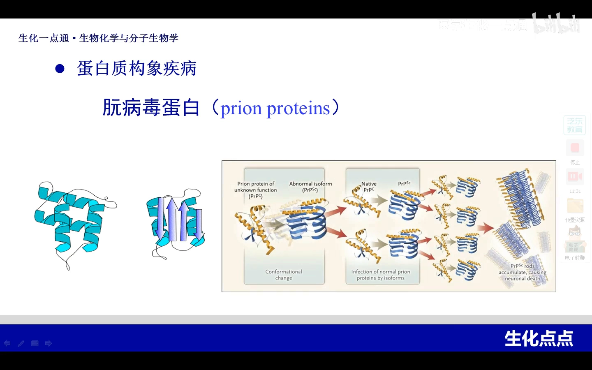

### 分子伴侣：折叠过程的"质检员"

[【跳转到 12:51】](https://www.bilibili.com/video/BV1ip4y1L7Lo/?t=771)

既然折叠可能被干扰，细胞里就需要保障机制——**分子伴侣**。目前认为有两大类：

- **热休克蛋白（HSP，又叫热激蛋白）**：新生肽链从核糖体上合成脱落时，与肽链前端结合，帮助正确折叠；
- **伴侣蛋白**：类似**桶状结构**，把多肽链置于桶内，桶内有很多帮助折叠的酶和 ATP。

分子伴侣本身也是蛋白质，大多是能催化 ATP 水解的 **ATP 酶**。它的要点是**创建一个隔离的环境**，让多肽链一级结构在其中安全折叠、互不干扰——注意它只是**辅助因素**，决定空间结构的主要力量依然是一级结构。

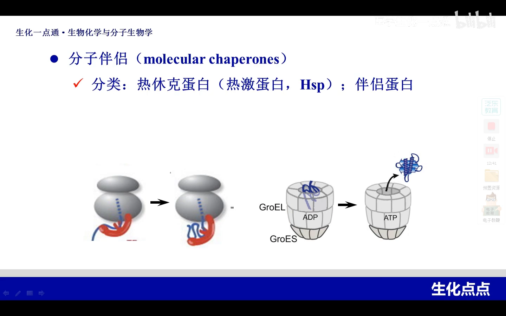

## 六、功能间接依赖序列：核心结论与理化性质

[【跳转到 14:45】](https://www.bilibili.com/video/BV1ip4y1L7Lo/?t=885)

全课的核心结论：**一级结构是高级结构与功能的基础；但蛋白质的功能要直接依赖于正确的空间结构——功能与一级结构之间是间接关系。**

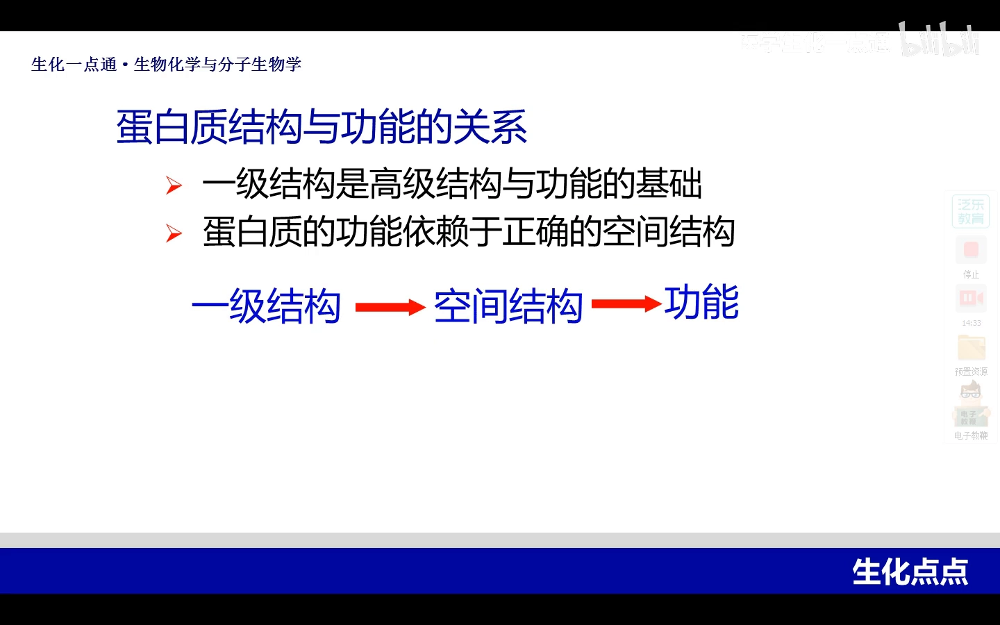

课程最后快速梳理了蛋白质的理化性质（都由氨基酸的性质继承而来）：

- **两性解离与等电点**：氨基酸有氨基、羧基，蛋白质同样可解离；
- **280 nm 紫外吸收**：因为蛋白质都含有芳香族氨基酸；
- **双缩脲反应**：蛋白质借助分子中的**肽键**，在碱性条件下与硫酸铜反应，呈现**紫红色**——可用于鉴定蛋白溶液；
- **胶体性质**：蛋白质颗粒大小正好在胶体范围内；胶体溶液稳定靠两点——颗粒表面**同种电荷相互排斥** + 表面**水化膜**阻隔；
- **盐析**：向胶体溶液中加入高浓度中性盐，破坏表面电荷和水化膜，蛋白质颗粒聚集沉淀下来；
- **变性**（[【跳转到 16:50】](https://www.bilibili.com/video/BV1ip4y1L7Lo/?t=1010)）：加热、酸、碱等条件下**空间构象被破坏，但一级结构（肽键）完整**；表现是溶解度降低、黏度增加，松散展开的肽链更容易被蛋白酶水解。

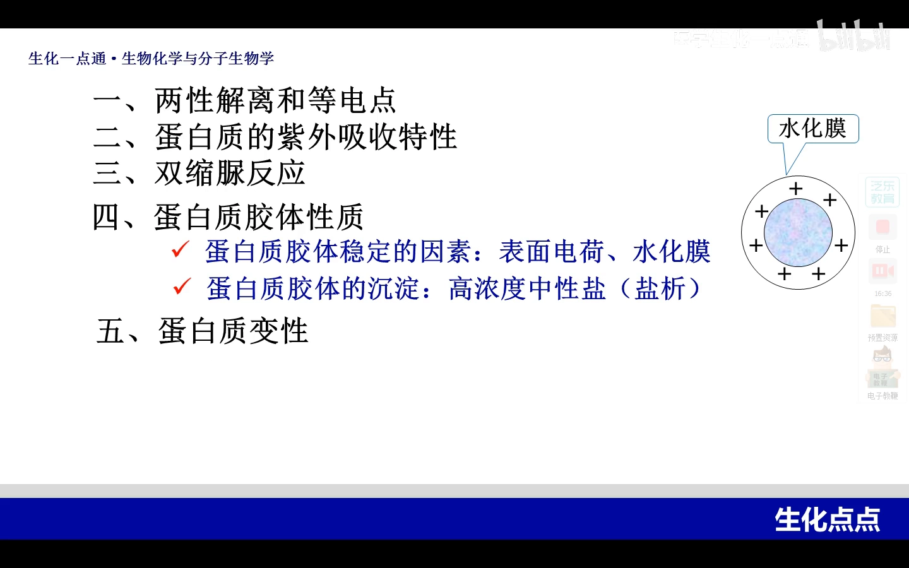

## 小结

- **序列决定作用力，作用力折叠出结构**：骨架原子确定 → 侧链位置固定 → 侧链相互作用 → 三维空间结构。
- **序列相似（同类替换）→ 结构相似 → 功能相似**：人、猪、牛的胰岛素都有降血糖功能。
- **关键位点换成性质迥异的氨基酸 → 结构改变 → 分子病**：镰刀型贫血中 β 链第 6 位谷氨酸→缬氨酸，疏水嵌合使红细胞镰变、破裂溶血。
- **功能直接依赖空间结构**：酶失去构象即失去催化功能；血红蛋白 T/R 态氨基酸相同而功能状态不同。
- **空间结构错了也会致病（构象病）**：朊病毒蛋白诱导 α 螺旋→β 折叠并循环放大；分子伴侣保障正确折叠，但只是辅助因素。
- **功能与一级结构是间接关系**：这就是"预测结构 ≈ 拿到理解功能的基础"的生物学根据。
- 视频结尾建议：用思维导图回顾整理本章知识，掌握更扎实（[【跳转到 17:40】](https://www.bilibili.com/video/BV1ip4y1L7Lo/?t=1060)）。

## 关键术语速查

| 术语 | 一句话解释 |
| --- | --- |
| 一级结构 | 氨基酸残基的排列顺序；通过决定侧链相互作用力来决定空间结构 |
| 二硫键 | 两个半胱氨酸侧链之间形成的共价键，如胰岛素 A/B 链间的三对 |
| 错义突变 | 基因点突变导致一个氨基酸被替换，如 β 链第 6 位谷氨酸→缬氨酸 |
| 分子病 | 蛋白质一级结构变异引起的疾病，典型如镰刀型红细胞贫血症 |
| T 态 / R 态 | 血红蛋白未结合氧（紧张）/ 结合氧（松弛）的两种构象 |
| 构象病 | 一级结构不变、空间结构改变导致的疾病，如疯牛病、老年性痴呆 |
| 朊病毒蛋白 | 能把 α 螺旋诱导成 β 折叠并循环放大的致病蛋白 |
| 分子伴侣 | 帮助新生肽链正确折叠的辅助蛋白（HSP / 伴侣蛋白），多为 ATP 酶 |
| 盐析 | 高浓度中性盐破坏表面电荷与水化膜，使蛋白质沉淀 |
| 变性 | 空间构象被破坏、一级结构（肽键）仍完整的理化性质改变 |
