# 预测出结构，就拿到理解功能的钥匙：蛋白质结构预测 50 年与两次深度学习突破

> 本文是「生物模型知识体系」条目 **1.2.3 序列→结构→功能：为什么预测结构就等于预测功能的基础** 的配套笔记（进阶篇），基于讲座视频《蛋白质结构和功能预测》（[BV1TT4y1i77V](https://www.bilibili.com/video/BV1TT4y1i77V/)，时长 32:41）整理，关键知识点均附时间戳跳转链接。

## 本讲在解决什么问题（SCQA）

**背景**：上一篇笔记（基础篇）讲清了因果链：序列决定结构，结构直接决定功能。想理解（乃至设计）蛋白质的功能，先得拿到它的三维结构。

**冲突**：序列可以高通量测序轻松获得，结构却只能靠实验技术测定——每种技术都很慢，还不能保证成功；用超级计算机硬算，2016 年之前成功率也极低。

**疑问**：能不能直接从氨基酸序列把三维结构算出来？这条路的突破口在哪里？

**回答（中心思想）**：**蛋白质折叠问题研究了 50 多年，突破口是把"两两残基是否靠近"的局部预测，改造为"把 L×L 接触/距离矩阵当成图像、用深度学习一次性全局预测"——第一代深度卷积残差网络（2016）把小家族预测精度提高三倍、CASP 成绩从 20% 推到 70%；第二代注意力机制（AlphaFold2，2020）把最难题得分从 30 几分推到 80 几分。**如今 90% 的蛋白质结构可以预测，有了结构就能从原子层面理解功能、指导药物与蛋白质设计——这就是"预测结构是理解功能的基础"。

---

## 一、背景：有了序列，为什么还缺结构

[【跳转到 00:14】](https://www.bilibili.com/video/BV1TT4y1i77V/?t=14)

约 20 年前人类基因组计划完成，人类第一次拿到了自身的全部遗传信息。当时的愿景是：读懂遗传信息 → 理解生命、理解我们自己 → 发展诊断和治疗疾病的新方法。

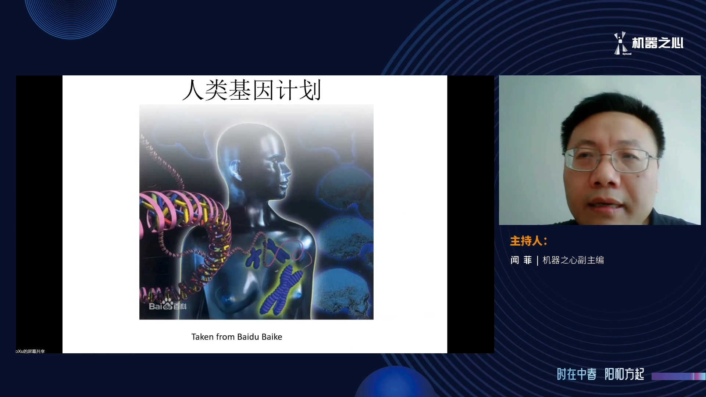

但要实现愿景，先要认识细胞里的三种重要大分子：遗传信息存储在 **DNA** 里，可 DNA 只是"信息"，真正在细胞里**执行功能的是蛋白质**。要理解生命过程，必须理解蛋白质（[【跳转到 00:37】](https://www.bilibili.com/video/BV1TT4y1i77V/?t=37)）。

蛋白质是什么？很多氨基酸串在一起的长链（[【跳转到 01:01】](https://www.bilibili.com/video/BV1TT4y1i77V/?t=61)）：

- **主链**：所有蛋白质的主链原子成分都一样，只有长度不同；
- **侧链**：20 种氨基酸的侧链原子结构各不相同——有的侧链原子很多，有的很少；
- **序列**：每个氨基酸用一个字母表示，整条蛋白质就是**一个字符串**——表现形式极其简单。

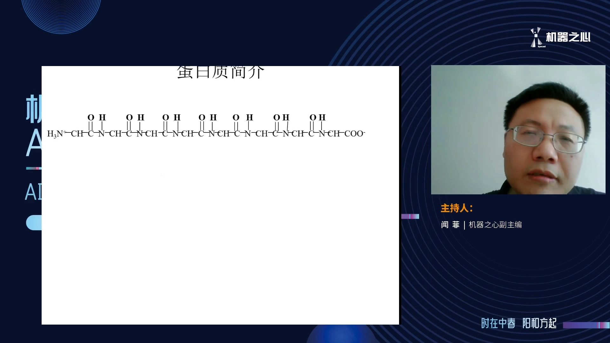

这些原子相互作用之后，形成一个稳定的三维结构。现在有很多软件能把结构画出来（卡通图、全原子图等）。**有了结构，就能从原子层面理解蛋白质的功能**：蛋白质通常通过与其它分子结合来执行功能——与 DNA 结合、与小分子结合、与其它蛋白质结合；跟哪些分子结合、怎么结合，就是功能的来源（[【跳转到 03:29】](https://www.bilibili.com/video/BV1TT4y1i77V/?t=209)）。

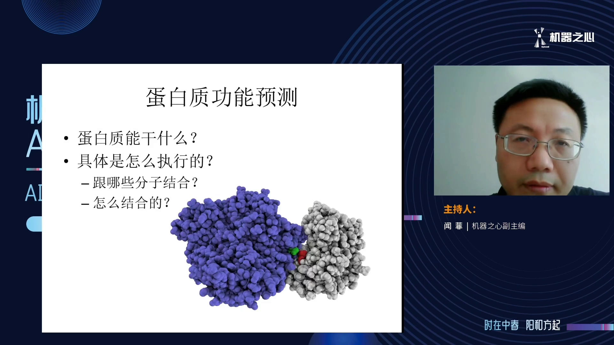

问题在于：序列可以高通量测序轻松拿到，结构却非常难测（[【跳转到 02:26】](https://www.bilibili.com/video/BV1TT4y1i77V/?t=146)）。现有几种很好的实验技术，但测定一个蛋白质结构需要很长时间，**且不能保证每个蛋白都能测出来**。于是科学家一直在想替代方案：**能不能用计算的方法，从氨基酸序列出发，直接把三维结构算出来？**这就是著名的**蛋白质折叠问题**，已研究了 50 多年；很长时间里进展缓慢，直到 2016 年引入**深度学习**才得到比较好的解决（[【跳转到 02:57】](https://www.bilibili.com/video/BV1TT4y1i77V/?t=177)）。在此之前，结构预测意味着超大计算资源——即使动用超级计算机，成功率也非常低，连很小的蛋白都很难算对（[【跳转到 03:59】](https://www.bilibili.com/video/BV1TT4y1i77V/?t=239)）。

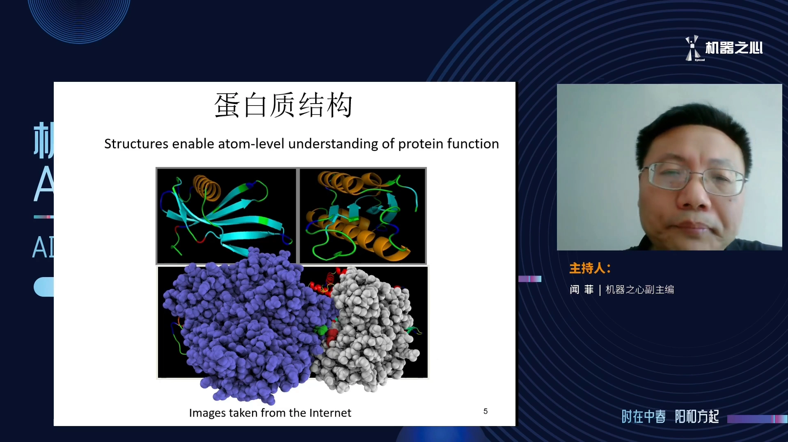

## 二、传统思路：从多序列比对里挖共进化信号

[【跳转到 04:36】](https://www.bilibili.com/video/BV1TT4y1i77V/?t=276)

2016 年前后，领域内形成了一套与传统完全不同的新方法，流程是：

1. 给定一条蛋白质序列，到序列数据库里**尽可能找齐它的同源序列**；
2. 把这些序列**比对在一起，形成多序列比对（MSA）**；
3. 从 MSA 里抽取**两种信息**：
   - **序列信息**：每个位置上氨基酸的保守性；
   - **相互作用（共进化）信息**：描述 MSA 中两个位置之间的关联——它比序列信息重要得多；
4. 用相互作用信息**重构三维坐标**。

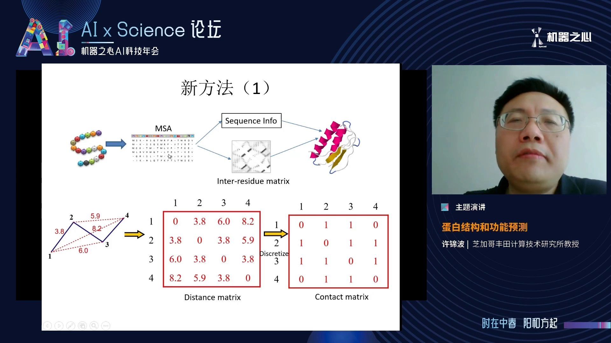

"相互作用信息"比较抽象，通常用两种矩阵表征（[【跳转到 05:51】](https://www.bilibili.com/video/BV1TT4y1i77V/?t=351)）：

- **距离矩阵**：L×L，存放任意两个原子间的欧式距离——大小与原子数成平方关系，非常复杂；
- **接触矩阵**：把距离"二值化"——取 8 埃作 cutoff，距离小于 8 埃记 1（空间上靠近），否则记 0（[【跳转到 06:41】](https://www.bilibili.com/video/BV1TT4y1i77V/?t=401)）。

于是核心问题变成：**能不能从序列信息预测接触矩阵？**这条路研究了很多年，精度一直很差，直到三种技术出现（[【跳转到 07:31】](https://www.bilibili.com/video/BV1TT4y1i77V/?t=451)）：

- **全局统计方法（共进化分析）**：约 2008 年起见效，但只对**大蛋白质家族**有效——小家族同源序列太少，方法基本无效；而大家族往往已有实验结构，并不缺方法；
- **深度卷积残差网络（2016，讲者团队）**：真正解决小家族问题——预测精度提高约三倍（[【跳转到 08:21】](https://www.bilibili.com/video/BV1TT4y1i77V/?t=501)）；
- **注意力机制网络（2020，DeepMind）**：进一步提高残基间相互作用关系的预测精度。

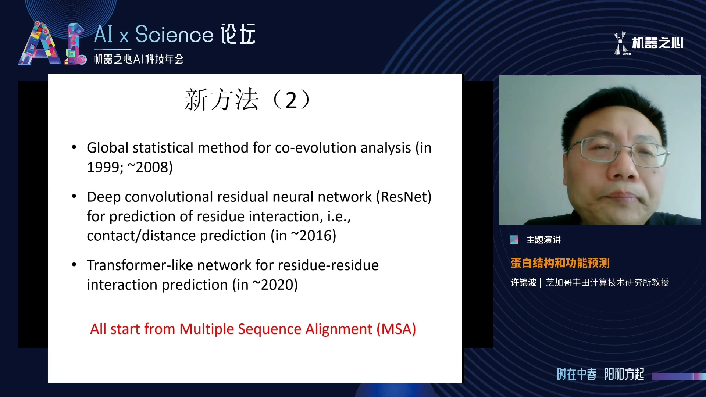

注意：这三种方法**都依赖多序列比对**——MSA 不好，一切白搭。

### 2012 年的失败教训

[【跳转到 09:36】](https://www.bilibili.com/video/BV1TT4y1i77V/?t=576)

其实 2012 年深度学习在图像识别崭露头角时，就有团队试过用它做结构预测，但相比传统机器学习**性能提高不到 1%**，等于失败。原因不是深度学习不行，而是他们只是**把传统机器学习模型简单替换成深度学习，没有改变数学模型**。

### 传统方法的根本缺陷

[【跳转到 10:51】](https://www.bilibili.com/video/BV1TT4y1i77V/?t=651)

传统机器学习怎么做接触矩阵预测？想判断第 i、j 两个位置是否在空间中靠近，就把 i 的序列信息、j 的序列信息（以及 i-j 的相互作用信息）喂给一个模型，让它输出关系判断。

问题在于：蛋白质能形成稳定结构，靠的是**所有原子间的相互作用**；而这种方法每次只考虑两个残基——两个位置单独拿出来时，在细胞里并不存在稳定关系。**忽略全局信息**，是传统方法的根本缺陷。所以出路不是"换个更强的模型"，而是**重新设计数学模型**。

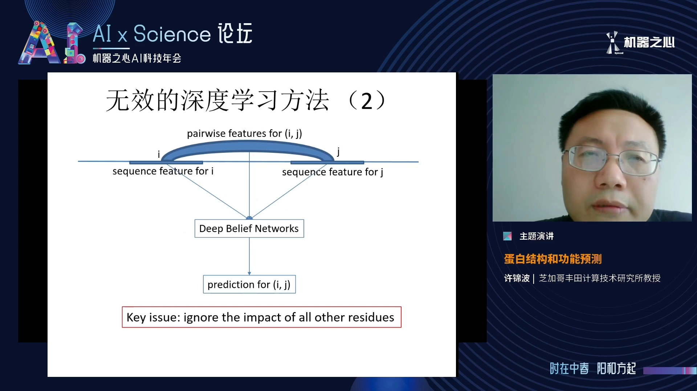

## 三、第一代突破：把接触矩阵当成图像来预测

[【跳转到 12:56】](https://www.bilibili.com/video/BV1TT4y1i77V/?t=776)

讲者团队 2015–2016 年开发了全新的数学模型：

- 不再每次预测两个残基，而是**同时预测所有残基对**的空间关系；
- 接触矩阵正好可以看成一个**图像**：L×L 个像素，每个像素的强度表示两个残基相互作用的强度；
- 一次预测**所有像素**的标签，而不是逐个像素预测——这样就用上了蛋白质的**全局信息**。

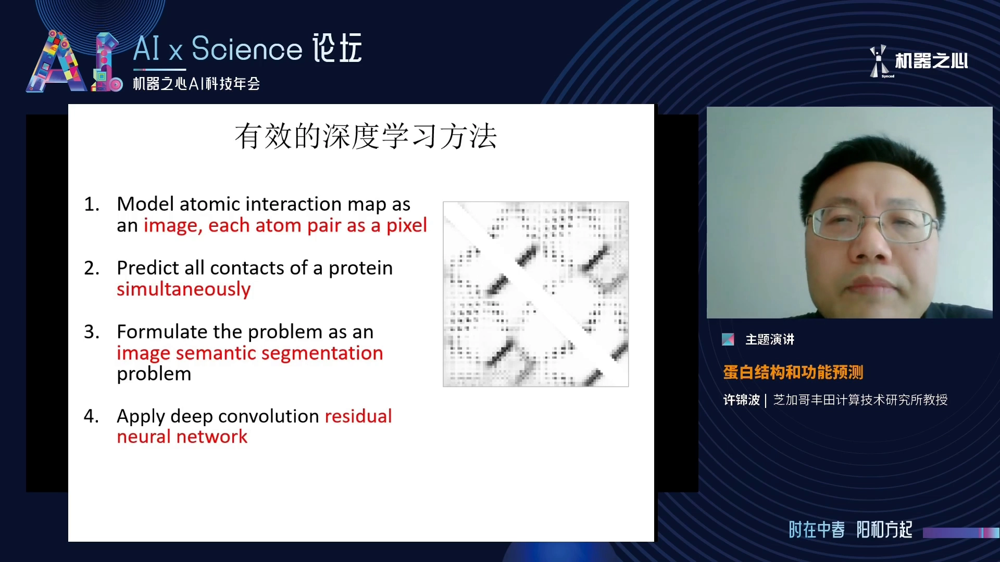

这个数学模型与计算机视觉中的**图像语义分割**问题非常相似，于是图像领域的成熟方法（深度卷积残差网络）被顺势引入（[【跳转到 13:21】](https://www.bilibili.com/video/BV1TT4y1i77V/?t=801)）。

网络架构是这样的（[【跳转到 14:36】](https://www.bilibili.com/video/BV1TT4y1i77V/?t=876)）：

1. 从 MSA 抽取**一维序列信息**，输入**一维卷积残差网络**做变换；
2. 变换后的一维信息通过**外积**等方法转成**二维信息**；
3. 二维信息与原来的相互作用矩阵**拼接**，形成新的"图像"；
4. 输入**二维卷积残差网络**，输出接触矩阵；
5. 根据接触矩阵**重构三维坐标**。

其中二维信息最重要，所以网络里用了大量二维卷积层——最初实验约 60 层（当年 GPU 显存与速度都有限）。

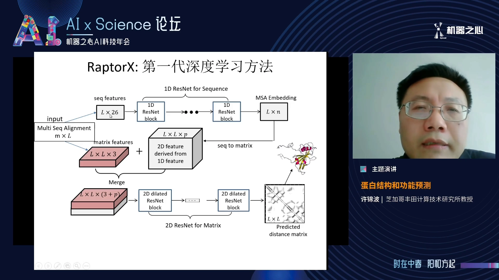

### 战绩验证

- **CASP12（2016）**：方法尚未完全实现完，团队每周更新一次模型参赛，最终**接触矩阵预测做得最好**（[【跳转到 15:26】](https://www.bilibili.com/video/BV1TT4y1i77V/?t=926)）；
- **论文结论**（2016 年秋挂网、2017 年 1 月发表，[【跳转到 16:16】](https://www.bilibili.com/video/BV1TT4y1i77V/?t=976)）：
  - 小蛋白质家族的接触预测**精度提高约三倍**；
  - 接触矩阵可做**大蛋白**的三维建模——基本不受蛋白质大小限制（传统方法只能做很小的蛋白）；
  - 对**膜蛋白**同样有效——虽然膜蛋白实验结构稀缺，但用其它蛋白训练出的网络对膜蛋白一样有效；
  - 还能预测**蛋白质复合物**——单链结构训练出的网络，可直接用于预测两条蛋白链之间的相互作用。
- **CAMEO 在线测试（2017）**：对一个 212 个氨基酸的膜蛋白，误差做到约两埃多，已非常接近实验技术解析的分辨率（[【跳转到 18:21】](https://www.bilibili.com/video/BV1TT4y1i77V/?t=1101)）。

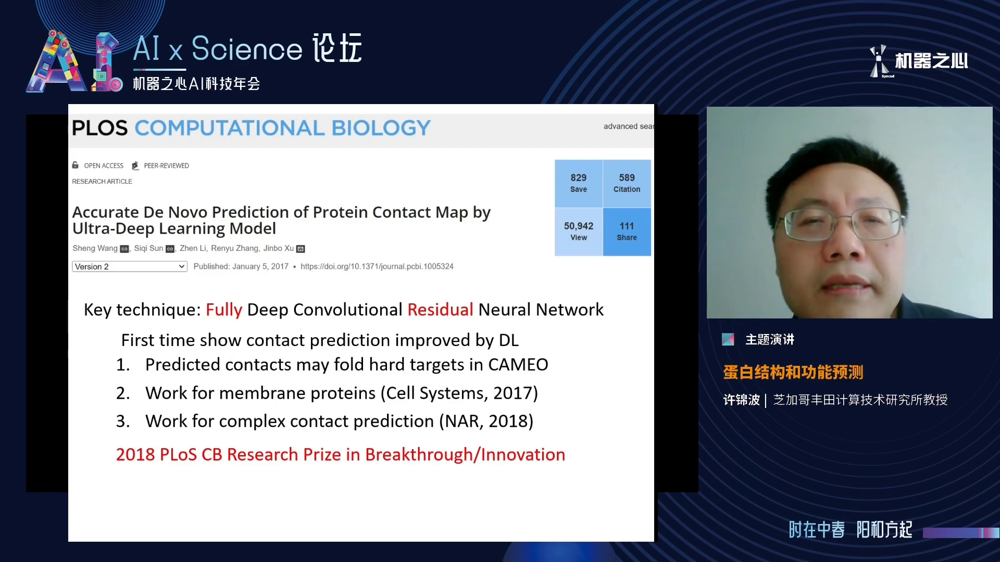

后来该方法推广到**距离矩阵**——比 0-1 接触矩阵提供更多信息、更多物理约束，三维重构精确得多（[【跳转到 18:58】](https://www.bilibili.com/video/BV1TT4y1i77V/?t=1138)）。

## 四、战绩单：CASP10→13，精度从 20% 到 80%

[【跳转到 19:53】](https://www.bilibili.com/video/BV1TT4y1i77V/?t=1193)

历届 CASP（蛋白质结构预测国际评测，CASP13 有众多队伍重新实现深度学习方法）的接触预测精度：

| 届次 | 最好精度 | 说明 |
| --- | --- | --- |
| CASP10 | ~20% | 传统方法时代 |
| CASP11 | ~27% | 略有提升 |
| CASP12 | 46–47% | 第一代深度学习首秀（当时方法还没完全实现完） |
| CASP13 | ~70% | 完整实现后的深度学习方法，排前面的全是深度学习，传统方法远远落后 |
| CASP13（工程化后） | ~80% | 不改方法，只加深网络、改进训练 |

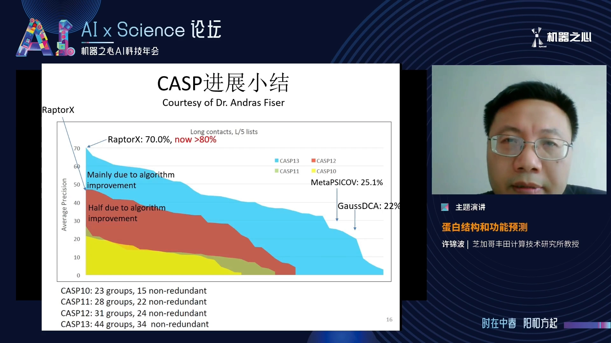

也就是说，第一代深度学习方法就已经把接触预测做得非常好了。

## 五、第二代突破：AlphaFold2 与注意力机制

[【跳转到 21:06】](https://www.bilibili.com/video/BV1TT4y1i77V/?t=1266)

2020 年 DeepMind 开发第二代深度学习算法，核心是**注意力机制**——继卷积网络之后深度学习的又一次大突破，比卷积网络更适合描述序列和自然语言。

AlphaFold2 的算法包含两个模块，正好对应新方法的两个关键步骤（[【跳转到 21:31】](https://www.bilibili.com/video/BV1TT4y1i77V/?t=1291)）：

1. **模块一：从 MSA 抽取残基间相互作用关系**——用注意力机制网络抽得更准；
2. **模块二：从相互作用矩阵重构三维坐标**——同样还是神经网络、同样用注意力机制。

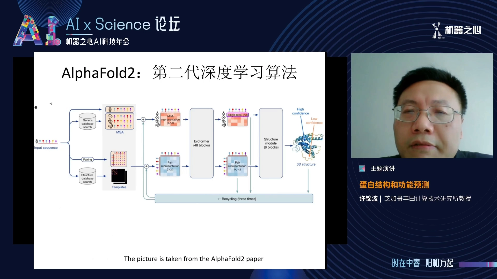

### 30 年进展一图看懂

[【跳转到 22:21】](https://www.bilibili.com/video/BV1TT4y1i77V/?t=1341)

CASP 发起人 John Moult 教授画的总结图：横坐标是测试蛋白难度（左易右难），纵坐标 0–100 分。图中曲线分三大组（[【跳转到 22:46】](https://www.bilibili.com/video/BV1TT4y1i77V/?t=1366)）：

- **最下面 12 条**：CASP1–12。在最难蛋白上挤在一起——20 多年几乎无进展，因为大家一直在用传统方法；
- **中间 3 条**：CASP13 与 CASP14，都用了卷积残差网络类方法，远远好于前 12 条；
- **最上面 1 条**：AlphaFold2（2020），注意力机制网络，又远好于中间 3 条。

在最难的测试蛋白上，深度学习把得分**从 30 几分提高到 80 几分**——提高约 50 分。注：训练注意力网络需要海量计算资源，学术界当时难以企及，这也是 DeepMind 的优势所在。

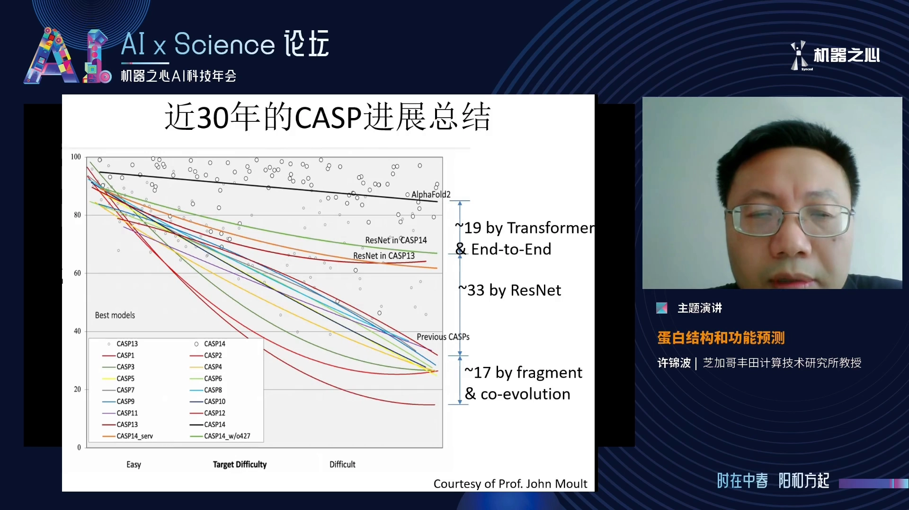

## 六、"复现并超越"？数据说了算

[【跳转到 25:16】](https://www.bilibili.com/video/BV1TT4y1i77V/?t=1516)

AlphaFold2 之后，不少团队宣布复现甚至"超越"。讲者查询了 CAMEO 在线评测，拿表现最接近 AlphaFold2 的两个团队对比：

- **运算时间**：两者基本都是 AlphaFold2 的两倍，远超 AlphaFold2；
- **性能**：均未达到 AlphaFold2，且仍有差距（性能值越大越好）。

结论：**截至目前，没有证据表明有任何团队真正超越了 AlphaFold2。**只沿 AlphaFold2 路线做 incremental 改进（加模块、加深网络、重新训练）并不是突破之道——真正的方向是解决它做不了的问题。

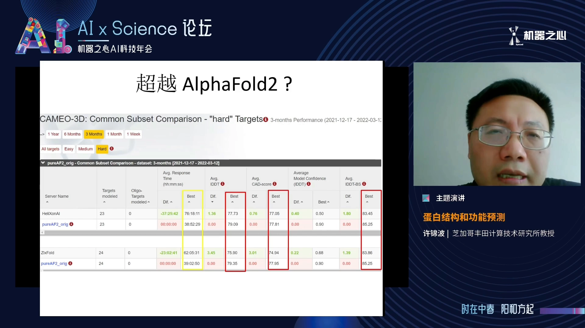

## 七、AlphaFold2 还解决不了的问题

[【跳转到 26:31】](https://www.bilibili.com/video/BV1TT4y1i77V/?t=1591)

- **蛋白质复合物（多链）结构预测**：精度还不理想（虽然比传统方法好很多）；
- **蛋白质与其他分子的相互作用**：与 DNA、RNA、多肽的相互作用预测；
- **抗体-抗原相互作用**：至今仍是一个非常难的问题；
- **单点突变对蛋白质结构和功能的影响**：这对酶优化等蛋白质工程非常重要，AlphaFold2 并不能解决。

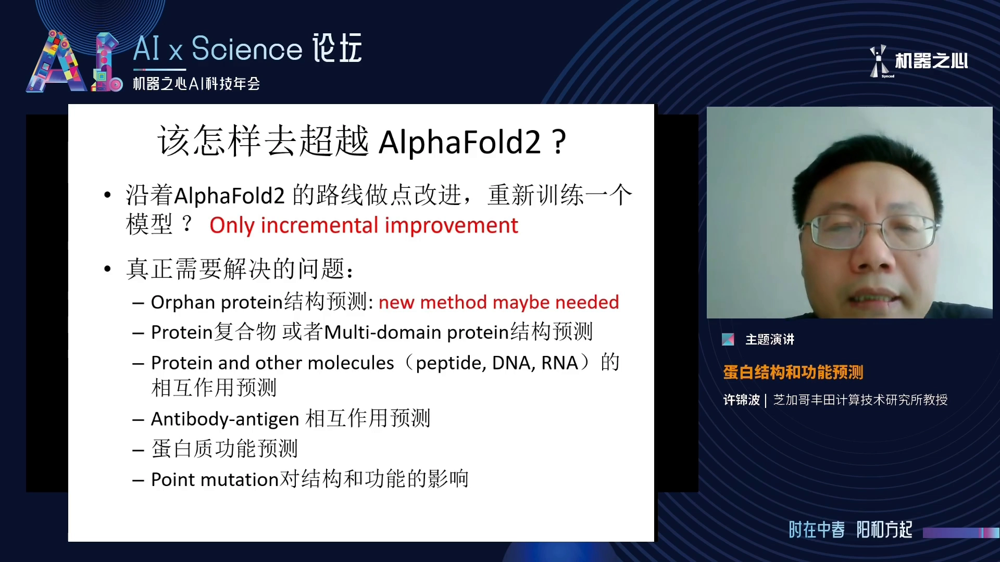

讲者团队 2017–2018 年起研究**复合物结构预测**，算法同样分两个模块（[【跳转到 29:01】](https://www.bilibili.com/video/BV1TT4y1i77V/?t=1741)）：

1. **为复合物生成多序列比对**——真正的难点：单链蛋白的 MSA 容易做，两条以上蛋白链的 MSA 很难做好；
2. **复合物结构预测网络**——基本可以把 AlphaFold2 的模型拷贝过来稍作修改。

后来 DeepMind 的**复合物预测软件 AlphaFold-Multimer** 正是同样的架构：模块一继承了上述 MSA 构造方法（并无新思想），模块二拷贝 AlphaFold2 网络。它比传统方法好很多，但仍有很多复合物预测不好——**MSA 好到什么程度才足以支撑复合物预测**，仍是需要研究的开放问题。

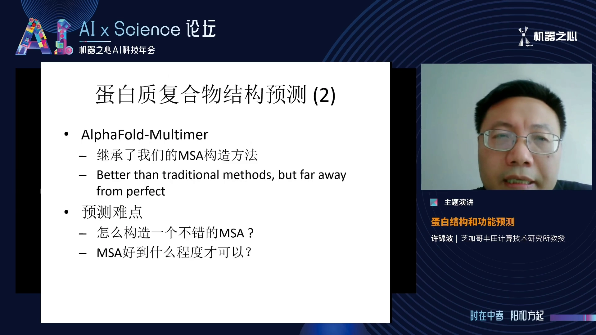

## 八、总结：范式转变已经开始

[【跳转到 29:51】](https://www.bilibili.com/video/BV1TT4y1i77V/?t=1791)

- **人工智能已经颠覆了蛋白质结构预测**：90% 的蛋白质结构可以预测，其中 50%–60% 能得到非常好的结果；
- **研究范式转变**：分子生物学家以前基于**序列**研究蛋白质，现在很多人开始基于**结构**研究蛋白质；
- **下游应用提速**：精确结构预测对药物的发现与设计帮助巨大，也大幅提高了蛋白质设计的效率；
- **问答要点**：
  - 蛋白质结构**动态变化**问题：恐怕无法单靠 AI 解决，需要 AI 与传统动力学方法结合（[【跳转到 31:31】](https://www.bilibili.com/video/BV1TT4y1i77V/?t=1891)）；
  - 结构预测到**新药研发**仍有很大 gap——结构预测好了，新药研发不会自动做得很好；AI 有作用，但还谈不上变革性突破；
  - 新药研发只是结构预测的落地方向**之一**，还有很多其他问题需要结构预测。

## 小结

- **为什么预测结构 = 理解功能的基础**：功能 = 结合，结合由结构决定；有了结构，就能从原子层面解释蛋白质怎么工作。
- **传统路线**：序列 → 找同源序列 → MSA →（保守性 + 共进化）→ 距离/接触矩阵 → 三维重构；成败全在 MSA 与相互作用信息的质量。
- **第一代突破（2016）**：把接触矩阵当图像、卷积残差网络全局预测——小家族精度 3 倍，膜蛋白/复合物均有效，CASP12/13 连续跃升（20%→70%→80%）。
- **第二代突破（2020）**：AlphaFold2 用注意力机制重塑"MSA→相互作用→三维坐标"两模块，最难蛋白得分从 30 几分到 80 几分。
- **现状**：90% 蛋白可预测（50–60% 高精度）；"超越 AlphaFold2"尚无实证，复合物、分子相互作用、突变效应仍是开放问题。
- **与本知识体系的关联**：本仓库结构预测类模型（Protenix / OpenFold3 / Boltz-2，条目 5.1.x）正处在这条"MSA + 深度学习 → 三维结构"的演化线上；理解本讲，就理解了它们的来路与输出指标（ipTM/pLDDT 等）该信到什么程度。

## 关键术语速查

| 术语 | 一句话解释 |
| --- | --- |
| 蛋白质折叠问题 | 从氨基酸序列出发计算三维结构的问题，已研究 50 余年 |
| MSA（多序列比对） | 把同源序列对齐得到的矩阵，共进化信号的来源 |
| 共进化 | MSA 中两个位置上氨基酸的联动变化，暗示它们在空间上靠近 |
| 距离矩阵 | L×L 矩阵，存放残基/原子两两间的欧式距离 |
| 接触矩阵 | 距离矩阵的 0-1 版：距离小于阈值（如 8 埃）记 1 |
| 深度卷积残差网络 | 带残差连接的卷积神经网络；第一代结构预测方法的核心（类比图像语义分割） |
| 注意力机制 | 继卷积之后深度学习的范式，AlphaFold2 的核心组件 |
| CASP | 蛋白质结构预测国际评测，两年一届，分难度考察 |
| CAMEO | 持续在线的自动结构预测评测 |
| AlphaFold2 | DeepMind 2020 年的第二代结构预测模型：两模块 + 注意力机制 |
| AlphaFold-Multimer | AlphaFold2 的复合物扩展：MSA 构造 + 复用 AF2 网络 |
| 单点突变 | 一个氨基酸被替换；其对结构与功能的影响仍是 AlphaFold2 解决不了的问题 |
