# 【蛋白质翻译后修饰】磷酸化、泛素化、苏木化、乙酰化、糖基化、乳酸化——看一篇就够了！

> 来源：Bilibili 视频《【蛋白质翻译后修饰】不同类型、机制、功能动画详解，含经验总结；一个视频帮你梳理清楚。》（UP 主：噗啦噗啦实验室，[BV1Ai421a74Y](https://www.bilibili.com/video/BV1Ai421a74Y/)，时长 38:38）。
> 本文基于视频字幕与画面逐窗口整理而成，配图取自视频截图（经 OCR 核对），时间戳可跳回原视频对应位置核对。视频系统讲解 6 大常见翻译后修饰的类型、机制与功能，并附研究方法经验总结——这也是理解结构预测平台里 `modifications` / `covalent_bonds` 等输入字段的背景知识（对应生物模型知识体系条目 1.2.4）。

## 本讲要解决的核心问题（SCQA）

**背景**：中心法则告诉我们，基因 stored 在 DNA 里，转录成 mRNA，再翻译成蛋白质。人类约有 2.5 万个基因，小鼠约 3 万个，水稻约 5-6 万个，拟南芥约 2.5 万个，果蝇约 1-1.5 万个，酵母约 6500 个。

**冲突**：如果"一个基因 = 一种蛋白质"，人类全部蛋白质似乎指日可待。但现实是：人体内蛋白质总数已超过 **1 亿种**——比基因数多出几千倍；而且同一个蛋白质还会"随时换装"，一会儿有活性、一会儿没活性。

**疑问**：多出来的复杂性从哪里来？蛋白质凭什么"千变万化"，科学家还怎么研究得清楚？

**回答（中心思想）**：蛋白质多样性有两大来源——转录层面的**可变剪切 / RNA 编辑**，以及本讲的主角：**蛋白质翻译后修饰（PTM，Post-Translational Modification）**——在已经翻译出来的蛋白质上，可逆地共价添加 400 多种功能基团。它像给刚出生的蛋白质"穿衣服、摘衣服"，随时改变其活性、稳定性、定位和相互作用，使蛋白质组相对基因组呈指数级扩张。

## 一、为什么 2.5 万个基因造出了 1 亿多种蛋白质

### 1.1 一个基因 ≠ 一种蛋白质

[【跳转到 03:21】](https://www.bilibili.com/video/BV1Ai421a74Y/?t=201)

如果 DNA → RNA → 蛋白质是严格的一对一关系，2.5 万个基因就只能产生 2.5 万种蛋白质。但真实情况是一条放大链：

- **2.5 万个基因**，通过可变剪切、RNA 编辑等机制，产生 **约 10 万种转录本**；
- 10 万种转录本翻译出蛋白质后，再叠加各种翻译后修饰，最终得到 **超过 1 亿种**不同形式的蛋白质。

[【跳转到 02:56】](https://www.bilibili.com/video/BV1Ai421a74Y/?t=176)

### 1.2 翻译后修饰：蛋白质的"穿搭系统"

[【跳转到 01:35】](https://www.bilibili.com/video/BV1Ai421a74Y/?t=95)

顾名思义，蛋白质的翻译后修饰，就是**在已经翻译出来的蛋白质上，添加各种功能基团的过程**。据报道，人体内发生的翻译后修饰种类已超过 400 种，常见的有：磷酸化、甲基化、乙酰化、泛素化、糖基化、苏木化（SUMO 化）、乳酸化、棕榈酰化、琥珀酰化等等。

视频里给了一个好记的类比：把刚翻译出来的蛋白质看成一个**刚出生的小 baby**，把各种修饰看成他的**衣服和装饰品**——在人生的不同阶段，他可以穿上不同的衣服，也可以**把衣服脱下来**（修饰是**可逆的**）；好几种修饰还能**同时进行**。于是同一个"人"在不同时空呈现完全不同的样子，认识他的人都未必认得出来。

正是这种"穿搭系统"的多样性与可逆性，让蛋白质组的大小相较基因组和转录组**指数级增加**——科学家的目光也因此从基因组时代过渡到了更复杂多变的蛋白质组时代。

## 二、翻译后修饰分几类：抓住"共价修饰"这个重点

### 2.1 三大类型

[【跳转到 04:12】](https://www.bilibili.com/video/BV1Ai421a74Y/?t=252)

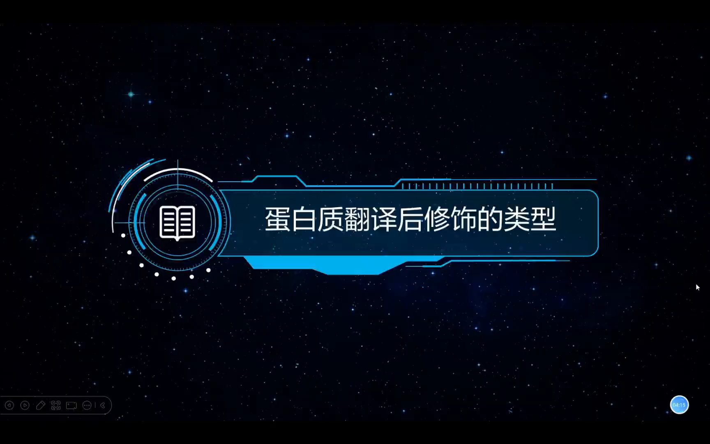

蛋白质的翻译后修饰分为三个大类型：

1. **一级结构的修饰**——发生在氨基酸链上的修饰；
2. **辅基及金属离子的结合修饰**；
3. **氨基酸残基的共价修饰**——本期视频的重点，也是平时文献里最常见的 PTM。

### 2.2 共价修饰的两个重点

[【跳转到 04:49】](https://www.bilibili.com/video/BV1Ai421a74Y/?t=289)

"共价修饰"这个名字里藏着两个要点：

- **位置**：发生在蛋白质氨基酸**残基的侧链**上，而不是肽链主链上；
- **本质**：肽链上的一些基团与化学基团（或小蛋白质）发生**可逆的共价结合**，从而改变蛋白质的性质和功能。

[【跳转到 05:04】](https://www.bilibili.com/video/BV1Ai421a74Y/?t=304)

这些反应都由**专门的酶**负责催化（加什么基团有对应的"写手"酶，去掉它有对应的"橡皮"酶）。接下来视频逐一讲解了六种最常见的修饰：磷酸化、泛素化、苏木化、乙酰化、糖基化、乳酸化。

## 三、磷酸化：细胞信号转导的"总开关"

### 3.1 定义：激酶把 ATP 上的磷酸基团搬到蛋白质上

[【跳转到 05:21】](https://www.bilibili.com/video/BV1Ai421a74Y/?t=321)

**背景知识**：大多数控制重要生理过程的蛋白质（比如肌肉收缩、神经传导）都存在"静息"与"活跃"两种状态——细胞静息时它们不活动，需要发挥作用时，就通过**添加或移除磷酸基团**改变构象，从静息形式切换成活性形式。

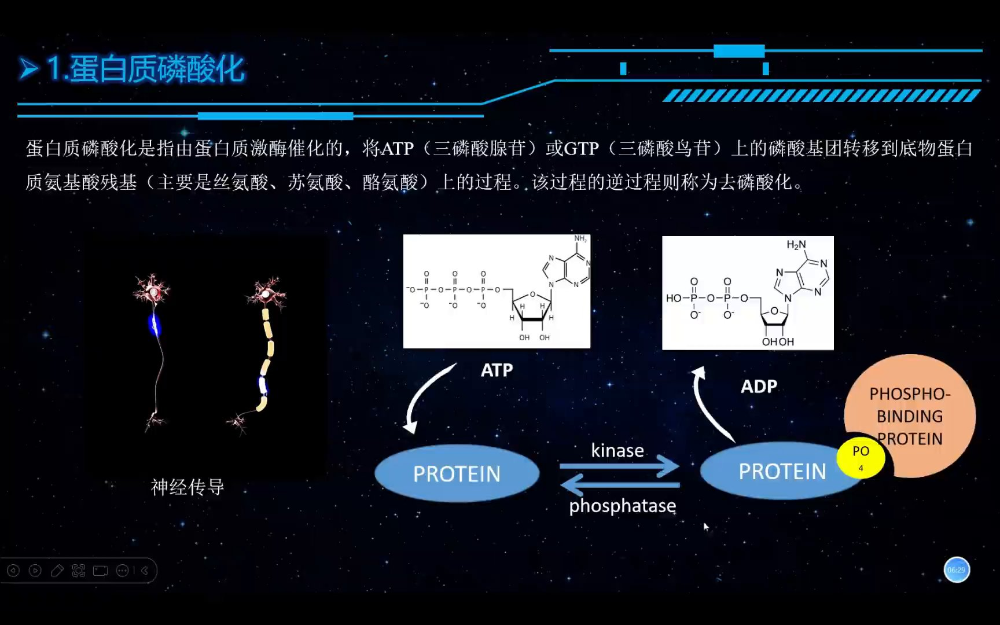

[【跳转到 06:25】](https://www.bilibili.com/video/BV1Ai421a74Y/?t=385)

**蛋白质磷酸化**：由**蛋白激酶**催化，将 ATP（三磷酸腺苷）或 GTP（三磷酸鸟苷）上的磷酸基团，转移到蛋白质底物的氨基酸残基上——主要发生在**丝氨酸、苏氨酸、酪氨酸**上。逆过程叫**去磷酸化**，由**蛋白磷酸酶**执行。初高中学过的 ATP/ADP 相互转化，其实就是我们最早接触的磷酸化/去磷酸化步骤。

### 3.2 激酶级联：把"非活性"切到"活性"

[【跳转到 07:21】](https://www.bilibili.com/video/BV1Ai421a74Y/?t=441)

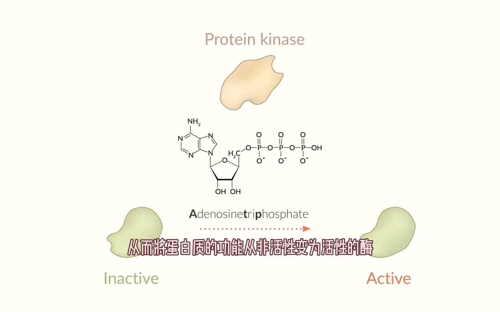

细胞通过受体接受外界信号；当特异配体与受体结合，信号被传递并可能改变细胞功能。在这类信号级联反应中，**核心元件就是蛋白激酶**——它结合 ATP（腺苷 + 三个磷酸基团），把其中一个磷酸基团转移到目标蛋白上，磷酸化蛋白与剩余的二磷酸腺苷（ADP）随后被释放。磷酸化几乎参与**所有细胞反应与信号转导途径**，能迅速而可逆地调节蛋白质的活性、稳定性和相互作用关系。

### 3.3 磷酸化之后，蛋白质发生了什么

[【跳转到 08:13】](https://www.bilibili.com/video/BV1Ai421a74Y/?t=493)

- **表面电荷 / 构象变化**：磷酸基团带负电、体积大，会让某些酶的**活性位点更暴露**或更易与底物结合，从而增强催化能力；也可能改变蛋白质与其他蛋白质、DNA、RNA 的结合能力；
- **亚细胞定位改变**：磷酸化可以暴露或隐藏**核定位信号**，影响蛋白质在细胞核与细胞质之间的穿梭。

## 四、泛素化：给蛋白质贴上"命运标签"

### 4.1 泛素：76 个氨基酸的小蛋白

[【跳转到 08:57】](https://www.bilibili.com/video/BV1Ai421a74Y/?t=537)

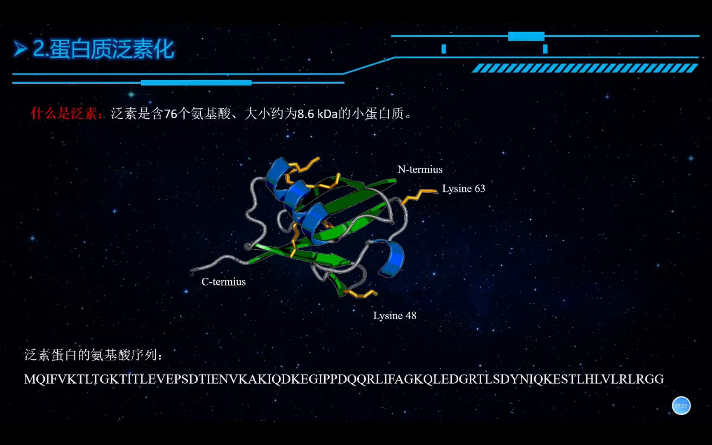

[【跳转到 09:54】](https://www.bilibili.com/video/BV1Ai421a74Y/?t=594)

**泛素（Ubiquitin）**是含 76 个氨基酸、约 8.6 kDa 的小蛋白质。人类基因组有 4 个基因编码泛素：UBB、UBC、UBA52 和 RPS27A。泛素序列上有 7 个赖氨酸残基（K6、K11、K27、K29、K33、K48、K63）和 1 个甲硫氨酸残基（M1）——泛素之间主要通过这些位点相互连接，形成的**泛素链拓扑结构**决定底物蛋白的命运。

### 4.2 E1-E2-E3 三级酶联：活化 → 结合 → 连接

[【跳转到 10:25】](https://www.bilibili.com/video/BV1Ai421a74Y/?t=625)

**泛素化**就是把这个小蛋白分子添加到底物蛋白的赖氨酸残基上（泛素 C 端甘氨酸连接到底物赖氨酸），在真核生物中普遍存在且高度保守。整个过程需要三类酶接力：

| 酶 | 通俗角色 | 人体内数量 |
| --- | --- | --- |
| **E1 泛素激活酶** | "装弹手"：ATP 供能，把泛素挂到自己半胱氨酸上形成**高能硫酯键** | 2 种（UBA1、UBA6） |
| **E2 泛素结合酶** | "搬运工"：从 E1 接过活化的泛素 | 约 35 种 |
| **E3 泛素连接酶** | "识别手"：识别靶蛋白上的特定降解信号，让 E2 靠近靶蛋白，把泛素转移上去 | 数百种，**决定底物特异性** |

这个过程可重复多次，在靶蛋白上形成**多聚泛素链**——链的长度和结构（连在哪个赖氨酸上）决定靶蛋白的命运。

### 4.3 可逆：去泛素化酶 DUB

[【跳转到 12:01】](https://www.bilibili.com/video/BV1Ai421a74Y/?t=721)

泛素化的逆过程由**去泛素化酶（DUB）**执行：水解泛素之间、或泛素与底物之间的肽键/异肽键，把泛素从底物上摘下来，回收再利用。

### 4.4 泛素化决定蛋白质的"命运"

[【跳转到 14:09】](https://www.bilibili.com/video/BV1Ai421a74Y/?t=849)

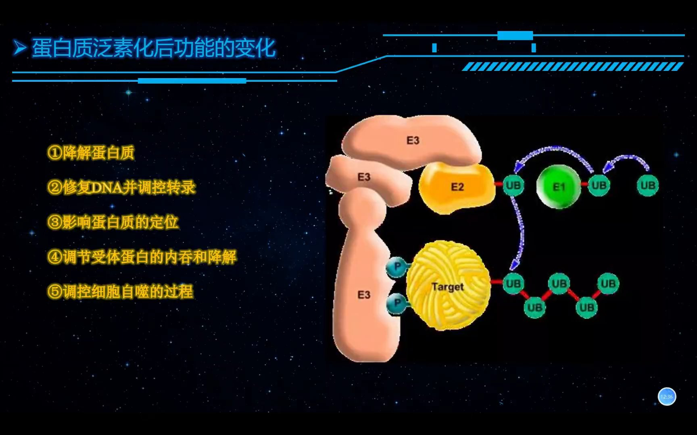

- **标记降解**（最著名）：多聚泛素链被 **26S 蛋白酶体**识别，介导蛋白质降解，调节蛋白总量；一些膜蛋白/酶被泛素化后进入**溶酶体**降解；
- **单泛素修饰**通常不触发降解，而是通过改变空间构象影响蛋白活性；
- **修复 DNA、调控转录**：修复因子被泛素化招募到 DNA 损伤位点；转录因子的泛素化影响其稳定性与转录活性；
- **影响定位**：把蛋白质从细胞核转到细胞质，或把膜蛋白送入内吞途径；
- **调节受体内吞与降解**：泛素化后的受体被内吞小体识别、包裹，最终与溶酶体结合完成降解；
- **调控自噬**：泛素化标记需要被自噬体包围的损坏细胞器或蛋白聚集体——细胞"大扫除"的有效机制。

## 五、苏木化（SUMO 化）：泛素的"表亲"

### 5.1 SUMO 蛋白：与泛素 18% 同源，却结构相似

[【跳转到 14:08】](https://www.bilibili.com/video/BV1Ai421a74Y/?t=848)

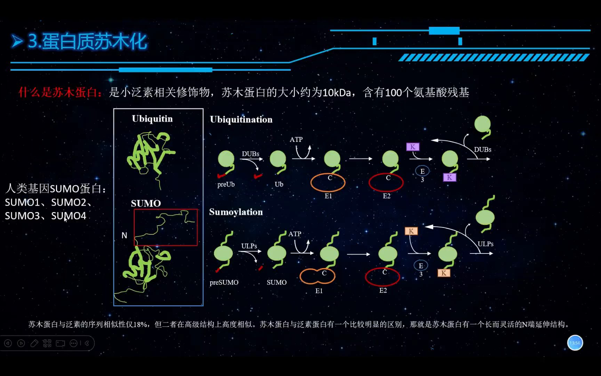

[【跳转到 15:29】](https://www.bilibili.com/video/BV1Ai421a74Y/?t=929)

**苏木化修饰**中的"苏木蛋白（SUMO，小泛素相关修饰物）"约 10 kDa、含 100 个氨基酸残基——序列上与泛素相似性仅 **18%**，但高级结构高度相似（核心都是保守的泛素折叠结构域）；区别在于 SUMO 有一条**长而灵活的 N 端延伸**。人类基因组有四种亚型：SUMO1-4，其中 SUMO2/3 相互同源性 97%（常写作 SUMO2/3），与 SUMO1 只有 46%。

**蛋白质苏木化（SUMOylation）**：SUMO 共价结合到目的蛋白的赖氨酸残基上的过程。

### 5.2 苏木化之后：免降解、改分布、调转录

[【跳转到 19:02】](https://www.bilibili.com/video/BV1Ai421a74Y/?t=1142)

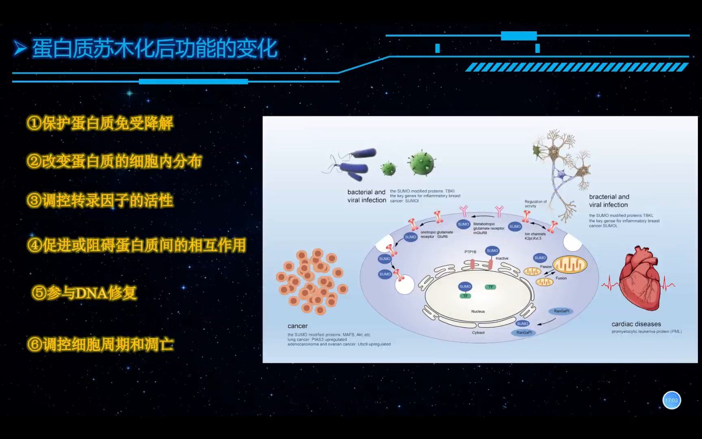

- **保护蛋白质免受降解**：SUMO 与泛素竞争同一赖氨酸位点（类似乙酰化与泛素的竞争）；
- **改变蛋白质的细胞内分布**：调控核-质转运；
- **调控转录因子活性**；
- **参与 DNA 损伤修复**：如 RAD51 蛋白的苏木化对同源重组修复至关重要；
- **影响细胞周期**：如 CDK1（周期蛋白依赖性激酶）的苏木化调控细胞分裂 [【跳转到 18:53】](https://www.bilibili.com/video/BV1Ai421a74Y/?t=1133)；
- **调控细胞凋亡**：如 FADD（FAS 相关死亡结构域蛋白）的苏木化可抑制凋亡。

## 六、乙酰化：给赖氨酸"戴帽子"，松开染色质

### 6.1 定义：乙酰辅酶 A 提供乙酰基

[【跳转到 19:32】](https://www.bilibili.com/video/BV1Ai421a74Y/?t=1172)

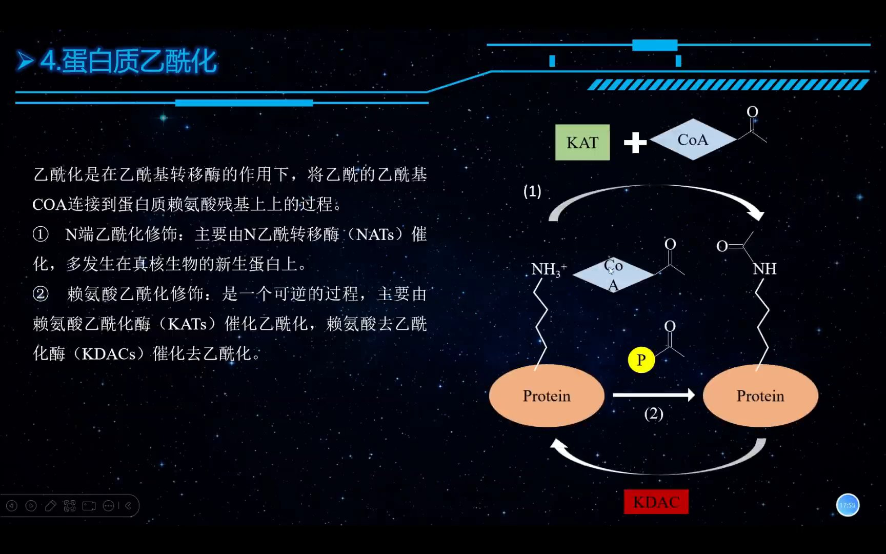

[【跳转到 19:54】](https://www.bilibili.com/video/BV1Ai421a74Y/?t=1194)

**乙酰化**：在乙酰基转移酶作用下，把乙酰辅酶 A 上的乙酰基连接到蛋白质赖氨酸残基上；逆过程叫**去乙酰化**，由**去乙酰化酶**催化。分两类：

- **N 端乙酰化**：主要由 N-乙酰转移酶（NATs）催化，多发生在真核生物的**新生蛋白质**上；
- **赖氨酸乙酰化**：**可逆**过程，由赖氨酸乙酰化酶（KATs）催化乙酰化、赖氨酸去乙酰化酶（KDACs/HDACs）催化去乙酰化。

[【跳转到 20:31】](https://www.bilibili.com/video/BV1Ai421a74Y/?t=1231)

乙酰化在真核和原核生物中都普遍存在。研究最早集中在**组蛋白**上，如今越来越多的**非组蛋白**乙酰化现象也被发现。

### 6.2 乙酰化之后：染色质松开、蛋白免降解

[【跳转到 23:19】](https://www.bilibili.com/video/BV1Ai421a74Y/?t=1399)

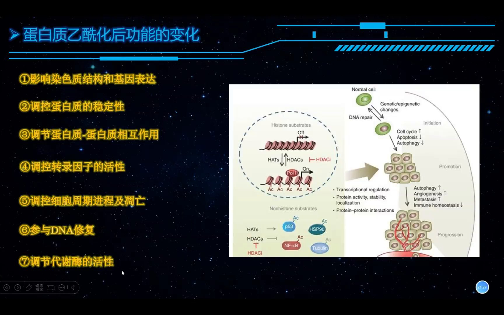

- **影响染色质结构与基因表达**：组蛋白赖氨酸被乙酰化后，染色质结构变**松散**，转录因子和 RNA 聚合酶 II 更容易接触 DNA，**促进基因表达**；去乙酰化则让染色质更紧密、抑制转录；
- **调控蛋白质稳定性**：乙酰化与泛素化**竞争同一赖氨酸**，保护蛋白免受蛋白酶体/溶酶体降解——例如 p53 的乙酰化增加其稳定性，不易被泛素化降解；
- **调节蛋白互作**：乙酰化**中和赖氨酸的正电荷**，改变与其他带电分子的结合能力（如 p300/CBP 与转录因子的结合调节转录活性）；
- **影响转录因子活性**：改变转录因子结构，影响其与 DNA 的结合；
- **参与细胞周期、凋亡、DNA 损伤修复、代谢酶活性调节**；
- **应激反应**：如热休克蛋白 HSP90 的乙酰化在应激条件下作用显著。

## 七、糖基化：在内质网和高尔基体"挂糖链"

### 7.1 定义：糖与蛋白质形成糖苷键

[【跳转到 23:54】](https://www.bilibili.com/video/BV1Ai421a74Y/?t=1434)

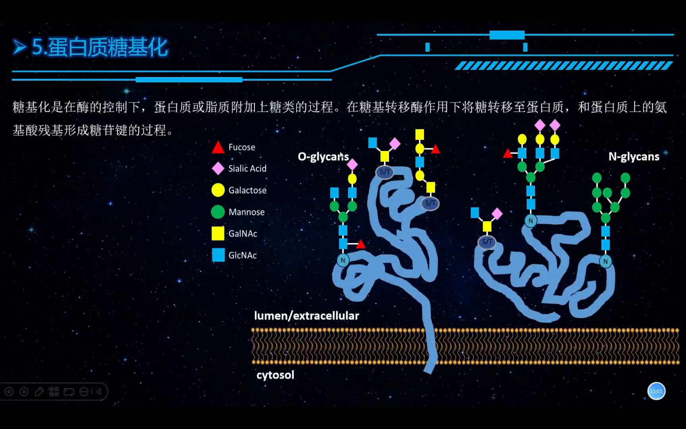

[【跳转到 24:53】](https://www.bilibili.com/video/BV1Ai421a74Y/?t=1493)

**糖蛋白**是糖与蛋白质共价结合的分子；**糖基化**就是把糖类分子通过**共价键**（糖苷键）连接到蛋白质氨基酸残基上的过程——通常在**内质网和高尔基体**中进行，由多种**糖基转移酶**参与。转录因子、热休克蛋白、RNA 聚合酶 II、癌基因翻译产物和多种生物酶中都有糖基化的身影。

### 7.2 O-糖基化 vs N-糖基化

[【跳转到 25:43】](https://www.bilibili.com/video/BV1Ai421a74Y/?t=1543)

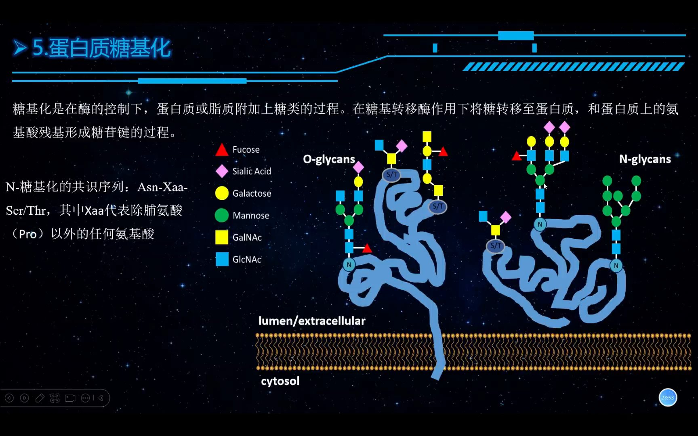

| 类型 | 连接位点 | 共识序列 | 备注 |
| --- | --- | --- | --- |
| **O-糖基化** | 丝氨酸/苏氨酸的**羟基**（羟基化后的赖氨酸、脯氨酸上也可发生） | **没有**明确共识序列 | 起步较晚，研究相对复杂，当前热点 |
| **N-糖基化** | 天冬酰胺（Asn）的氨基 | **Asn-Xaa-Ser/Thr**（Xaa = 除脯氨酸外的任何氨基酸） | 研究较成熟；所有 N-糖链共享一个由 **2 个 N-乙酰葡萄糖胺 + 3 个甘露糖**组成的五糖核心结构 |

[【跳转到 26:23】](https://www.bilibili.com/video/BV1Ai421a74Y/?t=1583)

N-糖基化的过程（动画演示）：内质网中一系列酶催化合成寡糖链 → N-乙酰葡糖胺转移酶识别并结合目标蛋白的天冬酰胺残基 → 寡糖链从供体分子（如多萜醇磷酸）转移到蛋白上 → 糖链在内质网/高尔基体中进一步加工修饰（糖基切除、添加等）。

### 7.3 糖基化的功能：从免疫到肿瘤

[【跳转到 27:18】](https://www.bilibili.com/video/BV1Ai421a74Y/?t=1638)

- **免疫保护**：影响免疫球蛋白的结构与功能，进而影响抗原识别；细胞表面糖基化蛋白还是"自我/非我"识别标志；
- **病毒复制**：病毒利用宿主糖基化机制修饰自己的蛋白——如流感病毒**血凝素 HA** 的糖基化影响感染性与抗原性；
- **细胞生长**：表面糖基化模式与增殖、分化、凋亡相关，可调控生长因子受体的活性与信号转导；
- **细胞粘附**：糖蛋白/糖脂的糖链介导细胞间粘附与信号传递（组织维持、细胞迁移、伤口愈合）；
- **炎症**：细胞因子、趋化因子的糖基化影响其稳定性与活性，调控炎症强度与持续时间。

## 八、乳酸化：2019 年才登场的研究新星

### 8.1 乳酸与 Warburg 效应

[【跳转到 29:21】](https://www.bilibili.com/video/BV1Ai421a74Y/?t=1761)

**乳酸**是细胞糖酵解途径重要的含碳代谢产物，也曾长期被当作无氧呼吸的"代谢废物"。肿瘤细胞中存在 **Warburg 效应（有氧糖酵解）**——即使氧气充足，肿瘤细胞也倾向于用糖酵解而非线粒体氧化磷酸化供能——这让乳酸受到广泛关注。

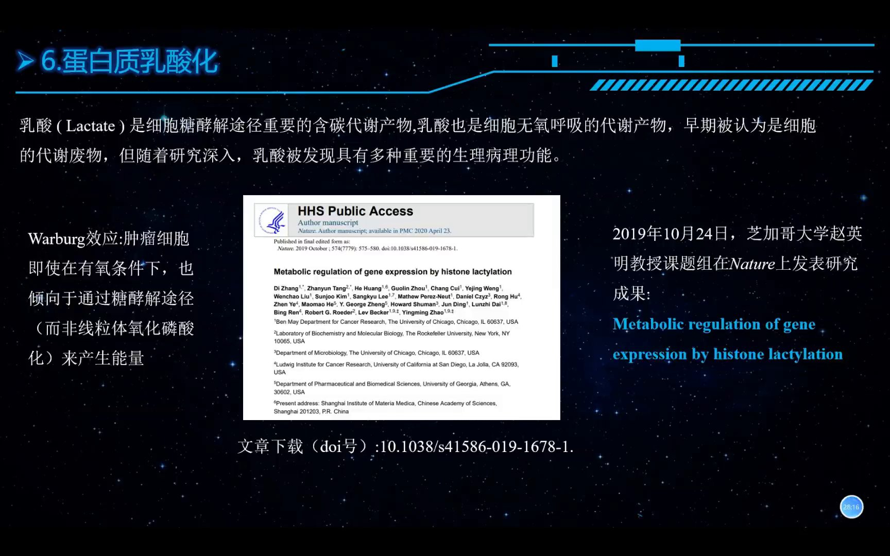

[【跳转到 30:38】](https://www.bilibili.com/video/BV1Ai421a74Y/?t=1838)

2019 年 10 月，芝加哥大学**赵英明**教授课题组在 *Nature* 上发表研究（*Metabolic regulation of gene expression by histone lactylation*，Nature 574: 575-580），首次报道乳酸可以**修饰组蛋白**、调控基因转录，掀起了乳酸化修饰的研究热潮。目前乳酸化仍处于初步研究阶段，但前景广泛。

### 8.2 组蛋白与三类调控蛋白

**组蛋白**：真核生物染色质（及原核细胞中相应碱性蛋白）的主要蛋白质组分，与 DNA 共同组成**核小体**——像 DNA 缠绕的"线轴"，维持染色质结构与稳定性。组蛋白修饰的调控蛋白分三类：

[【跳转到 32:05】](https://www.bilibili.com/video/BV1Ai421a74Y/?t=1925)

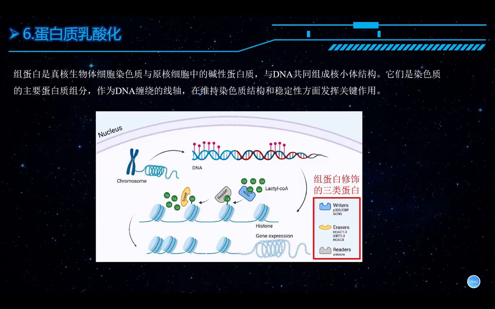

- **Writers（写入者）**：在组蛋白上添加修饰基团——乳酸化已报道的有 p300、GCN5、HBO1 等；
- **Erasers（擦除者）**：去除修饰、恢复原状——乳酸化已报道的有 HDAC1-3、HDAC8 和 SIRT1-3；
- **Readers（读取者）**：识别并结合特定修饰基团——如 BRG1 蛋白。

### 8.3 定义与三步过程

[【跳转到 32:03】](https://www.bilibili.com/video/BV1Ai421a74Y/?t=1923)

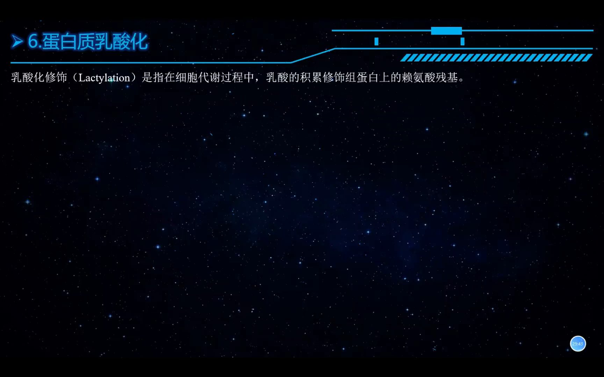

[【跳转到 32:12】](https://www.bilibili.com/video/BV1Ai421a74Y/?t=1932)

**乳酸化（Lactylation）**：细胞代谢中乳酸积累，修饰组蛋白上的赖氨酸残基（供体形式为 lactyl-CoA，乳酸辅酶 A）。过程分三步：①乳酸与蛋白质接触 → ②酶促反应发生 → ③修饰产物形成。

### 8.4 乳酸化的功能

[【跳转到 33:01】](https://www.bilibili.com/video/BV1Ai421a74Y/?t=1981)

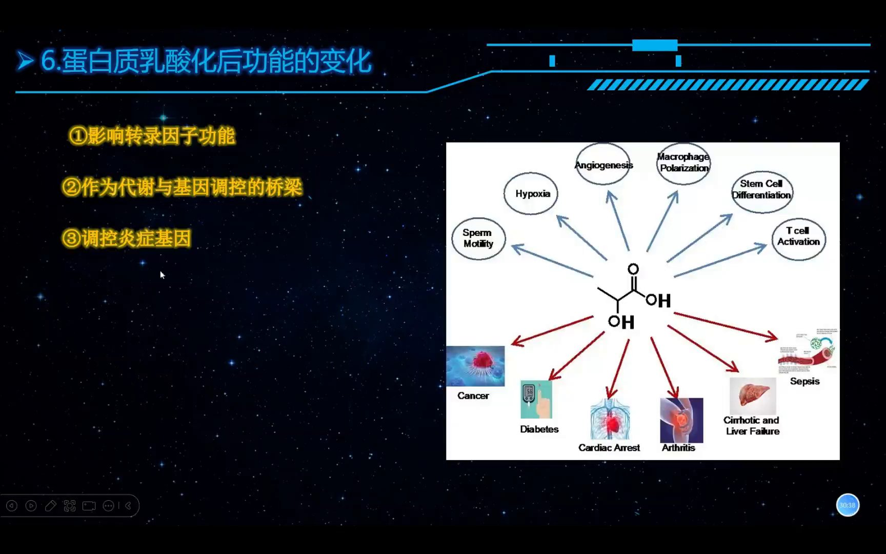

- **影响转录因子功能**：组蛋白 H3 的赖氨酸乳酸化可促进基因转录，在高代谢活性细胞中尤其明显；
- **代谢与基因调控的桥梁**：连接细胞代谢状态和基因调控，帮助细胞适应环境变化；
- **调控炎症基因**：如在巨噬细胞中激活炎症基因转录、促进炎症反应；
- **影响癌细胞行为**：参与基因表达、代谢重编程与肿瘤微环境，促进肿瘤生长与转移；
- 此外还在细胞分化与命运决定、信号转导、代谢应激响应、代谢通路调节中发挥作用。

## 九、一张表看懂六种修饰

[【跳转到 33:53】](https://www.bilibili.com/video/BV1Ai421a74Y/?t=2033)

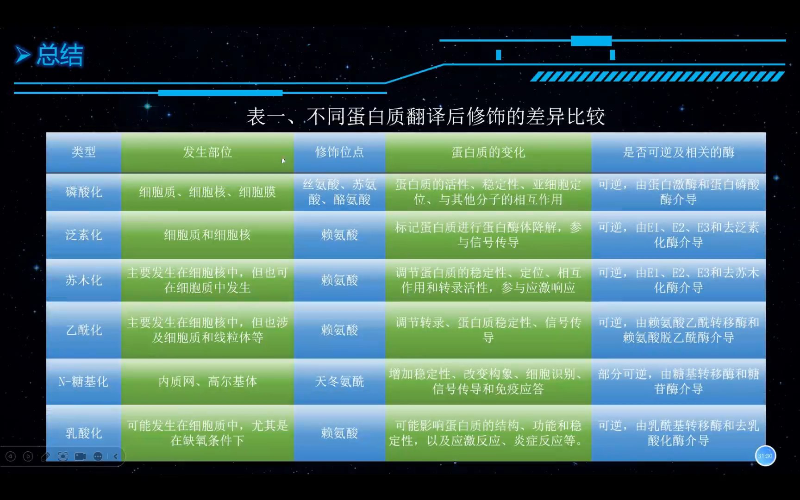

视频最后给出了一张总结表（发生部位、修饰位点、蛋白质变化、是否可逆及相关酶）。注意：乳酸化作为新发现的修饰，其具体机制仍在研究中，表中内容是根据现有研究资料做的推测，仅供参考。

## 十、怎么研究翻译后修饰：质谱为什么是主流

### 10.1 传统抗体的三板斧，为什么不够用

[【跳转到 34:52】](https://www.bilibili.com/video/BV1Ai421a74Y/?t=2092)

传统检测方法（Western blot、免疫沉淀等）都依赖**特异性抗体**，而抗体有三个天然短板：

- 很难精确区分蛋白质上结合的小分子差异，也难以对修饰氨基酸**精准定位**；
- 除模式动物外，大部分物种的蛋白质缺乏有效抗体，翻译后修饰抗体更无从谈起；
- 每种蛋白 × 每种修饰 × 每个位点都要一种对应抗体，适用范围有限、成本高昂，难以做组学层面的系统研究。

### 10.2 质谱：靠"分子量差异"破案

[【跳转到 35:51】](https://www.bilibili.com/video/BV1Ai421a74Y/?t=2151)

发生修饰与未发生修饰的蛋白，最大的差异就是**氨基酸侧链上化学基团的变化**——它直接体现为肽段**分子量的差异**，而分子量分析正是质谱的拿手好戏：

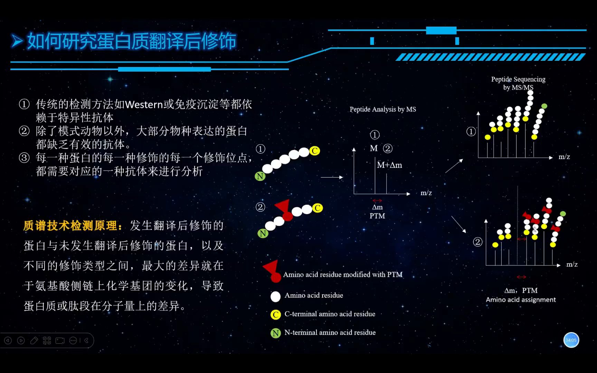

[【跳转到 36:32】](https://www.bilibili.com/video/BV1Ai421a74Y/?t=2192)

流程：蛋白先被酶切成肽段 → 一级质谱测得肽段分子量 → 若某肽段分子量恰好**增加了一个已知基团的分子量**（如磷酸根，即 M+Δm），就假设它发生了该修饰 → 再用**二级/多级质谱**对序列做二次确认，即可鉴定修饰类型与位点。质谱通量高、灵敏度高、定量准确，已成为翻译后修饰研究的主流手段；缺点是设备昂贵、操作与样品前处理复杂。

### 10.3 各方法优缺点一张表

[【跳转到 37:05】](https://www.bilibili.com/video/BV1Ai421a74Y/?t=2225)

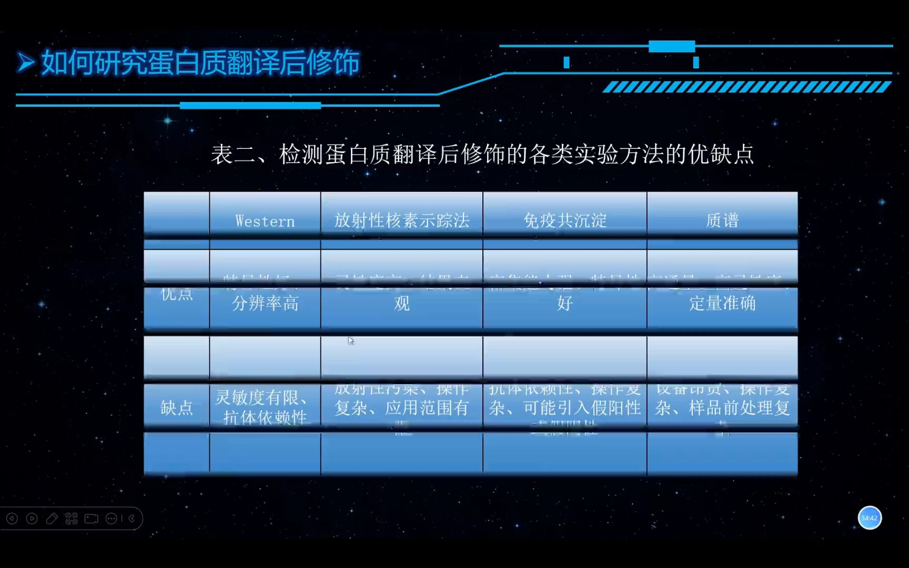

| 方法 | 优点 | 缺点 |
| --- | --- | --- |
| Western blot | 分辨率高、特异性好 | 灵敏度有限，**强抗体依赖** |
| 放射性核素示踪 | 结果直观、灵敏度高 | 有放射性污染风险，技术复杂、应用受限 |
| 免疫共沉淀 | 富集能力强、特异性好 | 抗体依赖、操作复杂，可能引入假阳性/假阴性 |
| 质谱 | 通量高、灵敏度高、定量准确 | 设备昂贵、操作与样品前处理复杂 |

各实验室可根据自身条件与经验选择合适的方法；想省质谱经费的，也可以先到抗体网站检索现成的修饰抗体。

## 小结

- 蛋白质多样性远超基因数（2.5 万基因 → 1 亿+ 蛋白质形式），两大来源是**可变剪切/RNA 编辑**与**翻译后修饰（PTM）**；
- PTM = 在已翻译的蛋白质上**可逆地共价添加功能基团**，发生在残基侧链上、由专门酶催化，人体内已超 400 种；
- **磷酸化**：激酶把 ATP/GTP 的磷酸基团转到 Ser/Thr/Tyr，是信号转导总开关，靠改变电荷/构象/定位调功能；
- **泛素化**：E1-E2-E3 三级酶联把 76 aa 的泛素挂到底物赖氨酸，多聚泛素链决定命运（降解/修复/定位/内吞/自噬），DUB 负责逆转；
- **苏木化（SUMO）**：泛素的"表亲"，竞争性保护赖氨酸、改变核质分布、调控转录因子与细胞周期；
- **乙酰化**：乙酰辅酶 A 酰基化赖氨酸，松开染色质促转录，与泛素竞争保护蛋白（如 p53）；
- **糖基化**：内质网/高尔基体中挂糖链，O-糖连 Ser/Thr（无共识序列）、N-糖连 Asn（共识序列 Asn-Xaa-Ser/Thr）；
- **乳酸化**：2019 年芝加哥大学赵英明课题组在 *Nature* 首次报道的组蛋白修饰，连接代谢与基因表达，writer/eraser/reader 框架仍在完善；
- 研究 PTM，**质谱靠分子量差异**（M+Δm + 二级谱确认）已成为主流，Western/同位素示踪/免疫共沉淀各有优缺点。

## 关键术语速查

| 术语 | 一句话解释 |
| --- | --- |
| 翻译后修饰（PTM） | 在已翻译的蛋白质上可逆地共价添加功能基团，人体内已超 400 种 |
| 共价修饰 | 发生在残基侧链、由专门酶催化的可逆共价结合，是 PTM 最常见的形式 |
| 蛋白激酶 / 磷酸酶 | 加磷酸基团 / 去磷酸基团的酶，磷酸化发生在 Ser/Thr/Tyr 上 |
| 泛素（Ubiquitin） | 76 氨基酸小蛋白，其链的拓扑结构决定底物命运 |
| E1/E2/E3 | 泛素化三级酶联：激活（2 种）→ 结合（约 35 种）→ 连接（数百种，决定特异性） |
| DUB | 去泛素化酶，水解异肽键把泛素摘下来 |
| SUMO / 苏木化 | 小泛素相关修饰物（约 10 kDa），与泛素结构相似、序列同源 18% |
| KAT / HDAC | 赖氨酸乙酰化酶 / 去乙酰化酶；N 端乙酰化则由 NATs 催化 |
| O-糖 / N-糖 | 连 Ser/Thr 羟基（无共识序列）/ 连 Asn（共识序列 Asn-Xaa-Ser/Thr，X≠Pro） |
| Warburg 效应 | 肿瘤细胞有氧条件下仍偏好糖酵解，是乳酸化备受关注的原因 |
| Writers / Erasers / Readers | 组蛋白修饰的写入者 / 擦除者 / 读取者三类调控蛋白 |
| M+Δm | 质谱鉴定 PTM 的核心逻辑：修饰使肽段分子量增加已知基团质量，二级谱确认位点 |
