# 氨基酸结构式背不过？从 20 种氨基酸的前世今生速记结构式、分类、命名与单字母编码

> 本文整理自 B 站视频 [《氨基酸结构式背不过？从20种氨基酸的前世今生带你速记结构式、分类、中文名称、英文缩写!》](https://www.bilibili.com/video/BV19LcfzgEPs/)（约 29 分钟）。逐窗口字幕已校对，时间戳可直接跳转到视频对应片段。

## 本讲要解决的核心问题（SCQA）

**背景**：氨基酸是蛋白质的"字母表"。在 AI 蛋白质模型里——无论是结构预测还是抗体设计——第一步都是把蛋白链写成一行由 20 种氨基酸拼成的序列。

**冲突**：20 种氨基酸，每一种都有中文名、英文名、三字缩写、单字母缩写和一张结构式图。死记硬背不但量大，还特别容易混——GLY（甘氨酸）和 GLU（谷氨酸）就只差一个字母；背完了名字，结构式还是画不出来。

**疑问**：能不能不硬背，而是像理解英语单词的词根一样，把每个氨基酸的名称、结构、缩写都"推导"出来？

**回答（中心思想）**：把 20 种氨基酸放进**五大类**（非极性脂肪族、酸性、极性中性、碱性、芳香族）的框架里，每一种都按**名称由来 → 结构式 → 缩写**三步推导；而单字母编码看似"群魔乱舞"，实际只有"11 取首字母 + 3 取特定字母 + 6 个特记"三档规则。理解了故事，20 种氨基酸全能拼出来。

---

## 一、通式：所有氨基酸共享一副骨架

### 1.1 α 碳上的"四件套"

氨基酸的中心是一个 **α 碳**，它同时连接四样东西：一个 α 氢（—H）、一个 α 氨基（—NH₂）、一个 α 羧基（—COOH），以及一个**侧链基团**（R 基）。20 种氨基酸的一切差异，全部藏在 R 基里。[【跳转到 00:25】](https://www.bilibili.com/video/BV19LcfzgEPs/?t=25)

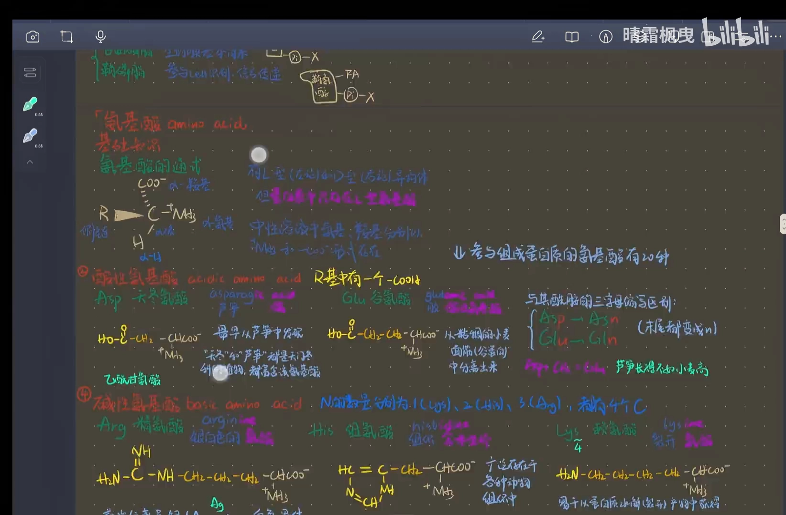

氨基酸有左旋 L 型和右旋 D 型两种镜像，但**组成蛋白质的只有 L 型**氨基酸。

### 1.2 中性溶液里的"两性离子"写法

在中性溶液中，氨基和羧基并不是中性的 —NH₂ / —COOH，而是分别以**带正电的 —NH₃⁺** 和**带负电的 —COO⁻** 形式存在。为了帮助读者熟悉这种生理 pH 下的真实形式，视频中后面的结构式全部按两性离子写法画出。[【跳转到 00:50】](https://www.bilibili.com/video/BV19LcfzgEPs/?t=50)

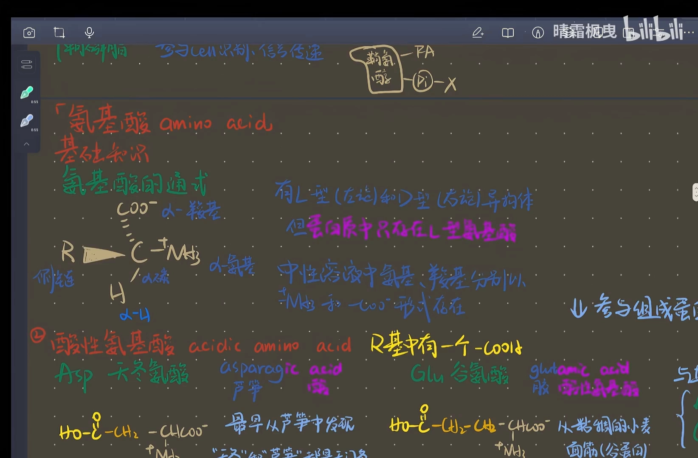

---

## 二、非极性脂肪族（上）：按侧链碳数排队

非极性脂肪族氨基酸有一个共同特点：**除了甲硫氨酸，侧链只含碳和氢**。视频按侧链碳数从少到多依次介绍：[【跳转到 01:15】](https://www.bilibili.com/video/BV19LcfzgEPs/?t=75)

| 氨基酸 | 侧链碳数 | 三字缩写 | 单字母 |
| --- | --- | --- | --- |
| 甘氨酸 Glycine | 0 | GLY | G |
| 丙氨酸 Alanine | 1 | ALA | A |
| 缬氨酸 Valine | 3 | VAL | V |
| 亮氨酸 Leucine | 4 | LEU | L |
| 异亮氨酸 Isoleucine | 4 | ILE | I |
| 脯氨酸 Proline | 3（成环） | PRO | P |
| 甲硫氨酸 Methionine | 3（含硫） | MET | M |

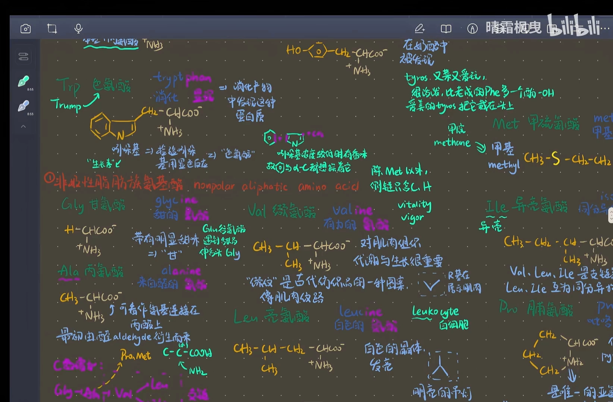

### 2.1 甘氨酸 GLY：最简单的"甜味"氨基酸

- **名字由来**：甘氨酸带有明显甜味，中文用"甘甜"来描述，所以叫甘氨酸。[【跳转到 01:40】](https://www.bilibili.com/video/BV19LcfzgEPs/?t=100)
- **易混点**：三字缩写 GLY 容易和 GLU（谷氨酸）弄混，两者只差最后一个字母。记忆故事：谷氨酸遇到甜品会伸出舌头去尝，末端的 U 就变成了 Y——所以甘氨酸是 GLY。[【跳转到 02:05】](https://www.bilibili.com/video/BV19LcfzgEPs/?t=125)
- **结构**：侧链 0 个碳，R 基就是一个氢——它是 20 种里最简单的氨基酸。

### 2.2 丙氨酸 ALA：从丙酸到醛的推导

- **结构推导**：先看丙酸——三个碳、末端一个羧基；把氨基接到 α 碳上，就和丙氨酸等价了。[【跳转到 02:30】](https://www.bilibili.com/video/BV19LcfzgEPs/?t=150)
- **名字由来**：丙氨酸最初由**醛**（aldehyde）衍生而来，取 aldehyde 的前两个字母 AL，再加上 amino（氨）的 A——ALA。[【跳转到 02:55】](https://www.bilibili.com/video/BV19LcfzgEPs/?t=175)

### 2.3 缬氨酸 VAL：象征肌肉的支链氨基酸

- **功能**：缬氨酸对肌肉组织的代谢与生长很重要——"有了缬氨酸，才有生命力"。英文里 vigor（活力）、vitality（生命力）的词首都是 val-。[【跳转到 03:20】](https://www.bilibili.com/video/BV19LcfzgEPs/?t=200)
- **中文译名**："缬"是中国古代纺织品的一种图案（缬纹），纹路非常像肌肉的纹理，所以 valine 被译作缬氨酸。[【跳转到 03:45】](https://www.bilibili.com/video/BV19LcfzgEPs/?t=225)
- **结构**：缬氨酸与 4 个碳的亮氨酸、异亮氨酸同属**支链氨基酸**（侧链带支链）。它侧链共 3 个碳还要带支链，结构因此唯一确定——就像展示肌肉时向外张开的胳膊。[【跳转到 04:35】](https://www.bilibili.com/video/BV19LcfzgEPs/?t=275)

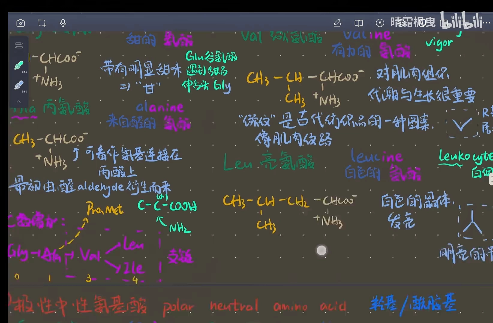

### 2.4 亮氨酸 LEU 与异亮氨酸 ILE：白亮的晶体和它的同分异构兄弟

- **亮氨酸**：首次被提取时呈现白色晶体、闪闪发亮，所以叫"亮"氨酸。"白"的词根是 leuko-——学医的同学熟悉的白细胞（leukocyte）正是这个前缀。缩写取前三个字母 LEU。[【跳转到 05:00】](https://www.bilibili.com/video/BV19LcfzgEPs/?t=300)
- **吊灯类比**：生活里什么最亮？挂在墙顶的白炽灯。明亮的吊灯——上面一根电线吊着、下面一个灯罩——形状恰似亮氨酸的侧链。[【跳转到 05:50】](https://www.bilibili.com/video/BV19LcfzgEPs/?t=350)

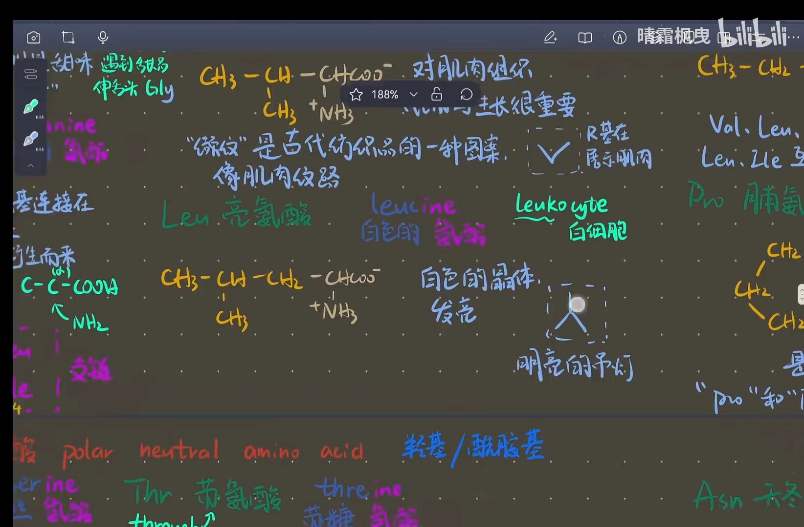

- **异亮氨酸**：它其实是亮氨酸的**同分异构体**。同分异构只能从 R 基上变动，而它又是支链氨基酸，所以只有一种选择——挪动甲基的位置。英文就在 leucine 前面加上 iso-（同分异构），缩写相当于在 LE 前面加一个大写 **I**：用中文念也有趣——"异"对应 I，LE 读起来像"亮"。[【跳转到 06:15】](https://www.bilibili.com/video/BV19LcfzgEPs/?t=375)

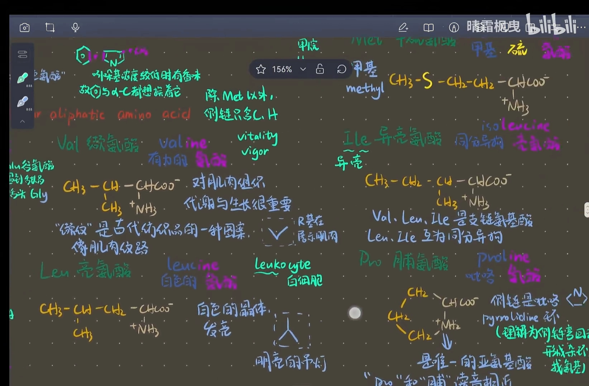

### 2.5 脯氨酸 PRO：唯一的亚氨基酸

- **结构**：脯氨酸的侧链有 3 个碳，但这侧链弯了回去，与自己的氨基相连，形成一个 4 碳 + 1 氮的**吡咯环**。[【跳转到 07:05】](https://www.bilibili.com/video/BV19LcfzgEPs/?t=425)
- **独特地位**：正因为氮被侧链"占用"，脯氨酸是 20 种氨基酸里**唯一的亚氨基酸**（氮上是 —NH— 而不是 —NH₂）。[【跳转到 07:30】](https://www.bilibili.com/video/BV19LcfzgEPs/?t=450)
- **谐音与形象**："脯"与缩写 Pro 读音相似；圆圆的形状像一块**肉脯**。[【跳转到 07:55】](https://www.bilibili.com/video/BV19LcfzgEPs/?t=475)

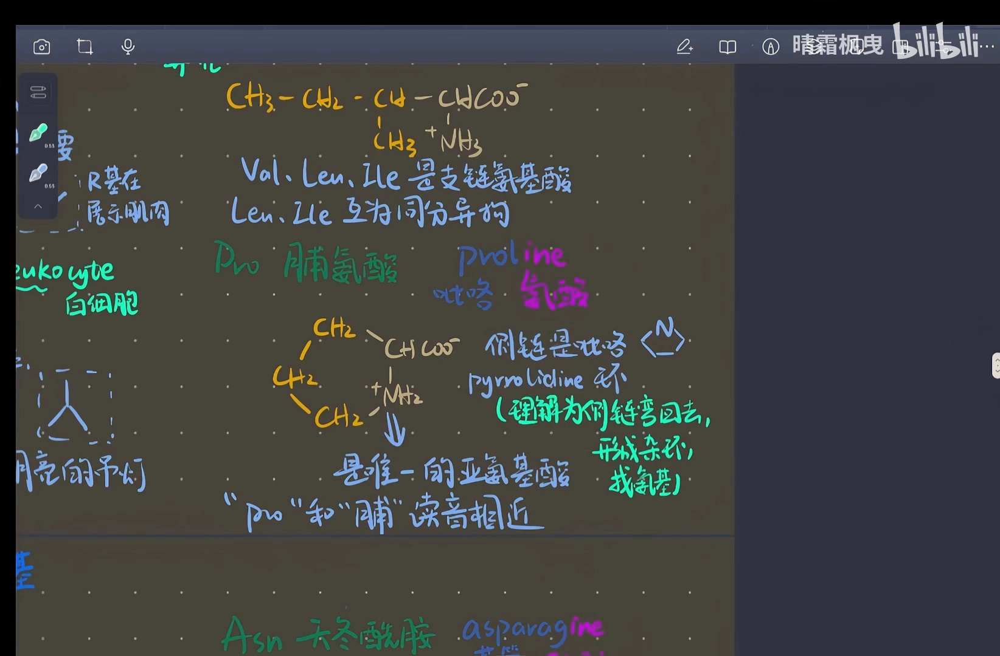

---

## 三、含硫兄弟：甲硫氨酸与半胱氨酸

### 3.1 甲硫氨酸 MET：拆开名字就是结构

- **拆名**："甲"是甲基，"硫"是硫原子——甲硫氨酸就是带一个**甲硫基**（—CH₂—CH₂—S—CH₃）的氨基酸。[【跳转到 08:20】](https://www.bilibili.com/video/BV19LcfzgEPs/?t=500)
- **结构推导**：它侧链有 3 个碳。先把甲硫基放在外面，剩下的 2 个碳连到 α 碳上，结构就推导出来了。[【跳转到 08:45】](https://www.bilibili.com/video/BV19LcfzgEPs/?t=525)
- **冷知识**：20 种氨基酸里只有两种含硫——甲硫氨酸和半胱氨酸。

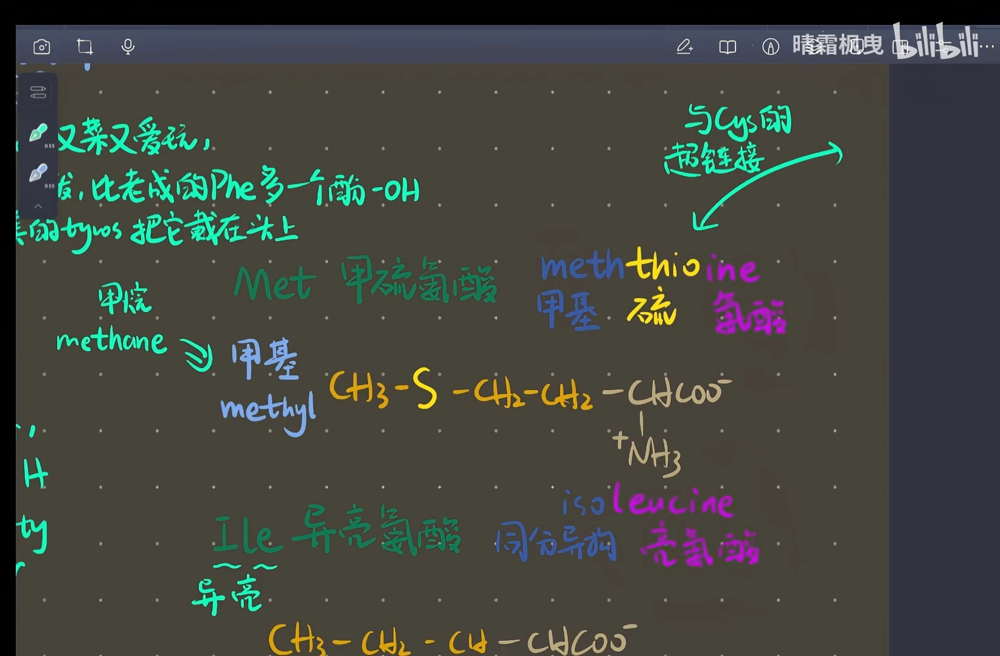

### 3.2 半胱氨酸 CYS：从膀胱结石到二硫键

- **名字由来**："胱"可以联想到膀胱——胱氨酸最早确实是从**膀胱结石**中分离出来的。[【跳转到 09:09】](https://www.bilibili.com/video/BV19LcfzgEPs/?t=549)
- **为什么叫"半"胱氨酸**：因为两个半胱氨酸可以通过**二硫键**脱氢相连，组成一个（完整的）胱氨酸——所以每个是"半个"。[【跳转到 09:34】](https://www.bilibili.com/video/BV19LcfzgEPs/?t=574)
- **英文缩写**：膀胱的英文是 cyst（囊肿），由此得到 cysteine，三字缩写直接取前三个字母 CYS。[【跳转到 09:34】](https://www.bilibili.com/video/BV19LcfzgEPs/?t=574)
- **结构**：—CH₂—CH₂—SH，末端是**巯基**（—SH）。它是蛋白质中形成二硫键的氨基酸。[【跳转到 09:59】](https://www.bilibili.com/video/BV19LcfzgEPs/?t=599)

---

## 四、酸性氨基酸与酰胺家族：天冬家族和谷氨家族

### 4.1 酸性氨基酸只有两种

酸性氨基酸侧链上带有一个**额外的羧基**，一共只有两种：天冬氨酸和谷氨酸——所以视频先讲它们，因为最简单。[【跳转到 09:59】](https://www.bilibili.com/video/BV19LcfzgEPs/?t=599)

### 4.2 天冬氨酸 ASP：从芦笋里发现的

- **名字由来**：天冬氨酸最早从**芦笋**中发现；天冬和芦笋都是天门冬科的植物，都富含这种氨基酸，所以叫天冬氨酸。[【跳转到 10:24】](https://www.bilibili.com/video/BV19LcfzgEPs/?t=624)
- **英文缩写**：英文名与芦笋（asparagus）同源，缩写取前三个字母 ASP。[【跳转到 10:49】](https://www.bilibili.com/video/BV19LcfzgEPs/?t=649)
- **结构**：侧链是一个羧基通过 CH₂ 与 α 碳相连——可以理解为在甘氨酸骨架上再接一个羧甲基。[【跳转到 10:49】](https://www.bilibili.com/video/BV19LcfzgEPs/?t=649)

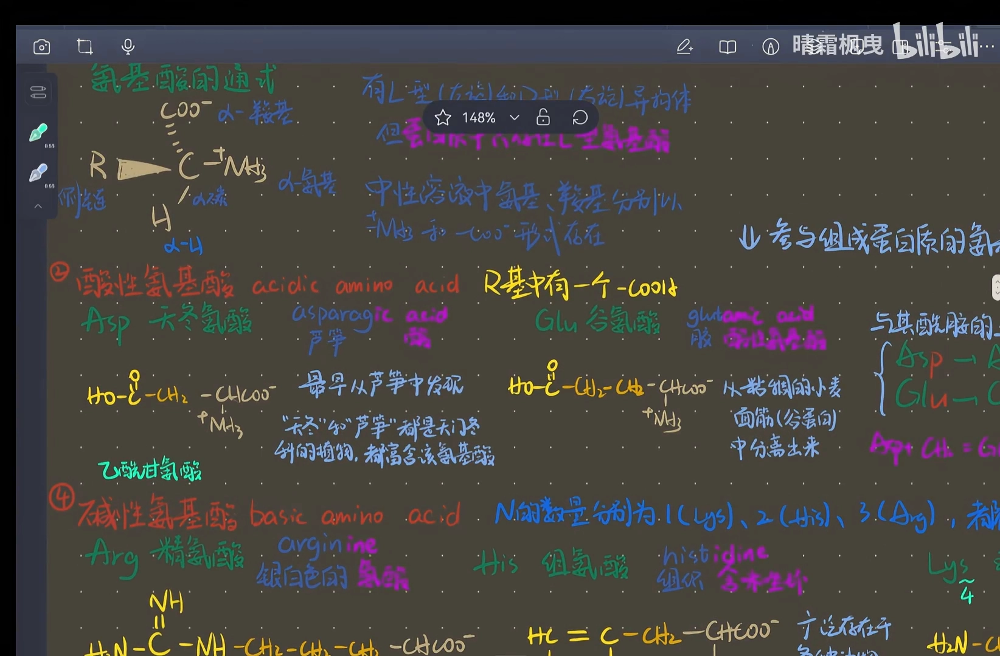

### 4.3 谷氨酸 GLU：粘稠的小麦面筋

- **结构**：谷氨酸就是比天冬氨酸**多一个 CH₂** 的版本。[【跳转到 11:14】](https://www.bilibili.com/video/BV19LcfzgEPs/?t=674)
- **名字由来**：谷氨酸首次从**粘稠的小麦面筋**中分离出来。面筋是胶状物质，"胶"的英文 gluten（谷蛋白）正说明它粘稠的性质；小麦面筋富含谷蛋白，谷蛋白里含大量谷氨酸——所以中文名叫谷氨酸。[【跳转到 11:39】](https://www.bilibili.com/video/BV19LcfzgEPs/?t=699)
- **谐音彩蛋**：glue（胶水）与"谷"的读音非常相似。[【跳转到 12:04】](https://www.bilibili.com/video/BV19LcfzgEPs/?t=724)

### 4.4 酰胺家族：羧基换成酰胺基

- 羧基与氨气反应、脱水缩合，就得到**酰胺基**。于是：天冬氨酸 → 天冬酰胺，谷氨酸 → 谷氨酰胺。[【跳转到 12:04】](https://www.bilibili.com/video/BV19LcfzgEPs/?t=724)
- 体现在缩写上：三字缩写的最后一个字母不管原来是什么，统一变成 **N**——ASP → ASN，GLU → GLN。[【跳转到 12:29】](https://www.bilibili.com/video/BV19LcfzgEPs/?t=749)
- 结构上也好理解：天冬酰胺和谷氨酰胺就是把对应酸性氨基酸侧链末端的羧基换成酰胺基（—CONH₂）。[【跳转到 12:29】](https://www.bilibili.com/video/BV19LcfzgEPs/?t=749)

---

## 五、极性中性氨基酸（羟基类）：丝氨酸、苏氨酸，与半胱氨酸再对比

### 5.1 极性中性氨基酸的分类

极性中性氨基酸一共 **5 种**，分成两类：带**酰胺基**的 2 种（天冬酰胺、谷氨酰胺），带**羟基（或其类似物）**的 3 种（丝氨酸、苏氨酸、半胱氨酸）。[【跳转到 12:54】](https://www.bilibili.com/video/BV19LcfzgEPs/?t=774)

### 5.2 丝氨酸 SER：蚕丝里提取的"瘦"氨基酸

- **名字由来**：丝氨酸首次从**蚕丝蛋白**中提取出来，所以直接用"丝"字命名——它也是丝绸的主要成分之一。缩写 SER，"丝"与 S 读音相似。[【跳转到 13:19】](https://www.bilibili.com/video/BV19LcfzgEPs/?t=799)
- **结构**：一个**羟甲基**（—CH₂OH）连到 α 碳上，是羟基类里最简单的。[【跳转到 13:44】](https://www.bilibili.com/video/BV19LcfzgEPs/?t=824)
- **"瘦"的类比**：形容一个人像"丝"一样，说明他非常瘦；类比到结构式，就是它在这一类里最简单。[【跳转到 15:24】](https://www.bilibili.com/video/BV19LcfzgEPs/?t=924)

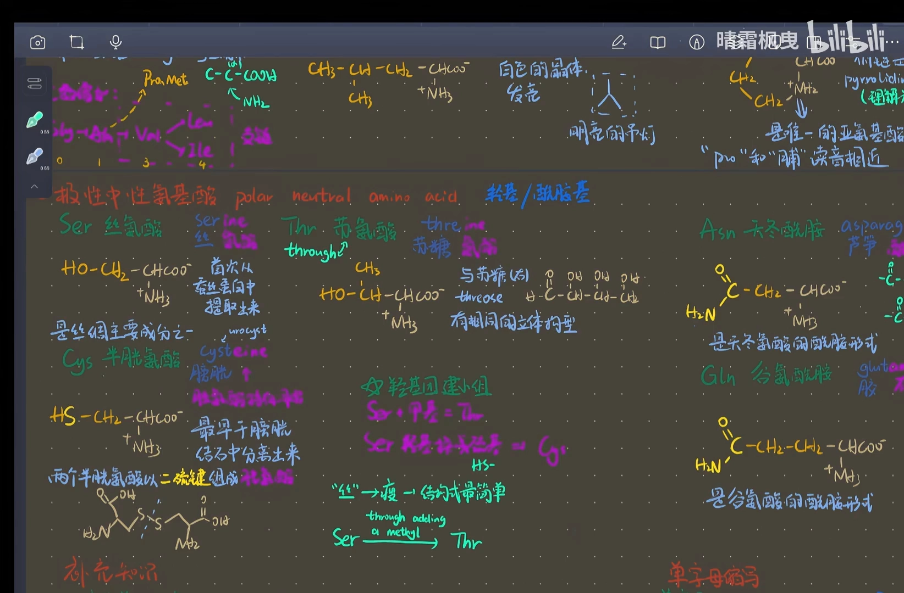

### 5.3 苏氨酸 THR：丝氨酸加一个甲基

- **结构**：苏氨酸 = 丝氨酸在 β 碳上**加一个甲基**。[【跳转到 13:44】](https://www.bilibili.com/video/BV19LcfzgEPs/?t=824)
- **名字由来**：苏氨酸与**苏糖**（threose）有相同的立体构型，所以叫"苏糖氨酸"，简称苏氨酸。但苏糖没人见过，不好记——更好的记法：三字缩写 THR，补全成 **through**（穿过），发音正像"苏"。[【跳转到 14:34】](https://www.bilibili.com/video/BV19LcfzgEPs/?t=874)

### 5.4 半胱氨酸的对比视角

把半胱氨酸和丝氨酸放在一起看：半胱氨酸就是**把丝氨酸羟基里的氧换成了硫**（—OH → —SH），可以看作羟基类里比较特殊的形式。[【跳转到 14:59】](https://www.bilibili.com/video/BV19LcfzgEPs/?t=899)

一句话总结这一节：**丝氨酸 + 甲基 → 苏氨酸；丝氨酸的 O 换 S → 半胱氨酸**。[【跳转到 15:24】](https://www.bilibili.com/video/BV19LcfzgEPs/?t=924)

---

## 六、碱性氨基酸：R 基含氮的三兄弟

碱性氨基酸相比酸性氨基酸"长得比较奇怪"：它们的 R 基里都**含有氮**——按氮的数量排：1 个氮的**赖氨酸**、2 个氮的**组氨酸**、3 个氮的**精氨酸**。共同点：侧链基团里都含 **4 个碳**。[【跳转到 15:49】](https://www.bilibili.com/video/BV19LcfzgEPs/?t=949)

### 6.1 精氨酸 ARG：银白色的"精英"

- **名字由来**：精氨酸首次分离时呈现**银白色晶体**。银的元素符号是 Ag，拉丁文是 **argentum**——所以它是"银白色"的氨基酸，缩写 ARG 就来自 argentum。[【跳转到 16:14】](https://www.bilibili.com/video/BV19LcfzgEPs/?t=974)
- **中文译名**："精"字取的是 argentum 开头发音的谐音。[【跳转到 16:39】](https://www.bilibili.com/video/BV19LcfzgEPs/?t=999)
- **结构**：含有一个**胍基**——一个氮连着一个碳，这个碳又连着另外两个氮。一个碳身上挂三个氮极不稳定，需要形成**大 π 键**这样的共轭结构才能稳定存在（两个氮之一带上双键）。[【跳转到 17:04】](https://www.bilibili.com/video/BV19LcfzgEPs/?t=1024)
- **记忆故事**：河北方言里"呱唧"是鼓掌的意思——鼓掌最有实力的是"精英"，精英鼓掌者长了三只手（三个氮），三只手鼓掌比两只手更有效果。但正常人不会长三只手，只有**机器人**（robot）会——给机器人配上三块"电池"（三个含氮基团），胍基就记住了。[【跳转到 17:29】](https://www.bilibili.com/video/BV19LcfzgEPs/?t=1049)

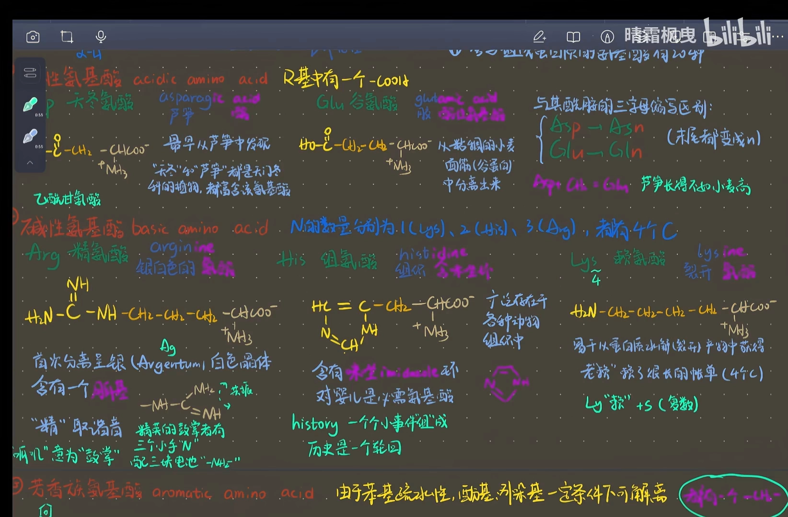

### 6.2 组氨酸 HIS：藏在"历史"里的咪唑环

- **缩写入手**：三字缩写 HIS，看到 HIS 最容易想到 **history**（历史）。[【跳转到 18:44】](https://www.bilibili.com/video/BV19LcfzgEPs/?t=1124)
- **名字由来**：组氨酸的"组"——它广泛存在于各种**动物组织**中，是组成身体必不可少的部分；对婴儿来说还是一种必需氨基酸。[【跳转到 19:09】](https://www.bilibili.com/video/BV19LcfzgEPs/?t=1149)
- **结构**：含一个**咪唑环**。历史的"轮回（周期律）"正好对应这个环：咪唑环是五元环，两个氮中间隔一个碳，其中一个氮带氢、另一个不带。整个环通过一个 CH₂ 与 α 碳相连。[【跳转到 19:34】](https://www.bilibili.com/video/BV19LcfzgEPs/?t=1174)
- **碳数分配**：侧链 4 个碳，3 个用在咪唑环里，剩 1 个连 α 碳。[【跳转到 19:59】](https://www.bilibili.com/video/BV19LcfzgEPs/?t=1199)

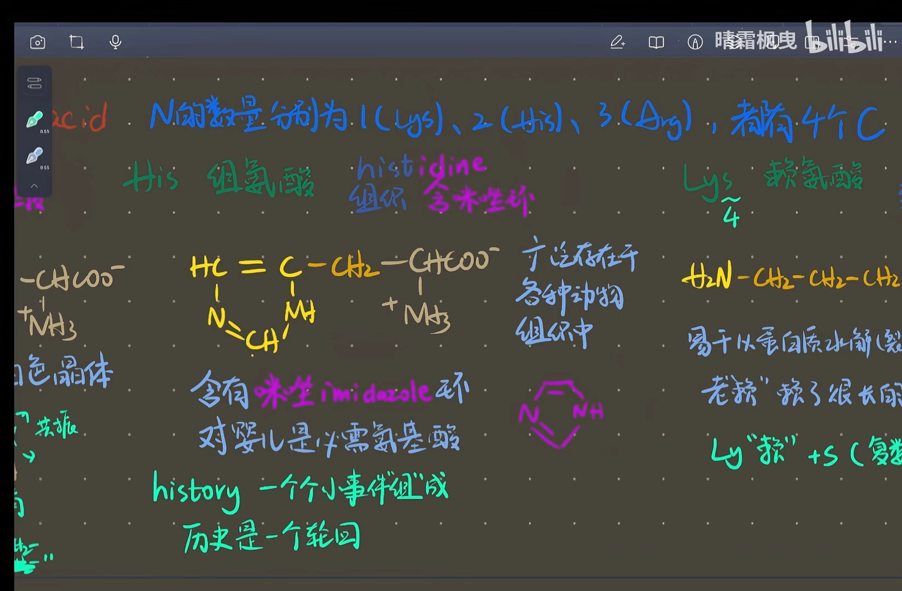

### 6.3 赖氨酸 LYS：老赖的长账单

- **结构**：一个正常氨基直接连着 **4 个 CH₂**，再连 α 碳——直链最长的碱性氨基酸。[【跳转到 19:59】](https://www.bilibili.com/video/BV19LcfzgEPs/?t=1199)
- **名字由来**："赖"就是老赖——欠了很多钱，欠账要写在账单上；老赖的账单特别长，这 4 个碳就是他的长账单。[【跳转到 20:24】](https://www.bilibili.com/video/BV19LcfzgEPs/?t=1224)
- **缩写**：LYS 与 lie（赖账）读音相似；英文单数变复数要在后面加 S——老赖的账单太多（复数），所以是 LYS。[【跳转到 20:24】](https://www.bilibili.com/video/BV19LcfzgEPs/?t=1224)

---

## 七、芳香族氨基酸：苯环三兄弟

芳香族氨基酸的共同特点：α 碳上都连一个 CH₂，结构式中**一定有苯环**。[【跳转到 21:14】](https://www.bilibili.com/video/BV19LcfzgEPs/?t=1274)

### 7.1 苯丙氨酸 PHE：苯基 + 丙氨酸

名字直白：**苯丙 = 苯基 + 丙氨酸**。英文缩写直接取"苯基"的前三个字母 PHE。[【跳转到 21:33】](https://www.bilibili.com/video/BV19LcfzgEPs/?t=1293)

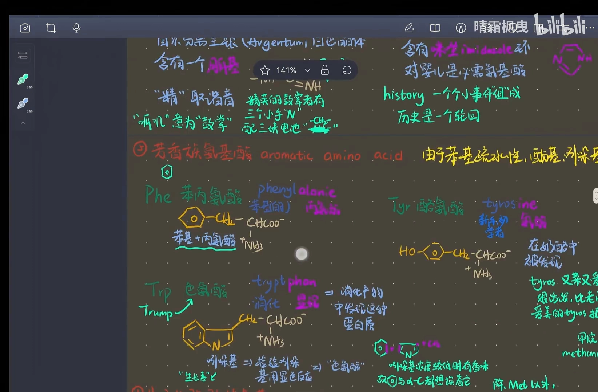

### 7.2 酪氨酸 TYR：戴酚羟基的"新手"

- **结构**：酪氨酸就是在苯丙氨酸"脑袋顶上"加了一个**酚羟基**——而且处在与 CH₂ 相对的**对位**。[【跳转到 21:58】](https://www.bilibili.com/video/BV19LcfzgEPs/?t=1318)
- **名字由来**：酪氨酸首次发现于**奶酪**中。[【跳转到 21:58】](https://www.bilibili.com/video/BV19LcfzgEPs/?t=1318)
- **记法**：tyrosine 里的 **tyro** 在英文中是独立单词，意为"新手、初学者"。新手又菜又爱玩、非常活泼——比"老成"的苯丙氨酸多一个酚羟基，正好体现活泼；新手还爱美，把酚羟基"戴"在头上（对位）。缩写取前三个字母 TYR。[【跳转到 22:23】](https://www.bilibili.com/video/BV19LcfzgEPs/?t=1343)

### 7.3 色氨酸 TRP：吲哚基的显色反应

- **结构**：CH₂ + 苯环 + **吲哚基**——三者中最复杂。[【跳转到 22:48】](https://www.bilibili.com/video/BV19LcfzgEPs/?t=1368)
- **为什么有吲哚基**：高中生物里的**生长素**就是吲哚乙酸，而吲哚乙酸正是由色氨酸衍生而来——所以色氨酸带吲哚基非常合理。[【跳转到 22:48】](https://www.bilibili.com/video/BV19LcfzgEPs/?t=1368)
- **中文名由来**：检验吲哚基用的是**显色反应**——"色"氨酸由此得名。[【跳转到 23:13】](https://www.bilibili.com/video/BV19LcfzgEPs/?t=1393)
- **缩写记法**：TRP 让人想到 Trump（特朗普）——视频里开玩笑说他"比较涩（色）"，所以 TRP 对应色氨酸。[【跳转到 23:38】](https://www.bilibili.com/video/BV19LcfzgEPs/?t=1418)
- **吲哚基结构**：也是一个五元环，但**只有一个氮**；与苯环并联（稠合）在一起。吲哚低浓度时有香味（很多香料含吲哚），高浓度时就不太美妙了。[【跳转到 24:03】](https://www.bilibili.com/video/BV19LcfzgEPs/?t=1443)
- **连接方式**：正因为吲哚"香"，苯环和 α 碳都想靠近它——于是它选择折中：一边直接与苯环并联，另一边通过 CH₂ 连接 α 碳。[【跳转到 24:28】](https://www.bilibili.com/video/BV19LcfzgEPs/?t=1468)

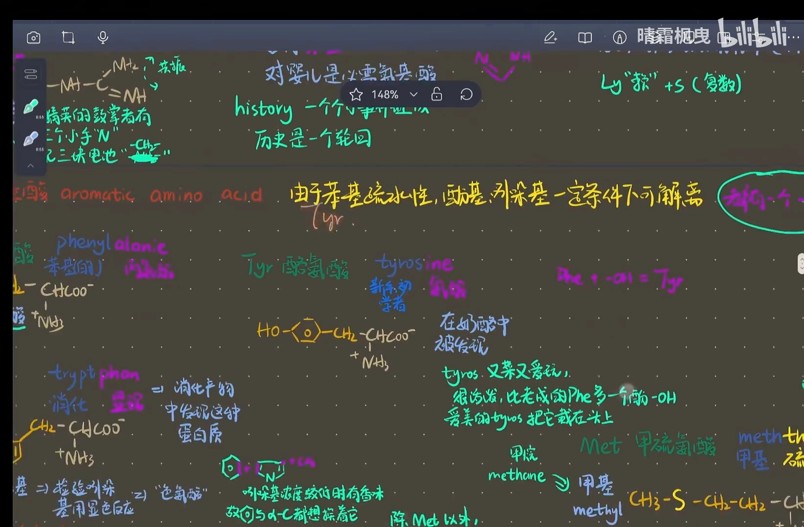

---

## 八、番外：第 21 种——硒代半胱氨酸 Sec

硒代半胱氨酸的结构与半胱氨酸的唯一差别，是**把硫换成了硒**；缩写就是硒的元素符号 **Se** 加上半胱氨酸的首字母 C，即 **Sec**。它非常罕见，但在某些情况下也可以参与合成蛋白质（常被称为"第 21 种氨基酸"）。[【跳转到 24:53】](https://www.bilibili.com/video/BV19LcfzgEPs/?t=1493)

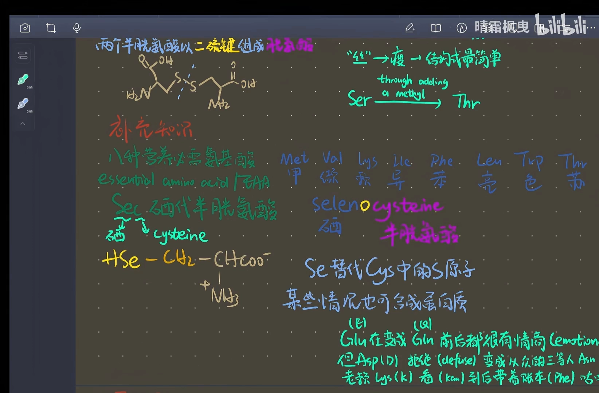

---

## 九、单字母编码：从"群魔乱舞"到一条口诀

三字缩写还算规整，**单字母编码**乍看却毫无规律——视频原话叫"群魔乱舞"。但拆开看，其实只有三档规则：[【跳转到 24:53】](https://www.bilibili.com/video/BV19LcfzgEPs/?t=1493)

### 9.1 第一档：11 种直接取首字母

有 11 种氨基酸的单字母编码就是三字缩写的**第一个字母**，完全不用特殊记忆：[【跳转到 25:18】](https://www.bilibili.com/video/BV19LcfzgEPs/?t=1518)

| 氨基酸 | 三字缩写 | 单字母 |
| --- | --- | --- |
| 甘氨酸 | GLY | G |
| 丙氨酸 | ALA | A |
| 缬氨酸 | VAL | V |
| 亮氨酸 | LEU | L |
| 异亮氨酸 | ILE | I |
| 脯氨酸 | PRO | P |
| 甲硫氨酸 | MET | M |
| 丝氨酸 | SER | S |
| 苏氨酸 | THR | T |
| 半胱氨酸 | CYS | C |
| 组氨酸 | HIS | H |

### 9.2 第二档：取特定位置的字母

- **酪氨酸 → Y**：取 tYr 的第二个字母。记忆：奶酪很好吃——**yummy**——所以是 Y。[【跳转到 25:43】](https://www.bilibili.com/video/BV19LcfzgEPs/?t=1543)
- **天冬酰胺 → N**：取 asn 的第三个字母（asparagiNe 的 N）。[【跳转到 26:08】](https://www.bilibili.com/video/BV19LcfzgEPs/?t=1568)
- **精氨酸 → R**：取 aRg 中的 R（aRginine）。[【跳转到 25:43】](https://www.bilibili.com/video/BV19LcfzgEPs/?t=1543)

### 9.3 第三档：剩下 6 个，编成三句话

剩下的 D、E、F、K、Q、W 六个字母，视频把它们编成了一段口诀，逐句拆解：

**第一句："谷氨酸在变成谷氨酰胺前后都是很有情商的"**——情商的英文是 emotional quotient：emotional 的首字母是 **E**，quotient 的首字母是 **Q**。所以谷氨酸（gluE）是 E，谷氨酰胺是 Q。[【跳转到 26:33】](https://www.bilibili.com/video/BV19LcfzgEPs/?t=1593)

**第二句："天冬氨酸拒绝变成从众的三等人"**——天冬酰胺（asn）用的是第三个字母 N，跟着大家走，所以"从容"、是"从众的三等人"；而天冬氨酸没有迎合这种规矩，它是**拒绝**的——defy（拒绝）的首字母 **D**，所以天冬氨酸是 D。[【跳转到 26:58】](https://www.bilibili.com/video/BV19LcfzgEPs/?t=1618)

**第三句："老赖看到后带着账本咕噜一声飞走了"**——[【跳转到 27:23】](https://www.bilibili.com/video/BV19LcfzgEPs/?t=1643)

- **赖氨酸 → K**：老赖（Lys）的 L 已经被亮氨酸占了，只好用紧挨着的 **K**；"带着账本"对应它那 4 个碳的长链。[【跳转到 27:48】](https://www.bilibili.com/video/BV19LcfzgEPs/?t=1668)
- **苯丙氨酸 → F**：PHE 读出来是"非"的音，"非"与 **F** 谐音。[【跳转到 27:48】](https://www.bilibili.com/video/BV19LcfzgEPs/?t=1668)
- **谷氨酸 → E**："咕噜一声"——咕噜就是谷氨酸，取 gluE 的 **E**。[【跳转到 28:13】](https://www.bilibili.com/video/BV19LcfzgEPs/?t=1693)
- **色氨酸 → W**：Trump 比较喜欢**赢**（win），取 **W**。[【跳转到 28:13】](https://www.bilibili.com/video/BV19LcfzgEPs/?t=1693)

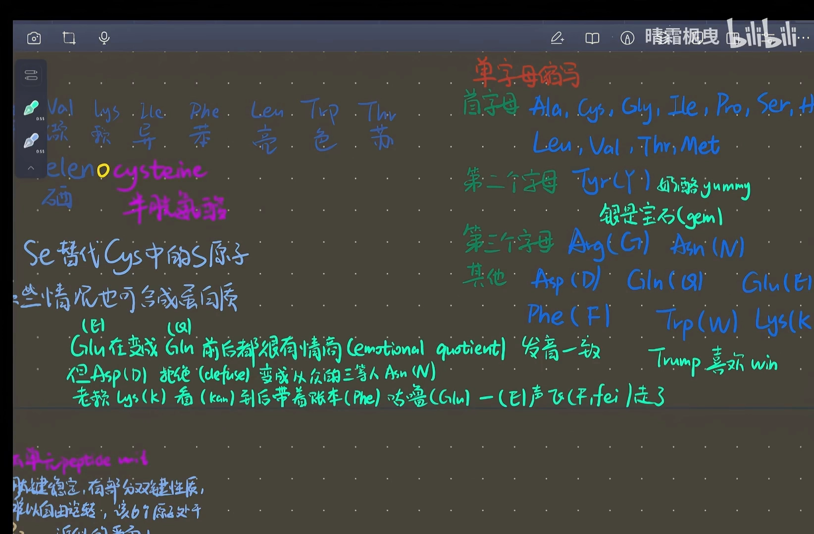

### 9.4 补充：8 种必需氨基酸——"甲携来一本亮色书"

人体无法自己合成、只能从食物中摄取的**必需氨基酸**有 8 种，口诀："**甲携来一本亮色书**"——[【跳转到 28:38】](https://www.bilibili.com/video/BV19LcfzgEPs/?t=1718)

甲硫氨酸、缬氨酸、赖氨酸、异亮氨酸、苯丙氨酸、亮氨酸、色氨酸、苏氨酸。

---

## 附：20 种标准氨基酸速查表

| 中文名 | 英文名 | 三字缩写 | 单字母 | 大类 | 记忆锚点 |
| --- | --- | --- | --- | --- | --- |
| 甘氨酸 | Glycine | GLY | G | 非极性脂肪族 | 甜味（甘甜）；R 基 = H |
| 丙氨酸 | Alanine | ALA | A | 非极性脂肪族 | 丙酸 + 氨基；醛 aldehyde |
| 缬氨酸 | Valine | VAL | V | 非极性脂肪族 | vigor 有力；缬纹像肌肉 |
| 亮氨酸 | Leucine | LEU | L | 非极性脂肪族 | 白色晶体发亮；leuko-；吊灯 |
| 异亮氨酸 | Isoleucine | ILE | I | 非极性脂肪族 | 亮氨酸同分异构体；iso- |
| 脯氨酸 | Proline | PRO | P | 非极性脂肪族 | 吡咯环；唯一亚氨基酸；肉脯 |
| 甲硫氨酸 | Methionine | MET | M | 非极性脂肪族（含硫） | 甲硫基 |
| 半胱氨酸 | Cysteine | CYS | C | 极性中性（巯基） | 胱氨酸/膀胱结石；二硫键 |
| 天冬氨酸 | Aspartic acid | ASP | D | 酸性 | 芦笋/天门冬科；defy → D |
| 谷氨酸 | Glutamic acid | GLU | E | 酸性 | 小麦面筋；gluten；gluE |
| 天冬酰胺 | Asparagine | ASN | N | 极性中性（酰胺） | 天冬氨酸 + 酰胺；末位 N |
| 谷氨酰胺 | Glutamine | GLN | Q | 极性中性（酰胺） | 谷氨酸 + 酰胺；eQ 情商 |
| 丝氨酸 | Serine | SER | S | 极性中性（羟基） | 蚕丝；最"瘦"最简单 |
| 苏氨酸 | Threonine | THR | T | 极性中性（羟基） | 丝 + 甲基；through ≈ 苏 |
| 赖氨酸 | Lysine | LYS | K | 碱性 | 老赖长账单（4×CH₂）；K |
| 精氨酸 | Arginine | ARG | R | 碱性 | 银白晶体；argentum；胍基 |
| 组氨酸 | Histidine | HIS | H | 碱性 | history；咪唑环 |
| 苯丙氨酸 | Phenylalanine | PHE | F | 芳香族 | 苯基 + 丙氨酸；"非" ≈ F |
| 酪氨酸 | Tyrosine | TYR | Y | 芳香族 | 奶酪；tyro 新手；酚羟基 |
| 色氨酸 | Tryptophan | TRP | W | 芳香族 | 吲哚；显色反应；win → W |

## 小结

- **一副骨架**：所有氨基酸都是"α 碳 + 氨基 + 羧基 + 氢 + R 基"；蛋白质里只有 L 型；生理 pH 下按两性离子（—NH₃⁺/—COO⁻）书写。
- **五大类分组**：非极性脂肪族（侧链只含碳氢，脯氨酸成环、甲硫含硫除外）、酸性（2 种）、极性中性（酰胺 2 + 羟基 3）、碱性（R 基含氮 3 种）、芳香族（苯环 3 种）。
- **名称即故事**：每个氨基酸的命名都有来历——甘氨酸的甜、亮氨酸的白亮、酪氨酸的奶酪、谷氨酸的面筋——理解故事，名字和结构互相推导。
- **缩写有规则**：三字缩写多取英文前三个字母（天冬酰胺/谷氨酰胺统一变 N）；单字母 = 11 个首字母 + 3 个特定字母（Y/R/N）+ 6 个特记（D/E/F/K/Q/W，一段口诀搞定）。
- **两个特殊成员**：脯氨酸是唯一亚氨基酸；硒代半胱氨酸（Sec）把 S 换成 Se，可视为"第 21 种"。
- **必需氨基酸 8 种**："甲携来一本亮色书"——甲硫、缬、赖、异亮、苯丙、亮、色、苏。

## 关键术语速查

| 术语 | 一句话解释 |
| --- | --- |
| α 碳 | 氨基酸的中心碳，连接氨基、羧基、氢和 R 基 |
| R 基（侧链） | 20 种氨基酸差异所在，决定分类与性质 |
| 两性离子 | 生理 pH 下 —NH₃⁺ 与 —COO⁻ 同时存在的写法 |
| 三字缩写 | 氨基酸的三字母代码（如 GLY、ALA），多为英文前三个字母 |
| 单字母编码 | 氨基酸的单字母代码（G、A…），蛋白序列的标准写法 |
| 支链氨基酸 | 侧链带支链的氨基酸：缬、亮、异亮 |
| 亚氨基酸 | 氮上少一个氢（—NH—）的氨基酸，脯氨酸是唯一一种 |
| 二硫键 | 两个半胱氨酸巯基（—SH）脱氢形成的 S—S 键 |
| 酰胺基 | 羧基与氨脱水缩合产物（—CONH₂），酸性氨基酸变酰胺的桥梁 |
| 胍基 | 精氨酸侧链的 C 连三氮结构，靠大 π 键稳定 |
| 咪唑环 | 组氨酸侧链的五元含氮杂环（2 个氮） |
| 吲哚基 | 色氨酸侧链的苯环 + 五元环稠合结构（1 个氮） |
| 硒代半胱氨酸 | 半胱氨酸的 S 换成 Se（Sec），罕见的"第 21 种"氨基酸 |
| 必需氨基酸 | 人体无法合成、必须从食物摄取的 8 种氨基酸 |
