# 蛋白质的结构：一级到四级，结构层级决定功能

> 本文是「生物模型知识体系」条目 **1.2.2 结构四层级** 的配套笔记，基于 B 站课程视频《2 蛋白质的结构》（[BV1ap4y1L7NC](https://www.bilibili.com/video/BV1ap4y1L7NC/)，时长 25:40）整理，关键知识点均附时间戳跳转链接。

## 本讲在解决什么问题（SCQA）

**背景**：你已经知道蛋白质由氨基酸脱水缩合连成多肽链。但翻开任何一本教材都会发现，"蛋白质的结构"并不是一句话，而是分成一级、二级、三级、四级四个层级。

**冲突**：初学者最容易把这些层级混为一谈——"空间结构"到底指什么？α-螺旋和整条肽链的三维结构是什么关系？为什么有的蛋白质有四级结构、有的没有？"结构域""亚基""模体"这些术语又各指什么？

**疑问**：四个层级分别是什么？各自靠什么化学力量维持？它们如何一步步搭出一个能执行功能的蛋白质？

**回答（中心思想）**：蛋白质结构是**自底向上的四层搭建**——一级是氨基酸序列，二级是局部主链的规则构象，三级是整条肽链的三维构象，四级是多亚基复合物；在二级与三级之间还有超二级结构、模体、结构域等功能性层次。**只有搭到最高层级，蛋白质才获得完整的功能。**

---

## 一、一级结构：多肽链的氨基酸序列

[【跳转到 00:00】](https://www.bilibili.com/video/BV1ap4y1L7NC/?t=0)

**一级结构，就是多肽链上氨基酸残基从 N 端到 C 端的排列顺序。**

把这句话展开，它包含三方面的信息：

- 这条链上有**多少种、多少个**氨基酸（类型与数量）；
- 每一个氨基酸**处在什么位置**。

这里说的"氨基酸残基"，是指氨基酸参与形成肽键后、失去了独立羧基和氨基的形态——每个残基还保留原本的框架结构，只是羧基和氨基已经脱水缩合形成了**肽键**。可以这样想象：以一个小球代表一个氨基酸，串联起来得到的就是多肽链。

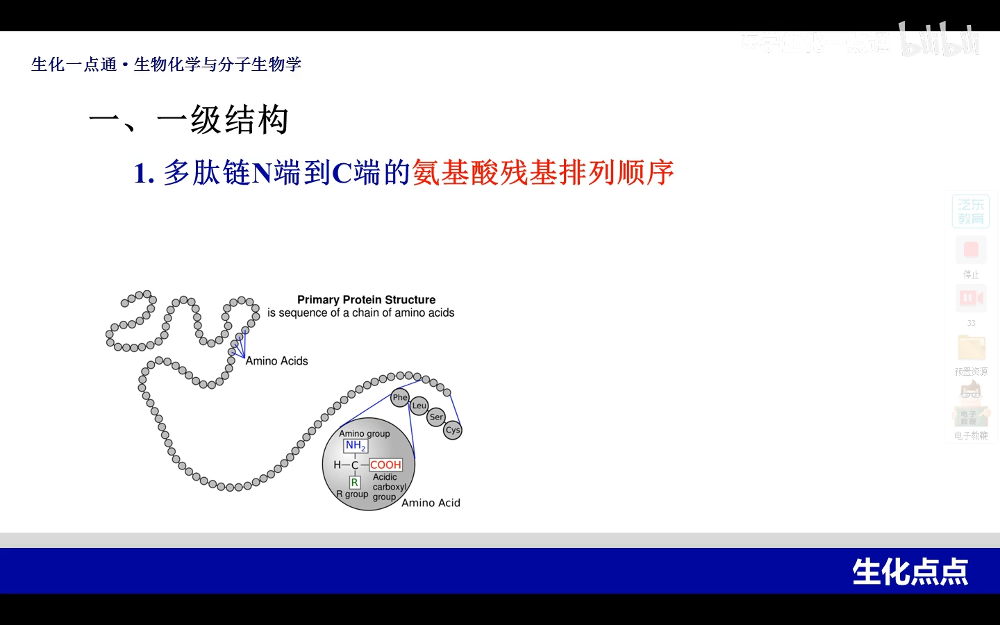

一级结构主要借助的化学键就是**肽键**，侧链则分布在整条骨架链的两侧。

有一个特殊情况：有些蛋白质（比如**胰岛素**）含有多个**巯基**（-SH，侧链上的含硫基团），两个巯基之间脱氢就形成了**二硫键**。教材上把这种特殊的二硫键也**归入一级结构**——记住这一点，后面讲三级结构时还会再强调。

## 二、二级结构：局部主链骨架的规则构象

[【跳转到 01:23】](https://www.bilibili.com/video/BV1ap4y1L7NC/?t=83)

**二级结构，是指多肽链中局部肽段主链骨架原子的相对空间位置——它根本不涉及侧链的构象。**

理解定义要抓住两个关键词：

- **局部**：不看整条链，只看其中一段；
- **骨架原子**：只看主链，不看侧链。

### 2.1 骨架原子是什么

[【跳转到 02:38】](https://www.bilibili.com/video/BV1ap4y1L7NC/?t=158)

从一级结构我们已经知道线性多肽链的样子。看图中绿色部分衬托出来的就是**多肽链的主链**，也就是骨架原子所在的链。

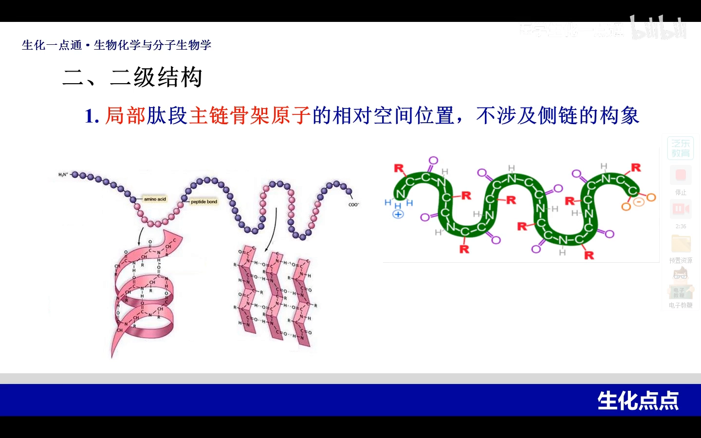

这里要引入**肽单元**的概念：每一个"碳、氧、氮、氢加两侧 α-碳"构成一个肽单元，相邻肽单元之间共用某一个氨基酸的 α-碳。由此，通过碳氧中的碳、氮氢中的氮和两侧的 α-碳，就形成了多肽链的主链。**骨架原子就是指这些碳、氮和 α-碳。**

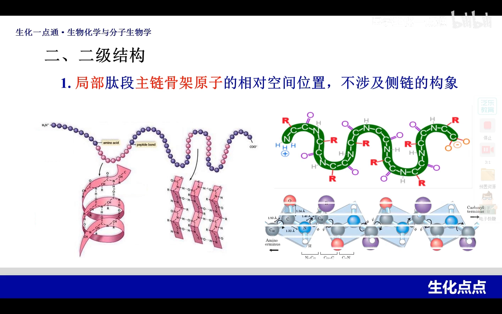

### 2.2 维系二级结构的力量：氢键

形成二级结构必须有力量来维持。维持它的主要化学键——甚至可以说是**唯一的化学键**——就是**氢键**：以氢原子为主，氢和氧、或氢和氮之间形成的微弱次级作用力。

二级结构有多种形式，主要有四种：**α-螺旋、β-折叠、β-转角、Ω环**，其中 α-螺旋和 β-折叠占了绝大部分。

### 2.3 α-螺旋：方向、粗细、力量、侧链

[【跳转到 04:16】](https://www.bilibili.com/video/BV1ap4y1L7NC/?t=256)

讲 α-螺旋，用"把教材一整段话浓缩成几个要点"的方法，可以归纳出四件事：

**① 方向——右手螺旋。** 螺旋方向用右手或左手代表：多肽链正方向从 N 端到 C 端，按图中链的旋转方向（向右、向前、顺时针），符合顺时针转向，因此称为**右手螺旋**——右手代表顺时针，左手代表逆时针。

[【跳转到 06:13】](https://www.bilibili.com/video/BV1ap4y1L7NC/?t=373)

**② 粗细——每圈 3.6 个残基、螺距 0.54nm。** 从某一个位置开始，转完完整一圈再到达类似位置，中间这段长度就是一圈螺旋，约 **3.6 个氨基酸残基**；螺旋的"弹性大小"用**螺距**衡量，为 **0.54nm**。记住 3.6 和 0.54 这两个数字，α-螺旋的形态就描述清楚了。

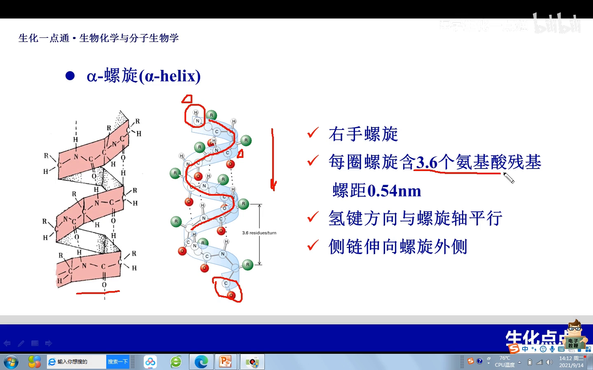

**③ 力量——氢键，且平行于主轴。** 每一个肽单元中羰基的氧，都要和它沿 C 端方向相隔约三个肽键之后的那个 N-H 的氢形成氢键。因此这些氢键处于相对平行的状态，**与假想的螺旋主轴平行**——这就是维持螺旋的力量。

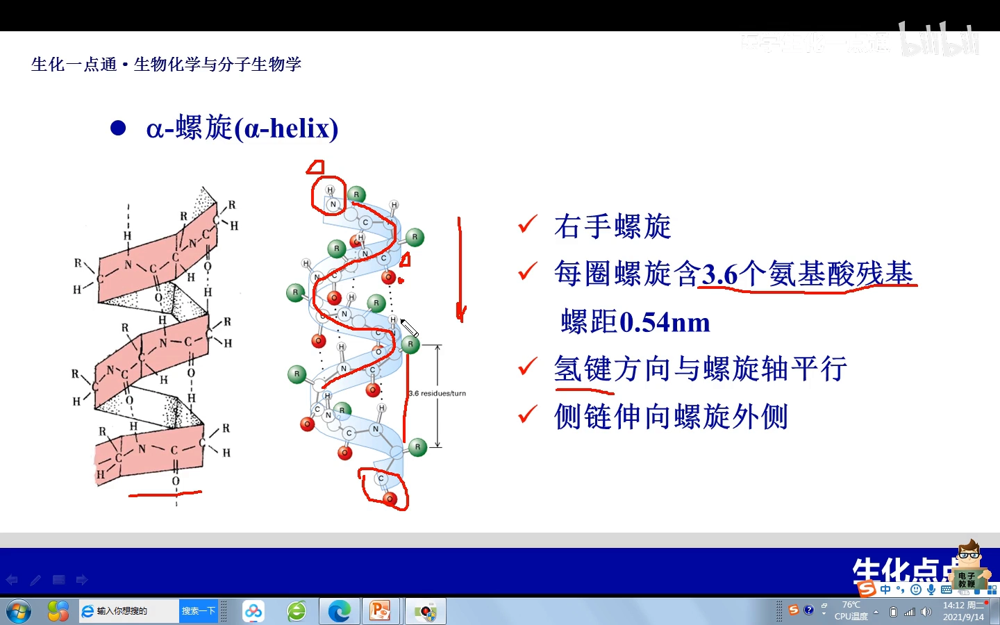

**④ 侧链——伸向螺旋外侧。** 虽然二级结构不涉及侧链的具体构象，但要交代侧链与螺旋的关系：在 α-螺旋中，**侧链伸向螺旋的外侧**。

[【跳转到 08:18】](https://www.bilibili.com/video/BV1ap4y1L7NC/?t=498)

### 2.4 β-折叠：锯齿状的肽段片层

[【跳转到 08:33】](https://www.bilibili.com/video/BV1ap4y1L7NC/?t=513)

**β-折叠呈锯齿状，而且一定是在两个肽段之间形成的。** 看图：一条多肽链的某个局部走向呈锯齿状，到左边之后反转 180 度折回来，依然锯齿状；这两段锯齿状结构相互靠拢，**中间以氢键维系**——两条肽段前后之间形成氢键——这样的结构才叫 β-折叠。

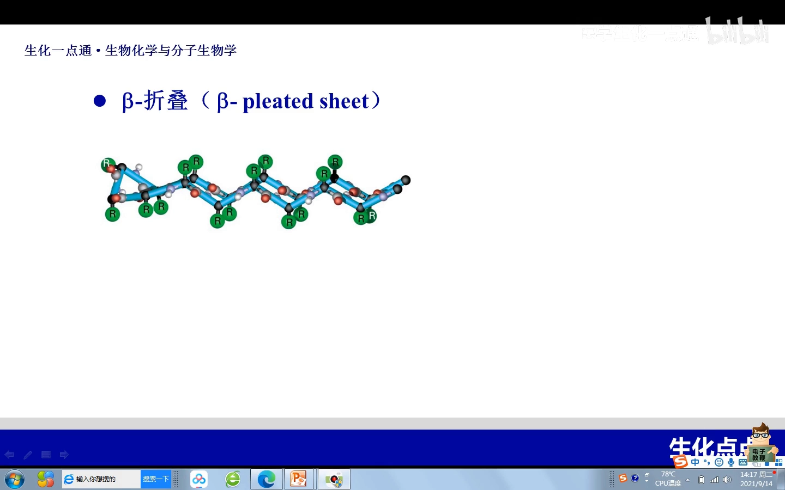

它的要点同样可以归纳为四条：

- **片段数**：最少两个片段，可以更多，但绝对不能少；
- **侧链位置**：一上一下、一上一下交替，位于整条链的上下方；
- **力量**：也是氢键，但氢键**与主轴的走向垂直**（肽段之间的氢键是前后方向，主链是水平走向）；
- **方向**：存在**平行式与反平行式**两种——看各肽段从 N 端到 C 端的走向是相同还是相反。

[【跳转到 10:35】](https://www.bilibili.com/video/BV1ap4y1L7NC/?t=635)

还有一个细节：图里画的都是同一条多肽链的不同片段之间形成的 β-折叠，但**不同的多肽链之间**恰好有片段形成这样的氢键关系，也是可以的。

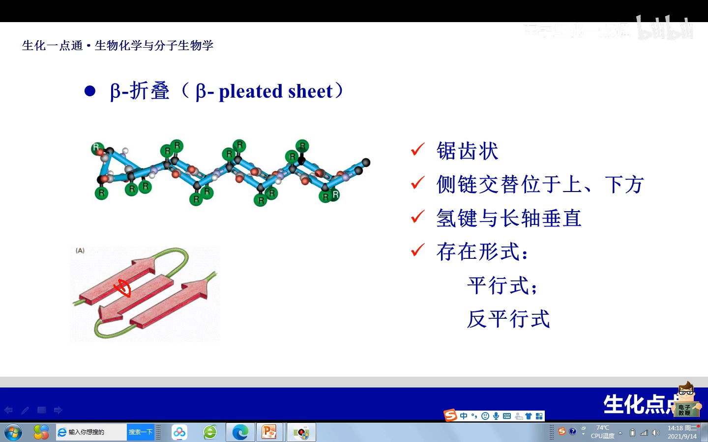

### 2.5 β-转角与 Ω环

[【跳转到 11:25】](https://www.bilibili.com/video/BV1ap4y1L7NC/?t=685)

**β-转角**：当一条多肽链的走向发生 **180 度回折**时形成的结构。这种结构往往在**球形蛋白的表面**最多见——因为球蛋白的多肽链走到这里要拐一个 180 度的弯。形成 β-转角对氨基酸残基有一定要求：这个残基**往往是脯氨酸或甘氨酸**。

**Ω环**：这是最近才确定的一种二级结构，同样多见于球蛋白的表面，并且**以亲水性的残基为主**。它的形态像字母 Omega（Ω），所以叫 Ω环；但左图中另一个普通的环状 loop 就不能称为 Ω环——Ω环是专指形态像 Ω 的这一种。

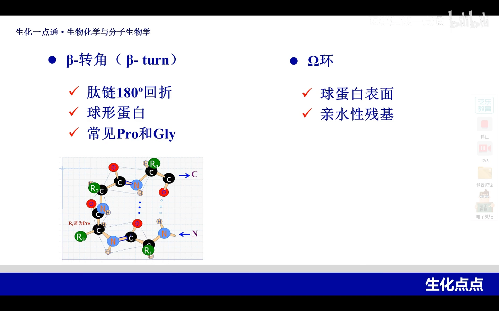

---

## 三、高于二级的特殊层次：超二级结构与模体

[【跳转到 12:43】](https://www.bilibili.com/video/BV1ap4y1L7NC/?t=763)

在二级结构的基础上，还有两个"非常特殊的结构层次"。

**超二级结构**：由**数个二级结构组合**在一起形成的一种**有规则的构象**。比如图中显示的是 α-螺旋和 α-螺旋的组合（"αα"超二级），下面这个图则是 β-折叠-α-螺旋-β-折叠的组合。一句话：超二级结构是有规则的二级结构搭起来的、比二级结构相对大一点的构架。

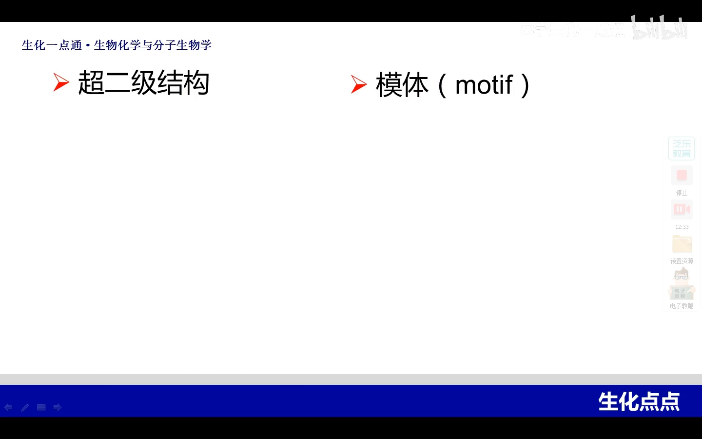

**模体（motif）**：强调的是**具有特定空间构象和特定功能**的结构。它与超二级结构关系密切——大多数模体本质上属于超二级结构这个形态范围——但二者**没有谁包含谁**：也有例外，比如几个氨基酸就可以具有空间构象和特定功能，那也叫模体。

[【跳转到 13:58】](https://www.bilibili.com/video/BV1ap4y1L7NC/?t=838)

模体为什么强调"特定构象 + 特定功能"？原因在于**它有特定的氨基酸排列顺序**。以典型的**锌指结构**为例：从构型上讲它就是一个超二级结构——从 N 端开始是一段 β-折叠，之后是一段 α-螺旋；但可能还有很多与它长得一样的构象却没有它的功能。它的功能来自：β-折叠处有**两个半胱氨酸**，α-螺旋处有**两个组氨酸**——正因为这四个残基在空间位置上如此排列，才决定了这个结构能**结合二价锌离子**。所以不是随便一个长得很像的超二级结构就能叫锌指结构——模体一定有特征性的氨基酸排列顺序。

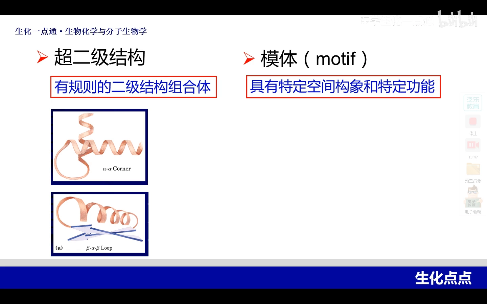

[【跳转到 15:38】](https://www.bilibili.com/video/BV1ap4y1L7NC/?t=938)

除了锌指结构，模体还有其他类型，比如**螺旋-环-螺旋**结构：一个 α-螺旋，中间经过一个环状，又是一个 α-螺旋（"α-螺旋-环-α-螺旋"）。还有一个典型的叫**亮氨酸拉链**。

这些模体有什么共同的功能色彩？**基本上，模体都出现在能够结合 DNA 的蛋白质里**——课程后期会需要一些蛋白质去和 DNA 结合（比如基因转录表达相关的蛋白），那时要注意：那些蛋白质里应该都具有模体结构。

## 四、三级结构：整条肽链的三维构象

[【跳转到 16:03】](https://www.bilibili.com/video/BV1ap4y1L7NC/?t=963)

**三级结构，是指整条多肽链里全部氨基酸残基——或者说全部原子——的相对空间位置。** 这已经达到了一条多肽链的最高级结构，侧链也在其中了。

与二级结构只靠氢键不同，**三级结构的形成需要多种力量**：**疏水键、盐键（离子键）、氢键、范德华力**（弱的异性电荷之间的吸引力）。

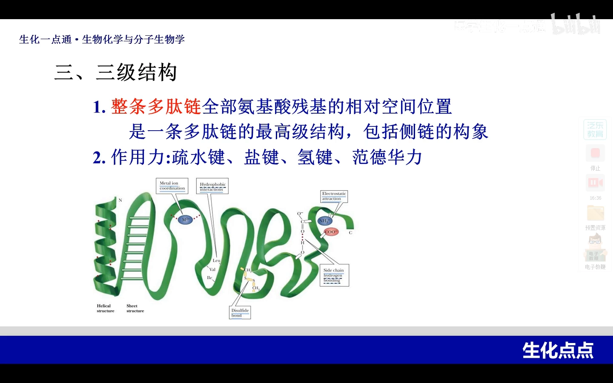

对照图来看：

- α-螺旋、β-折叠内部有**氢键**（二级结构），二级结构之间将来也可能再形成氢键；
- 离子基团的存在可以形成**离子键，也就是盐键**；
- 大量疏水基团聚集处存在**疏水相互作用（疏水键）**；
- 弱的异性电荷之间产生**范德华力**；
- 至于图上出现的**二硫键**——再次强调，我们一定要把二硫键放到**一级结构**去理解。

## 五、结构域：三级结构内的独立功能区

[【跳转到 18:28】](https://www.bilibili.com/video/BV1ap4y1L7NC/?t=1108)

三级结构的概念之后，还有一个**结构域**（domain）的概念。它指的是**分子量相对庞大的三级结构**——三级结构有小的、也有特别大的。在分子量大的三级结构内部，常常可以区分出多个**结构紧密的局部区域**。

看图：一条复杂的多肽链，左边和右边是两个结构相对非常紧密的区域，而两者之间相对比较疏松。右图中蓝色区域与紫色区域之间的力量比较弱，但分隔开的两个局部区域内部又比较紧密。

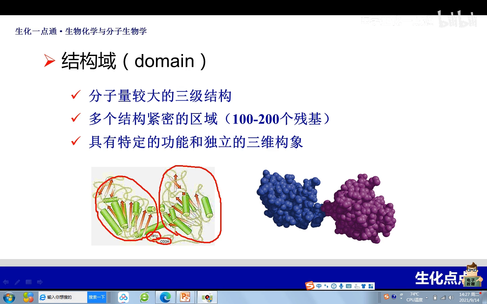

这样的每一个紧密区域都有两个特征：

- 具有**特定的功能**和独立的**三维功效**；
- 将来即使把这两个独立的区域分开、而不改变它们的空间构象，**功能依然存在**。

这种区域就称为**结构域**。简单而言：**结构域是三级结构内的独立功能区**——它包含在三级结构之内。

---

## 六、四级结构：多个亚基组合成复合物

[【跳转到 20:12】](https://www.bilibili.com/video/BV1ap4y1L7NC/?t=1212)

有些蛋白质最高级是三级，而有些复杂的蛋白质最高可以达到**四级**。

**四级结构，是指两个以上——最少两个——已经具备三级结构的多肽链再组合形成的结构。** 其中每一条多肽链都称为一个**亚基**（subunit）；亚基与亚基之间大多通过**氢键和离子键**组合在一起。

最典型的四级结构蛋白质就是**血红蛋白**：它包含四个亚基，其中两两相同，所以绝大多数正常人的血红蛋白是 **α2β2** 这样的一个**四聚体**。血红蛋白的主要功能我们都知道——运输氧。

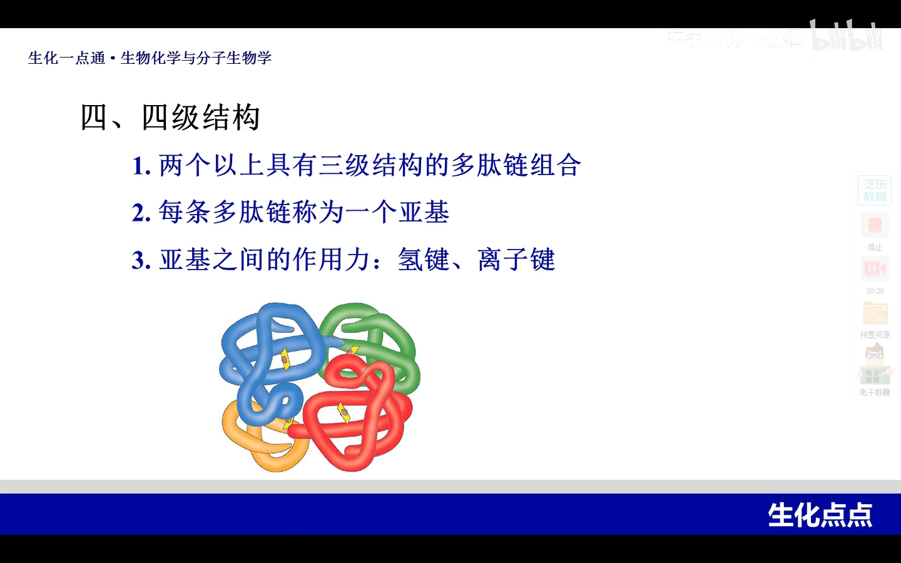

## 七、结构与功能：肌红蛋白与血红蛋白的对比

[【跳转到 21:02】](https://www.bilibili.com/video/BV1ap4y1L7NC/?t=1262)

把肌红蛋白和血红蛋白放在一起对比，最能体会"层级决定功能"。

**差异**：肌红蛋白是主要存在于肌肉组织中的蛋白质，看图左边这条单一的多肽链——它的最高级结构是**一条链的三级结构**；而血红蛋白是四个亚基构成的**四级结构**。二者绝对不一样。功能上，肌红蛋白是**储氧**的，血红蛋白是血液中**负责输氧**的。

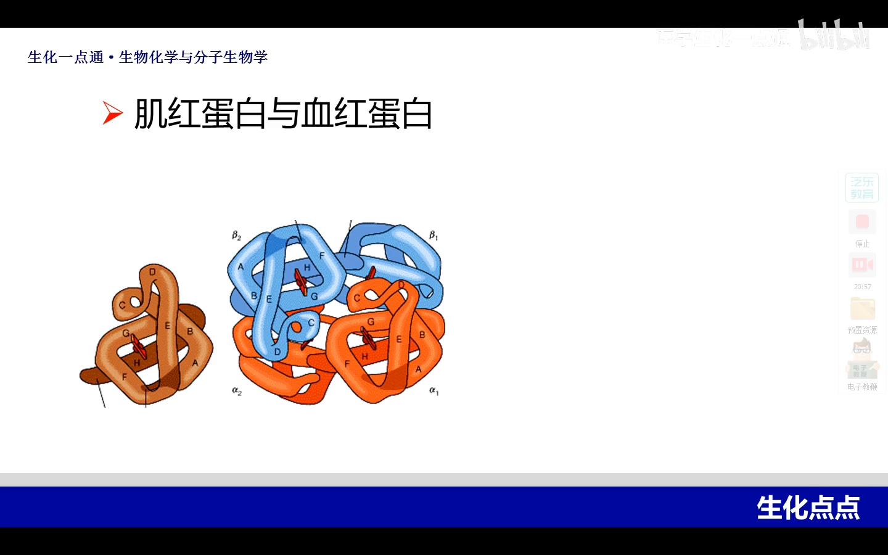

**相似性**：从空间构象上看，把血红蛋白里的任意一个亚基拿出来（比如 α 亚基），它的三级结构和肌红蛋白的三级结构非常像——这就是结构的相似性。也正因为结构的相似性，它们具有共同的结构与功能基础。

[【跳转到 22:29】](https://www.bilibili.com/video/BV1ap4y1L7NC/?t=1349)

**共同的"氧结合开关"——血红素**：肌红蛋白和血红蛋白的四个亚基内，都有一个相同的结构，叫**血红素**。血红素是**铁卟啉**结构，属于铁卟啉类化合物：中间是一个铁离子，嵌合在一个叫**卟啉**的化学分子里边。正因为有了这个铁，才能够与氧结合——也正因为有了血红素，才赋予了这两种蛋白质与氧结合的能力。

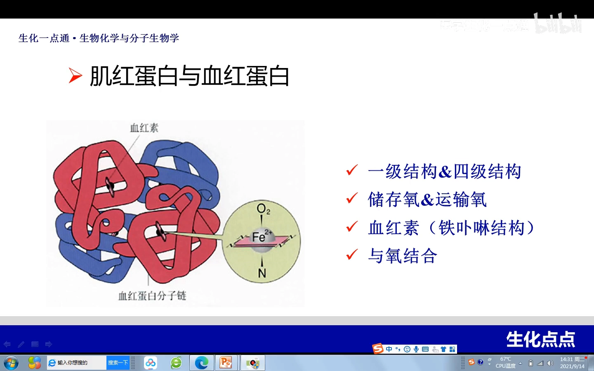

[【跳转到 23:34】](https://www.bilibili.com/video/BV1ap4y1L7NC/?t=1414)

**收束全课**：蛋白质的结构 = 一级结构 + 空间结构（二级、三级、四级）。简单的蛋白质一条多肽链，最高级是三级；复杂的、需要亚基构成的，最高级是四级。实际上我们体内的每一个蛋白质都由一级、二级、三级或四级结构构成——**因为只有有了最高级的结构，才能赋予这个蛋白质相应的功能**。比如细胞膜上的通道蛋白，它之所以有功能，一定是依赖于它的一级、二级、三级甚至四级结构的基础。

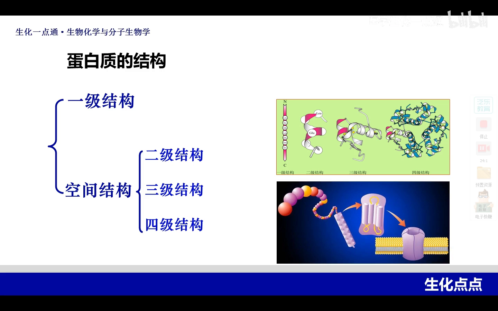

除了这四级层次，还要注意在二级和三级结构之间出现的那些新层次——**模体和结构域**，这都是**功能性的概念**。尤其是模体：具有模体的蛋白质都能与 DNA 相互作用——比如在基因进行转录表达的时候，就需要了解蛋白质结构，才能进一步掌握蛋白质的功能。结构与功能的关系，正是这门课下一讲的主题。

## 小结

- **四个层级，自底向上**：一级（氨基酸序列）→ 二级（局部主链规则构象）→ 三级（整条肽链三维构象）→ 四级（多亚基复合物）；层级搭得越高，功能越复杂。
- **各层的维系力**：一级靠肽键（二硫键也归入一级）；二级唯一的化学键是氢键；三级有疏水键、盐键、氢键、范德华力四种力量；四级亚基之间多靠氢键和离子键。
- **α-螺旋五个要点**：右手螺旋、每圈 3.6 个残基、螺距 0.54nm、氢键平行于主轴（羰基氧与 C 端方向相隔约三个肽键的 N-H 成键）、侧链伸向螺旋外侧。
- **β-折叠五个要点**：锯齿状、至少两个肽段、氢键垂直于主轴、侧链一上一下交替、分平行式与反平行式（看 N→C 走向是否一致）；不同肽链之间也可以形成。
- **β-转角与 Ω环**：β-转角是 180° 回折处，常为脯氨酸或甘氨酸；Ω环形如字母 Ω，以亲水性残基为主；二者都多见于球蛋白表面。
- **超二级与模体**：超二级结构是有规则的二级结构组合；模体强调特定构象 + 特定功能 + 特征性氨基酸顺序（锌指 = 2 个半胱氨酸 + 2 个组氨酸结合 Zn²⁺；还有螺旋-环-螺旋、亮氨酸拉链），常见于能结合 DNA 的蛋白质。
- **结构域**：庞大三级结构内部结构紧密、功能独立的局部区域，分开而不改变构象则功能仍在。
- **结构决定功能**：肌红蛋白（单链三级，储氧）与血红蛋白（α2β2 四级，输氧）亚基三级结构相似、共有铁卟啉血红素；只有搭到最高层级，蛋白质才获得完整功能（如通道蛋白）。

## 关键术语速查

| 术语 | 一句话解释 |
| --- | --- |
| 肽单元 | 每个"碳、氧、氮、氢 + 两侧 α-碳"构成的单元；相邻肽单元共用一个 α-碳 |
| 骨架原子 | 主链上的碳（羰基 C）、氮（N-H 的 N）和两侧 α-碳，二级结构只关心它们 |
| α-螺旋 | 右手螺旋；每圈 3.6 个残基、螺距 0.54nm；靠平行于主轴的氢键维持；侧链朝外 |
| β-折叠 | 锯齿状结构；至少两个肽段之间以垂直于主轴的氢键维系；分平行式与反平行式 |
| β-转角 | 肽链走向 180° 回折处形成的结构，常为脯氨酸或甘氨酸，多见于球蛋白表面 |
| Ω环 | 形如字母 Ω 的环状二级结构，多见于球蛋白表面，以亲水性残基为主 |
| 超二级结构 | 数个二级结构（如 αα、βαβ）组合成的有规则构象 |
| 模体（motif） | 具有特定空间构象和特定功能、有特征性氨基酸排列顺序的结构 |
| 锌指结构 | β-折叠上 2 个半胱氨酸 + α-螺旋上 2 个组氨酸共同结合二价锌离子的典型模体 |
| 螺旋-环-螺旋 | "α-螺旋-环-α-螺旋"构成的模体，与亮氨酸拉链同见于 DNA 结合蛋白 |
| 三级结构 | 整条多肽链全部原子的相对空间位置，靠疏水键、盐键、氢键、范德华力维持 |
| 结构域 | 分子量大的三级结构内部结构紧密、功能独立的局部区域 |
| 亚基 | 四级结构中每一条已具备三级结构的多肽链 |
| 四级结构 | 两个以上亚基通过氢键、离子键组合形成的结构（典型：血红蛋白 α2β2 四聚体） |
| 血红素 | 铁卟啉结构——铁离子嵌合在卟啉分子中，是结合氧的关键基团 |

---

> 视频来源：[《2 蛋白质的结构》BV1ap4y1L7NC](https://www.bilibili.com/video/BV1ap4y1L7NC/)（生物化学课程，25:40）。本文所有知识点与配图均取自该视频的字幕与画面，时间戳可直达对应讲解。
