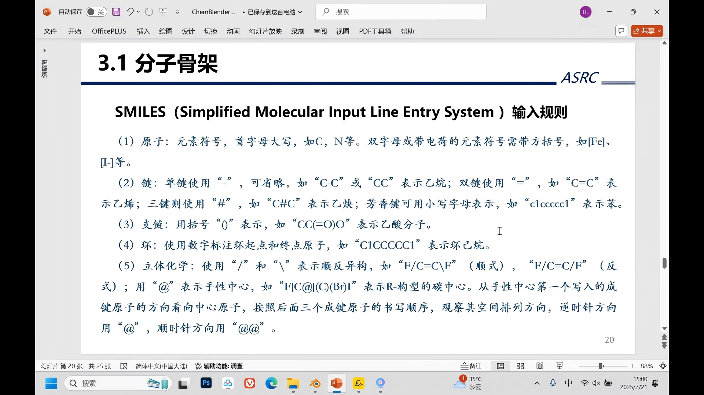
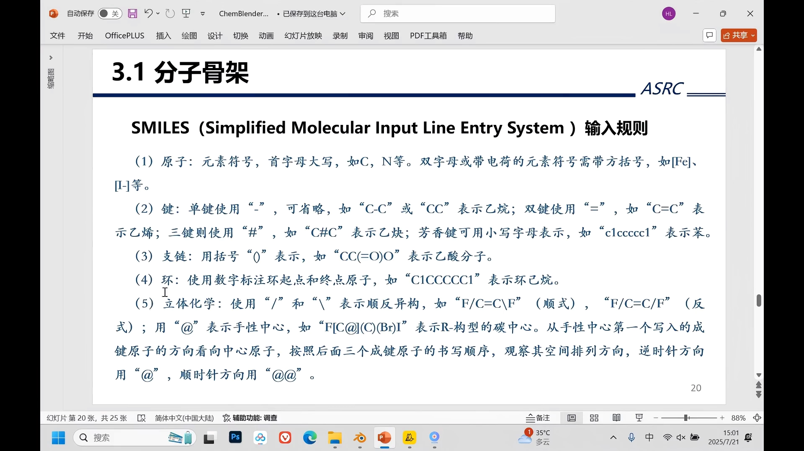
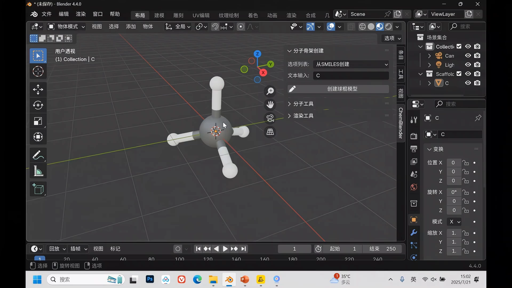
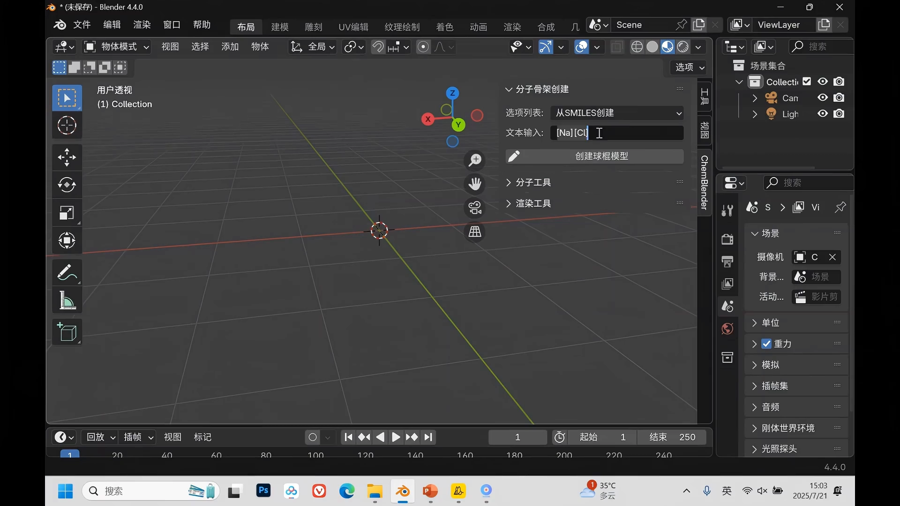
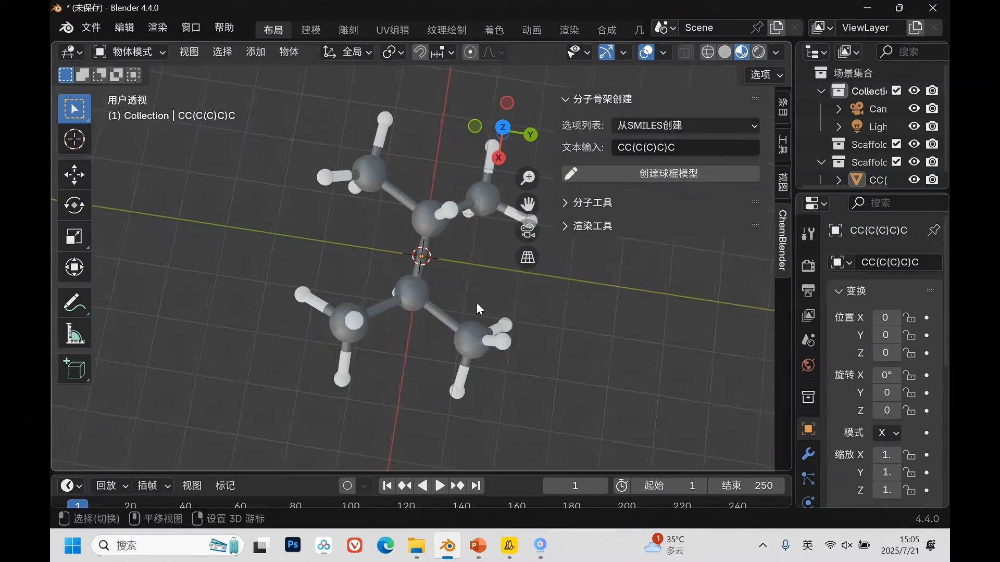
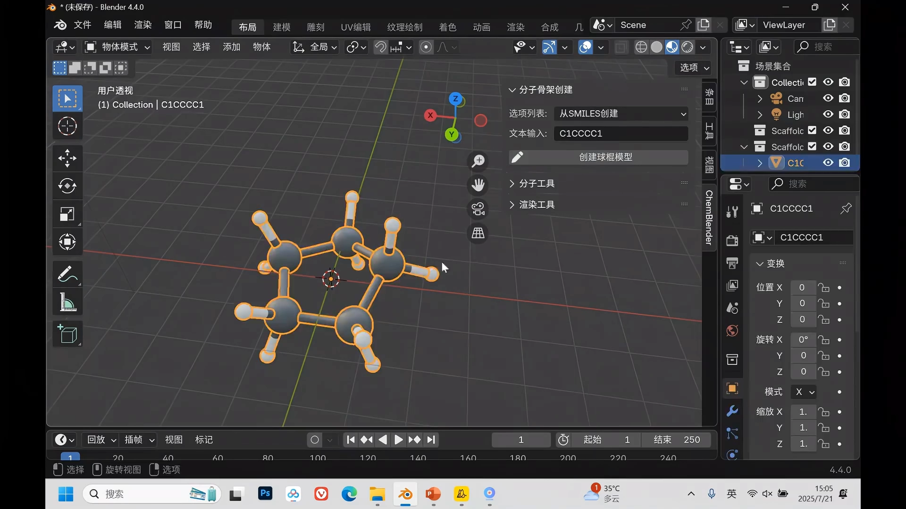
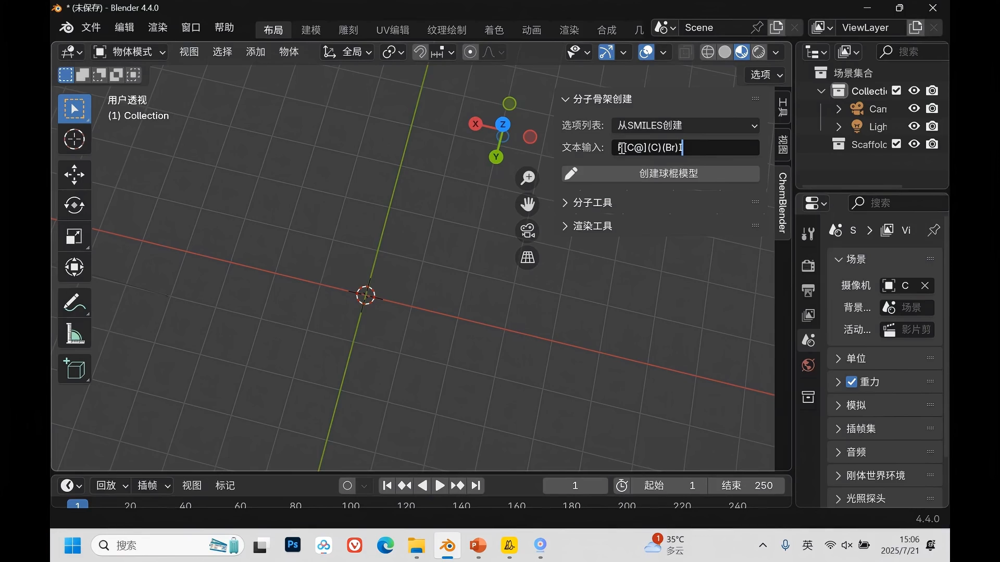
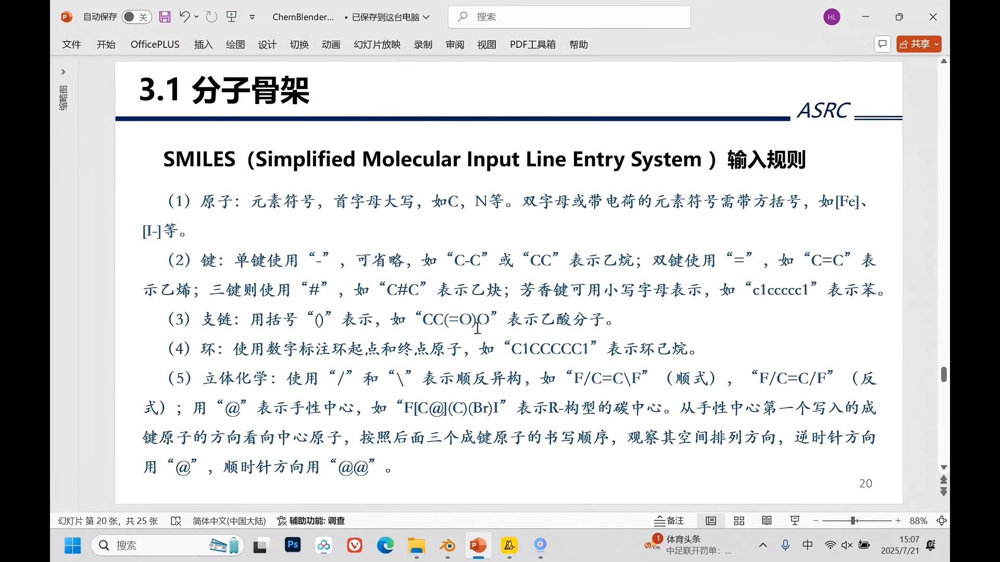
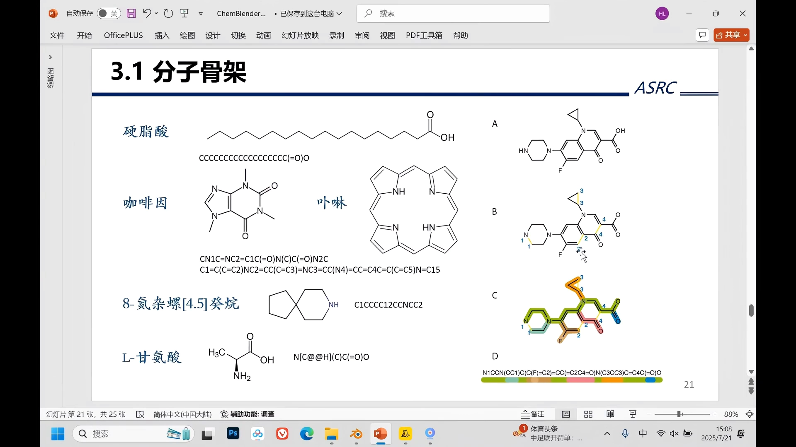
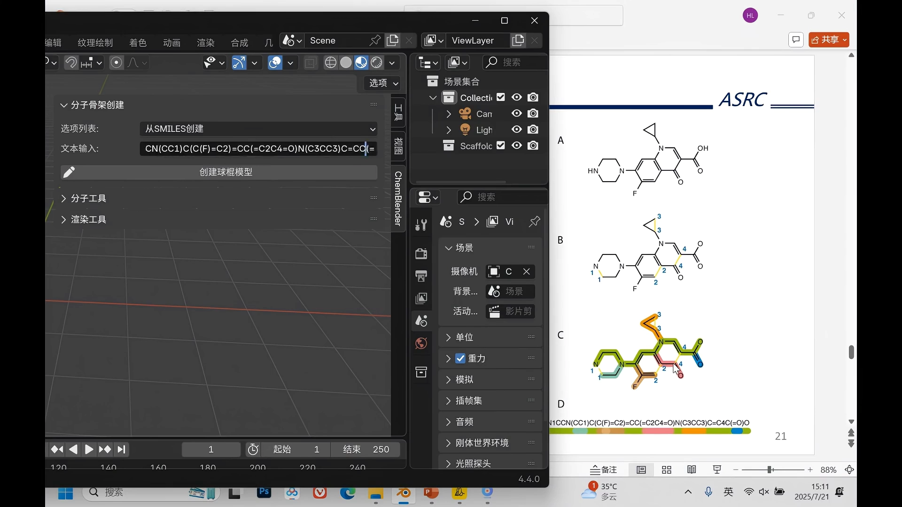

# SMILES 输入规则：五条规则把分子写成一行字符串

> 来源：Bilibili 视频《03_SMILES符号输入规则》（UP 主：独孤嘌呤，[BV1DrgBzNEwN](https://www.bilibili.com/video/BV1DrgBzNEwN/)，时长 13:47）。
> 本文基于视频字幕与画面逐窗口整理而成，配图取自视频截图，时间戳可跳回原视频对应位置核对。这一讲面向初学者，把 SMILES 的五条输入规则讲清楚，并用 Blender 化学插件逐条动手验证，最后用一个复杂分子完整示范书写过程。

## 本讲要解决的核心问题（SCQA）

**背景**：化学家习惯把分子画成二维结构式——一张"图"。在计算机里（分子数据库、化学信息学软件、AI 模型），我们需要的是能直接输入、存储和解析的**文本**。

**冲突**：图没法直接输入给程序；而分子的连接关系——哪个原子连哪个原子、是单键还是双键、有没有环、原子在空间中怎么排布——又必须完整保留，否则写出来的就不再是原来那个分子。

**疑问**：怎样用一行纯文本，无歧义地写出任意一个分子？

**回答（中心思想）**：用 **SMILES**（简化分子线性输入规范）。它把分子表示规则压缩成**五条**：**原子、化学键、支链、环、立体化学**。本讲逐条讲清规则，再用 Blender 化学插件把每条规则"输入 → 生成 3D 结构"验证一遍，最后用一个复杂分子示范三步书写法：**先写主链、再补支链、最后标环**。

## 一、SMILES 是什么：用字符串表示化学分子结构

[【跳转到 00:00】](https://www.bilibili.com/video/BV1DrgBzNEwN/?t=0)

SMILES 的核心思路：**用字符串来表示化学分子结构**。这样做的好处是方便在计算机中输入化学分子，并且解析它的结构。

整套规则并不复杂，一共五条：**原子、键、支链、环，以及立体化学**。其中最基本的是原子和化学键的输入。

[【跳转到 00:25】](https://www.bilibili.com/video/BV1DrgBzNEwN/?t=25)

## 二、五条输入规则

### 2.1 原子：写元素符号，特殊原子加中括号

[【跳转到 00:25】](https://www.bilibili.com/video/BV1DrgBzNEwN/?t=25)

原子一般**直接输入元素符号**就可以。只有两种例外需要在外面加**中括号**：

- **双字母**元素符号（如钠、氯这类两字母元素）；
- **带电荷**的原子。

### 2.2 化学键：单键省略，双键 =，三键 #，芳香键小写

[【跳转到 00:50】](https://www.bilibili.com/video/BV1DrgBzNEwN/?t=50)

| 键的类型 | 写法 |
| --- | --- |
| 单键 | 一般省略不写 |
| 双键 | 等号 `=` |
| 三键 | 井号 `#` |
| 芳香键 | 芳香原子用**小写字母**（如苯环是六个小写 `c`） |

### 2.3 环：用数字标注环的起点和终点

[【跳转到 01:15】](https://www.bilibili.com/video/BV1DrgBzNEwN/?t=75)

成环的地方要"打断"，在打断处的两个原子后面标**同一个数字**：两个 `1` 就表示这两个碳成环相连。如果这里是大写字母，写出来的就是**环烷烃**（饱和碳环）。

### 2.4 支链：用小括号括起来

[【跳转到 01:40】](https://www.bilibili.com/video/BV1DrgBzNEwN/?t=100)

支链一般用**小括号**括起来。比如乙酸分子，羧基是分叉结构，可以把其中一个氧看作支链，给它加一个小括号。

### 2.5 立体化学：斜杠定顺反，@ 定手性

[【跳转到 02:05】](https://www.bilibili.com/video/BV1DrgBzNEwN/?t=125)

立体化学有两种：

1. **顺反异构**：比如二氟乙烯，用向右的斜杠 `/` 和向左的斜杠 `\` 表示。把斜杠看作两根键——两个斜杠**方向不一样**，两个氟原子就连在双键同一侧，是**顺式**；两个斜杠**方向相同**，就是**反式**。
2. **手性原子**：在原子后面加 `@` 符号。手性碳一般连接**四个不同的基团**。

[【跳转到 02:30】](https://www.bilibili.com/video/BV1DrgBzNEwN/?t=150)

`@` 怎么读？从 SMILES 中**写的第一个原子看向手性中心**，后面三个原子按书写顺序（比如氟后面的碳、溴、碘）观察它们在空间中的排列：**顺时针是 `@@`，逆时针是 `@`**。

[【跳转到 03:20】](https://www.bilibili.com/video/BV1DrgBzNEwN/?t=200)

## 三、逐条验证：Blender 化学插件实操

规则讲完，视频用 Blender 的化学插件把每条规则实际输入一遍、生成球棍模型验证。

### 3.1 原子实操：C → 甲烷，N → 氨，O → 水；[Na] 才合法

[【跳转到 03:35】](https://www.bilibili.com/video/BV1DrgBzNEwN/?t=215)

输入一个碳，点击创建球棍模型，会创建出**甲烷**——插件默认自动补齐了氢原子。换成氮或氧：氮是**氨气**分子，氧是**水**分子。

双字母元素必须遵守中括号规则：输入钠原子不加中括号，创建时会提示错误（输入内容不符合规则）；加上中括号 `[Na]` 就能正常创建。再输入一个氯原子，就得到**氯化钠**——当然氯化钠实际是离子晶体，这里只是演示。

[【跳转到 04:00】](https://www.bilibili.com/video/BV1DrgBzNEwN/?t=240)

### 3.2 键与支链实操：乙烷、乙烯、乙炔与异丁烷

[【跳转到 04:50】](https://www.bilibili.com/video/BV1DrgBzNEwN/?t=290)

- 输入两个 `C`：**乙烷**（单键省略）；
- 中间用 `=`：**乙烯**（双键）；
- 用 `#`：**乙炔**（三键）。

支链：三个碳，在中间那个碳上再加一个碳，得到**异丁烷**。支链当中还可以再加支链——一条主链，支链上面还有支链；把另一段当主链、写成两条支链，结果一样，说明**写法不唯一但分子相同**。

### 3.3 环实操：五元环 → 环己烷 → 苯环

[【跳转到 06:05】](https://www.bilibili.com/video/BV1DrgBzNEwN/?t=365)

成环就是**首尾各加一个数字**：加一个 `1` 得到五元环；再加一个碳得到六元环，即**正己烷的环状结构**（环己烷）。把碳都改成**小写**，就变成芳香键——`C1` 加五个 `c` 加一个 `1`，创建出来就是一个**苯环**。

[【跳转到 06:30】](https://www.bilibili.com/video/BV1DrgBzNEwN/?t=390)

### 3.4 立体化学实操：斜杠与 @

[【跳转到 06:55】](https://www.bilibili.com/video/BV1DrgBzNEwN/?t=415)

顺反异构：一左一右两个斜杠表示**顺式**（两个氟在同一侧）；两个方向相同的斜杠就是**反式**。

手性原子用 `@`：手性碳要加中括号，第一个写氟原子，后面连一个碳、一个溴、一个碘（支链加小括号）。从第一个**氟原子的方向**看过去，按书写顺序比较后面三个原子——碳、溴、碘是**逆时针**的，所以是 `@`；改成 `@@` 后再看，碳、溴、碘变成**顺时针**。手性一般用得不多，需要考虑手性时才写，并不复杂。

[【跳转到 07:45】](https://www.bilibili.com/video/BV1DrgBzNEwN/?t=465)

## 四、综合实战：复杂分子的三步书写法

[【跳转到 08:40】](https://www.bilibili.com/video/BV1DrgBzNEwN/?t=520)

视频最后给了一个结构复杂的分子——里面有很多环，还有支链——并完整演示书写过程：

**第一步：找主链。** 主链并不唯一，按书写习惯和方便去寻找。本例给出的主链从**氮原子**出发，沿绿色标记的路径。

[【跳转到 09:30】](https://www.bilibili.com/video/BV1DrgBzNEwN/?t=570)

**第二步：补支链。** 这个分子共有**五条支链**，逐条用小括号写出；注意支链上还有支链——比如氟作为支链、双键连碳、双键氧，其中一条支链本身是一个**三元环**（三个碳）。

**第三步：标环。** 共**四个环**，把成环对应的原子用数字标记：第一个氮原子与支链碳相连标 `1`；两条支链的碳相连标 `2`；三元环标 `3`；第三条支链的碳与主链倒数第三、四个碳相连标 `4`。

[【跳转到 12:55】](https://www.bilibili.com/video/BV1DrgBzNEwN/?t=775)

写完后点击创建球棍模型：直接创建成功，与原图结构一致——书写正确。

对于太复杂的结构，还有其他创建方式可以辅助；比较简单的分子结构可以直接创建，复杂结构视频后面再讲解。

## 小结

- SMILES 用**一行字符串**表示化学分子结构，方便计算机输入与解析；
- 五条规则：**原子**（元素符号，双字母/带电加中括号）、**键**（单键省略、双键 `=`、三键 `#`、芳香小写）、**支链**（小括号）、**环**（数字标起终点）、**立体化学**（斜杠定顺反、`@` 定手性）；
- Blender 化学插件逐条验证：`C`→甲烷、`CC`→乙烷、`C=C`→乙烯、`C#C`→乙炔、`c1ccccc1`→苯环；
- 复杂分子三步法：**先找主链 → 再补支链（可嵌套）→ 最后标环**；
- 立体化学不常用，需要考虑手性/顺反时才写。

## 关键术语速查

| 术语 | 一句话解释 |
| --- | --- |
| SMILES | 简化分子线性输入规范：用一行字符串表示化学分子结构 |
| 中括号 `[ ]` | 双字母元素符号或带电荷的原子必须加，如 `[Na]` |
| 芳香键 | 芳香原子用小写字母，苯环即六个小写 `c` |
| 环闭合数字 | 环打断处的两个原子标同一个数字，表示它们相连 |
| 支链括号 | 分叉结构用小括号括起，括号内可嵌套 |
| 顺反异构 | 双键两侧用 `/` `\` 斜杠：方向不同=顺式，方向相同=反式 |
| 手性 `@` | 从第一个原子看向手性中心，按书写顺序排列：逆时针 `@`、顺时针 `@@` |
