# 生物大分子PDB格式文件解读

> 来源视频：[【生物大分子PDB格式文件解读】（B 站，约 37 分钟）](https://www.bilibili.com/video/BV1F541147X2/?t=0)。本文基于视频逐窗口文稿整理，配图取自视频画面，时间戳可跳转到对应讲解。

## 本讲要解决的核心问题（SCQA）

**背景**：做蛋白/RNA 的结构预测、分子对接或结构分析时，输入输出几乎都是同一个东西——PDB 文件。它是 Protein Data Bank 里每个结构条目的存储格式，一个纯文本文件。

**冲突**：打开文件一看，满屏英文缩写和数字，几十列挤在一起；更让人困惑的是，除了蛋白/RNA 本身，里面还常出现一批三字母码的"神秘组分"——GDP、MG、NA、HOH……它们是什么？名字从哪来的？

**疑问**：PDB 文件里每一列分别是什么意思？配体、离子、水凭什么叫 GDP、MG、HOH，而不是随便起名？

**回答（中心思想）**：PDB 文件 = **头部说明 + 逐原子坐标记录**两大块。每一个化学组分——标准残基也好，配体/离子/水也罢——都用一个统一登记的**三字母码**命名（这些码全部登记在 wwPDB 维护的化学组分字典 CCD 里）。认列 + 认码，就能读懂任何 PDB 文件。

## 一、PDB 是什么：大分子空间结构的"存档格式"

### 1.1 一类文件，两个数据库

PDB 文件存的是**生物大分子所有原子的三维坐标**：你要测生物大分子的空间结构，就得把每个原子的坐标存起来，这个文件就是 PDB 格式。注意它和计算机领域同名的 "PDB" 缩写不是一回事。

对 RNA 来说，这类文件目前主要存放在两个数据库：

- **PDB**（Protein Data Bank，蛋白质结构数据库）；
- **NDB**（Nucleic Acid Database，核酸数据库）。

两者性质一样，本讲以 PDB 数据库为例。

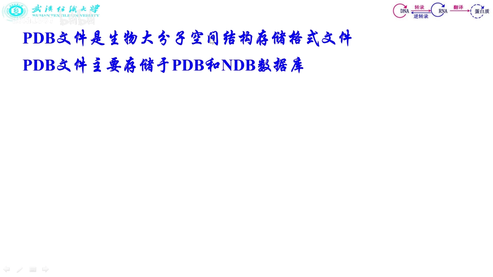

### 1.2 一分钟补齐 RNA 背景：从序列到 3D 结构

读懂坐标区之前，视频先补了最小必要的 RNA 知识：

- **核苷酸 = 磷酸 + 糖环 + 碱基**。不同核苷酸之间磷酸和糖环一模一样，唯一不同的是碱基，标准碱基分 G、A、U、C 四类（非标准碱基另说）。相邻核苷酸脱水缩合连成一条 RNA 链。
- **原子编号有规矩**：糖环原子记作 C1'、C2'、C3'、C4'、C5'（带撇号），靠 C5' 的一端叫 **5' 端**；碱基环上的原子另编一套（嘌呤从与糖环相连处开始 N1→N9，嘧啶 N1→C6）。所以"5 撇端"不写成 "5 端"，就是为了和碱基上的原子区分。

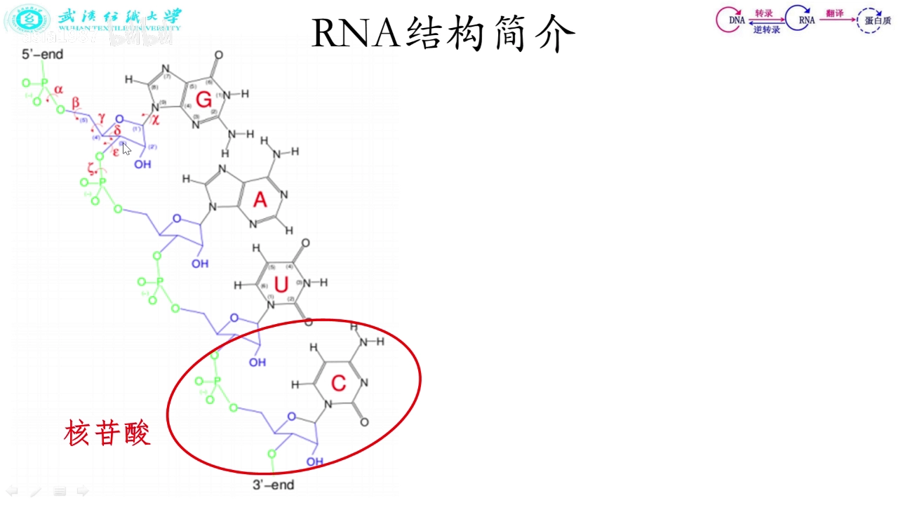

- **一级结构**：从 5' 端到 3' 端把碱基类型依次写下来，就是序列。
- **二级结构**：碱基在空间上靠近会形成氢键（单个氢键很弱，多了很强），G-C、A-U，还有 RNA 特有的 G-U 也能标准配对；把"谁和谁配对"画出来（平面表示）就是二级结构。
- **三级结构（3D）**：配对之后在空间里再折叠、加上三级相互作用，长成的实际立体形状。**PDB 存的就是这种三级结构。**

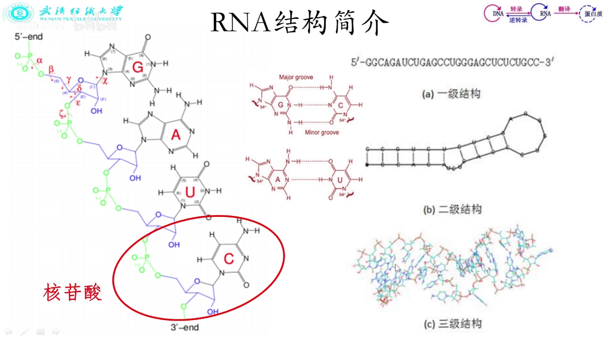

结构是实验测出来的，常用方法三种：**X 射线**（需先结晶）、**核磁共振 NMR**（溶液中直接测）、**冷冻电镜**（样品冻住再测）。

## 二、怎么找到并下载一个结构

### 2.1 知道 ID 就直接搜：以 1EHZ 为例

打开 PDB 主页，在搜索框输入想找的 PDB。视频用的例子是 **1EHZ**——这就是 **PDB code，也叫 PDB ID**，是结构在数据库里的代号。1EHZ 是一个以 GCAA 为发夹环（tetraloop）序列的特殊 RNA。

[【跳转到 08:50】](https://www.bilibili.com/video/BV1F541147X2/?t=530)

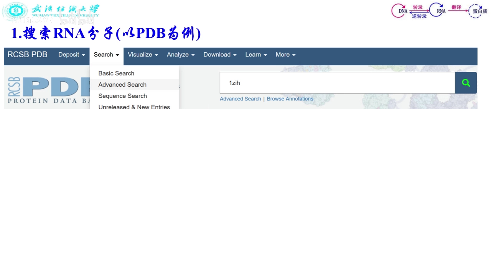

### 2.2 不知道 ID 就用高级搜索

不知道 ID 时，点 Search 里的 **Advanced Search**，每一行选一种信息类型、填一个参数，行数可以加号增加。视频演示的组合：

- **polymer entity type = RNA**：按大分子实体类型筛（keywords 可选可不选，每行都能改）；
- **片段数（链长）10~200 nt**："片段"对 RNA 来说是一个核苷酸、对蛋白质是一个氨基酸，可以填大于/小于/等于或范围；
- **实验方法 = 核磁共振**：NMR 在溶液中直接测结构；X 射线和冷冻电镜则要先结晶或把样品冻住；
- 还可以指定**序列**、按**结构相似性**找相似的 RNA。

[【跳转到 10:30】](https://www.bilibili.com/video/BV1F541147X2/?t=630)

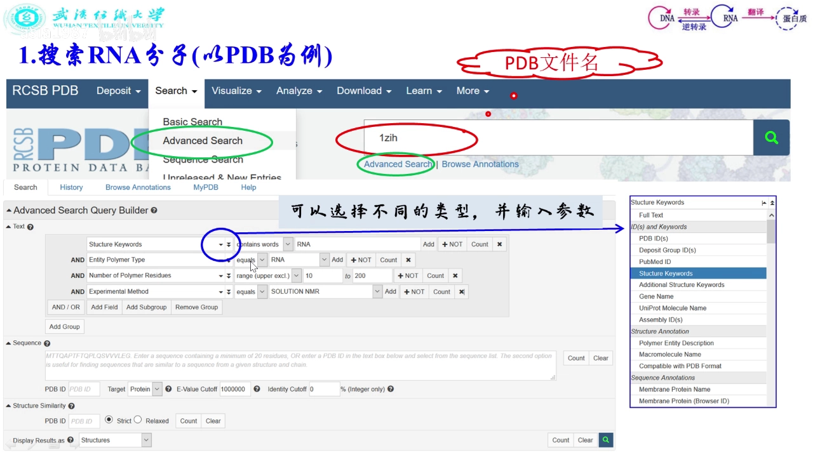

点搜索后得到 636 个结构，一页显示 25 条；结果可以再筛选，也能按 PDB ID、实测**分辨率**高低、发布早晚排序，还可以切换"详细信息/列表"等呈现方式。

### 2.3 下载：直接点 Download 拿到的是 CIF

- 结果页每个条目最大的字就是 **PDB ID**，旁边是标题（给结构起的名字，体现分子关键信息）、作者、实验方法、发布时间、简介和 3D 结构图。

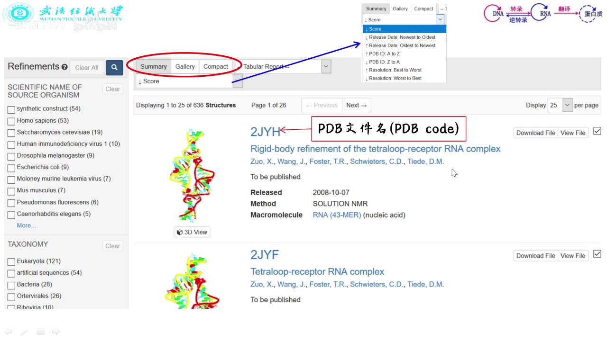

- **在线预览**：点 3D View 会打开嵌了 Jmol 类查看器的页面，可以用鼠标旋转、平移、滚轮缩放，还能选中片段、测原子间距离——类似 PyMOL / VMD 的网页简化版，也能得到不少有用信息。[【跳转到 15:32】](https://www.bilibili.com/video/BV1F541147X2/?t=932)

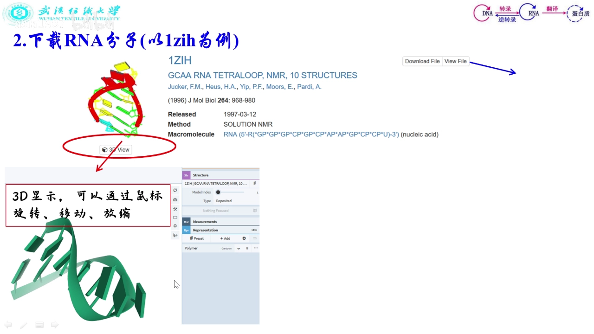

- **小坑**：直接点结果页的 Download 下载的是 **CIF 格式**。它和 PDB 没有本质差别（是一种趋势，以后可能以 CIF 为主），但一些早期软件不识别。想要 PDB 格式，就**点条目标题**进入 Structure Summary 页：这里有 Sequence、实验方法、注释等选项卡，第一个页面里有 **Download Files**（前面还有 Display Files 可以在线看序列、看 PDB 文件内容），FASTA Sequence 也可以顺手下载。[【跳转到 17:12】](https://www.bilibili.com/video/BV1F541147X2/?t=1032)

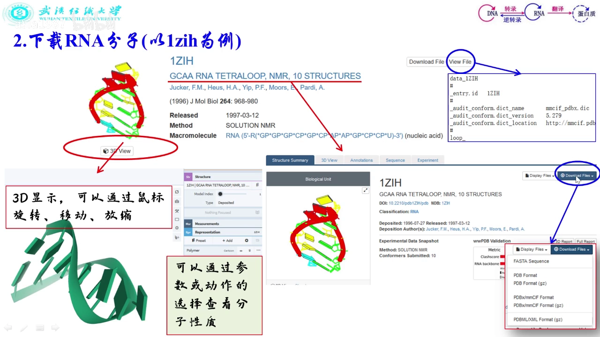

## 三、重头戏：坐标区逐列解读

下载好的 PDB 文件在 Windows 下要用文本方式打开（Linux 直接用编辑器），满屏英文看着头皮发麻。但对我们有用的主要就是**坐标（空间结构）**：只分析空间信息的话，保留坐标相关的行、其余删掉即可，或者写段代码只提取坐标。

### 3.1 先取 Model 1：NMR 结构的多个模型

如果结构是 NMR 测的，溶液中分子稍有运动就会多测出一个构象，文件里会存 10~20 个结构。用哪个不好说，**直接取 Model 1**：从 MODEL 开始，到第一个 ENDMDL 结束，中间就是我们要的原子坐标。[【跳转到 19:09】](https://www.bilibili.com/video/BV1F541147X2/?t=1149)

### 3.2 ATOM = 标准残基，HETATM = 非标准组分，TER = 链结束

- **ATOM**：标准残基的原子坐标——就是"化学组分"里那些标准核苷酸/氨基酸的原子；
- **HETATM**：非标准残基（配体、修饰组分等）用的另一种标记，1~6 列写的不是 ATOM。做一般分析时非标准残基能不要最好不要（它跟别的不一样），但**必须知道有这回事**；
- **TER**：代表一条链到此结束。[【跳转到 18:19】](https://www.bilibili.com/video/BV1F541147X2/?t=1099)

### 3.3 一行 ATOM 的每一列是什么

以 RNA 为例，一个核苷酸约有 30 个原子，ATOM 行的各列（列位为 PDB 格式规范）：

| 列位 | 内容 | 例子 |
| --- | --- | --- |
| 1–6 | 记录名：ATOM（标准）/ HETATM（非标准） | ATOM |
| 7–11 | 原子序号（从 5' 端起连续编号） | 1024 |
| 13–16 | 原子名 | C1'、N9、O5' |
| 18–20 | 残基名（这里是碱基类型） | G / A / U / C |
| 22 | 链标号（多链时 A、B、C、D…） | A |
| 23–26 | 核苷酸序号 | 1…12 |
| 31–54 | X、Y、Z 坐标 | 三位小数 |
| 55–60 | 占有率（occupancy） | 1.00 |
| 61–66 | 温度因子（B 因子） | — |
| 77–78 | 元素符号 | C / N / O / P |

[【跳转到 21:39】](https://www.bilibili.com/video/BV1F541147X2/?t=1299)

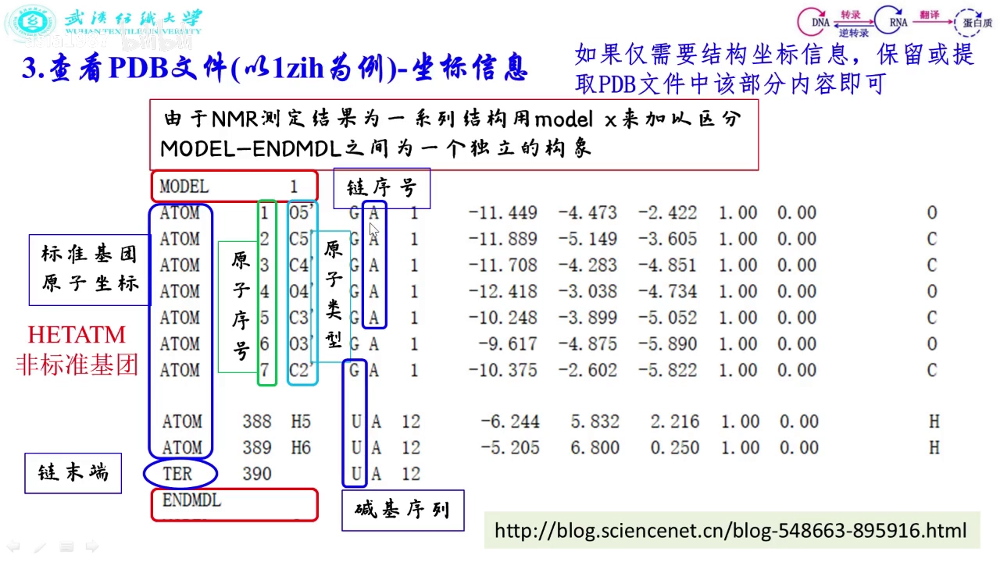

几个实际读法：

- **同一残基序号下的一串行 = 同一个核苷酸**：残基序号都是 1 的那些行属于第 1 号核苷酸，原子名 C1'、C2'、N1……各不相同，碱基都是 G 说明这个核苷酸的碱基是 G。
- **坐标是重头戏**：前面几列回答"这是谁的坐标"，31~54 列的 X/Y/Z 才是坐标本体。
- **占有率、B 因子**：与实验有关的参数，做一般空间分析用不上（占有率字段的含义见合集另一篇的解读：1.00 = 100%，表示该坐标处一定有原子）。
- **最后一列元素符号**：去掉编号后这个原子是什么元素（O5' 是氧、C5' 是碳），VMD/PyMOL 主要靠它给原子标不同颜色。[【跳转到 22:29】](https://www.bilibili.com/video/BV1F541147X2/?t=1349)

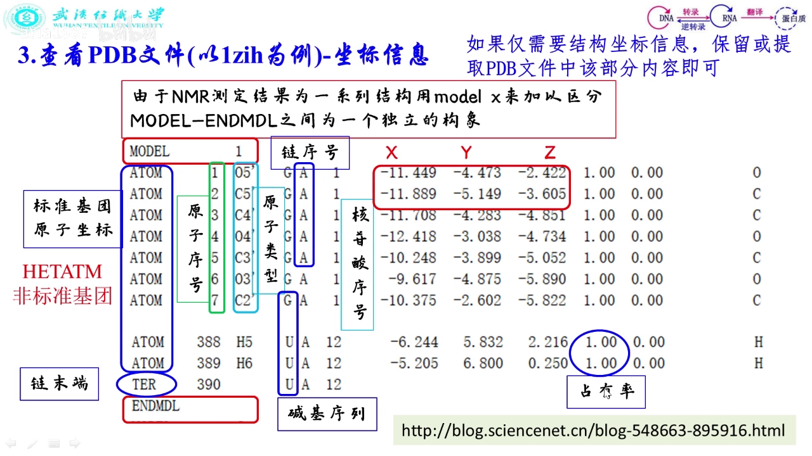

### 3.4 列位是强约定：写 PDB 必须按规范来

只是读入处理随便你，但要**输出** PDB 坐标给别的软件，就必须遵守列位规范：1~4 列的 ATOM 左对齐（顶格写）、7~11 列原子序号右对齐、13~16 列原子名左对齐、坐标从 31~38 列开始且右对齐、保留三位小数、单位是埃（Å，10^-10 米）——写错一格、多退一格空格，很多软件都识别不了。非标准组分的记录则把 1~6 列写成 HETATM。[【跳转到 25:37】](https://www.bilibili.com/video/BV1F541147X2/?t=1537)

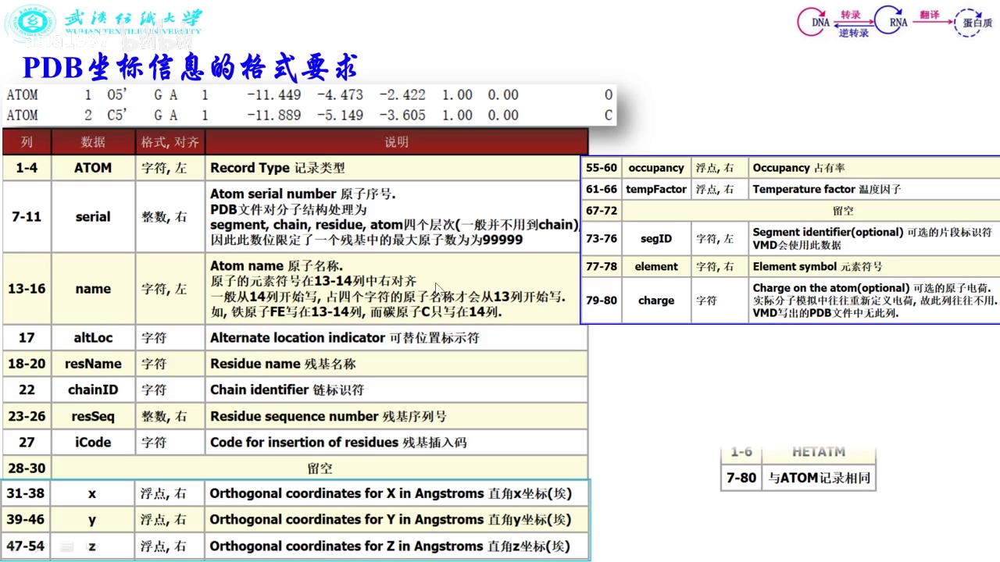

## 四、头部记录：结构的"身份证"

坐标区之前还有一大段头部说明，逐个看（以 1EHZ 为例）：[【跳转到 26:18】](https://www.bilibili.com/video/BV1F541147X2/?t=1578)

- **HEADER / TITLE**：分子类型（RNA）+ 发布日期 + PDB ID；标题 GCAA RNA tetraloop，点明这是以 GCAA 为发夹环序列的特殊 RNA。
- **组成与序列**：5'→3' 的序列、A 链、12 nt；COMPND/SOURCE 注明化合物来源（人工合成）；KEYWDS 关键词：核苷酸、RNA、tetraloop、GNRA 四连环、hairpin 发夹。
- **实验方法**：溶液核磁共振（NMR），共包含 **10 个 Model**——所以底下取坐标时要从里面选一个。
- **作者、版本与修订记录**：什么时候上传、什么时候修订过。
- **JRNL**：结构测出来要发文章，这里记录文章标题、期刊、发表日期、作者。

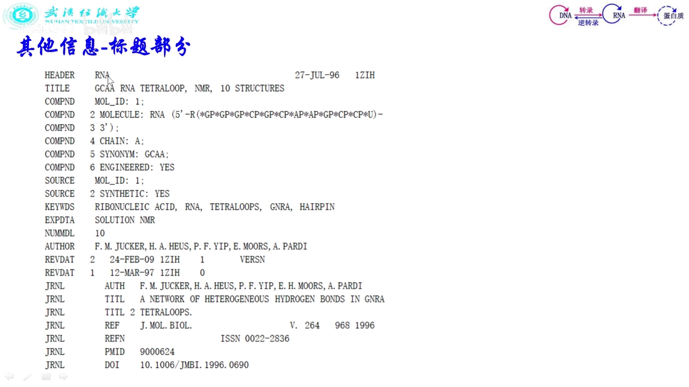

- **REMARK 3**：refinement（精修）——实验拿到的是数据，要变成空间结构还得优化，这里写优化方法；**REMARK 实验细节**：实验类型 NMR、温度 298 K、pH（离子强度、压强这次没写）。这些字段有则注明、没有则空着；想知道结构是在什么 pH 下测的，就看这一行。
- **Database Reference**：这是空间结构数据库，序列本身还登记在序列数据库、二级结构数据库里，这里做交叉引用。

## 五、非标准组分怎么命名：三字母码与 CCD（本条目主题）

### 5.1 换一个文件对比：437D 多出来的 HET 记录

1EHZ 里只有标准残基，所以没有非标准残基的记录。视频又找了一个 **437D**（PDB ID）的文件对比：它在坐标区之前多出了 1EHZ 没有的内容——**HET 相关记录**，对应一批非标准残基。[【跳转到 31:16】](https://www.bilibili.com/video/BV1F541147X2/?t=1876)

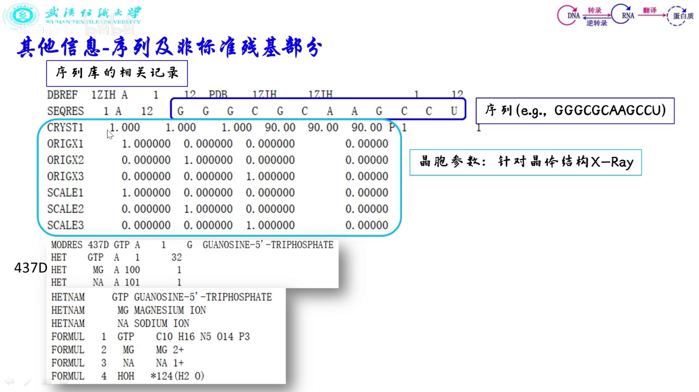

### 5.2 配体、离子、水，一个都不含糊

437D 测定的时候，结构里带有：

- **GDP**（配体小分子）、**镁原子、钠原子**（离子），还有**水**——测出来的结构里常含水。

它们都写在 HETATM 记录里，用**三字母码**当"残基名"，并且各有专门的记录交代身份：非标准残基的名字、非标准残基的**化学式**（怎么写、几个原子、什么元素），一眼可查。[【跳转到 31:41】](https://www.bilibili.com/video/BV1F541147X2/?t=1901)

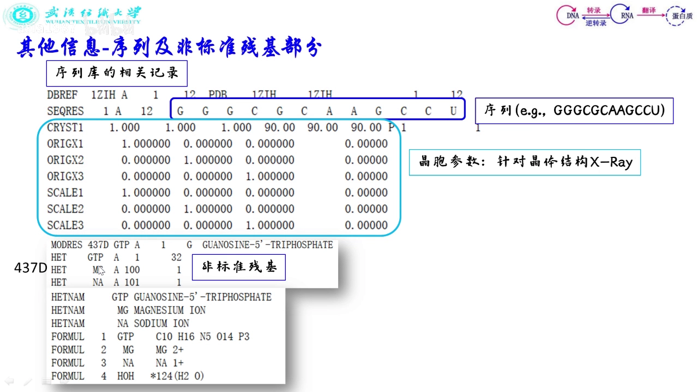

补充一点背景（视频按"化学组分"讲解，这里把名字补全）：这些三字母码不是作者随手起的，而是全部登记在 wwPDB 维护的**化学组分字典 CCD（Chemical Component Dictionary）**里。每个码唯一对应一个化学组分的构成与命名，GDP、MG、NA、HOH 如此，题目里提到的 **ATP、ZN** 等常用配体/离子码也一样——所以任何软件读到同一个码，识别出的都是同一个组分。

### 5.3 SITE 与 LINK：位点和残基间连接

非标准组分之外，437D 里还有两类记录：

- **SITE**：位点；
- **LINK**：哪个残基和哪个残基之间有键连接（例子里就有氢键这类）。[【跳转到 32:06】](https://www.bilibili.com/video/BV1F541147X2/?t=1926)

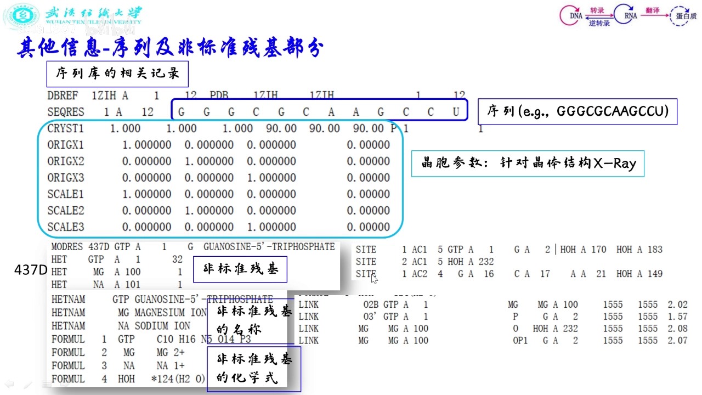

## 六、顺着 JRNL 找原文：从结构到论文

光看 PDB 对一个分子的认识还不完整——这个结构有什么功能、测定者做了哪些分析，要去看原始文献：

- 入口就是头部记录里的 **JRNL**（文章标题、期刊、日期、作者）；在 PDB 网站搜索 1EHZ 的主页上同样能看到文献信息，按名字或期刊把文献下载下来即可。
- 1EHZ 这篇研究的是一个**氢键网络**：在 GNRA tetraloop 里氢键网络长什么样。分子本身只是载体，作者关心的是这类 GCAA 发夹环里的氢键。
- 文献一般会交代：分子从哪来（来源）、功能与重要性、二级结构、空间结构怎么测/怎么合成/用什么实验方法，甚至热力学、动力学的初步探讨。[【跳转到 35:45】](https://www.bilibili.com/video/BV1F541147X2/?t=2145)
- 因为是 NMR 测的，文献里的结构图是 **10 个 Model 的叠加**——十个结构都很像，取哪个差别不大；标题则点出 G5 与 A8 之间错综复杂的氢键。

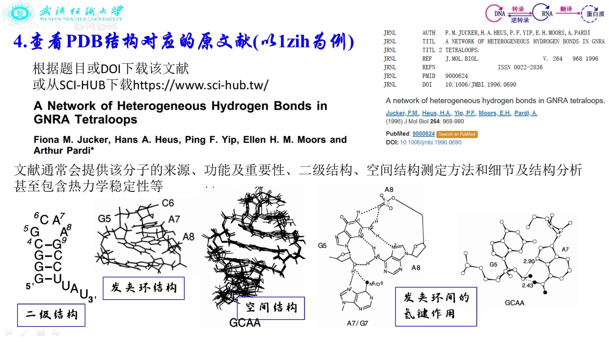

参考资料：英文官方文档 *Introduction to PDB Format* 非常详细（全英文）；有老师结合英文原文写了中文解释版博客，另有科普博主的更易读版本，都可以参考。[【跳转到 36:17】](https://www.bilibili.com/video/BV1F541147X2/?t=2177)

## 小结

- PDB 文件 = **头部说明 + 逐原子坐标**，存的是生物大分子的三级结构，单位埃（Å）。
- 不知道结构 ID 就用**高级搜索**：按实体类型（polymer entity type）、链长、实验方法、序列、结构相似性组合筛选。
- 直接点 Download 下载的是 **CIF**；要 PDB 格式去 Structure Summary 页的 **Download Files**。
- NMR 结构有 10~20 个 Model，一般**只取 Model 1**（MODEL 到第一个 ENDMDL）。
- **ATOM = 标准残基**（"化学组分"里的标准核苷酸/氨基酸），**HETATM = 非标准组分**（配体/修饰/离子/水），**TER = 链结束**；列位与对齐是强约定。
- 配体、离子、水都用**三字母码**命名：GDP、MG、NA、HOH、ATP、ZN……统一登记在**化学组分字典 CCD** 里；HETNAM/FORMUL 给名字和化学式，**SITE/LINK** 给位点和连接。
- 想深挖结构与功能，顺着 **JRNL** 找原始文献。

## 关键术语速查

| 术语 | 一句话解释 |
| --- | --- |
| PDB ID / PDB code | 结构在数据库里的四位代号，如 1EHZ、437D |
| ATOM | 标准残基的原子坐标记录 |
| HETATM | 非标准组分（配体、修饰残基、离子、水）的原子记录 |
| CCD | 化学组分字典：所有三字母组分码的官方登记处（ATP、ZN、HOH…） |
| MODEL / ENDMDL | NMR 多模型的起止标记，一般只取 Model 1 |
| TER | 一条链结束的标记 |
| 占有率 occupancy | 实验参数，1.00 = 100%（该坐标处必有原子，见合集另一篇） |
| B 因子 | 温度因子，与实验相关的原子波动参数 |
| Å（埃） | 坐标单位，10^-10 米 |
| REMARK 3 | 精修（refinement）方法的说明记录 |
| JRNL | 结构对应原始文献的引用记录 |
