# 精选！轻松小白到大神PDB数据库的介绍和使用含实操！

> 来源视频：[【精选！轻松小白到大神PDB数据库的介绍和使用含实操！】（B 站，约 20 分钟）](https://www.bilibili.com/video/BV1nC411p7iR/?t=0)。本文基于视频逐窗口文稿整理，配图取自视频画面，时间戳可跳转到对应讲解。这是一节计算机辅助药物设计课程里"PDB 数据库使用"的实操回放。

## 本讲要解决的核心问题（SCQA）

**背景**：做计算机辅助药物设计或结构分析，第一步就是给靶蛋白找一个可靠的三维结构，PDB 数据库是最主要的结构来源。

**冲突**：同一个蛋白在 PDB 里往往有几十上百个结构；条目页字段一大堆，结构里除了蛋白本身还带着各种小分子，新手不知道从哪下手。

**疑问**：怎么用手头已知的信息把目标结构检索出来？条目页上每个字段是什么意思？配体和溶剂分子怎么区分？

**回答（中心思想）**：按"你已知什么"选检索路径——知道靶点名称就走 **UniProt → PDB**，知道小分子名称就直接在 PDB 搜配体；再读懂条目页字段（PDB ID、文献、物种、分辨率、突变…），并用"点进配体页看出现条目数 + 看结构复杂度"分辨配体与溶剂分子。

## 一、开场答疑：占据因子与结构修补

视频开头是课程答疑，有两个与 PDB 文件直接相关的点：

- **占据因子（occupancy，占有率）= 1.00 代表 100%**：解析结构时，某个坐标位置上如果占有率是 1，说明这个位置**一定有原子存在**。讲者做 X 射线衍射比较多，其他实验方法不一定有这个字段。[【跳转到 00:29】](https://www.bilibili.com/video/BV1nC411p7iR/?t=29)

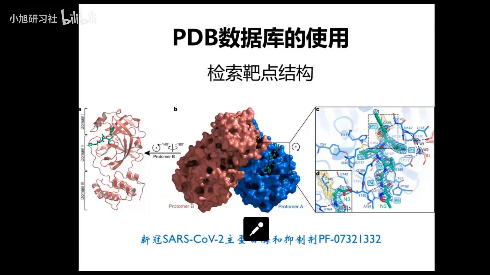

- **修补工具（remodel）**：可以简单修补三五个缺失残基；但缺失残基过多就不准确了，计算量也会上升。像 Rosetta 这种综合蛋白设计软件可以干这活，但它是命令行工具、在 Linux 上编译比一般程序还麻烦，建议先熟悉 Linux 再安装学习。

## 二、路径一：按靶点名称检索（UniProt → PDB）

这节课的实操目标：检索**新冠病毒主蛋白酶（新冠主蛋白酶）与它的抑制剂 PF-07321332** 的复合物结构。[【跳转到 04:35】](https://www.bilibili.com/video/BV1nC411p7iR/?t=275)

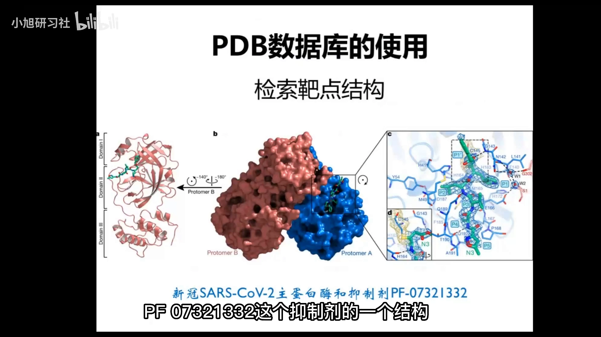

检索思路：**根据已知信息检索**。在不知道靶点其他信息、只知道靶点名称的情况下，用靶点名称去检索：

1. 先上 **UniProt** 网站——它收录了**所有蛋白**（结晶了的和没结晶的）的序列信息和其他相关信息。做研究的人肯定知道自己做的是哪个靶点/蛋白（比如新冠主蛋白酶），名称不一定要官方精确名，**模糊词也能搜**。
2. UniProt 有新旧两个网址，界面一样、可以互通，都能搜；注意要在浏览器里打开（微信内置浏览器有些功能用不了）。
3. 搜索结果一般第一个就是；如果是模糊搜索，就看看底下的描述和你的研究是否一致。[【跳转到 06:04】](https://www.bilibili.com/video/BV1nC411p7iR/?t=364)

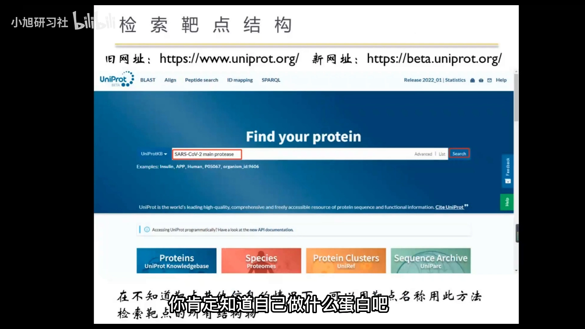

4. 在 UniProt 条目页找到 **Structure** 标签页：如果该蛋白有结晶结构，会全部列在这里（有哪些 PDB 等），上方还能在线可视化展示（可能有点卡）。[【跳转到 10:47】](https://www.bilibili.com/video/BV1nC411p7iR/?t=647)

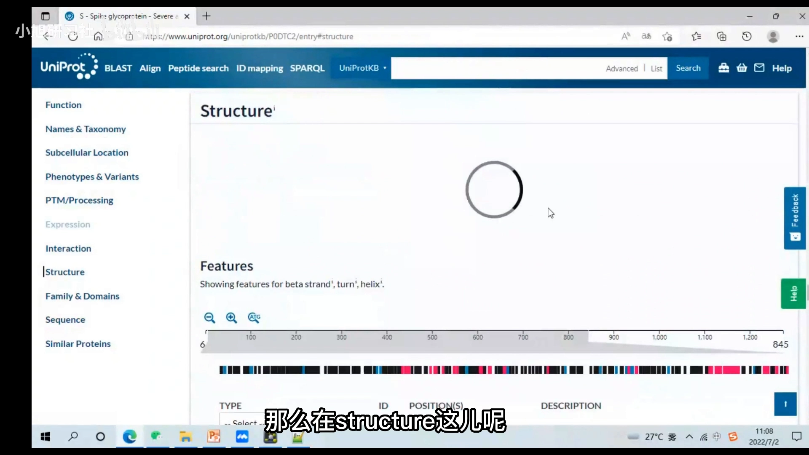

前提是：搜索之前你先要对研究对象有一定了解——精确词也好、模糊词也好，都得先了解才能检索。

## 三、路径二：按小分子/配体名称检索

第二条路走**小分子信息**：直接在 PDB 里把抑制剂名称 **PF-07321332** 输进去，包含这个小分子的结构就都出来了。[【跳转到 11:34】](https://www.bilibili.com/video/BV1nC411p7iR/?t=694)

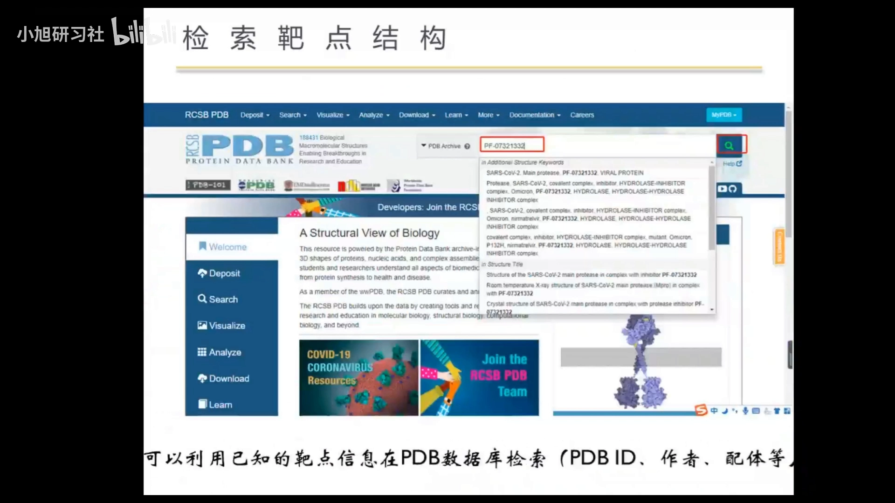

注意：这只是举例，**不是说一个小分子只能和一个靶蛋白结合**——一个小分子可以和多个靶蛋白有结构复合物。

## 四、读懂条目页：每个字段是什么

搜到结构后，视频用一张截图把条目页上每个条目的含义过了一遍。[【跳转到 12:08】](https://www.bilibili.com/video/BV1nC411p7iR/?t=728)

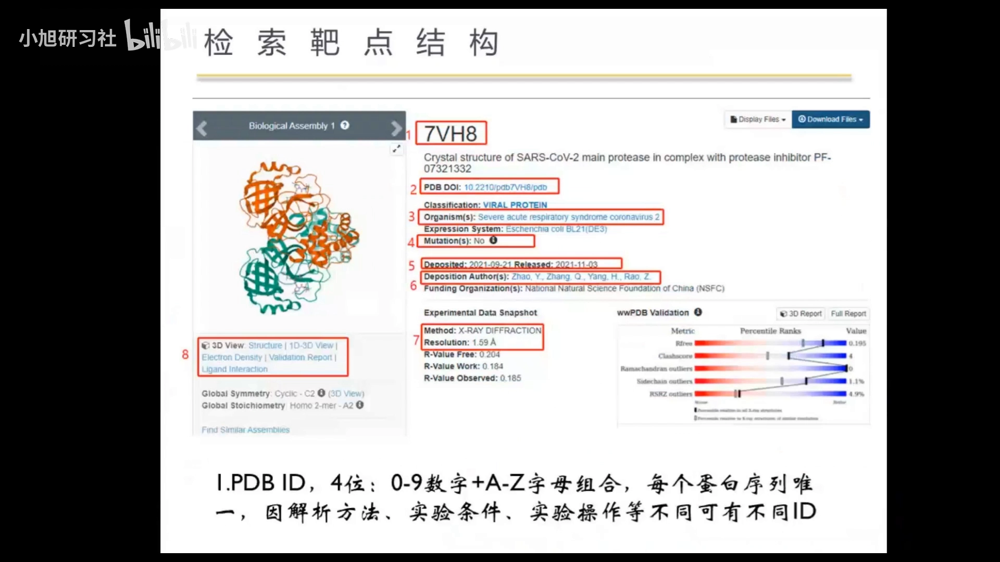

### 4.1 PDB ID 与 TITLE

- **PDB ID**：大写字母 + 数字的 **4 位编号**（0~9 与 A~Z 组合），用小写字母检索也行，**不区分大小写**。
- **TITLE**：就是 PDB 文件里看到的那个标题，告诉你这个酶叫什么——比如"新冠主蛋白酶与酶的抑制剂 PF-07321332 的结晶结构"，正是这次实操要找的符合要求的结构。[【跳转到 12:58】](https://www.bilibili.com/video/BV1nC411p7iR/?t=778)

### 4.2 一个 ID 只对应一条序列，一条序列可以有多个 ID

这是本节最容易混淆的点：

- **每个 PDB ID 唯一对应一条蛋白序列**；
- 但**每条序列可以有不同的 ID**——解析方法、实验条件、实验操作不同，复合物不同（配体小分子不同）、分辨率不同、连接的辅酶不同，或者状态/构象不同（开放、闭合，还是 **apo** 载脂蛋白形式），都会产生新的 ID。

### 4.3 文献 ID：结构跟着文章发

一般结构都是跟着文献发的：文章里不光发结构，还解释了测定条件（蛋白表达、纯化等）、可能的活性信息，以及作者想通过这个结构阐述的问题（分子机理、发挥药效等）。只发 PDB 结构不发文章的情况很少。

### 4.4 物种来源、表达系统与突变

- **物种来源**：条目页会告诉你，点进去还能看这个物种来源下还有什么蛋白；
- **表达系统**：比如 E. coli（大肠杆菌）——很多蛋白都是在大肠杆菌这个宿主里表达的；
- **突变字段**：没有突变就是 No，有就是 Yes。不同 PDB 之间突变的残基可能不同，通常是靠设计（engineering）改良、增加活性或稳定性。[【跳转到 15:03】](https://www.bilibili.com/video/BV1nC411p7iR/?t=903)

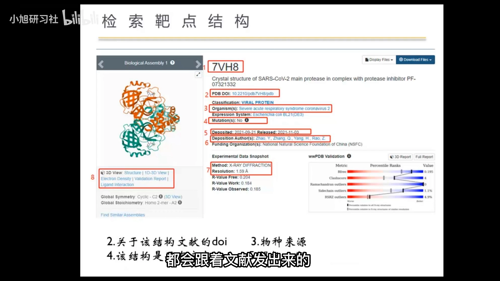

### 4.5 解析日期与实验数据：重点看分辨率

- 第五个字段是**解析日期**，以及解析作者、基金资助机构；
- **实验数据**里最重要的是**分辨率（resolution）**：例子中 1.59 Å，质量挺高——一般选 **2.5 Å 以下**的，越小解析的结构越准确；
- R-free 这些 R 值都是表征结构准确度的实验值；想看蛋白测定条件的细节，尽量不要只看 PDB 网站，**回文献里看更准确全面**。[【跳转到 16:18】](https://www.bilibili.com/video/BV1nC411p7iR/?t=978)

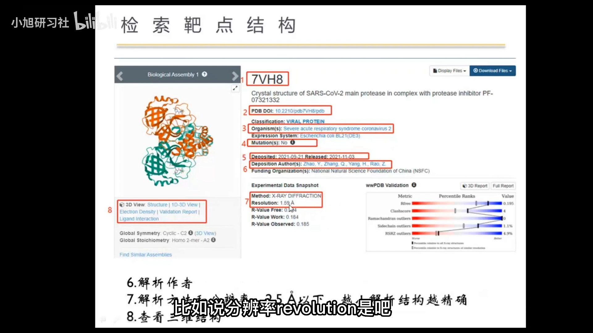

- **三维查看**：在线看会有点慢、有点卡（数据在线加载）；一般做法是点 Download 下载到本地，用 **PyMOL** 或其他分子可视化软件在自己电脑上看。[【跳转到 16:43】](https://www.bilibili.com/video/BV1nC411p7iR/?t=1003)

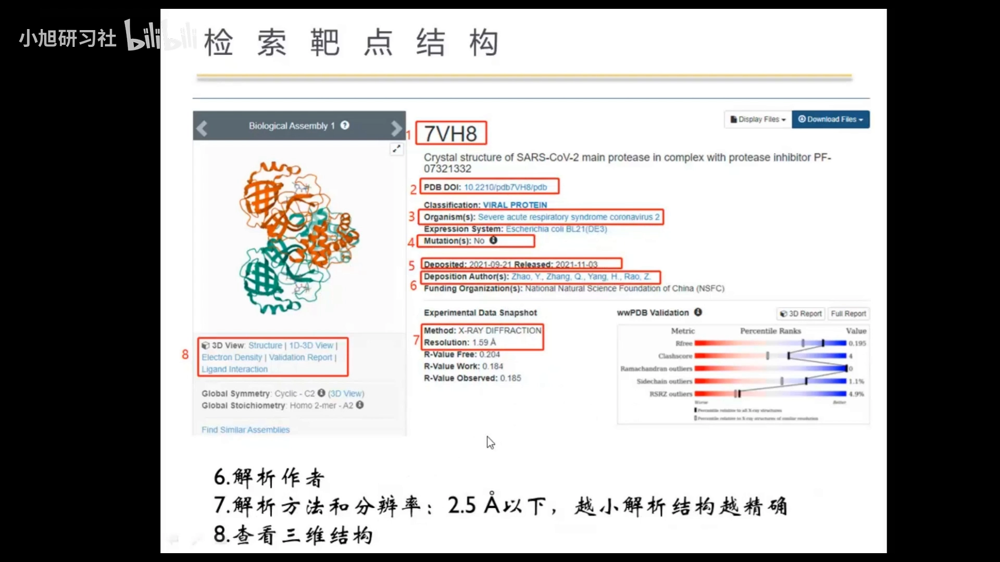

## 五、序列、链与靶点信息

在条目页点开序列下方的信息，会出现**靶点信息**：共价键、活性位点、相关文献 ID、大分子细节（物种种属、序列长度）等。[【跳转到 18:00】](https://www.bilibili.com/video/BV1nC411p7iR/?t=1080)

- **链的命名**：这个结构只有一条链，也命名为 **A 链**——就算只有一条链也不会省略命名；两条链就是 A/B 或 A/B/C，以此类推。
- **序列唯一性**：每个蛋白的氨基酸序列唯一、序列号为 1；但因为科学家和实验条件不同，同一个蛋白会被解析出很多个不同的 PDB 结构。
- 这里还能跳回第一种方法里的 **UniProt**——两个网站是互通的。

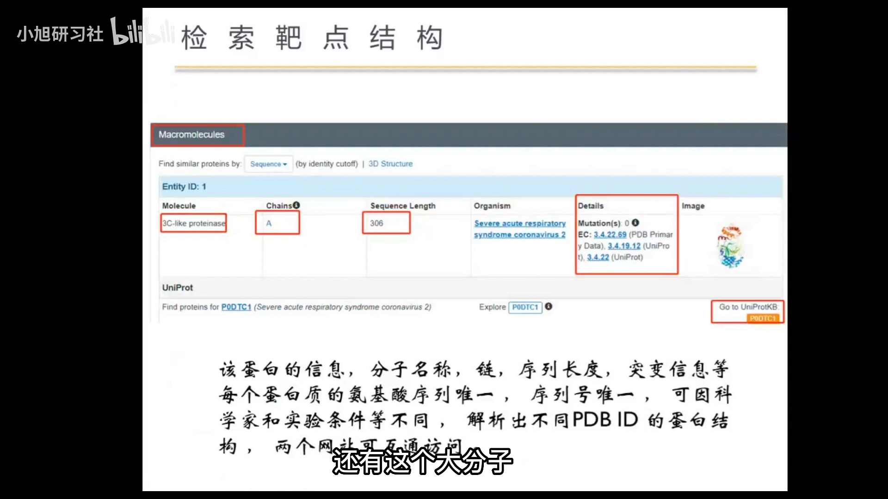

## 六、配体之外：溶剂分子怎么认

看结构里的配体信息时会发现：除了（主）配体，还有其他小分子，比如 DMSO 之类——这些是**帮助结晶的小分子、溶剂分子**。[【跳转到 18:42】](https://www.bilibili.com/video/BV1nC411p7iR/?t=1122)

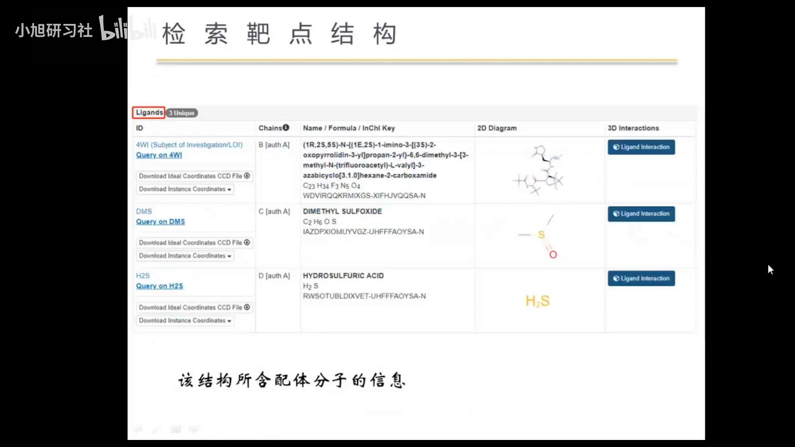

怎么判断一个小分子是不是溶剂分子？视频给了两个办法：

1. **点进配体页面看出现条目数**（新手友好）：直接点进去，页面会显示有多少个 PDB 条目含有这个分子的结构——例中点进去的这个分子只有 8 个入口，而有的分子有 3210 个。出现得毫无特异性的，多半就是溶剂分子（比如 DMS）。[【跳转到 19:07】](https://www.bilibili.com/video/BV1nC411p7iR/?t=1147)

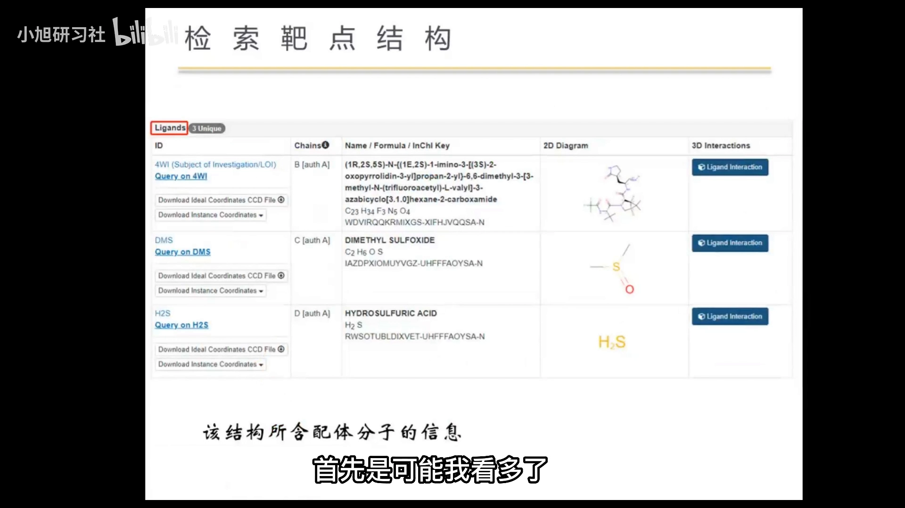

2. **看分子结构的复杂度**：讲者看得多了凭经验一眼能认；一般也可以用复杂度辅助判断——溶剂分子通常结构简单，比较复杂的一般就不是溶剂了。

补充一点背景（与合集上一篇衔接）：这些小分子的三字母码——水 **HOH**、DMSO **DMS**、以及 **ATP、ZN** 这类配体/离子码——都统一登记在 wwPDB 的化学组分字典 **CCD** 里，所以跨文件、跨软件都能被一致地识别；详见[上一篇：生物大分子PDB格式文件解读](生物大分子PDB格式文件解读.md)。

## 小结

- 检索路径按已知信息选：知道**靶点名称**走 UniProt → Structure 标签页；知道**小分子名称**直接在 PDB 搜配体。
- 一个小分子可以结合多个靶蛋白，搜出来一堆结果是正常的。
- **PDB ID** 是 4 位编号、不区分大小写；每个 ID 唯一对应一条序列，同一条序列因方法/条件/配体/构象不同会有多个 ID。
- 条目页字段：TITLE、文献 ID、物种来源、表达系统、突变（No/Yes）、解析日期、基金、分辨率。
- 挑结构优先看**分辨率**：一般选 2.5 Å 以下，越小越准；测定细节回文献里看。
- 在线看 3D 容易卡，下载后用 PyMOL 本地看。
- 配体之外的小分子多为溶剂：点进配体页看**出现条目数**、看**结构复杂度**来判断。

## 关键术语速查

| 术语 | 一句话解释 |
| --- | --- |
| 占据因子 occupancy | 实验参数，1.00 = 100%，该坐标处一定有原子 |
| PDB ID | 4 位编号（数字+字母），结构在数据库里的代号 |
| apo | 无配体结合的载脂蛋白形式 |
| resolution 分辨率 | 结构精度指标，越小越准，一般选 2.5 Å 以下 |
| 配体 ligand | 与靶蛋白结合的小分子，如抑制剂 PF-07321332 |
| 溶剂分子 | 结晶过程带入的小分子（HOH、DMS 等） |
| UniProt | 蛋白序列与功能信息数据库，检索靶点的入口 |
| 同源建模 | 找不到晶体结构时的替代建模方法 |
| Rosetta | 综合蛋白设计软件，可做 remodel/修补，命令行、Linux 编译 |
