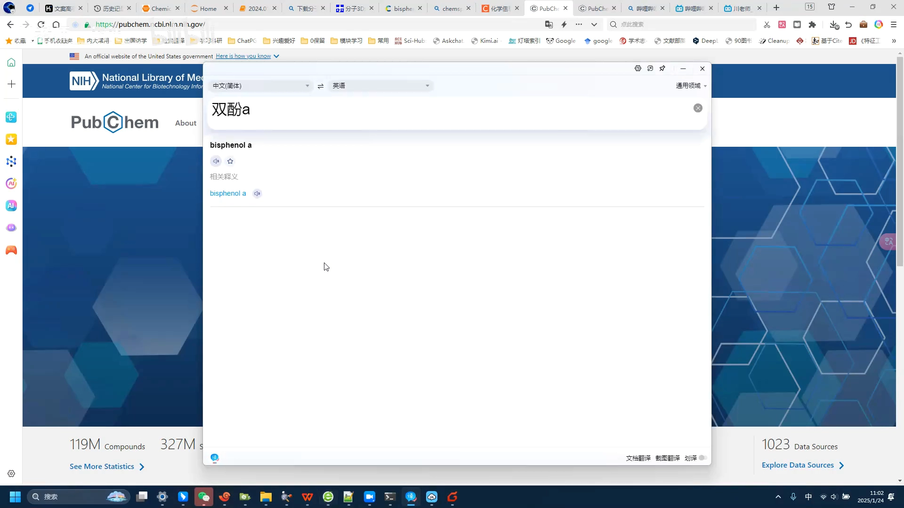
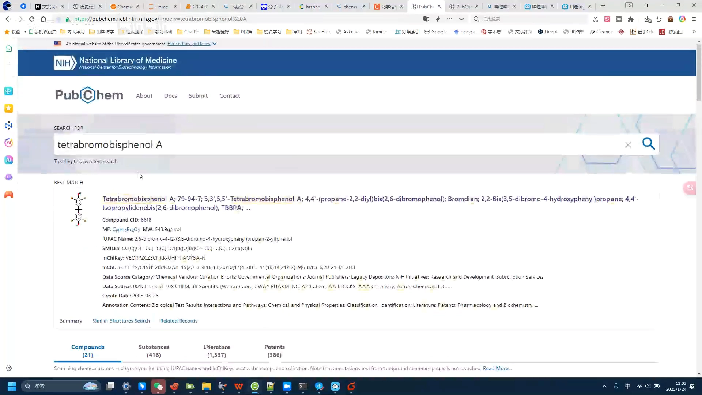
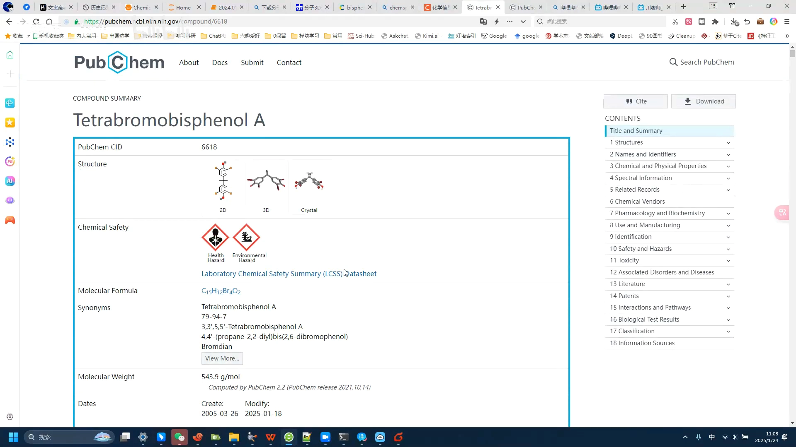
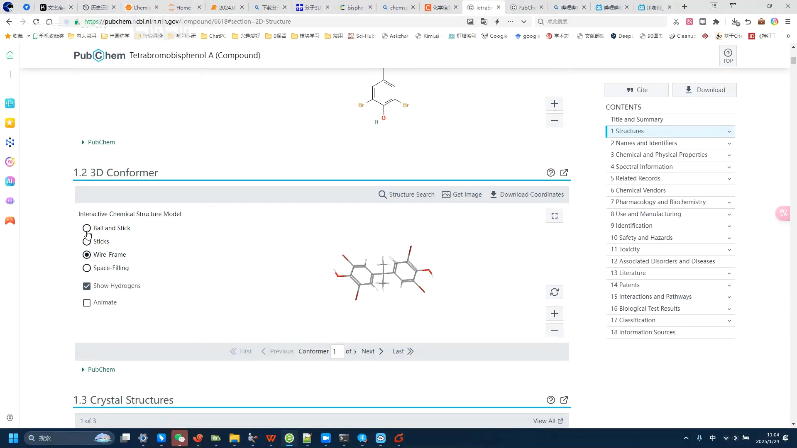
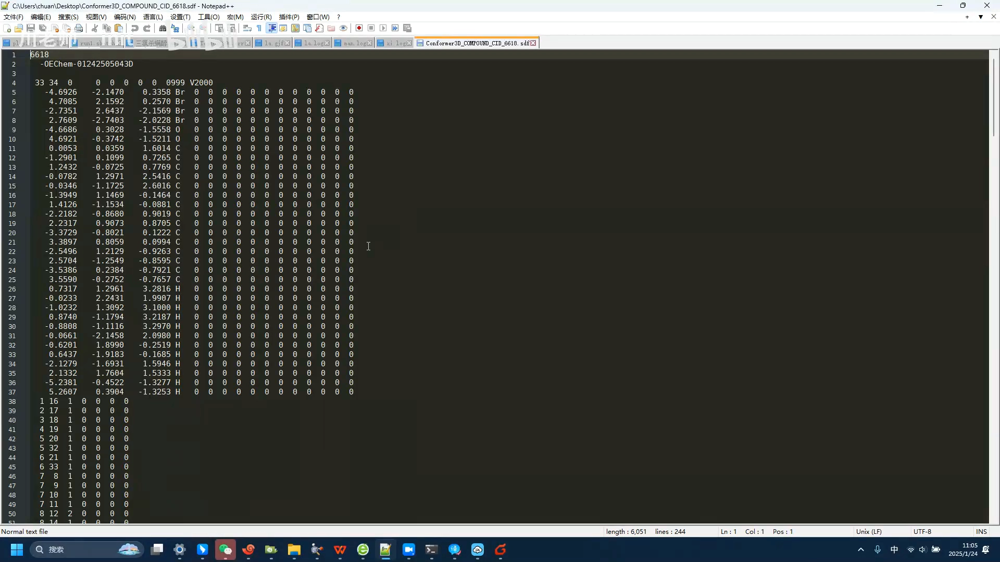
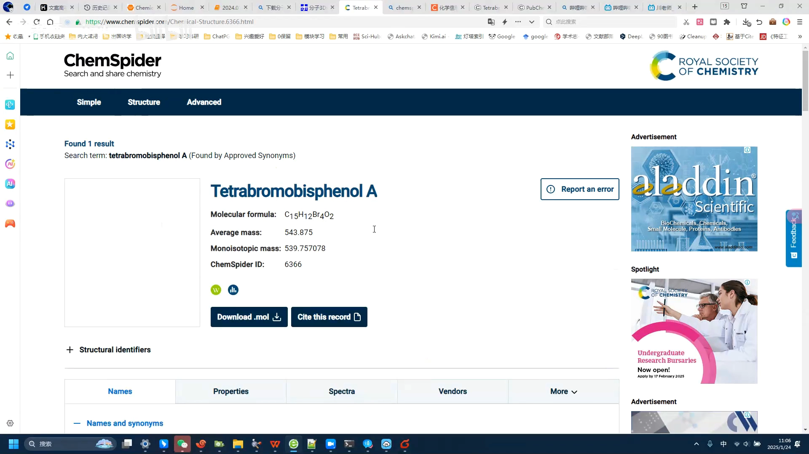
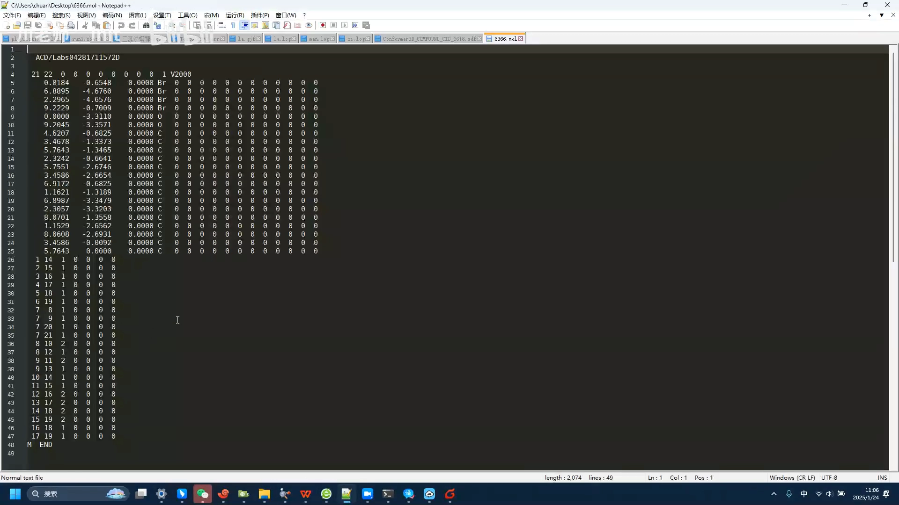
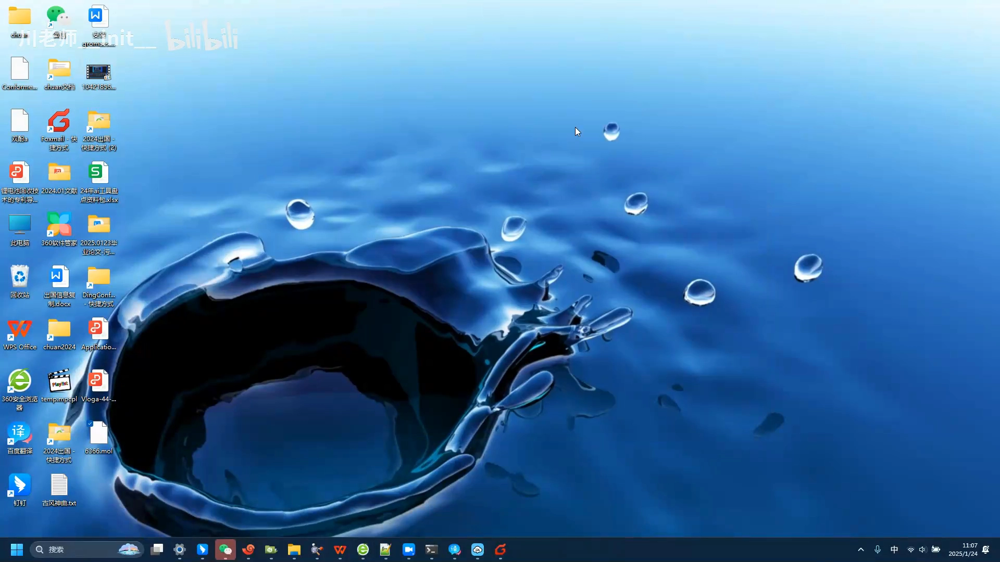

# PubChem 和 ChemSpider：免费下载小分子三维结构的两个权威网站

> 本篇整理自 B 站视频 [Pubchem和chemspider下载分子结构](https://www.bilibili.com/video/BV1Z6fnYGEWe/)（约 6.5 分钟）。

## 本讲要解决的核心问题（SCQA）

**背景**：做分子对接、结构预测这类计算，第一步是把小分子的三维结构文件拿到手——软件只有读到「每个原子在空间中的坐标」，才能开始后续计算。

**冲突**：网上能下载结构的网站不少，但质量参差不齐。UP 主前几天推荐的 ChemicalBook 就「翻车」了：它能下载结构、导出 mol 文件，但下下来的结构常有一些**低级错误**——有些原子的位置直接挤成一团，这种文件拿来计算会出大问题。

**疑问**：去哪里能**免费、可靠**地拿到小分子的三维结构文件？下载下来的文件里到底装的是什么？

**回答（中心思想）**：用 **PubChem** 和 **ChemSpider** 两个权威数据库：按名称搜索 → 下载「坐标」即可。PubChem 给的是 **SDF 文件**，ChemSpider 给的是 **mol 文件**；两者核心内容（每个原子的坐标）本质相同，还能互相转化——**格式只是外在的包装，内在信息没有本质差别**。

---

## 一、先挑网站：避开结构有低级错误的站点

UP 主先「排雷」：ChemicalBook 虽然也能下载分子结构、导出 mol 文件，但下出来的结构**有些存在很多低级错误，有些原子都挤到一块堆去了**，问题很大，所以不太推荐。

今天推荐的替代方案是两个比较权威的网站，第一个就是 **PubChem**：

[【跳转到 00:30】](https://www.bilibili.com/video/BV1Z6fnYGEWe/?t=30)

## 二、在 PubChem 下载 3D 结构（SDF 文件）

### 2.1 按名称搜索，认准 Best match

进入网站后，**直接输入物质名称**就可以了。这个例子要找的物质名字里带「双酚A」——我们把完整的物质名称（**四溴双酚A**）填进搜索框：

一开始没搜出来；再搜，下面一下出来很多结果。**有些结构相近的物质也会一起被搜出来**，但看第一个就好——第一个标着 **Best match**，就是最匹配的结果：

[【跳转到 01:51】](https://www.bilibili.com/video/BV1Z6fnYGEWe/?t=111)

### 2.2 从「坐标」入口下载：四种格式里选 SDF

找到物质后，点进它的页面。这里头还能看到它的一些**性质**，这个数据库还是很全面的。再往下是它的 **2D 结构**——这个我们一般用得比较少，**常用的是 3D 结构**，页面上也可以调整结构的显示效果：

我们真正需要的是**下载它的坐标**——也就是由每个原子坐标组成的结构。点一下下载入口，这里能下载**四种格式**；一般来说，**SDF 格式用得比较多**，所以我们就下载这个，保存到桌面：

[【跳转到 02:39】](https://www.bilibili.com/video/BV1Z6fnYGEWe/?t=159)

## 三、打开 SDF 看里面：核心就是一片原子坐标

下载下来之后，我们可以用一个**记事本**（任意文本编辑器）把它打开。打开之后你会发现：它最主要的部分就是**这一块数字**——这一片表示**每个原子的坐标**。

以这个分子为例：前面是四个溴——对，它是**四溴双酚A**，有四个溴原子；此外还有氧、碳、氢。**只要有这些信息，基本上问题就不大**：

[【跳转到 03:37】](https://www.bilibili.com/video/BV1Z6fnYGEWe/?t=217)

> 换句话说，SDF 文件的「灵魂」就是原子坐标表：软件读入这些数字，就能把分子在三维空间里重建出来。

## 四、ChemSpider：页面更简洁，直接下载 mol 文件

再推荐另一个网站：**ChemSpider**（中文有人叫它「化学蜘蛛」），它也非常好用。用法也一样：在搜索框里搜四溴双酚A——这里输入**英文名**，中文名估计搜不到。回车，一下就搜到了。

搜到之后，这个页面**更简洁**：直接就能下载 **mol 文件**，点这里就下载好了。两个网站都是免费下载的，但它们下载的**格式不一样**：

[【跳转到 04:40】](https://www.bilibili.com/video/BV1Z6fnYGEWe/?t=280)

## 五、SDF 和 mol 文件：格式不同，内在一样

**PubChem 下载的是 SDF 文件，ChemSpider 下载的是 mol 文件。** 格式不一样，但区别不大，因为里面记录的信息是差不多的。把刚下载的 mol 文件也用记事本打开，你会发现内容也差不多——**中间同样是那一片原子坐标**：

这两种文件是**可以互相转化**的。所以，**格式只是它的外在，内在没什么本质差别**。

### 5.1 两个网站怎么选

好了，这就是两个都能用的网站。具体用哪个，看两点：

1. **能不能搜出来**：你要的物质的名称在一个网站上搜不到，就换另一个；
2. **想要什么格式**：因为大部分物质在两个网站上都有，这时候就看你想要哪种文件——**想要 mol 文件，就从 ChemSpider 下载；想要 SDF 文件，就从 PubChem 下载**：

[【跳转到 06:04】](https://www.bilibili.com/video/BV1Z6fnYGEWe/?t=364)

## 小结

- 下载小分子 3D 结构，优先选权威数据库；ChemicalBook 这类站点下出的结构可能有**原子挤成一团**的低级错误。
- **PubChem**：按名称搜索 → 认准 **Best match** → 物质页面下载「坐标」，四种格式里 **SDF 最常用**。
- SDF 文件用记事本就能打开：核心内容是**每个原子的三维坐标**，比如四溴双酚A 就是四个溴 + 碳氢氧的坐标表。
- **ChemSpider**：页面更简洁，直接下载 **mol 文件**；搜不到中文名时用英文名。
- SDF 与 mol 文件**内在信息相同、可互相转化**；选择哪个网站就看「搜不搜得到」与「要哪种格式」。

## 关键术语速查

| 术语 | 一句话解释 |
| --- | --- |
| SDF 文件 | Structure Data File，文本格式的小分子结构文件，核心是原子坐标表，PubChem 默认提供 |
| mol 文件 | 另一种常见的小分子结构文本格式，ChemSpider 直接提供下载 |
| 原子坐标 | 每个原子在三维空间中的 (x, y, z) 位置，软件靠它重建分子 |
| 2D / 3D 结构 | 平面结构图 vs 带空间坐标的立体结构；计算一般用 3D |
| Best match | PubChem 搜索结果中最匹配的一项 |
| PubChem | 权威的免费化合物数据库，示例中下载 SDF 的网站 |
| ChemSpider | 另一个权威免费化合物数据库，别称「化学蜘蛛」，示例中下载 mol 文件的网站 |
| 四溴双酚A | 视频示例分子：双酚A 骨架上带四个溴原子，含 C、H、O、Br |
