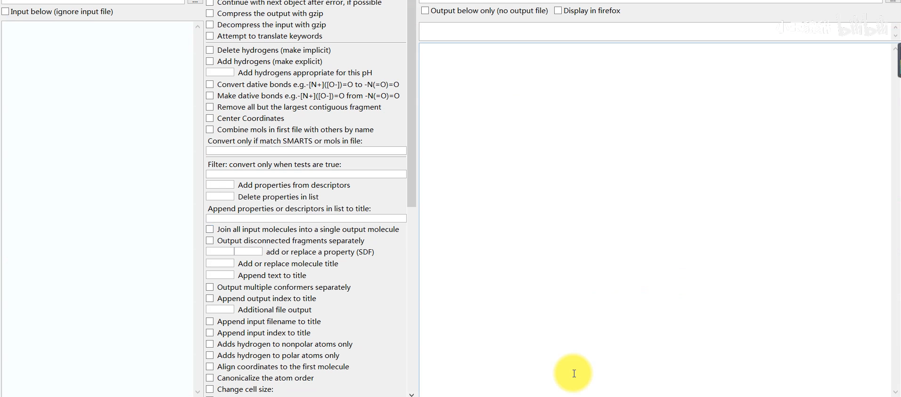
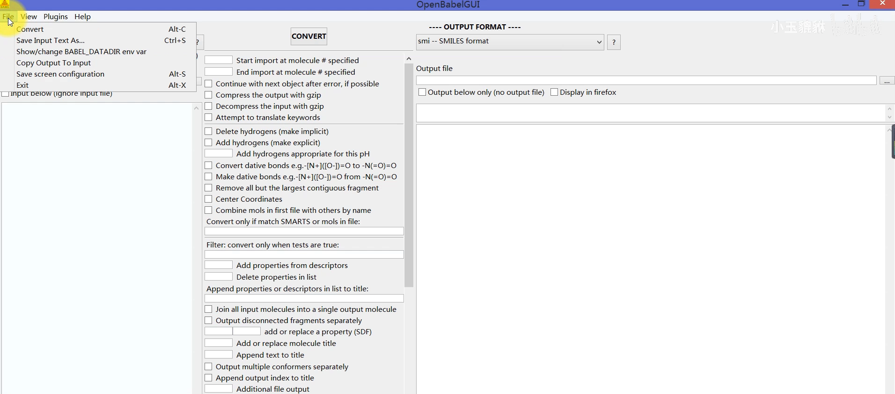
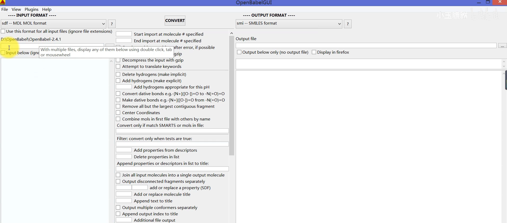
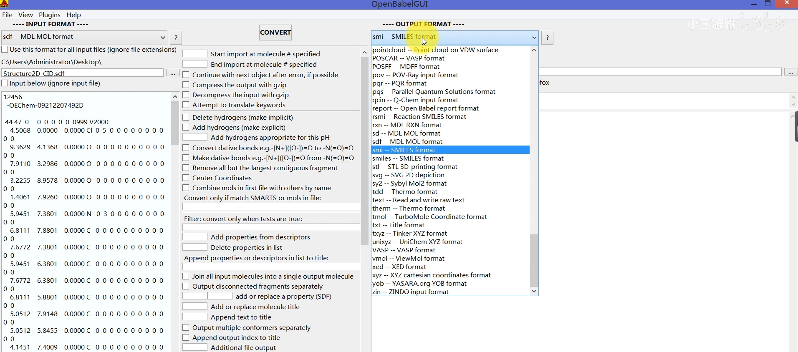
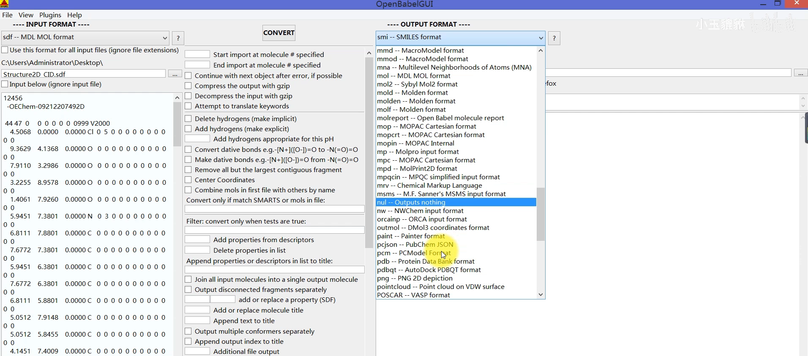
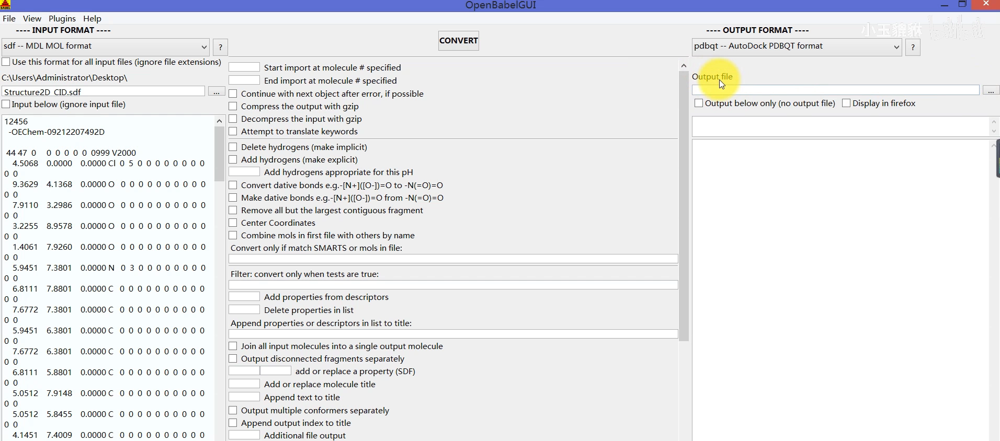
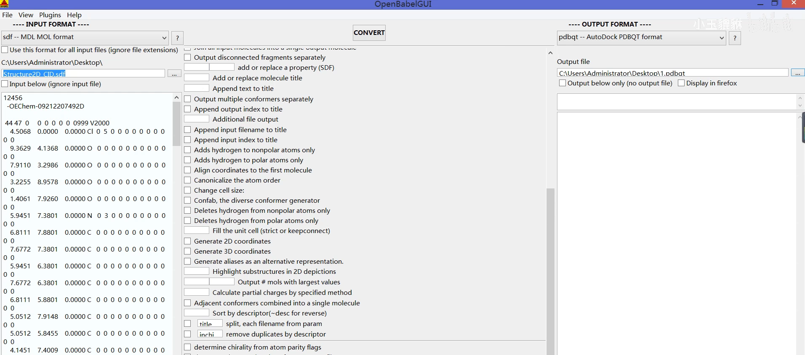
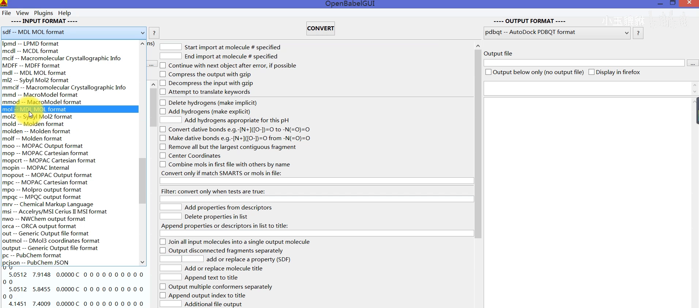
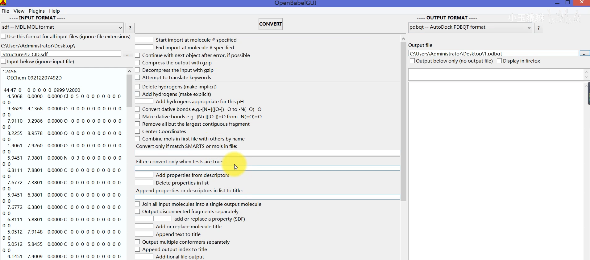
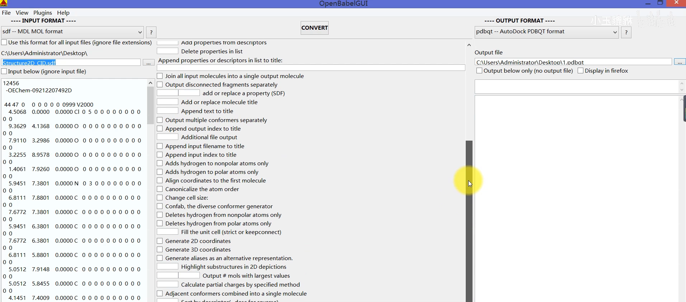

# 分子对接前为什么总要转格式？用 OpenBabel 把 SDF/mol2 一步转成 PDBQT

> 本篇整理自 B 站视频 [分子对接| 文件格式转换| 干货哟](https://www.bilibili.com/video/BV1wG4y1s73C/)（约 7 分钟）。

## 本讲要解决的核心问题（SCQA）

**背景**：做分子对接时，蛋白结构和化合物结构来自不同地方，格式五花八门——蛋白常是 PDB 格式（从 PDB 数据库下载的就是它），化合物可能是 SDF、mol2 等格式。

**冲突**：**不同的对接软件识别的文件格式是不一样的**。比如 UP 主用的 AutoDock，就只认 PDBQT 格式——直接把 PDB、SDF 或 mol2 文件喂给它，是没法对接的。

**疑问**：怎么把手里这些格式各异的分子文件，快速转成对接软件要的格式？

**回答（中心思想）**：用免费的 **OpenBabel**：选输入格式 → 选文件 → 选输出格式 → 点 **Convert**，一步完成。蛋白 **PDB → PDBQT**、化合物 **SDF / mol2 → PDBQT** 都能转；如果是上万化合物的大库，还能用 **Split** 功能拆成一个个单文件。

---

## 一、为什么对接前总要先「转格式」

做对接时，蛋白的结构、化合物的结构**都需要先做一层处理**。UP 主之前用的是 AutoDock 软件，那就需要把之前的 PDB 文件格式**转换为 PDBQT 格式**；或者把化合物的 SDF 结构转换为能用于对接的 PDBQT 格式。

再比如，把 **mol2 的化合物结构格式**转换为 PDBQT 格式，才能用于对接。这个过程中会涉及很多结构文件的转换——因为**不同的对接软件识别的文件格式不一样**，所以要先做一步格式转换，才能进行后续的对接实验：

[【跳转到 00:25】](https://www.bilibili.com/video/BV1wG4y1s73C/?t=25)

## 二、OpenBabel：一个界面搞定格式互转

今天带来的软件就是 **OpenBabel**——它可以做格式转换。它的界面从上往下看：最上面是 **File** 文件菜单，然后是 **View** 等等一些插件，最下面是状态栏：

[【跳转到 01:17】](https://www.bilibili.com/video/BV1wG4y1s73C/?t=77)

## 三、手把手：把 SDF 转成 PDBQT

### 3.1 选输入格式与文件

做结构的格式转换其实很容易。首先是这边的 **Input format（导入格式）**——它默认是 SMILES 格式，但**自己的文件是什么格式，就在这里选什么格式**：

UP 主拿一个例子来讲，大家以后照着相似的例子自己摸索就好。这次导入的是一个化合物的 **SDF 结构**：通过「三个点」按钮去找文件，选中这个 Structure2D_CID 的 SDF 文件，文件信息就导入进来了：

### 3.2 选输出格式：认识 PDB 与 PDBQT

输出（Output）文件格式在同样的位置选择，里面**有很多格式可供选择**，基本上能满足大家的要求。这次因为要转成用于分子对接的 **PDBQT**，就在列表里找它：

[【跳转到 02:57】](https://www.bilibili.com/video/BV1wG4y1s73C/?t=177)

先看 **PDB**：PDB 就是蛋白的结构格式（Protein Data Bank format）——从 PDB 数据库下载的就是这个格式。而 **PDBQT** 在列表里注明了是 **AutoDock PDBQT** 格式，意思是可以用于 AutoDock 对接：

[【跳转到 03:22】](https://www.bilibili.com/video/BV1wG4y1s73C/?t=202)

### 3.3 选输出位置，点 Convert

还需要做一个选择：**导出文件的位置**。直接选桌面、命个名（比如「1」）、保存，其他不用多处理，然后直接点一下 **Convert**——就可以把 SDF 转换成 PDBQT 了：

[【跳转到 04:37】](https://www.bilibili.com/video/BV1wG4y1s73C/?t=277)

点击 Convert 之后，这边的信息都会生成出来——这就是它生成的、用于对接的 **PDBQT 格式**文件。其实很简单，这时候桌面上已经有了这样一个文件：

[【跳转到 06:17】](https://www.bilibili.com/video/BV1wG4y1s73C/?t=377)

## 四、格式清单里的门道：mol2 与 TCMSP

除了视频里演示的 SDF，还有一个 **mol2** 格式也常用——那是某一个软件常用的一种格式。而且不止这一个软件：像 **TCMSP** 里面下载的结构，也都是 **mol2 结构**。

列表里当然也有 PDB 的结构；如果大家要把 **PDB 转成 PDBQT**，也是可以的——知道自己的文件放在哪，到时候导进去就好：

[【跳转到 04:12】](https://www.bilibili.com/video/BV1wG4y1s73C/?t=252)

## 五、进阶选项：生成坐标与拆分化合物库

### 5.1 中间选项栏：生成 2D / 3D 坐标

在输入、输出格式之间还有**中间这一栏**。正常情况下，做简单的格式转换**用不到它**，所以基本没有打勾的选项。但后期个别时候可能会用到：比如这里有一个**生成 2D 坐标、3D 坐标**的功能，有时候会用到，看个人需求：

[【跳转到 05:02】](https://www.bilibili.com/video/BV1wG4y1s73C/?t=302)

### 5.2 Split：把化合物库拆成一个个单文件

中间栏里还有一个功能有时会用到：**Split（拆分）**——把一个大文件拆分成一个个小文件。

像 Discovery Studio 这类软件用到的对接，往往是一个**化合物库**：假如有 1 万个化合物，可以全部放在一个文件里，由这一个文件记录 1 万多个化合物的信息。但做 **AutoDock 就不行**——它需要把库**拆分成一个个小文件**，1 万个化合物一个一个拎出来，可能会出现 1 万多个文件。到这种要单个文件的时候，就可能会用到这个功能：

[【跳转到 05:27】](https://www.bilibili.com/video/BV1wG4y1s73C/?t=327)

## 小结

- 分子对接前常要**转格式**：不同对接软件认的格式不同，AutoDock 只吃 **PDBQT**。
- 蛋白走 **PDB → PDBQT**；化合物走 **SDF / mol2 → PDBQT**。
- **OpenBabel** 三步搞定：选 **Input format** → 选文件 → 选 **Output format**（PDBQT，注明 AutoDock）→ 选位置 → 点 **Convert**。
- **mol2** 也是常用格式：TCMSP 下载的结构就是 mol2；PDB→PDBQT 同样可行。
- 中间选项栏平时不用动；需要时可**生成 2D/3D 坐标**；**Split** 能把上万化合物的大库拆成单个文件，供 AutoDock 这类软件使用。

## 关键术语速查

| 术语 | 一句话解释 |
| --- | --- |
| 分子对接 | 把小分子「放」进蛋白口袋预测结合模式的计算方法 |
| OpenBabel | 免费的化学文件格式转换工具，支持大量格式互转 |
| PDB | Protein Data Bank format，蛋白结构的经典文本格式 |
| PDBQT | AutoDock 用的格式（在 PDB 基础上加电荷等对接信息） |
| SDF | 化合物结构文本格式，PubChem 等数据库的常见下载格式 |
| mol2 | 常用的小分子结构格式，TCMSP 下载的就是它 |
| SMILES | 用一行文本字符串表示分子的格式，OpenBabel 的默认输入格式 |
| AutoDock | 常用分子对接软件，只认 PDBQT 格式 |
| TCMSP | 中药系统药理学数据库，提供 mol2 格式结构 |
| Discovery Studio | 另一款对接软件，可用单文件形式的化合物库 |
| Split | OpenBabel 的拆分功能：把大库文件拆成一个个单分子文件 |
