# 蛋白质的四级结构：肽键肽链、α螺旋β折叠、模体结构域亚基、锌指蛋白→详解

> 视频来源：[【生物化学】分分钟记住 蛋白质的四级结构（Bilibili）](https://www.bilibili.com/video/BV18K4y1J7fM/)，时长 5:24，播放 20 万+。本文基于视频演说图文稿整理，时间戳可跳转到对应讲解。

## 本讲要解决的核心问题（SCQA）

**背景**：蛋白质由氨基酸组成，是生命活动的主要执行者，而它的功能几乎完全由结构决定。

**冲突**：可 20 种氨基酸连成的一条链，是怎么"长"成有功能的三维机器的？为什么有的蛋白到三级结构就完工，有的却要几个亚基拼在一起才有活性？

**疑问**：蛋白质的四个结构层级到底怎么划分？高级结构靠什么维持？常听说的"模体""结构域""亚基"又是什么、彼此什么关系？

**回答（中心思想）**：蛋白质结构像盖楼——**一级结构是地基**（靠牢固的肽键共价连接），**二三四级靠脆弱的非共价键**维持；二级结构是 α-螺旋与 β-折叠，相邻的二级结构聚集**连续**形成模体（超二级结构，如锌指），三级结构上功能独立、**分隔**的区域是结构域；具有三级结构但没有活性的肽链是**亚基**，多个亚基聚齐才组装出有活性的四级结构（如血红蛋白）。

## 一、地基：从氨基酸到一级结构

[【跳转到 00:05】](https://www.bilibili.com/video/BV18K4y1J7fM/?t=5)

蛋白质一共有四级结构，就像盖房子：一级结构是地基，二三四层都是由一级结构这个地基决定的。

人体中一共有 **20 种氨基酸**，它们在结构上有一个共同特点：**氨基、羧基、氢原子都连在中间的 α-碳原子上**；不同之处在于连接的 **R 基**不同——一般我们把 R 基称为**侧链**，中间的碳原子骨架称为**主链** [【跳转到 00:26】](https://www.bilibili.com/video/BV18K4y1J7fM/?t=26)。

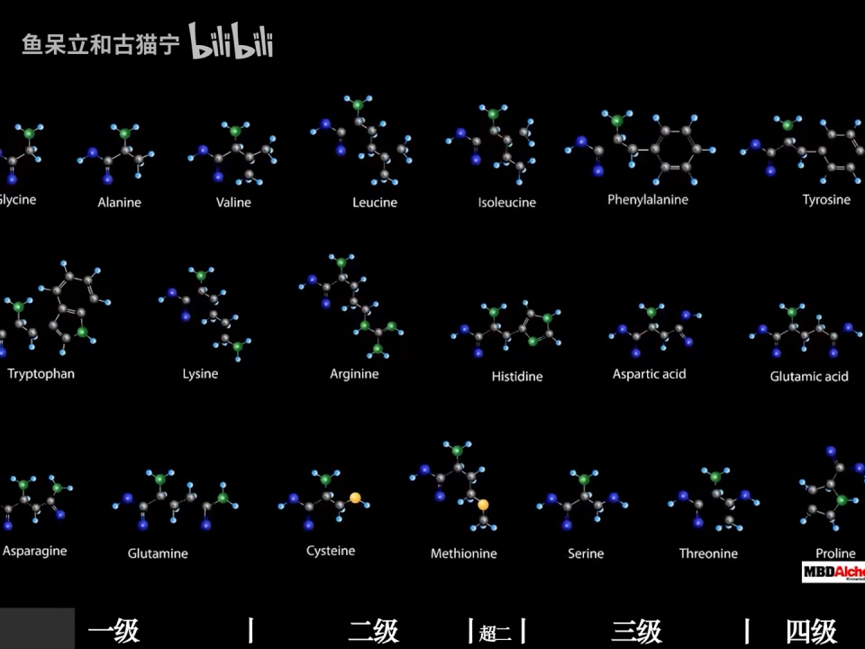

两个氨基酸"抱团取暖"，**脱去一分子水形成肽键**连在一起；很多氨基酸以肽键相连，就得到一条由 N 端到 C 端排列的多肽链骨架 [【跳转到 00:51】](https://www.bilibili.com/video/BV18K4y1J7fM/?t=51)——**这就是蛋白质的一级结构** [【跳转到 01:02】](https://www.bilibili.com/video/BV18K4y1J7fM/?t=62)。

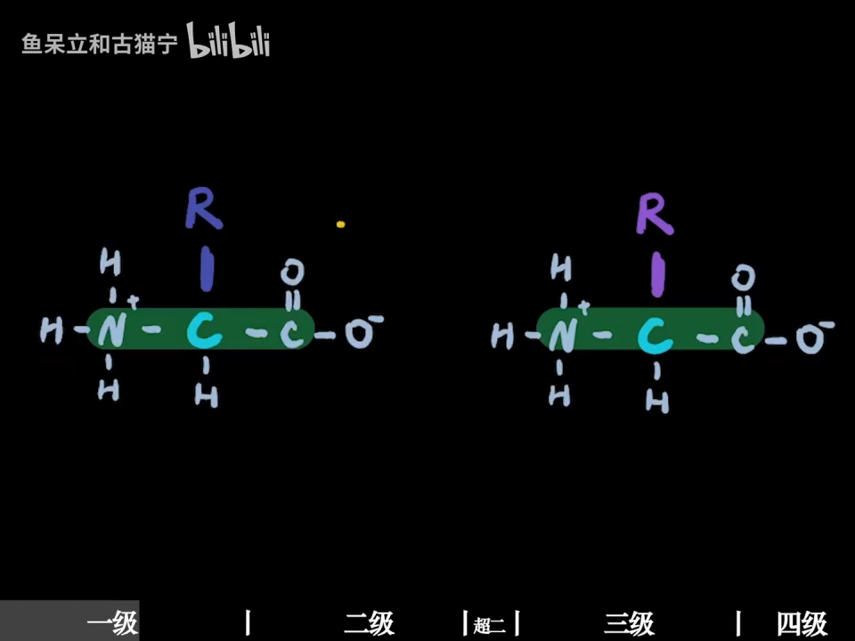

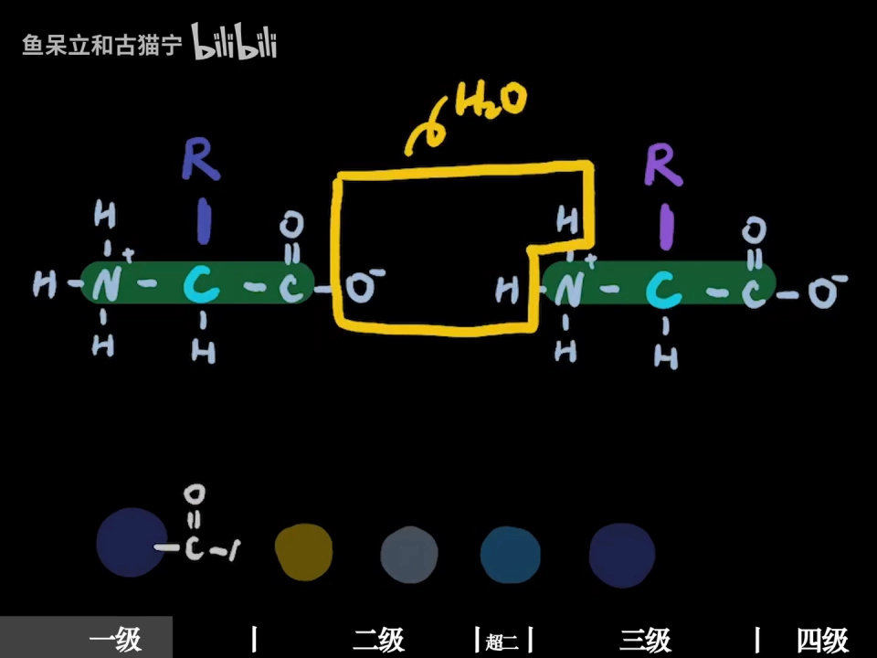

一级结构像地基一样稳固，是因为连接氨基酸的**肽键是牢固的共价键**；有些蛋白质还含有**二硫键**，比如胰岛素 [【跳转到 01:09】](https://www.bilibili.com/video/BV18K4y1J7fM/?t=69)。

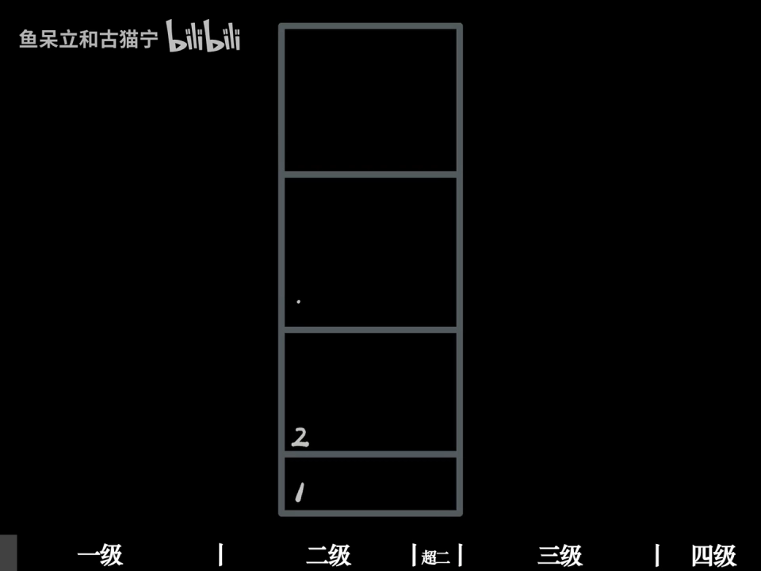

## 二、二级结构：α-螺旋与β-折叠

[【跳转到 01:26】](https://www.bilibili.com/video/BV18K4y1J7fM/?t=86)

有了地基，楼可以往上盖了。但和一级结构不同：**维持二三四级结构的化学键是非共价键**（氢键、范德华力等），作用力十分脆弱，所以高级结构较容易被破坏。

先看二级结构：**氢键是其主要化学键**（肽键中含有氧和氢原子，较易形成氢键）。二级结构指的是**多肽链主链原子的局部空间结构**——注意并不涉及侧链 R 基的构象，包括 α-螺旋和 β-折叠两种形式 [【跳转到 01:49】](https://www.bilibili.com/video/BV18K4y1J7fM/?t=109)。

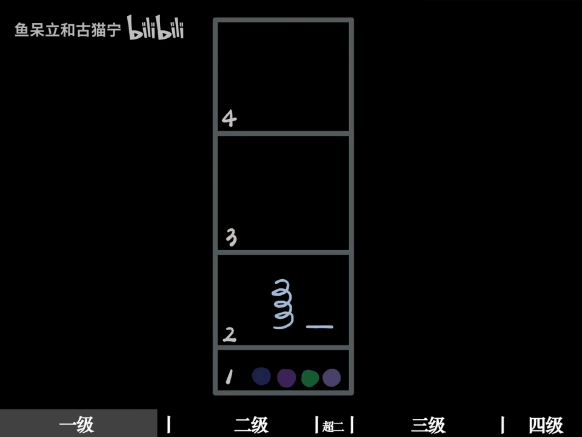

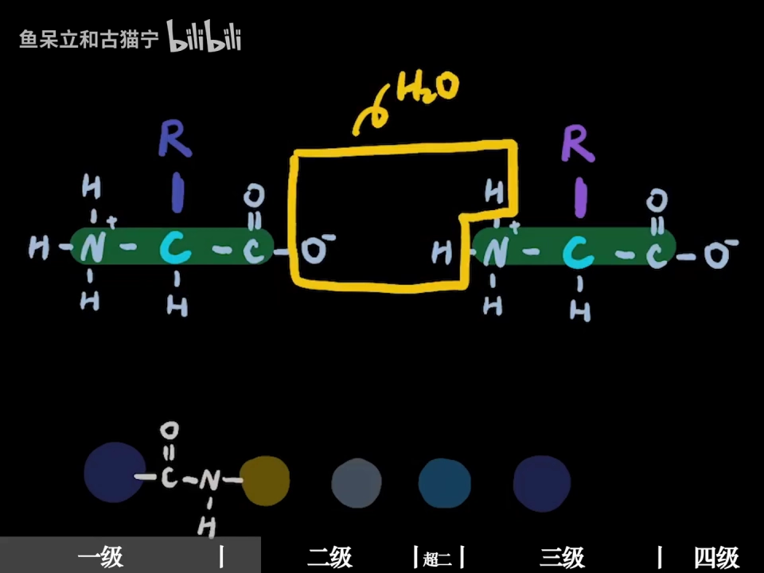

**α-螺旋**：右手螺旋，侧链伸向外侧，氢键在每个螺旋之中、与长轴平行 [【跳转到 02:03】](https://www.bilibili.com/video/BV18K4y1J7fM/?t=123)。但不是所有氨基酸都能形成 α-螺旋：如果侧链形状太大——比如**脯氨酸**——就不行 [【跳转到 02:24】](https://www.bilibili.com/video/BV18K4y1J7fM/?t=144)。

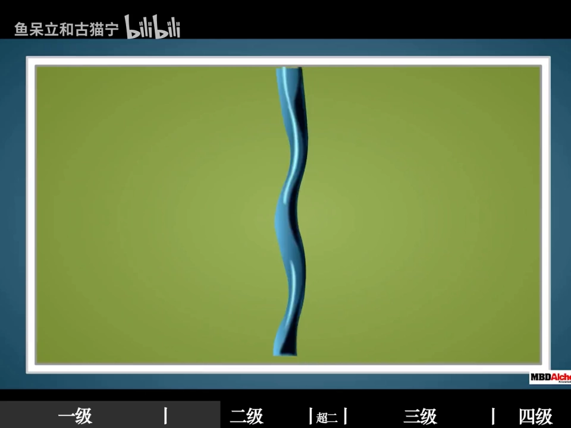

**β-折叠**：像一张折纸，侧链位于折纸的上下方；两段以上的 β-折叠平行排列，可以顺向平行，也可以反向平行，氢键则在两面之间 [【跳转到 02:39】](https://www.bilibili.com/video/BV18K4y1J7fM/?t=159)。

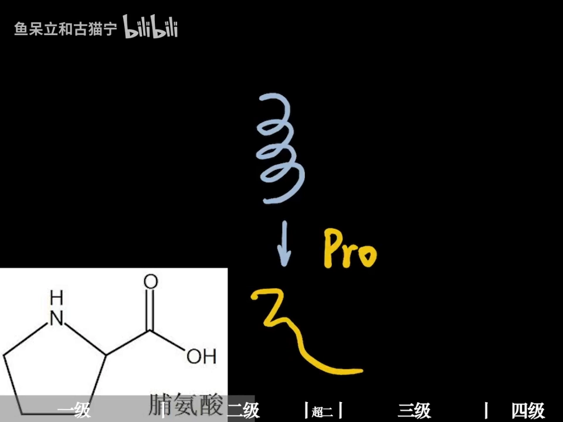

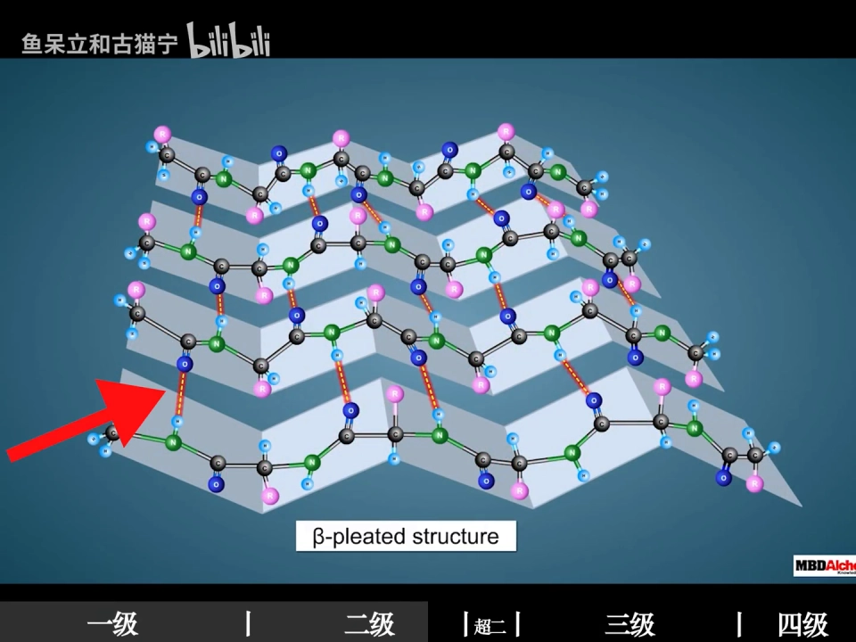

视频给了一个很形象的比喻：二级结构就像**一根头发丝**——有的部分形成了波浪卷（α-螺旋），有的部分形成了锯齿状（β-折叠），但不管怎么变，它仍是一根头发、一条肽链。

## 三、从模体到结构域：三级结构的分区

[【跳转到 02:44】](https://www.bilibili.com/video/BV18K4y1J7fM/?t=164)

如果几个相邻的波浪卷或锯齿相互聚集，形成有特殊功能的组合体，就成了**超二级结构**，我们将其称为**模体**——譬如 βββ 或 βαβ。

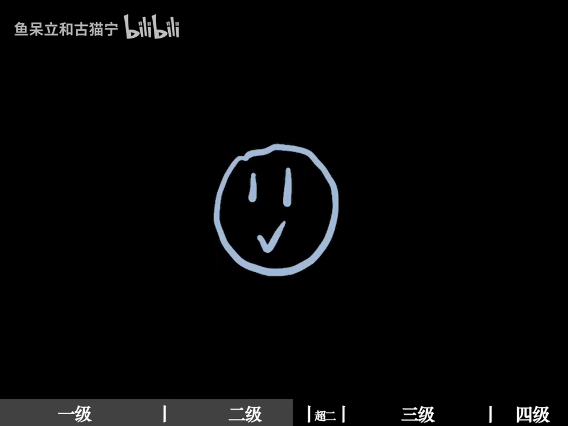

比模体更上一层则是**三级结构**：相比二级结构只是主链的局部空间构象，三级结构是主链**和侧链**更进一步的聚集 [【跳转到 03:08】](https://www.bilibili.com/video/BV18K4y1J7fM/?t=188)。对于分子量大的蛋白质，其三级结构往往可以分为几个**结构和功能相对独立的区域**，叫做**结构域**。

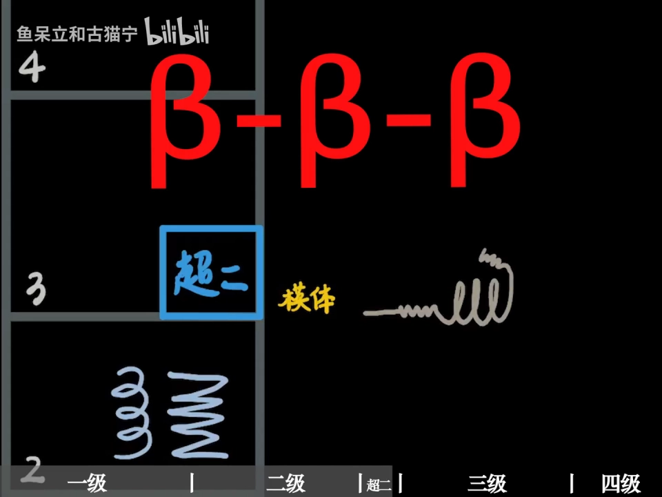

想象一下：一层楼里一块区域有锅碗瓢盆、冰箱炉灶，功能是煮饭；另一块区域有跑步机和哑铃，功能是健身——**厨房和健身房就相当于一条肽链上的结构域**，功能独立、结构也相对独立 [【跳转到 03:38】](https://www.bilibili.com/video/BV18K4y1J7fM/?t=218)。

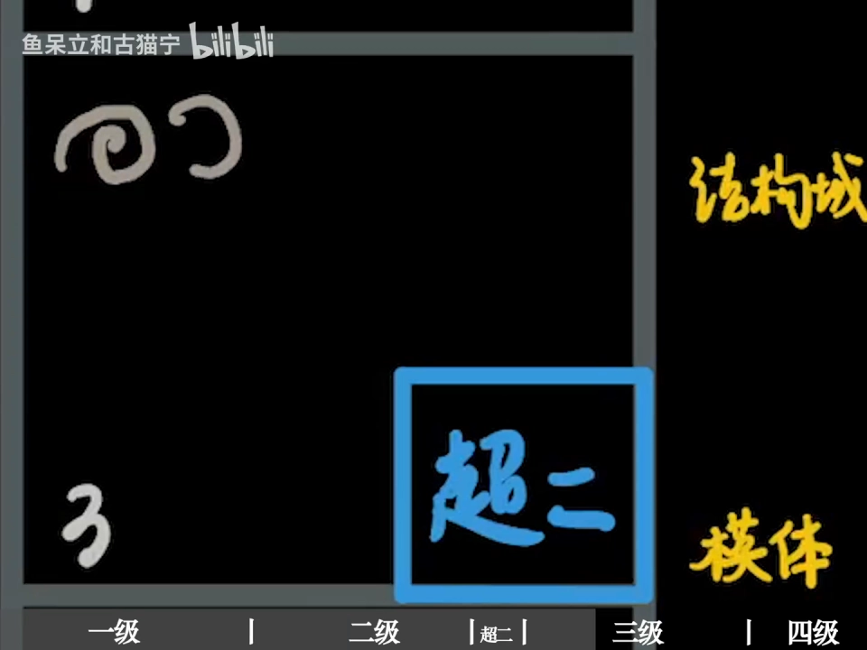

## 四、模体 vs 结构域：以锌指为例

那模体和结构域到底什么区别？视频给出关键判断 [【跳转到 04:03】](https://www.bilibili.com/video/BV18K4y1J7fM/?t=243)：

- **模体属于超二级结构，是连续的**；
- **结构域属于三级结构，是分隔开来的**。

以模体中的**锌指结构**为例：锌指就像一个人的手指，它可使蛋白质和核酸结合在一起 [【跳转到 04:09】](https://www.bilibili.com/video/BV18K4y1J7fM/?t=249)；但仅仅一个手指并不能使二者牢固结合，需要**多个手指**一起完成这一功能——就像手掌。多个锌指聚在一起，"手掌"就相当于是结构域了。

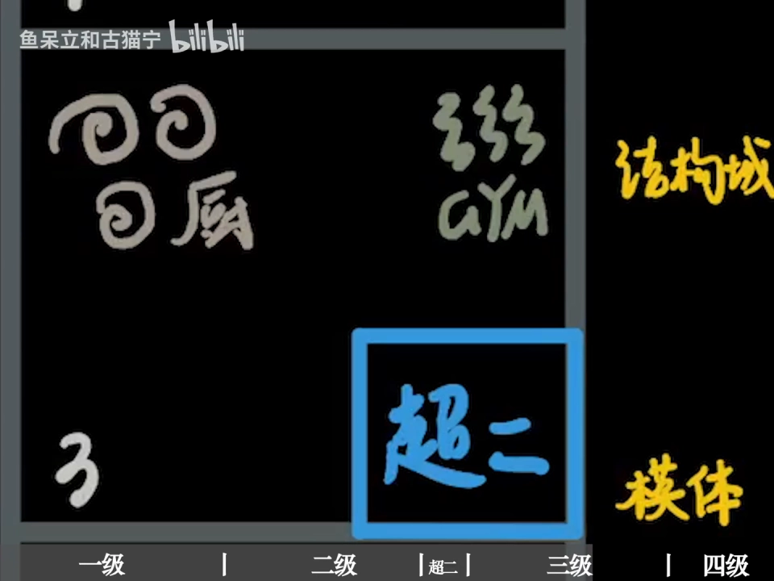

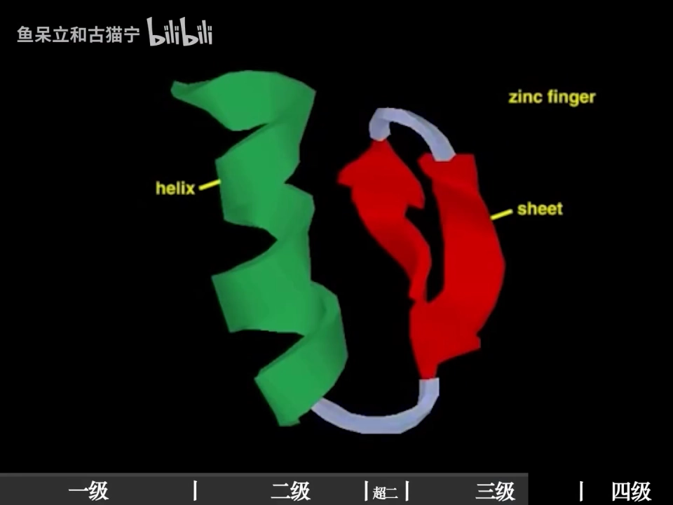

## 五、四级结构与亚基：血红蛋白的启示

[【跳转到 04:41】](https://www.bilibili.com/video/BV18K4y1J7fM/?t=281)

有的蛋白质到了三级结构就不再往上盖了；另一些蛋白——像是多聚体蛋白——还会继续"加油工作"，建立**四级结构**。构筑四级结构的"钢筋水泥"则是**亚基**。

亚基是什么？**一条具有三级结构的肽链，但并没有生物学活性**；两个、三个、四个亚基聚集在一起，可能就有了活性。最经典的例子是**血红蛋白：由四个亚基构成** [【跳转到 04:52】](https://www.bilibili.com/video/BV18K4y1J7fM/?t=292)。

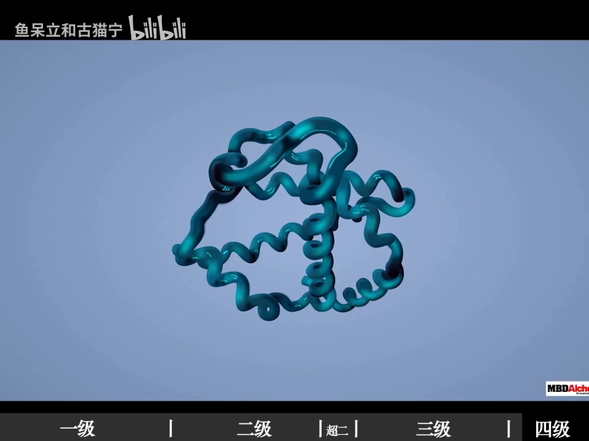

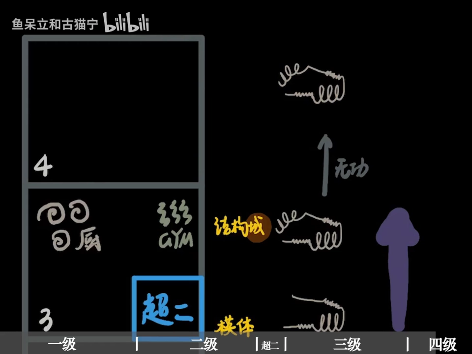

最后记住这句话：**四级结构由多条肽链组成，并不是所有蛋白质都有；而一、二、三级结构只由一条肽链构成**。

## 小结

- 蛋白质四级结构像盖楼：**一级是地基**（肽键共价 + 二硫键），**二三四级靠非共价键**（氢键、范德华力），脆弱易破坏；
- **二级结构**：主链原子的局部空间结构，α-螺旋（右手、氢键平行长轴）与 β-折叠（折纸、氢键在两面间）；脯氨酸不能形成 α-螺旋；
- 相邻二级结构连续聚集 = **模体**（超二级结构，βββ、βαβ、锌指）；三级结构上功能独立、分隔的区域 = **结构域**（厨房 vs 健身房）；
- **亚基** = 有三级结构但无活性的肽链；聚齐才有活性（血红蛋白 = 4 个亚基）；
- 一、二、三级 = 一条肽链；四级 = 多条肽链，并非所有蛋白都有。

## 关键术语速查

| 术语 | 一句话解释 |
| --- | --- |
| 一级结构 | N端→C端的多肽链骨架，靠肽键（共价）连接，可有二硫键 |
| 二级结构 | 主链原子的局部空间结构，主要靠氢键维持：α-螺旋、β-折叠 |
| 超二级结构（模体） | 相邻二级结构连续聚集形成的功能组合体，如 βββ、βαβ、锌指 |
| 三级结构 | 主链 + 侧链进一步聚集形成的整链三维构象 |
| 结构域 | 三级结构上结构和功能相对独立、分隔开来的区域 |
| 亚基 | 具有三级结构但没有生物学活性的一条肽链 |
| 四级结构 | 多个亚基聚集成有活性的复合物，如血红蛋白（4 亚基） |
| 锌指 | 模体的一种，形如手指，帮助蛋白质与核酸结合；多个锌指组成"手掌" |

## 延伸：锌指里的"锌"，就是结构预测里的 ion 实体

（本节为视频之外的延伸说明，非视频内容。）

视频用"手指"比喻讲清了锌指的功能——帮助蛋白质与核酸结合，但没有展开那个"锌"字：每个锌指里通常有一个 **Zn²⁺**，与半胱氨酸/组氨酸配位，像铆钉一样撑起模体的小结构。金属离子就这样直接参与稳定蛋白结构。因此在 Protenix 这类结构预测平台的输入中，`ion` 与蛋白质链并列、必须单独声明——预测含锌指的蛋白时漏掉 Zn²⁺，模体附近的构象就会算偏。
