# 辅酶、辅基与酶的那些事儿

> 视频来源：[辅酶、辅基与酶的那些事儿（Bilibili）](https://www.bilibili.com/video/BV1rR4y1X7uK/)，时长 2:24。本文基于视频演说图文稿整理，时间戳可跳转到对应讲解。

## 本讲要解决的核心问题（SCQA）

**背景**：酶催化着体内的几乎每一个化学反应，而我们已经知道，酶的本质通常是蛋白质。

**冲突**：可很多酶并不是"纯蛋白质"就能干活的——如果只把蛋白质部分提纯出来，催化活性往往就没了，还必须有另一部分"帮手"在场。

**疑问**：这些帮手是谁？它们和酶蛋白是怎么结合的？到底起什么作用？

**回答（中心思想）**：结合酶 = 酶蛋白 + 辅助因子。辅助因子按与酶蛋白结合的紧密程度分为**辅酶**（结合疏松、非共价、可透析除去，起运载体作用）和**辅基**（结合紧密、常为共价、多为金属离子）；金属离子既可以是催化所必需的"固定件"，也可以是连接酶与底物的"桥梁"，并以四种方式参与酶的工作。

## 一、酶的两种组成：单纯酶与结合酶

[【跳转到 00:00】](https://www.bilibili.com/video/BV1rR4y1X7uK/?t=0)

酶按分子组成分为两大类：

- **单纯酶**：仅由蛋白质构成的酶，如淀粉酶、蛋白酶、脂酶、核酸酶等；
- **结合酶**：由蛋白质和非蛋白质两部分组成——蛋白部分称为**酶蛋白**，非蛋白部分称为**辅助因子**。

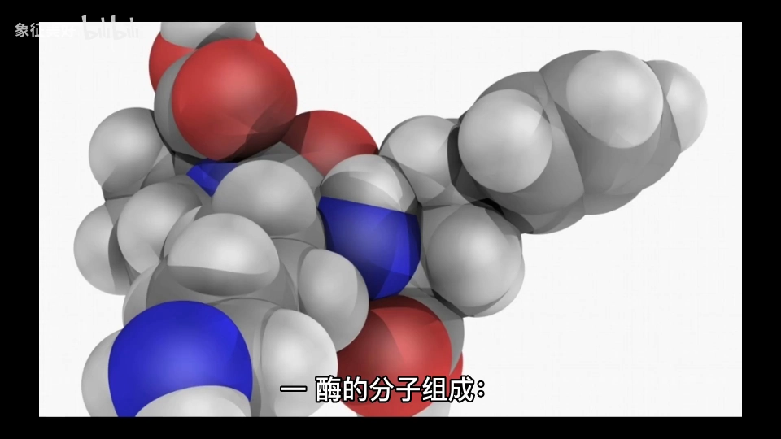

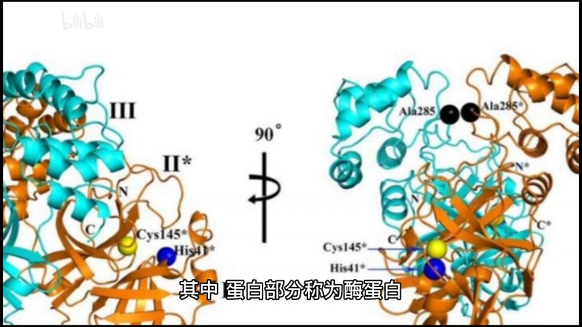

两者的分工非常明确 [【跳转到 00:20】](https://www.bilibili.com/video/BV1rR4y1X7uK/?t=20)：

| 组成部分 | 决定什么 |
| --- | --- |
| 酶蛋白（蛋白部分） | 酶促反应的**特异性**及催化机制 |
| 辅助因子（非蛋白部分） | 酶促反应的**性质**及类型 |

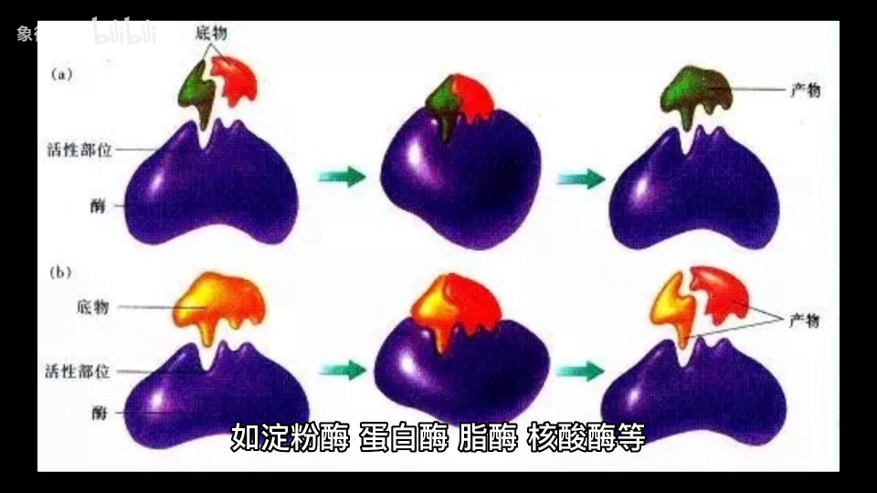

打个比方：酶蛋白像"操作员"，决定对哪种底物下手、怎么下手；辅助因子像"工具"，决定这轮操作具体是什么类型的反应。

## 二、辅助因子的两类"帮手"：辅酶与辅基

[【跳转到 00:30】](https://www.bilibili.com/video/BV1rR4y1X7uK/?t=30)

辅助因子按其与酶蛋白**结合的紧密程度**分为辅酶和辅基。它们的化学本质多为小分子有机化合物——B 族维生素及其衍生物、卟啉化合物——或者干脆就是金属离子 [【跳转到 00:40】](https://www.bilibili.com/video/BV1rR4y1X7uK/?t=40)。在酶促反应中，辅助因子主要参与**电子、质子或基团的转运**。

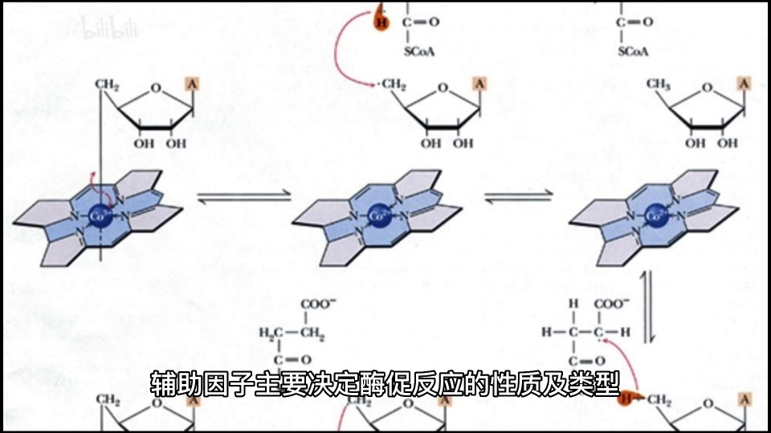

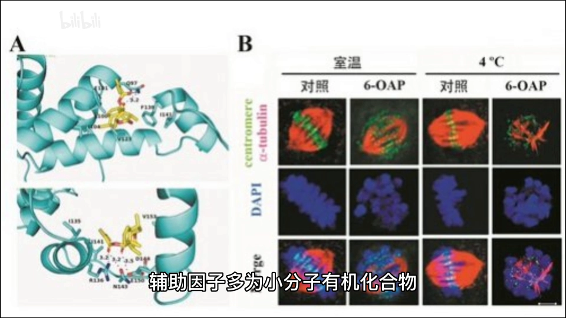

### 2.1 辅酶：结合疏松的"运载体"

[【跳转到 00:50】](https://www.bilibili.com/video/BV1rR4y1X7uK/?t=50)

**辅酶与酶蛋白结合疏松**，用透析或超滤等方法就可以把它除去。它在酶促反应中起**载体作用**：传递电子、质子或其他基团。

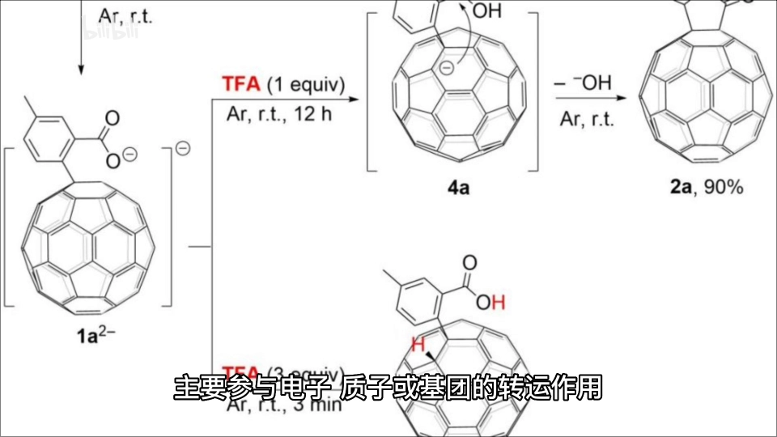

经典例子：**辅酶Ⅰ（NAD⁺）**和**辅酶Ⅱ（NADP⁺）**，分子中都含有烟酰胺，在反应中负责转移氢原子（也就是质子或电子）[【跳转到 01:00】](https://www.bilibili.com/video/BV1rR4y1X7uK/?t=60)。

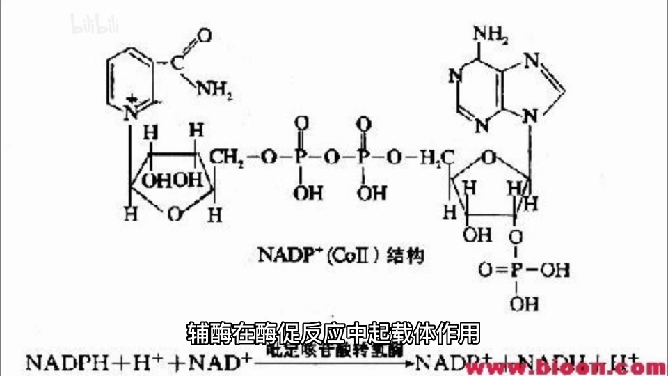

### 2.2 辅基：结合紧密，多为金属离子

[【跳转到 01:10】](https://www.bilibili.com/video/BV1rR4y1X7uK/?t=70)

**辅基多为金属离子**，如钾离子、钠离子、钙离子、镁离子、铜离子、锌离子、铁离子、锰离子等。

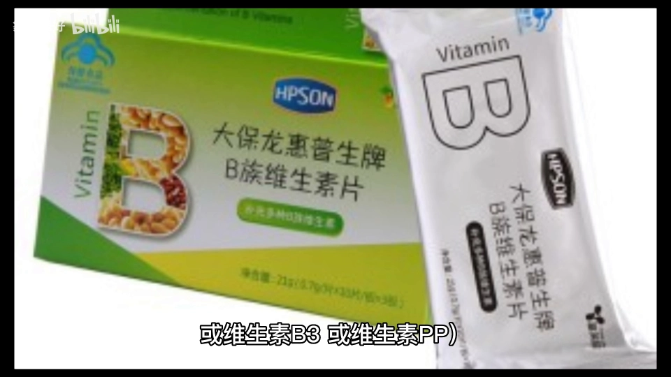

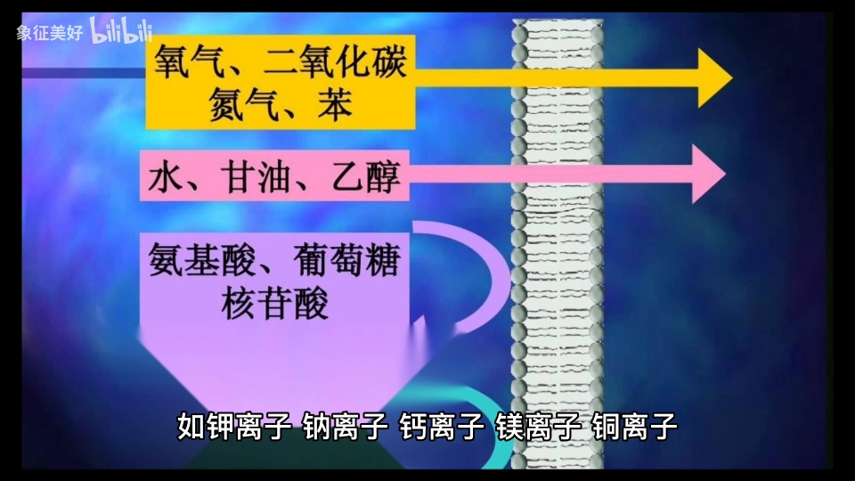

## 三、金属酶与金属激活酶：金属离子结合的两种情形

[【跳转到 01:30】](https://www.bilibili.com/video/BV1rR4y1X7uK/?t=30)

同样是金属离子参与，结合方式不同，酶的"身份"也不同：

- **金属酶**：金属离子与酶蛋白**结合紧密**，不易用透析或超滤等方法除去。金属离子是催化反应**所必需**的，但并不起连接酶与底物的桥梁作用 [【跳转到 01:40】](https://www.bilibili.com/video/BV1rR4y1X7uK/?t=100)；
- **金属激活酶**：金属离子虽是酶活性中心所必需的，但与酶**可逆结合**，在提取过程中容易丢失 [【跳转到 01:45】](https://www.bilibili.com/video/BV1rR4y1X7uK/?t=105)。它的金属离子**可以作为连接酶与底物的桥梁**。

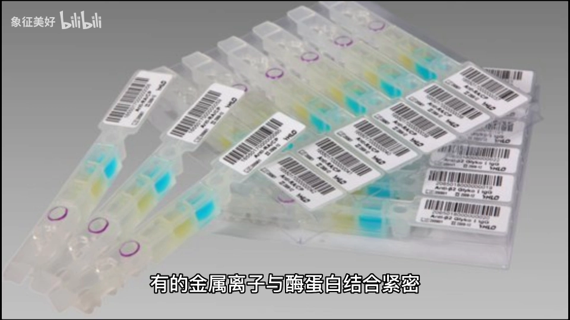

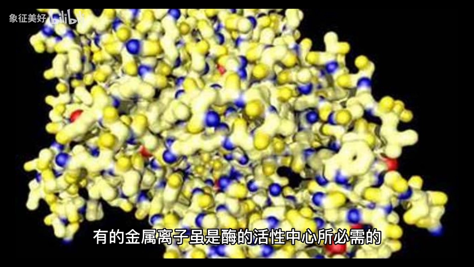

两个具体例子 [【跳转到 01:55】](https://www.bilibili.com/video/BV1rR4y1X7uK/?t=115)：己糖激酶催化葡萄糖磷酸化时需要**镁离子**；细胞色素氧化酶需要**铜离子**。

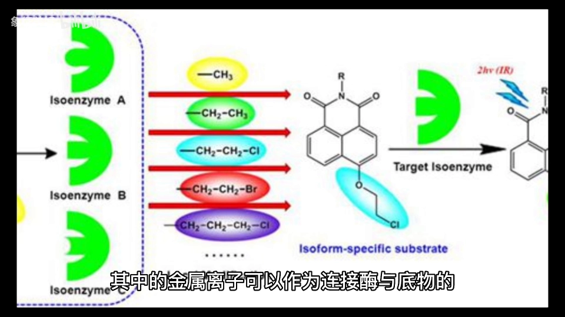

## 四、金属离子作为酶辅基的四大作用

[【跳转到 02:00】](https://www.bilibili.com/video/BV1rR4y1X7uK/?t=120)

视频最后把金属离子的作用归纳为四条：

1. **稳定酶的构象**——把酶的三维形状"撑住"；
2. **参与催化反应、传递电子**；
3. **在酶与底物间起桥梁作用**；
4. **中和阴离子、降低反应中的静电斥力**。

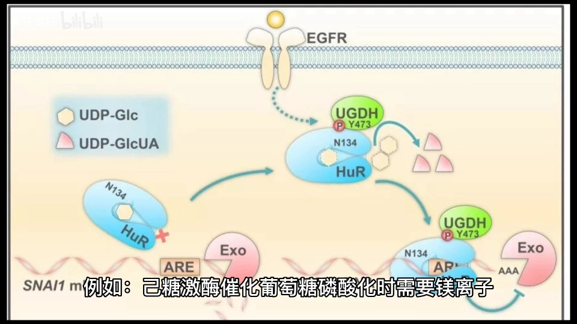

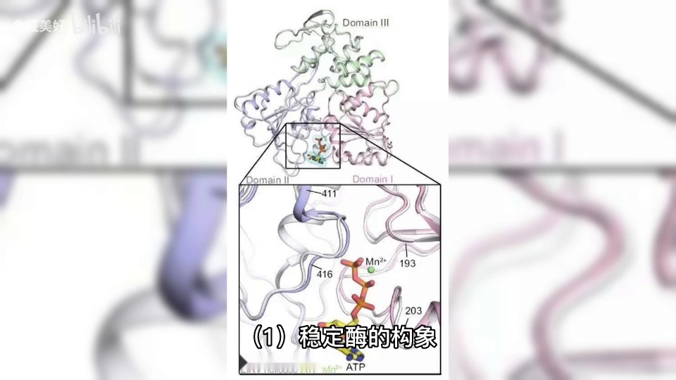

## 小结

- 酶按组成分**单纯酶**（只有蛋白质）与**结合酶**（酶蛋白 + 辅助因子）；
- 酶蛋白决定反应的**特异性**，辅助因子决定反应的**性质与类型**；
- 辅助因子按结合紧密程度分**辅酶**（疏松、非共价、可透析除去、起载体作用）与**辅基**（紧密、多为金属离子）；
- 金属离子与酶结合紧密的称**金属酶**，可逆结合的称**金属激活酶**（后者金属可作酶-底物桥梁）；
- 金属离子的四大作用：稳定构象、传电子、做桥梁、中和静电斥力。

## 关键术语速查

| 术语 | 一句话解释 |
| --- | --- |
| 单纯酶 | 仅由蛋白质构成的酶，如淀粉酶、蛋白酶 |
| 结合酶 | 由酶蛋白 + 辅助因子组成的酶 |
| 酶蛋白 | 结合酶的蛋白部分，决定反应特异性和催化机制 |
| 辅助因子 | 结合酶的非蛋白部分，决定反应性质与类型 |
| 辅酶 | 与酶蛋白结合疏松（非共价）、可透析除去的辅助因子，起载体作用 |
| 辅基 | 与酶蛋白结合紧密（常为共价）的辅助因子，多为金属离子 |
| 金属酶 | 金属离子结合紧密、不易除去的酶，金属为催化所必需 |
| 金属激活酶 | 金属离子可逆结合、提取易丢失的酶，金属可作酶-底物桥梁 |
| 透析 | 利用小分子可透过半透膜的性质分离疏松结合辅助因子的方法 |

## 延伸：为什么结构预测平台要把"离子"单独建模

（本节为视频之外的延伸说明，非视频内容。）

视频讲清了金属离子不是"装饰"：它们稳定酶构象、传递电子、连接酶与底物。因此在 Protenix 这类结构预测平台的输入里，`ion` 是与蛋白质链**并列的实体类型**——预测含金属的蛋白（如需要 Zn²⁺ 的蛋白）时必须单独声明离子，否则模型少了一个真实存在的结构稳定者，复合物结构就算不准。这正是本系列目录中把"离子与辅因子"列为独立知识点的用意。
