# 辅酶与酶辅助因子

> 视频来源：[辅酶与酶辅助因子（Bilibili）](https://www.bilibili.com/video/BV14C4y157Sm/)，时长 6:06。本文基于视频演说图文稿整理，时间戳可跳转到对应讲解。

## 本讲要解决的核心问题（SCQA）

**背景**：结合酶由酶蛋白和辅助因子两部分组成——这一点在《辅酶、辅基与酶的那些事儿》里已经讲过。

**冲突**：可辅助因子家族非常庞大：金属离子、FAD、NAD、TPP、辅酶A、四氢叶酸……考试还总爱问"谁转移什么基团""谁含哪种维生素"，视频里直言这部分**连续两年都考到**。

**疑问**：有没有一张系统的"对照表"，把这些辅酶辅基的功能和来源一次理清？

**回答（中心思想）**：辅助因子分**辅基**（与酶蛋白共价结合，金属离子全在此列）与**辅酶**（非共价结合，起运载体作用）两大类；再配一张"辅酶辅基 → 转移基团 → 对应维生素"的对照表，最后用一条谐音口诀把全部对应关系串起来。

## 一、辅助因子总览：金属离子与小分子有机物

[【跳转到 00:00】](https://www.bilibili.com/video/BV14C4y157Sm/?t=0)

少部分酶只由蛋白质构成（酶蛋白本身）；但大部分酶除了酶蛋白，还有辅助的因子，其中包括**金属离子**以及**小分子有机化合物**，比如 FAD。

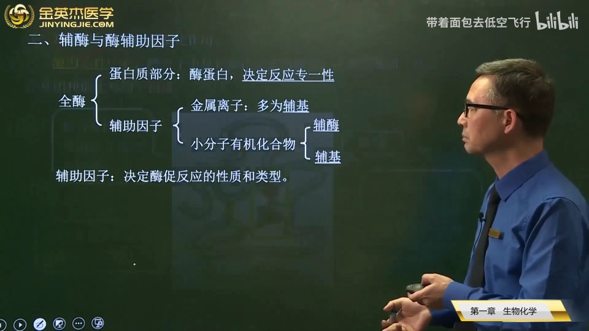

这些辅助因子可以大致分为**辅基**和**辅酶**两大类 [【跳转到 00:25】](https://www.bilibili.com/video/BV14C4y157Sm/?t=25)：

- **金属离子都属于辅基**；
- 小分子有机化合物有的是辅基，有的是辅酶。

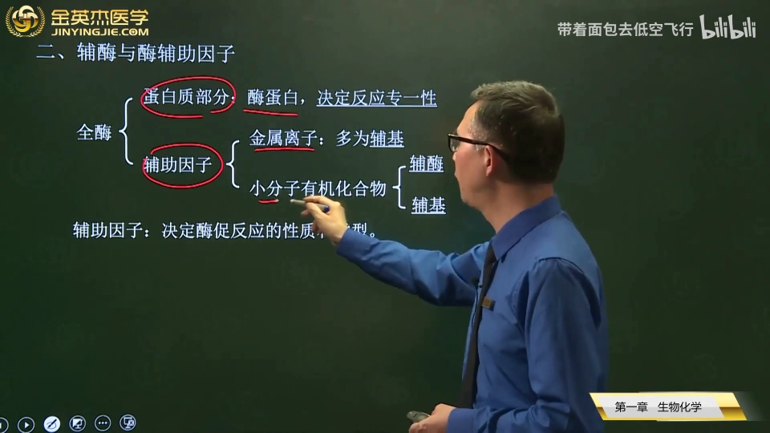

无论哪一类，这些辅助因子都决定了酶促反应的**类型或性质**，而酶蛋白决定反应的**专一性**。

## 二、辅基与辅酶：共价与非共价之别

[【跳转到 00:50】](https://www.bilibili.com/video/BV14C4y157Sm/?t=50)

视频用一张示意图讲清了两种结合方式的差别：**辅基指与酶蛋白以共价键结合的这些成分**（尤其是金属离子），所以用透析的方法不能将它们解离下来；像铁离子、FAD 就属于辅基 [【跳转到 01:15】](https://www.bilibili.com/video/BV14C4y157Sm/?t=75)。

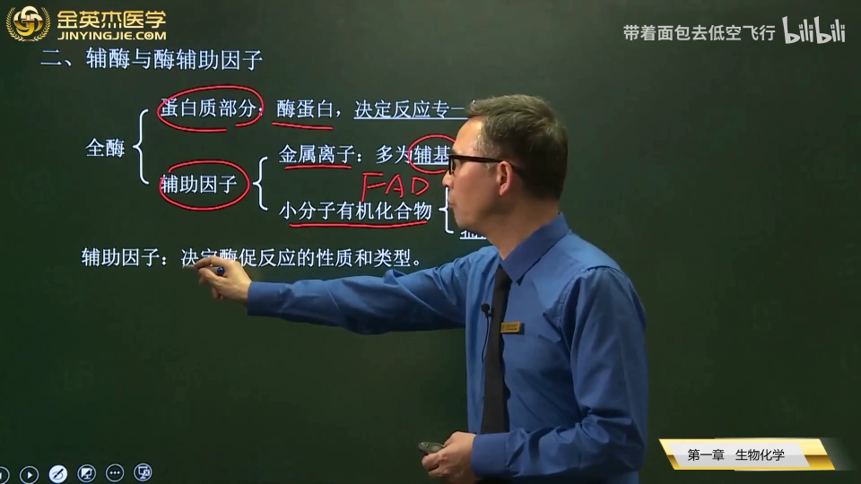

而另一类叫**辅酶**：像 NAD（烟酰胺腺嘌呤二核苷酸）与酶蛋白是**非共价键**结合，用透析的方法就可以把它解离下来。

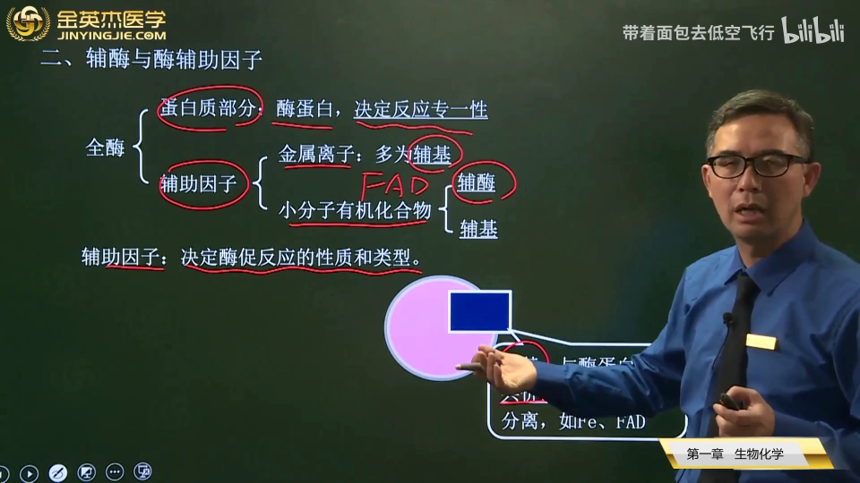

怎么形象地记住？抓住字面 [【跳转到 01:27】](https://www.bilibili.com/video/BV14C4y157Sm/?t=87)：

- 辅**基**的"基"是**基础**的"基"——以共价键结合，牢不可破；
- 辅**酶**的"酶"是**媒介**的意思——松散的非共价键联系。

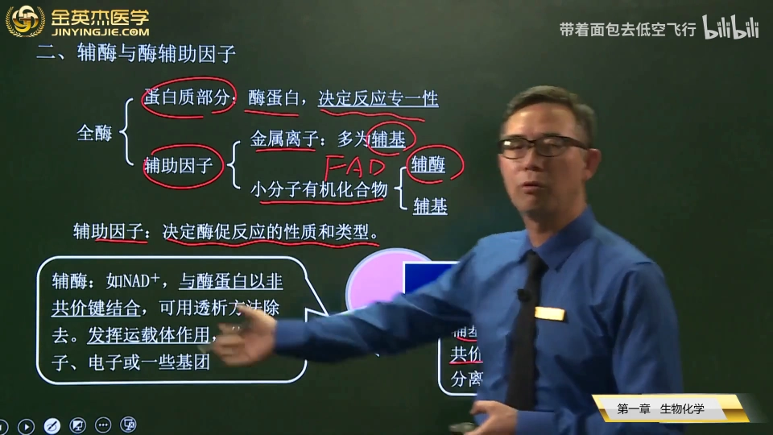

辅酶主要发挥**运载体**作用：有的传递电子、质子，或传递一些特殊的化学基团 [【跳转到 01:52】](https://www.bilibili.com/video/BV14C4y157Sm/?t=112)。

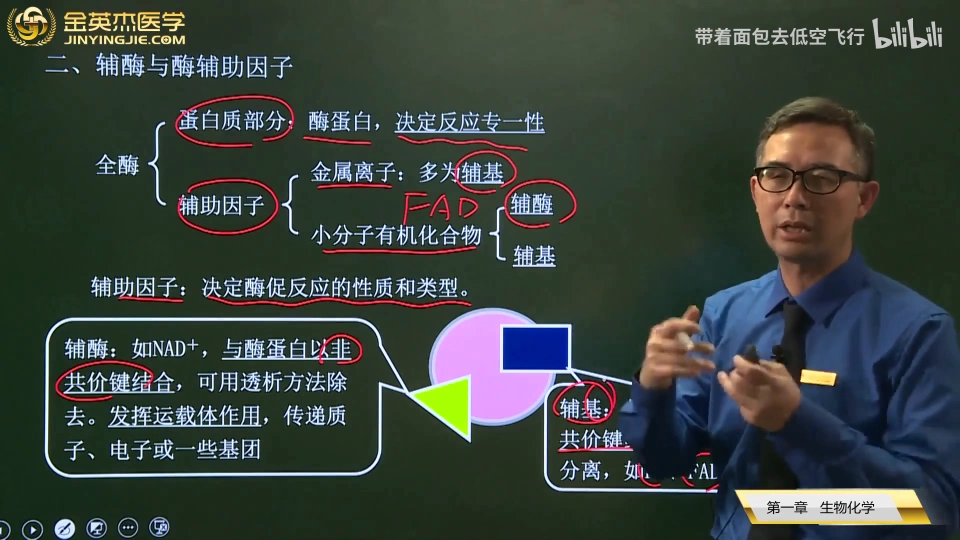

## 三、考试重点：重要辅酶辅基各转移什么基团

[【跳转到 02:15】](https://www.bilibili.com/video/BV14C4y157Sm/?t=135)

视频强调"它们转移的基团是什么"连续两年都考到。逐个认识：

- **辅酶Ⅰ**：我们叫 NAD；**辅酶Ⅱ**：是 NADP，叫烟酰胺腺嘌呤二核苷酸磷酸——这两者都是**转移氢原子**的，也叫质子或电子；
- **黄素单核苷酸（FMN）**和**黄素腺嘌呤二核苷酸（FAD）**：转移的也是**氢原子** [【跳转到 02:42】](https://www.bilibili.com/video/BV14C4y157Sm/?t=162)；
- **TPP**：转移的是**醛基**；**辅酶A**：转移的是**酰基** [【跳转到 03:00】](https://www.bilibili.com/video/BV14C4y157Sm/?t=180)；
- 特别要注意记住的是**磷酸吡哆醛**：转移的是**氨基**；
- **四氢叶酸**：转运的是**一碳单位**，一碳单位就是由四氢叶酸来运载的 [【跳转到 03:14】](https://www.bilibili.com/video/BV14C4y157Sm/?t=194)。

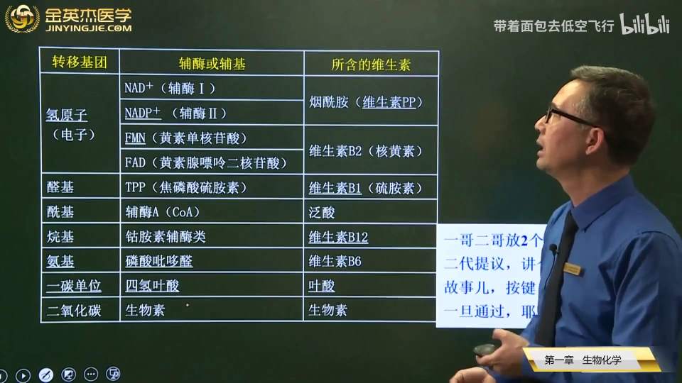

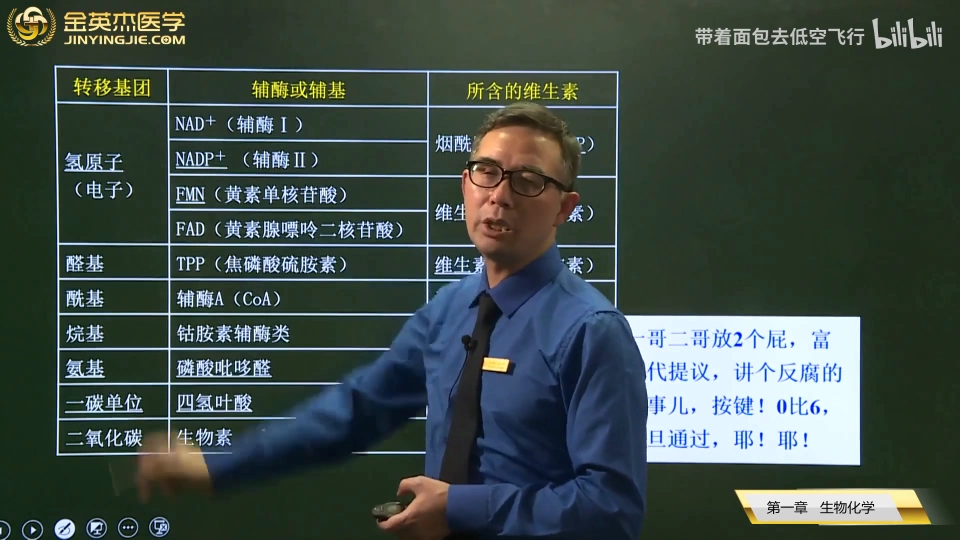

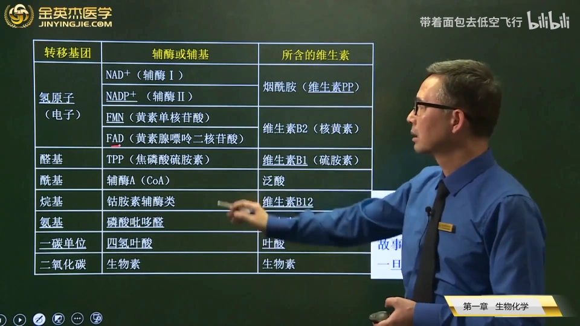

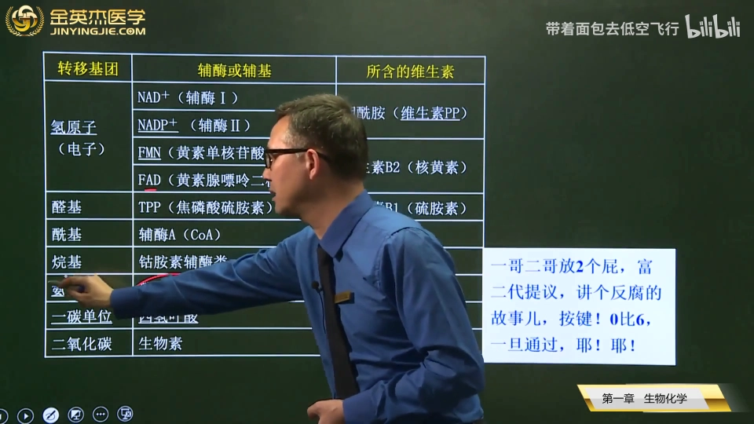

汇总成一张表：

| 辅酶 / 辅基 | 转移什么 |
| --- | --- |
| 辅酶Ⅰ（NAD⁺）、辅酶Ⅱ（NADP⁺） | 氢原子（质子 / 电子） |
| FMN、FAD | 氢原子 |
| TPP | 醛基 |
| 辅酶A | 酰基 |
| 磷酸吡哆醛 | 氨基 |
| 四氢叶酸 | 一碳单位 |

## 四、每个辅酶辅基背后站着哪种维生素

[【跳转到 03:48】](https://www.bilibili.com/video/BV14C4y157Sm/?t=228)

这些辅酶、辅基往往含有相关的维生素——或者说，一些维生素正是以这种形式作为自己的**活性形式**。所以一定要记住对应关系 [【跳转到 04:03】](https://www.bilibili.com/video/BV14C4y157Sm/?t=243)：

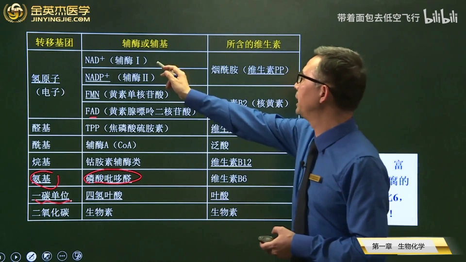

- 辅酶Ⅰ、辅酶Ⅱ → **维生素PP**（烟酰胺）；
- 黄素单核苷酸、黄素腺嘌呤二核苷酸 → **维生素 B2**（核黄素）；
- TPP → **维生素 B1**；辅酶A → **泛酸**；**钴胺素**辅酶类 → **维生素 B12**——视频特别提醒这一点很重要，课件里凡是下划线的都是曾经考过的内容；
- 磷酸吡哆醛 → **维生素 B6**；四氢叶酸 → **叶酸**的活性形式 [【跳转到 04:23】](https://www.bilibili.com/video/BV14C4y157Sm/?t=263)。

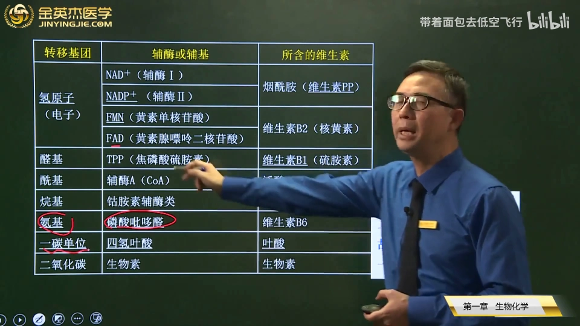

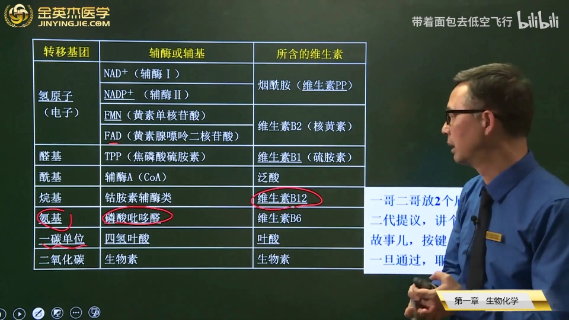

## 五、一条口诀串起全部

[【跳转到 04:45】](https://www.bilibili.com/video/BV14C4y157Sm/?t=285)

怎么把这些对应关系记下来？视频给了一个谐音口诀：

- **"一哥二哥放两个屁"**——辅酶Ⅰ、辅酶Ⅱ，还有 PP（两个 P，维生素PP）；
- **"富二代提议，讲个防腐的故事"**——"富二代"就是拼音 F 开头（FMN、FAD），含的是维生素 B2；"提"就是 TPP 的 T，含的是维生素 B1；
- "防腐"的故事里，**唯一含有金属离子的就是钴胺素辅酶类**——"古"谐音"钴"，"12"就是维生素 B12 [【跳转到 05:10】](https://www.bilibili.com/video/BV14C4y157Sm/?t=310)；
- **"既然有人提议，就要投票表决：按键"**——"按"指的就是**氨基**，投票的结果是"0、B6"（维生素 B6）；表决"一旦"通过——"一旦"谐音"**一碳**"（一碳单位）；"叶"代表叶酸，"四氢"代表四氢叶酸 [【跳转到 05:45】](https://www.bilibili.com/video/BV14C4y157Sm/?t=345)。

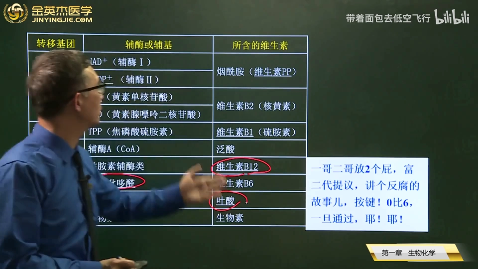

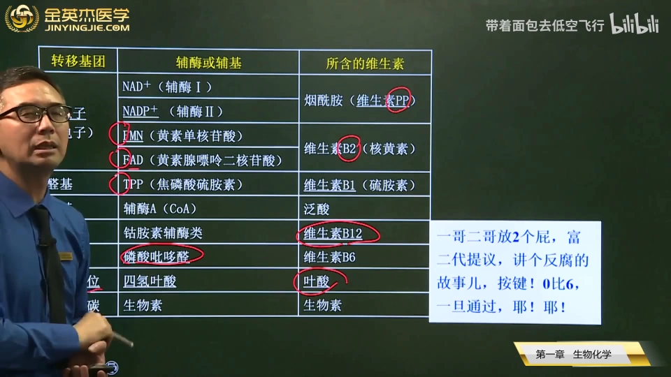

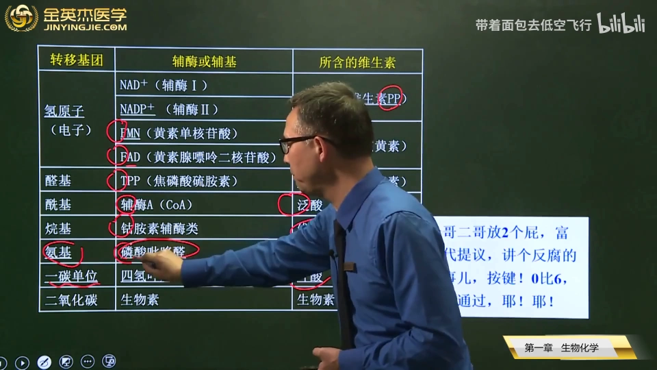

## 小结

- 辅助因子 = 金属离子 + 小分子有机化合物（如 FAD），决定酶促反应的类型或性质；
- **辅基**与酶蛋白共价结合（铁离子、FAD 等），透析不能解离；**辅酶**非共价结合（NAD 等），透析可解离；
- 记忆锚点：辅"基"= 基础（牢不可破），辅"酶"= 媒介（松散联系）；
- 转移基团对照：NAD⁺/NADP⁺、FMN/FAD → 氢原子；TPP → 醛基；辅酶A → 酰基；磷酸吡哆醛 → 氨基；四氢叶酸 → 一碳单位；
- 维生素对照：PP / B2 / B1 / 泛酸 / B12 / B6 / 叶酸；
- 口诀："一哥二哥放两个屁，富二代提议讲个防腐的故事"。

## 关键术语速查

| 术语 | 一句话解释 |
| --- | --- |
| 辅助因子 | 结合酶中非蛋白部分，决定反应的类型或性质 |
| 辅基 | 与酶蛋白共价结合、透析不能解离的辅助因子，金属离子全在此列 |
| 辅酶 | 与酶蛋白非共价结合、可透析解离的辅助因子，起运载体作用 |
| 辅酶Ⅰ / 辅酶Ⅱ | NAD⁺ / NADP⁺，含烟酰胺（维生素PP），转移氢原子 |
| FMN / FAD | 黄素单核苷酸 / 黄素腺嘌呤二核苷酸，含维生素 B2，转移氢原子 |
| TPP | 含维生素 B1，转移醛基 |
| 辅酶A | 含泛酸，转移酰基 |
| 磷酸吡哆醛 | 含维生素 B6，转移氨基 |
| 四氢叶酸 | 叶酸的活性形式，运载一碳单位 |
| 钴胺素辅酶类 | 含维生素 B12，是唯一含有金属离子的辅酶类 |

## 延伸：从"运载体"到结构预测的输入实体

（本节为视频之外的延伸说明，非视频内容。）

视频里的辅酶辅基（FAD、铁离子、钴胺素……）都是真实结合在蛋白上的小分子。在 Protenix 这类结构预测平台的输入 JSON 中，`ligand` 实体就是用来声明它们的——声明时使用的标识来自 PDB 的 CCD 化学组分字典（如 FAD、HEM 的三字母编码，见本系列 1.3.3 一节）。视频里那句"唯一含金属离子的钴胺素"也提示了另一条路径：金属部分单独走 `ion` 类型。
