# 1301：抗体与免疫球蛋白（上）

> 视频来源：[1301：抗体与免疫球蛋白（上）（Bilibili）](https://www.bilibili.com/video/BV1xN411P7Zx/)，时长 19:18。本文基于视频演说图文稿整理，时间戳可跳转到对应讲解。

## 本讲要解决的核心问题（SCQA）

**背景**：抗体是生物药与结构预测平台里最大的一类建模对象。要读懂抗体的输入输出，第一步是把抗体分子本身的结构搞清楚。

**冲突**：「抗体」和「免疫球蛋白」两个词日常混着用，听起来是一个东西；可抗体明明是"结合抗原"的分子，为什么它还能结合补体、通过胎盘、固定细胞？一个 Y 形分子凭什么"一专多能"？

**疑问**：抗体的基本结构到底由哪几条链组成？可变区、恒定区、铰链区各在哪里、各管什么？

**回答（中心思想）**：免疫球蛋白（Ig）单体由**两条相同的重链（H）+ 两条相同的轻链（L）**构成四肽链结构；靠近 N 端的**可变区（VH/VL）**负责"认脸"结合抗原，**恒定区（CL/CH）**负责执行效应功能，中间的**铰链区**提供开合柔性——用木瓜蛋白酶和胃蛋白酶把抗体拆开，正是逐一验证各部位功能的经典实验。

## 一、免疫球蛋白与抗体：一字之差，两个概念

[【跳转到 00:10】](https://www.bilibili.com/video/BV1xN411P7Zx/?t=10)

本讲分三块主要内容：抗体的定义、抗体的结构、抗体的分类与功能；另外还带出抗体与免疫球蛋白的区别、抗体的抗原性、免疫球蛋白超家族与克隆选择学说（后两块只做简介）。

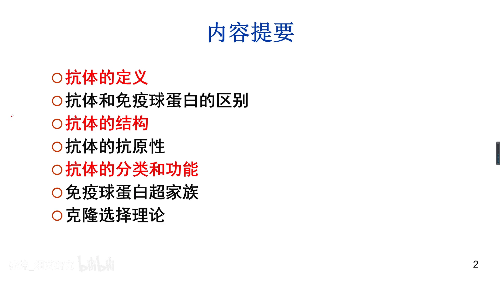

### 1.1 免疫球蛋白：曾被称为"丙种球蛋白"

[【跳转到 00:32】](https://www.bilibili.com/video/BV1xN411P7Zx/?t=32)

**免疫球蛋白**（Ig）指存在于人和动物血液（血清）、组织液以及其他外分泌液中，**一类具有相似结构的球蛋白**。

它曾被称为 **γ（gamma）球蛋白**，中国翻译为**丙种球蛋白** [【跳转到 00:57】](https://www.bilibili.com/video/BV1xN411P7Zx/?t=57)。名字来自电泳：血清蛋白在电泳中分成 α、β、γ 三个区带，而 γ 区的蛋白具有与抗原结合的特性（免疫活性），所以当时就这么叫开了。后来发现 γ 区里的主要成分就是 **IgG**——抗体中含量最高的一种。

### 1.2 抗体：生物学功能概念

[【跳转到 01:32】](https://www.bilibili.com/video/BV1xN411P7Zx/?t=92)

**抗体**（antibody）指机体受抗原物质刺激后，由 **B 淋巴细胞转化为浆细胞**产生的、能与相应抗原发生**特异性结合**的免疫球蛋白。

### 1.3 两个概念的区别与联系

[【跳转到 01:55】](https://www.bilibili.com/video/BV1xN411P7Zx/?t=115)

大部分情况下两个词可以混用，但严格说：**免疫球蛋白是化学结构上的概念，抗体是生物学功能上的概念**——

- 抗体必须与抗原结合；免疫球蛋白只要结构上"长得像抗体"即可，不一定要结合抗原；
- 所以：**抗体都是免疫球蛋白，但并非所有免疫球蛋白都有抗体活性**。

## 二、Ig 单体基本结构：两条重链 + 两条轻链

[【跳转到 02:45】](https://www.bilibili.com/video/BV1xN411P7Zx/?t=165)

抗体的结构里最核心的，是 **Ig 单体的基本结构**。一个完整的 Ig 分子就是一个"单体"：

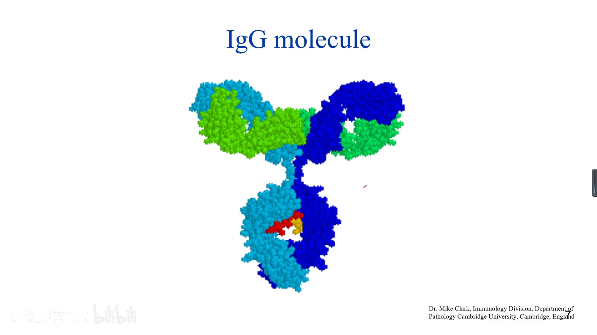

### 2.1 四条对称的多肽链

[【跳转到 03:05】](https://www.bilibili.com/video/BV1xN411P7Zx/?t=185)

单体由**四条对称的多肽链**构成：两条相同、分子量较大的**重链**（heavy chain，H），加两条相同、分子量较小的**轻链**（light chain，L）。图中深蓝与浅蓝是重链，绿色是轻链。

### 2.2 结构图每个细节都要掌握

[【跳转到 03:49】](https://www.bilibili.com/video/BV1xN411P7Zx/?t=229)

视频强调下面这张结构图"每一个细节都需要掌握"，因为**抗体的结构和功能的关系非常紧密**：

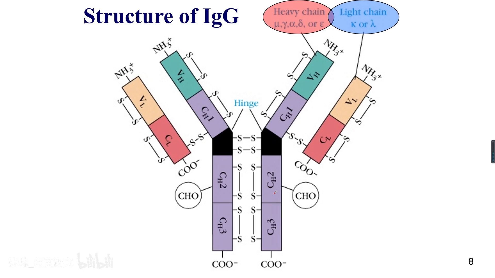

要点逐个拆解 [【跳转到 04:14】](https://www.bilibili.com/video/BV1xN411P7Zx/?t=254)：

- 英文 **H** = heavy（重）、**L** = light（轻），图里重链标 H、轻链标 L；
- **重链和轻链都分为可变区（V）与恒定区（C）** [【跳转到 04:39】](https://www.bilibili.com/video/BV1xN411P7Zx/?t=279)：重链可变区记 **VH**，轻链可变区记 **VL**；恒定区以 C 开头——轻链恒定区 **CL**，重链恒定区 **CH**。重链的 CH 可能有一个、两个、三个，还有的抗体有四个（后面讲到）；
- **可变区在 N 端，恒定区在 C 端** [【跳转到 05:04】](https://www.bilibili.com/video/BV1xN411P7Zx/?t=304)——这正是免疫学与生物化学紧密相关的地方；
- 图中 **S 表示二硫键**：既有链内（分子内）二硫键，也有链间（分子间）二硫键 [【跳转到 05:29】](https://www.bilibili.com/video/BV1xN411P7Zx/?t=329)；

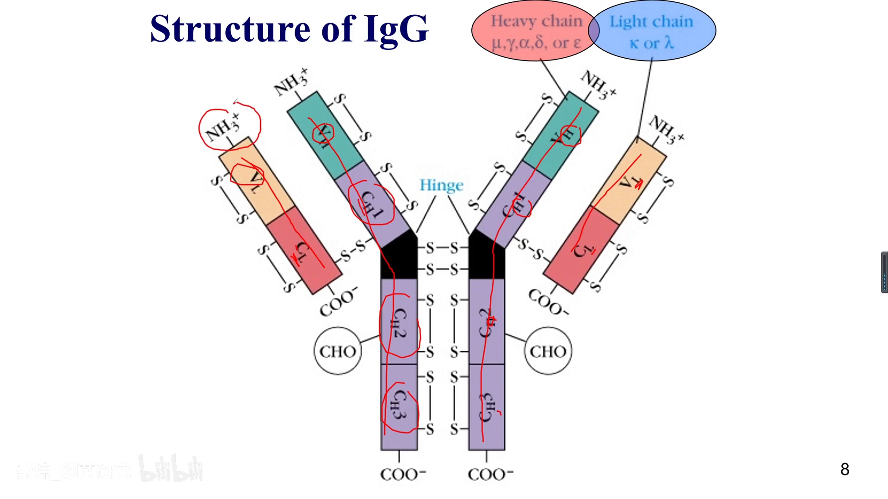

- **hinge = 铰链区** [【跳转到 05:54】](https://www.bilibili.com/video/BV1xN411P7Zx/?t=354)：像门轴一样控制两个臂的开合，后面细讲；重链（CH）在不同抗体间有五种，对应五类免疫球蛋白；
- 轻链分为 **κ（kappa）链和 λ（lambda）链** [【跳转到 06:19】](https://www.bilibili.com/video/BV1xN411P7Zx/?t=379)，一般性了解即可；图中 **CHO 标记糖基化位点**——抗体是一种含糖的蛋白。

注意一个易错点 [【跳转到 06:52】](https://www.bilibili.com/video/BV1xN411P7Zx/?t=412)：**同一个单体里的两条轻链是相同的**——要么都是 κ，要么都是 λ；κ/λ 的差异只出现在"不同抗体"之间。

## 三、可变区为什么能"抓住"千变万化的抗原

[【跳转到 07:36】](https://www.bilibili.com/video/BV1xN411P7Zx/?t=456)

### 3.1 表位：抗原上的"关键部位"

**表位**就是与抗体结合的、抗原上面的关键部位——**抗原决定簇**称为表位。可变区与恒定区分界的意义，就要围绕"表位"来理解：

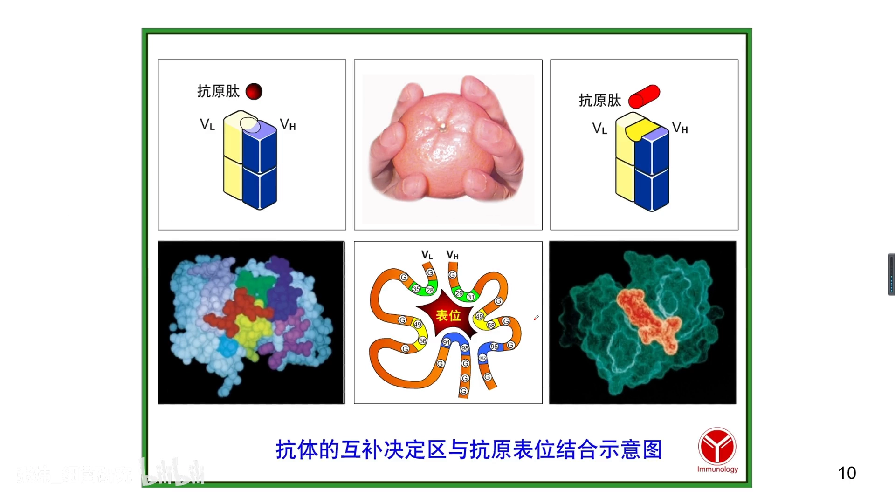

### 3.2 高变区：一级结构决定三级结构

[【跳转到 08:01】](https://www.bilibili.com/video/BV1xN411P7Zx/?t=481)

VL、VH 中各有**三个高变区（超变区）**。氨基酸的高级（三级）结构由一级结构决定，所以**改变高变区的一级结构，就能改变它的三级结构**——简单说，就是靠这几段序列的变化去"容纳"不同的表位。

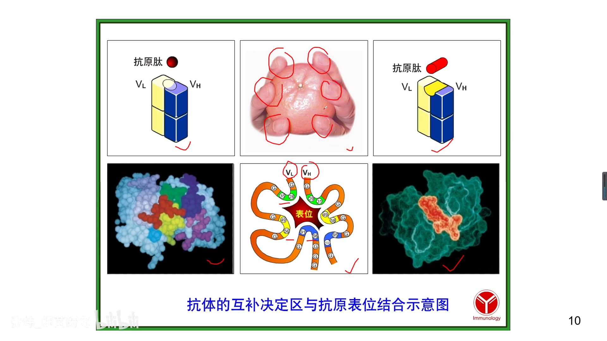

视频打了个比方 [【跳转到 08:26】](https://www.bilibili.com/video/BV1xN411P7Zx/?t=506)：轻链三个高变区 + 重链三个高变区，就像一只"手"，通过形状改变可以抓橙子、抓盒子……靠**改变高变区的结构去容纳不同的抗原表位**。旁边几幅图表达同一个意思：**抗体互补决定区（CDR）与抗原表位结合的示意图** [【跳转到 08:51】](https://www.bilibili.com/video/BV1xN411P7Zx/?t=531)。

## 四、恒定区与铰链区：抗体的"躯干"与"关节"

[【跳转到 09:22】](https://www.bilibili.com/video/BV1xN411P7Zx/?t=562)

### 4.1 恒定区数目：IgG/IgA 三个，IgM/IgE 四个

[【跳转到 10:07】](https://www.bilibili.com/video/BV1xN411P7Zx/?t=607)

不同抗体的恒定区数目不同：**IgG 和 IgA 有三个恒定区 CH1、CH2、CH3**；**IgM 和 IgE 多一个 CH4**——这第四个恒定区往往与细胞受体结合。

### 4.2 CH 各段的分工

[【跳转到 10:32】](https://www.bilibili.com/video/BV1xN411P7Zx/?t=632)

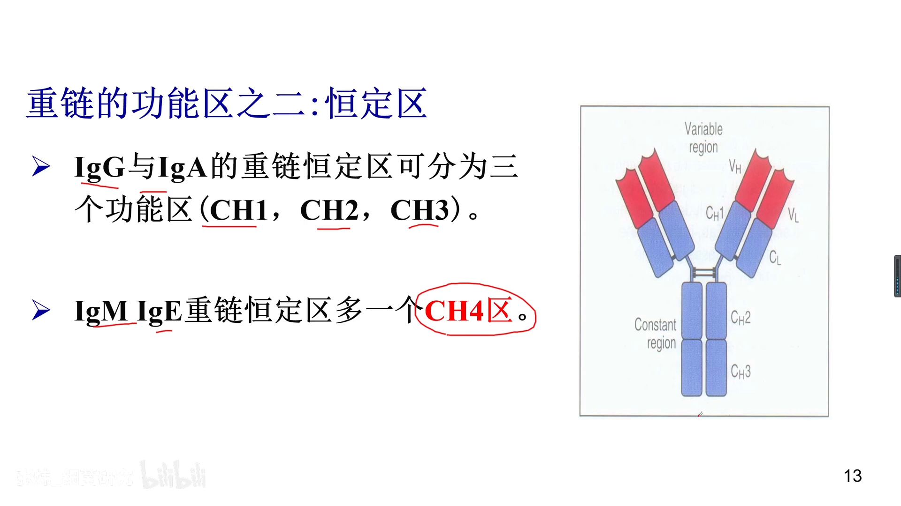

- **CH1**：遗传标志；
- **CH2**：与补体活化、通过胎盘有关；
- **CH3**：固定组织细胞；CH3 或 CH4 往往可以与**细胞上的 Fc 受体**结合 [【跳转到 10:57】](https://www.bilibili.com/video/BV1xN411P7Zx/?t=657)。

### 4.3 铰链区：0~180° 的柔性

[【跳转到 11:14】](https://www.bilibili.com/video/BV1xN411P7Zx/?t=674)

铰链区位于 **CH1 与 CH2 之间**，弹性非常好：一个抗体有**两个抗原结合位点**，铰链区可以改变两个臂之间的夹角——0°、60°、90°，最大可到 180°：

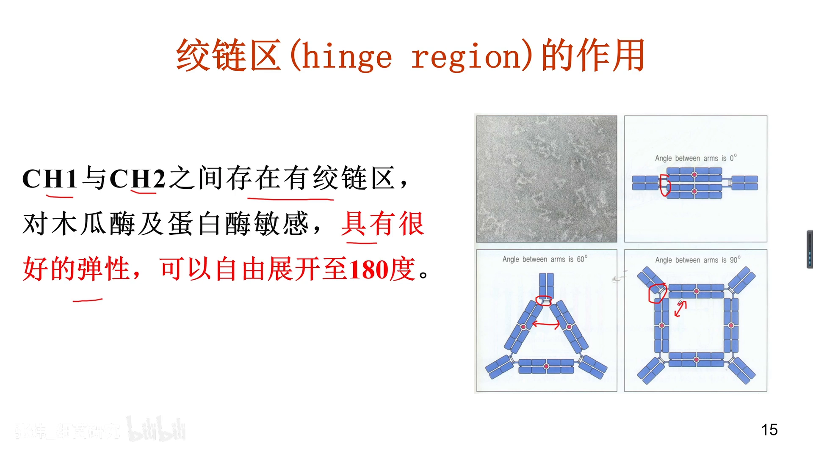

角度可变的直接后果，是抗体能"包抄"不同位置的抗原表位，把多个抗原**交联组成大的团块**，甚至出现**沉淀或凝集**现象 [【跳转到 12:04】](https://www.bilibili.com/video/BV1xN411P7Zx/?t=724)——这都和铰链区有关。

## 五、酶水解实验：拆开抗体看功能

[【跳转到 12:10】](https://www.bilibili.com/video/BV1xN411P7Zx/?t=730)

### 5.1 为什么要用两种酶切抗体

第一次看到这张图容易觉得奇怪：为什么偏要用两种不同的酶去切？其实一点也不"无聊"——早期研究者不知道抗体各部位的功能：**哪一段结合抗原、哪一段结合细胞**。用两种酶切出不同的片段组合，功能就"对号入座"了。

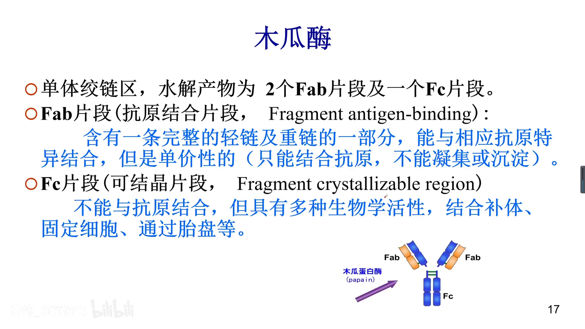

### 5.2 木瓜蛋白酶：2 Fab + 1 Fc

[【跳转到 12:35】](https://www.bilibili.com/video/BV1xN411P7Zx/?t=755)

木瓜蛋白酶在**铰链区靠近 N 端**处切断，两个臂与 Fc 段断开，水解产物为**两个 Fab 片段 + 一个 Fc 片段**：

- **Fab**（fragment antigen binding，**抗原结合片段**）[【跳转到 13:12】](https://www.bilibili.com/video/BV1xN411P7Zx/?t=792)：包含完整的轻链 + 重链的一部分（VH、CH1），其中就有抗体的高变区，能与抗原**特异性结合**——但它是**单价**的：能结合抗原，却**不能凝集或沉淀** [【跳转到 13:37】](https://www.bilibili.com/video/BV1xN411P7Zx/?t=817)（一个 Fab 抓一个抗原，抓不"成团"）；
- **Fc**（fragment crystallizable，**可结晶片段**）[【跳转到 14:02】](https://www.bilibili.com/video/BV1xN411P7Zx/?t=842)：不能结合抗原，但具有**多种生物学活性**——结合补体、固定细胞、通过胎盘等等 [【跳转到 14:27】](https://www.bilibili.com/video/BV1xN411P7Zx/?t=867)。

视频特别点破：初学者总觉得 Fab"很有用"，它确实有用，但**真正执行抗体大部分效应功能的其实是 Fc**；Fab 负责"找目标"，后面的事情靠 Fc 来做。

### 5.3 胃蛋白酶：Fab'₂ 双价 + 无活性的 pFc'

[【跳转到 14:52】](https://www.bilibili.com/video/BV1xN411P7Zx/?t=892)

胃蛋白酶在**铰链区靠近 C 端**切断：得到 **Fab'₂**——两个 Fab 由二硫键连成的**双价**片段，还原后可分解为两个 Fab。Fab'₂ 保留**双价抗体结合活性**，与抗原结合后**能形成沉淀或凝集**（两只"手"同时抓，就能把抗原交联成团）：

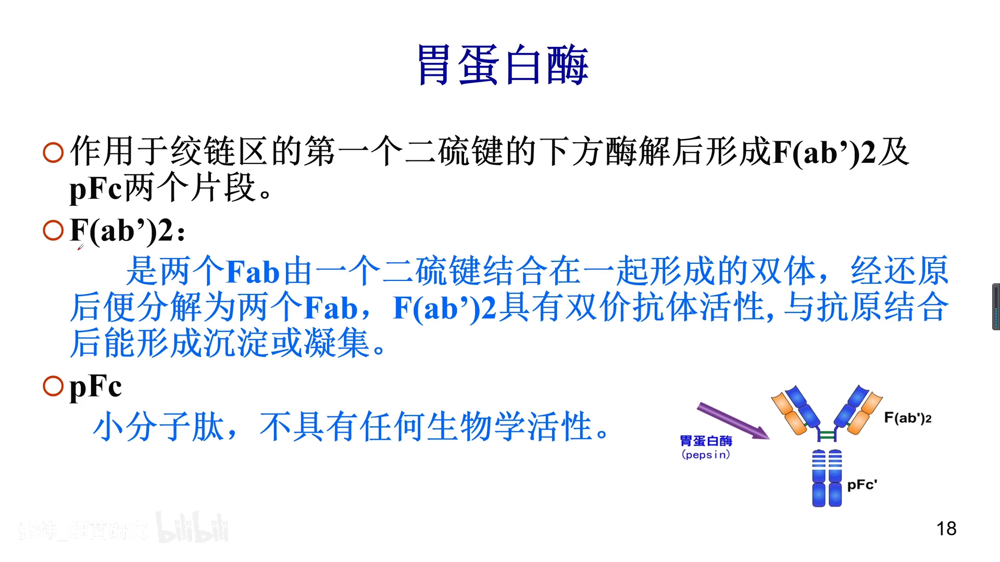

而 Fc 一侧则被切成小片段 **pFc'**，失去生物学活性 [【跳转到 15:22】](https://www.bilibili.com/video/BV1xN411P7Zx/?t=922)。两种酶切完一对比，抗体各部分的生物学活性就清楚了——这正是这组实验**最关键**的意义 [【跳转到 15:33】](https://www.bilibili.com/video/BV1xN411P7Zx/?t=933)。

## 六、免疫球蛋白的特殊结构：J 链与分泌成分

[【跳转到 15:48】](https://www.bilibili.com/video/BV1xN411P7Zx/?t=948)

特殊结构是多聚体抗体才有的"配件"：

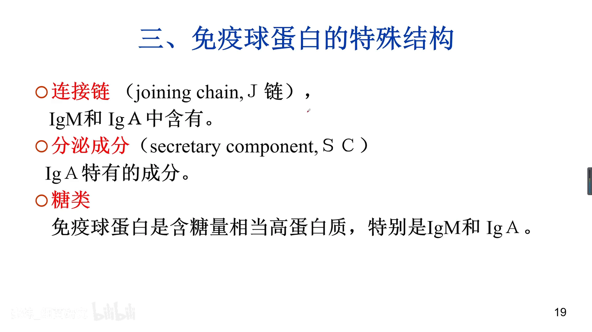

- **连接链（J 链）**：**五聚体的 IgM、二聚体的 IgA** 由 J 链连接多个单体而成；
- **分泌成分**（secretory component，SP）：分泌型 Ig（存在于唾液、肠液等外分泌液中）从血清分泌出去时需要它"打上标签"；
- **糖基化位点**：免疫球蛋白含糖量较高，尤其是 IgM 和 IgA [【跳转到 16:13】](https://www.bilibili.com/video/BV1xN411P7Zx/?t=973)。

## 七、五类免疫球蛋白：按重链 C 区分类

[【跳转到 16:43】](https://www.bilibili.com/video/BV1xN411P7Zx/?t=1003)

### 7.1 类、亚类、型、亚型

免疫球蛋白可分为**类、亚类、型和亚型**，本讲重点掌握「类」[【跳转到 16:57】](https://www.bilibili.com/video/BV1xN411P7Zx/?t=1017)。

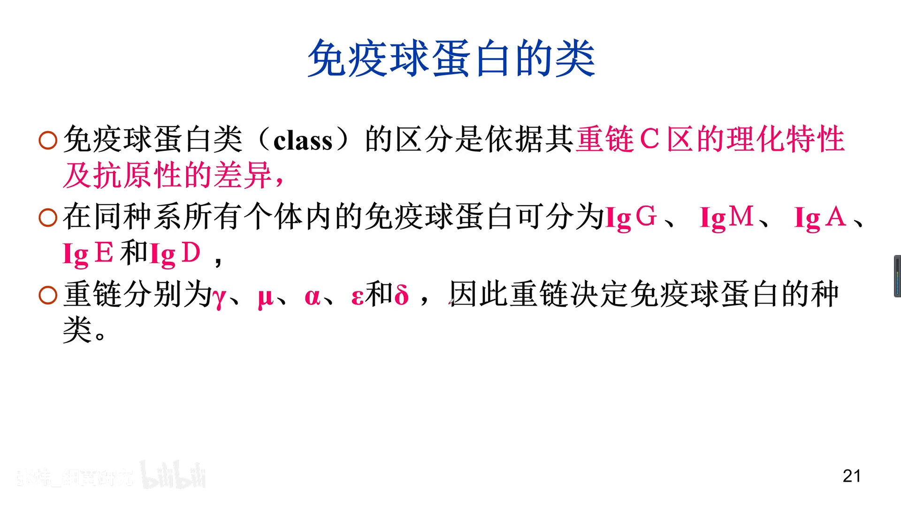

**「类」（class）的区分依据是重链 C 区**——重链恒定区的理化特征及抗原性差异 [【跳转到 17:22】](https://www.bilibili.com/video/BV1xN411P7Zx/?t=1042)。

### 7.2 重链五型与五类的对应

重链有 **γ、α、μ、ε、δ** 五种，对应五类免疫球蛋白：

| 重链类型 | 免疫球蛋白类别 | 好记程度 |
| --- | --- | --- |
| μ（mu） | IgM | 首字母对应，好记 |
| α（alpha） | IgA | 首字母对应，好记 |
| ε（epsilon） | IgE | 首字母对应，好记 |
| δ（delta） | IgD | 首字母对应，好记 |
| γ（gamma） | IgG | 不太像——因为 IgG 曾按电泳位置叫"γ 球蛋白" |

IgM→μ、IgA→α、IgE→ε、IgD→δ 四组首字母对应好记；唯独 IgG↔γ 看不出字面联系，原因正是 1.1 节的伏笔：γ 区电泳条带的主要成分就是 IgG，IgG 因此得名"γ 球蛋白"。

另外，各类免疫球蛋白的轻链都可分为 **κ 型和 λ 型**（主要针对人的体系）[【跳转到 18:42】](https://www.bilibili.com/video/BV1xN411P7Zx/?t=1122)；亚型、亚类不做要求，**五类是必须记住的重点**。

## 小结

- **免疫球蛋白是化学结构概念，抗体是生物学功能概念**：抗体都是免疫球蛋白，免疫球蛋白不一定有抗体活性；
- **Ig 单体 = 2 条相同重链 + 2 条相同轻链**，四条对称多肽链；重链轻链都分可变区（N 端）与恒定区（C 端）；
- **可变区（VH/VL）靠每条链 3 个高变区识别抗原表位**——一级结构的改变容纳不同表位，CDR 与表位结合；
- **恒定区执行效应功能**：CH1 遗传标志、CH2 补体活化与通过胎盘、CH3 固定组织细胞（结合 Fc 受体）；IgG/IgA 有 3 个 CH，IgM/IgE 有 4 个；
- **铰链区**（CH1/CH2 之间）提供 0~180° 柔性，使抗体能交联抗原、引发沉淀凝集；
- **木瓜蛋白酶 → 2 Fab（单价，结合抗原）+ 1 Fc（可结晶，效应功能）**；**胃蛋白酶 → Fab'₂（双价，可沉淀凝集）+ pFc'（无活性）**；
- **五类 Ig 按重链 C 区划分**：IgG/IgA/IgM/IgE/IgD ↔ γ/α/μ/ε/δ；轻链只有 κ、λ 两型。

## 关键术语速查

| 术语 | 一句话解释 |
| --- | --- |
| 免疫球蛋白（Ig） | 化学结构概念：血液/组织液/外分泌液中结构相似的球蛋白 |
| 抗体 | 功能概念：B 细胞→浆细胞受抗原刺激产生的、特异性结合抗原的免疫球蛋白 |
| 重链 / 轻链 | H 链大（五种）、L 链小（两型 κ/λ），同一单体两条轻链相同 |
| 可变区 VH/VL | N 端，各含 3 个高变区（CDR），负责结合抗原表位 |
| 恒定区 CH/CL | C 端，执行效应功能；IgG/IgA 三个 CH，IgM/IgE 四个（CH4） |
| 铰链区 | CH1 与 CH2 之间，弹性控制两臂 0~180° 开合 |
| Fab | 抗原结合片段：单价，能结合不能沉淀 |
| Fc | 可结晶片段：不结合抗原，负责补体、胎盘、结合细胞 |
| Fab'₂ / pFc' | 胃蛋白酶产物：双价结合片段 / 失活小片段 |
| J 链 | 连接 IgM 五聚体、IgA 二聚体的连接链 |
| 分泌成分（SP） | 分泌型 Ig 穿越外分泌液所需的"标签" |
| 类（class） | 按重链 C 区划分：IgG/IgA/IgM/IgE/IgD |
