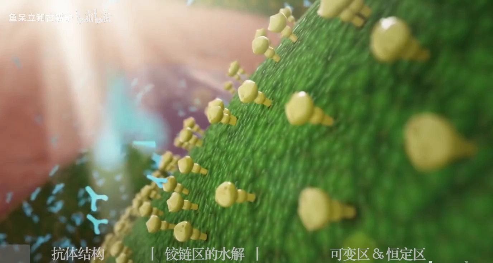
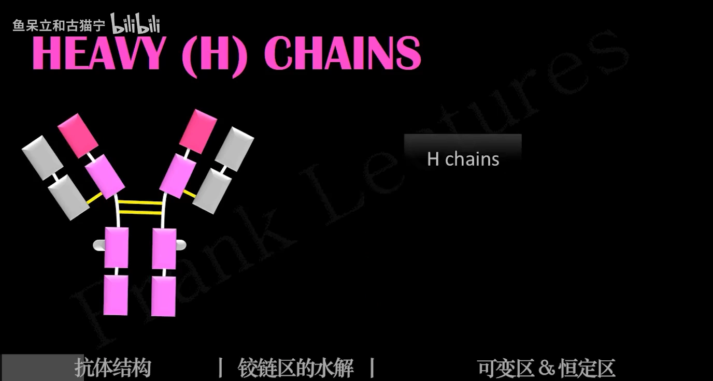
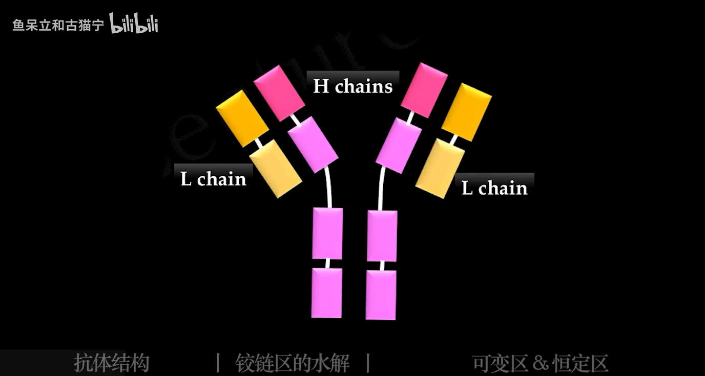
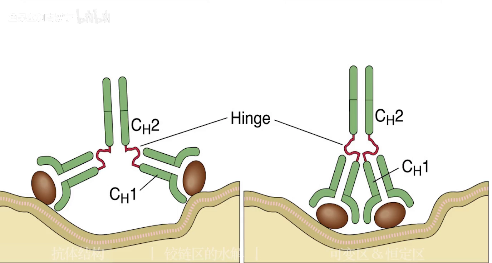
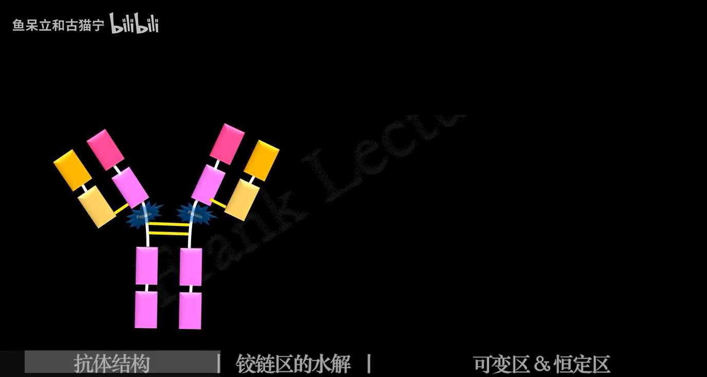
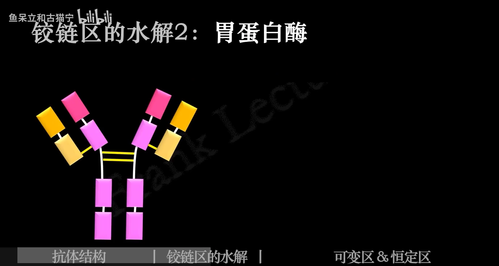
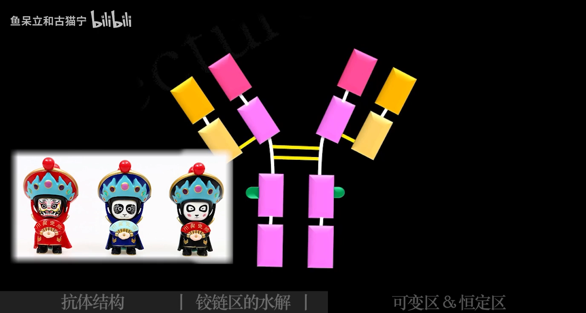
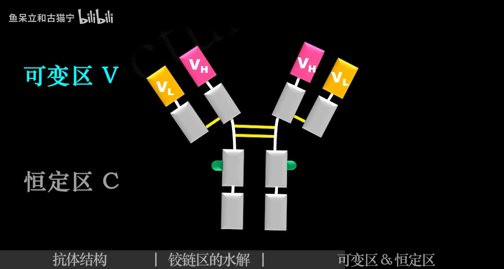
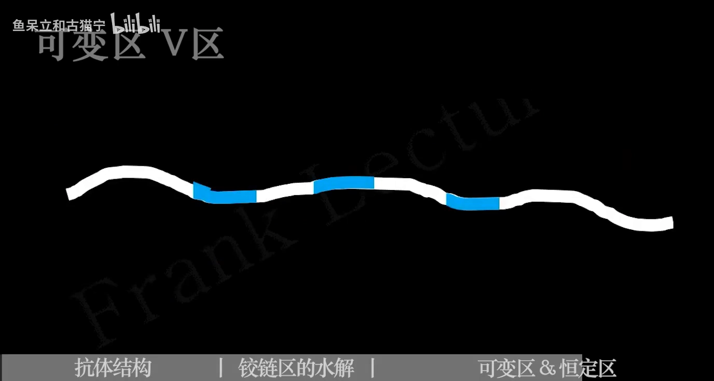
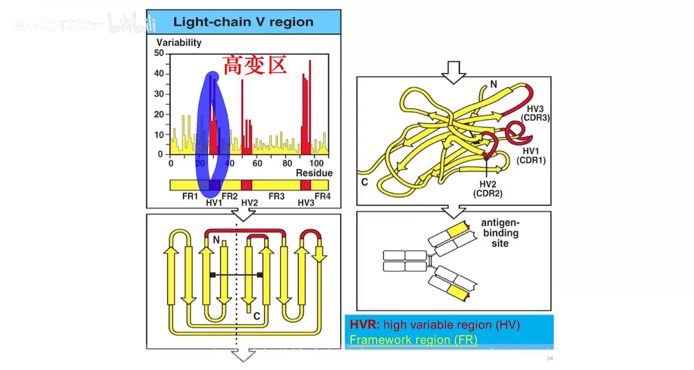

# 【免疫三分钟】抗体的结构：抗体有几种？木瓜／胃蛋白酶的水解效果？可变区／高变区／骨架区有什么不同？

> 视频来源：[【免疫三分钟】抗体的结构（Bilibili）](https://www.bilibili.com/video/BV1W341127c3/)，时长 3:50。本文基于视频演说图文稿整理，时间戳可跳转到对应讲解。

## 本讲要解决的核心问题（SCQA）

**背景**：打过新冠疫苗，身体就会提前产生抗体，以后再遇上特定病毒时能抵抗它们、保护自己。

**冲突**：抗体的本质只是蛋白质，由四条肽链构成——就这么一个 Y 形小分子，却要应对千变万化的抗原，还得"动员"补体和免疫细胞。

**疑问**：Y 形分子上，哪一段负责结合抗原？哪一段执行功能？铰链区、Fab、Fc、CDR 又都在哪里？

**回答（中心思想）**：抗体 = **两条重链 + 两条轻链**的四肽链 Y 形分子：靠近 N 端的**可变区（VL/VH）**各贡献 3 个高变区（CDR），共 6 个"叉齿"负责识别抗原；**恒定区 + 铰链区**负责效应功能与开合柔性；用**木瓜蛋白酶 / 胃蛋白酶**把抗体切成 Fab、Fc、Fab'₂，正是"结合"与"效应"两套分工的实验证据。

## 一、骨架：两条重链 + 两条轻链

### 1.1 四条肽链构成 Y 形分子

[【跳转到 00:15】](https://www.bilibili.com/video/BV1W341127c3/?t=15)

抗体的本质是蛋白质，由**四条肽链**构成：其中两条比较长，称为**重链**；另外两条比较短，称为**轻链**。

### 1.2 重链五型定五类，轻链两型

[【跳转到 00:26】](https://www.bilibili.com/video/BV1W341127c3/?t=26)

轻链有两种类型，重链有五种——**γ、μ、α、ε、δ**；抗体正是根据重链的类型分成了**五类**，其中 **IgG 占比最多**、也最为人们所熟知。

## 二、二硫键与铰链区：Y 形的"关节"

[【跳转到 00:31】](https://www.bilibili.com/video/BV1W341127c3/?t=31)

轻链和重链并不是相互独立的：它们之间以**二硫键**相连；在 Y 字形的交汇点（重链与重链之间）也有一个或多个二硫键 [【跳转到 00:38】](https://www.bilibili.com/video/BV1W341127c3/?t=38)。

正是交汇点的二硫键让 Y 字的两个手臂可以改变角度、弯曲伸展——因此这里被称为**铰链区** [【跳转到 00:49】](https://www.bilibili.com/video/BV1W341127c3/?t=49)。但注意：**并非所有抗体都有铰链区**——五类抗体中，**IgM 和 IgE 没有铰链区** [【跳转到 01:00】](https://www.bilibili.com/video/BV1W341127c3/?t=60)。

## 三、酶切实验：Fab"法宝"与 Fc"发愁"

### 3.1 木瓜蛋白酶 → 2 Fab + 1 Fc

[【跳转到 01:07】](https://www.bilibili.com/video/BV1W341127c3/?t=67)

铰链区可以被特定的酶水解。**木瓜蛋白酶**水解铰链区**靠近 N 端**的部分，形成**两个完全相同的 Fab（抗原结合片段）+ 一个 Fc（可结晶片段）**：

上方的 Fab 可以各自结合一个**抗原表位**——不妨按视频的谐音记作"**法宝**"；下方的 Fc 能保持完整但不能结合抗原——记作"**发愁**" [【跳转到 01:14】](https://www.bilibili.com/video/BV1W341127c3/?t=74)。

### 3.2 胃蛋白酶 → Fab'₂ 双价

[【跳转到 01:31】](https://www.bilibili.com/video/BV1W341127c3/?t=91)

**胃蛋白酶**更"暴力"：它水解铰链区**靠近 C 端**的二硫键，把 Fc 切碎、使其失去生物活性；而上方的两个 Fab 则像连体婴一样连在一起，成为 **Fab'₂** 片段——可以**同时结合两个抗原表位**。

## 四、可变区与恒定区："脸"与"躯干"

[【跳转到 01:56】](https://www.bilibili.com/video/BV1W341127c3/?t=116)

视频打了个比方：人与人的**脸**各不相同，而**躯干四肢**大同小异——抗体也是如此：Y 字形靠近 N 端的**上方**氨基酸序列变化较大，为**可变区（V 区）**；**下方**氨基酸序列大体相同，称为**恒定区（C 区）**。

**抗体与抗原结合的位置就是 V 区**——抗原千变万化，可变区正好可以应对这变化万千 [【跳转到 02:15】](https://www.bilibili.com/video/BV1W341127c3/?t=135)。

为了方便讲述，各区域也有特定名字 [【跳转到 02:28】](https://www.bilibili.com/video/BV1W341127c3/?t=148)：轻链和重链的可变区分别为 **VL** 和 **VH**；由于重链较长，其恒定区又分为 **CH1、CH2、CH3**——而 IgM 和 IgE 比较独特，有**四个**恒定区。

## 五、放大可变区：高变区、CDR 与骨架区

[【跳转到 02:49】](https://www.bilibili.com/video/BV1W341127c3/?t=169)

### 5.1 三段高变区 = 互补决定区

V 区由 100 多个氨基酸构成，其中**三段氨基酸变化能力特别强**，称为**高变区（HVR）**——抗体结合抗原这么高难度的任务当然交给它，所以高变区也称为**互补决定区（CDR）**——与抗原"互补"嘛 [【跳转到 02:54】](https://www.bilibili.com/video/BV1W341127c3/?t=174)。

除了这三段"特别喜欢变化"的氨基酸，其他氨基酸就像**长好的骨头**一样不怎么变化，称为**骨架区**。

### 5.2 骨架区 β 折叠撑起 CDR，6 把"叉子"抓抗原

在二级结构上，骨架区由**β 折叠**构成，三个高变区也因折叠而**聚拢**在一起 [【跳转到 03:11】](https://www.bilibili.com/video/BV1W341127c3/?t=191)：

总的来说：一个抗原结合位点上，**轻链贡献 3 个高变区、重链贡献 3 个高变区，共 6 个互补决定区**来识别、结合一个抗原——像"**六把叉子**"一样，不让抗原跑掉 [【跳转到 03:28】](https://www.bilibili.com/video/BV1W341127c3/?t=208)。

## 小结

- **抗体 = 2 重链 + 2 轻链**的四肽链 Y 形分子；重链五型（γ/μ/α/ε/δ）决定五类抗体，IgG 占比最多；
- **二硫键**固定四肽链；Y 形交汇点的**铰链区**提供柔性——IgM 和 IgE 没有铰链区；
- **木瓜蛋白酶**（切 N 端侧）→ 2 Fab"法宝"（各结合一个表位）+ 1 Fc"发愁"（完整但不结合抗原）；**胃蛋白酶**（切 C 端侧）→ Fab'₂（双价，连抓两个表位）+ Fc 碎片失活；
- **V 区（N 端）认抗原、C 区执行其余功能**；命名：VL/VH，CH1–CH3（IgM/IgE 有 4 个恒定区）；
- V 区 100 多个氨基酸中有 **3 段高变区（HVR = CDR）**，其余是**骨架区**（β 折叠，把 CDR 聚拢）；
- 每个抗原结合位点：轻链 3 + 重链 3 = **6 个 CDR**，像六把叉子抓住抗原。

## 关键术语速查

| 术语 | 一句话解释 |
| --- | --- |
| 重链（H） | 两条，较长；γ/μ/α/ε/δ 五型 → 五类抗体 |
| 轻链（L） | 两条，较短；两种类型 |
| 铰链区 | Y 形交汇处，可弯折改变角度；IgM/IgE 没有 |
| Fab | 抗原结合片段（"法宝"）：单价，结合一个表位 |
| Fc | 可结晶片段（"发愁"）：不结合抗原，保持完整 |
| Fab'₂ | 胃蛋白酶产物：两个 Fab 相连，可同时抓两个表位 |
| 可变区（V） | N 端，序列多变，结合抗原；VL/VH |
| 恒定区（C） | 序列大体相同；重链分 CH1–CH3（IgM/IgE 四个） |
| 高变区（HVR） | V 区中变化最强的三段 = 互补决定区（CDR） |
| 骨架区 | V 区中不怎么变化的氨基酸，β 折叠构成，撑起 CDR |
