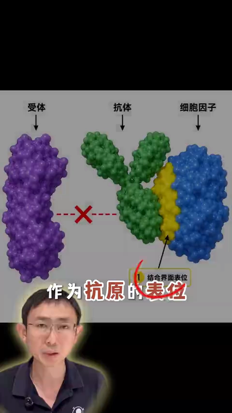

# AI 抗体从头设计，抗原表位怎么选？

> 视频来源：[AI抗体从头设计，抗原表位怎么选？（科曼生物 CEO 王铁源）](https://www.bilibili.com/video/BV1gS8X6yEt2/)
> 本文基于视频 AI 字幕与画面整理，时间戳可跳转到对应讲解。

## 本讲要解决的核心问题（SCQA）

**背景**：AI 抗体设计工具已经可以"指哪打哪"——给定一个抗原表位，就能从头设计出靶向它的抗体（表位即热点，决定了设计的起点）。抗体药物的效果与安全性，很大程度上在**选表位这一步**就已经决定了。

**冲突**：但很多团队拿到抗原结构后，并不知道表位该怎么挑；选错了表位，后面的设计再努力也事倍功半。

**疑问**：面对一个已知结构的抗原，表位到底怎么选？

**回答（中心思想）**：从两个层面选——**第一看生物学功能**（你要抗体去干什么，功能定方向）；**第二看表位自身的"可设计性"**（表面暴露、稳定二级结构、凹凸表面特征、疏水残基，这四点决定设计成功率）。

## 一、先定功能：你要抗体去做什么？

选表位第一重要的，是满足抗体的**生物学功能** [【跳转到 00:10】](https://www.bilibili.com/video/BV1gS8X6yEt2/?t=10)。视频给了几类典型场景：

1. **阻断结合**：想让抗体阻断细胞因子与其受体的结合，就应该选**细胞因子和受体的结合界面**作为抗原表位——抗体占据了界面，结合自然就被挡住了 [【跳转到 00:45】](https://www.bilibili.com/video/BV1gS8X6yEt2/?t=45)。
2. **人、鼠、猴交叉活性**：后续做体内药效评估时，有交叉活性的抗体会方便很多。但只用人的抗原去免疫，抗体可能只结合人的抗原、不结合鼠和猴的。解决办法是从源头入手：**一开始就选人、鼠、猴同时保守的表位**，设计出来的抗体就能同时结合三个物种 [【跳转到 01:01】](https://www.bilibili.com/video/BV1gS8X6yEt2/?t=61)。
3. **特殊位置需求**：有些项目希望抗体结合抗原的**近末端**表位，也有项目希望结合**远末端**表位——都是跟着生物学功能和活性的要求来定 [【跳转到 01:06】](https://www.bilibili.com/video/BV1gS8X6yEt2/?t=66)。

## 二、再看表位自身：决定设计成败的检查点

功能定了方向，第二步是审查表位本身的性质 [【跳转到 01:28】](https://www.bilibili.com/video/BV1gS8X6yEt2/?t=88)：

1. **必须暴露在抗原表面** [【跳转到 01:38】](https://www.bilibili.com/video/BV1gS8X6yEt2/?t=98)：这是底线。包埋在蛋白内部的氨基酸，抗体根本无法靶向。

2. **选二级结构相对稳定的位置** [【跳转到 01:48】](https://www.bilibili.com/video/BV1gS8X6yEt2/?t=108)：抗原结构通常是已知的，尽量选 α 螺旋、β 折叠等稳定二级结构上的区域；**loop（环）不太推荐**——loop 本身柔性大，针对它设计的难度更高。

   

3. **表面要有"抓点"：凸起或凹陷** [【跳转到 02:09】](https://www.bilibili.com/video/BV1gS8X6yEt2/?t=129)：可以想象抗体相当于一只手指——表面有凸起、凹陷等特征的地方容易"抓住"；特别光滑、平坦的区域则不好抓。

4. **残基性质：优选带疏水残基的表位** [【跳转到 02:32】](https://www.bilibili.com/video/BV1gS8X6yEt2/?t=152)：无论抗体还是小蛋白的计算设计，经验上**带疏水残基的表位设计成功率相对更高**；而亲水残基或带电荷非常多的表位，设计难度明显更大。

## 三、总结：选表位的两层面清单

视频最后给出一个两层面的总结 [【跳转到 02:53】](https://www.bilibili.com/video/BV1gS8X6yEt2/?t=173)：

- **层面一：生物学功能**——阻断结合界面、物种交叉活性、末端特异性……先想清楚抗体要干什么；
- **层面二：表位可设计性**——暴露在抗原表面 + 有稳定二级结构 + 有凸起/凹陷等表面特征 + 含一定疏水残基 [【跳转到 03:03】](https://www.bilibili.com/video/BV1gS8X6yEt2/?t=183)。

## 小结

- 表位选择直接决定抗体药物的药效与安全性；AI 工具可以针对指定表位从头设计抗体，所以"选表位"就是设计的起点。
- **功能定方向**：阻断结合就选结合界面；要人/鼠/猴交叉活性就选三物种保守表位；末端需求就选近/远末端表位。
- **可设计性定成败**：①必须表面暴露（内部够不着）；②优选稳定二级结构（α 螺旋、β 折叠），慎选柔性 loop；③优选有凸起/凹陷"抓点"的表面；④优选含疏水残基的表位（设计成功率更高）。
- 与免疫学背景呼应：表位是抗体识别的结构基础（见前两篇博客），而 AI 抗体设计把"表位"直接变成了设计输入——表位选得好，设计的抗体才既结合得牢，又落点准确。

## 关键术语速查

| 术语 | 一句话解释 |
| --- | --- |
| 表位（epitope） | 抗原上被抗体识别的结构基础；AI 抗体设计的"设计输入" |
| 结合界面（interface） | 两个分子相互接触的区域；阻断型抗体应靶向这里 |
| 交叉活性 | 抗体同时结合多个物种（如人、鼠、猴）同源抗原的能力 |
| 保守表位 | 在不同物种间序列/结构相似的表位，是获得交叉活性的选择 |
| 二级结构 | 蛋白链局部的规则构象，如 α 螺旋、β 折叠 |
| loop（环） | 连接二级结构的柔性区段，构象不稳定，作表位设计难度大 |
| 疏水残基 | 不与水亲和的氨基酸残基；经验上含疏水残基的表位更易设计成功 |
| 从头设计（de novo design） | 不依赖既有抗体，由 AI 直接生成靶向指定表位的抗体 |
