# 医学免疫学 第三章_01：抗原的性质与分子结构基础

> 视频来源：[医学免疫学 第三章_01 抗原的性质与分子结构基础（学免疫的姚小姚）](https://www.bilibili.com/video/BV1A5411a7py/)
> 本文基于视频 AI 字幕与画面整理，时间戳可跳转到对应讲解。

## 本讲要解决的核心问题（SCQA）

**背景**：免疫系统每天都在对付病毒、细菌、粉尘等各种"外来者"，而且打得非常准——乙肝病毒进入人体，只会刺激出乙肝抗体，绝不会顺带冒出一个抗艾滋病的抗体。

**冲突**：但病毒、细菌这样的"抗原"往往是个庞然大物：一个蛋白分子动辄几百上千个氨基酸。免疫系统如果对整个大分子做"全员识别"，既累又容易出错。

**疑问**：免疫系统到底识别的是抗原的什么？为什么识别能精确到"敌我分明、一点不乱"？

**回答（中心思想）**：免疫系统识别的从来不是整个抗原，而是抗原分子上一小段、一小段的**抗原表位**——表位决定特异性。理解了"抗原靠免疫原性 + 免疫反应性两大特性起作用，而特异性由表位决定"，这一章的所有概念就都能串起来。

## 一、什么是抗原：能"激活免疫"、又能"被免疫清除"的物质

**抗原（antigen）指所有能激活和诱导免疫应答的物质** [【跳转到 00:06】](https://www.bilibili.com/video/BV1A5411a7py/?t=6)。

理论上自然界万事万物都可能成为抗原：尘肺病患者接触的"抗原"，就是矿山工地里的无机粉尘。但在医学/免疫学范畴，我们通常讨论的是**有机物抗原**——蛋白抗原、多糖抗原、核酸、脂类 [【跳转到 00:31】](https://www.bilibili.com/video/BV1A5411a7py/?t=31)。

要当"合格的抗原"，必须同时具备两大基本特性 [【跳转到 01:13】](https://www.bilibili.com/video/BV1A5411a7py/?t=73)：

1. **免疫原性**：能被免疫细胞"看见"并激活免疫应答。具体说：抗原能被 T 细胞表面的受体 **TCR**（T Cell Receptor，T 细胞抗原受体）或 B 细胞表面的受体 **BCR**（B Cell Receptor，B 细胞抗原受体）识别结合，让这些细胞增殖分化——T 细胞变成有杀伤功能的效应 T 细胞，B 细胞变成浆细胞并生产抗体 [【跳转到 01:38】](https://www.bilibili.com/video/BV1A5411a7py/?t=98)。一句话：**它能把免疫系统"点着"**。
2. **免疫反应性（抗原性）**：能反过来与免疫应答的产物（效应细胞、抗体）特异性结合，被结合、中和、杀伤、清除 [【跳转到 02:03】](https://www.bilibili.com/video/BV1A5411a7py/?t=123)。一句话：**它会被免疫系统"盯上并处理掉"**。

视频里有个好记的类比：说一个人是"罪犯"要满足两个条件——他确实做了坏事（激活了社会的"免疫系统"），而且被抓住判刑（被"免疫产物"清除了）。只做坏事没被抓，那叫嫌疑犯；两者都占，才叫罪犯 [【跳转到 03:10】](https://www.bilibili.com/video/BV1A5411a7py/?t=190)。同理，**同时具有免疫原性和免疫反应性的，才是完整抗原**；大多数蛋白质就是完整抗原。

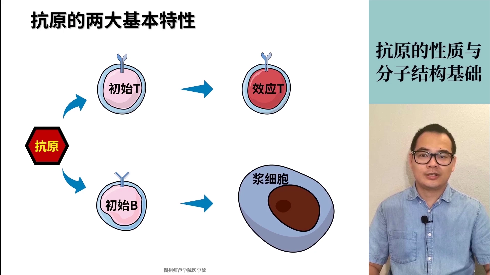

## 二、特异性：一个抗原只激活"命定"的那一个淋巴细胞克隆

适应性免疫应答具有**特异性**，而且特异性同时体现在抗原的两大特性上 [【跳转到 03:57】](https://www.bilibili.com/video/BV1A5411a7py/?t=237)：

- **免疫原性的特异性**：某个抗原分子只能诱导与之对应的淋巴细胞克隆发生免疫应答。这里先建立一个关键观念：**体内的 T 细胞并不是彼此的复印件**——每个 T 细胞会针对哪种抗原起反应，是"命中注定"的。所以一堆 T 细胞里，只有那个"红色的"T 细胞能被"红色的"抗原激活，一抗原只激活对应克隆 [【跳转到 04:22】](https://www.bilibili.com/video/BV1A5411a7py/?t=262)。
- **抗原性（免疫反应性）的特异性**：反过来，某个抗体或活化的 T 细胞面对五花八门的抗原时，也只与对应的那个抗原结合 [【跳转到 04:47】](https://www.bilibili.com/video/BV1A5411a7py/?t=287)。

两个方向合起来，就是适应性免疫的特异性：**抗原只激活对应克隆，克隆的产物也只咬对应抗原**。

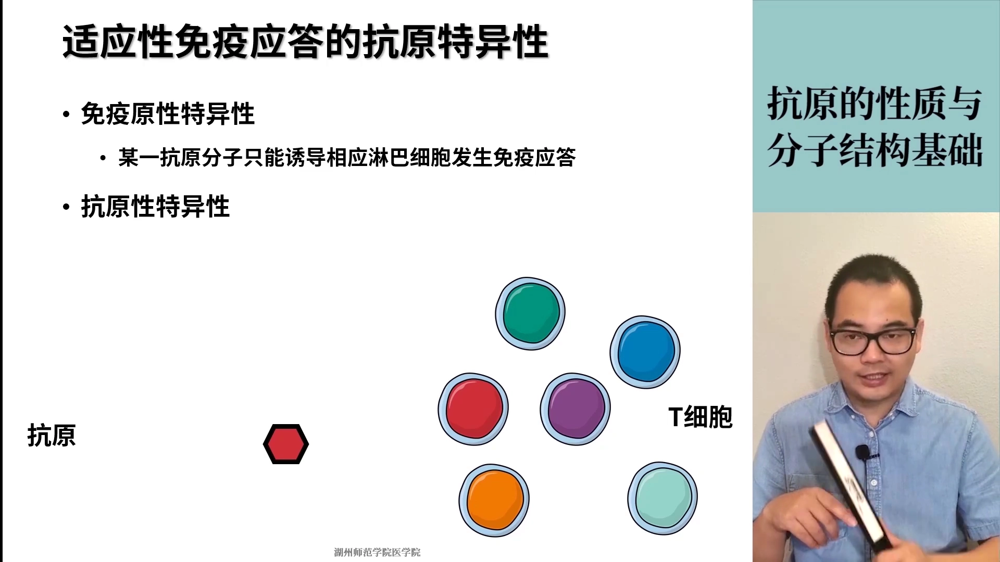

例子很好懂：乙肝病毒只能刺激出乙肝抗体，刺激不出抗艾滋病抗体；乙肝抗体也只跟乙肝病毒结合，不会去咬新冠病毒 [【跳转到 05:37】](https://www.bilibili.com/video/BV1A5411a7py/?t=337)。

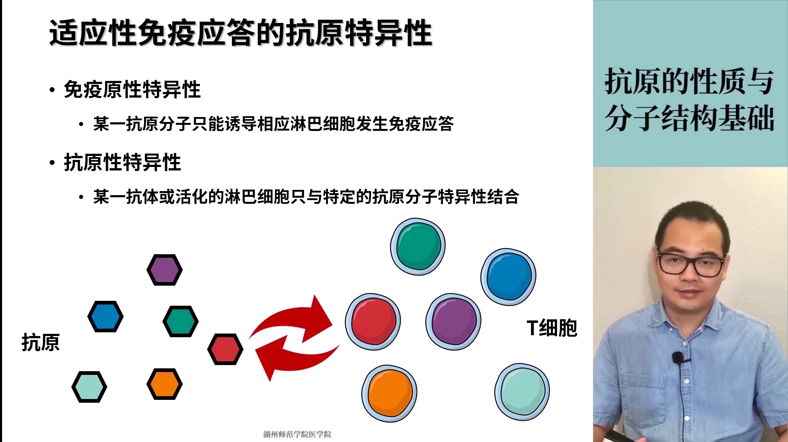

## 三、完全抗原与半抗原：两大特性只有其一叫"半"

**完全抗原**：免疫原性 + 免疫反应性都有，比如大多数蛋白质。

**半抗原（不完全抗原）**：两大特性只有其一——专指**只有免疫反应性（抗原性）、没有免疫原性**的物质 [【跳转到 05:59】](https://www.bilibili.com/video/BV1A5411a7py/?t=359)。

这个定义乍看很拧巴：自己激活不了免疫系统，却"躺着也中枪"地会被免疫产物结合，为什么？原因很简单：**半抗原通常是小分子**（一些多糖、脂类、药物）。它不激活免疫反应，不是因为它不是异物，也不代表它无害，只是**分子量太小，小到免疫系统里的细胞和分子根本"监控"不到它** [【跳转到 06:24】](https://www.bilibili.com/video/BV1A5411a7py/?t=384)。

视频里给了一个能自洽的例子 [【跳转到 07:39】](https://www.bilibili.com/video/BV1A5411a7py/?t=459)：多糖有小分子多糖、也有大分子多糖。小分子多糖激活不了免疫反应；但如果大分子多糖激活了免疫反应、体内产生了抗这种多糖的抗体，这个抗体会不会"捎带手"把结构相同的小分子多糖一起清掉？——会的，只要分子结构一样。这就是半抗原：**本身太小激不起反应，但可以被"别人激起的"免疫产物识别**。

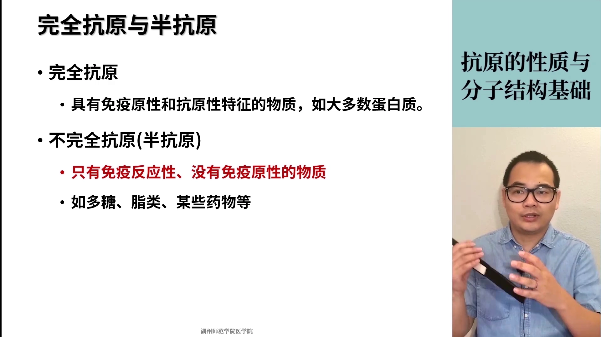

## 四、抗原表位：决定特异性的结构基础（本章核心）

**抗原表位（antigenic epitope），又称抗原决定簇**，指抗原分子中决定抗原特异性的特殊化学基团，是**决定抗原特异性的结构基础** [【跳转到 08:28】](https://www.bilibili.com/video/BV1A5411a7py/?t=508)。

大小很有规律：

- 蛋白质表位：一般 **5～17 个氨基酸**；
- 多糖 / 核苷酸表位：一般 **5～7 个单元**。

一个抗原分子上可以有**很多个**表位；而上一节的半抗原，其实就相当于**一个独立的抗原表位**游离在体外。

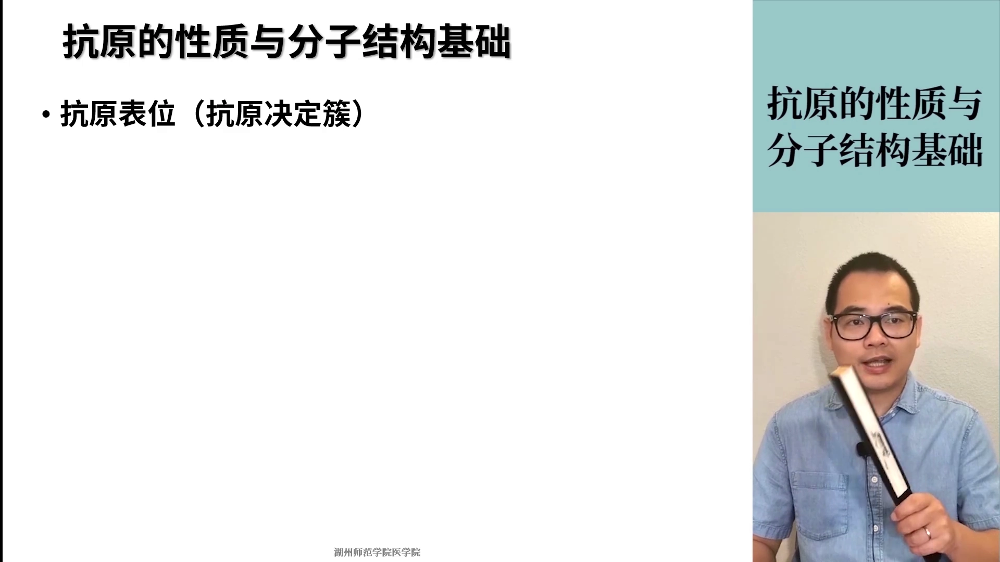

怎么直观理解"免疫系统认的是表位，不是整个抗原"？视频用的比喻是**认人**：你认出这是张三、那是李四，靠的不是把对方"整个"扫描一遍，而是认**特征**——眼睛长什么样、鼻子高不高、嘴巴大不大。抗原大分子上那些五颜六色的"特征片段"，就是免疫系统认人的"五官"，每一个颜色块代表一个抗原表位 [【跳转到 09:40】](https://www.bilibili.com/video/BV1A5411a7py/?t=580)。

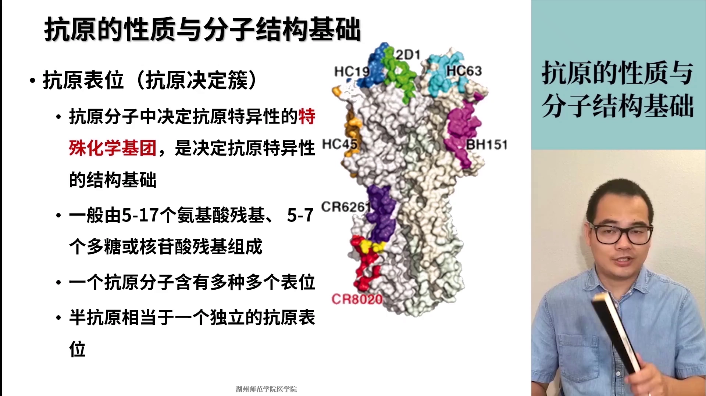

表位和半抗原的关系也随之打通了 [【跳转到 10:30】](https://www.bilibili.com/video/BV1A5411a7py/?t=630)：**同一个东西，看它处在什么状态**——

- 紫色的表位片段如果从大蛋白上脱离、单独游离存在：自身激活不了免疫系统 → 它是**半抗原**；
- 它结合在大分子蛋白载体上、成为完整抗原的一部分：它叫**抗原表位**。

也就是说：**游离的表位 = 半抗原；挂在载体上的半抗原 = 表位**。

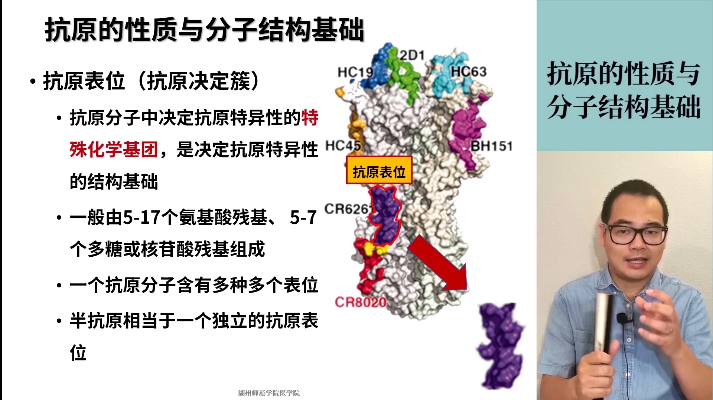

## 五、T 细胞表位与 B 细胞表位：同是表位，要求大不相同

表位还有第二种分类方法：按表位**能激活什么细胞**来分，分为 **T 细胞表位**和 **B 细胞表位** [【跳转到 11:00】](https://www.bilibili.com/video/BV1A5411a7py/?t=660)。

- **T 细胞表位**：由 TCR 识别，但 T 细胞自己不直接看抗原——表位必须先经过"吞掉、消化、切成小段"的加工处理，才能交给 T 细胞识别；
- **B 细胞表位**：由 BCR 识别，B 细胞**直接**识别，不需要别人帮忙。

视频用一张对比表把两个表位放在一起比较 [【跳转到 11:25】](https://www.bilibili.com/video/BV1A5411a7py/?t=685)：

| 比较项 | T 细胞表位 | B 细胞表位 |
| --- | --- | --- |
| 识别受体 | TCR | BCR |
| 是否需要 MHC | 必须要 | 不需要 |
| 表位性质 | 线性短肽 | 多肽、糖类、核酸等有机物均可 |
| 表位大小 | 8～12 个或 12～17 个氨基酸（对应两种不同的 T 细胞） | 氨基酸组成的蛋白、单糖/核苷酸组成的糖类核酸均可 |
| 表位类型 | 只能是线性表位 | 线性、构象都可以 |
| 表位位置 | 任意位置（表面或内部） | 必须在抗原分子表面 |

这里的 **MHC 分子**是整个免疫学里最重要的分子之一，主要作用是辅助 T 细胞活化：T 细胞活化必须要 MHC 参与，而 B 细胞不需要 [【跳转到 12:04】](https://www.bilibili.com/video/BV1A5411a7py/?t=724)。

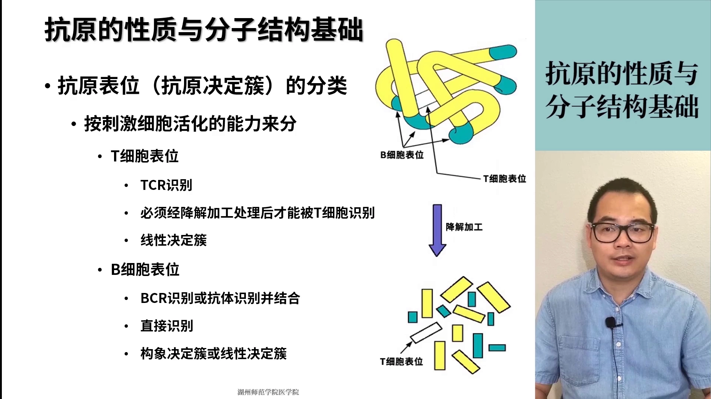

总的来说，**T 细胞对表位的要求更高，B 细胞要求低一些**，原因是分工不同 [【跳转到 13:19】](https://www.bilibili.com/video/BV1A5411a7py/?t=799)：

- T 细胞靠辅助细胞（抗原提呈细胞）帮它把抗原吞掉、消化、切成一段一段，挑出其中的**线性表位**递呈给 T 细胞。所以 T 表位必须是线性的——构象表位一消化就散了；但也正因为"先消化再识别"，**表位不管藏在分子里多深，都能被提取出来**，所以 T 表位可以在任意位置（表面或内部）。
- B 细胞"什么都要靠自己"：通过 BCR 直接识别完整抗原，表位藏在分子内部就够不着。所以 **B 表位必须在分子表面**。

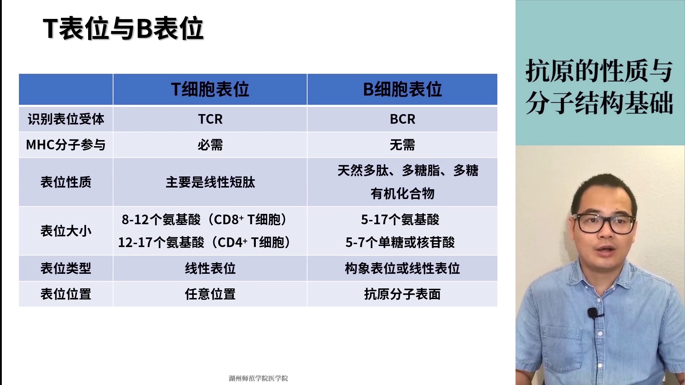

## 六、半抗原载体效应：青霉素为什么每次都要做皮试

上一节的表位/半抗原关系，再推一步就是**半抗原载体效应**：半抗原 + 大分子蛋白载体 → 变成完全抗原；反过来，完全抗原上的表位游离了 → 变回半抗原 [【跳转到 14:05】](https://www.bilibili.com/video/BV1A5411a7py/?t=845)。

它在临床上最典型的体现是**青霉素过敏** [【跳转到 14:49】](https://www.bilibili.com/video/BV1A5411a7py/?t=889)：

- 引起"青霉素过敏"的其实不是青霉素本身，而是**青霉噻唑酸**——青霉素在生产制造过程中产生的一种降解产物，可以简单理解为"杂质"；
- 它是个小分子（半抗原），正常情况下激不起免疫反应；但它进入体内后，如果正好遇到体内的大分子载体（蛋白），一结合就成了完全抗原 → 免疫系统被激活 → 过敏。

所以**青霉素注射之前要做皮试，而且每注射一次都要重新做一次皮试** [【跳转到 15:14】](https://www.bilibili.com/video/BV1A5411a7py/?t=914)。为什么不像"花生过敏查一次管一辈子"？因为这次皮试阴性，可能你真的不过敏，也可能只是**在这个特定时期，你体内还没有出现"青霉噻唑酸 + 大分子载体"的组合**——半抗原没被搬上"展示台"，免疫系统自然没反应。所以每一次注射，都得重新皮试。

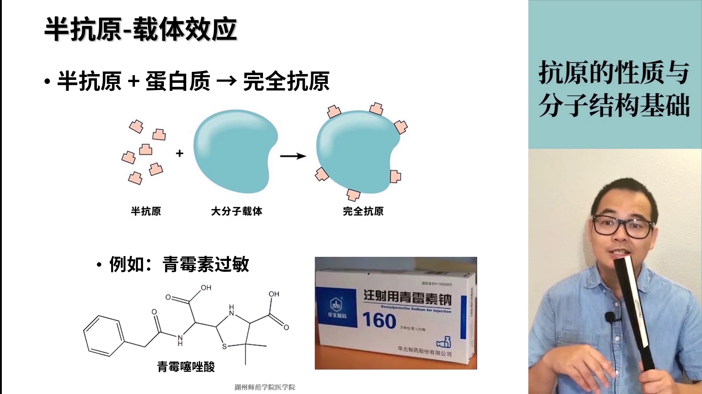

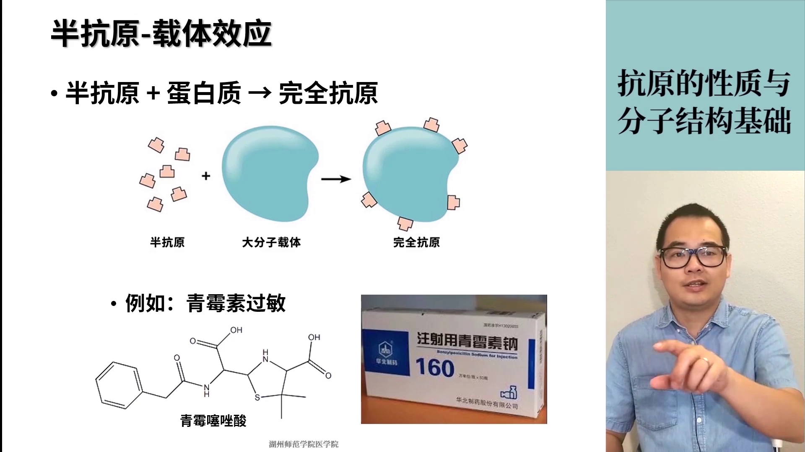

## 七、共同抗原与交叉反应：特异性并不矛盾

**共同抗原**：不同的抗原分子上，含有**相同的抗原决定簇（表位）**，这些抗原互称共同抗原 [【跳转到 16:20】](https://www.bilibili.com/video/BV1A5411a7py/?t=980)。

注意不要和"抗原抗体结合有特异性"弄混——这是两个层次：**抗原可以不一样，但不同抗原上可以带同一个表位**。比如两种不同的细菌，恰好都带一个相同的红色表位，它们就是共同抗原。

**交叉反应**：由共同表位刺激机体产生的抗体，可以彼此交叉结合 [【跳转到 17:35】](https://www.bilibili.com/video/BV1A5411a7py/?t=1055)。视频里的例子：一种细菌有紫色、绿色、红色表位，另一种细菌有蓝色、黄色、红色表位——紫色抗原诱导紫色抗体、绿色诱导绿色抗体、蓝色诱导蓝色抗体、黄色诱导黄色抗体，各管各的；但因为两种细菌共有红色表位，红色抗体会把两种细菌都"咬"一遍。

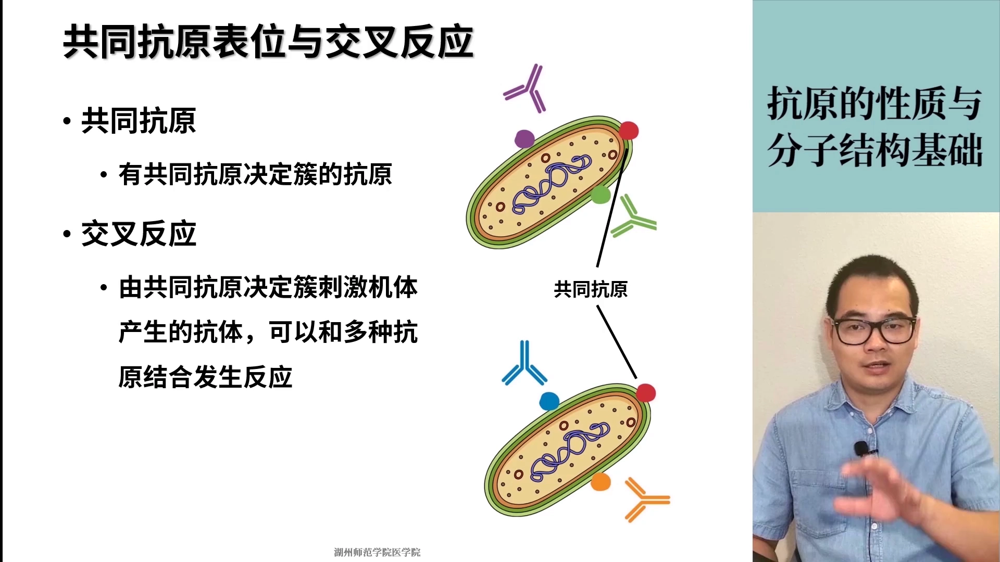

这和特异性矛盾吗？不矛盾——**这里仍然是特异性，只不过是"表位层次"的特异性**，而不是笼统地说"抗原"有特异性。

## 小结

- 抗原 = 能激活并诱导免疫应答的物质；医学上常见的是蛋白、多糖、核酸、脂类等有机物抗原。
- 完整抗原 = 免疫原性（激活 TCR/BCR → 细胞增殖分化 → 效应 T 细胞 / 浆细胞抗体）+ 免疫反应性（被效应产物结合、中和、清除），缺一不可。
- 特异性是双向的：一个抗原只激活对应的淋巴细胞克隆；克隆的产物也只结合对应的抗原。
- 半抗原 = 只有免疫反应性、没有免疫原性，本质是分子量太小、免疫系统监控不到。
- **抗原表位（决定簇）是决定抗原特异性的结构基础**：蛋白表位 5～17 个氨基酸，多糖/核苷酸 5～7 个单元；一个抗原可有多个表位；游离的表位就是半抗原。
- T 细胞表位：TCR 识别、需 MHC、线性短肽（8～12 / 12～17 aa）、位置不限；B 细胞表位：BCR 直接识别、线性/构象均可、必须在分子表面。
- 半抗原载体效应解释了青霉素过敏与"每次注射都要皮试"；共同表位解释了交叉反应——特异性始终在"表位"这个层面成立。

## 关键术语速查

| 术语 | 一句话解释 |
| --- | --- |
| 抗原 | 能激活和诱导免疫应答的物质 |
| 免疫原性 | 激活 T/B 细胞、启动免疫应答的能力 |
| 免疫反应性（抗原性） | 与免疫应答产物（抗体/效应细胞）特异性结合的能力 |
| 完全抗原 | 两大特性兼具的物质（如大多数蛋白质） |
| 半抗原 | 只有反应性、没有原性的小分子；结合大分子载体后才成为完全抗原 |
| 抗原表位 / 抗原决定簇 | 抗原分子上决定特异性的化学基团；蛋白表位 5～17 个氨基酸 |
| T 细胞表位 | TCR 识别、需 APC 加工与 MHC 参与的线性短肽 |
| B 细胞表位 | BCR 直接识别、必须位于分子表面的表位（线性或构象） |
| TCR / BCR | T 细胞 / B 细胞表面的抗原识别受体 |
| MHC | 辅助 T 细胞活化的关键分子 |
| 半抗原载体效应 | 半抗原结合大分子载体后变成完全抗原的现象 |
| 共同抗原 / 交叉反应 | 含有相同表位的不同抗原 / 共同表位刺激的抗体间的交叉结合 |
