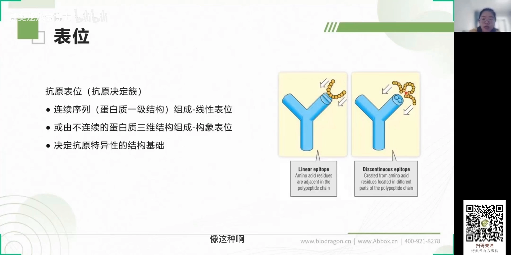
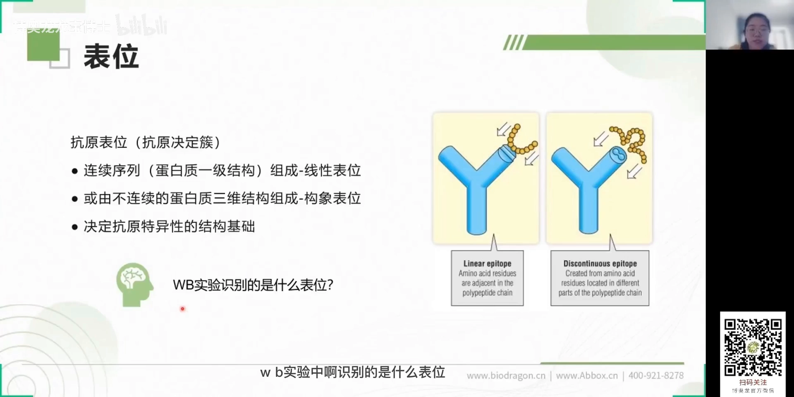
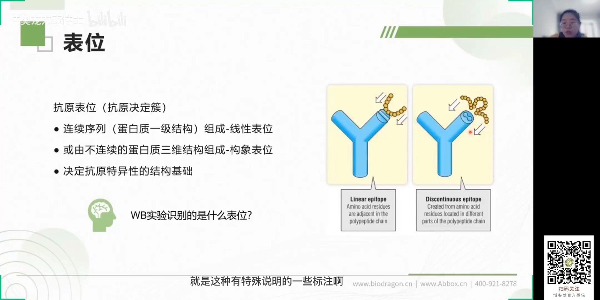
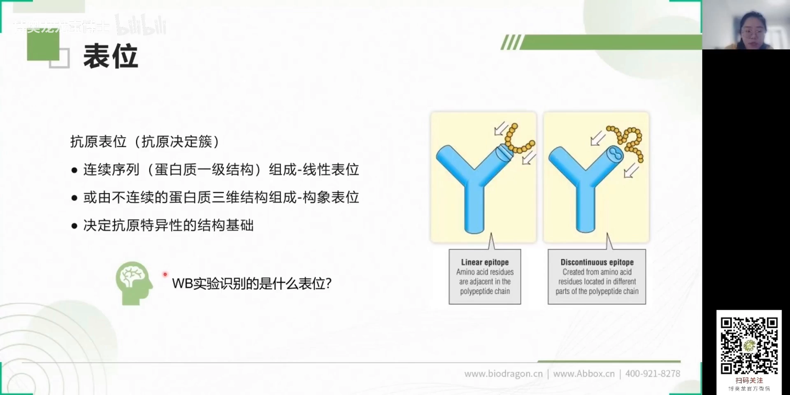
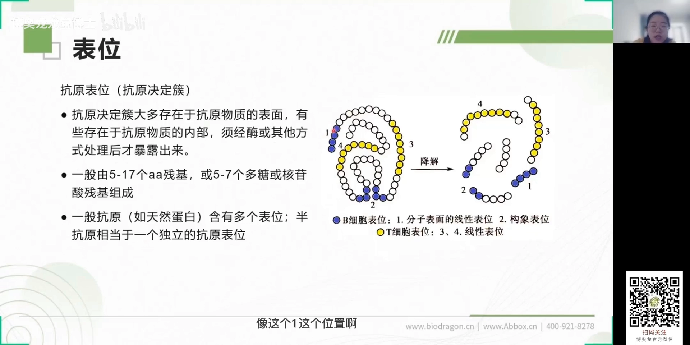

# 抗原表位，透彻理解！

> 视频来源：[抗原表位，透彻理解！（博奥龙·龙宝博士）](https://www.bilibili.com/video/BV1z24y1b7db/)
> 本文基于视频 AI 字幕与画面整理，时间戳可跳转到对应讲解。

## 本讲要解决的核心问题（SCQA）

**背景**：做 Western Blot（WB，蛋白质免疫印迹）实验时，我们习惯把蛋白"煮开跑胶"——变性、还原，把蛋白拆成一条条线性肽链，再用抗体去检测目标条带。

**冲突**：但有些抗体偏偏在变性条件下测不出信号，说明书上标注"需 native（非变性、非还原）条件"才能检测，比如常见的胶原蛋白抗体；native WB 的失败概率还比较大。

**疑问**：同样是抗体，为什么有的能认"煮开"的蛋白，有的不能？抗体识别的到底是什么？

**回答（中心思想）**：抗体识别的是**抗原表位（抗原决定簇）**——表位分**线性**与**构象**两种。变性会拆掉构象表位，所以"认构象"的抗体在变性 WB 里会失明；选抗体先看它认的表位类型，表位还决定了抗原的特异性、位置和个数。

## 一、表位的两种结构类型：线性表位 vs 构象表位

抗原的基本结构就是**抗原表位**，也叫**抗原决定簇**——它是决定抗原特异性的结构基础。按结构分两类 [【跳转到 00:00】](https://www.bilibili.com/video/BV1z24y1b7db/?t=0)：

- **线性表位**：由一级结构上**连续的一段氨基酸序列**组成，就像示意图里连续的一段；
- **构象表位**：不在一级结构上连续，而是**不连续的残基靠三维折叠凑到一起**形成的表面结构——抗体识别的正是这几个"点"所在的位置 [【跳转到 00:25】](https://www.bilibili.com/video/BV1z24y1b7db/?t=25)。

## 二、WB 实验识别的是哪种表位？——先看你怎么处理蛋白

视频用 WB 实验把两种表位的区别讲透了 [【跳转到 00:50】](https://www.bilibili.com/video/BV1z24y1b7db/?t=50)：

1. **常规变性还原 WB**：跑胶时二硫键断裂、蛋白打开成一级线性结构 → 能检测到信号的一般是**识别线性表位**的抗体；
2. **native（非变性、非还原）WB**：蛋白保持天然三维结构 → 有些抗体只有在这样的条件下才有阳性信号，它识别的就是**构象表位**——非变性条件没法把那块结构拆开。

**实战建议** [【跳转到 01:40】](https://www.bilibili.com/video/BV1z24y1b7db/?t=100)：native WB 失败概率较大，选购抗体时注意说明书有没有"需非变性条件"之类的特殊备注；做 Western 实验尽量挑**识别线性表位**的抗体，成功率会高很多。

## 三、表位的位置与个数：为什么"藏在里面"的表位没信号

- **位置**：表位大多位于抗原分子**表面**；也有些藏在分子**内部**，必须经酶解等方式暴露出来。一般所说的 **B 细胞表位都在表面** [【跳转到 02:05】](https://www.bilibili.com/video/BV1z24y1b7db/?t=125)。

- 示意图里：位置①是分子表面的**线性表位**，位置②是分子表面的**构象表位**——蛋白一旦变成线性，位置②的构象就被破坏了 [【跳转到 02:30】](https://www.bilibili.com/video/BV1z24y1b7db/?t=150)。这正是第二节现象的根源：认构象的抗体在变性 WB 里没有阳性信号。

- **个数**：一个表位一般由 **5～17 个氨基酸残基**组成；多糖、核苷酸类小分子表位 **5～7 个单元**就够 [【跳转到 02:55】](https://www.bilibili.com/video/BV1z24y1b7db/?t=175)。天然蛋白分子量大、序列长，往往带**多个表位**；而**半抗原**分子量小（一般 20 个氨基酸以下甚至更小），差不多就相当于**一个独立的抗原表位** [【跳转到 03:20】](https://www.bilibili.com/video/BV1z24y1b7db/?t=200)。

## 小结

- 抗原的基本结构是**抗原表位（决定簇）**，它决定抗原特异性。
- 表位分两种：**线性表位**（一级结构连续）与**构象表位**（不连续残基靠三维折叠拼合）。
- WB 用变性还原胶 → 只剩线性表位可被识别；**认构象的抗体需要 native WB**（如胶原蛋白抗体），失败率高，选购时留意备注。
- 表位多在分子表面；内部表位需酶解暴露；B 细胞表位在表面。
- 表位大小：蛋白 5～17 aa、多糖/核苷酸 5～7 个单元；天然蛋白多表位，半抗原 ≈ 一个独立表位。

## 关键术语速查

| 术语 | 一句话解释 |
| --- | --- |
| 抗原表位 / 抗原决定簇 | 抗原分子上决定特异性的特殊化学基团 |
| 线性表位 | 一级结构上连续序列组成的表位（变性后仍保留） |
| 构象表位 | 不连续残基经三维折叠在表面拼合的表位（变性后破坏） |
| Western Blot（WB） | 通过变性电泳 + 抗体检测目标蛋白的实验 |
| native 条件 | 非变性、非还原，保持蛋白天然构象的实验条件 |
| 半抗原 | 分子量小、只有一个"表位当量"、自身激不起免疫应答的小分子 |
